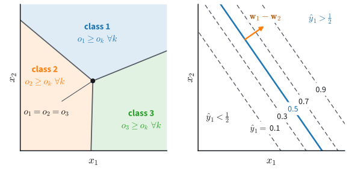

# Softmax Regression
:label:`sec_softmax`

Regression is the tool we reach for when answering *how much?* or *how many?* questions. Many supervised learning problems, however, ask *which category?* instead: a spam filter sorts email into two classes, a clinical tool chooses among candidate diagnoses, and a language model predicts the next token from a vocabulary of tens of thousands of words.

Suppose an online retailer wants to sort product photos into ten apparel categories: T-shirt, trouser, pullover, dress, coat, sandal, shirt, sneaker, bag, and ankle boot. Why not number those categories $1$ through $10$ and apply linear regression directly? Because integer codes for unordered categories are arbitrary names, not numerical quantities: a prediction of $5.5$ would place a photo halfway between a coat and a sandal, and squared error would penalize mistaking a T-shirt ($1$) for an ankle boot ($10$) $81$ times more heavily than mistaking it for a trouser ($2$). Moreover, even when we ultimately need a *hard assignment* (picking a single category), we almost always want a model that outputs *soft assignments*—a calibrated probability for every candidate class—so downstream decisions can weigh confidence against the cost of a mistake.

*Softmax regression* (also called *multinomial logistic regression*) solves both problems cleanly: it computes one affine score per class and maps those scores into a valid probability distribution via the softmax operator. Following the maximum-likelihood recipe of :numref:`sec_linear_regression`, minimizing the negative log-likelihood of the observed categories yields the *cross-entropy loss*.

## The Model

### Class Labels
:label:`subsec_classification-problem`

Let us start with a concrete $2 \times 2$ grayscale image classification problem with four scalar pixel features $x_1, x_2, x_3, x_4$ and three categories: cat ($1$), chicken ($2$), and dog ($3$). In general, with $q$ classes, an example's label is an integer $y \in \{1, \ldots, q\}$.

To represent unordered categories without imposing a false numerical ordering, statisticians use a *one-hot encoding*: a vector $\mathbf{y} \in \{0, 1\}^q$ with a $1$ in the coordinate of the true class ($y_y = 1$) and $0$ everywhere else. In our three-class example, a cat is $(1, 0, 0)$, a chicken is $(0, 1, 0)$, and a dog is $(0, 0, 1)$. Every pair of distinct classes now sits at the exact same Euclidean distance $\sqrt{2}$, and better yet, $\mathbf{y}$ is itself a valid probability distribution—the degenerate distribution placing $100\%$ of its mass on the true class—which we can compare directly against our model's predicted distribution $\hat{\mathbf{y}}$. (In equations we use $1$-based class index $y$ and one-hot vector $\mathbf{y}$; in Python code we store the $0$-based integer index directly.)

### Linear Scores

To score all $q$ classes simultaneously, softmax regression assigns each class $j \in \{1, \ldots, q\}$ its own affine function of the input features. Writing $w_{kj}$ for the weight connecting feature $k$ to class $j$ and $b_j$ for class $j$'s bias, our $2 \times 2$ image classifier computes three unnormalized scores (*logits*):

$$
\begin{aligned}
o_1 &= x_1 w_{11} + x_2 w_{21} + x_3 w_{31} + x_4 w_{41} + b_1,\\
o_2 &= x_1 w_{12} + x_2 w_{22} + x_3 w_{32} + x_4 w_{42} + b_2,\\
o_3 &= x_1 w_{13} + x_2 w_{23} + x_3 w_{33} + x_4 w_{43} + b_3.
\end{aligned}
$$

Viewed as a neural network (:numref:`fig_softmaxreg`), softmax regression is a single-layer fully connected network with $d$ inputs and $q$ output units ($d \cdot q$ weights and $q$ biases).

:label:`fig_softmaxreg`

Collecting the weights into a matrix $\mathbf{W} \in \mathbb{R}^{d \times q}$ (one row per feature, one column $\mathbf{w}_j \in \mathbb{R}^d$ per class) and the biases into $\mathbf{b} \in \mathbb{R}^q$, the logit vector for an input $\mathbf{x} \in \mathbb{R}^d$ is compactly written

$$\mathbf{o} = \mathbf{W}^\top \mathbf{x} + \mathbf{b},$$

where $o_j = \mathbf{w}_j^\top \mathbf{x} + b_j$. On the $28 \times 28$ Fashion-MNIST clothing images we classify in :numref:`sec_fashion_mnist`, $d = 784$ and $q = 10$, giving $7{,}840$ weights and $10$ biases.

### The Softmax
:label:`subsec_softmax_operation`

Suppose our linear layer outputs the logits $\mathbf{o} = (1.0, 2.2, 0.3)$ for cat, chicken, and dog. The chicken has the highest score, yet raw logits are not probabilities: they sum to $3.5$ rather than $1$, and nothing stops an affine score from turning negative or exceeding $1$. To convert any real vector $\mathbf{o} \in \mathbb{R}^q$ into a valid probability distribution $\hat{\mathbf{y}}$—$q$ strictly positive numbers summing to $1$—while preserving the ranking of the scores, the *softmax* function exponentiates each logit and divides by their sum:

$$\hat{\mathbf{y}} = \mathrm{softmax}(\mathbf{o}) \quad \textrm{where} \quad \hat{y}_j = \frac{\exp(o_j)}{\sum_{k=1}^q \exp(o_k)}.$$
:eqlabel:`eq_softmax_y_and_o`

For $\mathbf{o} = (1.0, 2.2, 0.3)$, the exponentials are $(2.72, 9.03, 1.35)$ with sum $13.09$, giving $\hat{\mathbf{y}} = (0.21, 0.69, 0.10)$: a $69\%$ predicted probability for chicken. Because $\exp$ is strictly increasing, softmax preserves the order of the logits, so the most probable class is always the class with the largest logit:

$$\operatorname*{argmax}_j \hat{y}_j = \operatorname*{argmax}_j o_j.$$

At inference time, if we only need the top predicted category, we can skip the exponentials altogether and take $\operatorname{argmax}_j o_j$.

Why use the exponential rather than some other positive increasing function? Because exponentials turn addition into multiplication, endowing the softmax with three foundational properties:

1. **Shift invariance (only differences between logits matter):** Adding any scalar constant $c$ to every entry of $\mathbf{o}$ multiplies both numerator and denominator of :eqref:`eq_softmax_y_and_o` by $\exp(c)$, leaving the probabilities unchanged: $\mathrm{softmax}(\mathbf{o} + c\mathbf{1}) = \mathrm{softmax}(\mathbf{o})$. Equivalently, the difference between any two logits is the log-odds ratio of their predicted probabilities:
   $$o_i - o_j = \log \frac{\hat{y}_i}{\hat{y}_j}.$$
   In our example, $o_2 - o_1 = 1.2$, so chicken is $e^{1.2} \approx 3.3$ times as probable as cat ($0.69 / 0.21$). This shift invariance also gives us a critical numerical safeguard (:numref:`sec_softmax_scratch`): subtracting $o_{\max} = \max_k o_k$ before exponentiating prevents floating-point overflow without changing the result.
2. **Reduction to logistic regression for $q = 2$:** With two classes, the probabilities depend solely on the single difference $o = o_1 - o_2$:
   $$\hat{y}_1 = \frac{\exp(o_1)}{\exp(o_1) + \exp(o_2)} = \frac{1}{1 + \exp(-o)} = \sigma(o),$$
   :eqlabel:`eq_softmax_to_sigmoid`
   where $\sigma(o)$ is the *logistic sigmoid*. Two-class softmax regression is thus identical to classic *logistic regression*, and $o = \log(\hat{y}_1 / \hat{y}_2)$ is the log-odds—the historical origin of the word *logit*.
3. **Clean gradients under maximum likelihood:** As we show below, the exponential in the softmax pairs with the logarithm in the likelihood so that the gradient of the loss collapses to the residual $\hat{\mathbf{y}} - \mathbf{y}$.

### Minibatches
:label:`subsec_softmax_vectorization`

To vectorize over a minibatch of $n$ examples with $d$ features, we stack the inputs into $\mathbf{X} \in \mathbb{R}^{n \times d}$, weights into $\mathbf{W} \in \mathbb{R}^{d \times q}$, and biases into $\mathbf{b} \in \mathbb{R}^{1 \times q}$:

$$
\begin{aligned}
\mathbf{O} &= \mathbf{X} \mathbf{W} + \mathbf{b},\\
\hat{\mathbf{Y}} &= \mathrm{softmax}(\mathbf{O}),
\end{aligned}
$$
:eqlabel:`eq_minibatch_softmax_reg`

where $\mathbf{b}$ broadcasts across the $n$ rows of $\mathbf{O} \in \mathbb{R}^{n \times q}$ and $\mathrm{softmax}$ is applied *rowwise* (exponentiating $\mathbf{O}$ and dividing each row by its own row sum).

### Decision Regions

Because softmax preserves the ordering of the affine logits $o_j = \mathbf{w}_j^\top\mathbf{x} + b_j$, softmax regression partitions the input space $\mathbb{R}^d$ into flat-sided convex polyhedra (:numref:`fig_mdl-clf-decision-regions`). Class $j$ wins wherever $o_j \geq o_k$ for all $k \neq j$, which is the intersection of $q - 1$ halfspaces $(\mathbf{w}_j - \mathbf{w}_k)^\top\mathbf{x} + (b_j - b_k) \geq 0$, and neighboring classes meet along the hyperplane where their two logits tie. Just as in linear regression, boundaries between classes are always *flat* hyperplanes; carving curved or non-convex decision regions requires hidden layers (:numref:`chap_perceptrons`).

:label:`fig_mdl-clf-decision-regions`

Keep in mind our core structural assumption: each example belongs to *exactly one* class from an *unordered* set. When multiple tags can apply to the same input simultaneously (*multi-label classification*), one uses an independent binary sigmoid per tag rather than a competing softmax :cite:`Tsoumakas.Katakis.2007`; when classes follow a natural rank order (*ordinal regression*), specialized threshold models exploit that ordering :cite:`Moon.Smola.Chang.ea.2010`.

## The Cross-Entropy Loss
:label:`subsec_softmax-regression-loss-func`

### Maximum Likelihood

How should we measure the discrepancy between our predicted probability distribution $\hat{\mathbf{y}}$ and the observed label $y$? Following the maximum-likelihood principle of :numref:`sec_linear_regression`, we interpret $\hat{y}_j = P(y = j \mid \mathbf{x})$ as the conditional probability of class $j$. Using the one-hot vector $\mathbf{y} \in \{0, 1\}^q$, we can write the probability assigned to the observed class $y$ as

$$P(y \mid \mathbf{x}) = \hat{y}_y = \prod_{j=1}^q \hat{y}_j^{y_j}.$$

Across $n$ independent training examples, the negative log-likelihood is the sum of per-example losses:

$$
\begin{aligned}
-\log \prod_{i=1}^n P(y^{(i)} \mid \mathbf{x}^{(i)}) &= \sum_{i=1}^n l(\mathbf{y}^{(i)}, \hat{\mathbf{y}}^{(i)}), \\
\textrm{where} \quad l(\mathbf{y}, \hat{\mathbf{y}}) &= -\sum_{j=1}^q y_j \log \hat{y}_j = -\log \hat{y}_y.
\end{aligned}
$$
:eqlabel:`eq_l_cross_entropy`

This objective is the *cross-entropy loss*. Notice how it behaves:

- Because $\hat{y}_y \in (0, 1)$, $l(\mathbf{y}, \hat{\mathbf{y}}) > 0$ always. It approaches $0$ as $\hat{y}_y \to 1$ and diverges to $+\infty$ as $\hat{y}_y \to 0$ (heavily penalizing confident mistakes).
- On our image with logits $(1.0, 2.2, 0.3)$ and probabilities $(0.21, 0.69, 0.10)$, if the true label is chicken ($y = 2$), the loss is $-\log 0.69 \approx 0.37$ nats; if the image is actually a dog ($y = 3$), the loss jumps sixfold to $-\log 0.10 \approx 2.30$ nats.

### The Gradient
:label:`subsec_softmax_and_derivatives`

Let us differentiate the cross-entropy loss with respect to the logits $\mathbf{o}$. Substituting :eqref:`eq_softmax_y_and_o` into :eqref:`eq_l_cross_entropy` and using $\sum_{j=1}^q y_j = 1$ expresses the loss directly in terms of $\mathbf{o}$:

$$
\begin{aligned}
l(\mathbf{y}, \hat{\mathbf{y}}) &= -\sum_{j=1}^q y_j \log \frac{\exp(o_j)}{\sum_{k=1}^q \exp(o_k)} \\
&= \sum_{j=1}^q y_j \log \sum_{k=1}^q \exp(o_k) - \sum_{j=1}^q y_j o_j \\
&= \log \sum_{k=1}^q \exp(o_k) - o_y.
\end{aligned}
$$

The first term, $\log \sum_{k=1}^q \exp(o_k)$, is the *log-sum-exp* function—a smooth convex upper bound on $\max_k o_k$ that exceeds $\max_k o_k$ by at most $\log q$ (Exercise :exref:`ex_softmax-regression-realsoftmax`). Differentiating with respect to $o_j$ gives

$$
\begin{aligned}
\frac{\partial l}{\partial o_j} &= \frac{\exp(o_j)}{\sum_{k=1}^q \exp(o_k)} - y_j = \mathrm{softmax}(\mathbf{o})_j - y_j, \\
\textrm{or} \quad \nabla_{\mathbf{o}}\, l &= \hat{\mathbf{y}} - \mathbf{y}.
\end{aligned}
$$

Just as in linear regression under squared loss, **the gradient with respect to the natural parameters $\mathbf{o}$ is simply prediction minus observation, $\hat{\mathbf{y}} - \mathbf{y}$** (a universal property of exponential-family generalized linear models; see :numref:`subsec_mdl-glm`). On our chicken image ($\mathbf{y} = (0, 1, 0)$), $\nabla_{\mathbf{o}}\, l = (0.21, -0.31, 0.10)$: one gradient descent step boosts the chicken's logit while pushing down the cat and dog logits in exact proportion to the probability mass each rival wrongly claimed. By the chain rule through $\mathbf{O} = \mathbf{X}\mathbf{W} + \mathbf{b}$, the minibatch gradient with respect to $\mathbf{W}$ is $\frac{1}{n}\mathbf{X}^\top(\hat{\mathbf{Y}} - \mathbf{Y})$, and the loss is globally *convex* in $(\mathbf{W}, \mathbf{b})$ (its Hessian with respect to $\mathbf{o}$ is the covariance matrix of a categorical draw from $\hat{\mathbf{y}}$; see Exercise :exref:`ex_softmax-regression-hessian`).

| | Linear regression | Softmax regression |
|:--|--|--|
| **Target** | continuous $y \in \mathbb{R}$ | class $y \in \{1, \ldots, q\}$, one-hot $\mathbf{y}$ |
| **Prediction** | $\hat{y} = \mathbf{w}^\top \mathbf{x} + b$ | $\hat{\mathbf{y}} = \mathrm{softmax}(\mathbf{W}^\top \mathbf{x} + \mathbf{b})$ |
| **Probabilistic model** | Gaussian $\mathcal{N}(\hat{y}, \sigma^2)$ | categorical $\mathrm{Cat}(\hat{\mathbf{y}})$ |
| **Loss (NLL)** | $\frac{1}{2}(\hat{y} - y)^2$ | $-\sum_{j=1}^q y_j \log \hat{y}_j = -\log \hat{y}_y$ |
| **Gradient** | $\hat{y} - y$ (w.r.t. $\hat{y}$) | $\hat{\mathbf{y}} - \mathbf{y}$ (w.r.t. $\mathbf{o}$) |

### Entropy and Cross-Entropy
:label:`subsec_info_theory_basics`

The name *cross-entropy* comes from Claude Shannon's information theory (:numref:`sec_mdl-information_theory`). When an outcome with probability $p$ occurs, Shannon defined its *surprisal* (information content) as $-\log p$ (measured in *nats* when using natural logarithms, or *bits* when using $\log_2$, with $1\textrm{ nat} = 1/\log 2 \approx 1.44\textrm{ bits}$). For a true distribution $\mathbf{p} = (p_1, \ldots, p_q)$ over $q$ classes, the expected surprisal is its *entropy*:

$$H(\mathbf{p}) = -\sum_{j=1}^q p_j \log p_j,$$

which ranges from $0$ (when one outcome is certain) to $\log q$ (when all $q$ outcomes are equally likely). If an observer instead encodes outcomes drawn from $\mathbf{p}$ using a code optimized for a model distribution $\hat{\mathbf{p}}$, their average code length (expected surprisal) is the *cross-entropy*:

$$H(\mathbf{p}, \hat{\mathbf{p}}) = -\sum_{j=1}^q p_j \log \hat{p}_j.$$

By *Gibbs' inequality*, $H(\mathbf{p}, \hat{\mathbf{p}}) \geq H(\mathbf{p})$ with equality if and only if $\hat{\mathbf{p}} = \mathbf{p}$ (their gap is the Kullback--Leibler divergence $D_{\mathrm{KL}}(\mathbf{p} \,\|\, \hat{\mathbf{p}}) = H(\mathbf{p}, \hat{\mathbf{p}}) - H(\mathbf{p}) \geq 0$). Comparing $H(\mathbf{p}, \hat{\mathbf{p}})$ with :eqref:`eq_l_cross_entropy`, our per-example loss $l(\mathbf{y}, \hat{\mathbf{y}}) = H(\mathbf{y}, \hat{\mathbf{y}})$ is literally the cross-entropy between the empirical label distribution $\mathbf{y}$ and the predicted distribution $\hat{\mathbf{y}}$! Better still, when an input is genuinely ambiguous—say a blurry photo that is $60\%$ likely to be a shirt and $40\%$ likely to be a T-shirt—Gibbs' inequality guarantees that the expected cross-entropy loss is uniquely minimized when the model reports the true calibrated probabilities $(0.6, 0.4)$ rather than an overconfident guess.

## Accuracy and Confidence

### The Error Rate

Although we evaluate classifiers by *accuracy* (or *error rate* $= 1 - \textrm{accuracy}$), we cannot train by differentiating the zero-one error directly. Define the *margin* of an example as its true class's logit minus the highest competing logit:

$$m = o_y - \max_{j \neq y} o_j.$$

The classifier makes an error ($m < 0$) or a correct prediction ($m > 0$) according to a discontinuous step function of $m$ (:numref:`fig_mdl-clf-margin-losses`) whose derivative is zero everywhere it exists, starving gradient descent of any learning signal. Cross-entropy replaces that flat step with a smooth, strictly decreasing convex surrogate ($\log(1 + e^{-m})$ for $q = 2$) that upper-bounds the zero-one error (when measured in bits by dividing by $\log 2$) and supplies a nonzero gradient for every example.

:label:`fig_mdl-clf-margin-losses`

### Calibration and Temperature

Notice one consequence of the smooth curve in :numref:`fig_mdl-clf-margin-losses`: cross-entropy keeps decreasing even after $m > 0$ and the classification decision is already correct. If a training dataset is *linearly separable*—meaning some $(\mathbf{W}, \mathbf{b})$ classifies every training example correctly ($m^{(i)} > 0$ for all $i$)—then multiplying $(\mathbf{W}, \mathbf{b})$ by any scale factor $c > 1$ multiplies every margin by $c$ and drives the training loss toward zero without bound (Exercise :exref:`ex_softmax-regression-separable`), pushing all predicted probabilities toward $0$ and $1$ without moving the decision boundary at all!

More generally, scaling all logits by the inverse of a positive *temperature* $T > 0$ before applying the softmax,

$$\hat{\mathbf{y}} = \mathrm{softmax}(\mathbf{o} / T),$$

sharpens the distribution toward a one-hot argmax as $T \to 0$ and flattens it toward the uniform distribution $(1/q, \ldots, 1/q)$ as $T \to \infty$ (:numref:`fig_mdl-clf-temperature`), while leaving the ranking of the logits—and therefore the classifier's accuracy—completely unchanged. Whether a trained model's predicted probabilities match true empirical accuracy (*calibration*) is an empirical question we will test on held-out data in :numref:`sec_classification`.

:label:`fig_mdl-clf-temperature`

## Summary

- **Softmax model:** Softmax regression maps a $d$-dimensional input $\mathbf{x}$ to $q$ class logits $\mathbf{o} = \mathbf{W}^\top\mathbf{x} + \mathbf{b}$ and normalizes them into probabilities $\hat{y}_j = \exp(o_j)/\sum_k \exp(o_k)$, carving input space into convex polyhedral decision regions bounded by hyperplanes.
- **Shift invariance and logistic regression:** Softmax depends only on pairwise logit differences $o_i - o_j = \log(\hat{y}_i / \hat{y}_j)$ and reduces to binary logistic regression $\hat{y}_1 = \sigma(o_1 - o_2)$ when $q = 2$.
- **Cross-entropy loss and gradient:** Maximizing the categorical likelihood of one-hot labels $\mathbf{y}$ minimizes the convex cross-entropy loss $l(\mathbf{y}, \hat{\mathbf{y}}) = -\sum_j y_j \log \hat{y}_j = \log\sum_k \exp(o_k) - o_y$, whose gradient with respect to the logits is the residual $\nabla_{\mathbf{o}}\, l = \hat{\mathbf{y}} - \mathbf{y}$.
- **Surrogate loss and temperature:** Cross-entropy provides a smooth convex surrogate for the flat zero-one error rate; scaling logits by $1/T$ adjusts prediction confidence without altering class rankings or accuracy.

## Exercises

1. **Softmax and sigmoid.** By :eqref:`eq_softmax_to_sigmoid`, logistic
   regression is softmax regression with two classes and one redundant
   logit removed. A colleague hands you a fitted logistic model
   $P(y = 1 \mid x) = \sigma(\hat\beta_0 + \hat\beta_1 x)$ with
   $\hat\beta_0 = 2$ and $\hat\beta_1 = -1$.
    1. Characterize all two-class softmax coefficients $(w_1, b_1)$ and
       $(w_2, b_2)$ whose predictions coincide with the logistic model for
       every $x$, and identify the pair with $o_2 \equiv 0$.
    1. Show that gradient descent on the cross-entropy loss of the
       two-class softmax model never changes $w_1 + w_2$ or $b_1 + b_2$.
       Suppose that gradient descent starts from
       $w_1 = w_2 = b_1 = b_2 = 0$ on the colleague's training data and
       converges to coefficients that reproduce the logistic model.
       Determine which pair it reaches.

    *Adapted from James, Witten, Hastie, and Tibshirani,
    [An Introduction to Statistical Learning](https://www.statlearning.com/),
    Exercise 4.12.*

1. **Softmax Hessian.** As in :numref:`subsec_softmax_and_derivatives`,
   write the cross-entropy loss as a function of the logits,
   $l(\mathbf{y}, \mathbf{o}) = g(\mathbf{o}) - \mathbf{y}^\top \mathbf{o}$
   with $g(\mathbf{o}) = \log \sum_k \exp(o_k)$.
    1. Compute the Hessian $\partial^2_{\mathbf{o}}\, l(\mathbf{y}, \mathbf{o})$
       and show that it does not depend on $\mathbf{y}$.
    1. Let $\mathbf{e}_Y$ be the one-hot vector of a class $Y$ drawn from
       $\mathrm{softmax}(\mathbf{o})$. Compute the covariance matrix of
       $\mathbf{e}_Y$ and show that it equals the Hessian from the previous
       step.
    1. Conclude that $g$ is convex and that the cross-entropy loss is convex
       in the logits.
   :exlabel:`ex_softmax-regression-hessian`

1. **Bradley--Terry model.** The
   [Bradley--Terry model](https://en.wikipedia.org/wiki/Bradley%E2%80%93Terry_model)
   :cite:`Bradley.Terry.1952` uses a logistic model to capture preferences.
   A user who chooses between apples and oranges picks each item with the
   probability given by the softmax of two scores, $o_{\textrm{apple}}$ and
   $o_{\textrm{orange}}$. Now add a default option of choosing neither,
   with a fixed score $o_{\textrm{none}} = 0$.
    1. Determine whether adding the same constant to $o_{\textrm{apple}}$
       and $o_{\textrm{orange}}$ changes the choice probabilities, first
       without and then with the default option. Conclude which scores the
       observed choices can determine in each model.
    1. Compare the ratio $P(\textrm{apple}) / P(\textrm{orange})$ with and
       without the default option. Describe a choice situation in which
       real users would not keep this ratio fixed.

1. **Log-sum-exp.** The function $\mathrm{lse}(a, b) = \log(\exp(a) + \exp(b))$
   is the log-sum-exp of :numref:`subsec_softmax_and_derivatives` with two
   arguments, so its gradient is the softmax of $(a, b)$.
    1. Prove that
       $$\max(a, b) < \mathrm{lse}(a, b) \leq \max(a, b) + \log 2,$$
       with equality on the right exactly when $a = b$, and show that the
       gap to $\max(a, b)$ can be made arbitrarily small. Hint: without
       loss of generality set $b = 0$ and $a \geq 0$.
    1. Prove that for every $\lambda > 0$
       $$\max(a, b) < \lambda^{-1} \mathrm{lse}(\lambda a, \lambda b) \leq \max(a, b) + \lambda^{-1} \log 2,$$
       and conclude that
       $\lambda^{-1} \mathrm{lse}(\lambda a, \lambda b) \to \max(a, b)$
       as $\lambda \to \infty$.
    1. Construct an analogous smooth minimum.
    1. Extend the definition and both bounds to $q$ numbers, showing that
       the gap to $\max_i a_i$ is at most $\log q$.
   :exlabel:`ex_softmax-regression-realsoftmax`

1. **Temperature.** Let $P = \mathrm{softmax}(\mathbf{o})$, and let the
   distribution at temperature $T$ be $\mathrm{softmax}(\mathbf{o}/T)$.
   Suppose we pick another distribution $Q$ with $Q(i) \propto P(i)^\alpha$
   for $\alpha > 0$.
    1. Which choice of $\alpha$ corresponds to doubling the temperature?
       Which choice corresponds to halving it?
    1. Suppose that exactly $s$ of the $q$ logits attain the largest value.
       Find the limit of $\mathrm{softmax}(\mathbf{o}/T)$ as $T \to 0$.
    1. Let $\bar{o} = \frac{1}{q}\sum_j o_j$ be the mean logit. Show that
       for large $T$
       $$\mathrm{softmax}(\mathbf{o}/T)_i = \frac{1}{q} + \frac{o_i - \bar{o}}{qT} + O(T^{-2}).$$
    1. Temperature scaling fits a single $T$ by minimizing the
       cross-entropy on a held-out set with the logits of the classifier
       held fixed. Show that this cross-entropy is a convex function of
       $\beta = 1/T$, so that the fit is a one-dimensional convex problem.
       Hint: use the convexity of $g$ from
       exercise :exref:`ex_softmax-regression-hessian`.
   :exlabel:`ex_softmax-regression-temperature`

1. **Separable data.** ● Suppose that some parameters
   $(\mathbf{W}, \mathbf{b})$ classify every training example correctly and
   without ties: on each example, the logit of the true class strictly
   exceeds every other logit. Consider the scaled parameters
   $(c\mathbf{W}, c\mathbf{b})$ for $c > 0$.
    1. Show that the cross-entropy loss of every training example strictly
       decreases as $c$ grows and tends to $0$ as $c \to \infty$.
    1. Conclude that the training loss has no minimizer and that every
       sequence of parameters whose training loss tends to $0$ has
       unbounded norm.
    1. Add the weight decay penalty of :numref:`sec_weight_decay`, applied
       to both weights and biases,
       $\frac{\lambda}{2}(\|\mathbf{W}\|^2 + \|\mathbf{b}\|^2)$ with
       $\lambda > 0$, to the training loss. Show that the penalized loss
       has a minimizer.
   :exlabel:`ex_softmax-regression-separable`

1. **Squared error on probabilities.** Instead of cross-entropy, we could
   fit the predicted probabilities to the one-hot label with the squared
   loss $\frac{1}{2}\|\hat{\mathbf{y}} - \mathbf{y}\|^2$.
    1. Show that the derivatives of the softmax are
       $\partial \hat{y}_k / \partial o_j = \hat{y}_k(\mathbf{1}(j = k) - \hat{y}_j)$,
       and use them to compute the gradient of the squared loss with
       respect to the logits.
    1. For two classes, write both losses as functions of the margin $m$
       and compute their derivatives with respect to $m$. Show that as
       $m \to -\infty$, that is, for a confident mistake, the derivative of
       the squared loss tends to 0 while that of the cross-entropy tends to
       $-1$.
    1. Explain what this difference means for a model that starts training
       with confident wrong predictions.

1. [code] **Gumbel-max trick.** ● Suppose that a label is generated by
   perturbing every logit with independent noise and reporting the class
   with the largest perturbed score,
   $y = \operatorname*{argmax}_i \, (o_i + \gamma_i)$. Gaussian noise gives
   the probit model, whose class probabilities have no closed form; one
   other noise distribution reproduces the softmax probabilities exactly.
   Let $\gamma_1, \ldots, \gamma_q$ be i.i.d. draws from the standard
   [Gumbel distribution](https://en.wikipedia.org/wiki/Gumbel_distribution),
   whose CDF is $P(\gamma \leq z) = \exp(-\exp(-z))$.
    1. Show that $P(o_k + \gamma_k \leq z) = \exp(-\exp(o_k)\exp(-z))$.
    1. Show that
       $P\left(\operatorname{argmax}_i \, (o_i + \gamma_i) = k\right) = \mathrm{softmax}(\mathbf{o})_k$.
       Hint: condition on the value of $o_k + \gamma_k$ and use the
       substitution $u = \exp(-z)$.
    1. Conclude that scaling the noise, $\gamma_i \mapsto T\gamma_i$,
       samples from $\mathrm{softmax}(\mathbf{o}/T)$.
    1. Verify your result numerically: for $\mathbf{o} = (1.0, 2.2, 0.3)$
       and $T \in \{0.25, 1, 4\}$, draw $10^5$ samples of
       $\operatorname{argmax}_i (o_i + T\gamma_i)$ and confirm that the
       label frequencies match $\mathrm{softmax}(\mathbf{o}/T)$ up to Monte
       Carlo error.
   :exlabel:`ex_softmax-regression-gumbel-max-trick`

[Discussions](https://d2l.discourse.group/t/46)

<!-- slides -->

::: {.slide}
::: {.cover}
[Dive into Deep Learning · §3.1]{.kicker}

Softmax Regression: Linear Models for Categorical Probabilities **one-hot encoding · affine logits · softmax · shift invariance · cross-entropy · $\hat{\mathbf{y}} - \mathbf{y}$ gradient · temperature**
:::
:::

::: {.slide title="Why Scalar Regression Fails on Unordered Categories"}
[Motivation & Failure Mode]{.kicker}

::: {.cols .vc}
::: {.col}
Sorting clothing photos into $q = 10$ unordered categories via continuous scalar regression breaks down immediately:

- **Arbitrary metric ordering:** Predicting $\hat{y} = 5.5$ places a photo halfway between coat ($5$) and sandal ($6$), imposing a false numerical order.
- **Distorted squared-error penalties:** Under $\frac{1}{2}(\hat{y} - y)^2$, mistaking T-shirt ($1$) for ankle boot ($10$) costs $(10 - 1)^2 = 81\times$ as much as mistaking it for trouser ($2$).
- **Need for calibrated distributions:** Downstream decisions require a complete probability vector $\hat{\mathbf{y}} \in \Delta^q$ across all $q$ candidate classes.
:::

::: {.col .fig .big}
@fig:ch03-cls-ordinal-trap
:::
:::
:::

::: {.slide title="One-Hot Encoding Represents Categories as Distributions"}
[Target Representation]{.kicker}

::: {.cols .vc}
::: {.col}
Consider a $2 \times 2$ grayscale image with four pixel features $(x_1, x_2, x_3, x_4)$ and $q = 3$ classes—cat ($1$), chicken ($2$), and dog ($3$):

- **One-hot label vector:** Encode class $y \in \{1, \ldots, q\}$ as $\mathbf{y} \in \{0, 1\}^q$ with $y_y = 1$ and $0$ elsewhere: cat $(1, 0, 0)$, chicken $(0, 1, 0)$, dog $(0, 0, 1)$.
- **Symmetric simplex vertices:** Every pair of distinct categories sits at exact Euclidean distance $\|\mathbf{e}_i - \mathbf{e}_j\|_2 = \sqrt{2}$, eliminating any artificial ordering.
- **Memory convention:** Math uses one-hot $\mathbf{y} \in \{0, 1\}^q$; code stores integer index $y \in \{0, \ldots, q-1\}$ in $O(1)$ space.
:::

::: {.col .fig .big}
@fig:ch03-cls-onehot-simplex
:::
:::
:::

::: {.slide title="One Affine Score (Logit) per Candidate Class"}
[The Linear Layer]{.kicker}

Softmax regression assigns each class $j \in \{1, \ldots, q\}$ its own weight vector $\mathbf{w}_j \in \mathbb{R}^d$ and bias $b_j \in \mathbb{R}$:

::: {.cols .vc}
::: {.col}
- **Unnormalized class scores (logits):** For input $\mathbf{x} \in \mathbb{R}^d$, class $j$ receives the affine score $o_j = \mathbf{w}_j^\top\mathbf{x} + b_j$.
- **Matrix form:** Stacking the columns $\mathbf{w}_j$ into $\mathbf{W} \in \mathbb{R}^{d \times q}$ and biases into $\mathbf{b} \in \mathbb{R}^q$ yields:
  $$\mathbf{o} = \mathbf{W}^\top \mathbf{x} + \mathbf{b}$$
- **Parameter count:** A $2\times 2$ image ($d=4, q=3$) uses $4\times 3 + 3 = 15$ parameters; a $28\times 28$ Fashion-MNIST image ($d=784, q=10$) uses $7{,}840 + 10 = 7{,}850$ parameters.
:::

::: {.col .fig}
{.nostretch width=100%}
:::
:::
:::

::: {.slide title="The Softmax Operator Maps Logits to Probabilities"}
[Probability Normalization]{.kicker}

::: {.cols .vc}
::: {.col}
The **softmax** operator exponentiates each logit and divides by their partition sum:

$$\hat{y}_j = \mathrm{softmax}(\mathbf{o})_j = \frac{\exp(o_j)}{\sum_{k=1}^q \exp(o_k)}$$

- **Concrete trace:** Logits $\mathbf{o} = (1.0, 2.2, 0.3)$ exponentiate to $(2.72, 9.03, 1.35)$ (sum $13.09$), giving $\hat{\mathbf{y}} = (0.21, 0.69, 0.10)$.
- **Valid simplex & order preservation:** Every $\hat{y}_j \in (0, 1)$, $\sum_j \hat{y}_j = 1$, and $\operatorname{argmax}_j \hat{y}_j = \operatorname{argmax}_j o_j$.
:::

::: {.col .fig}
@fig:ch03-cls-softmax-pipe
:::
:::
:::

::: {.slide title="Shift Invariance and Log-Odds Ratios"}
[Structural Properties of Softmax]{.kicker}

::: {.cols .vc}
::: {.col}
Exponentials convert additive shifts into a common factor that cancels out:

$$\mathrm{softmax}(\mathbf{o} + c\mathbf{1})_j = \frac{\exp(c)\exp(o_j)}{\exp(c)\sum_{k=1}^q \exp(o_k)} = \mathrm{softmax}(\mathbf{o})_j$$

- **Logit differences are log-odds:** $o_i - o_j = \log(\hat{y}_i / \hat{y}_j)$, so chicken ($2.2$) vs. cat ($1.0$) has odds $e^{1.2} \approx 3.3\times$.
- **Overflow safeguard:** Subtracting $c = \max_k o_k$ keeps every exponent $\le 0$, preventing `float32` overflow ($o > 88.7$).
:::

::: {.col .fig}
@fig:ch03-cls-shift-invariance
:::
:::
:::

::: {.slide title="Two-Class Softmax Reduces to Logistic Regression"}
[Connection to Binary Classification]{.kicker}

::: {.cols .vc}
::: {.col}
When $q = 2$, shift invariance implies that the two probabilities depend solely on the scalar difference $o = o_1 - o_2$:

$$\hat{y}_1 = \frac{1}{1 + \exp(-(o_1 - o_2))} = \sigma(o_1 - o_2)$$

- **Equivalence to logistic sigmoid:** Here $\sigma(o) = (1 + e^{-o})^{-1}$ and $\hat{y}_2 = 1 - \hat{y}_1 = \sigma(-o)$.
- **Redundant parameterization:** Parameters $(\mathbf{w}_1, b_1), (\mathbf{w}_2, b_2)$ collapse to a single difference vector $(\mathbf{w}_1 - \mathbf{w}_2, b_1 - b_2)$ with log-odds $o = \log(\hat{y}_1 / \hat{y}_2)$.
:::

::: {.col .fig}
@fig:ch03-cls-two-class-sigmoid
:::
:::
:::

::: {.slide title="Vectorizing Softmax Across a Minibatch"}
[Batched Matrix Formulation]{.kicker}

::: {.cols .vc}
::: {.col}
In code, we process a minibatch of $n$ examples with $d$ features in a single GEMM followed by a rowwise softmax:

$$\mathbf{O} = \mathbf{X}\mathbf{W} + \mathbf{b}, \qquad \hat{\mathbf{Y}} = \mathrm{softmax}(\mathbf{O})$$

- **Tensor shapes:** $\mathbf{X} \in \mathbb{R}^{n \times d}$ times $\mathbf{W} \in \mathbb{R}^{d \times q}$ plus broadcast $\mathbf{b} \in \mathbb{R}^{1 \times q}$ produces $\mathbf{O} \in \mathbb{R}^{n \times q}$.
- **Rowwise normalization:** Divide each row $i$ by its own partition sum $\sum_{k=1}^q \exp(O_{ik})$ (`axis=1, keepdims=True`).
:::

::: {.col .fig}
@fig:ch03-cls-batched-softmax
:::
:::
:::

::: {.slide title="Geometry of Softmax Decision Regions"}
[Linear Decision Boundaries]{.kicker}

Because softmax preserves logit ordering, class $j$ wins wherever $o_j \ge o_k$ for all $k \neq j$:

::: {.cols .vc}
::: {.col}
- **Intersection of halfspaces:** The condition $o_j \ge o_k$ expands to $(\mathbf{w}_j - \mathbf{w}_k)^\top\mathbf{x} + (b_j - b_k) \ge 0$, so each decision region is a flat-sided **convex polyhedron** formed by intersecting $q - 1$ halfspaces.
- **Pairwise hyperplane boundaries:** Neighboring classes $j$ and $k$ meet along the flat hyperplane where their logits tie ($o_j = o_k$).
- **Scope assumption:** Competing softmax outputs assume *mutually exclusive, unordered* classes (multi-label tasks use independent binary sigmoids per tag).
:::

::: {.col .fig .big}
{.nostretch width=100%}
:::
:::
:::

::: {.slide title="Maximum Likelihood Yields the Cross-Entropy Loss"}
[Probabilistic Loss Derivation]{.kicker}

::: {.cols .vc}
::: {.col}
The negative log-likelihood of observing true class $y$ (one-hot $\mathbf{y} \in \{0, 1\}^q$) under $\hat{y}_j = P(y = j \mid \mathbf{x})$ is the **cross-entropy loss**:

$$l(\mathbf{y}, \hat{\mathbf{y}}) = -\sum_{j=1}^q y_j \log \hat{y}_j = -\log \hat{y}_y$$

- **Boundary behavior:** $l \to 0$ as $\hat{y}_y \to 1$ and diverges to $+\infty$ as $\hat{y}_y \to 0$, heavily penalizing confident mistakes.
- **Concrete trace on $(0.21, 0.69, 0.10)$:** True chicken ($y = 2$) costs $-\log 0.69 \approx 0.37\text{ nats}$; true dog ($y = 3$) jumps sixfold to $-\log 0.10 \approx 2.30\text{ nats}$.
:::

::: {.col .fig}
@fig:ch03-cls-ce-surprisal
:::
:::
:::

::: {.slide title="Why Squared Error Fails on Softmax Probabilities"}
[Optimization Pitfall: Vanishing Gradients on Blunders]{.kicker}

::: {.cols .vc}
::: {.col}
Minimizing squared error $\frac{1}{2}\|\hat{\mathbf{y}} - \mathbf{y}\|_2^2$ on softmax outputs stalls on confident blunders:

- **Softmax Jacobian saturation:** Because $\partial \hat{y}_k / \partial o_j = \hat{y}_k(\mathbf{1}_{j=k} - \hat{y}_j)$ carries a factor of $\hat{y}_k$, any class with $\hat{y}_y \to 0$ has a vanishing logit derivative.
- **Log cancels exp in cross-entropy:** For two-class margin $m = o_y - o_{\text{other}} \ll 0$, squared-loss gradient $-2\sigma(m)(1-\sigma(m))^2 \to 0$, whereas cross-entropy gradient $-(1-\sigma(m)) \to -1$ supplies a full unit restoring force!
:::

::: {.col .fig .big}
@fig:ch03-cls-mse-vs-ce-grad
:::
:::
:::

::: {.slide title="Log-Sum-Exp Form and the Residual Gradient"}
[Exact Gradient Derivation]{.kicker}

::: {.cols .vc}
::: {.col}
Writing cross-entropy directly in terms of the logits $\mathbf{o}$ via the **log-sum-exp** function:

$$l(\mathbf{y}, \hat{\mathbf{y}}) = \log \sum_{k=1}^q \exp(o_k) - o_y$$

Differentiating with respect to $o_j$ yields the exact residual vector:

$$\nabla_{\mathbf{o}}\, l = \hat{\mathbf{y}} - \mathbf{y}$$

- **Prediction minus observation:** For $\hat{\mathbf{y}} = (0.21, 0.69, 0.10)$ and true chicken $\mathbf{y} = (0, 1, 0)$, $\nabla_{\mathbf{o}}\, l = (0.21, -0.31, 0.10)$ boosts chicken and suppresses rivals proportionally.
:::

::: {.col .fig}
@fig:ch03-cls-residual-grad
:::
:::
:::

::: {.slide title="Weight Gradients and Global Convexity"}
[Chain Rule to Parameters]{.kicker}

::: {.cols .vc}
::: {.col}
Backpropagating through $\mathbf{O} = \mathbf{X}\mathbf{W} + \mathbf{b}$ gives the minibatch parameter gradients:

$$\nabla_{\mathbf{W}} L = \frac{1}{n}\mathbf{X}^\top(\hat{\mathbf{Y}} - \mathbf{Y}), \qquad \nabla_{\mathbf{b}} L = \frac{1}{n}(\hat{\mathbf{Y}} - \mathbf{Y})^\top\mathbf{1}_n$$

- **Template nudging:** For a single example $\mathbf{x}$, $-\nabla_{\mathbf{w}_j} l = (y_j - \hat{y}_j)\mathbf{x}$ pulls the true class template $\mathbf{w}_y$ toward $\mathbf{x}$ and pushes rival templates $\mathbf{w}_{j \neq y}$ away.
- **Global convexity:** The logit Hessian $\nabla^2_{\mathbf{o}}\, l = \mathrm{diag}(\hat{\mathbf{y}}) - \hat{\mathbf{y}}\hat{\mathbf{y}}^\top \succeq \mathbf{0}$ is a categorical covariance matrix, making $L(\mathbf{W}, \mathbf{b})$ globally convex.
:::

::: {.col .fig}
@fig:ch03-cls-template-nudge
:::
:::
:::

::: {.slide title="Information-Theoretic View: Surprisal, Entropy, and KL"}
[Why It Is Called Cross-Entropy]{.kicker}

::: {.cols .vc}
::: {.col}
In Shannon's information theory, an event of probability $p$ carries **surprisal** $-\log p$:

- **Decomposition into entropy + KL divergence:**
  $$H(\mathbf{p}, \hat{\mathbf{p}}) = -\sum_{j=1}^q p_j \log \hat{p}_j = H(\mathbf{p}) + D_{\mathrm{KL}}(\mathbf{p} \,\|\, \hat{\mathbf{p}})$$
- **Gibbs' inequality ($D_{\mathrm{KL}} \ge 0$):** Because $D_{\mathrm{KL}}(\mathbf{p} \,\|\, \hat{\mathbf{p}}) = 0 \iff \hat{\mathbf{p}} = \mathbf{p}$, expected cross-entropy is uniquely minimized when predicted probabilities match the true conditional distribution $\hat{\mathbf{p}} = \mathbf{p}$ (proper scoring rule).
:::

::: {.col .fig}
@fig:ch03-cls-entropy-kl
:::
:::
:::

::: {.slide title="Cross-Entropy as a Smooth Surrogate for 0–1 Error"}
[Accuracy vs. Differentiable Training]{.kicker}

Define the classification **margin** of an example as its true-class logit minus the highest competing logit, $m = o_y - \max_{j \neq y} o_j$:

::: {.cols .vc}
::: {.col}
- **Zero-one error is non-differentiable:** The classifier errs when $m < 0$ and succeeds when $m > 0$. This step function has derivative $0$ everywhere it exists, providing zero gradient signal.
- **Convex upper bound:** Two-class cross-entropy in bits, $\log_2(1 + e^{-m})$, is a smooth, strictly decreasing convex upper bound on the $0\text{--}1$ error.
- **Mistake bound:** Every misclassified example ($m \le 0$) incurs at least $\log 2 \approx 0.693\text{ nats}$ ($1\text{ bit}$) of cross-entropy loss.
:::

::: {.col .fig}
{.nostretch width=100%}
:::
:::
:::

::: {.slide title="Separable Data, Unbounded Weights, and Temperature"}
[Confidence vs. Decision Boundaries]{.kicker}

Because cross-entropy keeps decreasing for $m > 0$, minimizing it pushes predicted probabilities toward $0$ and $1$ even after every decision is already correct:

::: {.cols .vc}
::: {.col}
- **Runaway weights on linearly separable data:** If $(\mathbf{W}, \mathbf{b})$ classifies every training point correctly ($m^{(i)} > 0$), scaling $(c\mathbf{W}, c\mathbf{b})$ with $c \to \infty$ drives the loss to $0$ without bound while leaving the decision boundary unchanged! Weight decay ($\frac{\lambda}{2}\|\mathbf{W}\|_F^2$) restores a finite minimizer.
- **Temperature scaling:** Dividing logits by $T > 0$ before softmax:
  $$\hat{\mathbf{y}}(T) = \mathrm{softmax}(\mathbf{o} / T)$$
  sharpens toward argmax as $T \to 0$ and flattens toward $(1/q, \ldots, 1/q)$ as $T \to \infty$ without altering $\operatorname{argmax}_j o_j$ or accuracy.
:::

::: {.col .fig}
{.nostretch width=100%}
:::
:::
:::

::: {.slide title="Concept Check: Softmax Invariance & Cross-Entropy"}
[Concept Check]{.kicker}

Work out the following three questions from the properties of softmax and cross-entropy:

1. **Shift invariance:** Given $\mathrm{softmax}(2, 0, 0) \approx (0.79, 0.11, 0.11)$ since $e^2 \approx 7.39$, what is $\mathrm{softmax}(102, 100, 100)$, and how many times more probable is class $1$ than class $2$?
2. **Honest calibration (Gibbs' inequality):** For ambiguous images that are shirts $60\%$ of the time and T-shirts $40\%$ of the time, which constant forecast achieves lower expected cross-entropy: $(0.6, 0.4)$ or $(0.9, 0.1)$?
3. **Surrogate error bound:** If a classifier reaches an average cross-entropy loss of $0.10\text{ nats}$ across $60{,}000$ training images, at most how many training images can it misclassify?

::: {.d2l-note .fragment .fade-up}
**Answers:** **(1)** Subtracting $100$ from every logit gives $\mathrm{softmax}(2, 0, 0) \approx (0.79, 0.11, 0.11)$, with ratio $e^{102-100} = e^2 \approx 7.39$. **(2)** $(0.6, 0.4)$ gives $H(\mathbf{p}) = -0.6\log 0.6 - 0.4\log 0.4 \approx 0.67\text{ nats}$, beating $(0.9, 0.1)$ at $-0.6\log 0.9 - 0.4\log 0.1 \approx 0.98\text{ nats}$. **(3)** Total loss is $60{,}000 \times 0.10 = 6{,}000\text{ nats}$, and each mistake ($m \le 0$) costs at least $\log 2 \approx 0.693\text{ nats}$, so at most $6{,}000 / 0.693 \approx 8{,}656$ errors ($14.4\%$).
:::
:::

::: {.slide title="Summary: Key Takeaways for Softmax Regression"}
[Section Summary]{.kicker}

| Concept | Mathematical Form | Key Property / Practical Role |
|:--|:--|:--|
| **One-hot target** | $\mathbf{y} \in \{0, 1\}^q,\; y_y = 1,\; \sum_j y_j = 1$ | Places all pairs of classes at equal distance $\sqrt{2}$; valid categorical distribution |
| **Batched affine logits** | $\mathbf{O} = \mathbf{X}\mathbf{W} + \mathbf{b} \in \mathbb{R}^{n \times q}$ | $d \cdot q + q$ parameters ($7{,}850$ on Fashion-MNIST); boundaries are flat hyperplanes |
| **Softmax operator** | $\hat{y}_j = \exp(o_j) / \sum_{k=1}^q \exp(o_k)$ | Order-preserving ($\operatorname{argmax} \hat{y}_j = \operatorname{argmax} o_j$); shift-invariant ($\mathrm{softmax}(\mathbf{o}+c\mathbf{1}) = \mathrm{softmax}(\mathbf{o})$) |
| **Log-odds & $q=2$ limit** | $o_i - o_j = \log(\hat{y}_i / \hat{y}_j),\; \hat{y}_1 = \sigma(o_1 - o_2)$ | Logit differences are log-odds; 2-class softmax equals binary logistic regression |
| **Cross-entropy loss** | $l(\mathbf{y}, \hat{\mathbf{y}}) = -\log \hat{y}_y = \log\sum_k \exp(o_k) - o_y$ | Negative log-likelihood; convex in $(\mathbf{W}, \mathbf{b})$; upper-bounds $0\text{--}1$ error ($\ge \log 2$ on mistakes) |
| **Logit & weight gradients** | $\nabla_{\mathbf{o}} l = \hat{\mathbf{y}} - \mathbf{y},\; \nabla_{\mathbf{W}} L = \frac{1}{n}\mathbf{X}^\top(\hat{\mathbf{Y}}-\mathbf{Y})$ | Prediction minus target; non-vanishing on confident mistakes (unlike squared error) |
| **Temperature scaling** | $\hat{\mathbf{y}}(T) = \mathrm{softmax}(\mathbf{o} / T),\; T > 0$ | Tunes confidence ($T \to 0$ argmax, $T \to \infty$ uniform) without changing class predictions |
:::
