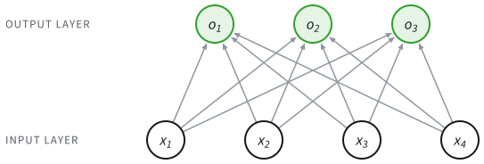
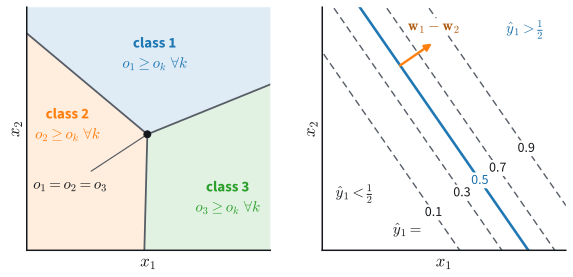
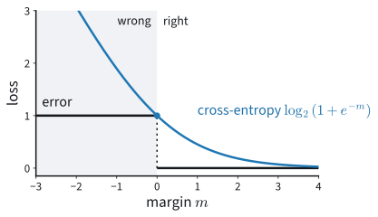
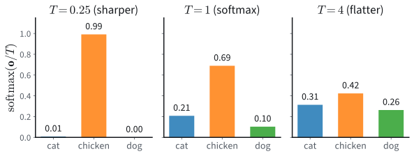

# Softmax Regression
:label:`sec_softmax`

An online store wants to file each product photo under one of ten
categories: T-shirt, trouser, pullover, dress, coat, sandal, shirt, sneaker,
bag, or ankle boot. Linear regression predicts a number, and a number is the
wrong kind of answer here. If we coded the categories as 1 to 10 and
regressed on the codes, a prediction of 5.5 would place a photo halfway
between a coat and a sandal, and the squared loss would charge 81 times more
for mistaking a T-shirt (code 1) for an ankle boot (code 10) than for a
trouser (code 2), although nothing makes the first mistake worse. The codes
are names, not quantities.

Problems of this kind are called *classification*: the model must say to
which of several categories, or classes, an example belongs. A spam filter
chooses between two classes, a diagnostic system among a handful of
diseases, and a language model chooses the next word from a vocabulary of
tens of thousands. Usually we want more than a decision. A spam filter
should remove an email from the inbox only when it is nearly certain, and a
doctor needs to know how likely a diagnosis is, not just which one is most
likely. So the model should output a probability for every class.

Softmax regression computes one linear score per class and turns the scores
into probabilities. To train it, we reuse the recipe of
:numref:`sec_linear_regression`: describe how the labels are generated and
minimize the negative log-likelihood of the observed labels. There, Gaussian
noise gave the squared loss. Here, a categorical model of the label gives the
cross-entropy loss. Throughout the chapter, each example belongs to exactly
one class and the classes have no order. The following sections train the
model on images of clothing and ask how well it predicts images that it has
not seen.

## The Model

### Class Labels
:label:`subsec_classification-problem`

We start with a problem small enough to write out in full. Each input is a
$2\times2$ grayscale image, so it has four features, the pixel values
$x_1, x_2, x_3, x_4$, and each image shows a cat, a chicken, or a dog. We
number the classes 1, 2, 3 in this order. In general there are $q$ classes,
and the label $y$ of an example is its class, an integer in
$\{1, \ldots, q\}$.

Regressing on these integers would impose an order that the classes do not
have, as the clothing codes showed. Instead we encode the label as a
*one-hot vector* $\mathbf{y} \in \{0, 1\}^q$, which has a 1 in the position
of the true class and 0 everywhere else. A chicken is
$\mathbf{y} = (0, 1, 0)$, and in general entry $y_j$ is 1 if the example
belongs to class $j$ and 0 otherwise. Every class gets its own coordinate,
and any two classes are equally far apart. The one-hot vector is also a
probability distribution over the classes, the one that puts all its mass on
the true class, so we can compare it directly with the probabilities that the
model predicts. In formulas, the class $y$ serves as an index and the one-hot
vector $\mathbf{y}$ as a vector over the classes. In code, a label is stored
as the integer index of its class, counting from 0 as Python does.

### Linear Scores

Softmax regression gives every class its own linear model. Class $j$
receives a score $o_j$, a weighted sum of the features plus a bias, with
weights and a bias of its own. We write $w_{kj}$ for the weight of feature
$k$ in the score of class $j$. For the $2\times2$ images the three scores are

$$
\begin{aligned}
o_1 &= x_1 w_{11} + x_2 w_{21} + x_3 w_{31} + x_4 w_{41} + b_1,\\
o_2 &= x_1 w_{12} + x_2 w_{22} + x_3 w_{32} + x_4 w_{42} + b_2,\\
o_3 &= x_1 w_{13} + x_2 w_{23} + x_3 w_{33} + x_4 w_{43} + b_3.
\end{aligned}
$$

Each line is a linear regression of the kind we met in
:numref:`sec_linear_regression`, so the model has 12 weights and 3 biases. A
larger score will mean a more probable class. The scores $o_j$ are called
*logits*, a name explained below. Drawn as a network
(:numref:`fig_softmaxreg`), the model has one output unit per class, and
every output depends on every input: it is a single fully connected layer,
like linear regression, but with $q$ outputs instead of one.

:label:`fig_softmaxreg`

We collect the weights in a matrix $\mathbf{W} \in \mathbb{R}^{4 \times 3}$,
with one row per feature and one column per class, and the biases in a
vector $\mathbf{b} \in \mathbb{R}^3$. Column $j$ of $\mathbf{W}$, which we
write $\mathbf{w}_j$, holds the weights of class $j$, so that
$o_j = \mathbf{w}_j^\top \mathbf{x} + b_j$. All the scores together are

$$\mathbf{o} = \mathbf{W}^\top \mathbf{x} + \mathbf{b}.$$

Entry $j$ of $\mathbf{W}^\top \mathbf{x}$ is the dot product of column
$\mathbf{w}_j$ with $\mathbf{x}$, the weighted sum for class $j$. With $d$
features and $q$ classes, $\mathbf{W} \in \mathbb{R}^{d \times q}$ and
$\mathbf{o}, \mathbf{b} \in \mathbb{R}^q$. Storing the features along the
rows of $\mathbf{W}$ matches the minibatch form below and the code of this
chapter. For the $28 \times 28$ clothing images that we will classify, $d = 784$
and $q = 10$, so the model has $7{,}840$ weights and 10 biases.

### The Softmax
:label:`subsec_softmax_operation`

Suppose that for some image the model computes the logits
$\mathbf{o} = (1.0, 2.2, 0.3)$. The chicken has the largest score, but the
scores are not probabilities: they sum to 3.5, not 1, and nothing prevents a
score from being negative or from exceeding 1. Fitting the scores to the
one-hot labels by least squares, as if this were regression with $q$
outputs, does not help. A linear function of $\mathbf{x}$ grows without
bound, so for inputs far from the training data it would predict
"probabilities" above 1 or below 0.

We need a map from any vector of $q$ real scores to a probability
distribution over $q$ classes: $q$ nonnegative numbers that sum to 1, with a
larger score giving a larger probability. Two steps achieve this.
Exponentiating each score makes it positive and keeps the order, and
dividing by the sum makes the results sum to 1. Together they form the
*softmax* function,

$$\hat{\mathbf{y}} = \mathrm{softmax}(\mathbf{o}) \quad \textrm{where} \quad \hat{y}_j = \frac{\exp(o_j)}{\sum_{k=1}^q \exp(o_k)}.$$
:eqlabel:`eq_softmax_y_and_o`

Each probability is proportional to the exponential of its score. For
$\mathbf{o} = (1.0, 2.2, 0.3)$ the exponentials are $(2.72, 9.03, 1.35)$,
their sum is $13.09$, and $\hat{\mathbf{y}} = (0.21, 0.69, 0.10)$: the model
gives the chicken a probability of 0.69. Since the exponential is
increasing, the softmax keeps the order of the scores, and the most probable
class is the one with the largest logit,

$$\operatorname*{argmax}_j \hat{y}_j = \operatorname*{argmax}_j o_j.$$

To predict a class, we can therefore skip the softmax and read off the
largest logit.

Only the differences between logits matter. Adding the same constant $c$ to
every logit multiplies the numerator and the denominator of
:eqref:`eq_softmax_y_and_o` by $\exp(c)$, which cancels, so
$\mathrm{softmax}(\mathbf{o} + c\mathbf{1}) = \mathrm{softmax}(\mathbf{o})$.
Equivalently, the difference of two logits is the logarithm of the ratio of
their probabilities,

$$o_i - o_j = \log \frac{\hat{y}_i}{\hat{y}_j}.$$

In the example, the logit of the chicken exceeds that of the cat by 1.2, so
the chicken is $e^{1.2} \approx 3.3$ times as probable as the cat
($0.69 / 0.21$). The $q$ logits therefore carry one redundant degree of
freedom. We could fix the score of one class at 0 without changing any
prediction, but we keep all $q$ so that every class is treated alike. The
same invariance makes the softmax safe to compute. In single precision,
$\exp(o)$ overflows once $o$ exceeds about 88, but after we subtract the
largest logit from every logit, no exponent is positive;
:numref:`subsec_softmax-implementation-revisited` builds this shift into the
loss.

For two classes, the probabilities depend only on the difference
$o = o_1 - o_2$:

$$\hat{y}_1 = \frac{\exp(o_1)}{\exp(o_1) + \exp(o_2)} = \frac{1}{1 + \exp(-o)} = \sigma(o).$$
:eqlabel:`eq_softmax_to_sigmoid`

The function $\sigma$ is the *logistic sigmoid*, which maps the real line
onto the interval $(0, 1)$. Softmax regression with two classes is logistic
regression, the standard model for binary classification in statistics. By
the previous paragraph, $o = \log(\hat{y}_1/\hat{y}_2)$ is the logarithm of
the odds of class 1, which statisticians call its logit. Machine learning has
extended the name to the scores of any classifier.

### Minibatches
:label:`subsec_softmax_vectorization`

As in linear regression, we compute the predictions for a minibatch of
examples with one matrix product. We stack the $n$ examples of a minibatch
as the rows of $\mathbf{X} \in \mathbb{R}^{n \times d}$. Then

$$
\begin{aligned}
\mathbf{O} &= \mathbf{X} \mathbf{W} + \mathbf{b},\\
\hat{\mathbf{Y}} &= \mathrm{softmax}(\mathbf{O}),
\end{aligned}
$$
:eqlabel:`eq_minibatch_softmax_reg`

where row $i$ of $\mathbf{O} \in \mathbb{R}^{n \times q}$ holds the logits
of example $i$ and the bias vector is added to every row by broadcasting.
The softmax acts *rowwise*: it exponentiates each row of $\mathbf{O}$ and
divides it by its own sum, so row $i$ of $\hat{\mathbf{Y}}$ is the predicted
distribution for example $i$. Most of the work is the product
$\mathbf{X}\mathbf{W}$. For a minibatch of 256 clothing images it multiplies
a $256 \times 784$ matrix by a $784 \times 10$ matrix, about two million
multiply-adds, in a single call.

### Decision Regions

Since the predicted class has the largest logit and every logit is affine in
$\mathbf{x}$, the decisions of the model have a simple geometry
(:numref:`fig_mdl-clf-decision-regions`). Class $j$ is predicted wherever
$o_j \geq o_k$ for every other class $k$. Each of these $q - 1$ conditions,
$(\mathbf{w}_j - \mathbf{w}_k)^\top \mathbf{x} + b_j - b_k \geq 0$, is a
linear inequality that holds on one side of a hyperplane. The region of
class $j$ is the intersection of these half-spaces, a convex polyhedron, and
two neighboring regions meet on the hyperplane where their scores tie.

With two classes, $\hat{y}_1 = \sigma(o)$ depends on $\mathbf{x}$ only
through $o = (\mathbf{w}_1 - \mathbf{w}_2)^\top \mathbf{x} + b_1 - b_2$.
Inputs with the same predicted probability lie on a hyperplane perpendicular
to $\mathbf{w}_1 - \mathbf{w}_2$, and the decision boundary is the hyperplane
on which $\hat{y}_1 = \frac{1}{2}$. The softmax bends the probabilities, but
the boundaries between classes stay flat. Classes that no hyperplane
separates, such as the two diagonals of a square, with one class at each
pair of opposite corners, are beyond the reach of this model.

:label:`fig_mdl-clf-decision-regions`

The regions partition the input space, so every input receives exactly one
class. This is the assumption we made at the start, and two common kinds of
problems do not satisfy it. In *multi-label classification*, several labels
can apply to the same example, as when a news article covers both business
and space flight. Such problems use a separate sigmoid for every label
instead of one softmax, because the labels do not compete for probability
:cite:`Tsoumakas.Katakis.2007`. In ordinal regression, the classes are
ordered, as age groups from infant to senior are, and a loss that ignores the
order discards information :cite:`Moon.Smola.Chang.ea.2010`.

## The Cross-Entropy Loss
:label:`subsec_softmax-regression-loss-func`

We now need a loss that measures how well the predicted probabilities
$\hat{\mathbf{y}}$ fit the labels. In :numref:`sec_linear_regression` the
squared loss was not chosen for convenience alone. We assumed that each label
is the linear prediction plus Gaussian noise, and the negative
log-likelihood of the observed labels under that assumption turned out to be
the squared loss. We now apply the same recipe with a model of how class
labels arise.

### Maximum Likelihood

The softmax output is a probability distribution over the classes, so it
defines a model of the labels: given features $\mathbf{x}$, an example
belongs to class $j$ with probability $\hat{y}_j$. The probability of the
observed label $y$ is $\hat{y}_y$, the entry of $\hat{\mathbf{y}}$ at the
true class. With the one-hot vector we can write it as a product over all
classes,

$$P(y \mid \mathbf{x}) = \hat{y}_y = \prod_{j=1}^q \hat{y}_j^{y_j},$$

since every factor other than the one for the true class is raised to the
power 0. This is the *categorical distribution*, which plays the role that
the Gaussian noise model played for linear regression.

If the labels of different examples are drawn independently, the
probability of all $n$ labels is the product of these probabilities. As in
linear regression, we take the negative logarithm, which turns the product
into a sum and the maximization into a minimization:

$$-\log \prod_{i=1}^n P(y^{(i)} \mid \mathbf{x}^{(i)}) = \sum_{i=1}^n l(\mathbf{y}^{(i)}, \hat{\mathbf{y}}^{(i)}),$$

where the loss of one example is

$$l(\mathbf{y}, \hat{\mathbf{y}}) = -\sum_{j=1}^q y_j \log \hat{y}_j = -\log \hat{y}_y.$$
:eqlabel:`eq_l_cross_entropy`

The loss is minus the logarithm of the probability that the model assigns to
the true class. It is called the *cross-entropy loss*, for a reason we give
below. For the logits $(1.0, 2.2, 0.3)$ and an image of a chicken, the loss is
$-\log 0.69 = 0.37$. Had the image shown a dog, to which the model gives
probability 0.10, the loss would be $-\log 0.10 = 2.27$.

Since every $\hat{y}_j$ lies between 0 and 1, the loss is never negative. It
is 0 only if the model gives the true class probability 1, which finite
logits never do, since every exponential is positive. At the other extreme,
a confident mistake costs without limit: as $\hat{y}_y \to 0$, the loss
grows to infinity.

### The Gradient
:label:`subsec_softmax_and_derivatives`

Training by minibatch SGD needs the gradient of the loss with respect to the
parameters. We first differentiate with respect to the logits. Substituting
the softmax :eqref:`eq_softmax_y_and_o` into the loss and using
$\sum_j y_j = 1$, we obtain

$$
\begin{aligned}
l(\mathbf{y}, \hat{\mathbf{y}}) &= -\sum_{j=1}^q y_j \log \frac{\exp(o_j)}{\sum_{k=1}^q \exp(o_k)} \\
&= \sum_{j=1}^q y_j \log \sum_{k=1}^q \exp(o_k) - \sum_{j=1}^q y_j o_j \\
&= \log \sum_{k=1}^q \exp(o_k) - o_y.
\end{aligned}
$$

The loss is the *log-sum-exp* of all logits minus the logit of the true
class. Log-sum-exp is a smooth version of the maximum: it exceeds the largest
logit by at most $\log q$ (exercise :exref:`ex_softmax-regression-realsoftmax`),
so the loss is small when the true class leads all others by a wide margin.
The derivative of log-sum-exp with respect to $o_j$ is
$\exp(o_j) / \sum_k \exp(o_k)$, the softmax itself. Therefore

$$\frac{\partial l}{\partial o_j} = \mathrm{softmax}(\mathbf{o})_j - y_j, \quad \textrm{that is,} \quad \nabla_{\mathbf{o}}\, l = \hat{\mathbf{y}} - \mathbf{y}.$$

The gradient is the predicted distribution minus the observed one. For the
chicken it is $(0.21, 0.69, 0.10) - (0, 1, 0) = (0.21, -0.31, 0.10)$. A
gradient step raises the logit of the true class and lowers the others, each
in proportion to the probability that it received by mistake. The entries
sum to zero, as they must, since adding a constant to all logits leaves the
loss unchanged.

Since $o_j = \mathbf{w}_j^\top \mathbf{x} + b_j$, the chain rule gives the
gradients for the parameters,
$\partial l / \partial \mathbf{w}_j = (\hat{y}_j - y_j)\,\mathbf{x}$ and
$\partial l / \partial b_j = \hat{y}_j - y_j$. A step moves the weights of
the true class toward $\mathbf{x}$ and those of every other class away from
it. For a minibatch whose one-hot labels are the rows of
$\mathbf{Y} \in \{0, 1\}^{n \times q}$, the gradient of the average loss with
respect to $\mathbf{W}$ is
$\frac{1}{n}\mathbf{X}^\top(\hat{\mathbf{Y}} - \mathbf{Y})$, a $d \times q$
matrix like $\mathbf{W}$.

Linear regression has a gradient of the same form: the derivative of
$\frac{1}{2}(\hat{y} - y)^2$ with respect to the prediction is the error
$\hat{y} - y$. The Gaussian and the categorical distribution both belong to
the exponential family of distributions, and for every member of this family
the negative log-likelihood has such a "prediction minus observation"
gradient (:numref:`subsec_mdl-glm`). The two models side by side:

| | Linear regression | Softmax regression |
|:--|:--|:--|
| label | a real number $y$ | a class $y$, one-hot $\mathbf{y}$ |
| prediction | $\hat{y} = \mathbf{w}^\top \mathbf{x} + b$ | $\hat{\mathbf{y}} = \mathrm{softmax}(\mathbf{W}^\top \mathbf{x} + \mathbf{b})$ |
| model of the label | Gaussian centered at $\hat{y}$ | categorical with probabilities $\hat{\mathbf{y}}$ |
| loss (negative log-likelihood) | $\frac{1}{2}(\hat{y} - y)^2$ | $-\log \hat{y}_y$ |
| gradient | $\hat{y} - y$ with respect to $\hat{y}$ | $\hat{\mathbf{y}} - \mathbf{y}$ with respect to $\mathbf{o}$ |

The loss is also convex in the logits: its matrix of second derivatives is
the covariance matrix of the predicted distribution, which is positive
semidefinite (exercise :exref:`ex_softmax-regression-hessian`). Since the
logits are affine in $\mathbf{W}$ and $\mathbf{b}$, the training loss is
convex in the parameters, and every local minimum is a global one.

### Entropy and Cross-Entropy
:label:`subsec_info_theory_basics`

The name of the loss comes from information theory, which measures
information by surprise. An outcome of probability $p$ carries the
*surprisal* $-\log p$. An outcome that was certain ($p = 1$) does not
surprise us at all, and the rarer an outcome, the larger its surprisal. Our
loss is the surprisal of the true label under the prediction of the model.

Suppose that outcomes are drawn from a distribution $\mathbf{p}$ over $q$
classes. The *entropy* of $\mathbf{p}$ is the expected surprisal of an
observer who knows $\mathbf{p}$,

$$H(\mathbf{p}) = -\sum_{j=1}^q p_j \log p_j.$$

It is 0 when one outcome is certain and largest, $\log q$, when all outcomes
are equally likely. With the natural logarithm it is measured in *nats*;
with $\log_2$ it is measured in bits, and one nat is $1/\log 2 \approx 1.44$
bits.

An observer who predicts the same outcomes with a distribution
$\hat{\mathbf{p}}$ instead has the expected surprisal

$$H(\mathbf{p}, \hat{\mathbf{p}}) = -\sum_{j=1}^q p_j \log \hat{p}_j,$$

the *cross-entropy* of $\hat{\mathbf{p}}$ relative to $\mathbf{p}$. The loss
:eqref:`eq_l_cross_entropy` is the cross-entropy $H(\mathbf{y}, \hat{\mathbf{y}})$
between the one-hot label and the prediction, hence its name. One fact about
these quantities tells us what minimizing the loss achieves: predicting with
the wrong distribution can only increase the average surprise,

$$H(\mathbf{p}, \hat{\mathbf{p}}) \geq H(\mathbf{p}), \quad \textrm{with equality if and only if } \hat{\mathbf{p}} = \mathbf{p}.$$

This is Gibbs' inequality, proved in :numref:`sec_mdl-information_theory`
together with the interpretation of entropy as the length of the shortest
code for the outcomes.

Labels are often uncertain even when the features are known. A small,
blurry photo may show a shirt with probability 0.6 and a T-shirt with
probability 0.4. If photos like it carry these labels at random according to
$\mathbf{p} = (0.6, 0.4)$, the expected loss of a prediction
$\hat{\mathbf{y}}$ is $H(\mathbf{p}, \hat{\mathbf{y}})$. Predicting
$(0.6, 0.4)$ costs $H(\mathbf{p}) = 0.67$ nats on average, while the more
confident $(0.9, 0.1)$ costs $0.98$ nats. By Gibbs' inequality, the expected
loss is smallest when the model reports the true probabilities, so
cross-entropy rewards honest probabilities rather than exaggerated ones. For
the same reason the loss accepts labels that are themselves distributions,
such as the fractions of annotators who chose each class: the formula
:eqref:`eq_l_cross_entropy` applies unchanged with a probability vector in
place of the one-hot $\mathbf{y}$.

## Accuracy and Confidence

A classifier is usually judged by its *accuracy*, the fraction of examples
on which the class with the largest logit is the true class, or by its error
rate, one minus the accuracy. Yet we train it by minimizing cross-entropy.
We now explain why, and what this choice does to the confidence of the
model.

### The Error Rate

Why not minimize the number of training errors directly? Whether an example
is classified correctly depends on its *margin*, the logit of the true class
minus the largest other logit,

$$m = o_y - \max_{j \neq y} o_j.$$

The example is classified correctly if $m > 0$ and wrongly if $m < 0$. Its
error, 1 for a mistake and 0 otherwise, is a step function of the margin
(:numref:`fig_mdl-clf-margin-losses`), and therefore of the parameters.
Wherever the step has a derivative, the derivative is zero. A small change
of the weights either changes no decision, so the number of errors stays the
same, or it flips a decision, so the number jumps. Gradient descent gets no
direction from it.

Cross-entropy is a smooth function of the margin. With two classes, the
probability of the true class is $\sigma(m)$ by :eqref:`eq_softmax_to_sigmoid`,
so the loss is

$$l = -\log \sigma(m) = \log\left(1 + \exp(-m)\right).$$

With $q$ classes, the loss
$\log \sum_k \exp(o_k) - o_y = \log\left(1 + \sum_{j \neq y} \exp(o_j - o_y)\right)$
is at least as large, since the sum contains the term $\exp(-m)$.
:numref:`fig_mdl-clf-margin-losses` shows the two-class loss. It decreases
everywhere, so every example contributes a gradient that pushes its margin
up, and the misclassified examples push hardest. It also lies above the
error: at $m \leq 0$ the loss is at least $\log 2$, so the sum of the losses
divided by $\log 2$ bounds the number of training errors. A model with an
average training loss of 0.07 nats misclassifies at most
$0.07 / \log 2 \approx 10\%$ of its training examples. Minimizing
cross-entropy therefore drives the error rate down, through a function that
gradient descent can follow.

:label:`fig_mdl-clf-margin-losses`

The loss never reaches zero. It keeps decreasing after the margin turns
positive, so it keeps rewarding the model for raising its confidence in
decisions that are already right. Raising the probability of the true class
from 0.51 to 0.99 changes no decision, but lowers the loss from 0.67 to
0.01.

### Calibration and Temperature

This reward for confidence has a cost. Suppose that some parameters classify
every training example correctly. Multiplying $\mathbf{W}$ and $\mathbf{b}$
by a constant larger than 1 multiplies every margin by it and lowers every
loss, so the training loss has no minimum, and gradient descent keeps
growing the weights (exercise :exref:`ex_softmax-regression-separable`).
Large gaps between logits mean predicted probabilities close to 0 and 1. A
model is *calibrated* if its probabilities match frequencies: of all
predictions made with confidence 0.9, 90% are correct. Models trained by
minimizing cross-entropy are often not calibrated, and deep networks tend to
be overconfident :cite:`Guo.Pleiss.Sun.Weinberger.2017`.

The scale of the logits sets the confidence of a prediction. Dividing all
logits by a *temperature* $T > 0$ before the softmax,

$$\hat{\mathbf{y}} = \mathrm{softmax}(\mathbf{o} / T),$$

sharpens the distribution for $T < 1$ and flattens it for $T > 1$
(:numref:`fig_mdl-clf-temperature`). As $T \to 0$, all probability goes to
the largest logit, and as $T \to \infty$, the distribution becomes uniform.
The name comes from statistical physics, where the same formula gives the
occupation of energy states at temperature $T$. The appendix derives the
softmax three ways, from the Boltzmann distribution of statistical physics,
from choices perturbed by Gumbel noise, and from the exponential family
(:numref:`subsec_mdl-softmax-origins`). Dividing by $T$ keeps the
order of the logits, so the predicted class, and with it the accuracy, does
not change.

:label:`fig_mdl-clf-temperature`

Temperature scaling uses this to calibrate a trained model. It chooses a
single $T$ by minimizing the cross-entropy on held-out data, with the logits
of the model held fixed :cite:`Guo.Pleiss.Sun.Weinberger.2017`. Since
cross-entropy is smallest for the true probabilities, the fitted $T$
corrects overconfidence, usually with $T > 1$, without changing a single
decision. Exercise :exref:`ex_softmax-regression-temperature` shows that
this one-dimensional fit is a convex problem.

We can now write down a classifier that outputs probabilities, derive its
loss from a model of the labels, and compute the gradient that trains it.
Two questions remain open. The decision boundaries of softmax regression are
hyperplanes, so classes that no hyperplane separates stay out of reach until
:numref:`chap_perceptrons` adds hidden layers. And a low training loss does
not yet tell us how well the model classifies images it has not seen, a
question we can ask once it is trained on real data.

## Summary

Softmax regression classifies an input by computing one linear score, or
logit, per class, $\mathbf{o} = \mathbf{W}^\top\mathbf{x} + \mathbf{b}$ with
$\mathbf{W} \in \mathbb{R}^{d \times q}$, and by turning the scores into
probabilities with the softmax, which exponentiates and normalizes them. Only
differences between logits matter, two classes give the logistic sigmoid, and
the boundaries between the predicted classes are hyperplanes. Reading the
softmax output as a categorical distribution of the label and maximizing the
likelihood of the observed labels gives the cross-entropy loss
$-\log \hat{y}_y$, just as Gaussian noise gave the squared loss for
regression, and its gradient with respect to the logits is again prediction
minus label, $\hat{\mathbf{y}} - \mathbf{y}$. Cross-entropy is minimized in
expectation by the true class probabilities, and it bounds the number of
errors by a smooth function that gradient descent can follow. Because it
keeps rewarding confidence, trained models are often overconfident; dividing
the logits by a temperature corrects the confidence without changing any
decision.

## Exercises

1. **Softmax Hessian.** As in :numref:`subsec_softmax_and_derivatives`,
   write the cross-entropy loss as a function of the logits,
   $l(\mathbf{y}, \mathbf{o}) = g(\mathbf{o}) - \mathbf{y}^\top \mathbf{o}$
   with $g(\mathbf{o}) = \log \sum_k \exp(o_k)$.
    1. Compute the Hessian $\partial^2_{\mathbf{o}}\, l(\mathbf{y}, \mathbf{o})$
       and show that it does not depend on $\mathbf{y}$.
    1. Let $\mathbf{e}_Y$ be the one-hot vector of a class $Y$ drawn from
       $\mathrm{softmax}(\mathbf{o})$. Compute the covariance matrix of
       $\mathbf{e}_Y$ and show that it equals the Hessian from the previous
       step.
    1. Conclude that $g$ is convex and that the cross-entropy loss is convex
       in the logits.
   :exlabel:`ex_softmax-regression-hessian`

1. **Softmax and sigmoid.** By :eqref:`eq_softmax_to_sigmoid`, logistic
   regression is softmax regression with two classes and one redundant
   logit removed. A colleague hands you a fitted logistic model
   $P(y = 1 \mid x) = \sigma(\hat\beta_0 + \hat\beta_1 x)$ with
   $\hat\beta_0 = 2$ and $\hat\beta_1 = -1$.
    1. Characterize all two-class softmax coefficients $(w_1, b_1)$ and
       $(w_2, b_2)$ whose predictions coincide with the logistic model for
       every $x$, and identify the pair with $o_2 \equiv 0$.
    1. Show that gradient descent on the cross-entropy loss of the
       two-class softmax model never changes $w_1 + w_2$ or $b_1 + b_2$.
       Suppose that gradient descent starts from
       $w_1 = w_2 = b_1 = b_2 = 0$ on the colleague's training data and
       converges to coefficients that reproduce the logistic model.
       Determine which pair it reaches.

    *Adapted from James, Witten, Hastie, and Tibshirani,
    [An Introduction to Statistical Learning](https://www.statlearning.com/),
    Exercise 4.12.*

1. **Bradley--Terry model.** The
   [Bradley--Terry model](https://en.wikipedia.org/wiki/Bradley%E2%80%93Terry_model)
   :cite:`Bradley.Terry.1952` uses a logistic model to capture preferences.
   A user who chooses between apples and oranges picks each item with the
   probability given by the softmax of two scores, $o_{\textrm{apple}}$ and
   $o_{\textrm{orange}}$. Now add a default option of choosing neither,
   with a fixed score $o_{\textrm{none}} = 0$.
    1. Determine whether adding the same constant to $o_{\textrm{apple}}$
       and $o_{\textrm{orange}}$ changes the choice probabilities, first
       without and then with the default option. Conclude which scores the
       observed choices can determine in each model.
    1. Compare the ratio $P(\textrm{apple}) / P(\textrm{orange})$ with and
       without the default option. Describe a choice situation in which
       real users would not keep this ratio fixed.

1. **Log-sum-exp.** The function $\mathrm{lse}(a, b) = \log(\exp(a) + \exp(b))$
   is the log-sum-exp of :numref:`subsec_softmax_and_derivatives` with two
   arguments, so its gradient is the softmax of $(a, b)$.
    1. Prove that
       $$\max(a, b) < \mathrm{lse}(a, b) \leq \max(a, b) + \log 2,$$
       with equality on the right exactly when $a = b$, and show that the
       gap to $\max(a, b)$ can be made arbitrarily small. Hint: without
       loss of generality set $b = 0$ and $a \geq 0$.
    1. Prove that for every $\lambda > 0$
       $$\max(a, b) < \lambda^{-1} \mathrm{lse}(\lambda a, \lambda b) \leq \max(a, b) + \lambda^{-1} \log 2,$$
       and conclude that
       $\lambda^{-1} \mathrm{lse}(\lambda a, \lambda b) \to \max(a, b)$
       as $\lambda \to \infty$.
    1. Construct an analogous smooth minimum.
    1. Extend the definition and both bounds to $q$ numbers, showing that
       the gap to $\max_i a_i$ is at most $\log q$.
   :exlabel:`ex_softmax-regression-realsoftmax`

1. **Temperature.** Let $P = \mathrm{softmax}(\mathbf{o})$, and let the
   distribution at temperature $T$ be $\mathrm{softmax}(\mathbf{o}/T)$.
   Suppose we pick another distribution $Q$ with $Q(i) \propto P(i)^\alpha$
   for $\alpha > 0$.
    1. Which choice of $\alpha$ corresponds to doubling the temperature?
       Which choice corresponds to halving it?
    1. Suppose that exactly $s$ of the $q$ logits attain the largest value.
       Find the limit of $\mathrm{softmax}(\mathbf{o}/T)$ as $T \to 0$.
    1. Let $\bar{o} = \frac{1}{q}\sum_j o_j$ be the mean logit. Show that
       for large $T$
       $$\mathrm{softmax}(\mathbf{o}/T)_i = \frac{1}{q} + \frac{o_i - \bar{o}}{qT} + O(T^{-2}).$$
    1. Temperature scaling fits a single $T$ by minimizing the
       cross-entropy on a held-out set with the logits of the classifier
       held fixed. Show that this cross-entropy is a convex function of
       $\beta = 1/T$, so that the fit is a one-dimensional convex problem.
       Hint: use the convexity of $g$ from
       exercise :exref:`ex_softmax-regression-hessian`.
   :exlabel:`ex_softmax-regression-temperature`

1. **Separable data.** ● Suppose that some parameters
   $(\mathbf{W}, \mathbf{b})$ classify every training example correctly and
   without ties: on each example, the logit of the true class strictly
   exceeds every other logit. Consider the scaled parameters
   $(c\mathbf{W}, c\mathbf{b})$ for $c > 0$.
    1. Show that the cross-entropy loss of every training example strictly
       decreases as $c$ grows and tends to $0$ as $c \to \infty$.
    1. Conclude that the training loss has no minimizer and that every
       sequence of parameters whose training loss tends to $0$ has
       unbounded norm.
    1. Add the weight decay penalty of :numref:`sec_weight_decay`, applied
       to both weights and biases,
       $\frac{\lambda}{2}(\|\mathbf{W}\|^2 + \|\mathbf{b}\|^2)$ with
       $\lambda > 0$, to the training loss. Show that the penalized loss
       has a minimizer.
   :exlabel:`ex_softmax-regression-separable`

1. **Squared error on probabilities.** Instead of cross-entropy, we could
   fit the predicted probabilities to the one-hot label with the squared
   loss $\frac{1}{2}\|\hat{\mathbf{y}} - \mathbf{y}\|^2$.
    1. Show that the derivatives of the softmax are
       $\partial \hat{y}_k / \partial o_j = \hat{y}_k(\mathbf{1}(j = k) - \hat{y}_j)$,
       and use them to compute the gradient of the squared loss with
       respect to the logits.
    1. For two classes, write both losses as functions of the margin $m$
       and compute their derivatives with respect to $m$. Show that as
       $m \to -\infty$, that is, for a confident mistake, the derivative of
       the squared loss tends to 0 while that of the cross-entropy tends to
       $-1$.
    1. Explain what this difference means for a model that starts training
       with confident wrong predictions.

1. [code] **Gumbel-max trick.** ● Suppose that a label is generated by
   perturbing every logit with independent noise and reporting the class
   with the largest perturbed score,
   $y = \operatorname*{argmax}_i \, (o_i + \gamma_i)$. Gaussian noise gives
   the probit model, whose class probabilities have no closed form; one
   other noise distribution reproduces the softmax probabilities exactly.
   Let $\gamma_1, \ldots, \gamma_q$ be i.i.d. draws from the standard
   [Gumbel distribution](https://en.wikipedia.org/wiki/Gumbel_distribution),
   whose CDF is $P(\gamma \leq z) = \exp(-\exp(-z))$.
    1. Show that $P(o_k + \gamma_k \leq z) = \exp(-\exp(o_k)\exp(-z))$.
    1. Show that
       $P\left(\operatorname{argmax}_i \, (o_i + \gamma_i) = k\right) = \mathrm{softmax}(\mathbf{o})_k$.
       Hint: condition on the value of $o_k + \gamma_k$ and use the
       substitution $u = \exp(-z)$.
    1. Conclude that scaling the noise, $\gamma_i \mapsto T\gamma_i$,
       samples from $\mathrm{softmax}(\mathbf{o}/T)$.
    1. Verify your result numerically: for $\mathbf{o} = (1.0, 2.2, 0.3)$
       and $T \in \{0.25, 1, 4\}$, draw $10^5$ samples of
       $\operatorname{argmax}_i (o_i + T\gamma_i)$ and confirm that the
       label frequencies match $\mathrm{softmax}(\mathbf{o}/T)$ up to Monte
       Carlo error.
   :exlabel:`ex_softmax-regression-gumbel-max-trick`

[Discussions](https://d2l.discourse.group/t/46)

<!-- slides -->

::: {.slide}
::: {.cover}
[Dive into Deep Learning · §3.1]{.kicker}

Probabilities for categories 
**one-hot labels · the softmax · cross-entropy · the gradient $\hat{\mathbf{y}} - \mathbf{y}$ · temperature**
:::
:::

::: {.slide title="A Class Code of 5.5 Means Nothing"}
[The problem]{.kicker}

Sort clothing photos into ten categories: T-shirt (code 1), trouser (2),
…, coat (5), sandal (6), …, ankle boot (10). Regress on the codes?

- A prediction of 5.5 sits "between" a coat and a sandal.
- The squared loss charges $(10-1)^2 = 81$ for T-shirt → ankle boot, but
  $(2-1)^2 = 1$ for T-shirt → trouser.

::: {.d2l-note}
Codes are names, not quantities. We want **one probability per class**,
and a loss derived from a model of the labels.
:::
:::

::: {.slide title="By the End of This Deck You Can"}
[Goals]{.kicker}

- compute softmax probabilities and the cross-entropy loss by hand;
- write the model for one example and for a minibatch, with
  $\mathbf{W} \in \mathbb{R}^{d \times q}$;
- derive cross-entropy from maximum likelihood, and its gradient
  $\hat{\mathbf{y}} - \mathbf{y}$;
- explain why we train on cross-entropy but report accuracy;
- correct overconfident probabilities with a temperature.

**Running examples:** a $2\times2$ image of a cat, chicken, or dog with
logits $(1.0, 2.2, 0.3)$; Fashion-MNIST, $d = 784$ pixels, $q = 10$ classes.
:::

::: {.slide title="Softmax Regression Is the Model of the Whole Chapter"}
[Where this fits]{.kicker}

::: {.cols .vc}
::: {.col}
| section | adds |
|---|---|
| **Softmax Regression** | **probabilities over classes, cross-entropy** |
| The Image Classification Dataset | Fashion-MNIST in minibatches |
| Measuring Classifiers | accuracy, costs, calibration, the `Classifier` class |
| Implementation from Scratch | softmax regression by hand |
| Concise Implementation | framework layers, a stable loss |
| Generalization in Classification | error bars, test-set reuse, VC dimension |
| Environment and Distribution Shift | correcting for shifted data |
:::

::: {.col .narrow}
- **Uses:** the linear model, minibatch SGD, and maximum likelihood under
  Gaussian noise, from Linear Regression.
- **Skips:** multi-label and ordinal labels; proofs of the
  information-theory facts, in the mathematics appendix.
:::
:::
:::

::: {.slide}
::: {.divider}
[01]{.dnum}

[Scores and probabilities]{.dtitle}

[one linear score per class, then the softmax]{.dsub}
:::
:::

::: {.slide title="A Label Is a One-Hot Vector"}
[Labels]{.kicker}

A $2\times2$ grayscale image has four features $x_1, \ldots, x_4$ and shows
a cat, a chicken, or a dog: classes 1, 2, 3.

- The label $y$ is the class; we encode it as a **one-hot** vector
  $\mathbf{y}$: a chicken is $\mathbf{y} = (0, 1, 0)$.
- Any two classes are equally far apart: no false order.
- $\mathbf{y}$ is a distribution with all its mass on the true class.

::: {.d2l-note}
Formulas use $\mathbf{y}$; code stores the class index, counting from 0.
:::
:::

::: {.slide title="Each Class Gets Its Own Linear Score"}
[Linear scores]{.kicker}

::: {.cols .vc}
::: {.col}
$$o_j = \mathbf{w}_j^\top \mathbf{x} + b_j, \qquad \mathbf{o} = \mathbf{W}^\top \mathbf{x} + \mathbf{b}$$

- $\mathbf{W} \in \mathbb{R}^{d \times q}$: a row per feature, a column
  $\mathbf{w}_j$ per class.
- $2\times2$ images: 12 weights, 3 biases.
- Fashion-MNIST: $7{,}840$ weights, 10 biases.
- The scores $o_j$ are the **logits**.
:::

::: {.col .fig .big}
{.nostretch width=100%}
:::
:::
:::

::: {.slide title="The Softmax Exponentiates, Then Normalizes"}
[The softmax]{.kicker}

$$\hat{y}_j = \mathrm{softmax}(\mathbf{o})_j = \frac{\exp(o_j)}{\sum_{k=1}^q \exp(o_k)}$$

- $\mathbf{o} = (1.0, 2.2, 0.3)$: exponentials $(2.72, 9.03, 1.35)$, sum
  $13.09$, so $\hat{\mathbf{y}} = (0.21, 0.69, 0.10)$.
- Nonnegative, sums to 1, keeps the order:
  $\operatorname{argmax}_j \hat{y}_j = \operatorname{argmax}_j o_j$.

::: {.d2l-note}
To predict a class, read off the largest logit.
:::
:::

::: {.slide title="Only Differences of Logits Matter"}
[The softmax · invariance]{.kicker}

$$o_i - o_j = \log \frac{\hat{y}_i}{\hat{y}_j}, \qquad \mathrm{softmax}(\mathbf{o} + c\mathbf{1}) = \mathrm{softmax}(\mathbf{o})$$

- Chicken minus cat is 1.2: the chicken is $e^{1.2} \approx 3.3$ times as
  probable ($0.69/0.21$).
- Subtract $\max_k o_k$ before $\exp$: float32 $\exp$ overflows past 88.
- Two classes, $o = o_1 - o_2$:
  $\hat{y}_1 = \frac{1}{1 + e^{-o}} = \sigma(o)$, the **logistic
  sigmoid**: logistic regression.
:::

::: {.slide title="A Minibatch Is One Matrix Product"}
[Minibatches]{.kicker}

$$\mathbf{O} = \mathbf{X}\mathbf{W} + \mathbf{b}, \qquad \hat{\mathbf{Y}} = \mathrm{softmax}(\mathbf{O}) \textrm{ row by row}$$

- $\mathbf{X}$: $n \times d$, one example per row; $\mathbf{O}$ and
  $\hat{\mathbf{Y}}$: $n \times q$; $\mathbf{b}$ is broadcast to every row.
- Fashion-MNIST, $n = 256$: $(256 \times 784)(784 \times 10)$, about
  2 million multiply-adds in one call.

::: {.d2l-note}
Features along the rows of $\mathbf{W}$: one example is
$\mathbf{W}^\top\mathbf{x}$, a minibatch is $\mathbf{X}\mathbf{W}$.
:::
:::

::: {.slide title="The Decision Boundaries Are Hyperplanes"}
[Decision regions]{.kicker}

Class $j$ wins where $o_j \ge o_k$ for all $k$: a **convex** intersection
of half-spaces.

{.nostretch width=60% fig-align="center"}

::: {.d2l-note .warn}
The softmax bends the probabilities, not the boundaries.
:::
:::

::: {.slide title="Check: What Are the Probabilities for Logits (102, 100, 100)?"}
[Check]{.kicker}

First compute $\mathrm{softmax}(2, 0, 0)$. Then the logits
$(102, 100, 100)$: what does a float32 computation of $e^{102}$ give, and
how do we avoid it?

::: {.fragment .fade-up}
::: {.d2l-note}
**Answer.** $e^2 = 7.39$, sum $9.39$: $(0.79, 0.11, 0.11)$. Adding 100 to
every logit changes nothing, but $e^{102}$ overflows to `inf` in float32.
Subtract the largest logit first: $(102, 100, 100) \to (0, -2, -2)$.
:::
:::
:::

::: {.slide}
::: {.divider}
[02]{.dnum}

[The cross-entropy loss]{.dtitle}

[maximum likelihood for class labels]{.dsub}
:::
:::

::: {.slide title="A Categorical Model of the Label Gives Cross-Entropy"}
[Maximum likelihood]{.kicker}

Given $\mathbf{x}$, the label is class $j$ with probability $\hat{y}_j$:
$P(y \mid \mathbf{x}) = \hat{y}_y = \prod_j \hat{y}_j^{y_j}$, with $y$ the
true class. Independent examples, then $-\log$:

$$l(\mathbf{y}, \hat{\mathbf{y}}) = -\sum_{j=1}^q y_j \log \hat{y}_j = -\log \hat{y}_y$$

- Chicken: $-\log 0.69 = 0.37$. Dog: $-\log 0.10 = 2.27$.
- Always $\ge 0$; 0 only with certainty; $\to \infty$ for a confident
  mistake.
:::

::: {.slide title="The Gradient Is Prediction Minus Label"}
[The gradient]{.kicker}

$$l = \log \sum_{k} \exp(o_k) - o_y \quad\Longrightarrow\quad \nabla_{\mathbf{o}}\, l = \hat{\mathbf{y}} - \mathbf{y}$$

- Chicken: $(0.21, 0.69, 0.10) - (0, 1, 0) = (0.21, -0.31, 0.10)$; the
  entries sum to 0.
- Weights: $\partial l / \partial \mathbf{w}_j = (\hat{y}_j - y_j)\,\mathbf{x}$;
  a minibatch gives $\frac{1}{n}\mathbf{X}^\top(\hat{\mathbf{Y}} - \mathbf{Y})$.
- Convex in the logits, hence in $\mathbf{W}$ and $\mathbf{b}$.

::: {.d2l-note}
The true class moves toward $\mathbf{x}$; the others move away in
proportion to the probability they took.
:::
:::

::: {.slide title="Same Recipe as Regression, Different Model of the Label"}
[Side by side]{.kicker}

| | Linear regression | Softmax regression |
|:--|:--|:--|
| label | real number $y$ | class $y$, one-hot $\mathbf{y}$ |
| model of the label | Gaussian at $\hat{y}$ | categorical, probabilities $\hat{\mathbf{y}}$ |
| negative log-likelihood | $\frac{1}{2}(\hat{y} - y)^2$ | $-\log \hat{y}_y$ |
| gradient | $\hat{y} - y$ | $\hat{\mathbf{y}} - \mathbf{y}$ (in $\mathbf{o}$) |

::: {.d2l-note .rule}
Choose a model of how the labels arise; minimize its negative
log-likelihood.
:::
:::

::: {.slide title="Cross-Entropy Is Never Below Entropy"}
[Entropy and cross-entropy]{.kicker}

- **Surprisal** of an outcome of probability $p$: $-\log p$.
- **Entropy** $H(\mathbf{p}) = -\sum_j p_j \log p_j$: the expected
  surprisal if we know $\mathbf{p}$ (in nats).
- **Cross-entropy** $H(\mathbf{p}, \hat{\mathbf{p}}) = -\sum_j p_j \log \hat{p}_j$:
  the expected surprisal if we predict with $\hat{\mathbf{p}}$ instead.

$$H(\mathbf{p}, \hat{\mathbf{p}}) \ge H(\mathbf{p}), \quad \textrm{equality iff } \hat{\mathbf{p}} = \mathbf{p} \quad \textrm{(Gibbs' inequality)}$$

::: {.d2l-note}
Our loss is $H(\mathbf{y}, \hat{\mathbf{y}})$: the one-hot label against
the prediction.
:::
:::

::: {.slide title="Check: Report (0.6, 0.4) or (0.9, 0.1)?"}
[Check]{.kicker}

Blurry photos like this one are shirts 60% of the time and T-shirts 40% of
the time. Which prediction has the lower expected cross-entropy:
$(0.6, 0.4)$ or the more confident $(0.9, 0.1)$?

::: {.fragment .fade-up}
::: {.d2l-note}
**Answer.** $(0.6, 0.4)$ costs $-0.6\log 0.6 - 0.4\log 0.4 = 0.67$ nats;
$(0.9, 0.1)$ costs $-0.6\log 0.9 - 0.4\log 0.1 = 0.98$ nats. By Gibbs'
inequality, the true probabilities always win: cross-entropy rewards
honest probabilities.
:::
:::
:::

::: {.slide}
::: {.divider}
[03]{.dnum}

[Accuracy and confidence]{.dtitle}

[why we train on one number and report another]{.dsub}
:::
:::

::: {.slide title="Counting Errors Gives No Gradient; Cross-Entropy Does"}
[The error rate]{.kicker}

::: {.cols .vc}
::: {.col}
- Margin $m = o_y - \max_{j \neq y} o_j$: correct iff $m > 0$.
- The error is a step in $m$: zero gradient almost everywhere.
- Two classes: $l = \log(1 + e^{-m})$, smooth and decreasing.
- A mistake costs at least $\log 2$, so
  errors $\le$ total loss $/ \log 2$.
:::

::: {.col .fig .big}
{.nostretch width=100%}
:::
:::
:::

::: {.slide title="Cross-Entropy Keeps Paying for Confidence"}
[Confidence]{.kicker}

- True class at 0.51 or at 0.99: same decision, but the loss falls from
  0.67 to 0.01.
- If $(\mathbf{W}, \mathbf{b})$ classifies every training example
  correctly, then $(2\mathbf{W}, 2\mathbf{b})$ doubles every margin and
  lowers every loss: no minimum.
- So trained models are often **overconfident**: of the predictions made
  at 0.9, fewer than 90% are right.

::: {.d2l-note .warn}
**Calibrated** means confidence 0.9 is right 90% of the time.
:::
:::

::: {.slide title="Temperature Changes Confidence, Not Decisions"}
[Temperature]{.kicker}

$\hat{\mathbf{y}} = \mathrm{softmax}(\mathbf{o}/T)$: $T < 1$ sharpens, $T > 1$
flattens; the order of the logits, and so the accuracy, never changes.

{.nostretch width=72% fig-align="center"}

::: {.d2l-note .rule}
**Temperature scaling:** fit one $T$ by minimizing cross-entropy on
held-out data, with the logits fixed.
:::
:::

::: {.slide title="Check: How Many Training Errors Can a Loss of 0.10 Hide?"}
[Check]{.kicker}

A classifier reaches an average cross-entropy of 0.10 nats on the 60,000
Fashion-MNIST training images. At most how many of them can it misclassify?

::: {.fragment .fade-up}
::: {.d2l-note}
**Answer.** Each mistake costs at least $\log 2 \approx 0.69$ nats, and
the total loss is $6{,}000$ nats, so at most
$6{,}000 / 0.69 \approx 8{,}700$ errors (14%). The bound is loose,
because correctly classified examples also contribute loss.
:::
:::
:::

::: {.slide title="Recap"}
[Wrap-up]{.kicker}

- **Model:** $\mathbf{o} = \mathbf{W}^\top\mathbf{x} + \mathbf{b}$,
  $\hat{\mathbf{y}} = \mathrm{softmax}(\mathbf{o})$; logits
  $(1.0, 2.2, 0.3)$ give $(0.21, 0.69, 0.10)$; Fashion-MNIST needs 7,850
  parameters.
- Only logit differences matter; two classes give the sigmoid; the
  boundaries are hyperplanes.
- **Loss:** the categorical likelihood gives cross-entropy
  $-\log \hat{y}_y$, 0.37 for the chicken; gradient
  $\hat{\mathbf{y}} - \mathbf{y}$, as in regression.
- **Accuracy and confidence:** cross-entropy is smallest for the true
  probabilities, bounds the errors smoothly, and rewards confidence;
  temperature scaling recalibrates without changing a decision.

**Next:** the Fashion-MNIST images and their data loader.
:::
