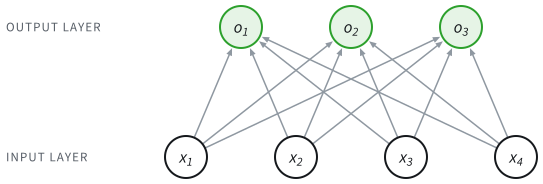
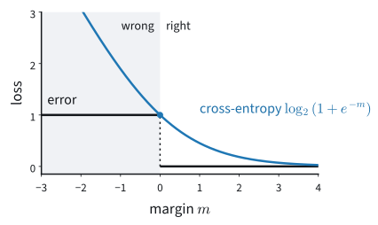
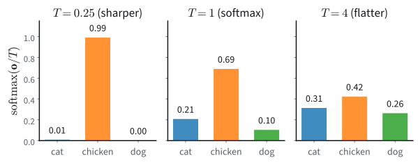

# Softmax Regression
:label:`sec_softmax`

Regression is the hammer we reach for when answering *how much?* or *how
many?* questions, such as predicting the sale price of a house in
:numref:`sec_linear_regression`. Many supervised learning problems,
however, put aside *how much?* and ask *which category?* instead. Problems
of this kind are called *classification*. A spam filter sorts email into two
classes, a diagnostic tool chooses among a handful of diseases, and a
language model predicts the next token from a vocabulary of tens of
thousands of words. How can a linear model answer such a question, and what
loss function should guide its training?

Consider an online retailer sorting product photos into ten apparel
categories: T-shirt, trouser, pullover, dress, coat, sandal, shirt,
sneaker, bag, and ankle boot. We could assign those categories the integers
1 through 10 and apply linear regression right out of the box—but the
result would be nonsensical, because those integers are arbitrary names
rather than numeric quantities. A prediction of 5.5 would place a photo
halfway between a coat and a sandal, whatever that could possibly mean.
Worse still, squared error would penalize mistaking a T-shirt (1) for an
ankle boot (10) 81 times more heavily than mistaking it for a trouser (2),
even though nothing makes the first error inherently worse than the second.

Practitioners also use the word *classification* to cover two subtly
different goals: *hard assignments* (committing to a single class) and
*soft assignments* (estimating the probability of each class). Even when we
ultimately need a hard decision, we nearly always prefer models that output
probabilities: a spam filter should quarantine an email only when it is
nearly certain, and a clinician needs to know how probable each diagnosis
is, not merely which one edged out the rest.

*Softmax regression* solves both problems cleanly: it computes one linear
score per class and transforms those scores into a valid probability
distribution. To train it, we follow the exact maximum-likelihood recipe of
:numref:`sec_linear_regression`—specify a probabilistic model for the
labels and minimize the negative log-likelihood of what we observe. Whereas
Gaussian noise produced the squared loss for regression, a categorical
label model produces the *cross-entropy loss*. Throughout this chapter,
every example belongs to exactly one class from an unordered set of
categories. In the sections that follow, we will train this model on real
clothing images and examine how well it generalizes to unseen data.

## The Model

### Class Labels
:label:`subsec_classification-problem`

To get our feet wet, let us begin with a problem small enough to write out
in full. Suppose every input is a $2\times2$ grayscale image, giving us
four scalar pixel features $x_1, x_2, x_3, x_4$, and every image depicts a
cat, a chicken, or a dog. We number these classes 1, 2, 3 in that order; in
general, with $q$ classes, the label $y$ of an example is an integer in
$\{1, \ldots, q\}$.

Because these categories carry no natural ordering, regressing directly on
the integers 1, 2, 3 would inject a spurious geometry just as with the
clothing codes above. Instead, statisticians represent unordered categories
using a *one-hot encoding*: a vector $\mathbf{y} \in \{0, 1\}^q$ with a 1
in the coordinate of the true class and 0 everywhere else. Thus a chicken
becomes $\mathbf{y} = (0, 1, 0)$, and in general $y_j = 1$ if the example
belongs to class $j$ and $0$ otherwise. Every class now gets its own axis,
making all pairs of distinct classes equidistant. Better yet, a one-hot
vector is itself a probability distribution—the degenerate distribution
placing all its mass on the true class—so we can compare it directly with
the probability vector predicted by our model. Throughout our equations,
$y$ denotes the integer class index while $\mathbf{y}$ denotes its one-hot
vector; in Python code, we store the integer index directly, zero-based as
Python conventions dictate.

### Linear Scores

To estimate conditional probabilities for all $q$ classes simultaneously,
softmax regression assigns every class its own affine function of the
inputs. Class $j$ receives a score $o_j$ formed as a weighted sum of the
features plus a bias, with its own dedicated parameters. Writing $w_{kj}$
for the weight connecting feature $k$ to class $j$, our $2\times2$ image
classifier computes three scores:

$$
\begin{aligned}
o_1 &= x_1 w_{11} + x_2 w_{21} + x_3 w_{31} + x_4 w_{41} + b_1,\\
o_2 &= x_1 w_{12} + x_2 w_{22} + x_3 w_{32} + x_4 w_{42} + b_2,\\
o_3 &= x_1 w_{13} + x_2 w_{23} + x_3 w_{33} + x_4 w_{43} + b_3.
\end{aligned}
$$

Each equation is an ordinary linear regression of the sort we built in
:numref:`sec_linear_regression`, giving 12 weights and 3 biases in total.
Higher scores $o_j$ will correspond to more probable classes; these raw
unnormalized scores are called *logits*, for a reason we explain shortly.
Viewed as a neural network (:numref:`fig_softmaxreg`), softmax regression
is again a single-layer network, now with $q$ output units instead of one.
Because every output depends on every input, this output layer is a *fully
connected layer*.

:label:`fig_softmaxreg`

In matrix notation, we collect the weights into
$\mathbf{W} \in \mathbb{R}^{4 \times 3}$ (one row per feature, one column
per class) and the biases into $\mathbf{b} \in \mathbb{R}^3$. Denoting
column $j$ of $\mathbf{W}$ by $\mathbf{w}_j$, class $j$'s score is
$o_j = \mathbf{w}_j^\top \mathbf{x} + b_j$, and all scores together read

$$\mathbf{o} = \mathbf{W}^\top \mathbf{x} + \mathbf{b}.$$

Here entry $j$ of $\mathbf{W}^\top \mathbf{x}$ is simply the inner product
$\mathbf{w}_j^\top \mathbf{x}$. For general $d$-dimensional inputs and $q$
classes, $\mathbf{W} \in \mathbb{R}^{d \times q}$ and
$\mathbf{o}, \mathbf{b} \in \mathbb{R}^q$. Placing features along rows and
classes along columns is purely a notational convention chosen to match the
minibatch equations and code below. On the $28 \times 28$ clothing images
we will soon classify, $d = 784$ and $q = 10$, giving $7{,}840$ weights and
10 biases.

### The Softmax
:label:`subsec_softmax_operation`

Suppose that for some image our linear layer outputs the logits
$\mathbf{o} = (1.0, 2.2, 0.3)$. Clearly the chicken has the highest score,
yet these numbers are not valid probabilities: they sum to 3.5 rather than
1, and in general nothing stops a raw linear score from turning negative or
exceeding 1. Why not simply fit $\mathbf{o}$ directly to the one-hot labels
by least squares, as a vector-valued regression? While that crude approach
can occasionally work, linear functions grow without bound: if bedroom
count enters linearly into the probability of buying a house, the model
will happily predict a "probability" greater than 1 for a mansion and less
than 0 for a studio.

We therefore need a smooth mapping that converts any real vector
$\mathbf{o} \in \mathbb{R}^q$ into a valid probability distribution—$q$
nonnegative numbers summing to 1—while preserving the ordering of scores.
Two simple operations do the job: exponentiate every score so that all
values become strictly positive while preserving order, and then *normalize*
by dividing each exponential by their sum. Why choose the exponential over
some other positive, increasing function? Because exponentials turn
addition into multiplication: shifting scores by a constant rescales
exponentials by a constant, differences of logits correspond directly to
ratios of probabilities, and—as we will soon see—the gradient of the loss
collapses to the cleanest conceivable expression. Together, these two steps
define the *softmax* function:

$$\hat{\mathbf{y}} = \mathrm{softmax}(\mathbf{o}) \quad \textrm{where} \quad \hat{y}_j = \frac{\exp(o_j)}{\sum_{k=1}^q \exp(o_k)}.$$
:eqlabel:`eq_softmax_y_and_o`

Every predicted probability is proportional to the exponential of its
logit. Returning to $\mathbf{o} = (1.0, 2.2, 0.3)$, the exponentials are
$(2.72, 9.03, 1.35)$ with sum $13.09$, yielding
$\hat{\mathbf{y}} = (0.21, 0.69, 0.10)$: the model assigns the chicken a
69% probability. Because $\exp$ is strictly increasing, softmax preserves
the ranking of the logits, so the most probable class is always the one
with the largest logit:

$$\operatorname*{argmax}_j \hat{y}_j = \operatorname*{argmax}_j o_j.$$

When we only need a hard class prediction at inference time, we can bypass
the softmax altogether and simply read off the largest logit.

Look a bit closer at what exponentiation buys us: *only differences
between logits matter*. Adding any constant $c$ to every entry of
$\mathbf{o}$ multiplies both numerator and denominator of
:eqref:`eq_softmax_y_and_o` by $\exp(c)$, which cancels out identically:
$\mathrm{softmax}(\mathbf{o} + c\mathbf{1}) = \mathrm{softmax}(\mathbf{o})$.
Equivalently, the difference between any two logits equals the
log-ratio of their predicted probabilities:

$$o_i - o_j = \log \frac{\hat{y}_i}{\hat{y}_j}.$$

In our example, the chicken's logit exceeds the cat's by 1.2, so the
chicken is $e^{1.2} \approx 3.3$ times as probable as the cat
($0.69 / 0.21$). Consequently, the $q$ logits carry one redundant degree of
freedom: we could clamp one class's score to 0 without changing any
prediction, though keeping all $q$ outputs preserves symmetry across
classes. Better yet, this shift invariance hands us a vital numerical
trick: subtracting $\max_k o_k$ from every logit before exponentiating
prevents floating-point overflow without altering the output
(:numref:`sec_softmax_scratch`).

In the special case of two classes ($q = 2$), the probabilities depend only
on the single difference $o = o_1 - o_2$:

$$\hat{y}_1 = \frac{\exp(o_1)}{\exp(o_1) + \exp(o_2)} = \frac{1}{1 + \exp(-o)} = \sigma(o).$$
:eqlabel:`eq_softmax_to_sigmoid`

Here $\sigma$ is the *logistic sigmoid*, mapping the real line smoothly
into $(0, 1)$. Two-class softmax regression is therefore identical to
*logistic regression*, the classic binary classifier of statistics. Because
$o = \log(\hat{y}_1/\hat{y}_2)$ is the log-odds of class 1, statisticians
named this quantity the *logit*; machine learning later adopted the term, a
bit more loosely, for the raw pre-softmax scores of any classifier.

### Minibatches
:label:`subsec_softmax_vectorization`

Just as in linear regression, we accelerate training and inference by
vectorizing computations over minibatches. Stacking $n$ examples into the
rows of $\mathbf{X} \in \mathbb{R}^{n \times d}$, we compute

$$
\begin{aligned}
\mathbf{O} &= \mathbf{X} \mathbf{W} + \mathbf{b},\\
\hat{\mathbf{Y}} &= \mathrm{softmax}(\mathbf{O}),
\end{aligned}
$$
:eqlabel:`eq_minibatch_softmax_reg`

where row $i$ of $\mathbf{O} \in \mathbb{R}^{n \times q}$ contains the
logits for example $i$ and $\mathbf{b}$ is added to every row via
broadcasting. The softmax is applied *rowwise*: each row of $\mathbf{O}$ is
exponentiated and normalized by its own row sum, so row $i$ of
$\hat{\mathbf{Y}}$ is the predicted class distribution for example $i$. The
bulk of the computation collapses into the single matrix--matrix product
$\mathbf{X}\mathbf{W}$—for a minibatch of 256 clothing images, multiplying
a $256 \times 784$ matrix by a $784 \times 10$ matrix executes roughly two
million multiply-adds in one vectorized call.

### Decision Regions

Because we pick the class with the largest logit and every logit is affine
in $\mathbf{x}$, softmax regression carves input space into remarkably
simple regions (:numref:`fig_mdl-clf-decision-regions`). Class $j$ wins
wherever $o_j \geq o_k$ for all $k \neq j$. Each of these $q - 1$
inequalities,
$(\mathbf{w}_j - \mathbf{w}_k)^\top \mathbf{x} + b_j - b_k \geq 0$, defines
a closed half-space bounded by a hyperplane. Intersecting those half-spaces
produces a convex polyhedron for each class, with neighboring classes
meeting along the flat hyperplane where their scores tie.

With two classes, $\hat{y}_1 = \sigma(o)$ depends on $\mathbf{x}$ solely
through $o = (\mathbf{w}_1 - \mathbf{w}_2)^\top \mathbf{x} + b_1 - b_2$.
Contours of constant predicted probability form parallel hyperplanes
perpendicular to $\mathbf{w}_1 - \mathbf{w}_2$, with the decision boundary
at $\hat{y}_1 = \frac{1}{2}$. Notice the key geometric limitation: although
the softmax curves the probabilities into an S-shape, the boundaries
between classes remain completely flat. Four points placed at the corners
of a square, with one class on each diagonal pair (the XOR pattern), can
never be separated by a single line. Capturing curved or disconnected
decision regions requires hidden layers, which we introduce in
:numref:`chap_perceptrons`.

:label:`fig_mdl-clf-decision-regions`

Before moving on, keep in mind our modeling assumption: every example
belongs to *exactly one* class from an *unordered* set. Two important
variants relax these conditions. In *multi-label classification*, several
categories may apply simultaneously—for example, a news article covering
both business and space flight—so we use an independent sigmoid for each
label rather than a competing softmax :cite:`Tsoumakas.Katakis.2007`. In
*ordinal regression*, categories follow an intrinsic order (such as age
brackets from infant to senior), and ignoring that order throws away
valuable structure :cite:`Moon.Smola.Chang.ea.2010`.

## The Cross-Entropy Loss
:label:`subsec_softmax-regression-loss-func`

Now that we can map features $\mathbf{x}$ to class probabilities
$\hat{\mathbf{y}}$, we need a loss function to measure how well those
probabilities match the observed labels. Rather than inventing one ad hoc,
we invoke the same maximum-likelihood principle that gave us squared error
in :numref:`sec_linear_regression`: specify how labels are generated from
our predictions and minimize the negative log-likelihood of the dataset.

### Maximum Likelihood

The softmax vector $\hat{\mathbf{y}}$ directly defines a probabilistic
model of the label: given features $\mathbf{x}$, the example belongs to
class $j$ with probability $\hat{y}_j$. The probability assigned to the
observed label $y$ is therefore $\hat{y}_y$, which we can write neatly as a
product over all classes using the one-hot vector $\mathbf{y}$:

$$P(y \mid \mathbf{x}) = \hat{y}_y = \prod_{j=1}^q \hat{y}_j^{y_j},$$

because every factor other than the true class is raised to the zeroth
power. This *categorical distribution* plays the exact role here that
Gaussian observation noise played in linear regression.

Assuming that the $n$ training labels are drawn independently given their
features, the likelihood of the entire dataset factors into the product of
per-example probabilities. Taking the negative logarithm turns that product
into a sum and converts maximization into minimization:

$$-\log \prod_{i=1}^n P(y^{(i)} \mid \mathbf{x}^{(i)}) = \sum_{i=1}^n l(\mathbf{y}^{(i)}, \hat{\mathbf{y}}^{(i)}),$$

where the per-example loss is

$$l(\mathbf{y}, \hat{\mathbf{y}}) = -\sum_{j=1}^q y_j \log \hat{y}_j = -\log \hat{y}_y.$$
:eqlabel:`eq_l_cross_entropy`

In words, the loss is simply the negative logarithm of the probability our
model assigns to the true class—known as the *cross-entropy loss* for an
information-theoretic reason we unpack shortly. With logits
$(1.0, 2.2, 0.3)$ on an image of a chicken ($\hat{y}_2 = 0.69$), the loss
is $-\log 0.69 \approx 0.37$. If the image were actually a dog
($\hat{y}_3 = 0.10$), the loss jumps to $-\log 0.10 \approx 2.3$, more than
six times as large.

Because every probability $\hat{y}_j$ lies in $(0, 1)$, the loss is always
nonnegative. It vanishes only when the model assigns probability 1 to the
true class—something finite logits can approach arbitrarily closely but
never actually attain, since $\exp(o_k) > 0$ for every class. Conversely,
a confident blunder incurs an unbounded penalty: as $\hat{y}_y \to 0$,
$-\log \hat{y}_y \to \infty$.

### The Gradient
:label:`subsec_softmax_and_derivatives`

To optimize this objective with minibatch SGD, let us differentiate the
loss with respect to the logits $\mathbf{o}$. Substituting
:eqref:`eq_softmax_y_and_o` into :eqref:`eq_l_cross_entropy` and using
$\sum_j y_j = 1$ gives

$$
\begin{aligned}
l(\mathbf{y}, \hat{\mathbf{y}}) &= -\sum_{j=1}^q y_j \log \frac{\exp(o_j)}{\sum_{k=1}^q \exp(o_k)} \\
&= \sum_{j=1}^q y_j \log \sum_{k=1}^q \exp(o_k) - \sum_{j=1}^q y_j o_j \\
&= \log \sum_{k=1}^q \exp(o_k) - o_y.
\end{aligned}
$$

Thus the cross-entropy loss equals the *log-sum-exp* of all logits minus
the true class's logit. Because log-sum-exp is a smooth upper approximation
to the maximum—exceeding $\max_k o_k$ by at most $\log q$ (exercise
:exref:`ex_softmax-regression-realsoftmax`)—the loss becomes small whenever
the true class's logit leads every rival by a comfortable margin.
Differentiating $\log \sum_k \exp(o_k)$ with respect to $o_j$ yields
$\exp(o_j) / \sum_k \exp(o_k)$, the softmax itself, so

$$\frac{\partial l}{\partial o_j} = \mathrm{softmax}(\mathbf{o})_j - y_j, \quad \textrm{that is,} \quad \nabla_{\mathbf{o}}\, l = \hat{\mathbf{y}} - \mathbf{y}.$$

Here is the payoff promised by the exponential: the gradient is simply the
difference between the model's predicted probabilities and what actually
happened. For our chicken image,
$\nabla_{\mathbf{o}}\, l = (0.21, 0.69, 0.10) - (0, 1, 0) = (0.21, -0.31, 0.10)$.
A gradient descent step therefore boosts the true class's logit while
pushing down every rival logit in exact proportion to the probability mass
it wrongly claimed. Notice too that the gradient components sum to zero, as
they must given the shift invariance of the softmax.

Applying the chain rule through $o_j = \mathbf{w}_j^\top \mathbf{x} + b_j$
gives $\partial l / \partial \mathbf{w}_j = (\hat{y}_j - y_j)\,\mathbf{x}$
and $\partial l / \partial b_j = \hat{y}_j - y_j$: each update pulls the
true class's weight vector toward $\mathbf{x}$ and nudges every other
class's weights away from it. Over a minibatch with one-hot label rows
$\mathbf{Y} \in \{0, 1\}^{n \times q}$, the average gradient with respect to
$\mathbf{W}$ is cleanly
$\frac{1}{n}\mathbf{X}^\top(\hat{\mathbf{Y}} - \mathbf{Y})$, matching the
$d \times q$ shape of $\mathbf{W}$.

Notice the uncanny parallel with linear regression, where the derivative of
$\frac{1}{2}(\hat{y} - y)^2$ with respect to $\hat{y}$ was also prediction
minus observation, $\hat{y} - y$. This is no coincidence: in every
exponential-family generalized linear model, the gradient of the negative
log-likelihood with respect to the natural parameters takes this exact
residual form (:numref:`subsec_mdl-glm`). Placing both models side by side
highlights the unity:

| | Linear regression | Softmax regression |
|:--|:--|:--|
| label | a real number $y$ | a class $y$, one-hot $\mathbf{y}$ |
| prediction | $\hat{y} = \mathbf{w}^\top \mathbf{x} + b$ | $\hat{\mathbf{y}} = \mathrm{softmax}(\mathbf{W}^\top \mathbf{x} + \mathbf{b})$ |
| model of the label | Gaussian centered at $\hat{y}$ | categorical with probabilities $\hat{\mathbf{y}}$ |
| loss (negative log-likelihood) | $\frac{1}{2}(\hat{y} - y)^2$ | $-\log \hat{y}_y$ |
| gradient | $\hat{y} - y$ with respect to $\hat{y}$ | $\hat{\mathbf{y}} - \mathbf{y}$ with respect to $\mathbf{o}$ |

Better still, the cross-entropy loss is *convex* in the logits. For two
classes ($o = o_1 - o_2$), the loss for class 1 is $\log(1 + \exp(-o))$,
whose second derivative is $\sigma(o)(1 - \sigma(o)) > 0$—the variance of a
Bernoulli trial with success probability $\sigma(o)$. With $q$ classes,
this second derivative generalizes to the covariance matrix of the
predicted categorical distribution, which is always positive semidefinite
(exercise :exref:`ex_softmax-regression-hessian`). Because the logits are
affine functions of $(\mathbf{W}, \mathbf{b})$, the training objective is
convex in all parameters, ensuring that every local minimum is a global
minimum—a mathematical luxury we will have to leave behind once we build
deep nonlinear networks in later chapters.

### Entropy and Cross-Entropy
:label:`subsec_info_theory_basics`

The term *cross-entropy* originates in information theory, the discipline
founded by Claude Shannon to study compression and communication. Why does
compression connect to prediction? Think of compressing a stream of
symbols: if you can predict the next symbol with certainty, you need send
no information at all; easy to predict means easy to compress. When an
event of probability $p$ occurs, Shannon defined its *surprisal* as
$-\log p$: a certain outcome ($p = 1$) causes zero surprise, while rarer
events cause greater surprise. Our loss $-\log \hat{y}_y$ is literally the
surprisal of the true label under our model's predicted probabilities.

For a true distribution $\mathbf{p}$ over $q$ classes, the *entropy*
$H(\mathbf{p})$ is the expected surprisal of an observer who knows
$\mathbf{p}$ exactly:

$$H(\mathbf{p}) = -\sum_{j=1}^q p_j \log p_j.$$

Entropy equals 0 when one outcome is certain and reaches its maximum,
$\log q$, when all $q$ outcomes are equally likely. Using natural
logarithms measures entropy in *nats* rather than base-2 bits, where one
nat equals $1/\log 2 \approx 1.44$ bits.

If an observer instead models the same data stream with an approximate
distribution $\hat{\mathbf{p}}$, their expected surprisal becomes the
*cross-entropy* of $\hat{\mathbf{p}}$ relative to $\mathbf{p}$:

$$H(\mathbf{p}, \hat{\mathbf{p}}) = -\sum_{j=1}^q p_j \log \hat{p}_j.$$

Comparing this with :eqref:`eq_l_cross_entropy`, our classification loss is
precisely $H(\mathbf{y}, \hat{\mathbf{y}})$—the cross-entropy between the
one-hot label and the predicted distribution. A cornerstone result, Gibbs'
inequality (proved in :numref:`sec_mdl-information_theory`), shows that
misstating the true probabilities can only increase average surprise:

$$H(\mathbf{p}, \hat{\mathbf{p}}) \geq H(\mathbf{p}), \quad \textrm{with equality if and only if } \hat{\mathbf{p}} = \mathbf{p}.$$

In compression terms, $H(\mathbf{p})$ is the shortest average code length
achievable (:numref:`sec_mdl-coding-compression`), and cross-entropy
measures how many nats we spend when encoding outcomes from $\mathbf{p}$
using a code tailored to $\hat{\mathbf{p}}$. Thus we can interpret
cross-entropy training in two equivalent ways: (i) maximizing the
likelihood of the observed labels, or (ii) minimizing the average
surprisal—and code length—needed to communicate them.

This perspective shines whenever labels are inherently uncertain even given
the input. Suppose a tiny, blurry photo could plausibly be a shirt (60%) or
a T-shirt (40%), so examples like it carry random labels drawn from
$\mathbf{p} = (0.6, 0.4)$. A model's expected loss is then
$H(\mathbf{p}, \hat{\mathbf{y}})$: reporting the honest probabilities
$(0.6, 0.4)$ incurs $H(\mathbf{p}) = 0.67$ nats, whereas overconfidently
guessing $(0.9, 0.1)$ drives the expected loss up to $0.98$ nats. By Gibbs'
inequality, cross-entropy uniquely rewards calibrated, honest probabilities
rather than exaggerated certainty. Better still, the general sum
$-\sum_j y_j \log \hat{y}_j$ works unchanged when targets $\mathbf{y}$ are
themselves *soft* probability vectors—for instance, the fraction of human
annotators voting for each class—whereas the shorthand $-\log \hat{y}_y$
applies specifically to hard one-hot labels.

## Accuracy and Confidence

In practice, classifiers are most often evaluated by *accuracy*—the
fraction of examples where the top-scoring class matches the true label—or
equivalently by *error rate* ($1 - \text{accuracy}$). Yet we do not train
by minimizing the error rate directly; we minimize cross-entropy instead.
Understanding why—and how this choice shapes the model's confidence—prevents
several common misconceptions.

### The Error Rate

Whether an example is classified correctly hinges on its *margin*, defined
as the true class's logit minus the highest competing logit:

$$m = o_y - \max_{j \neq y} o_j.$$

The prediction is right whenever $m > 0$ and wrong whenever $m < 0$. The
zero-one classification error (1 for a mistake, 0 for a correct prediction)
is therefore a discontinuous step function of $m$
(:numref:`fig_mdl-clf-margin-losses`). Everywhere the step function is
differentiable, its derivative is zero: a tiny tweak to the weights either
flips no decisions (zero change in error) or suddenly flips one (an abrupt
jump). Gradient descent receives no usable signal from it at all.

Cross-entropy replaces that flat, jagged step with a smooth, convex
surrogate in the margin. For two classes, the true class has probability
$\sigma(m)$ by :eqref:`eq_softmax_to_sigmoid`, giving

$$l = -\log \sigma(m) = \log\left(1 + \exp(-m)\right).$$

For $q$ classes,
$\log \sum_k \exp(o_k) - o_y = \log\left(1 + \sum_{j \neq y} \exp(o_j - o_y)\right)$
is at least as large, because the sum contains $\exp(-m)$. As
:numref:`fig_mdl-clf-margin-losses` illustrates, this surrogate decreases
monotonically across the entire real line, so every example supplies a
nonzero gradient pushing its margin upward—with misclassified examples
pushing hardest. Moreover, cross-entropy upper-bounds the error rate:
whenever $m \leq 0$, the loss is at least $\log 2$, so dividing the total
loss by $\log 2$ upper-bounds the number of training mistakes. For example,
an average training loss of 0.07 nats guarantees at most
$0.07 / \log 2 \approx 10\%$ training errors. Although this bound is loose
(at 0.45 nats it permits up to 65% errors, whereas real models err far less
often because correctly classified examples also contribute positive loss),
it ensures that driving cross-entropy down cannot leave the error rate
high—while giving gradient descent a smooth slope to follow.

:label:`fig_mdl-clf-margin-losses`

Crucially, cross-entropy never bottoms out at zero: even after the margin
turns positive and the decision is already right, it keeps rewarding larger
margins. Pushing $\hat{y}_y$ from 0.51 to 0.99 changes not a single class
prediction, yet cuts the loss from 0.67 down to 0.01.

### Calibration and Temperature

Pushed to its logical extreme, this relentless reward for confidence has a
striking consequence. Whenever a dataset is linearly separable—meaning some
$(\mathbf{W}, \mathbf{b})$ classifies every training example without error—scaling
those parameters up by any factor $c > 1$ scales every margin by $c$ and
strictly lowers the training loss. Consequently, the unregularized training
loss has *no finite minimum*, and gradient descent will grow the weights
without bound (exercise :exref:`ex_softmax-regression-separable`). The
decision boundaries never budge; only the predicted probabilities march
steadily toward 0 and 1.

The overall scale of the logits therefore governs *confidence* alone.
Dividing all logits by a positive *temperature* $T > 0$ prior to the
softmax,

$$\hat{\mathbf{y}} = \mathrm{softmax}(\mathbf{o} / T),$$

sharpens the predicted distribution when $T < 1$ and flattens it toward
uniformity when $T > 1$ (:numref:`fig_mdl-clf-temperature`), all while
leaving the ranking of the logits—and hence the predicted class and
accuracy—completely untouched. Both the softmax formula and the term
*temperature* trace back to Boltzmann and Gibbs in statistical physics,
where the probability of occupying a physical state of energy $E$ at
temperature $T$ is proportional to $\exp(-E / kT)$
(:numref:`subsec_mdl-softmax-origins`).

:label:`fig_mdl-clf-temperature`

A low training loss therefore does not automatically vouch for a model's
probabilities. Whether predictions made with 90% confidence are actually
correct nine times out of ten is an empirical question we must test on
held-out data—a check we carry out in :numref:`sec_classification`. First,
however, we need a real image classification dataset to train and test on.

## Summary

Softmax regression generalizes linear regression to unordered multi-class
classification by computing one linear logit per class,
$\mathbf{o} = \mathbf{W}^\top\mathbf{x} + \mathbf{b}$, and converting those
logits into a valid probability distribution via the softmax operation
$\hat{y}_j = \exp(o_j) / \sum_k \exp(o_k)$. Because only differences
between logits affect the output, the model reduces to logistic regression
for two classes and partitions input space along flat hyperplane decision
boundaries. Modeling the observed label as a draw from the predicted
categorical distribution and minimizing its negative log-likelihood yields
the convex cross-entropy loss $-\log \hat{y}_y$—equivalently, the
information-theoretic surprisal of the true class—whose gradient with
respect to the logits takes the clean residual form
$\hat{\mathbf{y}} - \mathbf{y}$. Unlike the discontinuous zero-one error
rate, cross-entropy provides a smooth, convex upper bound that gradient
descent can optimize, though its continual push toward higher margins means
that predicted probabilities should always be checked for calibration on
held-out data.

## Exercises

1. **By hand.** A three-class model computes the logits $(2, 0, -1)$ for
   an input.
    1. Compute the softmax probabilities, and the loss and the gradient
       $\hat{\mathbf{y}} - \mathbf{y}$ for each of the three possible
       labels. Check that each gradient sums to zero.
    1. Subtract 5 from every logit and repeat. State in one sentence what
       changed and what did not.
    1. Divide the logits by $T = 2$ and by $T = \frac{1}{2}$. Which
       quantities change, and which class is predicted in each case?

1. **Softmax and sigmoid.** By :eqref:`eq_softmax_to_sigmoid`, logistic
   regression is softmax regression with two classes and one redundant
   logit removed. A colleague hands you a fitted logistic model
   $P(y = 1 \mid x) = \sigma(\hat\beta_0 + \hat\beta_1 x)$ with
   $\hat\beta_0 = 2$ and $\hat\beta_1 = -1$.
    1. Characterize all two-class softmax coefficients $(w_1, b_1)$ and
       $(w_2, b_2)$ whose predictions coincide with the logistic model for
       every $x$, and identify the pair with $o_2 \equiv 0$.
    1. Show that gradient descent on the cross-entropy loss of the
       two-class softmax model never changes $w_1 + w_2$ or $b_1 + b_2$.
       Suppose that gradient descent starts from
       $w_1 = w_2 = b_1 = b_2 = 0$ on the colleague's training data and
       converges to coefficients that reproduce the logistic model.
       Determine which pair it reaches.

    *Adapted from James, Witten, Hastie, and Tibshirani,
    [An Introduction to Statistical Learning](https://www.statlearning.com/),
    Exercise 4.12.*

1. **Softmax Hessian.** As in :numref:`subsec_softmax_and_derivatives`,
   write the cross-entropy loss as a function of the logits,
   $l(\mathbf{y}, \mathbf{o}) = g(\mathbf{o}) - \mathbf{y}^\top \mathbf{o}$
   with $g(\mathbf{o}) = \log \sum_k \exp(o_k)$.
    1. Compute the Hessian $\partial^2_{\mathbf{o}}\, l(\mathbf{y}, \mathbf{o})$
       and show that it does not depend on $\mathbf{y}$.
    1. Let $\mathbf{e}_Y$ be the one-hot vector of a class $Y$ drawn from
       $\mathrm{softmax}(\mathbf{o})$. Compute the covariance matrix of
       $\mathbf{e}_Y$ and show that it equals the Hessian from the previous
       step.
    1. Conclude that $g$ is convex and that the cross-entropy loss is convex
       in the logits.
   :exlabel:`ex_softmax-regression-hessian`

1. **Bradley--Terry model.** The
   [Bradley--Terry model](https://en.wikipedia.org/wiki/Bradley%E2%80%93Terry_model)
   :cite:`Bradley.Terry.1952` uses a logistic model to capture preferences.
   A user who chooses between apples and oranges picks each item with the
   probability given by the softmax of two scores, $o_{\textrm{apple}}$ and
   $o_{\textrm{orange}}$. Now add a default option of choosing neither,
   with a fixed score $o_{\textrm{none}} = 0$.
    1. Determine whether adding the same constant to $o_{\textrm{apple}}$
       and $o_{\textrm{orange}}$ changes the choice probabilities, first
       without and then with the default option. Conclude which scores the
       observed choices can determine in each model.
    1. Compare the ratio $P(\textrm{apple}) / P(\textrm{orange})$ with and
       without the default option. Describe a choice situation in which
       real users would not keep this ratio fixed.

1. **Log-sum-exp.** The function $\mathrm{lse}(a, b) = \log(\exp(a) + \exp(b))$
   is the log-sum-exp of :numref:`subsec_softmax_and_derivatives` with two
   arguments, so its gradient is the softmax of $(a, b)$.
    1. Prove that
       $$\max(a, b) < \mathrm{lse}(a, b) \leq \max(a, b) + \log 2,$$
       with equality on the right exactly when $a = b$, and show that the
       gap to $\max(a, b)$ can be made arbitrarily small. Hint: without
       loss of generality set $b = 0$ and $a \geq 0$.
    1. Prove that for every $\lambda > 0$
       $$\max(a, b) < \lambda^{-1} \mathrm{lse}(\lambda a, \lambda b) \leq \max(a, b) + \lambda^{-1} \log 2,$$
       and conclude that
       $\lambda^{-1} \mathrm{lse}(\lambda a, \lambda b) \to \max(a, b)$
       as $\lambda \to \infty$.
    1. Construct an analogous smooth minimum.
    1. Extend the definition and both bounds to $q$ numbers, showing that
       the gap to $\max_i a_i$ is at most $\log q$.
   :exlabel:`ex_softmax-regression-realsoftmax`

1. **Temperature.** Let $P = \mathrm{softmax}(\mathbf{o})$, and let the
   distribution at temperature $T$ be $\mathrm{softmax}(\mathbf{o}/T)$.
   Suppose we pick another distribution $Q$ with $Q(i) \propto P(i)^\alpha$
   for $\alpha > 0$.
    1. Which choice of $\alpha$ corresponds to doubling the temperature?
       Which choice corresponds to halving it?
    1. Suppose that exactly $s$ of the $q$ logits attain the largest value.
       Find the limit of $\mathrm{softmax}(\mathbf{o}/T)$ as $T \to 0$.
    1. Let $\bar{o} = \frac{1}{q}\sum_j o_j$ be the mean logit. Show that
       for large $T$
       $$\mathrm{softmax}(\mathbf{o}/T)_i = \frac{1}{q} + \frac{o_i - \bar{o}}{qT} + O(T^{-2}).$$
    1. Temperature scaling fits a single $T$ by minimizing the
       cross-entropy on a held-out set with the logits of the classifier
       held fixed. Show that this cross-entropy is a convex function of
       $\beta = 1/T$, so that the fit is a one-dimensional convex problem.
       Hint: use the convexity of $g$ from
       exercise :exref:`ex_softmax-regression-hessian`.
   :exlabel:`ex_softmax-regression-temperature`

1. **Separable data.** ● Suppose that some parameters
   $(\mathbf{W}, \mathbf{b})$ classify every training example correctly and
   without ties: on each example, the logit of the true class strictly
   exceeds every other logit. Consider the scaled parameters
   $(c\mathbf{W}, c\mathbf{b})$ for $c > 0$.
    1. Show that the cross-entropy loss of every training example strictly
       decreases as $c$ grows and tends to $0$ as $c \to \infty$.
    1. Conclude that the training loss has no minimizer and that every
       sequence of parameters whose training loss tends to $0$ has
       unbounded norm.
    1. Add the weight decay penalty of :numref:`sec_weight_decay`, applied
       to both weights and biases,
       $\frac{\lambda}{2}(\|\mathbf{W}\|^2 + \|\mathbf{b}\|^2)$ with
       $\lambda > 0$, to the training loss. Show that the penalized loss
       has a minimizer.
   :exlabel:`ex_softmax-regression-separable`

1. **Squared error on probabilities.** Instead of cross-entropy, we could
   fit the predicted probabilities to the one-hot label with the squared
   loss $\frac{1}{2}\|\hat{\mathbf{y}} - \mathbf{y}\|^2$.
    1. Show that the derivatives of the softmax are
       $\partial \hat{y}_k / \partial o_j = \hat{y}_k(\mathbf{1}(j = k) - \hat{y}_j)$,
       and use them to compute the gradient of the squared loss with
       respect to the logits.
    1. For two classes, write both losses as functions of the margin $m$
       and compute their derivatives with respect to $m$. Show that as
       $m \to -\infty$, that is, for a confident mistake, the derivative of
       the squared loss tends to 0 while that of the cross-entropy tends to
       $-1$.
    1. Explain what this difference means for a model that starts training
       with confident wrong predictions.

1. [code] **Gumbel-max trick.** ● Suppose that a label is generated by
   perturbing every logit with independent noise and reporting the class
   with the largest perturbed score,
   $y = \operatorname*{argmax}_i \, (o_i + \gamma_i)$. Gaussian noise gives
   the probit model, whose class probabilities have no closed form; one
   other noise distribution reproduces the softmax probabilities exactly.
   Let $\gamma_1, \ldots, \gamma_q$ be i.i.d. draws from the standard
   [Gumbel distribution](https://en.wikipedia.org/wiki/Gumbel_distribution),
   whose CDF is $P(\gamma \leq z) = \exp(-\exp(-z))$.
    1. Show that $P(o_k + \gamma_k \leq z) = \exp(-\exp(o_k)\exp(-z))$.
    1. Show that
       $P\left(\operatorname{argmax}_i \, (o_i + \gamma_i) = k\right) = \mathrm{softmax}(\mathbf{o})_k$.
       Hint: condition on the value of $o_k + \gamma_k$ and use the
       substitution $u = \exp(-z)$.
    1. Conclude that scaling the noise, $\gamma_i \mapsto T\gamma_i$,
       samples from $\mathrm{softmax}(\mathbf{o}/T)$.
    1. Verify your result numerically: for $\mathbf{o} = (1.0, 2.2, 0.3)$
       and $T \in \{0.25, 1, 4\}$, draw $10^5$ samples of
       $\operatorname{argmax}_i (o_i + T\gamma_i)$ and confirm that the
       label frequencies match $\mathrm{softmax}(\mathbf{o}/T)$ up to Monte
       Carlo error.
   :exlabel:`ex_softmax-regression-gumbel-max-trick`

[Discussions](https://d2l.discourse.group/t/46)

<!-- slides -->

::: {.slide}
::: {.cover}
[Dive into Deep Learning · §3.1]{.kicker}

Probabilities for categories 
**one-hot labels · the softmax · cross-entropy · the gradient $\hat{\mathbf{y}} - \mathbf{y}$ · temperature**
:::
:::

::: {.slide title="A Class Code of 5.5 Means Nothing"}
[The problem]{.kicker}

Sort clothing photos into ten categories: T-shirt (code 1), trouser (2),
…, coat (5), sandal (6), …, ankle boot (10). Regress on the codes?

- A prediction of 5.5 sits "between" a coat and a sandal.
- The squared loss charges $(10-1)^2 = 81$ for T-shirt → ankle boot, but
  $(2-1)^2 = 1$ for T-shirt → trouser.

::: {.d2l-note}
Codes are names, not quantities. We want **one probability per class**,
and a loss derived from a model of the labels.
:::
:::

::: {.slide title="By the End of This Deck You Can"}
[Goals]{.kicker}

- compute softmax probabilities and the cross-entropy loss by hand;
- write the model for one example and for a minibatch, with
  $\mathbf{W} \in \mathbb{R}^{d \times q}$;
- derive cross-entropy from maximum likelihood, and its gradient
  $\hat{\mathbf{y}} - \mathbf{y}$;
- explain why we train on cross-entropy but report accuracy;
- say what a temperature changes about a prediction, and what it does not.

**Running examples:** a $2\times2$ image of a cat, chicken, or dog with
logits $(1.0, 2.2, 0.3)$; Fashion-MNIST, $d = 784$ pixels, $q = 10$ classes.
:::

::: {.slide title="Softmax Regression Is the Model of the Whole Chapter"}
[Where this fits]{.kicker}

::: {.cols .vc}
::: {.col}
| section | adds |
|---|---|
| **Softmax Regression** | **probabilities over classes, cross-entropy** |
| Image Classification Data | Fashion-MNIST in minibatches |
| Softmax Regression from Scratch | softmax regression by hand, the `Classifier` class |
| Concise Implementation | framework layers, a stable loss |
| Measuring Classifiers | precision, recall, costs, calibration |
| Generalization in Classification | error bars, test-set reuse, VC dimension |
| Environment and Distribution Shift | correcting for shifted data |
:::

::: {.col .narrow}
- **Uses:** the linear model, minibatch SGD, and maximum likelihood under
  Gaussian noise, from Linear Regression.
- **Skips:** multi-label and ordinal labels; proofs of the
  information-theory facts, in the mathematics appendix.
:::
:::
:::

::: {.slide}
::: {.divider}
[01]{.dnum}

[Scores and probabilities]{.dtitle}

[one linear score per class, then the softmax]{.dsub}
:::
:::

::: {.slide title="A Label Is a One-Hot Vector"}
[Labels]{.kicker}

A $2\times2$ grayscale image has four features $x_1, \ldots, x_4$ and shows
a cat, a chicken, or a dog: classes 1, 2, 3.

- The label $y$ is the class; we encode it as a **one-hot** vector
  $\mathbf{y}$: a chicken is $\mathbf{y} = (0, 1, 0)$.
- Any two classes are equally far apart: no false order.
- $\mathbf{y}$ is a distribution with all its mass on the true class.

::: {.d2l-note}
Formulas use $\mathbf{y}$; code stores the class index, counting from 0.
:::
:::

::: {.slide title="Each Class Gets Its Own Linear Score"}
[Linear scores]{.kicker}

::: {.cols .vc}
::: {.col}
$$o_j = \mathbf{w}_j^\top \mathbf{x} + b_j, \qquad \mathbf{o} = \mathbf{W}^\top \mathbf{x} + \mathbf{b}$$

- $\mathbf{W} \in \mathbb{R}^{d \times q}$: a row per feature, a column
  $\mathbf{w}_j$ per class.
- $2\times2$ images: 12 weights, 3 biases.
- Fashion-MNIST: $7{,}840$ weights, 10 biases.
- The scores $o_j$ are the **logits**.
:::

::: {.col .fig .big}
{.nostretch width=100%}
:::
:::
:::

::: {.slide title="The Softmax Exponentiates, Then Normalizes"}
[The softmax]{.kicker}

$$\hat{y}_j = \mathrm{softmax}(\mathbf{o})_j = \frac{\exp(o_j)}{\sum_{k=1}^q \exp(o_k)}$$

- $\mathbf{o} = (1.0, 2.2, 0.3)$: exponentials $(2.72, 9.03, 1.35)$, sum
  $13.09$, so $\hat{\mathbf{y}} = (0.21, 0.69, 0.10)$.
- Nonnegative, sums to 1, keeps the order:
  $\operatorname{argmax}_j \hat{y}_j = \operatorname{argmax}_j o_j$.

::: {.d2l-note}
To predict a class, read off the largest logit.
:::
:::

::: {.slide title="Only Differences of Logits Matter"}
[The softmax · invariance]{.kicker}

$$o_i - o_j = \log \frac{\hat{y}_i}{\hat{y}_j}, \qquad \mathrm{softmax}(\mathbf{o} + c\mathbf{1}) = \mathrm{softmax}(\mathbf{o})$$

- Chicken minus cat is 1.2: the chicken is $e^{1.2} \approx 3.3$ times as
  probable ($0.69/0.21$).
- One redundant degree of freedom: fixing one logit at 0 changes no
  prediction.
- Two classes, $o = o_1 - o_2$:
  $\hat{y}_1 = \frac{1}{1 + e^{-o}} = \sigma(o)$, the **logistic
  sigmoid**: logistic regression.
:::

::: {.slide title="A Minibatch Is One Matrix Product"}
[Minibatches]{.kicker}

$$\mathbf{O} = \mathbf{X}\mathbf{W} + \mathbf{b}, \qquad \hat{\mathbf{Y}} = \mathrm{softmax}(\mathbf{O}) \textrm{ row by row}$$

- $\mathbf{X}$: $n \times d$, one example per row; $\mathbf{O}$ and
  $\hat{\mathbf{Y}}$: $n \times q$; $\mathbf{b}$ is broadcast to every row.
- Fashion-MNIST, $n = 256$: $(256 \times 784)(784 \times 10)$, about
  2 million multiply-adds in one call.

::: {.d2l-note}
Features along the rows of $\mathbf{W}$: one example is
$\mathbf{W}^\top\mathbf{x}$, a minibatch is $\mathbf{X}\mathbf{W}$.
:::
:::

::: {.slide title="The Decision Boundaries Are Hyperplanes"}
[Decision regions]{.kicker}

Class $j$ wins where $o_j \ge o_k$ for all $k$: a **convex** intersection
of half-spaces.

{.nostretch width=60% fig-align="center"}

::: {.d2l-note .warn}
The softmax bends the probabilities, not the boundaries.
:::
:::

::: {.slide title="Check: What Are the Probabilities for Logits (102, 100, 100)?"}
[Check]{.kicker}

First compute $\mathrm{softmax}(2, 0, 0)$. Then say, without computing
$e^{102}$, what $\mathrm{softmax}(102, 100, 100)$ is, and how many times as
probable the first class is as the second.

::: {.fragment .fade-up}
::: {.d2l-note}
**Answer.** $e^2 = 7.39$, sum $9.39$: $(0.79, 0.11, 0.11)$. Adding 100 to
every logit changes nothing, so the second answer is the same. The first
class is $e^{2} \approx 7.4$ times as probable: only the difference of the
logits matters.
:::
:::
:::

::: {.slide}
::: {.divider}
[02]{.dnum}

[The cross-entropy loss]{.dtitle}

[maximum likelihood for class labels]{.dsub}
:::
:::

::: {.slide title="A Categorical Model of the Label Gives Cross-Entropy"}
[Maximum likelihood]{.kicker}

Given $\mathbf{x}$, the label is class $j$ with probability $\hat{y}_j$:
$P(y \mid \mathbf{x}) = \hat{y}_y = \prod_j \hat{y}_j^{y_j}$, with $y$ the
true class. Independent examples, then $-\log$:

$$l(\mathbf{y}, \hat{\mathbf{y}}) = -\sum_{j=1}^q y_j \log \hat{y}_j = -\log \hat{y}_y$$

- Chicken: $-\log 0.69 \approx 0.37$. Dog: $-\log 0.10 \approx 2.3$, six
  times as much.
- Always $\ge 0$; 0 only with certainty; $\to \infty$ for a confident
  mistake.
:::

::: {.slide title="The Gradient Is Prediction Minus Label"}
[The gradient]{.kicker}

$$l = \log \sum_{k} \exp(o_k) - o_y \quad\Longrightarrow\quad \nabla_{\mathbf{o}}\, l = \hat{\mathbf{y}} - \mathbf{y}$$

- Chicken: $(0.21, 0.69, 0.10) - (0, 1, 0) = (0.21, -0.31, 0.10)$; the
  entries sum to 0.
- Weights: $\partial l / \partial \mathbf{w}_j = (\hat{y}_j - y_j)\,\mathbf{x}$;
  a minibatch gives $\frac{1}{n}\mathbf{X}^\top(\hat{\mathbf{Y}} - \mathbf{Y})$.
- Convex in the logits, hence in $\mathbf{W}$ and $\mathbf{b}$.

::: {.d2l-note}
The true class moves toward $\mathbf{x}$; the others move away in
proportion to the probability they took.
:::
:::

::: {.slide title="Same Recipe as Regression, Different Model of the Label"}
[Side by side]{.kicker}

| | Linear regression | Softmax regression |
|:--|:--|:--|
| label | real number $y$ | class $y$, one-hot $\mathbf{y}$ |
| model of the label | Gaussian at $\hat{y}$ | categorical, probabilities $\hat{\mathbf{y}}$ |
| negative log-likelihood | $\frac{1}{2}(\hat{y} - y)^2$ | $-\log \hat{y}_y$ |
| gradient | $\hat{y} - y$ | $\hat{\mathbf{y}} - \mathbf{y}$ (in $\mathbf{o}$) |

::: {.d2l-note .rule}
Choose a model of how the labels arise; minimize its negative
log-likelihood.
:::
:::

::: {.slide title="Cross-Entropy Is Never Below Entropy"}
[Entropy and cross-entropy]{.kicker}

- **Surprisal** of an outcome of probability $p$: $-\log p$.
- **Entropy** $H(\mathbf{p}) = -\sum_j p_j \log p_j$: the expected
  surprisal if we know $\mathbf{p}$ (in nats).
- **Cross-entropy** $H(\mathbf{p}, \hat{\mathbf{p}}) = -\sum_j p_j \log \hat{p}_j$:
  the expected surprisal if we predict with $\hat{\mathbf{p}}$ instead.

$$H(\mathbf{p}, \hat{\mathbf{p}}) \ge H(\mathbf{p}), \quad \textrm{equality iff } \hat{\mathbf{p}} = \mathbf{p} \quad \textrm{(Gibbs' inequality)}$$

::: {.d2l-note}
Our loss is $H(\mathbf{y}, \hat{\mathbf{y}})$: the one-hot label against
the prediction.
:::
:::

::: {.slide title="Check: Report (0.6, 0.4) or (0.9, 0.1)?"}
[Check]{.kicker}

Blurry photos like this one are shirts 60% of the time and T-shirts 40% of
the time. Which prediction has the lower expected cross-entropy:
$(0.6, 0.4)$ or the more confident $(0.9, 0.1)$?

::: {.fragment .fade-up}
::: {.d2l-note}
**Answer.** $(0.6, 0.4)$ costs $-0.6\log 0.6 - 0.4\log 0.4 = 0.67$ nats;
$(0.9, 0.1)$ costs $-0.6\log 0.9 - 0.4\log 0.1 = 0.98$ nats. By Gibbs'
inequality, the true probabilities always win: cross-entropy rewards
honest probabilities.
:::
:::
:::

::: {.slide}
::: {.divider}
[03]{.dnum}

[Accuracy and confidence]{.dtitle}

[why we train on one number and report another]{.dsub}
:::
:::

::: {.slide title="Counting Errors Gives No Gradient; Cross-Entropy Does"}
[The error rate]{.kicker}

::: {.cols .vc}
::: {.col}
- Margin $m = o_y - \max_{j \neq y} o_j$: correct iff $m > 0$.
- The error is a step in $m$: zero gradient almost everywhere.
- Two classes: $l = \log(1 + e^{-m})$, smooth and decreasing.
- A mistake costs at least $\log 2$, so
  errors $\le$ total loss $/ \log 2$.
:::

::: {.col .fig .big}
{.nostretch width=100%}
:::
:::
:::

::: {.slide title="Cross-Entropy Keeps Paying for Confidence"}
[Confidence]{.kicker}

- True class at 0.51 or at 0.99: same decision, but the loss falls from
  0.67 to 0.01.
- If $(\mathbf{W}, \mathbf{b})$ classifies every training example
  correctly, then $(2\mathbf{W}, 2\mathbf{b})$ doubles every margin and
  lowers every loss: no minimum, and the weights grow without bound.
- The scale of the logits sets the confidence and nothing else.

::: {.d2l-note .warn}
A low loss does not certify the probabilities. Whether confidence 0.9 is
right 90% of the time has to be **measured**.
:::
:::

::: {.slide title="Temperature Changes Confidence, Not Decisions"}
[Temperature]{.kicker}

$\hat{\mathbf{y}} = \mathrm{softmax}(\mathbf{o}/T)$: $T < 1$ sharpens, $T > 1$
flattens; the order of the logits, and so the accuracy, never changes.

{.nostretch width=72% fig-align="center"}

::: {.d2l-note .rule}
One number $T$ moves every confidence and no decision. Which $T$ makes the
probabilities honest is measured on held-out data (Measuring Classifiers).
:::
:::

::: {.slide title="Check: How Many Training Errors Can a Loss of 0.10 Hide?"}
[Check]{.kicker}

A classifier reaches an average cross-entropy of 0.10 nats on the 60,000
Fashion-MNIST training images. At most how many of them can it misclassify?

::: {.fragment .fade-up}
::: {.d2l-note}
**Answer.** Each mistake costs at least $\log 2 \approx 0.69$ nats, and
the total loss is $6{,}000$ nats, so at most
$6{,}000 / 0.69 \approx 8{,}700$ errors (14%). The bound is loose,
because correctly classified examples also contribute loss.
:::
:::
:::

::: {.slide title="Recap"}
[Wrap-up]{.kicker}

- **Model:** $\mathbf{o} = \mathbf{W}^\top\mathbf{x} + \mathbf{b}$,
  $\hat{\mathbf{y}} = \mathrm{softmax}(\mathbf{o})$; logits
  $(1.0, 2.2, 0.3)$ give $(0.21, 0.69, 0.10)$; Fashion-MNIST needs 7,850
  parameters.
- Only logit differences matter; two classes give the sigmoid; the
  boundaries are hyperplanes.
- **Loss:** the categorical likelihood gives cross-entropy
  $-\log \hat{y}_y$, 0.37 for the chicken; gradient
  $\hat{\mathbf{y}} - \mathbf{y}$, as in regression.
- **Accuracy and confidence:** cross-entropy is smallest for the true
  probabilities, bounds the errors smoothly, and keeps rewarding
  confidence; a temperature moves every confidence and no decision.

**Next:** the Fashion-MNIST images and their data loader.
:::
