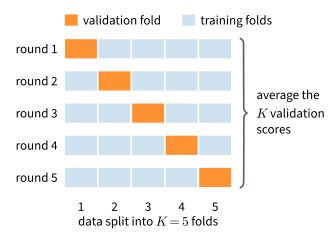

```{.python .input}
%load_ext d2lbook.tab
tab.interact_select('mxnet', 'pytorch', 'tensorflow', 'jax')
```

# Generalization
:label:`sec_generalization_basics`

Imagine two college students, Ellie and Irene, preparing for a statistics final exam by practicing on past exams. Ellie memorizes every past question and its exact numerical answer word for word; scored on those practice exams, she gets 100%. Irene instead works to understand the underlying concepts and formulas; she gets 92% on the practice questions because of occasional arithmetic slips, yet when the real final exam arrives with brand-new problems, Irene scores 90% while Ellie flounders.

Machine learning models face the exact same divide. Our ultimate goal is never simply to score well on the finite *training set* we already have; it is to make accurate predictions on unseen examples drawn from the broader population—a property called *generalization*. In our synthetic linear regression earlier, we fitted 3 parameters to 1,000 examples, so memorization was impossible and training loss tracked validation loss closely. Once a model class becomes rich enough to bend around individual data points, however, driving training error to zero can actually make predictions on new data *worse*. In this section, we formalize the distinction between training error and generalization error, demonstrate *underfitting* and *overfitting* through polynomial curve fitting, unpack the *bias--variance decomposition*, and introduce *validation sets* and *$K$-fold cross-validation* for principled model selection.

```{.python .input #generalization-polynomial-curve-fitting-1}
%%tab pytorch
import math
import numpy as np
import torch
from torch import nn
from torch.nn import functional as F
from d2l import torch as d2l
```

```{.python .input #generalization-polynomial-curve-fitting-1}
%%tab tensorflow
import math
import numpy as np
import tensorflow as tf
from d2l import tensorflow as d2l
```

```{.python .input #generalization-polynomial-curve-fitting-1}
%%tab jax
import math
import numpy as np
import jax
from jax import numpy as jnp
from flax import nnx
import optax
from d2l import jax as d2l
```

```{.python .input #generalization-polynomial-curve-fitting-1}
%%tab mxnet
import math
import numpy as np
from mxnet import autograd, gluon, init, np as mnp, npx
from mxnet.gluon import nn
from d2l import mxnet as d2l
npx.set_np()
```

## Training Error and Generalization Error
:label:`subsec_empirical-risk-and-risk`

In supervised learning, we assume that both our training examples and the future test examples we will encounter at deployment are drawn independently from the same underlying probability distribution $P(\mathbf{x}, y)$—the *independent and identically distributed* (i.i.d.) assumption.

Given a finite training dataset $\mathcal{D} = \{(\mathbf{x}^{(1)}, y^{(1)}), \ldots, (\mathbf{x}^{(n)}, y^{(n)})\}$ of $n$ examples drawn i.i.d. from $P$, the *training error* (or *empirical risk*) of a predictor $f$ under loss $l$ is the sample average over $\mathcal{D}$:

$$R_{\textrm{emp}}[f] = \frac{1}{n} \sum_{i=1}^n l\left(\mathbf{x}^{(i)}, y^{(i)}, f(\mathbf{x}^{(i)})\right).$$
:eqlabel:`eq_empirical-risk-min`

By contrast, the *generalization error* (or *true risk* / *population risk*) is the expected loss on a fresh example $(\mathbf{x}, y)$ drawn from $P$:

$$R[f] = \mathbb{E}_{(\mathbf{x}, y) \sim P}\Big[l\big(\mathbf{x}, y, f(\mathbf{x})\big)\Big] = \int l\big(\mathbf{x}, y, f(\mathbf{x})\big)\, dP(\mathbf{x}, y).$$
:eqlabel:`eq_true-risk`

We want to find a function $f$ that minimizes the true risk $R[f]$, yet we never have direct access to the distribution $P$—we only observe the finite sample $\mathcal{D}$, so our training algorithm minimizes $R_{\textrm{emp}}[f]$ instead (*empirical risk minimization*).

Why can $R_{\textrm{emp}}[\hat{f}]$ underestimate $R[\hat{f}]$ so severely? If we picked a *fixed* function $f$ in advance—before looking at $\mathcal{D}$—then by the law of large numbers, $R_{\textrm{emp}}[f]$ would be an unbiased estimate of $R[f]$ with fluctuations of order $1/\sqrt{n}$. However, our trained model $\hat{f}$ is *not* fixed independent of $\mathcal{D}$: it was specifically selected from an entire model class $\mathcal{F}$ to minimize error *on $\mathcal{D}$*! Whenever $\mathcal{F}$ is flexible enough to latch onto accidental noise quirks in $\mathcal{D}$, the training error $R_{\textrm{emp}}[\hat{f}]$ becomes optimistically biased downward relative to the true risk $R[\hat{f}]$ (Exercise :exref:`ex_generalization-optimism`). To measure $R[\hat{f}]$ honestly, we must evaluate $\hat{f}$ on an independent held-out *test set* (or *validation set*) $\mathcal{D}'$ that played no role in fitting its parameters.

## Underfitting and Overfitting

Comparing training error against validation error diagnoses two opposite failure modes:

- **Underfitting (high bias):** The model is too rigid to capture the true underlying trend in the data, so *both* training error and validation error remain high and close together.
- **Overfitting (high variance):** The model is so flexible relative to the dataset size that it fits the random noise in the training examples in addition to the signal; training error becomes tiny while validation error climbs much higher, opening a large *generalization gap* $R[\hat{f}] - R_{\textrm{emp}}[\hat{f}]$.

### Polynomial Curve Fitting
:label:`subsec_polynomial-curve-fitting`

We can watch underfitting, balanced fitting, and catastrophic overfitting unfold without ever leaving linear regression! Suppose a scalar input $x$ is drawn uniformly from $[-1, 1]$ and the true label is generated by a smooth curve plus Gaussian noise,

$$y = f^*(x) + \epsilon, \qquad f^*(x) = 5 + 1.2x - 3.4x^2 + 5.6x^3, \qquad \epsilon \sim \mathcal{N}(0, \sigma^2),$$

with $\sigma = 0.1$. Note that the irreducible population noise floor for the squared error $(\hat{y} - y)^2$ is $\sigma^2 = 0.01$: even the true function $f^*(x)$ incurs an expected squared error of $0.01$ because of the unpredictable noise $\epsilon$.

To fit a curved function using linear regression, we map the scalar input $x$ to a vector of monomial *polynomial features* $(1, x, x^2, \ldots, x^k)^\top \in \mathbb{R}^{k+1}$. A degree-$k$ polynomial

$$\hat{y} = \sum_{j=0}^k w_j x^j$$

is nonlinear in $x$, yet **completely linear in the weights $\mathbf{w} = (w_0, \ldots, w_k)^\top$**! Thus we can fit any degree-$k$ polynomial on $n$ training points by constructing the Vandermonde design matrix $\mathbf{X} \in \mathbb{R}^{n \times (k+1)}$ with entries $X_{ij} = (x^{(i)})^j$ and calling `lstsq` (just as we did in :numref:`subsec_linear-regression-analytic-solution`). Let us generate $n = 20$ training points and $1{,}000$ test points (enough to estimate test error accurately), and then compare three degrees: $k = 1$ (a straight line), $k = 3$ (a cubic), and $k = 19$ (a degree-19 polynomial with $20$ parameters for $20$ points):

```{.python .input #generalization-polynomial-curve-fitting-2}
def target(x):
    """The cubic f* that generates the labels."""
    return 5 + 1.2 * x - 3.4 * x**2 + 5.6 * x**3

def make_data(rng, n, sigma):
    """Draw n inputs uniformly from [-1, 1] and label them by the noisy cubic."""
    x = rng.uniform(-1, 1, n)
    return x, target(x) + rng.normal(0, sigma, n)

sigma = 0.1                               # standard deviation of the noise
rng = np.random.default_rng()             # a new random draw on every run
x_train, y_train = make_data(rng, 20, sigma)  # few, so high degrees overfit
x_test, y_test = make_data(rng, 1000, sigma)
```

Below, `features(x, d)` builds the design matrix $[1, x, \ldots, x^d]$,
`fit_degree` finds the exact least-squares weights, and `mse` computes the plain
mean squared error (omitting the factor of $\frac{1}{2}$ so the noise floor sits
neatly at $\sigma^2 = 0.01$):

```{.python .input #generalization-polynomial-curve-fitting-3}
def features(x, d):
    """Design matrix whose columns are the powers x^0, x^1, ..., x^d."""
    return x.reshape(-1, 1) ** np.arange(d + 1)

def fit_degree(x, y, d):
    """Least-squares weights of the degree-d polynomial fitted to (x, y)."""
    return np.linalg.lstsq(features(x, d), y, rcond=None)[0]

def mse(w, x, y):
    """Mean squared error of the polynomial with weights w on (x, y)."""
    return ((features(x, len(w) - 1) @ w - y) ** 2).mean()
```

Let us plot the fits of degree $1$, $3$, and $19$ against the $20$ noisy training points and the true cubic:

```{.python .input #generalization-polynomial-curve-fitting-6}
xs = np.linspace(-1, 1, 200)
_, axes = d2l.plt.subplots(1, 3, figsize=(10, 3.4), sharey=True)
for ax, d in zip(axes, (1, 3, 19)):
    w = fit_degree(x_train, y_train, d)
    d2l.plot([xs, xs, x_train], [target(xs), features(xs, d) @ w, y_train],
             xlabel='x', ylim=(-7, 11), fmts=('--', '-', 'o'),
             legend=['cubic', 'fit', 'training data'] if d == 1 else None,
             axes=ax)
    ax.set_title(f'degree {d}')
```

Those three panels tell the whole story of the two classic failure modes of
supervised learning:

- **Degree $k = 1$ (underfitting):** A straight line cannot bend to follow the S-shaped cubic; it misses training and test points alike.
- **Degree $k = 3$ (well matched):** A cubic has exactly the flexibility of $f^*$; its fit is nearly indistinguishable from the true curve.
- **Degree $k = 19$ (overfitting):** With $k + 1 = 20$ parameters and $n = 20$ distinct training points, the polynomial has enough degrees of freedom to interpolate every single training point (Exercise :exref:`ex_generalization-exact-polynomial`). Between the data points, however, the curve oscillates, sending the test error soaring by orders of magnitude!

What happens to the learned weights $w_j$ themselves when the polynomial overfits? Let us print the training error, the test error, and the largest weight magnitude $\max_j |\hat{w}_j|$ for each of the three degrees:

```{.python .input #generalization-polynomial-curve-fitting-4}
for d in (1, 3, 19):
    w = fit_degree(x_train, y_train, d)
    print(f'degree {d:2d}: train {mse(w, x_train, y_train):.2g}, '
          f'test {mse(w, x_test, y_test):.2g}, '
          f'largest |weight| {np.abs(w).max():.2g}')
```

Although exact numbers vary slightly with each random draw, the contrast is
dramatic. Degree $1$ suffers massive errors on both splits (a test MSE above $1$,
over $100\times$ the $\sigma^2 = 0.01$ noise floor). Degree $3$ pushes both
training and test errors right down to the $\sigma^2 = 0.01$ floor, with its
largest weight right near the true leading coefficient $5.6$. Degree $19$ drives
training error far below the noise floor—essentially to zero—while its test error
explodes by many orders of magnitude! Look at its weights to see the mechanism:
degree $19$ relies on astronomically large positive and negative coefficients that
delicately cancel at the $20$ training inputs and blow up everywhere else.

Sweeping across every degree from $1$ to $19$ maps out the full transition on a
logarithmic scale:

```{.python .input #generalization-polynomial-curve-fitting-5}
degrees = list(range(1, 20))
weights = [fit_degree(x_train, y_train, d) for d in degrees]
train_err = [mse(w, x_train, y_train) for w in weights]
test_err = [mse(w, x_test, y_test) for w in weights]
d2l.plot(degrees, [train_err, test_err], xlabel='polynomial degree',
         ylabel='mean squared error', legend=['train', 'test'],
         yscale='log', ylim=(1e-4, 1e3))
```

As $k$ increases, the training error decreases monotonically—because adding $x^{k+1}$ only enlarges the subspace of functions available to least squares—plunging far below $\sigma^2$ by $k = 19$. The test error, by contrast, traces a classic **U-shaped curve**: it drops steeply to its minimum at $k = 3$ (or a nearby degree) as underfitting disappears, and then climbs by orders of magnitude as extra powers of $x$ fit the random noise in our 20 training points.

For $k = 3$, the weights stay modest (the largest sits near the true leading coefficient $5.6$). By $k = 19$, however, the largest coefficient grows into the millions or beyond! Because $x^{10}$ and $x^{12}$ look almost identical on $[-1, 1]$, the least-squares fit cancels giant positive multiples of one against giant negative multiples of the other to thread the 20 noisy points—a hallmark instability that we will cure directly with weight decay in :numref:`sec_weight_decay`.

### Bias and Variance

Why does model complexity produce a U-shaped generalization curve? Let us decompose the expected squared error of a model $\hat{f}_{\mathcal{D}}$ trained on a random dataset $\mathcal{D}$ at a test point $x$ where $y = f^*(x) + \epsilon$ (with $\mathbb{E}[\epsilon] = 0$, $\mathrm{Var}(\epsilon) = \sigma^2$, and $\epsilon$ independent of $\mathcal{D}$). Write $\bar{f}(x) = \mathbb{E}_{\mathcal{D}}[\hat{f}_{\mathcal{D}}(x)]$ for the average predictor across all possible training sets of size $n$. Adding and subtracting $f^*(x)$ and $\bar{f}(x)$ inside $\mathbb{E}_{\mathcal{D}, \epsilon}[(\hat{f}_{\mathcal{D}}(x) - y)^2]$ and noting that the cross terms vanish yields the famous *bias--variance decomposition*:

$$\mathbb{E}_{\mathcal{D}, \epsilon}\!\left[\big(\hat{f}_{\mathcal{D}}(x) - y\big)^2\right] = \underbrace{\big(\bar{f}(x) - f^*(x)\big)^2}_{\textrm{bias}^2(x)} + \underbrace{\mathbb{E}_{\mathcal{D}}\!\left[\big(\hat{f}_{\mathcal{D}}(x) - \bar{f}(x)\big)^2\right]}_{\textrm{variance}(x)} + \underbrace{\sigma^2}_{\textrm{noise}}.$$
:eqlabel:`eq_generalization-bias-variance`

Every model's expected test error is the sum of three nonnegative pieces:

1. **Squared bias $(\bar{f}(x) - f^*(x))^2$:** How far the *average* fitted model (even averaged over infinitely many training datasets) sits from the true function $f^*(x)$. Rigid models (like a straight line $k = 1$ on a cubic) have high bias.
2. **Variance $\mathbb{E}_{\mathcal{D}}[(\hat{f}_{\mathcal{D}}(x) - \bar{f}(x))^2]$:** How sensitively the fitted model fluctuates from one random training sample $\mathcal{D}$ to the next. Overly flexible models ($k = 12$) swing wildly with every new draw of 20 points, suffering huge variance.
3. **Irreducible noise $\sigma^2$:** The variance of the label $y$ around $f^*(x)$ itself, which no predictor can ever beat.

In our polynomial experiment we can measure all three terms directly. Let us keep the $20$ training inputs fixed and redraw only their label noise. Because the least-squares weights depend linearly on $\mathbf{y}$ and the noise has mean zero, the average fit $\bar{f}$ is simply the fit to the noiseless labels $f^*(x^{(i)})$, which gives the squared bias exactly; refitting across $200$ independent draws of the training noise estimates the variance at every test point:

```{.python .input #generalization-bias-variance-decomposition}
noise = rng.normal(0, sigma, (len(x_train), 200))   # 200 draws of the noise
bias2, var = [], []
for d in degrees:
    w_avg = fit_degree(x_train, target(x_train), d)               # average fit
    W = fit_degree(x_train, target(x_train)[:, None] + noise, d)  # fit per draw
    bias2.append(mse(w_avg, x_test, target(x_test)))
    var.append((features(x_test, d) @ W).var(axis=1).mean())
d2l.plot(degrees, [bias2, var, [sigma**2] * len(degrees),
                   np.add(bias2, var) + sigma**2],
         xlabel='polynomial degree', ylabel='mean squared error',
         fmts=('-', 'C1-.', 'g:', 'm--'), yscale='log', ylim=(1e-4, 1e3))
d2l.plt.legend(['bias$^2$', 'variance', r'noise $\sigma^2$',
                'expected test error'], ncol=2, frameon=False,
               loc='lower center', bbox_to_anchor=(0.5, 1));  # above the plot
```

Look how cleanly the curves explain the U-shape of test error: squared bias is
huge at degrees $1$ and $2$, then collapses to zero at degree $3$ (the first
family rich enough to contain the cubic). Variance, meanwhile, climbs with every
added degree—starting around $\sigma^2(d+1)/n$ (the noise variance scaled by
parameters per example; see exercise :exref:`ex_generalization-optimism`) and
eventually exploding orders of magnitude past the noise floor. Underfitting is
error dominated by *bias*; overfitting is error dominated by *variance*. The
idealized trade-off shown in :numref:`fig_capacity_vs_error` recurs across
classical statistics and machine learning: training error drops steadily with
complexity, while test error reaches its minimum at an intermediate sweet spot
(never dropping below $\sigma^2$).


:label:`fig_capacity_vs_error`


### Model Complexity

As :numref:`fig_capacity_vs_error` summarizes schematically, increasing model complexity (capacity) reduces bias while increasing variance. The optimal generalization performance sits at the sweet spot where the sum of squared bias and variance reaches its minimum. In classical parametric models, complexity is governed by the number of parameters $d$ and the magnitude of the weights $\|\mathbf{w}\|$; in deep learning (:numref:`sec_generalization_deep`), we will see how regularization, architecture design, and dataset scale reshape this curve.

### Dataset Size

Besides restricting model complexity, the most direct way to crush variance is to collect *more training data*. For a fixed polynomial degree $k$, fitting to $n = 1{,}000$ points instead of $n = 20$ averages out the random noise and pins down even high-degree coefficients cleanly (with estimation variance decaying as $(k + 1)\sigma^2 / n$). Let us watch how degrees $1$, $3$, and $19$ respond as we grow a fresh training set from $n = 20$ to $n = 1{,}000$ examples:

```{.python .input #generalization-dataset-size}
for n in (20, 50, 100, 1000):
    x, y = make_data(rng, n, sigma)          # a fresh training set of size n
    errs = [mse(fit_degree(x, y, d), x_test, y_test) for d in (1, 3, 19)]
    print(f'n = {n:4d}: test error of degrees 1, 3, 19:',
          ', '.join(f'{e:.2g}' for e in errs))
```

Look at the contrast. Growing the dataset rescues the overfitting degree-19
polynomial dramatically—its test error plunges by orders of magnitude by
$n = 100$, and by $n = 1{,}000$ it matches the true cubic. Meanwhile, the
underfitting straight line barely budges (its test error remains stuck around
$2$): collecting more data shrinks *variance*, but it can never cure
*bias*. As a classical rule of thumb, model complexity should scale alongside
dataset size rather than racing ahead of it—one big reason deep learning surged
only once massive digital datasets became commonplace (though deep networks will
add fascinating twists to this rule in :numref:`sec_generalization_deep`).

With $n = 20$ points, the degree-$19$ polynomial has one weight per point and memorizes the noise; at $n = 50$ its test error still varies wildly from one draw to the next; and by $n = 1{,}000$ it is as accurate as the cubic. A model is never "too complex" in a vacuum—it is only too complex *relative to the amount of signal and data available to constrain it*.

## Model Selection
:label:`subsec_generalization-model-selection`

### Validation Sets

In our synthetic experiment we knew $f^*(x)$ and generated 1,000 test points at will. In a real problem, how should we choose hyperparameters—such as the polynomial degree $k$, the learning rate $\eta$, or the weight decay strength $\lambda$?

We can never choose hyperparameters by minimizing training error, because training error always favors the most complex, memorization-prone model ($k = 19$). Nor should we tune hyperparameters by repeatedly consulting the final *test set*, which would leak test-set noise into our design choices (:numref:`chap_classification_generalization`). Instead, we partition our available data into three disjoint splits:

1. **Training set:** Used to fit the model parameters $(\mathbf{w}, b)$ for each candidate hyperparameter setting.
2. **Validation set:** Used to compare candidate hyperparameter settings and select the winner (*model selection*).
3. **Test set:** Held in a vault and evaluated *once* at the very end to report an unbiased estimate of the selected model's generalization error.

### Cross-Validation

When a dataset is small (say, $n = 20$ or $n = 100$ clinical records), carving off a fixed 20% validation set leaves too few examples to train on and too few to validate reliably. *$K$-fold cross-validation* (:numref:`fig_kfold_cv`) makes every example do double duty. We partition the dataset randomly into $K$ equal-sized disjoint subsets (*folds*) $\mathcal{D}_1, \ldots, \mathcal{D}_K$ (typically $K = 5$ or $K = 10$). In round $i \in \{1, \ldots, K\}$, we train the model from scratch on the $K - 1$ folds $\mathcal{D} \setminus \mathcal{D}_i$ and evaluate its validation loss on the held-out fold $\mathcal{D}_i$. Averaging the $K$ held-out losses gives the $K$-fold cross-validation score, and once the winning hyperparameter is chosen, we retrain the model on all $n$ examples. (In the extreme case $K = n$, called *leave-one-out cross-validation*, each fold is a single data point; for linear least squares, a remarkable algebraic identity computes all $n$ leave-one-out residuals from a *single* fit without retraining $n$ times—see Exercise :exref:`ex_generalization-leave-one-out-shortcut`.)


:label:`fig_kfold_cv`

Folds must come from a *random* permutation, because real datasets often arrive sorted, and with folds of only four points a single split is noisy. So `kfold_splits` below draws ten independent random partitions into $K = 5$ folds (*repeated* cross-validation), and `cv_error` averages the validation error of the degree-$d$ fit over all of their folds:

```{.python .input #generalization-cross-validation-1}
def kfold_splits(rng, n, K=5, repeats=10):
    """Random partitions of the indices 0, ..., n-1 into K folds."""
    return [np.array_split(rng.permutation(n), K) for _ in range(repeats)]

def cv_error(x, y, d, splits):
    """Validation error of the degree-d fit, averaged over all folds."""
    return np.mean([mse(fit_degree(np.delete(x, f), np.delete(y, f), d),
                        x[f], y[f]) for folds in splits for f in folds])
```

Let us select the polynomial degree using strictly the $20$ training examples—evaluating
every degree on the exact same folds for a fair comparison—and check how closely
that choice matches the true test-set optimum (which cross-validation never sees):

```{.python .input #generalization-cross-validation-2}
splits = kfold_splits(rng, len(x_train))  # the same folds for every degree
cv_err = [cv_error(x_train, y_train, d, splits) for d in degrees]
print('cross-validation picks degree:', degrees[np.argmin(cv_err)])
print('lowest test error at degree:  ', degrees[np.argmin(test_err)])
```

Let us plot the 5-fold cross-validation curve right alongside the test-error
curve across all 19 degrees:

```{.python .input #generalization-cross-validation-3}
d2l.plot(degrees, [test_err, cv_err], xlabel='polynomial degree',
         ylabel='mean squared error', fmts=('m--', 'g-.'), yscale='log',
         ylim=(1e-4, 1e3))
d2l.plt.legend(['test', '5-fold cross-validation'], ncol=2, frameon=False,
               loc='lower center', bbox_to_anchor=(0.5, 1));  # above the plot
```

Without ever glancing at the test set, repeated 5-fold cross-validation reliably
locates the bottom of the test-error bowl—usually selecting degree $3$, or
occasionally a nearby degree whose test error is nearly indistinguishable.
Near the minimum, the two
curves track within a small factor, with cross-validation naturally a bit noisier
since it averages over $20$ points instead of $1{,}000$. At high degrees, notice
why cross-validation shoots up even earlier and higher than test error: each
fold trains on only $16$ points rather than $20$, so degree $15$ already
interpolates all $16$ training points, and any validation point near the edges of
$[-1, 1]$ falls outside the fitted range where high-degree polynomials explode!

How should we pick $K$? Because every fold trains on only a fraction
$(K - 1) / K$ of the dataset, its fitted model is slightly worse than a model
trained on all $n$ examples, giving $K$-fold cross-validation a slight pessimistic
bias. Pushing $K = n$ (*leave-one-out* cross-validation) nearly eliminates that
bias, yet demands $n$ separate fits per candidate and yields strongly correlated
fold errors with higher variance. In practice, $K = 5$ or $K = 10$ strikes the
classic sweet spot between bias, variance, and compute :cite:`Kohavi.1995` (see
exercise :exref:`ex_generalization-fold-cross-validation` for the exact bias
analysis).

Using only the 20 training examples, 5-fold cross-validation cleanly rejects both the underfitted degrees ($k \leq 2$) and the wildly overfitted high-degree polynomials, picking $k = 3$ or a nearby degree; retraining on all 20 points yields a smooth fit whose test error sits near the $\sigma^2 = 0.01$ noise floor.

## Summary

- **Empirical vs. population risk:** Training minimizes empirical risk $R_{\textrm{emp}}[f]$ on a finite sample $\mathcal{D}$, whereas deployment performance is governed by true population risk $R[f] = \mathbb{E}[l(f(\mathbf{x}), y)]$. Because training selects $f$ to fit $\mathcal{D}$, $R_{\textrm{emp}}[\hat{f}]$ is optimistically biased downward.
- **Underfitting, overfitting, and bias--variance:** Expected test error decomposes into $\textrm{bias}^2 + \textrm{variance} + \sigma^2$. Rigid models underfit (high bias, low variance); overly flexible models on small datasets overfit (low bias, high variance), producing a U-shaped validation curve.
- **Dataset scale:** Increasing training sample size $n$ shrinks estimation variance as $1/n$, allowing richer model classes to generalize cleanly.
- **Model selection:** Hyperparameters must never be chosen by training error or on the final test set; instead, use a dedicated validation split or, when data are scarce, $K$-fold cross-validation.

## Exercises

1. **When IID fails.** Give three examples in which dependent observations
   make treating a dataset as IID inadvisable. For each, state whether a
   random train/validation split overestimates or underestimates the
   generalization error, and describe a split that avoids the problem.


1. **Exact polynomial regression.** Show that when the $n$ training inputs
   $x^{(1)}, \ldots, x^{(n)}$ are distinct, a polynomial of degree $n-1$
   fits the $n$ labels exactly, and explain where distinctness is used.
   What does least squares return when two inputs coincide but their
   labels differ?
   :exlabel:`ex_generalization-exact-polynomial`

1. [code] **A better basis for degree 19.** The high powers $x^{17}$ and
   $x^{19}$ differ by less than 0.05 anywhere on $[-1, 1]$, so the columns
   of `features(x, 19)` are nearly parallel. The Chebyshev polynomials
   $T_0, \ldots, T_{19}$ span the same functions but stay between $-1$
   and $1$ on the interval.
    1. Predict first: if we fit degree 19 to the 20 training points in the
       Chebyshev basis, which of the training error, the test error, and
       the largest weight will change, and by how much?
    1. Check your prediction over several runs: replace `features(x, 19)`
       by `np.polynomial.chebyshev.chebvander(x, 19)` for both the training
       and the test inputs, and compare the two design matrices'
       condition numbers (`np.linalg.cond`), the training and test errors,
       and the largest weights.
    1. Explain why the two fits are the same polynomial in exact
       arithmetic, and which of your numbers differ in float64 and why. Does
       the better basis rescue degree 19 on 20 points? What does your answer
       say about the size of the weights as a measure of complexity?
   :exlabel:`ex_generalization-chebyshev-basis`

1. **Optimism of the training error.** ● Consider least squares with a
   fixed $n \times p$ design matrix $\mathbf{X}$ of full column rank and
   labels $\mathbf{y} = \mathbf{X}\mathbf{w}^* + \boldsymbol{\epsilon}$,
   whose noise terms are independent with mean zero and variance
   $\sigma^2$. The fitted predictions are
   $\hat{\mathbf{y}} = \mathbf{H}\mathbf{y}$ with
   $\mathbf{H} = \mathbf{X}(\mathbf{X}^\top\mathbf{X})^{-1}\mathbf{X}^\top$.
    1. Show that the expected training error is
       $\mathbb{E}[\|\mathbf{y} - \hat{\mathbf{y}}\|^2]/n = \sigma^2 (n - p)/n$.
       Hint: $\mathbf{y} - \hat{\mathbf{y}} = (\mathbf{I} - \mathbf{H})\boldsymbol{\epsilon}$,
       and the trace of $\mathbf{I} - \mathbf{H}$ is $n - p$.
    1. Draw fresh labels $\mathbf{y}' = \mathbf{X}\mathbf{w}^* + \boldsymbol{\epsilon}'$
       at the same inputs. Show that the expected error of
       $\hat{\mathbf{y}}$ on them is $\sigma^2 (n + p)/n$, so that the
       training error underestimates it by $2\sigma^2 p/n$. Show that
       $\sigma^2 p/n$ is the variance of the predictions, averaged over
       the $n$ inputs.
    1. Evaluate both expressions for the cubic fit of
       :numref:`subsec_polynomial-curve-fitting` ($n = 20$, $p = 4$,
       $\sigma = 0.1$) and compare them with the training and test errors
       of degree 3 over several runs of the experiment. Explain the
       differences: how much does the training error of a single run
       spread around its expectation, and why does the formula of (b),
       which holds at the training inputs, not apply exactly to the test
       inputs?
   :exlabel:`ex_generalization-optimism`

1. **$K$-fold cross-validation.**
    1. Suppose that a model trained on $m$ examples has expected
       generalization error $R(m) = R_\infty + c/m$ with $c > 0$. Each
       fold's model trains on $(K-1)n/K$ examples. Compute the bias of the
       $K$-fold estimate relative to $R(n)$, the error of the model trained
       on all $n$ examples. Express the bias as a fraction of
       $R(n) - R_\infty$ and evaluate this fraction for $K = 2$, $5$, $10$,
       and $n$.
    1. After selecting a hyperparameter by cross-validation, the final
       model is retrained on all $n$ examples. Explain why a hyperparameter
       whose best value depends on the training-set size complicates this
       step, and give an example.
   :exlabel:`ex_generalization-fold-cross-validation`

1. **Leave-one-out shortcut.** ● Leave-one-out cross-validation requires
   $n$ model fits for a general learner. Consider least squares with the
   design matrix $\mathbf{X}$, whose rows are $\mathbf{x}^{(i)\top}$. Let
   $\mathbf{A} = \mathbf{X}^\top\mathbf{X}$ and assume that it remains
   invertible when any one row of $\mathbf{X}$ is removed. Let
   $\hat{y}^{(i)}$ be the prediction at $\mathbf{x}^{(i)}$ of the fit on
   all $n$ examples, let $\hat{y}^{(-i)}$ be the prediction at
   $\mathbf{x}^{(i)}$ of the fit that omits example $i$, and let
   $h_i = \mathbf{x}^{(i)\top}\mathbf{A}^{-1}\mathbf{x}^{(i)}$. Use the
   Sherman--Morrison identity
   $$(\mathbf{A} - \mathbf{u}\mathbf{u}^\top)^{-1} = \mathbf{A}^{-1} + \frac{\mathbf{A}^{-1}\mathbf{u}\mathbf{u}^\top\mathbf{A}^{-1}}{1 - \mathbf{u}^\top\mathbf{A}^{-1}\mathbf{u}}$$
   with $\mathbf{u} = \mathbf{x}^{(i)}$ to show that
   $$y^{(i)} - \hat{y}^{(-i)} = \frac{y^{(i)} - \hat{y}^{(i)}}{1 - h_i}.$$
   State what leave-one-out cross-validation then costs for least
   squares compared with a single fit.
   :exlabel:`ex_generalization-leave-one-out-shortcut`

:begin_tab:`mxnet`
[Discussions](https://d2l.discourse.group/t/96)
:end_tab:

:begin_tab:`pytorch`
[Discussions](https://d2l.discourse.group/t/97)
:end_tab:

:begin_tab:`tensorflow`
[Discussions](https://d2l.discourse.group/t/234)
:end_tab:

:begin_tab:`jax`
[Discussions](https://d2l.discourse.group/t/17978)
:end_tab:
