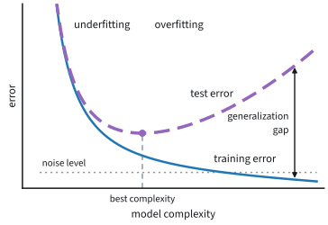

```{.python .input}
%load_ext d2lbook.tab
tab.interact_select('mxnet', 'pytorch', 'tensorflow', 'jax')
```

# Generalization
:label:`sec_generalization_basics`

Consider two college students preparing diligently for a final exam by working
through exams from previous years. Suppose the first student, *Extraordinary
Ellie*, prepares solely by memorizing the exact answers to every past exam
question. If the professor recycles old questions word for word, Ellie will score
100%—easily outscoring her classmate *Inductive Irene*, who has a terrible rote
memory but a sharp knack for underlying concepts and averages 90%. Yet the moment
the exam features *new* questions, Ellie freezes while Irene maintains her 90%
average.

In the previous three sections, our linear model had just two weights and a bias
fitted to $1{,}000$ synthetic examples, so fitting the training data was practically
the whole story. In real machine learning, however, we fit a model to past
examples only because we want to predict *future*, unseen ones: tomorrow's stock
prices rather than yesterday's, undiagnosed diseases in newly arriving patients,
or the sale price of a home coming on the market next month. Fitting the training
set alone guarantees nothing. Given 20 noisy measurements at distinct inputs, a
polynomial of degree 19 can pass right through every single training point with
zero error while making wild predictions everywhere in between. Like Ellie, such a
model has *memorized* its training labels rather than discovering the underlying
pattern. Our true goal is *generalization*: making accurate predictions on fresh
examples drawn from the same population as the training data.

Because every real dataset is finite, the danger of memorization never goes away.
Clinical studies may enroll only a few thousand patients—or a few hundred for rare
diseases. Even massive public image benchmarks like ImageNet
:cite:`Deng.Dong.Socher.ea.2009`, with millions of labeled photographs, cover an
infinitesimally tiny sliver of all possible megapixel images, meaning virtually
every image a deployed model sees is brand new.

How can we tell from a finite sample whether a model has learned a genuine pattern
or merely memorized noise? In this section, we formalize the distinction between
training error and generalization error, demonstrate underfitting, overfitting,
and the bias--variance trade-off directly through polynomial curve fitting, and
show how validation sets and $K$-fold cross-validation let us select models
honestly without fooling ourselves.

```{.python .input #generalization-polynomial-curve-fitting-1}
%%tab pytorch
import math
import numpy as np
import torch
from torch import nn
from torch.nn import functional as F
from d2l import torch as d2l
```

```{.python .input #generalization-polynomial-curve-fitting-1}
%%tab tensorflow
import math
import numpy as np
import tensorflow as tf
from d2l import tensorflow as d2l
```

```{.python .input #generalization-polynomial-curve-fitting-1}
%%tab jax
import math
import numpy as np
import jax
from jax import numpy as jnp
from flax import nnx
import optax
from d2l import jax as d2l
```

```{.python .input #generalization-polynomial-curve-fitting-1}
%%tab mxnet
import math
import numpy as np
from mxnet import autograd, gluon, init, np as mnp, npx
from mxnet.gluon import nn
from d2l import mxnet as d2l
npx.set_np()
```

## Training Error and Generalization Error
:label:`subsec_empirical-risk-and-risk`

To make "new examples from the same population" precise, supervised learning
relies on a foundational premise: both our training examples and the future
examples our model will encounter are drawn *independently* from an *identical*
underlying distribution $P(X, Y)$. This is the *IID assumption*. It is a strong
assumption, and real-world deployments violate it all the time—a vision model
trained on daytime photographs may be run at night, and a retail model trained on
last year's purchases must predict next year's. Yet without *some* assumption
linking the training distribution to the deployment distribution, we would be dead
in the water: data from one world tells us nothing about an unrelated world. Later
chapters study distribution shift explicitly; here we start with the clean IID
case.

Under the IID assumption, any model $f$ is associated with two distinct errors.
The first is the *training error* (also called the *empirical risk*), an empirical
average computed directly over our $n$ training examples:

$$R_\textrm{emp}(f) = \frac{1}{n} \sum_{i=1}^n l(f(\mathbf{x}^{(i)}), y^{(i)}),$$
:eqlabel:`eq_empirical-risk-min`

where $l(\hat{y}, y)$ is our chosen loss function (such as squared error). The
second is the *generalization error* (also called the *risk*), defined as the
theoretical *expectation* of the loss on a brand-new example $(\mathbf{x}, y)$
drawn from $P$:

$$R(f) = \mathbb{E}[l(f(\mathbf{x}), y)].$$
:eqlabel:`eq_true-risk`

Think of $R(f)$ as the average error we would observe if we evaluated $f$ on an
infinite stream of fresh examples from $P$. The difference
$R(f) - R_\textrm{emp}(f)$ is the *generalization gap*. Ultimately we care about
minimizing $R(f)$, while $R_\textrm{emp}(f)$ is what our training loop actually
minimizes; the generalization gap tells us how much our training score flatters
the model.

Because nobody hands us the true distribution $P$, we can never compute $R(f)$
exactly. Instead, we *estimate* it by holding out a fresh collection of $n'$
examples that never participate in training and averaging the loss of our fixed
model $f$ over them. Because $f$ was fitted without ever seeing these held-out
examples, their $n'$ losses are independent random draws with mean $R(f)$. Their
average is therefore an *unbiased* estimator of $R(f)$ with standard error
$\sigma_l / \sqrt{n'}$ (:numref:`sec_prob`), where $\sigma_l$ is the standard
deviation of the loss on a single example—so quadrupling the held-out set halves
our estimation uncertainty. The validation loss plotted in
:numref:`sec_linear_scratch`--:numref:`sec_linear_concise` is precisely such an
estimate. Below, we refer to these held-out examples as a *test set* (we draw the
sharp distinction between validation and test sets once we begin selecting among
multiple candidate models in :numref:`subsec_generalization-model-selection`).

No such unbiasedness guarantee holds for the training error $R_\textrm{emp}(f)$:
because the training data were actively used to choose $f$, the model has adapted
to their idiosyncrasies and tends to look artificially better on them. At the
extreme, a lookup table that simply memorizes every training pair $(\mathbf{x}^{(i)}, y^{(i)})$
achieves zero training error while having no clue what to predict on any unseen
input! For our 3-parameter linear model trained on $1{,}000$ examples in
:numref:`sec_oo-design`, there was barely any room to memorize, so training and
validation curves overlapped almost perfectly. Let us now see what happens when a
model *does* have enough flexibility to memorize.

## Underfitting and Overfitting

How wide the generalization gap grows depends on the interplay between model
flexibility and dataset size. To watch both extremes unfold cleanly, we turn to a
classic controlled experiment where we know both the true function and the noise
level.

### Polynomial Curve Fitting
:label:`subsec_polynomial-curve-fitting`

Given a single scalar input $x$ and a real-valued target $y$, consider fitting a
polynomial of degree $d$:

$$\hat{y} = \sum_{j=0}^{d} w_j x^j = w_0 + w_1 x + w_2 x^2 + \cdots + w_d x^d.$$

Notice that this is still *linear regression*, simply using the monomials
$x, x^2, \ldots, x^d$ as input features (with $w_0$ acting as the bias multiplying
$x^0 = 1$). Here the degree $d$ acts as a convenient dial for model flexibility.
Because every polynomial of degree $d$ is also a polynomial of degree $d + 1$
(simply set $w_{d+1} = 0$), raising $d$ can never worsen the best achievable
training error. In fact, whenever $n$ training inputs are distinct, a polynomial
of degree $n - 1$ has $n$ free weights and can interpolate every single training
point with *zero* training error (exercise
:exref:`ex_generalization-exact-polynomial`).

We generate labels from a known cubic corrupted by additive Gaussian noise:

$$y = f^*(x) + \epsilon \quad \textrm{with} \quad f^*(x) = 5 + 1.2x - 3.4x^2 + 5.6x^3 \quad \textrm{and} \quad \epsilon \sim \mathcal{N}(0, \sigma^2),$$

drawing $x$ uniformly from $[-1, 1]$ and setting $\sigma = 0.1$. Because $\epsilon$
is irreducible noise, its variance $\sigma^2 = 0.01$ is the theoretical MSE floor
that no model can beat on new data. To give high-degree polynomials ample room to
overfit, we draw only $20$ training examples alongside $1{,}000$ test examples
(enough to estimate test error accurately). Plain NumPy suffices to draw the data
and solve each least-squares fit directly via `lstsq`:

```{.python .input #generalization-polynomial-curve-fitting-2}
def target(x):
    """The cubic f* that generates the labels."""
    return 5 + 1.2 * x - 3.4 * x**2 + 5.6 * x**3

def make_data(rng, n, sigma):
    """Draw n inputs uniformly from [-1, 1] and label them by the noisy cubic."""
    x = rng.uniform(-1, 1, n)
    return x, target(x) + rng.normal(0, sigma, n)

sigma = 0.1                               # standard deviation of the noise
rng = np.random.default_rng()             # a new random draw on every run
x_train, y_train = make_data(rng, 20, sigma)  # few, so high degrees overfit
x_test, y_test = make_data(rng, 1000, sigma)
```

Below, `features(x, d)` builds the design matrix $[1, x, \ldots, x^d]$,
`fit_degree` finds the exact least-squares weights, and `mse` computes the plain
mean squared error (omitting the factor of $\frac{1}{2}$ so the noise floor sits
neatly at $\sigma^2 = 0.01$):

```{.python .input #generalization-polynomial-curve-fitting-3}
def features(x, d):
    """Design matrix whose columns are the powers x^0, x^1, ..., x^d."""
    return x.reshape(-1, 1) ** np.arange(d + 1)

def fit_degree(x, y, d):
    """Least-squares weights of the degree-d polynomial fitted to (x, y)."""
    return np.linalg.lstsq(features(x, d), y, rcond=None)[0]

def mse(w, x, y):
    """Mean squared error of the polynomial with weights w on (x, y)."""
    return ((features(x, len(w) - 1) @ w - y) ** 2).mean()
```

Let us compare polynomial fits of degree $1$, $3$, and $19$ visually against the
$20$ noisy training points and the true cubic:

```{.python .input #generalization-polynomial-curve-fitting-6}
xs = np.linspace(-1, 1, 200)
_, axes = d2l.plt.subplots(1, 3, figsize=(10, 3.4), sharey=True)
for ax, d in zip(axes, (1, 3, 19)):
    w = fit_degree(x_train, y_train, d)
    d2l.plot([xs, xs, x_train], [target(xs), features(xs, d) @ w, y_train],
             xlabel='x', ylim=(-7, 11), fmts=('--', '-', 'o'),
             legend=['cubic', 'fit', 'training data'] if d == 1 else None,
             axes=ax)
    ax.set_title(f'degree {d}')
```

Those three panels tell the whole story of the two classic failure modes of
supervised learning:

* **Underfitting (degree 1):** A straight line is simply too rigid to capture the
  S-shaped curvature of a cubic, so it misses both training and test points badly.
* **Well-matched complexity (degree 3):** The cubic fit is nearly
  indistinguishable from the ground-truth curve $f^*$.
* **Overfitting (degree 19):** The degree-19 curve threads directly through all
  20 noisy training points—and then oscillates wildly between them, sacrificing
  the true pattern to chase random noise.

Let us inspect the training MSE, test MSE, and largest weight magnitude for each
of the three models:

```{.python .input #generalization-polynomial-curve-fitting-4}
for d in (1, 3, 19):
    w = fit_degree(x_train, y_train, d)
    print(f'degree {d:2d}: train {mse(w, x_train, y_train):.2g}, '
          f'test {mse(w, x_test, y_test):.2g}, '
          f'largest |weight| {np.abs(w).max():.2g}')
```

Although exact numbers vary slightly with each random draw, the contrast is
dramatic. Degree $1$ suffers massive errors on both splits (a test MSE above $1$,
over $100\times$ the $\sigma^2 = 0.01$ noise floor). Degree $3$ pushes both
training and test errors right down to the $\sigma^2 = 0.01$ floor, with its
largest weight right near the true leading coefficient $5.6$. Degree $19$ drives
training error far below the noise floor—essentially to zero—while its test error
explodes by many orders of magnitude! Look at its weights to see the mechanism:
degree $19$ relies on astronomically large positive and negative coefficients that
delicately cancel at the $20$ training inputs and blow up everywhere else.

Sweeping across every degree from $1$ to $19$ maps out the full transition on a
logarithmic scale:

```{.python .input #generalization-polynomial-curve-fitting-5}
degrees = list(range(1, 20))
weights = [fit_degree(x_train, y_train, d) for d in degrees]
train_err = [mse(w, x_train, y_train) for w in weights]
test_err = [mse(w, x_test, y_test) for w in weights]
d2l.plot(degrees, [train_err, test_err], xlabel='polynomial degree',
         ylabel='mean squared error', legend=['train', 'test'],
         yscale='log', ylim=(1e-4, 1e3))
```

As promised, training error decreases monotonically with degree, plunging far
below $\sigma^2$ by degree $19$. Test error traces a classic U-shaped curve: it
drops steeply to a minimum right at (or just above) degree $3$ and then climbs by
orders of magnitude as excess flexibility goes into fitting noise. Comparing the
two curves immediately diagnoses which regime we are in: *underfitting* appears as
high training and test errors with little gap between them, whereas *overfitting*
appears as a test error sitting well above a low training error. (Keep in mind,
though, that a nonzero generalization gap is not automatically bad—what we
ultimately care about is minimizing *test error*, and in deep learning the best
performing networks routinely fit their training data far more tightly than
held-out data.)

### Bias and Variance

Notice something intriguing in the sweep above: every polynomial family of degree
$d \geq 3$ *contains* the exact true cubic $f^*$. Why, then, does test error shoot
upward for $d > 3$? Because our fitted polynomial $\hat{f}$ adapts to the random
noise in our particular 20 training labels. Repeat the experiment with fresh
training noise, and a flexible high-degree model will swing to a wildly different
curve.

To quantify this trade-off, fix a test point $x$ with random label
$y = f^*(x) + \epsilon$, and let $\hat{f}$ denote the model fitted to a random
draw of the training noise. Taking expectations over both the training noise and
the test noise $\epsilon$ decomposes the expected squared prediction error into
three clean terms:

$$
\mathbb{E}\left[\big(y - \hat{f}(x)\big)^2\right] = \underbrace{\big(f^*(x) - \mathbb{E}[\hat{f}(x)]\big)^2}_{\textrm{bias}^2} + \underbrace{\textrm{Var}\big(\hat{f}(x)\big)}_{\textrm{variance}} + \sigma^2.
$$
:eqlabel:`eq_generalization-bias-variance`

Here the squared *bias* measures how far the *average* fitted curve misses the
true function $f^*(x)$—a systematic error caused by a model class that is too
rigid (unrelated to the intercept parameter $b$ of a linear model). The *variance*
measures how wildly $\hat{f}(x)$ fluctuates from one training draw to the next.
And $\sigma^2$ is the irreducible test noise. The proof takes one line: write
$y - \hat{f}(x) = \epsilon + \textrm{bias}(x) + v$, where
$\textrm{bias}(x) = f^*(x) - \mathbb{E}[\hat{f}(x)]$ is deterministic and
$v = \mathbb{E}[\hat{f}(x)] - \hat{f}(x)$ is zero-mean fluctuation around the
average fit. Squaring and taking expectations yields

$$\mathbb{E}\left[\big(\epsilon + \textrm{bias}(x) + v\big)^2\right] = \mathbb{E}[\epsilon^2] + \textrm{bias}(x)^2 + \mathbb{E}[v^2] = \sigma^2 + \textrm{bias}(x)^2 + \textrm{Var}\big(\hat{f}(x)\big),$$

because $\epsilon$ and $v$ both have mean zero and are independent of each other,
killing every cross term (see :numref:`sec_mdl-statistics` for the general
derivation).

Best of all, in our polynomial experiment we can *measure* all three terms
directly! Because least-squares weights
$\hat{\mathbf{w}} = (\mathbf{X}^\top \mathbf{X})^{-1}\mathbf{X}^\top \mathbf{y}$
depend linearly on $\mathbf{y}$ and the noise has mean zero, the expected fit
$\mathbb{E}[\hat{f}]$ is simply the fit to the *noiseless* labels $f^*(x^{(i)})$,
giving us $\textrm{bias}^2$ exactly. Meanwhile, refitting across $200$ independent
draws of the training noise gives an empirical estimate of the variance at every
test point:

```{.python .input #generalization-bias-variance-decomposition}
noise = rng.normal(0, sigma, (len(x_train), 200))   # 200 draws of the noise
bias2, var = [], []
for d in degrees:
    w_avg = fit_degree(x_train, target(x_train), d)               # average fit
    W = fit_degree(x_train, target(x_train)[:, None] + noise, d)  # fit per draw
    bias2.append(mse(w_avg, x_test, target(x_test)))
    var.append((features(x_test, d) @ W).var(axis=1).mean())
d2l.plot(degrees, [bias2, var, [sigma**2] * len(degrees),
                   np.add(bias2, var) + sigma**2],
         xlabel='polynomial degree', ylabel='mean squared error',
         fmts=('-', 'C1-.', 'g:', 'm--'), yscale='log', ylim=(1e-4, 1e3))
d2l.plt.legend(['bias$^2$', 'variance', r'noise $\sigma^2$',
                'expected test error'], ncol=2, frameon=False,
               loc='lower center', bbox_to_anchor=(0.5, 1));  # above the plot
```

Look how cleanly the curves explain the U-shape of test error: squared bias is
huge at degrees $1$ and $2$, then collapses to zero at degree $3$ (the first
family rich enough to contain the cubic). Variance, meanwhile, climbs with every
added degree—starting around $\sigma^2(d+1)/n$ (the noise variance scaled by
parameters per example; see exercise :exref:`ex_generalization-optimism`) and
eventually exploding orders of magnitude past the noise floor. Underfitting is
error dominated by *bias*; overfitting is error dominated by *variance*. The
idealized trade-off shown in :numref:`fig_capacity_vs_error` recurs across
classical statistics and machine learning: training error drops steadily with
complexity, while test error reaches its minimum at an intermediate sweet spot
(never dropping below $\sigma^2$).


:label:`fig_capacity_vs_error`

### Model Complexity

Using polynomial degree as a proxy for complexity simply counts parameters, which
is handy but far too crude for general machine learning. What genuinely governs a
model family's *capacity* is how rich a variety of labelings it can fit on the
same set of inputs. Consider a model class so expressive that, given $n$ distinct
inputs, it can perfectly fit *any* labels—even completely random ones (just as
degree-19 polynomials did on our 20 points). Achieving zero training error inside
such a class tells us nothing on its own, because the family would have fitted
pure noise just as effortlessly :cite:`vapnik1994measuring`.

Philosopher of science Karl Popper captured the exact same insight with his
principle of *falsifiability* :cite:`popper2005logic`: a theory that can explain
any conceivable observation is not a scientific theory at all, because it rules
out nothing. What earns our trust is a hypothesis class that *could not* fit
arbitrary random data, yet nevertheless fits the data we actually observe.
Statistical learning theory formalizes this intuition into quantitative bounds on
the generalization gap (:numref:`sec_mdl-generalization-bounds`).

Crucially, raw parameter count is not the only lever on capacity—parameter
*magnitude* matters just as much. Notice that our degree-19 polynomial could
memorize the 20 noisy points only by inflating its weights to astronomical sizes.
Constrain those weights to remain small, and even a high-degree polynomial cannot
oscillate wildly between training points. Restricting weight magnitudes is the
core idea behind *weight decay*, the regularization technique we study in
:numref:`sec_weight_decay`.

When we reach deep neural networks, parameter counting breaks down even more
dramatically: modern networks routinely have enough capacity to memorize randomly
shuffled labels on real image datasets, yet when trained on genuine labels they
generalize remarkably well :cite:`zhang2021understanding`. Remember the logical
lesson: when a model *can* memorize random labels, low training error alone does
not certify good generalization—*yet it does not guarantee bad generalization
either!* In deep learning, we therefore rely heavily on held-out data to measure
generalization directly (a puzzle we examine closely in
:numref:`sec_generalization_deep`).

### Dataset Size

Model complexity is never absolute; it is always relative to the amount of
training data. With only $20$ examples, a degree-19 polynomial has one weight per
point and memorizes noise effortlessly. With $1{,}000$ examples, those same $20$
weights can no longer bend to chase individual noisy points, and the label noise
averages out. Let us watch how degrees $1$, $3$, and $19$ respond as we grow the
training set from $20$ to $1{,}000$ examples:

```{.python .input #generalization-dataset-size}
for n in (20, 50, 100, 1000):
    x, y = make_data(rng, n, sigma)          # a fresh training set of size n
    errs = [mse(fit_degree(x, y, d), x_test, y_test) for d in (1, 3, 19)]
    print(f'n = {n:4d}: test error of degrees 1, 3, 19:',
          ', '.join(f'{e:.2g}' for e in errs))
```

Look at the contrast. Growing the dataset rescues the overfitting degree-19
polynomial dramatically—its test error plunges by orders of magnitude by
$n = 100$, and by $n = 1{,}000$ it matches the true cubic. Meanwhile, the
underfitting straight line barely budges (its test error remains stuck around
$1.5$ to $2$): collecting more data shrinks *variance*, but it can never cure
*bias*. As a classical rule of thumb, model complexity should scale alongside
dataset size rather than racing ahead of it—one big reason deep learning surged
only once massive digital datasets became commonplace (though deep networks will
add fascinating twists to this rule in :numref:`sec_generalization_deep`).

## Model Selection
:label:`subsec_generalization-model-selection`

In our polynomial sweep above, we spotted degree $3$ by peeking at the test error.
That was a diagnostic demonstration, not a legitimate workflow! In real projects
we compare many candidate models—varying architectures, feature sets, loss
functions, and hyperparameters such as learning rate or number of epochs—a process
called *model selection*. And we must perform it without touching the test set.

### Validation Sets

Why is selecting a model based on test-set performance off limits? Because once
the test set influences our choice, it ceases to provide an unbiased estimate of
generalization error! If we sweep 19 degrees and pick whichever scored lowest on
the test set, we cherry-pick whichever candidate got luckiest on those specific
test points—effectively *overfitting the test set*, with a downward bias that
worsens the more candidates we try :cite:`ong2005learning`. Worse, if we overfit
the training set, a test set keeps us honest; if we overfit the test set itself,
nothing is left to warn us. Conversely, selecting by training error is useless
because training error always rewards the most flexible model (picking degree 19
every time).

The principled solution is a three-way split:

* The **training set** fits each candidate model's parameters.
* The **validation set** evaluates every candidate so we can choose the best
  architecture and hyperparameters.
* The **test set** stays locked in a vault until the very end, evaluated *once*
  to report an honest, unbiased estimate of our final model's generalization
  error.

In practice, research communities often reuse public benchmark test sets across
years of papers, blurring the line between validation and test data. This book is
no exception: whenever we compare models across held-out data in our experiments,
the reported metrics are rightly *validation* errors or accuracies unless
explicitly stated otherwise.

### Cross-Validation

When training data are scarce, carving out a dedicated validation split leaves too
few examples for fitting—with only $20$ training points, setting aside $5$ for
validation sacrifices a quarter of our data. *$K$-fold cross-validation* solves
this dilemma by letting every example take a turn in both roles. We randomly
partition the training data into $K$ non-overlapping *folds*. For each candidate
model, we run $K$ separate fits—each time training on $K - 1$ folds and
evaluating on the remaining held-out fold (:numref:`fig_kfold_cv`)—and average
the $K$ validation errors to score the candidate. Once we have picked the winning
model or hyperparameter, we retrain it on all $n$ training examples.


:label:`fig_kfold_cv`

Because real-world datasets frequently arrive sorted (by timestamp, label, or
feature value), folds must be formed from a *random* permutation rather than
contiguous slices—otherwise each fold would cover a biased slice of the input
space. With tiny folds of only four points, a single random split can also be
noisy, so `kfold_splits` below implements *repeated* cross-validation, averaging
over ten independent random 5-fold partitions:

```{.python .input #generalization-cross-validation-1}
def kfold_splits(rng, n, K=5, repeats=10):
    """Random partitions of the indices 0, ..., n-1 into K folds."""
    return [np.array_split(rng.permutation(n), K) for _ in range(repeats)]

def cv_error(x, y, d, splits):
    """Validation error of the degree-d fit, averaged over all folds."""
    return np.mean([mse(fit_degree(np.delete(x, f), np.delete(y, f), d),
                        x[f], y[f]) for folds in splits for f in folds])
```

Let us select the polynomial degree using strictly the $20$ training examples—evaluating
every degree on the exact same folds for a fair comparison—and check how closely
that choice matches the true test-set optimum (which cross-validation never sees):

```{.python .input #generalization-cross-validation-2}
splits = kfold_splits(rng, len(x_train))  # the same folds for every degree
cv_err = [cv_error(x_train, y_train, d, splits) for d in degrees]
print('cross-validation picks degree:', degrees[np.argmin(cv_err)])
print('lowest test error at degree:  ', degrees[np.argmin(test_err)])
```

Let us plot the 5-fold cross-validation curve right alongside the test-error
curve across all 19 degrees:

```{.python .input #generalization-cross-validation-3}
d2l.plot(degrees, [test_err, cv_err], xlabel='polynomial degree',
         ylabel='mean squared error', fmts=('m--', 'g-.'), yscale='log',
         ylim=(1e-4, 1e3))
d2l.plt.legend(['test', '5-fold cross-validation'], ncol=2, frameon=False,
               loc='lower center', bbox_to_anchor=(0.5, 1));  # above the plot
```

Without ever glancing at the test set, repeated 5-fold cross-validation reliably
locates the bottom of the test-error bowl—usually selecting degree $3$, or
occasionally a nearby degree whose test error is nearly indistinguishable (see
exercise :exref:`ex_generalization-cv-reliability`). Near the minimum, the two
curves track within a small factor, with cross-validation naturally a bit noisier
since it averages over $20$ points instead of $1{,}000$. At high degrees, notice
why cross-validation shoots up even earlier and higher than test error: each
fold trains on only $16$ points rather than $20$, so degree $15$ already
interpolates all $16$ training points, and any validation point near the edges of
$[-1, 1]$ falls outside the fitted range where high-degree polynomials explode!

How should we pick $K$? Because every fold trains on only a fraction
$(K - 1) / K$ of the dataset, its fitted model is slightly worse than a model
trained on all $n$ examples, giving $K$-fold cross-validation a slight pessimistic
bias. Pushing $K = n$ (*leave-one-out* cross-validation) nearly eliminates that
bias, yet demands $n$ separate fits per candidate and yields strongly correlated
fold errors with higher variance. In practice, $K = 5$ or $K = 10$ strikes the
classic sweet spot between bias, variance, and compute :cite:`Kohavi.1995` (see
exercises :exref:`ex_generalization-fold-cross-validation` and
:exref:`ex_generalization-leave-one-out-shortcut` for the exact bias analysis and
a neat least-squares shortcut for leave-one-out).

Even with careful cross-validation, notice how blunt a control knob polynomial
degree is: stepping from degree $d$ to $d + 1$ adds an entire new feature (or in
high dimensions, a whole combinatorial burst of interaction terms). In
:numref:`sec_weight_decay`, we introduce *weight decay*, which directly tames the
runaway weights we witnessed at degree $19$ and lets us dial model capacity up or
down continuously.

## Summary

* Fitting the training data is only a means to an end; the true goal of machine
  learning is *generalization*—achieving low expected risk $R(f)$ on unseen data
  drawn from the same distribution (under the IID assumption).
* Evaluating a fixed model on $n'$ held-out examples gives an unbiased estimate
  of $R(f)$ whose standard error shrinks as $1 / \sqrt{n'}$.
* Decomposing expected squared error into $\textrm{bias}^2 + \textrm{variance} + \sigma^2$
  explains the two fundamental failure modes: *underfitting* (high bias: both
  training and test error remain high) and *overfitting* (high variance: low
  training error accompanied by high test error).
* Model capacity depends not only on parameter count but also on parameter
  magnitude; growing the dataset reduces variance (helping flexible models) but
  cannot reduce bias.
* To choose among candidate models and hyperparameters without overfitting the
  test set, use a dedicated *validation set* or *$K$-fold cross-validation*
  (typically $K = 5$ or $10$), keeping the test set untouched until final
  evaluation.

## Exercises

1. **When IID fails.** Give three examples in which dependent observations
   make treating a dataset as IID inadvisable. For each, state whether a
   random train/validation split overestimates or underestimates the
   generalization error, and describe a split that avoids the problem.

1. **Two kinds of zero error.** Under which circumstances can the training
   error be driven to zero? Under which circumstances can the
   generalization error be zero? Compare the two sets of conditions, and
   explain the role of the noise term $\sigma^2$ in the decomposition of
   the expected test error, :eqref:`eq_generalization-bias-variance`.

1. **Exact polynomial regression.** Show that when the $n$ training inputs
   $x^{(1)}, \ldots, x^{(n)}$ are distinct, a polynomial of degree $n-1$
   fits the $n$ labels exactly, and explain where distinctness is used.
   What does least squares return when two inputs coincide but their
   labels differ?
   :exlabel:`ex_generalization-exact-polynomial`

1. [code] **A better basis for degree 19.** The high powers $x^{17}$ and
   $x^{19}$ differ by less than 0.05 anywhere on $[-1, 1]$, so the columns
   of `features(x, 19)` are nearly parallel. The Chebyshev polynomials
   $T_0, \ldots, T_{19}$ span the same functions but stay between $-1$
   and $1$ on the interval.
    1. Predict first: if we fit degree 19 to the 20 training points in the
       Chebyshev basis, which of the training error, the test error, and
       the largest weight will change, and by how much?
    1. Check your prediction over several runs: replace `features(x, 19)`
       by `np.polynomial.chebyshev.chebvander(x, 19)` for both the training
       and the test inputs, and compare the two design matrices'
       condition numbers (`np.linalg.cond`), the training and test errors,
       and the largest weights.
    1. Explain why the two fits are the same polynomial in exact
       arithmetic, and which of your numbers differ in float64 and why. Does
       the better basis rescue degree 19 on 20 points? What does your answer
       say about the size of the weights as a measure of complexity?
   :exlabel:`ex_generalization-chebyshev-basis`

1. **Optimism of the training error.** ● Consider least squares with a
   fixed $n \times p$ design matrix $\mathbf{X}$ of full column rank and
   labels $\mathbf{y} = \mathbf{X}\mathbf{w}^* + \boldsymbol{\epsilon}$,
   whose noise terms are independent with mean zero and variance
   $\sigma^2$. The fitted predictions are
   $\hat{\mathbf{y}} = \mathbf{H}\mathbf{y}$ with
   $\mathbf{H} = \mathbf{X}(\mathbf{X}^\top\mathbf{X})^{-1}\mathbf{X}^\top$.
    1. Show that the expected training error is
       $\mathbb{E}[\|\mathbf{y} - \hat{\mathbf{y}}\|^2]/n = \sigma^2 (n - p)/n$.
       Hint: $\mathbf{y} - \hat{\mathbf{y}} = (\mathbf{I} - \mathbf{H})\boldsymbol{\epsilon}$,
       and the trace of $\mathbf{I} - \mathbf{H}$ is $n - p$.
    1. Draw fresh labels $\mathbf{y}' = \mathbf{X}\mathbf{w}^* + \boldsymbol{\epsilon}'$
       at the same inputs. Show that the expected error of
       $\hat{\mathbf{y}}$ on them is $\sigma^2 (n + p)/n$, so that the
       training error underestimates it by $2\sigma^2 p/n$. Show that
       $\sigma^2 p/n$ is the variance of the predictions, averaged over
       the $n$ inputs.
    1. Evaluate both expressions for the cubic fit of
       :numref:`subsec_polynomial-curve-fitting` ($n = 20$, $p = 4$,
       $\sigma = 0.1$) and compare them with the training and test errors
       of degree 3 over several runs of the experiment. Explain the
       differences: how much does the training error of a single run
       spread around its expectation, and why does the formula of (b),
       which holds at the training inputs, not apply exactly to the test
       inputs?
   :exlabel:`ex_generalization-optimism`

1. [code] **Data size and model complexity.** Regenerate the polynomial data
   of :numref:`subsec_polynomial-curve-fitting` and report every test error
   as the median over 20 runs, because a single draw fluctuates by
   about as much as the differences measured here.
    1. Your manager asks whether collecting more data would improve a
       model that performs poorly, before paying for any. Draw 100
       training examples, fit degrees 1, 3, and 10 on the first 20, 40,
       60, 80, and 100 of them, and plot the test error of each degree
       against the training-set size. Explain how the slope of each curve
       at 100 examples supports or undermines a request for more data.
    1. Sweep the degree from 1 to 29 with 10, 40, and 100 training
       examples. For each size, report the first degree above 3 at which
       the test error exceeds twice its value at degree 3. Relate the trend
       to the rule that the complexity of a model should grow with the
       amount of data, not ahead of it.

1. [code] **Reliability of cross-validation.** Repeat the selection of
   :numref:`subsec_generalization-model-selection` for 100 runs, each
   with its own 20 training examples. For each run, record the degree
   chosen by repeated 5-fold cross-validation, by 5-fold cross-validation
   with a single split, by leave-one-out cross-validation ($K = 20$, for
   which one split is all there is), and by the test error. How often does
   each method choose
   degree 3? When cross-validation chooses a different degree, by what
   factor does the test error of its choice exceed the test error of
   degree 3? Explain why a wrong choice is usually cheap here, and describe
   when it would be expensive.
   :exlabel:`ex_generalization-cv-reliability`

1. **$K$-fold cross-validation.**
    1. Suppose that a model trained on $m$ examples has expected
       generalization error $R(m) = R_\infty + c/m$ with $c > 0$. Each
       fold's model trains on $(K-1)n/K$ examples. Compute the bias of the
       $K$-fold estimate relative to $R(n)$, the error of the model trained
       on all $n$ examples. Express the bias as a fraction of
       $R(n) - R_\infty$ and evaluate this fraction for $K = 2$, $5$, $10$,
       and $n$.
    1. After selecting a hyperparameter by cross-validation, the final
       model is retrained on all $n$ examples. Explain why a hyperparameter
       whose best value depends on the training-set size complicates this
       step, and give an example.
   :exlabel:`ex_generalization-fold-cross-validation`

1. **Leave-one-out shortcut.** ● Leave-one-out cross-validation requires
   $n$ model fits for a general learner. Consider least squares with the
   design matrix $\mathbf{X}$, whose rows are $\mathbf{x}^{(i)\top}$. Let
   $\mathbf{A} = \mathbf{X}^\top\mathbf{X}$ and assume that it remains
   invertible when any one row of $\mathbf{X}$ is removed. Let
   $\hat{y}^{(i)}$ be the prediction at $\mathbf{x}^{(i)}$ of the fit on
   all $n$ examples, let $\hat{y}^{(-i)}$ be the prediction at
   $\mathbf{x}^{(i)}$ of the fit that omits example $i$, and let
   $h_i = \mathbf{x}^{(i)\top}\mathbf{A}^{-1}\mathbf{x}^{(i)}$. Use the
   Sherman--Morrison identity
   $$(\mathbf{A} - \mathbf{u}\mathbf{u}^\top)^{-1} = \mathbf{A}^{-1} + \frac{\mathbf{A}^{-1}\mathbf{u}\mathbf{u}^\top\mathbf{A}^{-1}}{1 - \mathbf{u}^\top\mathbf{A}^{-1}\mathbf{u}}$$
   with $\mathbf{u} = \mathbf{x}^{(i)}$ to show that
   $$y^{(i)} - \hat{y}^{(-i)} = \frac{y^{(i)} - \hat{y}^{(i)}}{1 - h_i}.$$
   State what leave-one-out cross-validation then costs for least
   squares compared with a single fit.
   :exlabel:`ex_generalization-leave-one-out-shortcut`

:begin_tab:`mxnet`
[Discussions](https://d2l.discourse.group/t/96)
:end_tab:

:begin_tab:`pytorch`
[Discussions](https://d2l.discourse.group/t/97)
:end_tab:

:begin_tab:`tensorflow`
[Discussions](https://d2l.discourse.group/t/234)
:end_tab:

:begin_tab:`jax`
[Discussions](https://d2l.discourse.group/t/17978)
:end_tab:

<!-- slides -->

::: {.slide}
::: {.cover}
[Dive into Deep Learning · §2.6]{.kicker}

Performance on data the model has not seen<br>
**training and test error · underfitting and overfitting · bias and variance · validation**
:::
:::

::: {.slide title="Twenty Weights Fit Twenty Points and Miss New Ones"}
[The problem]{.kicker}

@!generalization-polynomial-curve-fitting-6

- 20 noisy samples of a cubic. Degree 19, one weight per point: training
  error essentially 0, error on 1,000 new points many orders of magnitude
  above the cubic's.
- Fitting the sample is the means; predicting **new** data is the goal.
:::

::: {.slide title="By the End of This Deck You Can"}
[Goals]{.kicker}

- tell training error from generalization error, and estimate the second
  on held-out data;
- diagnose underfitting and overfitting from the two errors;
- split the expected test error into bias², variance, and noise;
- predict when more data helps and when it does not;
- choose a model with a validation set or $K$-fold cross-validation.

**Running example:** 20 noisy samples of the cubic
$5 + 1.2x - 3.4x^2 + 5.6x^3$, fit by polynomials of degree 1 to 19.
:::

::: {.slide title="Held-Out Data Tells Us Whether a Fit Carries Over"}
[Where this fits]{.kicker}

::: {.cols .vc}
::: {.col}
| section | adds |
|---|---|
| Linear Regression | model, loss, closed form, minibatch SGD |
| Synthetic Data | data with known $\mathbf{w}^*, b^*$ |
| Implementation from Scratch | SGD and the training loop by hand |
| Object-Oriented Design | `Module`, `DataModule`, `Trainer` |
| Concise Implementation | framework layers and losses |
| **Generalization** | **training vs. test error** |
| Weight Decay | a penalty on large weights |
:::

::: {.col .narrow}
- **Uses:** least squares, and the standard error $\sigma/\sqrt{n}$ of
  an average.
- **Skips:** learning-theory bounds, distribution shift, and why deep
  networks generalize; later chapters take these up.
:::
:::
:::

::: {.slide}
::: {.divider}
[01]{.dnum}

[Two Errors]{.dtitle}

[what we can compute and what we want]{.dsub}
:::
:::

::: {.slide title="Training Error Averages Over the Sample, Risk Over the Population"}
[Two errors]{.kicker}

**IID assumption:** training examples and future examples are drawn
independently from one distribution $P(X, Y)$. For a model $f$, with
$l(\hat{y}, y)$ the loss of predicting $\hat{y}$ for label $y$:

$$R_\textrm{emp}(f) = \frac{1}{n}\sum_{i=1}^n l\big(f(\mathbf{x}^{(i)}), y^{(i)}\big)$$

$$R(f) = \mathbb{E}\big[l(f(\mathbf{x}), y)\big]$$

The first averages over the $n$ training examples, the second over a new
example $(\mathbf{x}, y)$ drawn from $P$.

::: {.d2l-note}
The training error (*empirical risk*) is computable; the generalization
error (*risk*) is what we want. Their difference $R - R_\textrm{emp}$ is
the *generalization gap*.
:::
:::

::: {.slide title="Held-Out Data Estimates the Risk; Training Data Flatters the Model"}
[Two errors]{.kicker}

- **Held-out examples:** $n'$ examples that played no part in training.
  Their average loss is unbiased, with standard error $\sigma_l/\sqrt{n'}$
  ($\sigma_l$: standard deviation of one example's loss). The validation loss of
  the earlier decks is such an estimate; this deck calls them a test set.
- **Training set:** it chose the model. A lookup table of its labels has
  training error 0 and knows nothing about new inputs.

::: {.d2l-note .warn}
The training error is an **optimistic** estimate of the risk.
:::
:::

::: {.slide title="Check: Is the Gap More Than Noise?"}
[Check]{.kicker}

A model has training error $0.020$ and error $0.030$ on 400 held-out
examples. The loss of one example has standard deviation $0.04$. Is the
gap real, or could the held-out estimate be off by that much?

::: {.fragment .fade-up}
::: {.d2l-note}
**Answer.** The standard error of the held-out estimate is
$0.04/\sqrt{400} = 0.002$. The gap of $0.010$ is five standard errors:
the model does worse on new data than on its training data.
:::
:::
:::

::: {.slide}
::: {.divider}
[02]{.dnum}

[Underfitting and Overfitting]{.dtitle}

[polynomials of growing degree on 20 points]{.dsub}
:::
:::

::: {.slide title="Polynomial Regression Is Linear Regression on Powers of x"}
[Underfitting and overfitting]{.kicker}

$$\hat{y} = \sum_{j=0}^{d} w_j x^j \qquad \textrm{(features } 1, x, \ldots, x^d\textrm{)}$$

- The degree $d$ sets the flexibility; degree $n - 1$ fits $n$ distinct
  points exactly.
- Data: $y = f^*(x) + \epsilon$, $f^*(x) = 5 + 1.2x - 3.4x^2 + 5.6x^3$,
  $\epsilon \sim \mathcal{N}(0, \sigma^2)$ with $\sigma = 0.1$, $x$
  uniform on $[-1, 1]$.
- 20 training and 1,000 test examples, drawn anew on every run. Least
  squares for each degree; predicting $f^*$ exactly scores about
  $\sigma^2 = 0.01$.
:::

::: {.slide title="Degree 1 Underfits; Degree 19 Overfits With Huge Weights"}
[Underfitting and overfitting]{.kicker}

@!generalization-polynomial-curve-fitting-4

- **Degree 1:** both errors far above $\sigma^2 = 0.01$. Too rigid:
  *underfitting*.
- **Degree 3:** both errors of the order of the noise level; largest
  weight near the true coefficient 5.6.
- **Degree 19:** training error near 0, test error many orders of
  magnitude larger, enormous weights: *overfitting*.
:::

::: {.slide title="Training Error Always Falls; Test Error Is Lowest Near Degree 3"}
[Underfitting and overfitting]{.kicker}

::: {.cols .vc}
::: {.col}
- Training error falls with every degree: a larger class contains the
  smaller one.
- Test error is lowest at or just above degree 3, then climbs by orders
  of magnitude.
- High training error: underfitting. Test error far above a low training
  error: overfitting.
:::

::: {.col .fig .big}
@!generalization-polynomial-curve-fitting-5
:::
:::
:::

::: {.slide title="Check: Select the Degree by Training Error?"}
[Check]{.kicker}

Which degree has the smallest training error in the sweep, and how does
its test error compare with that of degree 3?

::: {.fragment .fade-up}
::: {.d2l-note}
**Answer.** Degree 19, the most flexible, as it must be: a larger class
never fits the training data worse. Its test error is many orders of
magnitude above that of degree 3. The training error cannot choose the
flexibility.
:::
:::
:::

::: {.slide title="Expected Test Error Is Bias² Plus Variance Plus Noise"}
[Bias and variance]{.kicker}

Same inputs, fresh training noise: the fit $\hat{f}$ is random. For a
test input $x$ with label $y = f^*(x) + \epsilon$,

$$\mathbb{E}\big[(y - \hat{f}(x))^2\big] = \underbrace{\big(f^*(x) - \mathbb{E}[\hat{f}(x)]\big)^2}_{\textrm{bias}^2} + \underbrace{\textrm{Var}\big(\hat{f}(x)\big)}_{\textrm{variance}} + \sigma^2.$$

- **Bias:** how far the average fit is from the truth.
- **Variance:** how much the fit moves when the noise is redrawn.
- **Noise** $\sigma^2$: what no model can predict.
:::

::: {.slide title="Bias Vanishes at Degree 3; Variance Grows With Every Degree"}
[Bias and variance]{.kicker}

::: {.cols .vc}
::: {.col}
- Least squares is linear in the labels, so the average fit is the fit
  to the noiseless labels: it gives the bias².
- 200 redraws of the training noise give the variance, roughly
  $\sigma^2 (d+1)/n$ at low degrees.
- The sum is smallest at degree 3.
:::

::: {.col .fig}
@!generalization-bias-variance-decomposition
:::
:::
:::

::: {.slide title="Too Rigid Means Bias; Too Flexible Means Variance"}
[Bias and variance]{.kicker}

::: {.cols .vc}
::: {.col}
For many families of models that grow step by step:

- training error keeps falling, even below the noise level;
- test error is smallest at an intermediate complexity;
- the gap widens as complexity grows.
:::

::: {.col .fig .big}
{width=100%}
:::
:::
:::

::: {.slide title="Capacity Is More Than a Parameter Count"}
[Model complexity]{.kicker}

- **Capacity:** the ability to fit many labelings. Degree 19 fits *any*
  20 labels exactly, random ones too, so its perfect fit is no evidence of
  a pattern.
- **Weight size:** that fit uses weights larger by many orders of
  magnitude than the cubic's, whose largest is about 5.6. Small weights cannot swing so wildly: weight decay, next.
- **Deep networks** fit randomly assigned labels on standard image
  datasets, yet generalize when trained on the real ones (Zhang et al.,
  2021).
:::

::: {.slide title="More Data Cures Variance, Not Bias"}
[Dataset size]{.kicker}

Fresh training sets of size $n$, the same 1,000 test examples:

@!generalization-dataset-size

- Degree 19: orders of magnitude better by $n = 100$, as good as the
  cubic at $n = 1{,}000$.
- Degree 1: still 1.5 to 2 at $n = 1{,}000$.

::: {.d2l-note}
When capacity grows with the number of weights, let the complexity grow
**with** the data, not ahead of it. Deep networks complicate this rule.
:::
:::

::: {.slide title="Check: Collect More Data?"}
[Check]{.kicker}

Model A: training error 1.9, test error 2.0. Model B: training error
$10^{-14}$, test error $10^{8}$. For which one does ten times more data
help?

::: {.fragment .fade-up}
::: {.d2l-note}
**Answer.** Model B. It overfits, and more data cuts its variance. Model
A underfits: more data leaves its bias, so it needs a more flexible
model instead.
:::
:::
:::

::: {.slide}
::: {.divider}
[03]{.dnum}

[Model Selection]{.dtitle}

[choosing without the test set]{.dsub}
:::
:::

::: {.slide title="Selecting on the Test Set Makes Its Score Optimistic"}
[Model selection]{.kicker}

- Keep the best of 19 test errors and you keep a lucky one: the test set
  has been fit.
- The training error always picks the most flexible model.
- **Three-way split:** training set (fit) · validation set (choose) ·
  test set (report once).

::: {.d2l-note .warn}
Test sets reused across many experiments and papers invite the same bias.
:::
:::

::: {.slide title="K-Fold Cross-Validation Uses Every Example to Train and to Validate"}
[Model selection]{.kicker}

::: {.cols .vc}
::: {.col}
- Train on $K - 1$ folds, validate on the one left out, average the $K$
  errors; retrain the winner on all the data.
- Each fold's model sees only $(K-1)/K$ of the data: a slightly
  **pessimistic** estimate.
- $K = n$ (leave-one-out) removes that bias but costs $n$ fits. $K = 5$
  or $10$ is the usual compromise.
:::

::: {.col .fig}
{width=100%}
:::
:::
:::

::: {.slide title="Cross-Validation Picks a Low Degree Without the Test Set"}
[Model selection]{.kicker}

::: {.cols .vc}
::: {.col}
@!generalization-cross-validation-2

- 5 random folds of the 20 training examples, averaged over 10 splits.
- Usually degree 3, otherwise a degree a little above it with a test
  error close to degree 3's. The test error itself is lowest at 3 or a
  little above.
- At high degrees it usually rises earlier than the test error: each
  fold fits only 16 points, and degree 15 interpolates them.
:::

::: {.col .fig}
@!generalization-cross-validation-3
:::
:::
:::

::: {.slide title="Check: What Does Cross-Validation Cost?"}
[Check]{.kicker}

We compare 19 degrees on $n = 20$ examples. How many least-squares fits
do 5-fold cross-validation and leave-one-out need, counting the final
refit? How many examples does each fit see?

::: {.fragment .fade-up}
::: {.d2l-note}
**Answer.** 5-fold: $19 \cdot 5 = 95$ fits on 16 examples, plus one refit
on all 20; our ten random splits make it 950. Leave-one-out:
$19 \cdot 20 = 380$ fits on 19 examples, plus the refit: less bias for four
times the cost of one split.
:::
:::
:::

::: {.slide title="Recap"}
[Wrap-up]{.kicker}

- **Two errors:** training error is optimistic; held-out error estimates
  the risk, with standard error $\sigma_l/\sqrt{n'}$.
- **Underfitting** is bias (degree 1: both errors far above $\sigma^2$);
  **overfitting** is variance (degree 19: test error many orders of
  magnitude above that of degree 3).
- **Expected test error** = bias² + variance + $\sigma^2$, smallest at
  degree 3.
- **More data** cures variance, not bias.
- **Select** with a validation set or $K$-fold cross-validation, never
  with the test set: 5-fold usually picks degree 3.

**Next:** weight decay, a finer control of capacity than the degree.
:::
