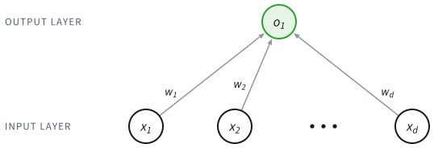

# Linear Regression
:label:`chap_regression`

*Regression* is the workhorse of quantitative prediction whenever the target is a meaningful number rather than a discrete category: estimating a home's sale price from its floor area and age, forecasting a patient's hospital stay from vital signs, or predicting next quarter's electricity demand. It is also an ideal proving ground for deep learning. Nearly every ingredient of neural network training—parameterized forward passes, loss functions grounded in maximum likelihood, minibatch stochastic gradient descent, reusable training harnesses, generalization diagnostics, and weight-norm regularization—already appears in its simplest, most transparent form in *linear regression*.

We begin in :numref:`sec_linear_regression` by formulating the affine model and the squared error loss, solving the problem both in closed form via orthogonal projection and iteratively via minibatch stochastic gradient descent (SGD), and connecting squared loss to Gaussian maximum likelihood. Before touching real data, :numref:`sec_synthetic-regression-data` constructs a synthetic benchmark with known ground-truth parameters $(\mathbf{w}^*, b^*)$ and noise level $\sigma$, giving us an exact target against which to test our code. The next three sections build the training pipeline in stages: first from raw tensors and automatic differentiation (:numref:`sec_linear_scratch`), then factored into the reusable `Module`, `DataModule`, and `Trainer` classes that power the rest of the book (:numref:`sec_oo-design`), and finally expressed in a few lines with high-level framework layers and optimizers (:numref:`sec_linear_concise`).

Fitting the training data is only half the problem. Using polynomial curve fitting, :numref:`sec_generalization_basics` separates training error from generalization error, decomposes expected test error into squared bias, variance, and noise, and shows how validation splits and $K$-fold cross-validation select model complexity without peeking at test data. Finally, :numref:`sec_weight_decay` tames overfitting in high dimensions by adding a squared $\ell_2$ penalty, showing how weight decay selectively shrinks directions that the training inputs determine poorly.

```toc
:maxdepth: 2

linear-regression
synthetic-regression-data
linear-regression-scratch
oo-design
linear-regression-concise
generalization
weight-decay
```

<!-- slides -->

::: {.slide}
::: {.cover}
[Dive into Deep Learning · §2]{.kicker}

Linear Neural Networks for Regression<br>
**affine models · squared loss · normal equations · minibatch SGD · generalization · weight decay**
:::
:::

::: {.slide title="Linear Regression Is Deep Learning in Miniature"}
[The Proving Ground]{.kicker}

::: {.cols .vc}
::: {.col}
- **Parameterized forward pass and loss:** Predict via $\hat{y} = \mathbf{w}^\top \mathbf{x} + b$ and score misfit via $L(\mathbf{w}, b) = \frac{1}{2n}\|\mathbf{X}\mathbf{w} + b - \mathbf{y}\|_2^2$, grounded in Gaussian maximum likelihood.
- **Exact closed form vs. scalable iteration:** The normal equations $\mathbf{X}^\top\mathbf{X}\mathbf{w}^* = \mathbf{X}^\top\mathbf{y}$ project $\mathbf{y}$ orthogonally in $O(nd^2 + d^3)$, whereas minibatch SGD updates in $O(|\mathcal{B}|d)$ per step.
- **Two recurring failure modes:** A silent shape bug ($(32,) - (32, 1) \to 32 \times 32$) still lowers loss, and a high-degree polynomial that interpolates 20 noisy points fails on new data.
:::

::: {.col .fig .big}
@fig:ch02-lr-miniature
:::
:::
:::

::: {.slide title="From First Principles to a Reusable Training Pipeline"}
[Architectural Roadmap]{.kicker}

::: {.cols .vc}
::: {.col}
- **Theory & Synthetic Oracle:** Formulate the affine model, squared loss, normal equations, and minibatch SGD, then verify against known ground truth $(\mathbf{w}^*, b^*)$ and noise floor $\sigma^2/2$.
- **Three Implementation Tiers:** Build the tensor autograd loop from scratch, decouple into `Module` / `DataModule` / `Trainer`, and swap in the framework's dense layers and optimizers.
- **Generalization & Weight Decay:** Diagnose underfitting vs. overfitting via bias–variance and $K$-fold CV, and damp collinear noise with $\ell_2$ ridge shrinkage.
:::

::: {.col .fig .big}
@fig:ch02-lr-roadmap
:::
:::
:::

::: {.slide title="Concrete Running Benchmarks Across the Chapter"}
[Quantitative Anchors]{.kicker}

::: {.cols .vc}
::: {.col}
- **Projection & Synthetic Testbed:** The 3-point line $(0,1),(1,1),(2,0)$ yields $\hat{\mathbf{w}} = (7/6, -1/2)^\top$ with $\mathbf{X}^\top\mathbf{r} = \mathbf{0}$; on $n = 1{,}000$ examples, with $\mathbf{w}^* = (2, -3.4)^\top, b^* = 4.2, \sigma = 0.01$, loss drops from $16.6$ to $\sigma^2/2 = 5 \times 10^{-5}$.
- **Polynomial Curve Fitting ($n = 20$):** Noisy samples of a cubic ($\sigma = 0.1$): degree $1$ underfits, degree $3$ hits $\sigma^2 = 0.01$, degree $19$ explodes.
- **High-Dimensional Ridge ($d = 200, n = 300$):** The prior penalty $\lambda = \sigma^2/(n\tau^2) = 1/3$ shrinks the effective parameters to $\operatorname{df} \approx 127$.
:::

::: {.col .fig .big}
@fig:ch02-lr-benchmarks
:::
:::
:::

::: {.slide title="The Complete Supervised Learning Loop"}
[End-to-End Perspective]{.kicker}

Every model in the rest of this book—from multilayer perceptrons to Transformers—reuses the exact pipeline we construct in this chapter:

::: {.cols .vc}
::: {.col}
- **Forward & loss (`Module`):** Map minibatch inputs $\mathbf{X} \in \mathbb{R}^{|\mathcal{B}| \times d}$ to predictions $\hat{\mathbf{y}}$ and evaluate the penalized empirical loss $L_{\mathcal{B}}(\mathbf{w}, b) + \frac{\lambda}{2}\|\mathbf{w}\|_2^2$.
- **Backward & update (`Trainer`):** Differentiate $L_{\mathcal{B}}$ via reverse-mode autograd and step parameters via $(\mathbf{w}, b) \leftarrow (\mathbf{w}, b) - \eta \nabla L_{\mathcal{B}}$.
- **Validation & selection (`DataModule`):** Track held-out risk after every epoch to tune hyperparameters $(\eta, |\mathcal{B}|, \lambda)$ without leaking test data.
:::

::: {.col .fig}
{.nostretch width=100%}
:::
:::

::: {.d2l-note .rule}
Viewed as a neural network, linear regression is a single fully connected layer with $d$ inputs and $1$ linear output neuron.
:::
:::
