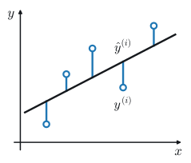
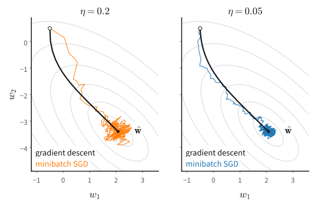

```{.python .input}
%load_ext d2lbook.tab
tab.interact_select('mxnet', 'pytorch', 'tensorflow', 'jax')
```

# Linear Regression
:label:`sec_linear_regression`

*Regression* problems arise whenever we want to predict a numerical value: the
sale price of a home or a share of stock, a patient's length of stay in a
hospital, or next quarter's retail demand. (By contrast, in *classification*
problems—which we take up in :numref:`chap_classification`—the goal is to assign
an example to one of a discrete set of categories.)

To ground our discussion in a concrete example, suppose you are considering buying
a 20-year-old house with 150 square meters of living area and want to estimate a
fair price. Naturally, you gather records of recent neighborhood sales, noting for
each home its floor area, its age, and the price it fetched. Plotting price
against area, the points scatter around an upward-sloping line: larger homes tend
to sell for more, not with clockwork precision, but clearly on average. If we can
fit that line—or, using both area and age, the corresponding plane—we can estimate
a price for the 150-square-meter house and for any other home not yet on the
market.

*Linear regression* is both the simplest and the most widely used tool for this
task. It predicts the numerical target as a weighted sum of the input
measurements plus a constant offset. Dating back more than two centuries
:cite:`Legendre.1805,Gauss.1809`, linear regression remains the standard first
baseline on virtually every regression problem. For our purposes it offers a
second major advantage: it is the simplest setting in which *every* core
ingredient of modern machine learning appears side by side—a parameterized model,
a loss function measuring how poorly it fits the data, an optimization algorithm
for improving the parameters, and predictions on unseen examples. The deep
networks of later chapters replace the linear model with richer architectures
while keeping almost everything else intact.

In this section, we build all of these components using the matrix--vector
products, gradients, and expectations from :numref:`chap_preliminaries`. We first
derive the closed-form solution to least squares and examine its clean geometric
interpretation as orthogonal projection. We then turn to *minibatch stochastic
gradient descent*, the iterative optimization algorithm that powers nearly every
deep learning model in this book, and verify the speedups of vectorized
computation. Finally, we uncover the deep probabilistic link between squared-error
loss and Gaussian noise—showing us when to reach for a different loss—and view
linear regression as a single-layer neural network.

```{.python .input #linear-regression}
%%tab mxnet
import time
import numpy as np
from mxnet import np as mnp, npx
npx.set_np()
```

```{.python .input #linear-regression}
%%tab pytorch
import time
import numpy as np
import torch
```

```{.python .input #linear-regression}
%%tab tensorflow
import time
import numpy as np
import tensorflow as tf
```

```{.python .input #linear-regression}
%%tab jax
import time
import jax
from jax import numpy as jnp
import numpy as np
```

## The Model and the Loss

### Features and Labels

Let us establish the standard machine learning vocabulary for this setup. The
collection of past house sales is our *training dataset* (or *training set*), and
each individual sale is an *example* (also called a *data point*, *instance*, or
*sample*). The numerical quantity we aim to predict—here, the sale price—is the
*label* (or *target*), while the input measurements used to make the
prediction—area and age—are the *features* (or *covariates*).

Throughout the book, $n$ denotes the number of examples in the dataset. We use
parenthesized superscripts to index examples and subscripts to index features:
$\mathbf{x}^{(i)}$ is the feature vector of the $i$-th example, $x_j^{(i)}$ is its
$j$-th feature, and $y^{(i)}$ is its label. For our housing dataset,
$\mathbf{x}^{(i)} = (x_1^{(i)}, x_2^{(i)})$ holds the area and age of the $i$-th
sale, and $y^{(i)}$ is its sale price.

### The Linear Model
:label:`subsec_linear_model`

At the heart of every supervised learning method is a *model* specifying how
features map to a predicted target. Linear regression assumes that the expected
sale price is a weighted sum of area and age plus a constant:

$$\textrm{price} = w_{\textrm{area}} \cdot \textrm{area} + w_{\textrm{age}} \cdot \textrm{age} + b.$$
:eqlabel:`eq_price-area`

The coefficients $w_{\textrm{area}}$ and $w_{\textrm{age}}$ are called *weights*,
measuring how much the predicted price shifts per unit change in each feature. For
instance, with $w_{\textrm{area}} = 3{,}000$ dollars per square meter,
$w_{\textrm{age}} = -1{,}000$ dollars per year, and $b = 50{,}000$ dollars, our
20-year-old, 150-square-meter house is priced at
$3{,}000 \cdot 150 - 1{,}000 \cdot 20 + 50{,}000 = 480{,}000$ dollars.

The constant $b$ is the *bias* (also called the *offset* or *intercept*), giving
the model's output when all features equal zero. Although nobody buys a zero-area
house, omitting $b$ would force every fitted line or plane to pass through the
origin—a constraint the data have no reason to obey. Strictly speaking,
:eqref:`eq_price-area` is an *affine transformation* (a linear map followed by a
translation by $b$), though the name *linear regression* is universal.

In machine learning we routinely work with hundreds or thousands of features,
where writing out terms explicitly becomes unwieldy. With $d$ features gathered
into a vector $\mathbf{x} = (x_1, \ldots, x_d) \in \mathbb{R}^d$ and weights
$\mathbf{w} = (w_1, \ldots, w_d) \in \mathbb{R}^d$, the prediction $\hat{y}$ is
expressed compactly as a dot product:

$$\hat{y} = w_1 x_1 + \cdots + w_d x_d + b = \mathbf{w}^\top \mathbf{x} + b.$$
:eqlabel:`eq_linreg-y`

To compute predictions for an entire collection of $n$ examples simultaneously, we
stack the feature vectors as the rows of the *design matrix*
$\mathbf{X} \in \mathbb{R}^{n \times d}$ (one row per example, one column per
feature) and collect the labels into $\mathbf{y} = (y^{(1)}, \ldots, y^{(n)})$.
The vector of all $n$ predictions $\hat{\mathbf{y}} \in \mathbb{R}^n$ is then a
single matrix--vector product:

$$\hat{\mathbf{y}} = \mathbf{X}\mathbf{w} + b,$$
:eqlabel:`eq_linreg-y-vec`

where the scalar bias $b$ is added to every entry via broadcasting
(:numref:`subsec_broadcasting`). Computing :eqref:`eq_linreg-y-vec` over a
*minibatch* of examples at once delegates the work to highly optimized linear
algebra kernels, running orders of magnitude faster than a Python loop over
individual examples.

Of course, even if the true relationship between price, area, and age were linear,
no real dataset satisfies $y^{(i)} = \mathbf{w}^\top \mathbf{x}^{(i)} + b$
without error. Two homes of identical area and age still sell for different prices
because of unrecorded factors (a renovated kitchen, street noise, negotiation
timing) and plain randomness. Linear regression therefore models the *conditional
mean* $\mathbb{E}[y \mid \mathbf{x}] = \mathbf{w}^\top \mathbf{x} + b$, treating
each individual home's departure from this average as noise. Our goal is to choose
the parameters $\mathbf{w}$ and $b$ so that predictions on *future* homes drawn
from the same population are as accurate as possible. To do so, we need two more
ingredients: a way to score how well any given $(\mathbf{w}, b)$ fits the data,
and a procedure for updating $(\mathbf{w}, b)$ to improve that score.

### The Squared Loss
:label:`subsec_linear-regression-loss-function`

A *loss function* quantifies the discrepancy between predicted and actual labels
as a single nonnegative number: zero for a flawless prediction, and larger as the
error grows. For regression problems, the workhorse choice is the *squared error*
loss. For example $i$, with prediction $\hat{y}^{(i)}$ and true label $y^{(i)}$,
we define

$$l^{(i)}(\mathbf{w}, b) = \frac{1}{2} \left(\hat{y}^{(i)} - y^{(i)}\right)^2.$$
:eqlabel:`eq_mse`

Here $r^{(i)} = \hat{y}^{(i)} - y^{(i)}$ is the *error* on example $i$—the
vertical gap between the fitted line and the data point in
:numref:`fig_fit_linreg` (statisticians often call its negative,
$y^{(i)} - \hat{y}^{(i)}$, the *residual*). The leading factor of $\frac{1}{2}$
does not change which parameters minimize the loss; we include it purely for
algebraic convenience so that the $2$ brought down by differentiation cancels
cleanly, giving $\partial l^{(i)} / \partial \hat{y}^{(i)} = r^{(i)}$. Keep in
mind that this $\frac{1}{2}$ is a textbook convention rather than a universal
rule: the built-in mean squared error functions in most frameworks omit it, making
their loss and gradient twice as large as ours. The optimal parameters are
identical either way, though as we will see shortly, the factor of $2$ scales the
effective learning rate of gradient descent.


:label:`fig_fit_linreg`

To evaluate a candidate pair $(\mathbf{w}, b)$ across the entire training set of
$n$ examples, we average the per-example losses:

$$L(\mathbf{w}, b) = \frac{1}{n} \sum_{i=1}^n l^{(i)}(\mathbf{w}, b) = \frac{1}{2n} \sum_{i=1}^n \left(\mathbf{w}^\top \mathbf{x}^{(i)} + b - y^{(i)}\right)^2,$$

which is half the *mean squared error* (MSE). Training amounts to solving the
optimization problem

$$\hat{\mathbf{w}}, \hat{b} = \operatorname*{argmin}_{\mathbf{w}, b}\ L(\mathbf{w}, b),$$

where, as with $\hat{y}$, the hats emphasize that $\hat{\mathbf{w}}$ and $\hat{b}$
are empirical estimates derived from finite data. Because the training data are
fixed, $L$ depends solely on the parameters $(\mathbf{w}, b)$. Notice that up to
the constant factor $\frac{1}{2n}$, this is the exact same objective we
differentiated for our toy line model in :numref:`sec_calculus`, with the bias
written out explicitly.

Squaring the errors is a double-edged sword: while it strongly discourages large
mistakes, it also makes the fit acutely sensitive to outliers. An error of $10$
costs a hundred times as much as an error of $1$, so even a single corrupted
label can drag the fitted line far off course. Just how badly? Let us place 20
points cleanly along $y = 2x$, corrupt a single label to $10{,}000$ (say, a data
entry typo), and fit a line through the origin, $\hat{y} = w x$, under two
competing losses.

For the squared loss $\sum_i (w x^{(i)} - y^{(i)})^2$, setting the derivative to
zero yields the closed-form slope
$w = \sum_i x^{(i)} y^{(i)} / \sum_i (x^{(i)})^2$. For the *mean absolute error*
(MAE), $\frac{1}{n}\sum_i |w x^{(i)} - y^{(i)}|$, there is no simple algebraic
formula, but with just one parameter we can evaluate the loss across a fine grid
of slopes and pick the minimizer directly.

```{.python .input #linear-regression-loss-function}
x = np.arange(1.0, 21.0)
y = 2 * x
y[5] = 10000                            # corrupt a single label
w_sq = (x * y).sum() / (x * x).sum()    # squared-loss minimizer
w_grid = np.linspace(0, 30, 3001)       # slopes 0, 0.01, ..., 30
mae = np.abs(w_grid[:, None] * x - y).mean(axis=1)
w_mae = w_grid[mae.argmin()]            # MAE minimizer on the grid
print(f'true w: 2.00, squared loss: {w_sq:.2f}, MAE: {w_mae:.2f}')
```

A single corrupted point out of twenty yanks the squared-loss slope from $2.00$
all the way to roughly $23$, while the absolute-error slope does not budge from
$2.00$! Under squared loss, one gigantic error of nearly $10{,}000$ overwhelms
the combined pull of all nineteen clean points; under absolute error, its pull
grows only linearly, so the nineteen clean points easily outvote it. Which
behavior is desirable depends on what kind of noise we expect in our labels—a
question we answer from first principles in
:numref:`subsec_normal_distribution_and_squared_loss`.

## Minimizing the Loss

Unlike almost all of the deep networks we will study later in this book, linear
regression with squared loss enjoys a closed-form analytic solution. We derive
that solution first—both because it is fast for small problems and because its
geometry reveals what least squares actually does—before turning to the iterative
optimization method required by deep learning.

### The Normal Equations
:label:`subsec_linear-regression-analytic-solution`

Because the squared loss is a quadratic function of $(\mathbf{w}, b)$, its
gradient is linear in the parameters, and finding where the gradient vanishes
reduces to solving a system of linear equations. To write this cleanly, we fold
the bias $b$ into the weight vector by appending a constant column of ones to the
design matrix, giving $\tilde{\mathbf{X}} = [\mathbf{X}, \mathbf{1}] \in \mathbb{R}^{n \times (d+1)}$,
and stacking the parameters into $\tilde{\mathbf{w}} = (\mathbf{w}, b) \in \mathbb{R}^{d+1}$.
Then $\tilde{\mathbf{X}}\tilde{\mathbf{w}} = \mathbf{X}\mathbf{w} + b$, and
minimizing $L$ is equivalent to minimizing
$\|\tilde{\mathbf{X}}\tilde{\mathbf{w}} - \mathbf{y}\|^2$. In
:numref:`sec_calculus`, we showed that this function has gradient
$2\tilde{\mathbf{X}}^\top(\tilde{\mathbf{X}}\tilde{\mathbf{w}} - \mathbf{y})$.
Setting the gradient to zero gives the *normal equations*:

$$\tilde{\mathbf{X}}^\top \tilde{\mathbf{X}}\, \tilde{\mathbf{w}} = \tilde{\mathbf{X}}^\top \mathbf{y},$$

a system of $d + 1$ linear equations in the $d + 1$ unknown parameters.

In general, a zero gradient only signals a stationary point, not necessarily a
global minimum. For least squares, however, a one-line expansion proves that
*every* solution $\hat{\tilde{\mathbf{w}}}$ of the normal equations is a global
minimizer. For any perturbation $\mathbf{v} \in \mathbb{R}^{d+1}$, expanding the
squared norm at $\hat{\tilde{\mathbf{w}}} + \mathbf{v}$ yields

$$\|\tilde{\mathbf{X}}(\hat{\tilde{\mathbf{w}}} + \mathbf{v}) - \mathbf{y}\|^2 = \|\tilde{\mathbf{X}}\hat{\tilde{\mathbf{w}}} - \mathbf{y}\|^2 + 2\mathbf{v}^\top \tilde{\mathbf{X}}^\top(\tilde{\mathbf{X}}\hat{\tilde{\mathbf{w}}} - \mathbf{y}) + \|\tilde{\mathbf{X}}\mathbf{v}\|^2.$$
:eqlabel:`eq_linreg-pythagoras`

By the normal equations, the middle cross term is identically zero, and the final
term $\|\tilde{\mathbf{X}}\mathbf{v}\|^2$ is always nonnegative—so no parameter
vector can achieve a smaller loss than $\hat{\tilde{\mathbf{w}}}$. Moreover, the
loss strictly increases unless $\tilde{\mathbf{X}}\mathbf{v} = \mathbf{0}$ (that
is, unless shifting the parameters by $\mathbf{v}$ leaves every single prediction
unchanged). Whenever the columns of $\tilde{\mathbf{X}}$ are *linearly
independent* (full column rank), $\tilde{\mathbf{X}}\mathbf{v} = \mathbf{0}$
forces $\mathbf{v} = \mathbf{0}$, so the global minimizer is unique. Linear
independence fails whenever one feature is redundant—for example, if we include
both area in square meters and area in square feet—in which case infinitely many
weight combinations produce the exact same predictions
(see exercise :exref:`ex_linear-regression-singular-design-matrix`).

When $\tilde{\mathbf{X}}$ has full column rank, the square matrix
$\tilde{\mathbf{X}}^\top \tilde{\mathbf{X}}$ is invertible, giving the classic
formula

$$\hat{\tilde{\mathbf{w}}} = (\tilde{\mathbf{X}}^\top \tilde{\mathbf{X}})^{-1} \tilde{\mathbf{X}}^\top \mathbf{y}.$$

Treat this closed-form expression as a tool for mathematical analysis rather than
a literal recipe for numerical code! Explicitly forming
$\tilde{\mathbf{X}}^\top \tilde{\mathbf{X}}$ squares the condition number and
amplifies floating-point rounding errors (:numref:`subsec_mdl-condition-number`),
and explicitly inverting a matrix is both slower and less accurate than solving
the linear system directly :cite:`Golub.Van-Loan.1996`. In numerical code, always
call a dedicated least-squares solver such as `lstsq`, which operates directly on
a stable factorization of $\tilde{\mathbf{X}}$.

Let us check this on our three-point line model from :numref:`sec_calculus`, with
inputs $0, 1, 2$, labels $1, 1, 0$, and prediction $w_1 + w_2 \cdot \textrm{input}$
(putting the intercept column of ones first so each row of $\tilde{\mathbf{X}}$ is
$(1, \textrm{input})$):

$$\tilde{\mathbf{X}} = \begin{bmatrix} 1 & 0 \\ 1 & 1 \\ 1 & 2 \end{bmatrix}, \quad \tilde{\mathbf{X}}^\top \tilde{\mathbf{X}} = \begin{bmatrix} 3 & 3 \\ 3 & 5 \end{bmatrix}, \quad \tilde{\mathbf{X}}^\top \mathbf{y} = \begin{bmatrix} 2 \\ 1 \end{bmatrix}.$$

Solving $3w_1 + 3w_2 = 2$ and $3w_1 + 5w_2 = 1$ yields $\hat{w}_2 = -1/2$ and
$\hat{w}_1 = 7/6$, matching the minimum we located in :numref:`sec_calculus`.
Below, we solve the same system using `lstsq` (naming $\tilde{\mathbf{X}}$ simply
`X`) and verify that $\tilde{\mathbf{X}}^\top \mathbf{r} = \mathbf{0}$ for the
resulting error vector $\mathbf{r} = \tilde{\mathbf{X}}\hat{\tilde{\mathbf{w}}} - \mathbf{y}$.

```{.python .input #linear-regression-the-normal-equations}
%%tab pytorch
X = torch.tensor([[1.0, 0.0], [1.0, 1.0], [1.0, 2.0]])  # rows (1, input)
y = torch.tensor([[1.0], [1.0], [0.0]])
w_hat = torch.linalg.lstsq(X, y).solution
r = X @ w_hat - y                                       # errors
print('w_hat:', tuple(round(float(v), 4) for v in w_hat[:, 0]))
print('r:', tuple(round(float(v), 4) for v in r[:, 0]))
print(f'max |X^T r|: {float((X.T @ r).abs().max()):.0e}')
```

```{.python .input #linear-regression-the-normal-equations}
%%tab tensorflow
X = tf.constant([[1.0, 0.0], [1.0, 1.0], [1.0, 2.0]])  # rows (1, input)
y = tf.constant([[1.0], [1.0], [0.0]])
w_hat = tf.linalg.lstsq(X, y, fast=False)      # do not form X^T X
r = X @ w_hat - y                                      # errors
print('w_hat:', tuple(round(float(v), 4) for v in w_hat[:, 0]))
print('r:', tuple(round(float(v), 4) for v in r[:, 0]))
XTr = tf.transpose(X) @ r
print(f'max |X^T r|: {float(tf.reduce_max(tf.abs(XTr))):.0e}')
```

```{.python .input #linear-regression-the-normal-equations}
%%tab jax
X = jnp.array([[1.0, 0.0], [1.0, 1.0], [1.0, 2.0]])  # rows (1, input)
y = jnp.array([[1.0], [1.0], [0.0]])
w_hat = jnp.linalg.lstsq(X, y)[0]
r = X @ w_hat - y                                    # errors
print('w_hat:', tuple(round(float(v), 4) for v in w_hat[:, 0]))
print('r:', tuple(round(float(v), 4) for v in r[:, 0]))
print(f'max |X^T r|: {float(jnp.abs(X.T @ r).max()):.0e}')
```

```{.python .input #linear-regression-the-normal-equations}
%%tab mxnet
X = mnp.array([[1.0, 0.0], [1.0, 1.0], [1.0, 2.0]])  # rows (1, input)
y = mnp.array([[1.0], [1.0], [0.0]])
w_hat = mnp.linalg.lstsq(X, y, rcond=None)[0]
r = X @ w_hat - y                                    # errors
print('w_hat:', tuple(round(float(v), 4) for v in w_hat[:, 0]))
print('r:', tuple(round(float(v), 4) for v in r[:, 0]))
print(f'max |X^T r|: {float(mnp.abs(X.T @ r).max()):.0e}')
```

Sure enough, `lstsq` returns $\hat{\tilde{\mathbf{w}}} = (7/6, -1/2)$ and errors
$\mathbf{r} = (1/6, -1/3, 1/6)$ to four decimal places, with
$\tilde{\mathbf{X}}^\top \mathbf{r}$ vanishing down to `float32` rounding noise
($\sim 10^{-7}$).

### Least Squares as Projection

The normal equations carry an illuminating geometric interpretation—which is in
fact where the word "normal" comes from. Recall from :numref:`sec_linear-algebra`
that a matrix--vector product $\tilde{\mathbf{X}}\tilde{\mathbf{w}}$ is a linear
combination of the columns of $\tilde{\mathbf{X}}$ weighted by the entries of
$\tilde{\mathbf{w}}$. Each column records one feature across all $n$ examples and
therefore lives in $\mathbb{R}^n$, right alongside the label vector $\mathbf{y}$.
As $\tilde{\mathbf{w}}$ ranges over $\mathbb{R}^{d+1}$, the achievable predictions
$\tilde{\mathbf{X}}\tilde{\mathbf{w}}$ sweep out the *column space* of
$\tilde{\mathbf{X}}$ (for two columns in $\mathbb{R}^3$, a flat plane passing
through the origin). Minimizing $\|\tilde{\mathbf{X}}\tilde{\mathbf{w}} - \mathbf{y}\|$
simply asks: *which point in this subspace lies closest to $\mathbf{y}$?*

![Least squares as projection. The predictions $\tilde{\mathbf{X}}\tilde{\mathbf{w}}$ range over the column space of $\tilde{\mathbf{X}}$. The fitted values $\hat{\mathbf{y}} = \tilde{\mathbf{X}}\hat{\tilde{\mathbf{w}}}$ are the foot of the perpendicular from the label vector $\mathbf{y}$, so the error vector $\mathbf{r} = \hat{\mathbf{y}} - \mathbf{y}$ meets the column space at a right angle. Any other prediction $\tilde{\mathbf{X}}\tilde{\mathbf{w}}$ lies farther from $\mathbf{y}$ (dotted): its squared distance adds the squared length of the dotted leg in the plane.](../img/mdl-linreg-projection.svg)
:label:`fig_linreg_projection`

Geometrically, the closest point is the foot of the perpendicular dropped from
$\mathbf{y}$ onto the column space (:numref:`fig_linreg_projection`). Rewriting
the normal equations as $\tilde{\mathbf{X}}^\top \mathbf{r} = \mathbf{0}$ (with
$\mathbf{r} = \tilde{\mathbf{X}}\hat{\tilde{\mathbf{w}}} - \mathbf{y}$) says
precisely that the error vector $\mathbf{r}$ has zero dot product with every
column of $\tilde{\mathbf{X}}$—that is, $\mathbf{r}$ is *orthogonal* ("normal") to
the column space! From this vantage point, :eqref:`eq_linreg-pythagoras` is just
the Pythagorean theorem on the right triangle in the figure: the squared distance
from $\mathbf{y}$ to any competing prediction $\tilde{\mathbf{X}}\tilde{\mathbf{w}}$
equals $\|\mathbf{r}\|^2$ plus the squared distance
$\|\tilde{\mathbf{X}}\tilde{\mathbf{w}} - \hat{\mathbf{y}}\|^2$ inside the
subspace. Thus the fitted vector
$\hat{\mathbf{y}} = \tilde{\mathbf{X}}\hat{\tilde{\mathbf{w}}}$ is the
*orthogonal projection* of $\mathbf{y}$ onto the column space of
$\tilde{\mathbf{X}}$ (see :numref:`sec_mdl-geometry-linear-algebraic-ops` for a
general treatment of projections).

Checking our three-point example makes this concrete: the error vector
$\mathbf{r} = (1/6, -1/3, 1/6)$ is indeed orthogonal to both columns of
$\tilde{\mathbf{X}}$—its dot product with $(1, 1, 1)$ is $1/6 - 1/3 + 1/6 = 0$,
and its dot product with $(0, 1, 2)$ is $-1/3 + 2/6 = 0$. Notice what
orthogonality to the column of ones implies: *the errors sum to zero*. Whenever a
least-squares model includes a bias term, its positive and negative errors balance
out exactly so that the fit neither overestimates nor underestimates the labels on
average (exercise :exref:`ex_linear-regression-centering`).

### Minibatch Stochastic Gradient Descent
:label:`subsec_linear-regression-minibatch-sgd`

While linear regression spoils us with an analytic formula, we should not get used
to such good fortune: requiring a closed-form solution would rule out virtually
all of deep learning. Fortunately, even when we cannot solve for the minimum
analytically, we can optimize models effectively using *gradient descent*
(:numref:`sec_calculus`), iteratively nudging the parameters in the direction
opposite the gradient of the loss,
$\mathbf{w} \leftarrow \mathbf{w} - \eta \nabla_{\mathbf{w}} L(\mathbf{w})$,
with step size (or *learning rate*) $\eta > 0$.

How should we compute that gradient in practice? Evaluating the exact gradient of
the full training loss $L(\mathbf{w}, b)$ requires sweeping over all $n$ examples
before taking even a single update step :cite:`Liu.Nocedal.1989`. On datasets with
millions of examples (many of them redundant), full-batch gradient descent is
painfully slow. At the opposite extreme, pure *stochastic gradient descent* (SGD)
estimates the gradient from a single randomly chosen example per step
:cite:`Bottou.2010`. Although each update is cheap, single-example gradients are
very noisy and leave modern processors severely underutilized: moving data from
memory dominates when processing one example at a time, whereas matrix operations
over batches run an order of magnitude faster (and layers such as batch
normalization in :numref:`sec_batch_norm` require multiple examples at once).

The practical sweet spot is *minibatch stochastic gradient descent*
:cite:`Li.Zhang.Chen.ea.2014`: at each iteration $t$, we sample a random
*minibatch* $\mathcal{B}_t$ of $|\mathcal{B}|$ examples and average the gradient
over that minibatch. Because $\mathcal{B}_t$ is sampled uniformly at random, its
average gradient is an *unbiased* estimator of the full gradient
(:numref:`sec_prob`), while its variance shrinks proportionally to
$1 / |\mathcal{B}|$. Writing the update jointly for $(\mathbf{w}, b)$ gives

$$(\mathbf{w},b) \leftarrow (\mathbf{w},b) - \frac{\eta}{|\mathcal{B}|} \sum_{i \in \mathcal{B}_t} \nabla_{(\mathbf{w},b)}\, l^{(i)}(\mathbf{w},b).$$

For linear regression with our squared loss :eqref:`eq_mse`, the chain rule yields
closed-form expressions for the per-example gradients—the derivative of $l^{(i)}$
with respect to $\hat{y}^{(i)}$ is simply the error $r^{(i)} = \hat{y}^{(i)} - y^{(i)}$,
and the derivatives of $\hat{y}^{(i)}$ with respect to $\mathbf{w}$ and $b$ are
$\mathbf{x}^{(i)}$ and $1$, respectively—producing the explicit update rule

$$
\begin{aligned}
\mathbf{w} &\leftarrow \mathbf{w} - \frac{\eta}{|\mathcal{B}|} \sum_{i \in \mathcal{B}_t} \mathbf{x}^{(i)} \left(\mathbf{w}^\top \mathbf{x}^{(i)} + b - y^{(i)}\right),\\
b &\leftarrow b - \frac{\eta}{|\mathcal{B}|} \sum_{i \in \mathcal{B}_t} \left(\mathbf{w}^\top \mathbf{x}^{(i)} + b - y^{(i)}\right).
\end{aligned}
$$
:eqlabel:`eq_linreg_batch_update`

Look at the intuition inside :eqref:`eq_linreg_batch_update`: each example nudges
the weight vector along its own feature vector $\mathbf{x}^{(i)}$ in proportion to
its prediction error, while the bias shifts by the minibatch's average error. We
initialize $(\mathbf{w}, b)$ (typically randomly) and repeat this update for a
chosen number of steps or until a stopping criterion is met. Because minibatch SGD
is universal in practice, both deep learning libraries and the remainder of this
book simply refer to this minibatch algorithm as *SGD*.

Notice that the minibatch size $|\mathcal{B}|$ and the learning rate $\eta$ are
not learned by gradient descent—we specify them up front. Such user-chosen
settings are called *hyperparameters* (and can be tuned systematically on held-out
validation data, as we discuss later in this chapter, or automatically via tools
such as Bayesian optimization :cite:`Frazier.2018`). Powers of $2$ between $32$
and $256$ are common starting points for $|\mathcal{B}|$, balancing statistical
efficiency against hardware throughput and memory limits.

Finally, keep in mind that the learning rate $\eta$ is inseparable from the
scaling of the loss function. Multiplying any loss $L$ by a positive constant $c$
multiplies its gradient by $c$, so running SGD on $c L$ with learning rate $\eta$
takes the exact same steps as running SGD on $L$ with learning rate $c \eta$. In
particular, switching to a library MSE loss that omits our factor of $\frac{1}{2}$
requires halving $\eta$ to preserve the exact same optimization trajectory, and
summing rather than averaging over a minibatch requires dividing $\eta$ by
$|\mathcal{B}|$.

### Gradient Noise and the Learning Rate

A subtle but crucial property of minibatch SGD is that, with a fixed learning rate
$\eta$, it never settles completely at the exact minimizer—not even on a convex
least-squares problem. At the global minimizer $\hat{\tilde{\mathbf{w}}}$, the
*full-dataset* gradient vanishes ($\tilde{\mathbf{X}}^\top \mathbf{r} = \mathbf{0}$),
meaning the individual error terms $\mathbf{x}^{(i)} r^{(i)}$ cancel across the
entire dataset. Inside any random minibatch $\mathcal{B}_t$, however, they do not
cancel! Consequently, while full-batch gradient descent glides steadily into
$\hat{\mathbf{w}}$, constant-step-size SGD keeps jittering inside a stationary
cloud around $\hat{\mathbf{w}}$ known as the *noise ball*
(:numref:`fig_linreg_gd_sgd`).

A one-dimensional calculation shows exactly how wide this noise ball is. Let
$u = w - \hat{w}$ be the distance from the minimizer, rescaling the feature so the
full-batch gradient is simply $u$. One SGD step maps $u$ to
$(1 - \eta) u - \eta \xi$, where the minibatch gradient noise $\xi$ has mean zero
and variance $s^2 / |\mathcal{B}|$ ($s^2$ being the single-example gradient
variance). Close to the minimizer, $\xi$ is nearly independent of $u$, so the
variance $v$ of $u$ updates to $(1 - \eta)^2 v + \eta^2 s^2 / |\mathcal{B}|$.
Setting this equal to $v$ to find the stationary cloud gives
$v \approx \eta s^2 / (2 |\mathcal{B}|)$ for small $\eta$: the mean squared
distance from the minimizer scales as $\eta / |\mathcal{B}|$, growing directly
with the label noise (via $s^2$).


:label:`fig_linreg_gd_sgd`

Quartering $\eta$ cuts the stationary variance $v$ by four and thus halves the
radius of the noise ball, as seen in the right panel of
:numref:`fig_linreg_gd_sgd`—at the cost of shrinking the initial distance four
times more slowly and needing roughly four times as many steps to reach the
vicinity of $\hat{\mathbf{w}}$. In practice, we resolve this trade-off by
starting with a larger learning rate for rapid progress and gradually reducing it
along a *learning rate schedule* (see :numref:`subsec_mdl-stochastic-gradients`
for the multidimensional derivation). Notice also that because the sequence of
minibatches is random, two training runs from the exact same initialization land
at different points inside the noise ball—making trained parameters themselves
random, which is why empirical numbers throughout this book are often quoted as
ranges rather than exact constants.

### Vectorization for Speed

We have argued twice that a single vectorized matrix product over many examples
dramatically outperforms looping over examples in Python. Let us measure the
difference directly. Below, we compute predictions for $1{,}000$ examples using
weights $\mathbf{w} = (2, -3.4)$ and bias $b = 4.2$, first one example at a time
in a Python list comprehension and then all at once via `X @ w + b`
(:numref:`sec_ndarray`). Storing $\mathbf{w}$ as a $2 \times 1$ column matrix lets
the exact same expression handle either a single $1 \times 2$ row slice or the
entire $1{,}000 \times 2$ matrix.

```{.python .input #linear-regression-vectorization-for-speed-1}
%%tab pytorch
n = 1000
X = torch.ones(n, 2)                # the values do not affect the timing
w = torch.tensor([[2.0], [-3.4]])
b = 4.2
# Wait until the device has finished (CUDA runs asynchronously)
wait = lambda x: torch.cuda.synchronize() if torch.cuda.is_available() else None
```

```{.python .input #linear-regression-vectorization-for-speed-1}
%%tab tensorflow
n = 1000
X = tf.ones((n, 2))                 # the values do not affect the timing
w = tf.constant([[2.0], [-3.4]])
b = 4.2
# Wait until all devices have finished (a GPU runs asynchronously)
wait = lambda x: tf.test.experimental.sync_devices()
```

```{.python .input #linear-regression-vectorization-for-speed-1}
%%tab jax
n = 1000
X = jnp.ones((n, 2))                # the values do not affect the timing
w = jnp.array([[2.0], [-3.4]])
b = 4.2
wait = jax.block_until_ready        # JAX returns before it has finished
```

```{.python .input #linear-regression-vectorization-for-speed-1}
%%tab mxnet
n = 1000
X = mnp.ones((n, 2))                # the values do not affect the timing
w = mnp.array([[2.0], [-3.4]])
b = 4.2
wait = lambda x: npx.waitall()      # MXNet returns before it has finished
```

Our timing helper `seconds` runs a warm-up call first (to absorb one-time setup
and JIT compilation costs) and calls `wait` before stopping the clock, since GPU
and accelerator frameworks dispatch operations asynchronously and may return to
Python while the hardware is still computing.

```{.python .input #linear-regression-vectorization-for-speed-2}
def seconds(f):
    """Time one call of f, after a warm-up call."""
    wait(f())
    start = time.perf_counter()
    wait(f())
    return time.perf_counter() - start
```

```{.python .input #linear-regression-vectorization-for-speed-3}
loop = seconds(lambda: [X[i:i + 1] @ w + b for i in range(n)])
vectorized = seconds(lambda: X @ w + b)
print(f'one example at a time: {loop * 1e3:8.3f} ms')
print(f'all examples at once:  {vectorized * 1e3:8.3f} ms')
print(f'speedup: {loop / vectorized:.0f}x')
```

Even though both paths perform the exact same arithmetic, computing all $1{,}000$
predictions in a single vectorized call is *hundreds of times* faster! The loop
pays Python interpreter overhead and kernel-launch latency on every single
example, whereas the matrix multiplication pays that overhead once and hands the
bulk arithmetic to compiled linear algebra libraries—reducing both runtime and
opportunities for bugs. The exact same argument applies to gradient computation,
which is why we always train on minibatches. Once training finishes, evaluating
$\hat{\mathbf{w}}^\top \mathbf{x} + \hat{b}$ on unseen inputs yields our
*predictions* (a phase deep learning practitioners often call *inference*, though
statisticians reserve "inference" more broadly for drawing conclusions about
parameters as well as labels).

## Squared Loss and Gaussian Noise
:label:`subsec_normal_distribution_and_squared_loss`

So far, our motivation for the squared loss has been purely pragmatic: it is
smooth and admits a closed-form solution, yet as our corrupted-label experiment
showed, it can be painfully sensitive to outliers. Is there a deeper reason to
choose squared error—and a principled way to know when to pick a different loss?

Linear regression was invented at the turn of the nineteenth century, and while
historians still debate whether Gauss or Legendre thought of least squares first,
it was Gauss who also discovered the *normal distribution* (or *Gaussian*). As we
are about to see, the normal distribution and squared-error loss share a far
deeper connection than common parentage.

### The Normal Distribution

A *normal distribution* with mean $\mu$ and variance $\sigma^2$ (standard
deviation $\sigma$) has probability density

$$p(x) = \frac{1}{\sqrt{2 \pi \sigma^2}} \exp\left(-\frac{(x - \mu)^2}{2 \sigma^2}\right).$$

Its density forms the familiar symmetric bell curve centered at $\mu$, whose width
is governed by $\sigma$: roughly $68\%$ of its probability mass lies within one
standard deviation of $\mu$, and roughly $95\%$ within $2\sigma$. Because the
*squared* deviation $(x - \mu)^2$ appears inside the negative exponential, extreme
deviations are vanishingly unlikely: a value $5\sigma$ from the mean has density
$e^{-12.5} \approx 4 \times 10^{-6}$ times that at the peak. We write
$\epsilon \sim \mathcal{N}(\mu, \sigma^2)$ to denote a normally distributed random
variable. Because sums of many small independent disturbances converge toward a
normal distribution (:numref:`subsec_mdl-gaussian-clt`), the Gaussian is the
natural default model for well-behaved measurement noise.

Formally, linear regression with additive Gaussian noise assumes that every
observed label is the linear signal plus an independent normal noise term:

$$y = \mathbf{w}^\top \mathbf{x} + b + \epsilon, \quad \epsilon \sim \mathcal{N}(0, \sigma^2).$$

Under this model, the conditional mean $\mathbb{E}[y \mid \mathbf{x}]$ is indeed
$\mathbf{w}^\top \mathbf{x} + b$ (matching :numref:`subsec_linear_model`), and
labels scatter symmetrically around the line with the same noise scale $\sigma$
at every input $\mathbf{x}$ (:numref:`fig_linreg_gaussian_noise`).


:label:`fig_linreg_gaussian_noise`

### Maximum Likelihood

With an explicit probabilistic noise model in hand, we no longer have to invent a
loss function by guesswork: we can score any candidate parameters $(\mathbf{w}, b)$
by how probable they make the observed data! Given $(\mathbf{w}, b)$, the
conditional density of observing label $y$ at feature vector $\mathbf{x}$ is

$$p(y \mid \mathbf{x}) = \frac{1}{\sqrt{2 \pi \sigma^2}} \exp\left(-\frac{(y - \mathbf{w}^\top \mathbf{x} - b)^2}{2 \sigma^2}\right).$$

Labels lying close to the predicted line receive high density; labels far away
receive tiny density. Viewed as a function of the parameters $(\mathbf{w}, b)$ for
fixed observed data, this density is the *likelihood* (the term $P(D \mid H)$ in
Bayes' theorem from :numref:`sec_prob`). According to the *principle of maximum
likelihood*, the best parameters are those that maximize the likelihood of the
entire dataset. Because the $n$ training examples are drawn independently, the
joint conditional density factorizes into a product:

$$p(\mathbf y \mid \mathbf X) = \prod_{i=1}^{n} p(y^{(i)} \mid \mathbf{x}^{(i)}).$$

For our three-point example in :numref:`subsec_linear-regression-analytic-solution`
(with $\sigma = 1$), the least-squares line $(7/6, -1/2)$ assigns the labels a
joint density of roughly $0.058$, whereas a flat line through their mean assigns
only $0.045$—and no other line achieves a higher likelihood.

In practice, maximizing a product of thousands of small densities is awkward
analytically and quickly underflows to zero in floating-point arithmetic. Taking
the logarithm converts the product into a well-behaved sum without moving the
maximizer (since $\log$ is strictly increasing). Following the universal
optimization convention of *minimization* rather than maximization, we minimize
the *negative log-likelihood*:

$$-\log p(\mathbf y \mid \mathbf X) = \sum_{i=1}^n \left[\frac{1}{2} \log(2 \pi \sigma^2) + \frac{1}{2 \sigma^2} \left(y^{(i)} - \mathbf{w}^\top \mathbf{x}^{(i)} - b\right)^2\right].$$

Look at the two terms inside the sum. For any fixed $\sigma$, the first term is a
constant independent of $\mathbf{w}$ and $b$, while the second term is simply the
sum of squared errors multiplied by the positive constant $1 / (2\sigma^2)$!
Therefore, the minimizer over $(\mathbf{w}, b)$ is identical to the least-squares
solution regardless of $\sigma$. In other words, *minimizing mean squared error is
mathematically equivalent to maximum likelihood estimation under additive Gaussian
noise* (see :numref:`subsec_mdl-gaussian-mse` for the general theory).

This probabilistic lens immediately explains why our single corrupted label of
$10{,}000$ wrecked the least-squares fit. Under a Gaussian noise model with
$\sigma = 1$, a point lying nearly $10{,}000\sigma$ away from the line is deemed
essentially impossible! Desperate to raise that point's vanishing likelihood,
maximum likelihood tilts the entire line sharply toward the outlier, trading one
astronomical penalty for nineteen modest errors on the clean points.

### Choosing a Loss from a Noise Model
:label:`subsec_linreg-loss-menu`

Best of all, the exact same recipe—specify a realistic conditional noise model
$p(y \mid \mathbf{x})$ and minimize its negative log-likelihood—generates an entire
menu of principled loss functions tailored to different kinds of data (where
$\nu(\mathbf{x})$ denotes the predicted count rate in the final row):

| Output type | Noise model | Loss (negative log-likelihood) |
|:--|:--|:--|
| real-valued, well-behaved noise | Gaussian | squared error (this section) |
| real-valued, outliers or heavy tails | Laplace | absolute error (exercise :exref:`ex_linear-regression-laplace-noise`) |
| positive, multiplicative fluctuations (prices) | Gaussian on $\log y$ | squared error on $\log y$ (exercise :exref:`ex_linear-regression-beyond-gaussian-noise`) |
| counts (sales, arrivals) | Poisson | $\nu(\mathbf{x}) - y \log \nu(\mathbf{x})$ (exercise :exref:`ex_linear-regression-counting-apples`) |

Consider the *Laplace distribution*,
$p(\epsilon) = \frac{1}{2\beta}\exp(-|\epsilon| / \beta)$ with scale $\beta > 0$.
Because its exponent decays linearly in $|\epsilon|$ rather than quadratically in
$\epsilon^2$, its tails carry far more probability mass than a Gaussian of equal
variance (:numref:`fig_linreg-loss-menu`, left), and its negative log-likelihood
yields the *mean absolute error*. Under a Laplace noise model, an extreme label
is viewed as rare but plausible rather than impossible, so the fitted line refuses
to chase it—explaining the robustness we observed in our outlier experiment.
Between these two extremes lies the *Huber loss* (:numref:`fig_linreg-loss-menu`,
right), which behaves quadratically for small errors (smooth and easy to optimize
near zero) and linearly beyond a threshold $\delta$ (robust to occasional
corrupted labels). In :numref:`chap_classification`, we will apply this exact
same maximum-likelihood recipe to derive the cross-entropy loss for
classification.


:label:`fig_linreg-loss-menu`

## Linear Regression as a Neural Network

Although linear models cannot express the rich nonlinear mappings of deep
learning, neural networks cleanly subsume linear regression as their simplest
special case: a single-layer network in which every input feature wires directly
to a single output unit (:numref:`fig_single_neuron`). Each feature
$x_1, \ldots, x_d$ sits at an input node, each connection carries a weight $w_j$,
and the single output node computes $o_1 = \mathbf{w}^\top \mathbf{x} + b$.
Because the inputs are given and only the output node performs computation, this
is a *single-layer* network; and because every input connects to every output,
such a layer is called *fully connected* (or *dense*).


:label:`fig_single_neuron`

Historically, the vocabulary of units and weighted connections originated in
early mathematical models of biological neurons by cyberneticists Warren McCulloch
and Walter Pitts :cite:`McCulloch.Pitts.1943`, where dendrites aggregate
weighted synaptic inputs and fire down an axon. Today, however, the biological
analogy is best held loosely: as :citet:`Russell.Norvig.2016` famously remarked,
while airplanes were initially *inspired* by birds, modern aerodynamics draws far
more from physics and mathematics than from ornithology. Likewise, what we carry
forward from :numref:`fig_single_neuron` is the modular *layer abstraction*: the
deep networks of upcoming chapters stack many such layers with nonlinear
activations between them, while training them with the very same loss framework
and minibatch SGD.

Two pieces remain before we have a complete working system. First, we have not
yet written a training loop in code; the next sections build one from scratch,
beginning with synthetic data whose ground-truth parameters we know so we can
verify every line of our implementation. Second, achieving a tiny training loss
does not guarantee accurate predictions on homes our model has never seen—a
question we analyze in :numref:`sec_generalization_basics`, before putting real
housing data to the test in :numref:`sec_kaggle_house`.

## Summary

* *Linear regression* predicts a continuous target as an affine combination of
  input features, $\hat{y} = \mathbf{w}^\top \mathbf{x} + b$ (or
  $\hat{\mathbf{y}} = \mathbf{X}\mathbf{w} + b$ across a batch), using a single
  fully connected layer.
* Minimizing the average squared error leads to the *normal equations*
  $\tilde{\mathbf{X}}^\top \tilde{\mathbf{X}} \tilde{\mathbf{w}} = \tilde{\mathbf{X}}^\top \mathbf{y}$;
  geometrically, the fitted values $\hat{\mathbf{y}}$ are the orthogonal
  projection of $\mathbf{y}$ onto the column space of $\tilde{\mathbf{X}}$.
* *Minibatch stochastic gradient descent* (SGD) iteratively updates parameters
  using unbiased gradient estimates over random minibatches—combining low
  per-step cost with vectorized matrix speedups. With a constant learning rate
  $\eta$, SGD settles into a *noise ball* around the minimizer whose variance
  scales as $\eta / |\mathcal{B}|$.
* Minimizing squared error is mathematically equivalent to *maximum likelihood
  estimation* under additive Gaussian noise. Choosing different noise models
  (such as Laplace or Poisson) yields different losses—like mean absolute error,
  which resists outliers that badly distort a squared-error fit.

## Exercises

1. **Fitting a constant.** Consider a model without features that
   predicts the same value $b$ for every example. Fit it to labels
   $y^{(1)}, \ldots, y^{(n)} \in \mathbb{R}$ by minimizing
   $\sum_i (y^{(i)} - b)^2$.
    1. Find an analytic solution for the optimal value of $b$.
    1. Fit a normal distribution $\mathcal{N}(b, \sigma^2)$ to
       $y^{(1)}, \ldots, y^{(n)}$ by maximum likelihood in both $b$ and
       $\sigma^2$. Show that the estimate of $b$ is the solution of part (a)
       and find the estimate of $\sigma^2$.
    1. Change the loss to $\sum_i |y^{(i)} - b|$ and find all of its
       minimizers. Then replace a single label by an arbitrary value and
       determine how far the minimizers of each of the two losses can move.

1. **Intercept and centering.** Appending a constant feature $1$ to every
   input turns the affine model $\mathbf{w}^\top \mathbf{x} + b$ into a
   linear model in $(\mathbf{x}, 1)$. Centering the data removes the bias
   in a different way. Let $\bar{\mathbf{x}}$ and $\bar{y}$ be the averages
   of the features and of the labels over the training set.
    1. Show that every minimizer $(\hat{\mathbf{w}}, \hat{b})$ of the
       squared loss satisfies
       $\hat{b} = \bar{y} - \hat{\mathbf{w}}^\top \bar{\mathbf{x}}$, and
       conclude that the errors $\hat{y}^{(i)} - y^{(i)}$ of a least-squares
       fit with a bias sum to zero.
    1. Show that $\hat{\mathbf{w}}$ is a least-squares fit without bias to
       the centered data
       $(\mathbf{x}^{(i)} - \bar{\mathbf{x}},\, y^{(i)} - \bar{y})$.
   :exlabel:`ex_linear-regression-centering`

1. **Laplace noise.** Assume that the additive noise $\epsilon$ follows
   the Laplace distribution with scale $1$ (see
   :numref:`sec_mdl-distributions`), that is,
   $p(\epsilon) = \frac{1}{2} \exp(-|\epsilon|)$.
    1. Write out the negative log-likelihood of the data under the model
       $-\log p(\mathbf y \mid \mathbf X)$.
    1. Determine whether a closed-form solution exists.
    1. Write the minibatch stochastic gradient descent update for
       $(\mathbf{w}, b)$ under this loss in the form of
       :eqref:`eq_linreg_batch_update`, using $0$ where $|\cdot|$ has no
       derivative, at zero, and elsewhere its slope
       $\operatorname{sign}(\cdot) = \pm 1$. A substitute of this kind is
       called a *subgradient*. Compare how the size of each example's
       contribution depends on its error under this loss and under the
       squared loss.
    1. [code] Apply this update to the corrupted-label data of
       :numref:`subsec_linear-regression-loss-function`, for a line through
       the origin, using the full dataset in every step, the learning rate
       0.002, and 2,000 steps from $w = 0$. The minimizer of the absolute
       error is exactly $w = 2$. Where do the iterates end? Explain why they
       do not settle at the minimizer, and propose a fix.
   :exlabel:`ex_linear-regression-laplace-noise`

1. **Beyond Gaussian noise.** Suppose you use regression to estimate the
   price of houses or of stocks.
    1. Model the price directly as
       $y = \mathbf{w}^\top \mathbf{x} + b + \epsilon$ with
       $\epsilon \sim \mathcal{N}(0, \sigma^2)$, and take
       $\sigma = 100{,}000$ dollars. Compute the probability that the model
       assigns to a negative price for a house whose predicted price is
       $50{,}000$ dollars. Explain why no single $\sigma$ suits both this
       house and a house whose predicted price is $5{,}000{,}000$ dollars.
    1. Now regress on the logarithm of the price,
       $\log \textrm{price} = \mathbf{w}^\top \mathbf{x} + b + \epsilon$,
       where $\epsilon \sim \mathcal{N}(0, \sigma^2)$ now acts on the log
       scale. Compute the conditional mean and standard deviation of the
       price and show that their ratio does not depend on $\mathbf{x}$.
       Determine whether $\exp(\mathbf{w}^\top \mathbf{x} + b)$ is an
       unbiased prediction of the price. The same modeling choice underlies
       the Black--Scholes model of option pricing :cite:`Black.Scholes.1973`.
   :exlabel:`ex_linear-regression-beyond-gaussian-noise`

1. **Counting apples.** Suppose we want to use regression to estimate the
   *number* of apples sold in a grocery store.
    1. Identify the problems with a Gaussian additive noise model for such
       a target.
    1. The [Poisson distribution](https://en.wikipedia.org/wiki/Poisson_distribution)
       models counts. It is given by
       $p(k \mid \nu) = \nu^k e^{-\nu}/k!$, where $\nu > 0$
       is the rate and $k \in \{0, 1, 2, \ldots\}$ is the observed count.
       Prove that $\mathbb{E}[k] = \nu$.
    1. Derive the negative log-likelihood of a count $k$ under a rate
       $\nu(\mathbf{x})$ that depends on the features, dropping terms
       that do not depend on the parameters, and check it against the table
       in :numref:`subsec_linreg-loss-menu`.
    1. Compare the parameterizations
       $\nu(\mathbf{x}) = \mathbf{w}^\top \mathbf{x} + b$ and
       $\log \nu(\mathbf{x}) = \mathbf{w}^\top \mathbf{x} + b$.
       Determine for each whether $\nu(\mathbf{x}) > 0$ holds for all
       inputs and parameters, and state the consequence for the loss of
       part (c). Write that loss in terms of $(\mathbf{w}, b)$ for the
       second parameterization.
   :exlabel:`ex_linear-regression-counting-apples`

1. [code] **The size of the noise ball.** Generate $n = 1{,}000$ examples with
   two features drawn from $\mathcal{N}(0, 1)$ and labels
   $y = \mathbf{x}^\top \mathbf{w}^* + \epsilon$, where
   $\mathbf{w}^* = (2, -3.4)$ and $\epsilon \sim \mathcal{N}(0, 1)$, and
   compute the least-squares solution $\hat{\mathbf{w}}$ with `lstsq`.
    1. Run minibatch SGD without a bias, starting at $\hat{\mathbf{w}}$,
       with minibatches of 10 and $\eta = 0.1$ for 20,000 steps. Estimate
       the mean squared distance $\mathbb{E}\|\mathbf{w} - \hat{\mathbf{w}}\|^2$ of
       the iterates from $\hat{\mathbf{w}}$.
    1. Repeat for $\eta \in \{0.05, 0.025\}$ and for minibatch sizes 20
       and 40. Check that the mean squared distance is roughly
       proportional to $\eta / |\mathcal{B}|$.
    1. Why does the distance not depend on how far $\hat{\mathbf{w}}$ is
       from $\mathbf{w}^*$? What would change if the labels had no noise
       at all?

1. **Composing two linear layers.** Suppose a network with two layers is
   built by feeding the output of one linear layer,
   $\mathbf{h} = \mathbf{W}_1 \mathbf{x} + \mathbf{b}_1$, into a second,
   $\hat{y} = \mathbf{w}_2^\top \mathbf{h} + b_2$. Determine the class of
   functions of $\mathbf{x}$ that this network can represent and compare it
   with the class represented by a single linear layer. What property must
   an operation inserted between the two layers have for the composition to
   represent a strictly larger class?

1. **Singular design matrix.** ● Full column rank makes the least-squares
   minimizer unique. Suppose instead that $\mathbf{X}^\top \mathbf{X}$ is
   singular.
    1. Show that a minimizer of $\|\mathbf{y} - \mathbf{X}\mathbf{w}\|^2$
       still exists and characterize the set of all minimizers.
    1. Write the singular value decomposition as
       $\mathbf{X} = \mathbf{U}\boldsymbol{\Sigma}\mathbf{V}^\top$ with
       orthogonal $\mathbf{U}$ and $\mathbf{V}$ and a rectangular diagonal
       $\boldsymbol{\Sigma}$ of nonnegative singular values. The
       Moore--Penrose pseudoinverse is
       $$\mathbf{X}^{\dagger} = \mathbf{V}\boldsymbol{\Sigma}^{\dagger}\mathbf{U}^\top,$$
       where $\boldsymbol{\Sigma}^{\dagger}$ transposes
       $\boldsymbol{\Sigma}$ and inverts its nonzero entries. Show that
       $\mathbf{X}^{\dagger}\mathbf{y}$ is the minimizer of smallest norm
       within the set of part (a).
    1. Starting from $\mathbf{w} = \mathbf{0}$, which minimizer does
       gradient descent converge to? State whether the answer changes for
       minibatch stochastic gradient descent.
   :exlabel:`ex_linear-regression-singular-design-matrix`

1. **Noise injection and ridge regression.** ● Let
   $\mathbf{X}^\top \mathbf{X}$ be singular or nearly so, and recall that
   among all minimizers of $\|\mathbf{y} - \mathbf{X}\mathbf{w}\|^2$ the
   one of smallest norm is $\mathbf{X}^{\dagger}\mathbf{y}$, where the
   pseudoinverse $\mathbf{X}^{\dagger}$ inverts the nonzero singular values
   of $\mathbf{X}$ and keeps the zero ones at zero.
    1. Perturb the inputs: replace $\mathbf{X}$ by $\mathbf{X} + \mathbf{Z}$,
       where the entries of $\mathbf{Z}$ are independent draws from
       $\mathcal{N}(0, \gamma^2)$. Compute
       $\mathbb{E}[(\mathbf{X} + \mathbf{Z})^\top (\mathbf{X} + \mathbf{Z})]$
       and determine whether it is invertible. Express the expected loss
       $\mathbb{E}\|\mathbf{y} - (\mathbf{X} + \mathbf{Z})\mathbf{w}\|^2$
       in terms of $\mathbf{X}$, $\mathbf{y}$, $\mathbf{w}$ and $\gamma$.
    1. The standard remedy for a (near-)singular
       $\mathbf{X}^\top \mathbf{X}$ is to add $\lambda' \mathbf{I}$
       before inverting. Show that
       $$\mathbf{w}_{\lambda'} = (\mathbf{X}^\top\mathbf{X} + \lambda'\mathbf{I})^{-1}\mathbf{X}^\top\mathbf{y}$$
       is well defined for every $\lambda' > 0$ and that it minimizes
       $\|\mathbf{y} - \mathbf{X}\mathbf{w}\|^2 + \lambda'\|\mathbf{w}\|^2$,
       the $\ell_2$ penalty of :numref:`sec_weight_decay` written for the
       summed loss. Find the $\lambda'$ for which this objective equals the
       expected loss of part (a). Compare the limit of
       $\mathbf{w}_{\lambda'}$ as $\lambda' \to 0$ with
       $\mathbf{X}^{\dagger}\mathbf{y}$.
   :exlabel:`ex_linear-regression-noise-injection-ridge`

:begin_tab:`mxnet`
[Discussions](https://d2l.discourse.group/t/40)
:end_tab:

:begin_tab:`pytorch`
[Discussions](https://d2l.discourse.group/t/258)
:end_tab:

:begin_tab:`tensorflow`
[Discussions](https://d2l.discourse.group/t/259)
:end_tab:

:begin_tab:`jax`
[Discussions](https://d2l.discourse.group/t/17973)
:end_tab:

<!-- slides -->

::: {.slide}
::: {.cover}
[Dive into Deep Learning · §2.1]{.kicker}

Predicting a number from features<br>
**the linear model · squared loss · normal equations · minibatch SGD · Gaussian noise**
:::
:::

::: {.slide title="Past Sales Should Price a House Nobody Has Sold"}
[The problem]{.kicker}

::: {.cols .vc}
::: {.col}
- A house: 150 m², built 20 years ago. What is a fair price?
- Recent sales: area, age, price for each.
- Bigger houses cost more, not exactly but **on average**.

::: {.d2l-note}
**Regression:** predict a number from features. Find the line (or plane)
through the sales, then read off a price for any house.
:::
:::

::: {.col .fig .big}
{.nostretch width=100%}
:::
:::
:::

::: {.slide title="By the End of This Deck You Can"}
[Goals]{.kicker}

- write the linear model for one example and for a minibatch;
- solve the normal equations and read the fit as a projection;
- write the minibatch SGD update and say what $\eta$ and $|\mathcal{B}|$ do;
- derive the squared loss from Gaussian noise, and pick a loss for other
  noise.

**Running examples:** house prices; the three-point line model of
Calculus (inputs $0, 1, 2$, labels $1, 1, 0$); the weights
$\mathbf{w} = (2, -3.4)$ and bias $b = 4.2$, the true parameters of the
synthetic data in the next four decks.
:::

::: {.slide title="Linear Regression Is the Whole Learning Loop in Miniature"}
[Where this fits]{.kicker}

::: {.cols .vc}
::: {.col}
| section | adds |
|---|---|
| **Linear Regression** | **model, loss, closed form, minibatch SGD** |
| Synthetic Data | data with known $\mathbf{w}^*, b^*$ |
| Implementation from Scratch | SGD and the training loop by hand |
| Object-Oriented Design | `Module`, `DataModule`, `Trainer` |
| Concise Implementation | framework layers and losses |
| Generalization | training vs. test error |
| Weight Decay | a penalty on large weights |
:::

::: {.col .narrow}
- **Uses:** matrix–vector products, gradients, gradient descent,
  expectation.
- **Skips:** QR and SVD solvers, the pseudoinverse, and convergence
  proofs, all in the mathematics appendix.
:::
:::
:::

::: {.slide}
::: {.divider}
[01]{.dnum}

[The model and the loss]{.dtitle}

[a dot product, and a penalty on each miss]{.dsub}
:::
:::

::: {.slide title="A Prediction Is a Dot Product Plus a Bias"}
[The model]{.kicker}

$$\textrm{price} = w_{\textrm{area}} \cdot \textrm{area} + w_{\textrm{age}} \cdot \textrm{age} + b$$

- $w_{\textrm{area}} = 3{,}000$ per m², $w_{\textrm{age}} = -1{,}000$
  per year, $b = 50{,}000$: the house costs
  $450{,}000 - 20{,}000 + 50{,}000 = 480{,}000$ dollars.
- $d$ features: $\hat{y} = \mathbf{w}^\top \mathbf{x} + b$.
- Minibatch, rows of the design matrix $\mathbf{X}$:
  $\hat{\mathbf{y}} = \mathbf{X}\mathbf{w} + b$, one matrix call.

::: {.d2l-note}
The **bias** $b$ is the prediction at $\mathbf{x} = \mathbf{0}$. Without
it, every fit passes through the origin.
:::
:::

::: {.slide title="The Squared Loss Averages the Squared Errors"}
[The loss]{.kicker}

::: {.cols .vc}
::: {.col}
$$L(\mathbf{w}, b) = \frac{1}{2n} \sum_{i=1}^{n} \bigl(\mathbf{w}^\top \mathbf{x}^{(i)} + b - y^{(i)}\bigr)^2$$

- Error $r^{(i)} = \hat{y}^{(i)} - y^{(i)}$: the vertical gap.
- Training: $\hat{\mathbf{w}}, \hat{b} = \operatorname{argmin} L$.
- Hats mark estimates computed from data.
:::

::: {.col .fig}
{.nostretch width=100%}
:::
:::
:::

::: {.slide title="One Bad Label Pulls the Squared-Loss Slope From 2 to 23"}
[The loss]{.kicker}

Twenty points on $y = 2x$, one label changed to 10,000. Fit $\hat{y} = wx$
by squared loss (closed form) and by absolute error (on a grid of slopes):

@linear-regression-loss-function

::: {.d2l-note .warn}
Squaring lets one error of nearly 10,000 outweigh nineteen points on the
line. The absolute error counts it in proportion to its size.
:::
:::

::: {.slide}
::: {.divider}
[02]{.dnum}

[Minimizing the loss]{.dtitle}

[exactly, as a projection; or step by step, with minibatches]{.dsub}
:::
:::

::: {.slide title="A Zero Gradient Gives the Normal Equations"}
[Closed form]{.kicker}

Fold $b$ into the weights: $\tilde{\mathbf{X}} = [\mathbf{X}, \mathbf{1}]$,
$\tilde{\mathbf{w}} = (\mathbf{w}, b)$. Set the gradient
$2\tilde{\mathbf{X}}^\top(\tilde{\mathbf{X}}\tilde{\mathbf{w}} - \mathbf{y})$ to zero:

$$\tilde{\mathbf{X}}^\top \tilde{\mathbf{X}}\, \hat{\tilde{\mathbf{w}}} = \tilde{\mathbf{X}}^\top \mathbf{y}$$

- Any other point: $\|\tilde{\mathbf{X}}(\hat{\tilde{\mathbf{w}}} + \mathbf{v}) - \mathbf{y}\|^2 = \|\tilde{\mathbf{X}}\hat{\tilde{\mathbf{w}}} - \mathbf{y}\|^2 + \|\tilde{\mathbf{X}}\mathbf{v}\|^2$.
- Independent columns: unique,
  $\hat{\tilde{\mathbf{w}}} = (\tilde{\mathbf{X}}^\top \tilde{\mathbf{X}})^{-1}\tilde{\mathbf{X}}^\top \mathbf{y}$.
- In code, call `lstsq`; never form the inverse.
:::

::: {.slide title="The Three-Point Line Fits at (7/6, −1/2)"}
[Closed form]{.kicker}

Inputs $0, 1, 2$ and labels $1, 1, 0$, so the rows of $\tilde{\mathbf{X}}$ are $(1, \textrm{input})$:

$$\tilde{\mathbf{X}}^\top \tilde{\mathbf{X}} = \begin{bmatrix} 3 & 3 \\ 3 & 5 \end{bmatrix}, \quad \tilde{\mathbf{X}}^\top \mathbf{y} = \begin{bmatrix} 2 \\ 1 \end{bmatrix} \quad\Longrightarrow\quad \hat{\tilde{\mathbf{w}}} = (7/6, -1/2)$$

`lstsq` returns $\hat{\tilde{\mathbf{w}}}$; the errors
$\mathbf{r} = \tilde{\mathbf{X}}\hat{\tilde{\mathbf{w}}} - \mathbf{y}$ satisfy
$\tilde{\mathbf{X}}^\top\mathbf{r} = \mathbf{0}$ up to float32 rounding:

@!linear-regression-the-normal-equations
:::

::: {.slide title="The Fit Is the Projection of y Onto the Column Space"}
[Closed form · geometry]{.kicker}

::: {.cols .vc}
::: {.col}
- $\tilde{\mathbf{X}}\tilde{\mathbf{w}}$ sweeps all combinations of the columns: the
  **column space**.
- Closest point to $\mathbf{y}$: the foot of the **perpendicular**.
- The errors ${\mathbf{r} = \hat{\mathbf{y}} - \mathbf{y}}$ satisfy
  ${\tilde{\mathbf{X}}^\top\mathbf{r} = \mathbf{0}}$: perpendicular to every
  column ("normal").
:::

::: {.col .fig .big}
{.nostretch width=100%}
:::
:::
:::

::: {.slide title="Check: Why Do the Errors Sum to Zero?"}
[Check]{.kicker}

The three-point fit leaves errors $\mathbf{r} = (1/6, -1/3, 1/6)$, which
sum to zero. Is that a coincidence?

::: {.fragment .fade-up}
::: {.d2l-note}
**Answer.** No. The model has a bias, so $\tilde{\mathbf{X}}$ has a column of
ones, and the normal equations make the error vector perpendicular to
it: $\mathbf{1}^\top\mathbf{r} = 0$. Every least-squares fit with a bias
has errors that sum to zero.
:::
:::
:::

::: {.slide title="Minibatch SGD Steps Along a Cheap, Unbiased Gradient"}
[Minibatch SGD]{.kicker}

Draw a random minibatch $\mathcal{B}_t$ and step against its average
gradient:

$$\mathbf{w} \leftarrow \mathbf{w} - \frac{\eta}{|\mathcal{B}|} \sum_{i \in \mathcal{B}_t} \mathbf{x}^{(i)} \bigl(\mathbf{w}^\top \mathbf{x}^{(i)} + b - y^{(i)}\bigr)$$

- Each example pulls $\mathbf{w}$ along its own $\mathbf{x}^{(i)}$, in
  proportion to its error $r^{(i)}$.
- Expectation: the full gradient. Variance: $\propto 1/|\mathcal{B}|$.
- Hyperparameters: $\eta$ and $|\mathcal{B}|$ (often 32 to 256).
- Scaling the loss by $c$ acts like scaling $\eta$ by $c$: a value of
  $\eta$ means something only together with its loss.
:::

::: {.slide title="One Matrix Product Beats a Thousand Small Ones"}
[Minibatch SGD · vectorization]{.kicker}

Predict 1,000 examples with $\mathbf{w} = (2, -3.4)$, $b = 4.2$, one at a
time and all at once; `seconds(f)` is the wall time of one call of `f`:

@linear-regression-vectorization-for-speed-3

::: {.d2l-note}
Same arithmetic, but the loop incurs the interpreter and launch overhead
1,000 times. Hence minibatches, and whole-tensor code throughout the book.
:::
:::

::: {.slide title="A Constant Learning Rate Leaves SGD in a Noise Ball"}
[Minibatch SGD · noise]{.kicker}

Mean squared distance from $\hat{\mathbf{w}}$ $\propto \eta/|\mathcal{B}|$:
quarter $\eta$, half the width, four times the steps.

{.nostretch width=62% fig-align="center"}
:::

::: {.slide title="Check: What Does a 4× Larger Minibatch Do to the Noise Ball?"}
[Check]{.kicker}

Minibatch SGD with learning rate $\eta$ and minibatches of 32 ends in a
noise ball around $\hat{\mathbf{w}}$. We switch to minibatches of 128.

1. At the same $\eta$, how does the mean squared distance from
   $\hat{\mathbf{w}}$ change?
2. Which learning rate gives back the old noise ball?

::: {.fragment .fade-up}
::: {.d2l-note}
**Answers.** (1) It is $\propto \eta/|\mathcal{B}|$, so it falls 4×: the
cloud is half as wide. (2) $4\eta$ keeps $\eta/|\mathcal{B}|$ fixed, as
long as $4\eta$ is still small enough for the steps to stay stable.
:::
:::
:::

::: {.slide}
::: {.divider}
[03]{.dnum}

[Squared loss and Gaussian noise]{.dtitle}

[where the square comes from, and when to drop it]{.dsub}
:::
:::

::: {.slide title="Gaussian Noise Scatters Labels Evenly Around the Line"}
[Gaussian noise]{.kicker}

::: {.cols .vc}
::: {.col}
$$y = \mathbf{w}^\top \mathbf{x} + b + \epsilon, \qquad \epsilon \sim \mathcal{N}(0, \sigma^2)$$

$$p(y \mid \mathbf{x}) = \frac{1}{\sqrt{2\pi\sigma^2}} \exp\Bigl(-\frac{(y - \mathbf{w}^\top \mathbf{x} - b)^2}{2\sigma^2}\Bigr)$$

- Mean on the line, same width $\sigma$ at every $\mathbf{x}$.
- $5\sigma$ away: density $e^{-12.5} \approx 4 \times 10^{-6}$ of the peak.
:::

::: {.col .fig}
{.nostretch width=100%}
:::
:::
:::

::: {.slide title="Maximum Likelihood Under Gaussian Noise Is Least Squares"}
[Gaussian noise]{.kicker}

Independent examples: the likelihood is a product; take $-\log$:

$$-\log p(\mathbf{y} \mid \mathbf{X}) = \frac{n}{2}\log(2\pi\sigma^2) + \frac{1}{2\sigma^2}\sum_{i=1}^n \bigl(y^{(i)} - \mathbf{w}^\top \mathbf{x}^{(i)} - b\bigr)^2$$

- The first term does not depend on $\mathbf{w}, b$.
- The second is the squared loss, scaled by $1/\sigma^2$.

::: {.d2l-note .rule}
Choose a noise model, minimize its negative log-likelihood. Gaussian noise
gives the squared loss.
:::
:::

::: {.slide title="Heavy-Tailed Noise Calls for the Absolute Error"}
[Choosing a loss]{.kicker}

Gaussian → squared error · Laplace → **absolute error** · Gaussian on
$\log y$ → squared error on $\log y$ · Poisson with rate $\nu$ → $\nu - y \log \nu$.
Under heavy Laplace tails a far label is unusual, not impossible, so it does
not tilt the line.

{.nostretch width=64% fig-align="center"}
:::

::: {.slide title="Linear Regression Is a One-Layer Network"}
[A neural network]{.kicker}

{.nostretch width=70% fig-align="center"}

- $o_1 = w_1 x_1 + \cdots + w_d x_d + b$: every input feeds the output, a
  **fully connected** layer.
- Deep networks stack such layers, with nonlinear functions between them,
  and train them with the same loss and minibatch SGD.
:::

::: {.slide title="Check: How Unlikely Is an Error of 10?"}
[Check]{.kicker}

With unit-scale noise, compare an error of 10 with an error of 1.
How many times less likely is it under $\mathcal{N}(0, 1)$, and under the
Laplace density $\tfrac{1}{2}e^{-|\epsilon|}$?

::: {.fragment .fade-up}
::: {.d2l-note}
**Answer.** Gaussian: $e^{-(100 - 1)/2} = e^{-49.5} \approx 3 \times 10^{-22}$.
Laplace: $e^{-(10 - 1)} = e^{-9} \approx 1.2 \times 10^{-4}$. The Gaussian
fit must bend toward such a label; the Laplace fit can ignore it.
:::
:::
:::

::: {.slide title="Recap"}
[Wrap-up]{.kicker}

- **Model:** $\hat{y} = \mathbf{w}^\top \mathbf{x} + b$; the house costs
  $480{,}000$ dollars; a minibatch is $\mathbf{X}\mathbf{w} + b$.
- **Closed form:** $\tilde{\mathbf{X}}^\top \tilde{\mathbf{X}}\hat{\tilde{\mathbf{w}}} = \tilde{\mathbf{X}}^\top \mathbf{y}$,
  a projection; the three-point line fits at $(7/6, -1/2)$.
- **Minibatch SGD:** cheap unbiased steps; constant $\eta$ leaves a noise
  ball with squared radius $\propto \eta / |\mathcal{B}|$, so $\eta$ is
  lowered during training; the right $\eta$ depends on how the loss is
  scaled.
- **Noise model:** Gaussian → squared loss, sensitive to outliers (slope
  23 instead of 2); Laplace → absolute error.

**Next:** a synthetic dataset whose true parameters we choose, so that a
trained model can be checked against a known answer.
:::
