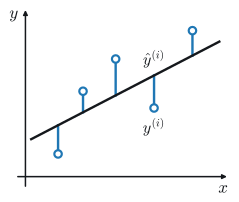
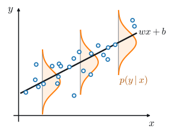
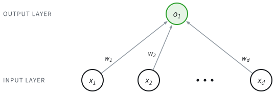
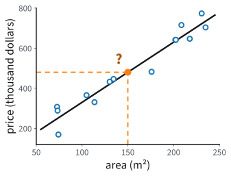
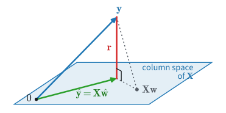
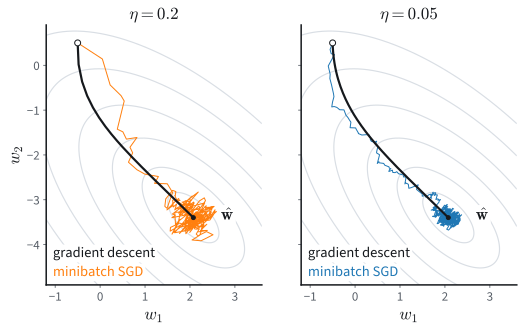
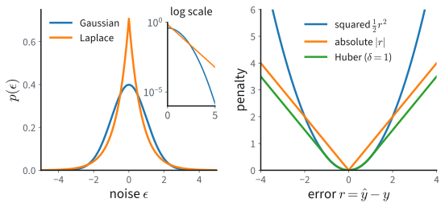

```{.python .input}
%load_ext d2lbook.tab
tab.interact_select('mxnet', 'pytorch', 'tensorflow', 'jax')
```

# Linear Regression
:label:`sec_linear_regression`

Suppose you are about to buy a house with 150 square meters of living area,
built 20 years ago, and want to know what a fair price is. You collect the
recent sales in the neighborhood and note for each one its area, its age,
and the price it fetched. Plotted against area, the prices scatter around a
rising line: bigger houses cost more, not exactly but on average. If we can
find that line, or with both area and age the corresponding plane, we can
read off a price for the house in question and for any other house that has
not been sold.

Predicting a number from measurements is called *regression*. It arises
whenever the quantity of interest is numerical: the price of a home or a
stock, a patient's length of stay in hospital, the demand for a product next
quarter. Linear regression predicts the number as a weighted sum of the
measurements. It goes back to Legendre and Gauss at the beginning of the
19th century :cite:`Legendre.1805,Gauss.1809` and is still the first method
to try on a regression problem. It is also the simplest model in which every
part of learning appears: a model with parameters, a loss that measures how
badly the parameters fit the data, an algorithm that improves them, and
predictions for new examples. The networks of later chapters replace the
model and keep the rest.

This section builds these parts for linear regression, with the
matrix--vector products, gradients, and expectations of
:numref:`chap_preliminaries`. We choose the parameters that minimize the
squared prediction error, either in closed form, which has a simple
geometric meaning, or by minibatch stochastic gradient descent, the algorithm that
trains every network in this book. We then show that the squared error is
the loss implied by Gaussian noise, which tells us when to use another
loss. The rest of the chapter implements the method and asks how well a
fitted model predicts examples that it has not seen.

```{.python .input #linear-regression}
%%tab mxnet
import time
import numpy as np
from mxnet import np as mnp, npx
npx.set_np()
```

```{.python .input #linear-regression}
%%tab pytorch
import time
import numpy as np
import torch
```

```{.python .input #linear-regression}
%%tab tensorflow
import time
import numpy as np
import tensorflow as tf
```

```{.python .input #linear-regression}
%%tab jax
import time
import jax
from jax import numpy as jnp
import numpy as np
```

## The Model and the Loss

### Features and Labels

Machine learning has names for the parts of this problem. The sales we
collected form the *training set*, and each sale is an *example* (also
called a data point, instance, or sample). The quantity we want to predict,
the price, is the *label* (also target). The quantities on which the
prediction is based, area and age, are the *features* (also covariates).

We write $n$ for the number of examples, $\mathbf{x}^{(i)}$ for the features
of example $i$, and $y^{(i)}$ for its label. Superscripts in parentheses
count examples and subscripts count features, so $x_j^{(i)}$ is feature $j$
of example $i$. For the houses, $\mathbf{x}^{(i)} = (x_1^{(i)}, x_2^{(i)})$
holds the area and the age of sale $i$, and $y^{(i)}$ its price.

### The Linear Model
:label:`subsec_linear_model`

A model states how the features determine the prediction. Linear regression
assumes that the price is, on average, a weighted sum of the features plus a
constant:

$$\textrm{price} = w_{\textrm{area}} \cdot \textrm{area} + w_{\textrm{age}} \cdot \textrm{age} + b.$$
:eqlabel:`eq_price-area`

The numbers $w_{\textrm{area}}$ and $w_{\textrm{age}}$ are the *weights*.
Each says how much the price changes per unit of its feature. With
$w_{\textrm{area}} = 3{,}000$ dollars per square meter,
$w_{\textrm{age}} = -1{,}000$ dollars per year, and $b = 50{,}000$ dollars,
the house of 150 square meters built 20 years ago is predicted to cost
$3{,}000 \cdot 150 - 1{,}000 \cdot 20 + 50{,}000 = 480{,}000$ dollars.

The constant $b$ is the *bias* (also called offset or intercept), the
prediction when all features are zero. No house has zero area, but without
$b$ every fit would be forced through the origin, which the data have no
reason to respect. Strictly speaking, a linear function plus a constant is
called affine, but the name linear regression is standard.

With $d$ features, the prediction $\hat{y}$ is

$$\hat{y} = w_1 x_1 + \cdots + w_d x_d + b = \mathbf{w}^\top \mathbf{x} + b,$$
:eqlabel:`eq_linreg-y`

where the feature vector $\mathbf{x} = (x_1, \ldots, x_d)$ and the weight
vector $\mathbf{w} = (w_1, \ldots, w_d)$ lie in $\mathbb{R}^d$. The
prediction is the dot product of weights and features, plus the bias. For
all $n$ examples at once, we stack the feature vectors as the rows of the
*design matrix* $\mathbf{X} \in \mathbb{R}^{n \times d}$, with one row per
example and one column per feature. The predictions
$\hat{\mathbf{y}} \in \mathbb{R}^n$ are then a matrix--vector product,

$$\hat{\mathbf{y}} = \mathbf{X}\mathbf{w} + b,$$
:eqlabel:`eq_linreg-y-vec`

in which the scalar $b$ is added to every entry by broadcasting
(:numref:`subsec_broadcasting`). Entry $i$ of $\hat{\mathbf{y}}$ is the
dot product of row $i$ with $\mathbf{w}$ plus $b$, the prediction for
example $i$, and the labels form the vector
$\mathbf{y} = (y^{(1)}, \ldots, y^{(n)})$. A framework evaluates
:eqref:`eq_linreg-y-vec` for a whole minibatch, a group of examples
processed together, with one call to a matrix routine.

No real dataset satisfies $y^{(i)} = \mathbf{w}^\top \mathbf{x}^{(i)} + b$
exactly for every $i$. Two houses with the same area and age sell for
different prices, because of features we did not record, such as the view,
and because of chance. The linear model therefore describes the average
label: we assume that the conditional expectation
$E[Y \mid X = \mathbf{x}]$, the mean price of houses with features
$\mathbf{x}$, equals $\mathbf{w}^\top \mathbf{x} + b$, and we treat the
deviation of each label from it as noise. Our goal is to choose
$\mathbf{w}$ and $b$ so that predictions for new examples from the same
population are accurate. For that we need a measure of how good given
parameters are, and a procedure that improves them.

### The Squared Loss
:label:`subsec_linear-regression-loss-function`

A *loss function* measures the error of a prediction by a single number,
zero for a perfect prediction and larger for worse ones. The most common
loss for regression is the squared error. For example $i$, with prediction
$\hat{y}^{(i)}$ and label $y^{(i)}$, it is

$$l^{(i)}(\mathbf{w}, b) = \frac{1}{2} \left(\hat{y}^{(i)} - y^{(i)}\right)^2.$$
:eqlabel:`eq_mse`

The difference $r^{(i)} = \hat{y}^{(i)} - y^{(i)}$ between prediction and
label is the *error* of example $i$, the vertical gap between a data point
and the line in :numref:`fig_fit_linreg` (statisticians call its negative,
$y^{(i)} - \hat{y}^{(i)}$, the residual). The loss is half the squared
error. The factor $\frac{1}{2}$ only makes the derivative tidier:
$\partial l^{(i)} / \partial \hat{y}^{(i)} = r^{(i)}$.


:label:`fig_fit_linreg`

The quality of the parameters on the whole training set is the average loss,

$$L(\mathbf{w}, b) = \frac{1}{n} \sum_{i=1}^n l^{(i)}(\mathbf{w}, b) = \frac{1}{2n} \sum_{i=1}^n \left(\mathbf{w}^\top \mathbf{x}^{(i)} + b - y^{(i)}\right)^2,$$

half the mean squared error. Training means finding the parameters that
minimize it,

$$\hat{\mathbf{w}}, \hat{b} = \operatorname*{argmin}_{\mathbf{w}, b}\ L(\mathbf{w}, b).$$

Like $\hat{y}$, the hats mark estimates computed from data. We reserve
$\mathbf{w}^*$ and $b^*$ for the true parameters of a process that generates data, which we
know only when we generate the data ourselves. Since the training data are
fixed, $L$ is a function of the parameters alone. It is the loss
$\|\mathbf{X}\mathbf{w} - \mathbf{y}\|^2$ of the line model in
:numref:`sec_calculus`, divided by $2n$ and with the bias written
separately. Multiplying a loss by a positive constant does not move its
minimizer, although, as we will see with minibatch SGD, it changes the
steps of gradient methods.

Squaring makes large errors count far more than small ones: an error of 10
costs a hundred times as much as an error of 1. The squared loss therefore
penalizes large errors heavily, but it also lets a single bad label
dominate the fit. To see how much, we place twenty points exactly on the
line $y = 2x$, change one label to 10,000, as a typing error might, and fit a
line through the origin, $\hat{y} = wx$, in two ways.

Setting the derivative of the squared loss
$\sum_i (w x^{(i)} - y^{(i)})^2$ to zero gives its minimizer
$w = \sum_i x^{(i)} y^{(i)} / \sum_i (x^{(i)})^2$. The *mean absolute
error* $\frac{1}{n}\sum_i |w x^{(i)} - y^{(i)}|$ has no such formula, so
we minimize it by gradient descent. Where the absolute value
has no derivative, at zero, we use $0$; elsewhere its slope is
$\operatorname{sign}(\cdot) = \pm 1$. A substitute of this kind is called a
subgradient.

```{.python .input #linear-regression-loss-function}
x = np.arange(1.0, 21.0)
y = 2 * x
y[5] = 10000                           # corrupt a single label
w_sq = (x * y).sum() / (x * x).sum()   # squared-loss minimizer
w_mae = 0.0                            # gradient descent on the MAE
for _ in range(2000):
    w_mae -= 0.002 * (np.sign(w_mae * x - y) * x).mean()
print(f'true w: 2.00, squared loss: {w_sq:.2f}, MAE: {w_mae:.2f}')
```

One corrupted label in twenty pulls the squared-loss slope from 2 to about
23, while the absolute-error slope stays near 2. Under the squared loss, the
single error of nearly 10,000 outweighs everything the other nineteen
points contribute. Under the absolute error it counts only in proportion to
its size, and the nineteen points on the line hold the slope in place.
Which behavior is right depends on what we believe about the noise, the
question of :numref:`subsec_normal_distribution_and_squared_loss`.

## Minimizing the Loss

Linear regression is one of the few models whose loss can be minimized in
closed form. We derive that solution first, because its geometry shows what
least squares does. We then turn to the iterative method that trains every
other model in this book.

### The Normal Equations
:label:`subsec_linear-regression-analytic-solution`

We first absorb the bias into the weights. Appending a feature that equals
$1$ for every example, a column of ones in $\mathbf{X}$, and appending $b$
to $\mathbf{w}$ turns $\mathbf{w}^\top\mathbf{x} + b$ into a dot product of
the extended vectors. Minimizing $L$ is then the same as minimizing
$\|\mathbf{X}\mathbf{w} - \mathbf{y}\|^2$. In
:numref:`sec_calculus` we computed the gradient of this function,
$2\mathbf{X}^\top(\mathbf{X}\mathbf{w} - \mathbf{y})$. Setting it to zero
gives the *normal equations*,

$$\mathbf{X}^\top \mathbf{X}\, \mathbf{w} = \mathbf{X}^\top \mathbf{y},$$

a system of $d + 1$ linear equations in the $d + 1$ weights, the original
$d$ and the bias.

A zero gradient does not in general mark a minimum, but here every solution
of the normal equations is one, by a short argument. Let $\hat{\mathbf{w}}$
solve the normal equations and compare the loss at any other point
$\hat{\mathbf{w}} + \mathbf{v}$. Expanding the square gives

$$\|\mathbf{X}(\hat{\mathbf{w}} + \mathbf{v}) - \mathbf{y}\|^2 = \|\mathbf{X}\hat{\mathbf{w}} - \mathbf{y}\|^2 + 2\mathbf{v}^\top \mathbf{X}^\top(\mathbf{X}\hat{\mathbf{w}} - \mathbf{y}) + \|\mathbf{X}\mathbf{v}\|^2.$$
:eqlabel:`eq_linreg-pythagoras`

The middle term vanishes by the normal equations, and the last term is never
negative, so no point has a smaller loss than $\hat{\mathbf{w}}$. The loss
is strictly larger at $\hat{\mathbf{w}} + \mathbf{v}$ unless
$\mathbf{X}\mathbf{v} = \mathbf{0}$, that is, unless moving the weights by
$\mathbf{v}$ leaves every prediction unchanged. When the columns of
$\mathbf{X}$ are *linearly independent*, meaning that
$\mathbf{X}\mathbf{v} = \mathbf{0}$ only for $\mathbf{v} = \mathbf{0}$,
the minimizer is therefore unique. Independence fails when one feature is a
combination of others, such as the area in square meters and the area in
square feet. Then many weight vectors make the same predictions, and
exercise :exref:`ex_linear-regression-singular-design-matrix` shows how to
choose among them.

With independent columns, the matrix $\mathbf{X}^\top \mathbf{X}$ is
invertible: if $\mathbf{X}^\top \mathbf{X}\mathbf{v} = \mathbf{0}$, then
$\|\mathbf{X}\mathbf{v}\|^2 = \mathbf{v}^\top \mathbf{X}^\top \mathbf{X}\mathbf{v} = 0$,
so $\mathbf{v} = \mathbf{0}$. Its *inverse*
$(\mathbf{X}^\top \mathbf{X})^{-1}$ is the matrix that undoes it,
$(\mathbf{X}^\top \mathbf{X})^{-1}\mathbf{X}^\top \mathbf{X} = \mathbf{I}$,
and multiplying the normal equations by it gives the minimizer

$$\hat{\mathbf{w}} = (\mathbf{X}^\top \mathbf{X})^{-1} \mathbf{X}^\top \mathbf{y}.$$

This formula is for analysis, not for computation. Forming
$\mathbf{X}^\top\mathbf{X}$ amplifies rounding errors
(:numref:`subsec_mdl-condition-number`), and computing an inverse is slower
and less accurate than solving the system :cite:`Golub.Van-Loan.1996`.
Libraries provide a least-squares solver, `lstsq`, which works directly
with a factorization of $\mathbf{X}$.

Take the three-example line model of :numref:`sec_calculus`: inputs $0$,
$1$, and $2$, labels $1$, $1$, and $0$, and the prediction
$w_1 + w_2 \cdot \textrm{input}$, whose rows $(1, \textrm{input})$ already
contain the column of ones. Then

$$\mathbf{X} = \begin{bmatrix} 1 & 0 \\ 1 & 1 \\ 1 & 2 \end{bmatrix}, \quad \mathbf{X}^\top \mathbf{X} = \begin{bmatrix} 3 & 3 \\ 3 & 5 \end{bmatrix}, \quad \mathbf{X}^\top \mathbf{y} = \begin{bmatrix} 2 \\ 1 \end{bmatrix},$$

and the normal equations $3w_1 + 3w_2 = 2$ and $3w_1 + 5w_2 = 1$ give
$\hat{w}_2 = -1/2$ and $\hat{w}_1 = 7/6$, the minimum that
:numref:`sec_calculus` located at $(7/6, -1/2)$. We let the library solve
the same problem and print the weights, the errors
$\mathbf{r} = \mathbf{X}\hat{\mathbf{w}} - \mathbf{y}$, and the largest
entry of $\mathbf{X}^\top\mathbf{r}$ in absolute value, which the normal
equations say is zero.

```{.python .input #linear-regression-the-normal-equations}
%%tab pytorch
X = torch.tensor([[1.0, 0.0], [1.0, 1.0], [1.0, 2.0]])  # rows (1, input)
y = torch.tensor([[1.0], [1.0], [0.0]])
w_hat = torch.linalg.lstsq(X, y).solution
r = X @ w_hat - y                                       # errors
print('w_hat:', tuple(round(float(v), 4) for v in w_hat[:, 0]))
print('r:', tuple(round(float(v), 4) for v in r[:, 0]))
print(f'max |X^T r|: {float((X.T @ r).abs().max()):.0e}')
```

```{.python .input #linear-regression-the-normal-equations}
%%tab tensorflow
X = tf.constant([[1.0, 0.0], [1.0, 1.0], [1.0, 2.0]])  # rows (1, input)
y = tf.constant([[1.0], [1.0], [0.0]])
w_hat = tf.linalg.lstsq(X, y, fast=False)      # do not form X^T X
r = X @ w_hat - y                                      # errors
print('w_hat:', tuple(round(float(v), 4) for v in w_hat[:, 0]))
print('r:', tuple(round(float(v), 4) for v in r[:, 0]))
XTr = tf.transpose(X) @ r
print(f'max |X^T r|: {float(tf.reduce_max(tf.abs(XTr))):.0e}')
```

```{.python .input #linear-regression-the-normal-equations}
%%tab jax
X = jnp.array([[1.0, 0.0], [1.0, 1.0], [1.0, 2.0]])  # rows (1, input)
y = jnp.array([[1.0], [1.0], [0.0]])
w_hat = jnp.linalg.lstsq(X, y)[0]
r = X @ w_hat - y                                    # errors
print('w_hat:', tuple(round(float(v), 4) for v in w_hat[:, 0]))
print('r:', tuple(round(float(v), 4) for v in r[:, 0]))
print(f'max |X^T r|: {float(jnp.abs(X.T @ r).max()):.0e}')
```

```{.python .input #linear-regression-the-normal-equations}
%%tab mxnet
X = mnp.array([[1.0, 0.0], [1.0, 1.0], [1.0, 2.0]])  # rows (1, input)
y = mnp.array([[1.0], [1.0], [0.0]])
w_hat = mnp.linalg.lstsq(X, y, rcond=None)[0]
r = X @ w_hat - y                                    # errors
print('w_hat:', tuple(round(float(v), 4) for v in w_hat[:, 0]))
print('r:', tuple(round(float(v), 4) for v in r[:, 0]))
print(f'max |X^T r|: {float(mnp.abs(X.T @ r).max()):.0e}')
```

The library returns $\hat{\mathbf{w}} = (7/6, -1/2)$ and the errors
$\mathbf{r} = (1/6, -1/3, 1/6)$, printed to four decimals. The vector
$\mathbf{X}^\top\mathbf{r}$ is zero up to rounding errors of order
$10^{-7}$, the precision of float32.

### Least Squares as Projection

The normal equations have a geometric meaning, which also explains their
name. In :numref:`sec_linear-algebra` we saw that a matrix--vector product
is a combination of the columns of the matrix: $\mathbf{X}\mathbf{w}$ is
$w_1$ times the first column of $\mathbf{X}$, plus $w_2$ times the second,
and so on. Each column holds one feature for all $n$ examples, so it is a
vector in $\mathbb{R}^n$, like the labels $\mathbf{y}$. As $\mathbf{w}$
varies, the predictions $\mathbf{X}\mathbf{w}$ range over all combinations
of the columns, a set called the *column space* of $\mathbf{X}$. For two
columns in $\mathbb{R}^3$ it is a plane through the origin. Minimizing
$\|\mathbf{X}\mathbf{w} - \mathbf{y}\|$ asks for the point of the column
space closest to the label vector $\mathbf{y}$.

![Least squares as projection. The predictions $\mathbf{X}\mathbf{w}$ range over the column space of $\mathbf{X}$. The fitted values $\hat{\mathbf{y}} = \mathbf{X}\hat{\mathbf{w}}$ are the foot of the perpendicular from the label vector $\mathbf{y}$, so the error vector $\mathbf{r} = \hat{\mathbf{y}} - \mathbf{y}$ meets the column space at a right angle. Any other prediction $\mathbf{X}\mathbf{w}$ lies farther from $\mathbf{y}$ (dotted): its squared distance adds the squared length of the dotted leg in the plane.](../img/mdl-linreg-projection.svg)
:label:`fig_linreg_projection`

The closest point is the foot of the perpendicular from $\mathbf{y}$
(:numref:`fig_linreg_projection`). The normal equations express this
condition. Written as $\mathbf{X}^\top\mathbf{r} = \mathbf{0}$ with the
errors $\mathbf{r} = \mathbf{X}\hat{\mathbf{w}} - \mathbf{y}$, which is the
gradient $2\mathbf{X}^\top\mathbf{r}$ of :numref:`sec_calculus` set to zero,
they state that the error vector has zero dot product with every column of
$\mathbf{X}$, so it is perpendicular to the column space; "normal" is an
old word for perpendicular. The identity :eqref:`eq_linreg-pythagoras` is
the theorem of Pythagoras for the right triangle in the figure: for any
other prediction $\mathbf{X}\mathbf{w}$, the squared distance to
$\mathbf{y}$ is the squared length of the error vector plus the squared
distance $\|\mathbf{X}\mathbf{w} - \hat{\mathbf{y}}\|^2$ within the column
space. The fitted values $\hat{\mathbf{y}}$ are the
*orthogonal projection* of $\mathbf{y}$ onto the column space
(:numref:`sec_mdl-geometry-linear-algebraic-ops` treats projections in
general).

In the three-example fit, the error vector $(1/6, -1/3, 1/6)$ is
perpendicular to both columns: its dot product with the column of ones
$(1, 1, 1)$ is $1/6 - 1/3 + 1/6 = 0$, and its dot product with the inputs
$(0, 1, 2)$ is $-1/3 + 2/6 = 0$. Perpendicularity to the column of ones
means that the errors sum to zero. This holds for every least-squares fit
with a bias: on average the line neither overestimates nor
underestimates the labels (exercise :exref:`ex_linear-regression-centering`).

### Minibatch Stochastic Gradient Descent
:label:`subsec_linear-regression-minibatch-sgd`

Most models in this book have no closed-form minimizer. They are trained
by gradient descent, which :numref:`sec_calculus` introduced: starting from
initial parameters, it repeatedly takes a small step against the gradient
of the loss,
$\mathbf{w} \leftarrow \mathbf{w} - \eta \nabla_{\mathbf{w}} L(\mathbf{w})$,
where the learning rate $\eta > 0$ sets the size of the step. Our loss is
an average over all $n$ examples, so with millions of examples every step
takes a full pass over the data, although a small fraction of them would
already show roughly which way to go. The opposite extreme uses a single
randomly chosen example per step, which is called *stochastic gradient
descent* (SGD) :cite:`Bottou.2010`. Its steps are cheap but noisy, and they
waste hardware: a processor computes a matrix product over many examples
much faster than the same arithmetic one example at a time, as we measure
below.

The compromise is a minibatch: at step $t$ we draw a random set
$\mathcal{B}_t$ of $|\mathcal{B}|$ examples and average the gradient over
it :cite:`Li.Zhang.Chen.ea.2014`. Because the minibatch is drawn at random,
its average gradient equals the full gradient in expectation; in the
language of :numref:`sec_prob`, it is an unbiased estimate. Its variance
falls in proportion to $1/|\mathcal{B}|$, since the variance of an average
of independent draws is the variance of one draw divided by their number
(for draws with replacement; the loaders of this book draw without
replacement within an epoch, which changes this only slightly when
$|\mathcal{B}|$ is much smaller than the number of examples, as
:numref:`sec_sgd` discusses).
The update of *minibatch stochastic gradient descent* is

$$(\mathbf{w},b) \leftarrow (\mathbf{w},b) - \frac{\eta}{|\mathcal{B}|} \sum_{i \in \mathcal{B}_t} \nabla_{(\mathbf{w},b)}\, l^{(i)}(\mathbf{w},b).$$

For the squared loss the chain rule gives the gradients explicitly: the
derivative of $l^{(i)}$ with respect to the prediction is the error
$r^{(i)} = \hat{y}^{(i)} - y^{(i)}$, and the derivative of the prediction
is $\mathbf{x}^{(i)}$ with respect to $\mathbf{w}$ and $1$ with respect to
$b$. The updates are therefore

$$
\begin{aligned}
\mathbf{w} &\leftarrow \mathbf{w} - \frac{\eta}{|\mathcal{B}|} \sum_{i \in \mathcal{B}_t} \mathbf{x}^{(i)} \left(\mathbf{w}^\top \mathbf{x}^{(i)} + b - y^{(i)}\right),\\
b &\leftarrow b - \frac{\eta}{|\mathcal{B}|} \sum_{i \in \mathcal{B}_t} \left(\mathbf{w}^\top \mathbf{x}^{(i)} + b - y^{(i)}\right).
\end{aligned}
$$
:eqlabel:`eq_linreg_batch_update`

Each example pulls the weights along its own feature vector, in proportion
to its error, and the bias moves by the average error. Training
initializes $\mathbf{w}$ and $b$, often at random, and repeats the update
for a fixed number of steps or until the loss stops improving. In practice
the name SGD refers to this minibatch version. The optimizers that
frameworks call SGD implement it, and this book uses the name in the same
sense from here on.

The minibatch size $|\mathcal{B}|$ and the learning rate $\eta$ are chosen
by us rather than learned; such settings are called *hyperparameters*.
Powers of 2 between 32 and 256 are common starting points for the minibatch
size, limited by memory and by how many examples the hardware processes in
parallel. The last sections of this chapter show how to choose
hyperparameters with data held out from training.

The learning rate is tied to the scale of the loss. Multiplying the loss by
a constant $c > 0$ multiplies its gradient by $c$, so gradient descent or
SGD takes the same steps on $cL$
with learning rate $\eta$ as on $L$ with learning rate $c\eta$. A learning
rate has a meaning only together with the loss it is used with. Two such
factors are common. The built-in mean squared error of most libraries
omits our $\frac{1}{2}$, so its gradient is twice ours, and a learning rate
of $\eta/2$ with that loss reproduces our updates at $\eta$. Summing the
loss over a minibatch instead of averaging it multiplies the gradient by
$|\mathcal{B}|$, and the learning rate must shrink by the same factor.

### Gradient Noise and the Learning Rate

Minibatch SGD with a constant learning rate does not converge to the
minimizer $\hat{\mathbf{w}}$, even on least squares. At $\hat{\mathbf{w}}$ the
gradient of the full loss vanishes, but the gradient on a minibatch does
not: the terms $\mathbf{x}^{(i)} r^{(i)}$ cancel in the sum over the whole
training set, which is what $\mathbf{X}^\top\mathbf{r} = \mathbf{0}$
states, but not within a minibatch. The parameters therefore keep moving
and fluctuate in a cloud around $\hat{\mathbf{w}}$, the *noise ball*
(:numref:`fig_linreg_gd_sgd`). Its size follows from a balance. Each step
adds noise of variance proportional to $\eta^2 / |\mathcal{B}|$, while the
pull toward $\hat{\mathbf{w}}$ removes a fraction proportional to $\eta$ of
the squared distance. For small $\eta$ the two balance when the mean
squared distance from $\hat{\mathbf{w}}$ is proportional to
$\eta / |\mathcal{B}|$ times the variance of the label noise. Full-batch
gradient descent has no such noise and converges.


:label:`fig_linreg_gd_sgd`

Quartering $\eta$ halves the width of the noise ball, as the
proportionality predicts, but SGD then needs about four times as many steps to approach
$\hat{\mathbf{w}}$. In practice the learning rate is therefore lowered
during training, following a *schedule*; the appendix derives the size of
the cloud (:numref:`subsec_mdl-stochastic-gradients`). Since the
minibatches are drawn at random, two runs from the same start also end at
different points of the cloud: the trained parameters are themselves
random.

### Vectorization for Speed

Both the predictions $\mathbf{X}\mathbf{w} + b$ for a minibatch and the
gradient in :eqref:`eq_linreg_batch_update` are matrix--vector products,
which a framework evaluates with one call into compiled code instead of a
Python loop over the examples (:numref:`sec_ndarray`). To measure the
difference, we predict the labels of 1,000 examples with the weights
$\mathbf{w} = (2, -3.4)$ and the bias $b = 4.2$, which return later in this
chapter as the true parameters of synthetic data. With $\mathbf{w}$ stored
as a $2 \times 1$ matrix, the product `X @ w + b` serves both for one
example, a $1 \times 2$ row of `X`, and for all of them.

```{.python .input #linear-regression-vectorization-for-speed-1}
%%tab pytorch
n = 1000
X = torch.ones(n, 2)                # the values do not affect the timing
w = torch.tensor([[2.0], [-3.4]])
b = 4.2
# Wait until the device has finished (CUDA runs asynchronously)
wait = lambda x: torch.cuda.synchronize() if torch.cuda.is_available() else None
```

```{.python .input #linear-regression-vectorization-for-speed-1}
%%tab tensorflow
n = 1000
X = tf.ones((n, 2))                 # the values do not affect the timing
w = tf.constant([[2.0], [-3.4]])
b = 4.2
# Wait until all devices have finished (a GPU runs asynchronously)
wait = lambda x: tf.test.experimental.sync_devices()
```

```{.python .input #linear-regression-vectorization-for-speed-1}
%%tab jax
n = 1000
X = jnp.ones((n, 2))                # the values do not affect the timing
w = jnp.array([[2.0], [-3.4]])
b = 4.2
wait = jax.block_until_ready        # JAX returns before it has finished
```

```{.python .input #linear-regression-vectorization-for-speed-1}
%%tab mxnet
n = 1000
X = mnp.ones((n, 2))                # the values do not affect the timing
w = mnp.array([[2.0], [-3.4]])
b = 4.2
wait = lambda x: npx.waitall()      # MXNet returns before it has finished
```

The function `seconds` times one call of a function, after a first call
that absorbs one-time setup costs, and waits until the computation has
finished before it stops the clock.

```{.python .input #linear-regression-vectorization-for-speed-2}
def seconds(f):
    """Time one call of f, after a warm-up call."""
    wait(f())
    start = time.perf_counter()
    wait(f())
    return time.perf_counter() - start
```

```{.python .input #linear-regression-vectorization-for-speed-3}
loop = seconds(lambda: [X[i:i + 1] @ w + b for i in range(n)])
vectorized = seconds(lambda: X @ w + b)
print(f'one example at a time: {loop * 1e3:8.3f} ms')
print(f'all examples at once:  {vectorized * 1e3:8.3f} ms')
print(f'speedup: {loop / vectorized:.0f}x')
```

Computing all predictions at once is faster by a factor of hundreds or
more, although the arithmetic is the same. The loop incurs the overhead of
the Python interpreter and of launching a framework operation once per
example; the matrix product incurs it once. The same holds for the
gradient, which is why we train on minibatches rather than on single
examples. After training, the same product computes the *prediction*
$\hat{\mathbf{w}}^\top \mathbf{x} + \hat{b}$ for a new example, such as
the house we set out to value; practitioners also call this step
inference.

## Squared Loss and Gaussian Noise
:label:`subsec_normal_distribution_and_squared_loss`

So far the squared loss has been a convenient choice, smooth and with a
closed-form minimizer, but too sensitive to the corrupted label. A
probabilistic view tells us when it is the right choice: we model how the
labels scatter around the line and choose the parameters under which the
observed labels are most probable. Normal scatter yields the squared loss,
and other kinds of scatter yield other losses.

### The Normal Distribution

The *normal distribution*, or Gaussian distribution, with mean $\mu$ and
variance $\sigma^2$ has the density

$$p(x) = \frac{1}{\sqrt{2 \pi \sigma^2}} \exp\left(-\frac{(x - \mu)^2}{2 \sigma^2}\right).$$

As in :numref:`sec_prob`, the probability of an interval is the area under
the density over it. The density is a bell-shaped curve, symmetric about
$\mu$, whose width is set by the standard deviation $\sigma$: about 68% of
the probability lies within $\sigma$ of the mean and about 95% within
$2\sigma$. Since the squared distance from the mean appears in the
exponent, large deviations are extremely improbable: a value $5\sigma$
from the mean has density $e^{-12.5} \approx 4 \times 10^{-6}$ times that
at the mean. We write $\epsilon \sim \mathcal{N}(\mu, \sigma^2)$ for a random
variable with this distribution. Sums of many small independent effects are
approximately normal (:numref:`subsec_mdl-gaussian-clt`), which makes it a
natural model for measurement noise.

Linear regression with Gaussian noise assumes that each label is the
linear prediction plus an independent normal deviation,

$$y = \mathbf{w}^\top \mathbf{x} + b + \epsilon, \quad \epsilon \sim \mathcal{N}(0, \sigma^2).$$

The conditional mean $E[Y \mid X = \mathbf{x}]$ is then
$\mathbf{w}^\top \mathbf{x} + b$, the assumption of
:numref:`subsec_linear_model`, and the labels scatter around it with the
same standard deviation $\sigma$ for every $\mathbf{x}$
(:numref:`fig_linreg_gaussian_noise`).


:label:`fig_linreg_gaussian_noise`

### Maximum Likelihood

Given parameters $\mathbf{w}$ and $b$, the density of a label $y$ for
features $\mathbf{x}$ is the normal density centered on the prediction:

$$p(y \mid \mathbf{x}) = \frac{1}{\sqrt{2 \pi \sigma^2}} \exp\left(-\frac{(y - \mathbf{w}^\top \mathbf{x} - b)^2}{2 \sigma^2}\right).$$

A label close to the line has a high density and a label far from it a low
one. Viewed as a function of the parameters, the density of the observed
data is the *likelihood*, the quantity $P(D \mid H)$ of Bayes' theorem in
:numref:`sec_prob` with the parameters in the role of the hypothesis. The
*principle of maximum likelihood* chooses the parameters under which the
observed labels are most probable. Since the examples are drawn
independently, the density of all labels is the product

$$p(\mathbf y \mid \mathbf X) = \prod_{i=1}^{n} p(y^{(i)} \mid \mathbf{x}^{(i)}).$$

A product of many small numbers is awkward to maximize, and in floating
point it underflows to zero. The logarithm turns the product into a sum, and
since it is increasing it does not move the maximizer. By convention we
minimize instead of maximize, so we minimize the *negative log-likelihood*

$$-\log p(\mathbf y \mid \mathbf X) = \sum_{i=1}^n \left[\frac{1}{2} \log(2 \pi \sigma^2) + \frac{1}{2 \sigma^2} \left(y^{(i)} - \mathbf{w}^\top \mathbf{x}^{(i)} - b\right)^2\right].$$

The first term does not depend on $\mathbf{w}$ or $b$, and the second is
the sum of squared errors divided by $2\sigma^2$. For a fixed $\sigma$,
minimizing the negative log-likelihood over $\mathbf{w}$ and $b$ is
therefore the same as minimizing the squared loss, whatever the value of
$\sigma$. Least squares is maximum likelihood estimation under Gaussian
noise. The appendix treats maximum likelihood in general
(:numref:`subsec_mdl-gaussian-mse`).

The derivation also explains the corrupted label. Under Gaussian noise with
$\sigma = 1$, a label of 10,000 where the line predicts 12 lies about $10^4$
standard deviations away, which has essentially zero probability. To make
the data less improbable, maximum likelihood tilts the line toward that
label, at the expense of the nineteen other points, each of which then
costs only a moderate amount.

### Choosing a Loss from a Noise Model
:label:`subsec_linreg-loss-menu`

The same derivation applies to any noise model. We choose a conditional
distribution $p(y \mid \mathbf{x})$ that describes how the labels scatter
and minimize its negative log-likelihood. Gaussian noise yields the squared
error, and other assumptions yield other losses:

| Output type | Noise model | Loss (negative log-likelihood) |
|:--|:--|:--|
| real-valued, well-behaved noise | Gaussian | squared error (this section) |
| real-valued, outliers or heavy tails | Laplace | absolute error (exercise :exref:`ex_linear-regression-laplace-noise`) |
| positive, multiplicative fluctuations (prices) | Gaussian on $\log y$ | squared error on $\log y$ (exercise :exref:`ex_linear-regression-beyond-gaussian-noise`) |
| counts (sales, arrivals) | Poisson | $\nu(\mathbf{x}) - y \log \nu(\mathbf{x})$ (exercise :exref:`ex_linear-regression-counting-apples`) |

The Laplace distribution has the density
$p(\epsilon) = \frac{1}{2\beta}\exp(-|\epsilon|/\beta)$ with scale
$\beta > 0$. Its exponent falls off with $|\epsilon|$ instead of
$\epsilon^2$, so its tails carry far more probability than those of a
Gaussian with the same variance (:numref:`fig_linreg-loss-menu`, left), and
its negative log-likelihood penalizes a large error only linearly. This
is the robustness to the corrupted label that we observed: the Laplace
model treats a label far from the line as unusual but possible, and does
not tilt the line toward it. The figure also shows the *Huber loss*, which
is quadratic for small errors and linear beyond a threshold $\delta$. It
suits data in which most of the noise is Gaussian but a few labels are
corrupted. The same principle covers noise whose level depends on the
input, by predicting $\sigma(\mathbf{x})$ alongside the mean, and the next
chapter uses it to derive the loss for classification.


:label:`fig_linreg-loss-menu`

## Linear Regression as a Neural Network

Linear regression is also the smallest neural network.
:numref:`fig_single_neuron` draws it as one. Each feature is an input
unit, every input is connected to a single output unit, and the output
computes the weighted sum of its inputs plus the bias,
$o_1 = \mathbf{w}^\top \mathbf{x} + b$, with one weight per connection.
The inputs are given and only the output is computed, so the network has a
single layer of computation. Since every input connects to the output, the
layer is called *fully connected* (or dense). The number of inputs $d$ is
the feature dimensionality of the layer.


:label:`fig_single_neuron`

The vocabulary of units and weighted connections comes from early models
of biological neurons :cite:`McCulloch.Pitts.1943`, but the analogy is
loose. What we keep is the view of linear regression as a layer: the
networks of later chapters stack many such layers, with nonlinear
functions between them, and train them with the same kind of loss and the
same minibatch SGD.

We can now write down a linear model, fit it exactly or with minibatch SGD,
and choose its loss from an assumption about the noise. Two questions
remain. Training in code needs data, a model, and a training loop that can
be reused for every later model, which the next sections build. And a small
training loss does not by itself guarantee accurate prices for houses that
were not in the training set; :numref:`sec_generalization_basics` asks when
it does.

## Summary

Linear regression predicts a number as a weighted sum of features plus a
bias, $\hat{y} = \mathbf{w}^\top \mathbf{x} + b$, and computes the
predictions for a minibatch as one matrix--vector product. The parameters
that minimize the average squared error on the training set solve the normal
equations, and the fitted values are the orthogonal projection of the label
vector onto the column space of the design matrix. Minibatch stochastic
gradient descent approaches the same minimizer with cheap, noisy steps. With
a constant learning rate it ends in a noise ball around the minimizer whose
size grows with the learning rate, and a learning rate is meaningful only
together with the scale of the loss. The squared error is the negative
log-likelihood of Gaussian noise: it suits labels with Gaussian scatter and
is sensitive to outliers, and other noise models give other losses. As a
network, linear regression is a single fully connected layer, the building
block of the deep networks to come.

## Exercises

1. **Fitting a constant.** Consider a model without features that
   predicts the same value $b$ for every example. Fit it to labels
   $y^{(1)}, \ldots, y^{(n)} \in \mathbb{R}$ by minimizing
   $\sum_i (y^{(i)} - b)^2$.
    1. Find an analytic solution for the optimal value of $b$.
    1. Fit a normal distribution $\mathcal{N}(b, \sigma^2)$ to
       $y^{(1)}, \ldots, y^{(n)}$ by maximum likelihood in both $b$ and
       $\sigma^2$. Show that the estimate of $b$ is the solution of part (a)
       and find the estimate of $\sigma^2$.
    1. Change the loss to $\sum_i |y^{(i)} - b|$ and find all of its
       minimizers. Then replace a single label by an arbitrary value and
       determine how far the minimizers of each of the two losses can move.

1. **Intercept and centering.** Appending a constant feature $1$ to every
   input turns the affine model $\mathbf{w}^\top \mathbf{x} + b$ into a
   linear model in $(\mathbf{x}, 1)$. Centering the data removes the bias
   in a different way. Let $\bar{\mathbf{x}}$ and $\bar{y}$ be the averages
   of the features and of the labels over the training set.
    1. Show that every minimizer $(\hat{\mathbf{w}}, \hat{b})$ of the
       squared loss satisfies
       $\hat{b} = \bar{y} - \hat{\mathbf{w}}^\top \bar{\mathbf{x}}$, and
       conclude that the errors $\hat{y}^{(i)} - y^{(i)}$ of a least-squares
       fit with a bias sum to zero.
    1. Show that $\hat{\mathbf{w}}$ is a least-squares fit without bias to
       the centered data
       $(\mathbf{x}^{(i)} - \bar{\mathbf{x}},\, y^{(i)} - \bar{y})$.
   :exlabel:`ex_linear-regression-centering`

1. **Laplace noise.** Assume that the additive noise $\epsilon$ follows
   the Laplace distribution with scale $1$ (see
   :numref:`sec_mdl-distributions`), that is,
   $p(\epsilon) = \frac{1}{2} \exp(-|\epsilon|)$.
    1. Write out the negative log-likelihood of the data under the model
       $-\log p(\mathbf y \mid \mathbf X)$.
    1. Determine whether a closed-form solution exists.
    1. Write the minibatch stochastic gradient descent update for
       $(\mathbf{w}, b)$ under this loss in the form of
       :eqref:`eq_linreg_batch_update`, using the subgradient
       $\operatorname{sign}(\cdot)$
       of :numref:`subsec_linear-regression-loss-function`. Compare how the
       size of each example's contribution depends on its error under
       this loss and under the squared loss.
    1. The demonstration with a corrupted label in
       :numref:`subsec_linear-regression-loss-function` applies this update
       to a line through the origin, using the full dataset in every step
       and a constant learning rate. On its data the minimizer of the
       absolute error is exactly $w = 2$, yet the code prints $2.02$.
       Explain why the iterates do not settle at the minimizer, and propose
       a fix.
   :exlabel:`ex_linear-regression-laplace-noise`

1. **Beyond Gaussian noise.** Suppose you use regression to estimate the
   price of houses or of stocks.
    1. Model the price directly as
       $y = \mathbf{w}^\top \mathbf{x} + b + \epsilon$ with
       $\epsilon \sim \mathcal{N}(0, \sigma^2)$, and take
       $\sigma = 100{,}000$ dollars. Compute the probability that the model
       assigns to a negative price for a house whose predicted price is
       $50{,}000$ dollars. Explain why no single $\sigma$ suits both this
       house and a house whose predicted price is $5{,}000{,}000$ dollars.
    1. Now regress on the logarithm of the price,
       $\log \textrm{price} = \mathbf{w}^\top \mathbf{x} + b + \epsilon$,
       where $\epsilon \sim \mathcal{N}(0, \sigma^2)$ now acts on the log
       scale. Compute the conditional mean and standard deviation of the
       price and show that their ratio does not depend on $\mathbf{x}$.
       Determine whether $\exp(\mathbf{w}^\top \mathbf{x} + b)$ is an
       unbiased prediction of the price. The same modeling choice underlies
       the Black--Scholes model of option pricing :cite:`Black.Scholes.1973`.
    1. Stock prices are quoted on a discrete grid, for example in whole
       cents. Explain how this affects the log-price model and for which
       price range the effect is largest.
   :exlabel:`ex_linear-regression-beyond-gaussian-noise`

1. **Counting apples.** Suppose we want to use regression to estimate the
   *number* of apples sold in a grocery store.
    1. Identify the problems with a Gaussian additive noise model for such
       a target.
    1. The [Poisson distribution](https://en.wikipedia.org/wiki/Poisson_distribution)
       models counts. It is given by
       $p(k \mid \nu) = \nu^k e^{-\nu}/k!$, where $\nu > 0$
       is the rate and $k \in \{0, 1, 2, \ldots\}$ is the observed count.
       Prove that $E[k] = \nu$.
    1. Derive the negative log-likelihood of a count $k$ under a rate
       $\nu(\mathbf{x})$ that depends on the features, dropping terms
       that do not depend on the parameters, and check it against the table
       in :numref:`subsec_linreg-loss-menu`.
    1. Compare the parameterizations
       $\nu(\mathbf{x}) = \mathbf{w}^\top \mathbf{x} + b$ and
       $\log \nu(\mathbf{x}) = \mathbf{w}^\top \mathbf{x} + b$.
       Determine for each whether $\nu(\mathbf{x}) > 0$ holds for all
       inputs and parameters, and state the consequence for the loss of
       part (c). Write that loss in terms of $(\mathbf{w}, b)$ for the
       second parameterization.
   :exlabel:`ex_linear-regression-counting-apples`

1. [code] **The size of the noise ball.** Generate $n = 1{,}000$ examples with
   two features drawn from $\mathcal{N}(0, 1)$ and labels
   $y = \mathbf{x}^\top \mathbf{w}^* + \epsilon$, where
   $\mathbf{w}^* = (2, -3.4)$ and $\epsilon \sim \mathcal{N}(0, 1)$, and
   compute the least-squares solution $\hat{\mathbf{w}}$ with `lstsq`.
    1. Run minibatch SGD without a bias, starting at $\hat{\mathbf{w}}$,
       with minibatches of 10 and $\eta = 0.1$ for 20,000 steps. Estimate
       the mean squared distance $E\|\mathbf{w} - \hat{\mathbf{w}}\|^2$ of
       the iterates from $\hat{\mathbf{w}}$.
    1. Repeat for $\eta \in \{0.05, 0.025\}$ and for minibatch sizes 20
       and 40. Check that the mean squared distance is roughly
       proportional to $\eta / |\mathcal{B}|$.
    1. Why does the distance not depend on how far $\hat{\mathbf{w}}$ is
       from $\mathbf{w}^*$? What would change if the labels had no noise
       at all?

1. **Composing two linear layers.** Suppose a network with two layers is
   built by feeding the output of one linear layer,
   $\mathbf{h} = \mathbf{W}_1 \mathbf{x} + \mathbf{b}_1$, into a second,
   $\hat{y} = \mathbf{w}_2^\top \mathbf{h} + b_2$. Determine the class of
   functions of $\mathbf{x}$ that this network can represent and compare it
   with the class represented by a single linear layer. What property must
   an operation inserted between the two layers have for the composition to
   represent a strictly larger class?

1. **Singular design matrix.** ● Full column rank makes the least-squares
   minimizer unique. Suppose instead that $\mathbf{X}^\top \mathbf{X}$ is
   singular.
    1. Show that a minimizer of $\|\mathbf{y} - \mathbf{X}\mathbf{w}\|^2$
       still exists and characterize the set of all minimizers.
    1. Write the singular value decomposition as
       $\mathbf{X} = \mathbf{U}\boldsymbol{\Sigma}\mathbf{V}^\top$ with
       orthogonal $\mathbf{U}$ and $\mathbf{V}$ and a rectangular diagonal
       $\boldsymbol{\Sigma}$ of nonnegative singular values. The
       Moore--Penrose pseudoinverse is
       $$\mathbf{X}^{\dagger} = \mathbf{V}\boldsymbol{\Sigma}^{\dagger}\mathbf{U}^\top,$$
       where $\boldsymbol{\Sigma}^{\dagger}$ transposes
       $\boldsymbol{\Sigma}$ and inverts its nonzero entries. Show that
       $\mathbf{X}^{\dagger}\mathbf{y}$ is the minimizer of smallest norm
       within the set of part (a).
    1. Starting from $\mathbf{w} = \mathbf{0}$, which minimizer does
       gradient descent converge to? State whether the answer changes for
       minibatch stochastic gradient descent.
    1. Replace $\mathbf{X}$ by $\tilde{\mathbf{X}} = \mathbf{X} + \mathbf{Z}$,
       where the entries of $\mathbf{Z}$ are independent draws from
       $\mathcal{N}(0, \gamma^2)$. Compute
       $E[\tilde{\mathbf{X}}^\top \tilde{\mathbf{X}}]$ and determine whether
       it is invertible. Express the expected loss
       $E\|\mathbf{y} - \tilde{\mathbf{X}}\mathbf{w}\|^2$ in terms of
       $\mathbf{X}$, $\mathbf{y}$, $\mathbf{w}$ and $\gamma$.
    1. The standard remedy for a (near-)singular
       $\mathbf{X}^\top \mathbf{X}$ is to add $\tilde{\lambda} \mathbf{I}$
       before inverting. Show that
       $$\mathbf{w}_{\tilde{\lambda}} = (\mathbf{X}^\top\mathbf{X} + \tilde{\lambda}\mathbf{I})^{-1}\mathbf{X}^\top\mathbf{y}$$
       is well defined for every $\tilde{\lambda}>0$ and that it minimizes
       $\|\mathbf{y} - \mathbf{X}\mathbf{w}\|^2 + \tilde{\lambda}\|\mathbf{w}\|^2$,
       the $\ell_2$ penalty of :numref:`sec_weight_decay` written for the
       summed loss. Find the $\tilde{\lambda}$ for which this objective
       equals the expected loss of part (d). Compare the limit of
       $\mathbf{w}_{\tilde{\lambda}}$ as $\tilde{\lambda} \to 0$ with
       $\mathbf{X}^{\dagger}\mathbf{y}$ from part (b).
   :exlabel:`ex_linear-regression-singular-design-matrix`

:begin_tab:`mxnet`
[Discussions](https://d2l.discourse.group/t/40)
:end_tab:

:begin_tab:`pytorch`
[Discussions](https://d2l.discourse.group/t/258)
:end_tab:

:begin_tab:`tensorflow`
[Discussions](https://d2l.discourse.group/t/259)
:end_tab:

:begin_tab:`jax`
[Discussions](https://d2l.discourse.group/t/17973)
:end_tab:

<!-- slides -->

::: {.slide}
::: {.cover}
[Dive into Deep Learning · §2.1]{.kicker}

Predicting a number from features<br>
**the linear model · squared loss · normal equations · minibatch SGD · Gaussian noise**
:::
:::

::: {.slide title="Past Sales Should Price a House Nobody Has Sold"}
[The problem]{.kicker}

::: {.cols .vc}
::: {.col}
- A house: 150 m², built 20 years ago. What is a fair price?
- Recent sales: area, age, price for each.
- Bigger houses cost more, not exactly but **on average**.

::: {.d2l-note}
**Regression:** predict a number from features. Find the line (or plane)
through the sales, then read off a price for any house.
:::
:::

::: {.col .fig .big}
{.nostretch width=100%}
:::
:::
:::

::: {.slide title="By the End of This Deck You Can"}
[Goals]{.kicker}

- write the linear model for one example and for a minibatch;
- solve the normal equations and read the fit as a projection;
- write the minibatch SGD update and say what $\eta$ and $|\mathcal{B}|$ do;
- derive the squared loss from Gaussian noise, and pick a loss for other
  noise.

**Running examples:** house prices; the three-point line model of
Calculus (inputs $0, 1, 2$, labels $1, 1, 0$); the weights
$\mathbf{w} = (2, -3.4)$ and bias $b = 4.2$, the true parameters of the
synthetic data in the next four decks.
:::

::: {.slide title="Linear Regression Is the Whole Learning Loop in Miniature"}
[Where this fits]{.kicker}

::: {.cols .vc}
::: {.col}
| section | adds |
|---|---|
| **Linear Regression** | **model, loss, closed form, minibatch SGD** |
| Object-Oriented Design | `Module`, `DataModule`, `Trainer` |
| Synthetic Data | data with known $\mathbf{w}^*, b^*$ |
| Implementation from Scratch | SGD and the training loop by hand |
| Concise Implementation | framework layers and losses |
| Generalization | training vs. test error |
| Weight Decay | a penalty on large weights |
:::

::: {.col .narrow}
- **Uses:** matrix–vector products, gradients, gradient descent,
  expectation.
- **Skips:** QR and SVD solvers, the pseudoinverse, and convergence
  proofs, all in the mathematics appendix.
:::
:::
:::

::: {.slide}
::: {.divider}
[01]{.dnum}

[The model and the loss]{.dtitle}

[a dot product, and a penalty on each miss]{.dsub}
:::
:::

::: {.slide title="A Prediction Is a Dot Product Plus a Bias"}
[The model]{.kicker}

$$\textrm{price} = w_{\textrm{area}} \cdot \textrm{area} + w_{\textrm{age}} \cdot \textrm{age} + b$$

- $w_{\textrm{area}} = 3{,}000$ per m², $w_{\textrm{age}} = -1{,}000$
  per year, $b = 50{,}000$: the house costs
  $450{,}000 - 20{,}000 + 50{,}000 = 480{,}000$ dollars.
- $d$ features: $\hat{y} = \mathbf{w}^\top \mathbf{x} + b$.
- Minibatch, rows of the design matrix $\mathbf{X}$:
  $\hat{\mathbf{y}} = \mathbf{X}\mathbf{w} + b$, one matrix call.

::: {.d2l-note}
The **bias** $b$ is the prediction at $\mathbf{x} = \mathbf{0}$. Without
it, every fit passes through the origin.
:::
:::

::: {.slide title="The Squared Loss Averages the Squared Errors"}
[The loss]{.kicker}

::: {.cols .vc}
::: {.col}
$$L(\mathbf{w}, b) = \frac{1}{2n} \sum_{i=1}^{n} \bigl(\mathbf{w}^\top \mathbf{x}^{(i)} + b - y^{(i)}\bigr)^2$$

- Error $r^{(i)} = \hat{y}^{(i)} - y^{(i)}$: the vertical gap.
- Training: $\hat{\mathbf{w}}, \hat{b} = \operatorname{argmin} L$.
- Hats are estimates; $\mathbf{w}^*, b^*$ are true parameters.
:::

::: {.col .fig}
{.nostretch width=100%}
:::
:::
:::

::: {.slide title="One Bad Label Pulls the Squared-Loss Slope From 2 to 23"}
[The loss]{.kicker}

Twenty points on $y = 2x$, one label changed to 10,000. Fit $\hat{y} = wx$
by squared loss (closed form) and by absolute error (gradient descent):

@linear-regression-loss-function

::: {.d2l-note .warn}
Squaring lets one error of nearly 10,000 outweigh nineteen points on the
line. The absolute error counts it in proportion to its size.
:::
:::

::: {.slide}
::: {.divider}
[02]{.dnum}

[Minimizing the loss]{.dtitle}

[exactly, as a projection; or step by step, with minibatches]{.dsub}
:::
:::

::: {.slide title="A Zero Gradient Gives the Normal Equations"}
[Closed form]{.kicker}

Fold $b$ into $\mathbf{w}$ with a column of ones; then
$\nabla_{\mathbf{w}} \|\mathbf{X}\mathbf{w} - \mathbf{y}\|^2 = 2\mathbf{X}^\top(\mathbf{X}\mathbf{w} - \mathbf{y}) = \mathbf{0}$:

$$\mathbf{X}^\top \mathbf{X}\, \hat{\mathbf{w}} = \mathbf{X}^\top \mathbf{y}$$

- Any other point: $\|\mathbf{X}(\hat{\mathbf{w}} + \mathbf{v}) - \mathbf{y}\|^2 = \|\mathbf{X}\hat{\mathbf{w}} - \mathbf{y}\|^2 + \|\mathbf{X}\mathbf{v}\|^2$.
- Independent columns: unique,
  $\hat{\mathbf{w}} = (\mathbf{X}^\top \mathbf{X})^{-1}\mathbf{X}^\top \mathbf{y}$.
- In code, call `lstsq`; never form the inverse.
:::

::: {.slide title="The Three-Point Line Fits at (7/6, −1/2)"}
[Closed form]{.kicker}

Inputs $0, 1, 2$, labels $1, 1, 0$, rows $(1, \textrm{input})$:

$$\mathbf{X}^\top \mathbf{X} = \begin{bmatrix} 3 & 3 \\ 3 & 5 \end{bmatrix}, \quad \mathbf{X}^\top \mathbf{y} = \begin{bmatrix} 2 \\ 1 \end{bmatrix} \quad\Longrightarrow\quad \hat{\mathbf{w}} = (7/6, -1/2)$$

`lstsq` returns $\hat{\mathbf{w}}$; the errors
$\mathbf{r} = \mathbf{X}\hat{\mathbf{w}} - \mathbf{y}$ satisfy
$\mathbf{X}^\top\mathbf{r} = \mathbf{0}$ up to float32 rounding:

@!linear-regression-the-normal-equations
:::

::: {.slide title="The Fit Is the Projection of y Onto the Column Space"}
[Closed form · geometry]{.kicker}

::: {.cols .vc}
::: {.col}
- $\mathbf{X}\mathbf{w}$ sweeps all combinations of the columns: the
  **column space**.
- Closest point to $\mathbf{y}$: the foot of the **perpendicular**.
- The errors ${\mathbf{r} = \hat{\mathbf{y}} - \mathbf{y}}$ satisfy
  ${\mathbf{X}^\top\mathbf{r} = \mathbf{0}}$: perpendicular to every
  column ("normal").
:::

::: {.col .fig .big}
{.nostretch width=100%}
:::
:::
:::

::: {.slide title="Check: Why Do the Errors Sum to Zero?"}
[Check]{.kicker}

The three-point fit leaves errors $\mathbf{r} = (1/6, -1/3, 1/6)$, which
sum to zero. Is that a coincidence?

::: {.fragment .fade-up}
::: {.d2l-note}
**Answer.** No. The model has a bias, so $\mathbf{X}$ has a column of
ones, and the normal equations make the error vector perpendicular to
it: $\mathbf{1}^\top\mathbf{r} = 0$. Every least-squares fit with a bias
has errors that sum to zero.
:::
:::
:::

::: {.slide title="Minibatch SGD Steps Along a Cheap, Unbiased Gradient"}
[Minibatch SGD]{.kicker}

Draw a random minibatch $\mathcal{B}_t$ and step against its average
gradient:

$$\mathbf{w} \leftarrow \mathbf{w} - \frac{\eta}{|\mathcal{B}|} \sum_{i \in \mathcal{B}_t} \mathbf{x}^{(i)} \bigl(\mathbf{w}^\top \mathbf{x}^{(i)} + b - y^{(i)}\bigr)$$

- Each example pulls $\mathbf{w}$ along its own $\mathbf{x}^{(i)}$, in
  proportion to its error $r^{(i)}$.
- Expectation: the full gradient. Variance: $\propto 1/|\mathcal{B}|$.
- Hyperparameters: $\eta$ and $|\mathcal{B}|$ (often 32 to 256).
- Scaling the loss by $c$ acts like scaling $\eta$ by $c$: a value of
  $\eta$ means something only together with its loss.
:::

::: {.slide title="One Matrix Product Beats a Thousand Small Ones"}
[Minibatch SGD · vectorization]{.kicker}

Predict 1,000 examples with $\mathbf{w} = (2, -3.4)$, $b = 4.2$, one at a
time and all at once; `seconds(f)` is the wall time of one call of `f`:

@linear-regression-vectorization-for-speed-3

::: {.d2l-note}
Same arithmetic, but the loop incurs the interpreter and launch overhead
1,000 times. Hence minibatches, and whole-tensor code throughout the book.
:::
:::

::: {.slide title="A Constant Learning Rate Leaves SGD in a Noise Ball"}
[Minibatch SGD · noise]{.kicker}

Mean squared distance from $\hat{\mathbf{w}}$ $\propto \eta/|\mathcal{B}|$:
quarter $\eta$, half the width, four times the steps.

{.nostretch width=62% fig-align="center"}
:::

::: {.slide title="Check: What Does a 4× Larger Minibatch Do to the Noise Ball?"}
[Check]{.kicker}

Minibatch SGD with learning rate $\eta$ and minibatches of 32 ends in a
noise ball around $\hat{\mathbf{w}}$. We switch to minibatches of 128.

1. At the same $\eta$, how does the mean squared distance from
   $\hat{\mathbf{w}}$ change?
2. Which learning rate gives back the old noise ball?

::: {.fragment .fade-up}
::: {.d2l-note}
**Answers.** (1) It is $\propto \eta/|\mathcal{B}|$, so it falls 4×: the
cloud is half as wide. (2) $4\eta$ keeps $\eta/|\mathcal{B}|$ fixed, as
long as $4\eta$ is still small enough for the steps to stay stable.
:::
:::
:::

::: {.slide}
::: {.divider}
[03]{.dnum}

[Squared loss and Gaussian noise]{.dtitle}

[where the square comes from, and when to drop it]{.dsub}
:::
:::

::: {.slide title="Gaussian Noise Scatters Labels Evenly Around the Line"}
[Gaussian noise]{.kicker}

::: {.cols .vc}
::: {.col}
$$y = \mathbf{w}^\top \mathbf{x} + b + \epsilon, \qquad \epsilon \sim \mathcal{N}(0, \sigma^2)$$

$$p(y \mid \mathbf{x}) = \frac{1}{\sqrt{2\pi\sigma^2}} \exp\Bigl(-\frac{(y - \mathbf{w}^\top \mathbf{x} - b)^2}{2\sigma^2}\Bigr)$$

- Mean on the line, same width $\sigma$ at every $\mathbf{x}$.
- $5\sigma$ away: density $e^{-12.5} \approx 4 \times 10^{-6}$ of the peak.
:::

::: {.col .fig}
{.nostretch width=100%}
:::
:::
:::

::: {.slide title="Maximum Likelihood Under Gaussian Noise Is Least Squares"}
[Gaussian noise]{.kicker}

Independent examples: the likelihood is a product; take $-\log$:

$$-\log p(\mathbf{y} \mid \mathbf{X}) = \frac{n}{2}\log(2\pi\sigma^2) + \frac{1}{2\sigma^2}\sum_{i=1}^n \bigl(y^{(i)} - \mathbf{w}^\top \mathbf{x}^{(i)} - b\bigr)^2$$

- The first term does not depend on $\mathbf{w}, b$.
- The second is the squared loss, scaled by $1/\sigma^2$.

::: {.d2l-note .rule}
Choose a noise model, minimize its negative log-likelihood. Gaussian noise
gives the squared loss.
:::
:::

::: {.slide title="Heavy-Tailed Noise Calls for the Absolute Error"}
[Choosing a loss]{.kicker}

Gaussian → squared error · Laplace → **absolute error** · Gaussian on
$\log y$ → squared error on $\log y$ · Poisson with rate $\nu$ → $\nu - y \log \nu$.
Under heavy Laplace tails a far label is unusual, not impossible, so it does
not tilt the line.

{.nostretch width=64% fig-align="center"}
:::

::: {.slide title="Linear Regression Is a One-Layer Network"}
[A neural network]{.kicker}

{.nostretch width=70% fig-align="center"}

- $o_1 = w_1 x_1 + \cdots + w_d x_d + b$: every input feeds the output, a
  **fully connected** layer.
- Deep networks stack such layers, with nonlinear functions between them,
  and train them with the same loss and minibatch SGD.
:::

::: {.slide title="Check: How Unlikely Is an Error of 10?"}
[Check]{.kicker}

With unit-scale noise, compare an error of 10 with an error of 1.
How many times less likely is it under $\mathcal{N}(0, 1)$, and under the
Laplace density $\tfrac{1}{2}e^{-|\epsilon|}$?

::: {.fragment .fade-up}
::: {.d2l-note}
**Answer.** Gaussian: $e^{-(100 - 1)/2} = e^{-49.5} \approx 3 \times 10^{-22}$.
Laplace: $e^{-(10 - 1)} = e^{-9} \approx 1.2 \times 10^{-4}$. The Gaussian
fit must bend toward such a label; the Laplace fit can ignore it.
:::
:::
:::

::: {.slide title="Recap"}
[Wrap-up]{.kicker}

- **Model:** $\hat{y} = \mathbf{w}^\top \mathbf{x} + b$; the house costs
  $480{,}000$ dollars; a minibatch is $\mathbf{X}\mathbf{w} + b$.
- **Closed form:** $\mathbf{X}^\top \mathbf{X}\hat{\mathbf{w}} = \mathbf{X}^\top \mathbf{y}$,
  a projection; the three-point line fits at $(7/6, -1/2)$.
- **Minibatch SGD:** cheap unbiased steps; constant $\eta$ leaves a noise
  ball with squared radius $\propto \eta / |\mathcal{B}|$, so $\eta$ is
  lowered during training; the right $\eta$ depends on how the loss is
  scaled.
- **Noise model:** Gaussian → squared loss, sensitive to outliers (slope
  23 instead of 2); Laplace → absolute error.

**Next:** classes that hold a model, its data, and a reusable training
loop.
:::
