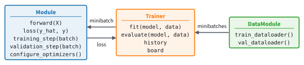

```{.python .input}
%load_ext d2lbook.tab
tab.interact_select('mxnet', 'pytorch', 'tensorflow', 'jax')
```

# Object-Oriented Design for Implementation
:label:`sec_oo-design`

The function `train` of :numref:`sec_linear_scratch` trained linear
regression in a dozen lines. Those lines are written for one model and one
dataset: the functions `linreg` and `squared_loss`, the parameters `w` and
`b`, and the arrays `X_train` and `X_val` all appear in its body, so any
other model would need a copy with a few lines changed. Stripped of these
names, the loop reads as follows.

```text
for epoch in range(num_epochs):
    for X, y in train_data:                     # data
        loss = loss_fn(net(X), y)               # model and loss
        update(params, gradient(loss, params))  # optimizer
    val_loss = mean_loss(net, val_data)         # model on held-out data
    record(epoch, val_loss)
```

Only the lines with comments depend on the problem; the loop around them
never changes. Nearly thirty sections of this book train a model, most of
them in several frameworks, so a loop written out in each would exist in
close to a hundred copies. A change to how we train, such as clipping very
large gradients or lowering the learning rate as training proceeds, would
then have to be made in every copy, and the copies would drift apart.

We therefore write the loop once, as a class, and put the parts that change
into two more classes, a design borrowed from libraries such as
[Lightning](https://lightning.ai/). A **`Module`** holds a model: its
parameters, its predictions (`forward`), its loss, and its *optimizer*, the
object that applies an update rule such as minibatch SGD. A
**`DataModule`** holds a dataset and serves it in minibatches. A
**`Trainer`** runs the loop.

In the pseudocode, the `DataModule` supplies
`train_data` and `val_data`, the `Module` supplies `net`, `loss_fn`, and the
update rule, and the `Trainer` runs the two `for` loops, computes the
gradients, and records the losses (:numref:`fig_oo_design`). Every model in
the book is a subclass of `Module`, and every dataset a subclass of
`DataModule`.


:label:`fig_oo_design`

This section rewrites the code of :numref:`sec_linear_scratch` in this
form and ends by training the same model once more, through the classes.
Some arguments and methods exist only for later chapters; we say so where
they appear.

```{.python .input #oo-design-object-oriented-design-for-implementation}
%%tab mxnet
import math
import numpy as np
from mxnet import autograd, gluon, init, np as mnp, npx
from mxnet.gluon import nn
from d2l import mxnet as d2l
npx.set_np()
```

```{.python .input #oo-design-object-oriented-design-for-implementation}
%%tab pytorch
import math
import numpy as np
import torch
from torch import nn
from torch.nn import functional as F
from d2l import torch as d2l
```

```{.python .input #oo-design-object-oriented-design-for-implementation}
%%tab tensorflow
import math
import numpy as np
import tensorflow as tf
from d2l import tensorflow as d2l
```

```{.python .input #oo-design-object-oriented-design-for-implementation}
%%tab jax
import math
import numpy as np
import jax
from jax import numpy as jnp
from flax import nnx
import optax
from d2l import jax as d2l
```

```{.python .input #oo-design-object-oriented-design-for-implementation-1}
import collections
```

## Utilities
:label:`oo-design-utilities`

Two helpers make the classes of this book easier to write in a notebook.
Neither has anything to do with machine learning. Python defines a class in
one block of code, but a class with several methods is easier to explain in
several short cells, each next to the prose about it. The decorator
`add_to_class` registers a function as a method of a class that already
exists, so that one class can be spread over several cells. This is
notebook scaffolding, not a design we recommend: in an ordinary Python
module, a class is defined in one place.

```{.python .input #oo-design-utilities-1}
def add_to_class(Class):  #@save
    """Register functions as methods in created class."""
    def wrapper(obj):
        setattr(Class, obj.__name__, obj)
        return obj
    return wrapper
```

To see it at work, we create an instance `a` of a class `A` that has no
methods other than its constructor.

```{.python .input #oo-design-utilities-2}
class A:
    def __init__(self):
        self.b = 1

a = A()
```

In a separate cell we register a method `do`. The instance `a`, created
before `do` existed, has it too, since Python looks up a method on the class
at the moment of the call.

```{.python .input #oo-design-utilities-3}
@add_to_class(A)
def do(self):
    print('Instance attribute "b" is', self.b)

a.do()
```

The second helper removes repetitive code from constructors, which usually
store each argument as an attribute: `self.lr = lr`,
`self.batch_size = batch_size`, and so on. Most of these arguments are
hyperparameters, such as the learning rate, hence the name of the `d2l`
class `HyperParameters`. Its method `save_hyperparameters` stores all
arguments of the constructor that calls it as attributes, except those named
in `ignore`. It reads them with Python's `inspect` module, which teaches
nothing about training, so its body is in :numref:`sec_utils`.

```{.python .input #oo-design-utilities-5}
class B(d2l.HyperParameters):
    def __init__(self, a, b, c):
        self.save_hyperparameters(ignore=['c'])
        print('self.a =', self.a, 'self.b =', self.b)
        print('self.c exists:', hasattr(self, 'c'))

b = B(a=1, b=2, c=3)
```

All classes in the rest of this section inherit from `HyperParameters`.

## Models
:label:`subsec_oo-design-models`

A model in this book is a subclass of `Module`. The subclass creates its
parameters in its constructor and defines three methods: `forward` computes
the predictions for a minibatch of inputs, `loss` compares predictions with
labels, and `configure_optimizers` returns the optimizer. (By default,
`forward` applies `self.net`, a network that a subclass may store.) The base
class contributes the two steps that the trainer calls, `training_step` and
`validation_step`. Besides `HyperParameters`, `Module` inherits from the
framework's base class of networks.

:begin_tab:`mxnet`
That class is Gluon's `nn.Block`. Calling an instance, `model(X)`, runs
`forward`, and the block keeps track of the parameters stored as its
attributes (:numref:`sec_model_construction`).
:end_tab:

:begin_tab:`pytorch`
That class is `nn.Module`. Calling an instance, `model(X)`, runs `forward`,
and the module keeps track of the parameters stored as its attributes
(:numref:`sec_model_construction`).
:end_tab:

:begin_tab:`tensorflow`
That class is `tf.keras.Model`, whose instances run `call` when called; our
`call` stores the flag `training`, for layers such as dropout, and
redirects to `forward`. The constructor removes an attribute `loss` that
Keras 3 sets to `None`, since it would hide our method `loss`.
:end_tab:

:begin_tab:`jax`
That class is Flax's `nnx.Module`, an ordinary Python object whose
attributes hold its parameters, where `nnx.jit` and `nnx.grad` find them.
We redirect `__call__` to `forward`.
:end_tab:

```{.python .input #oo-design-models}
%%tab pytorch
class Module(nn.Module, d2l.HyperParameters):  #@save
    """The base class of models."""
    def loss(self, y_hat, y):
        raise NotImplementedError

    def forward(self, X):
        assert hasattr(self, 'net'), 'Neural network is not defined'
        return self.net(X)

    def training_step(self, batch):
        """The mean loss on one minibatch, or a dict of batch-mean metrics
        with key 'loss'."""
        return self.loss(self(*batch[:-1]), batch[-1])

    def validation_step(self, batch):
        """The mean loss on one minibatch of validation data, or a dict of
        batch-mean metrics with key 'loss'."""
        return self.loss(self(*batch[:-1]), batch[-1])

    def configure_optimizers(self):
        raise NotImplementedError
```

```{.python .input #oo-design-models}
%%tab mxnet
class Module(nn.Block, d2l.HyperParameters):  #@save
    """The base class of models."""
    def loss(self, y_hat, y):
        raise NotImplementedError

    def forward(self, X):
        assert hasattr(self, 'net'), 'Neural network is not defined'
        return self.net(X)

    def training_step(self, batch):
        """The mean loss on one minibatch, or a dict of batch-mean metrics
        with key 'loss'."""
        return self.loss(self(*batch[:-1]), batch[-1])

    def validation_step(self, batch):
        """The mean loss on one minibatch of validation data, or a dict of
        batch-mean metrics with key 'loss'."""
        return self.loss(self(*batch[:-1]), batch[-1])

    def configure_optimizers(self):
        raise NotImplementedError
```

```{.python .input #oo-design-models}
%%tab tensorflow
class Module(tf.keras.Model, d2l.HyperParameters):  #@save
    """The base class of models."""
    def __init__(self):
        super().__init__()
        self.training = None
        self.__dict__.pop('loss', None)

    def loss(self, y_hat, y):
        raise NotImplementedError

    def forward(self, X):
        assert hasattr(self, 'net'), 'Neural network is not defined'
        return self.net(X)

    def call(self, X, *args, training=None, **kwargs):
        if training is not None:
            self.training = training
        return self.forward(X, *args, **kwargs)

    def training_step(self, batch):
        """The mean loss on one minibatch, or a dict of batch-mean metrics
        with key 'loss'."""
        return self.loss(self(*batch[:-1], training=True), batch[-1])

    def validation_step(self, batch):
        """The mean loss on one minibatch of validation data, or a dict of
        batch-mean metrics with key 'loss'."""
        return self.loss(self(*batch[:-1], training=False), batch[-1])

    def configure_optimizers(self):
        raise NotImplementedError
```

```{.python .input #oo-design-models}
%%tab jax
class Module(nnx.Module, d2l.HyperParameters):  #@save
    """The base class of models."""
    def loss(self, y_hat, y):
        raise NotImplementedError

    def forward(self, X, *args, **kwargs):
        assert hasattr(self, 'net'), 'Neural network is not defined'
        return self.net(X, *args, **kwargs)

    def __call__(self, X, *args, **kwargs):
        return self.forward(X, *args, **kwargs)

    def training_step(self, batch):
        """The mean loss on one minibatch, or a dict of batch-mean metrics
        with key 'loss'."""
        return self.loss(self(*batch[:-1]), batch[-1])

    def validation_step(self, batch):
        """The mean loss on one minibatch of validation data, or a dict of
        batch-mean metrics with key 'loss'."""
        return self.loss(self(*batch[:-1]), batch[-1])

    def configure_optimizers(self):
        raise NotImplementedError
```

A minibatch is a tuple whose last element holds the labels and whose other
elements hold the inputs. `training_step` calls the model on the inputs and
passes the predictions and the labels to `loss`; `validation_step` does the
same on validation data. Both steps *return* their result and do nothing
else: they do not print, plot, or keep a record. This restriction is the
key decision of the design. Nothing in a model refers to the trainer, so any
loop, not only the trainer's, can train or evaluate it.

In this chapter a step returns one number, the mean loss over the minibatch.
From :numref:`sec_classification` on, a step may return a dictionary of such
means, with the loss under the key `'loss'` and, say, the accuracy next to
it. The function `as_metrics` wraps a single loss in a dictionary, so that
the trainer handles both alike.

```{.python .input #oo-design-models-1}
def as_metrics(out):  #@save
    """A step returns a loss or a dict of metrics; return a dict."""
    return out if isinstance(out, dict) else {'loss': out}
```

### Linear Regression as a Module

The model of :numref:`sec_linear_scratch` becomes a subclass of `Module`.
Its constructor creates the parameters as `init_params` did and registers
them with the module through the framework's parameter type. Registration
lets the framework's tools find the parameters, which are then listed,
saved, and moved to a GPU together with the rest of the model. It computes
nothing for us: the loss and the update are still the ones we wrote by hand.

:begin_tab:`pytorch`
`nn.Parameter` wraps a tensor and records the operations on it, as
`requires_grad=True` did; assigned as an attribute, it is registered, so
`model.parameters()` lists `w` and `b`.
:end_tab:

:begin_tab:`mxnet`
A Gluon `Parameter` assigned as an attribute is registered with the block,
which allocates its value and its gradient in `initialize()`. The array
that holds the value is returned by `data()`.
:end_tab:

:begin_tab:`tensorflow`
`add_weight` creates a variable, a tensor that can be changed in place, and
registers it with the Keras model, so `model.trainable_variables` lists `w`
and `b`.
:end_tab:

:begin_tab:`jax`
`nnx.Param` marks an array as a trainable parameter, so `nnx.grad`
differentiates with respect to `w` and `b`. The argument `rngs` supplies the
random key for the initialization; without it, the model takes a new key
from the `d2l` library.
:end_tab:

```{.python .input #linear-regression-scratch-defining-the-model-1  n=6}
%%tab pytorch
class LinearRegressionScratch(d2l.Module):  #@save
    """The linear regression model implemented from scratch."""
    def __init__(self, num_inputs, lr, sigma=0.01):
        super().__init__()
        self.save_hyperparameters()
        self.w = nn.Parameter(d2l.normal(0, sigma, (num_inputs, 1)))
        self.b = nn.Parameter(d2l.zeros(1))
```

```{.python .input #linear-regression-scratch-defining-the-model-1  n=6}
%%tab mxnet
class LinearRegressionScratch(d2l.Module):  #@save
    """The linear regression model implemented from scratch."""
    def __init__(self, num_inputs, lr, sigma=0.01):
        super().__init__()
        self.save_hyperparameters()
        self.w = gluon.Parameter('w', shape=(num_inputs, 1),
                                 init=init.Normal(sigma))
        self.b = gluon.Parameter('b', shape=(1,), init=init.Zero())
        self.initialize()
```

```{.python .input #linear-regression-scratch-defining-the-model-1  n=6}
%%tab tensorflow
class LinearRegressionScratch(d2l.Module):  #@save
    """The linear regression model implemented from scratch."""
    def __init__(self, num_inputs, lr, sigma=0.01):
        super().__init__()
        self.save_hyperparameters()
        normal = tf.keras.initializers.RandomNormal(mean=0, stddev=sigma)
        self.w = self.add_weight(name='w', shape=(num_inputs, 1),
                                 initializer=normal)
        self.b = self.add_weight(name='b', shape=(1,), initializer='zeros')
```

```{.python .input #linear-regression-scratch-defining-the-model-1  n=7}
%%tab jax
class LinearRegressionScratch(d2l.Module):  #@save
    """The linear regression model implemented from scratch."""
    def __init__(self, num_inputs, lr, sigma=0.01, rngs=None):
        super().__init__()
        self.save_hyperparameters(ignore=['rngs'])
        rngs = nnx.Rngs(d2l.get_key()) if rngs is None else rngs
        self.w = nnx.Param(
            rngs.params.normal((num_inputs, 1)) * sigma)
        self.b = nnx.Param(jnp.zeros(1))
```

The forward pass and the loss are `linreg` and `squared_loss` of
:numref:`sec_linear_scratch`, now methods that read the parameters from the
model.

```{.python .input #linear-regression-scratch-defining-the-model-2  n=8}
%%tab pytorch, tensorflow, jax
@d2l.add_to_class(LinearRegressionScratch)  #@save
def forward(self, X):
    return d2l.matmul(X, self.w) + self.b
```

```{.python .input #linear-regression-scratch-defining-the-model-2}
%%tab mxnet
@d2l.add_to_class(LinearRegressionScratch)  #@save
def forward(self, X):
    return d2l.matmul(X, self.w.data()) + self.b.data()
```

```{.python .input #linear-regression-scratch-defining-the-loss-function  n=9}
@d2l.add_to_class(LinearRegressionScratch)  #@save
def loss(self, y_hat, y):
    l = (y_hat - d2l.reshape(y, (-1, 1))) ** 2 / 2
    return d2l.reduce_mean(l)
```

The update becomes an optimizer class, `SGD`. Its update is the one line of
:numref:`sec_linear_scratch`; the rest of the class gives it the interface
of the framework's own optimizers, so that :numref:`sec_linear_concise` can
exchange the two.

:begin_tab:`pytorch`
As in PyTorch's optimizers, `step` updates the parameters in place and
`zero_grad` resets their gradients to zero.
:end_tab:

:begin_tab:`mxnet`
As in Gluon's `Trainer`, `step` updates the parameters in place. Gluon's
`step` divides the gradient by a batch size; ours ignores it, since our loss
is already a mean.
:end_tab:

:begin_tab:`tensorflow`
As in Keras optimizers, `apply_gradients` receives pairs of a gradient and a
variable and updates each variable in place with `assign_sub`.
:end_tab:

:begin_tab:`jax`
JAX arrays cannot be changed in place, so an optimizer of Optax, JAX's
optimization library, only computes the updates, here $-\eta$ times the
gradient, and `nnx.Optimizer` adds them to the parameters.
:end_tab:

```{.python .input #linear-regression-scratch-defining-the-optimization-algorithm-1  n=11}
%%tab mxnet
class SGD(d2l.HyperParameters):  #@save
    """Minibatch stochastic gradient descent."""
    def __init__(self, params, lr):
        self.save_hyperparameters()

    def step(self, _):
        for param in self.params:
            param -= self.lr * param.grad
```

```{.python .input #linear-regression-scratch-defining-the-optimization-algorithm-1  n=11}
%%tab pytorch
class SGD(d2l.HyperParameters):  #@save
    """Minibatch stochastic gradient descent."""
    def __init__(self, params, lr):
        self.save_hyperparameters()

    def step(self):
        for param in self.params:
            param -= self.lr * param.grad

    def zero_grad(self):
        for param in self.params:
            if param.grad is not None:
                param.grad.zero_()
```

```{.python .input #linear-regression-scratch-defining-the-optimization-algorithm-1  n=12}
%%tab tensorflow
class SGD(d2l.HyperParameters):  #@save
    """Minibatch stochastic gradient descent."""
    def __init__(self, lr):
        self.save_hyperparameters()

    def apply_gradients(self, grads_and_vars):
        for grad, param in grads_and_vars:
            param.assign_sub(self.lr * grad)
```

```{.python .input #linear-regression-scratch-defining-the-optimization-algorithm-1  n=13}
%%tab jax
class SGD(d2l.HyperParameters):  #@save
    """Minibatch stochastic gradient descent."""
    # An optax optimizer is a pair of pure functions: `init` creates the
    # optimizer state, and `update` turns gradients into parameter updates.
    def __init__(self, lr):
        self.save_hyperparameters()

    def init(self, params):
        del params  # SGD keeps no state
        return optax.EmptyState()

    def update(self, updates, state, params=None):
        del params
        updates = jax.tree_util.tree_map(lambda g: -self.lr * g, updates)
        return updates, state
```

The model's `configure_optimizers` returns an instance of this class.

:begin_tab:`mxnet`
It hands `SGD` the arrays returned by `data()`, whose `grad` attributes hold
the gradients.
:end_tab:

```{.python .input #linear-regression-scratch-defining-the-optimization-algorithm-2  n=14}
%%tab pytorch
@d2l.add_to_class(LinearRegressionScratch)  #@save
def configure_optimizers(self):
    return SGD([self.w, self.b], self.lr)
```

```{.python .input #linear-regression-scratch-defining-the-optimization-algorithm-2  n=14}
%%tab tensorflow
@d2l.add_to_class(LinearRegressionScratch)  #@save
def configure_optimizers(self):
    return SGD(self.lr)
```

```{.python .input #linear-regression-scratch-defining-the-optimization-algorithm-2  n=14}
%%tab jax
@d2l.add_to_class(LinearRegressionScratch)  #@save
def configure_optimizers(self):
    return SGD(self.lr)
```

```{.python .input #linear-regression-scratch-defining-the-optimization-algorithm-2  n=14}
%%tab mxnet
@d2l.add_to_class(LinearRegressionScratch)  #@save
def configure_optimizers(self):
    return SGD([self.w.data(), self.b.data()], self.lr)
```

## Data
:label:`oo-design-data`

The base class for data is shorter still. A dataset in this book is a
subclass of `DataModule`, whose constructor prepares the data, downloading
and preprocessing it if needed. (The argument `root` names the directory for
downloaded files, and `num_workers` the number of processes that load data
in parallel.) A subclass implements one method, `get_dataloader(train)`. It
returns a *data loader*, an object that yields the data one minibatch at a
time, as the tuples that the steps of `Module` expect. The other two methods
merely call it.

```{.python .input #oo-design-data}
class DataModule(d2l.HyperParameters):  #@save
    """The base class of data."""
    def __init__(self, root='../data', num_workers=4):
        self.save_hyperparameters()

    def get_dataloader(self, train):
        raise NotImplementedError

    def train_dataloader(self):
        return self.get_dataloader(train=True)

    def val_dataloader(self):
        return self.get_dataloader(train=False)
```

The synthetic data of :numref:`sec_synthetic-regression-data` become a
subclass whose constructor calls `d2l.synthetic_data` for
`num_train + num_val` examples, by default 1,000 of each: the first
`num_train` for training, the rest for validation.

:begin_tab:`jax`
Without a `key`, the constructor takes a new one from `d2l.get_key()`, so
each run generates a new dataset.
:end_tab:

```{.python .input #synthetic-regression-data-generating-the-dataset-1}
%%tab pytorch, tensorflow, mxnet
class SyntheticRegressionData(d2l.DataModule):  #@save
    """Synthetic data for linear regression."""
    def __init__(self, w, b, noise=0.01, num_train=1000, num_val=1000,
                 batch_size=32):
        super().__init__()
        self.save_hyperparameters()
        self.X, self.y = d2l.synthetic_data(w, b, noise, num_train + num_val)
```

```{.python .input #synthetic-regression-data-generating-the-dataset-1}
%%tab jax
class SyntheticRegressionData(d2l.DataModule):  #@save
    """Synthetic data for linear regression."""
    def __init__(self, w, b, noise=0.01, num_train=1000, num_val=1000,
                 batch_size=32, key=None):
        super().__init__()
        self.save_hyperparameters()
        key = d2l.get_key() if key is None else key  # A new dataset per run
        self.X, self.y = d2l.synthetic_data(w, b, noise, num_train + num_val,
                                            key)
```

### A Loader for Every Epoch

What should `get_dataloader` return? The generator `minibatches` of
:numref:`sec_linear_scratch` would not do. The trainer asks a `DataModule`
for its loaders once and then iterates over them in every epoch, and a
generator serves one pass and then nothing. The trainer would train for one
epoch and idle through the rest, without an error.

We need a loader that can be iterated in every epoch, draws a fresh random
order on every pass, and reports its number of minibatches through `len`.
The loaders that deep learning frameworks provide do more. For data that do
not fit in memory, or that must be decoded before use, such as large
collections of images, they read examples from disk and prepare the next
minibatches in parallel workers while the model trains on the current one.
Our dataset fits in memory, so none of this is needed yet.

For data held in memory as tensors, we add the method `get_tensorloader` to
`DataModule`. It returns the framework's loader where one suits such data,
and otherwise a short class of our own. The validation examples are read in
their stored order, since we only average the loss over them.

:begin_tab:`jax`
JAX has no data loader of its own. Our `ArrayLoader` serves NumPy arrays
from the host and splits a new key off its own on every shuffled pass, so
that every pass has a new order and no key is used twice. It keeps the last,
partial minibatch, which costs one more compilation of each compiled step
per run, not per epoch.
:end_tab:

```{.python .input #synthetic-regression-data-reusable-data-loaders-1}
%%tab jax
class ArrayLoader:  #@save
    """Minibatches of in-memory arrays, reshuffled each pass if shuffle."""
    def __init__(self, arrays, batch_size, shuffle=False, drop_last=False,
                 key=None):
        self.arrays = tuple(np.asarray(a) for a in arrays)  # On the host
        self.batch_size, self.shuffle = batch_size, shuffle
        self.drop_last = drop_last
        if shuffle and key is None:  # A new order on each run
            key = d2l.get_key()
        self.key = key

    def __len__(self):
        n = len(self.arrays[0])
        if self.drop_last:
            return n // self.batch_size
        return (n + self.batch_size - 1) // self.batch_size

    def __iter__(self):
        n = len(self.arrays[0])
        if self.shuffle:  # A new key, and hence a new order, on every pass
            self.key, key = jax.random.split(self.key)
            order = np.asarray(jax.random.permutation(key, n))
        else:
            order = np.arange(n)
        for i in range(len(self)):
            start = i * self.batch_size
            batch_indices = order[start : start + self.batch_size]
            yield tuple(a[batch_indices] for a in self.arrays)
```

```{.python .input #synthetic-regression-data-reusable-data-loaders-1}
%%tab mxnet
class ArrayLoader:  #@save
    """Minibatches of in-memory arrays, reshuffled each pass if shuffle."""
    def __init__(self, arrays, batch_size, shuffle=False, drop_last=False):
        self.arrays = tuple(arrays)
        self.batch_size, self.shuffle = batch_size, shuffle
        self.drop_last = drop_last

    def __len__(self):
        n = len(self.arrays[0])
        if self.drop_last:
            return n // self.batch_size
        return (n + self.batch_size - 1) // self.batch_size

    def __iter__(self):
        order = mnp.arange(len(self.arrays[0]), dtype='int32')
        if self.shuffle:  # A new random order on every pass
            mnp.random.shuffle(order)
        for i in range(len(self)):
            start = i * self.batch_size
            batch_indices = order[start : start + self.batch_size]
            yield tuple(a[batch_indices] for a in self.arrays)
```

:begin_tab:`mxnet`
Gluon's `DataLoader` builds a minibatch one example at a time. Our
`ArrayLoader` reads it with one indexing operation per tensor instead, a
saving that grows with the size of the minibatch.
:end_tab:

:begin_tab:`pytorch`
`TensorDataset` pairs the tensors example by example, and `DataLoader` draws
minibatches from it, in a new random order on every pass when
`shuffle=True`.
:end_tab:

:begin_tab:`tensorflow`
`from_tensor_slices` pairs the tensors example by example, and `batch`
groups them into minibatches. In between, `shuffle` draws each next example
from a buffer: one that holds all training examples gives a new uniformly
random order on every pass, and one of a single example keeps the stored
order.
:end_tab:

:begin_tab:`jax, mxnet`
`get_tensorloader` wraps the arrays in an `ArrayLoader`.
:end_tab:

```{.python .input #synthetic-regression-data-concise-implementation-of-the-data-loader-1}
%%tab pytorch
@d2l.add_to_class(d2l.DataModule)  #@save
def get_tensorloader(self, tensors, train, indices=slice(0, None)):
    tensors = tuple(a[indices] for a in tensors)
    dataset = torch.utils.data.TensorDataset(*tensors)
    return torch.utils.data.DataLoader(dataset, self.batch_size,
                                       shuffle=train)
```

```{.python .input #synthetic-regression-data-concise-implementation-of-the-data-loader-1}
%%tab tensorflow
@d2l.add_to_class(d2l.DataModule)  #@save
def get_tensorloader(self, tensors, train, indices=slice(0, None)):
    tensors = tuple(a[indices] for a in tensors)
    shuffle_buffer = tensors[0].shape[0] if train else 1
    return tf.data.Dataset.from_tensor_slices(tensors).shuffle(
        buffer_size=shuffle_buffer).batch(self.batch_size)
```

```{.python .input #synthetic-regression-data-concise-implementation-of-the-data-loader-1}
%%tab jax
@d2l.add_to_class(d2l.DataModule)  #@save
def get_tensorloader(self, tensors, train, indices=slice(0, None)):
    tensors = tuple(a[indices] for a in tensors)
    return ArrayLoader(tensors, self.batch_size, shuffle=train)
```

```{.python .input #synthetic-regression-data-concise-implementation-of-the-data-loader-1}
%%tab mxnet
@d2l.add_to_class(d2l.DataModule)  #@save
def get_tensorloader(self, tensors, train, indices=slice(0, None)):
    tensors = tuple(a[indices] for a in tensors)
    return ArrayLoader(tensors, self.batch_size, shuffle=train)
```

`get_tensorloader` keeps the examples selected by `indices` and shuffles
them only if `train` is true. `SyntheticRegressionData` passes it the slice
of each split.

```{.python .input #synthetic-regression-data-concise-implementation-of-the-data-loader-2}
@d2l.add_to_class(SyntheticRegressionData)  #@save
def get_dataloader(self, train):
    i = slice(0, self.num_train) if train else slice(self.num_train, None)
    return self.get_tensorloader((self.X, self.y), train, i)
```

We create the dataset of :numref:`sec_synthetic-regression-data` and repeat
the test of the generator: one pass over the training loader, then a second
pass over the same loader.

```{.python .input #oo-design-a-loader-for-every-epoch-1}
data = SyntheticRegressionData(w=d2l.tensor([2, -3.4]), b=4.2)
```

```{.python .input #synthetic-regression-data-concise-implementation-of-the-data-loader-3  n=4}
loader = data.train_dataloader()
sizes = [len(y) for X, y in loader]
print(f'{len(sizes)} minibatches, the last of size {sizes[-1]}')
print(f'second pass: {len([y for X, y in loader])} minibatches')
for _ in range(2):  # Each new pass starts in a new random order
    X, y = next(iter(loader))
    print('a new pass starts with labels', d2l.numpy(y[:3, 0]).round(2))
```

The first pass yields 32 minibatches, the last of 8 examples, as the
generator did. This time, however, the second pass yields all 32 minibatches
again, and every pass starts with different examples because the order is
drawn anew. The loader also reports its number of minibatches without a
pass.

```{.python .input #synthetic-regression-data-concise-implementation-of-the-data-loader-4}
len(loader)
```

## Training
:label:`oo-design-training`

### The Training Loop and the History

The `Trainer` class fits the parameters of a `Module` to the data of a
`DataModule`. Its constructor takes the number of epochs, `max_epochs`. (The
other two arguments can be ignored until they are needed: `num_gpus` in
:numref:`sec_use_gpu`, and `gradient_clip_val`, which limits the size of
large gradients, in :numref:`sec_rnn-scratch`.) It also creates a progress
board, on which the trainer plots the losses; we define it below. Training
begins with three preparations: `prepare_data` asks the `DataModule` for its
loaders, `prepare_model` stores the model, and `prepare_optimizer` calls the
model's `configure_optimizers`. Each is a line or two, and a method of its
own so that later sections can override it.

```{.python .input #oo-design-training}
class Trainer(d2l.HyperParameters):  #@save
    """Fit a Module to a DataModule, keeping a per-epoch history."""
    def __init__(self, max_epochs, num_gpus=0, gradient_clip_val=0):
        self.save_hyperparameters()
        self.board = ProgressBoard(xlabel='epoch', ylabel='loss')

    def prepare_data(self, data):
        self.train_dataloader = data.train_dataloader()
        self.val_dataloader = data.val_dataloader()

    def prepare_model(self, model):
        self.model = model

    def prepare_optimizer(self, model):
        self.optim = model.configure_optimizers()
```

:begin_tab:`pytorch`
For later chapters, `prepare_optimizer` also accepts a learning-rate
schedule next to the optimizer (:numref:`sec_scheduler`).
:end_tab:

:begin_tab:`jax`
`prepare_model` creates two views of the model that share its parameters,
one for training and one for evaluation, which differ for layers such as
dropout. `prepare_optimizer` wraps the Optax optimizer in `nnx.Optimizer`,
which holds the optimizer state.
:end_tab:

```{.python .input #oo-design-training-3}
%%tab pytorch
@d2l.add_to_class(Trainer)  #@save
def prepare_optimizer(self, model):
    """`configure_optimizers` may also return a learning-rate scheduler."""
    # PyTorch steps a schedule with a separate object (sec_scheduler)
    optim = model.configure_optimizers()
    self.optim, self.scheduler = (optim if isinstance(optim, tuple)
                                  else (optim, None))
```

```{.python .input #oo-design-training-3}
%%tab jax
@d2l.add_to_class(Trainer)  #@save
def prepare_model(self, model):
    # Two views that share the parameters: layers such as dropout behave
    # differently in training and in evaluation
    self.model = model
    self.train_model = nnx.view(model, deterministic=False,
                                use_running_average=False,
                                raise_if_not_found=False)
    self.val_model = nnx.view(model, deterministic=True,
                              use_running_average=True,
                              raise_if_not_found=False)

#@save
optimizer_cache = {}  # The most recent optax transformation, by its key

# Reusing the transformation lets a later fit of a model with the same
# structure reuse the compiled training step

@d2l.add_to_class(Trainer)  #@save
def prepare_optimizer(self, model):
    key = (jax.tree.structure(model), type(model).configure_optimizers)
    if key not in optimizer_cache:
        optimizer_cache.clear()  # One entry: it may refer to a model
        optimizer_cache[key] = model.configure_optimizers()
    self.optim = nnx.Optimizer(model, optimizer_cache[key], wrt=nnx.Param)
```

The method `fit(model, data)` is the outer loop of the pseudocode at the
start of this section. After the three preparations it runs `max_epochs`
epochs. In each, `fit_epoch` updates the parameters once per minibatch and
returns the mean of every quantity that `training_step` reports, and
`validate` returns the means over the validation data. The method `record`
keeps these means.

```{.python .input #oo-design-training-1}
@d2l.add_to_class(Trainer)  #@save
def fit(self, model, data):
    self.prepare_data(data)
    self.prepare_model(model)
    self.prepare_optimizer(model)
    self.history = collections.defaultdict(list)
    self.board.clear()
    self.board.xlim = [0, self.max_epochs]
    for self.epoch in range(self.max_epochs):
        # The training mean averages over the epoch, so it sits mid-epoch
        self.record('train', self.fit_epoch(), x=self.epoch + 0.5)
        if self.val_dataloader is not None:
            self.record('val', self.validate(), x=self.epoch + 1)
        self.board.show(final=False)
    self.board.show()

@d2l.add_to_class(Trainer)  #@save
def record(self, split, metrics, x):
    for name in sorted(metrics, key=lambda name: (name != 'loss', name)):
        self.history[f'{split}_{name}'].append(metrics[name])
        self.board.draw(x, metrics[name], f'{split}_{name}')
```

`fit` stores the epoch in `self.epoch`, so that the methods it calls can
read it, and skips validation when `val_dataloader` returns `None`.

What is left when training ends? `fit` itself returns nothing. Everything is
in `trainer.history`, a dictionary of lists to which `record` appends each
mean. Its keys combine the split with the name of the quantity:
`'train_loss'`, `'val_loss'`, and, for a classifier, `'val_acc'`. Thus
`trainer.history['val_loss'][-1]` is the validation loss after the last
epoch. (`record` puts the loss first, so that a curve keeps its color on the
board from one model to the next.)

### Epoch Means

The means that `fit_epoch` and `validate` return are averages over
examples, not over minibatches: each minibatch counts in proportion to its
size. This matters for the last minibatch of a pass, which is smaller
whenever the minibatch size does not divide the number of examples: 1,000
examples in minibatches of 32 make 31 full minibatches and one of 8, and
with equal weights per minibatch each of the last 8 examples would count
four times as much as the others. The trainer therefore multiplies each
value by the number of examples in its minibatch. This requires a step to
return a mean and never a sum: a loss summed over a minibatch of 32 examples
would enter the average 32 times too large.

`Averager` computes these means. It weights each minibatch by its size, and
it keeps the sums on the device, converting them into Python numbers only
once per epoch, in `mean`, since every such conversion makes Python wait
until a GPU has finished the work queued before it
(:numref:`subsec_async_dispatch`). With three parameters on a CPU this
saves nothing, and `Averager` may be read as a slightly elaborate way of
taking a mean.

```{.python .input #linear-regression-scratch-training-5}
class Averager:  #@save
    """Example-weighted means of batch metrics, summed on the device."""
    def __init__(self):
        self.sums, self.n = {}, 0

    def add(self, metrics, n):
        for name, value in metrics.items():
            self.sums[name] = self.sums.get(name, 0) + value * n
        self.n += n

    def mean(self):
        """One host synchronization per metric; the loss comes first."""
        names = sorted(self.sums, key=lambda name: (name != 'loss', name))
        return {name: float(self.sums[name]) / self.n for name in names}
```

### Training and Validation Passes

The two passes, `fit_epoch` and `validate`, are the inner loop of `train`
in :numref:`sec_linear_scratch`, written against the classes: the
minibatches come from the loader, the loss from the model's steps, and the
update from the optimizer. Both wrap what a step returns with `as_metrics`
and average it with `Averager`. Each minibatch first passes through
`prepare_batch`, a hook that a later chapter overrides to move minibatches
to a GPU; here it returns the minibatch unchanged.

```{.python .input #linear-regression-scratch-training-1  n=15}
@d2l.add_to_class(d2l.Trainer)  #@save
def prepare_batch(self, batch):
    return batch
```

The loop that trains every model in the book is longer than linear
regression needs. Its algorithm is the step of :numref:`sec_linear_scratch`:
forward pass and loss, backward pass, update, and a clearing of gradients
where the framework keeps them. The other lines prepare the minibatch,
average its metrics, or are hooks for later chapters, and none of them
changes the result of training here.

:begin_tab:`pytorch`
The two `if` statements are the hooks, for gradient clipping and a
learning-rate schedule. `detach()` keeps the running sum of losses from
holding on to the computation graph of every minibatch, and `train()` and
`eval()` matter only for layers we have not met yet.
:end_tab:

:begin_tab:`mxnet`
`step(1)` passes a batch size of 1, since our loss is already a mean.
`wait_to_read` keeps Python at most one minibatch ahead of the device; without
it, Python could queue a whole epoch, and the memory for the queued
intermediate results would grow with the queue.
:end_tab:

:begin_tab:`tensorflow`
A function compiled with `tf.function` runs much faster than the same
operations issued one at a time from Python, so this `prepare_model`, which
replaces the one above, compiles the two steps once per call of `fit`. It
first runs one forward pass, because Keras creates a layer's variables only
when the layer first sees data.
:end_tab:

:begin_tab:`jax`
`_trainer_train_step` compiles the forward pass, the loss, the gradient, and
the update into one function. With `has_aux=True`, `nnx.grad`
differentiates the `'loss'` entry of the step's metrics and also returns
the whole dictionary.
:end_tab:

```{.python .input #linear-regression-scratch-training-2  n=16}
%%tab pytorch
@d2l.add_to_class(d2l.Trainer)  #@save
def fit_epoch(self):
    self.model.train()
    metrics = d2l.Averager()
    for batch in map(self.prepare_batch, self.train_dataloader):
        out = d2l.as_metrics(self.model.training_step(batch))
        self.optim.zero_grad()
        out['loss'].backward()
        if self.gradient_clip_val > 0:  # To be discussed later
            self.clip_gradients(self.gradient_clip_val, self.model)
        with torch.no_grad():
            self.optim.step()
        if self.scheduler is not None:
            self.scheduler.step()
        metrics.add({k: v.detach() for k, v in out.items()}, len(batch[-1]))
    return metrics.mean()

@d2l.add_to_class(d2l.Trainer)  #@save
def validate(self):
    self.model.eval()
    metrics = d2l.Averager()
    with torch.no_grad():
        for batch in map(self.prepare_batch, self.val_dataloader):
            metrics.add(d2l.as_metrics(self.model.validation_step(batch)),
                        len(batch[-1]))
    return metrics.mean()
```

```{.python .input #linear-regression-scratch-training-2  n=17}
%%tab mxnet
@d2l.add_to_class(d2l.Trainer)  #@save
def fit_epoch(self):
    metrics, previous = d2l.Averager(), None
    for batch in map(self.prepare_batch, self.train_dataloader):
        with autograd.record():
            out = d2l.as_metrics(self.model.training_step(batch))
        out['loss'].backward()
        if self.gradient_clip_val > 0:
            self.clip_gradients(self.gradient_clip_val, self.model)
        self.optim.step(1)
        metrics.add(out, len(batch[-1]))
        if previous is not None:  # Python stays one step ahead at most
            previous.wait_to_read()
        previous = out['loss']
    return metrics.mean()

@d2l.add_to_class(d2l.Trainer)  #@save
def validate(self):
    metrics = d2l.Averager()
    for batch in map(self.prepare_batch, self.val_dataloader):
        metrics.add(d2l.as_metrics(self.model.validation_step(batch)),
                    len(batch[-1]))
    return metrics.mean()
```

```{.python .input #linear-regression-scratch-training-2  n=18}
%%tab tensorflow
@d2l.add_to_class(d2l.Trainer)  #@save
def prepare_model(self, model):
    self.model = model
    loader = (self.train_dataloader if self.train_dataloader is not None
              else self.val_dataloader)  # `evaluate` has no training data
    batch = self.prepare_batch(next(iter(loader)))
    model(*batch[:-1], training=False)  # Keras creates the variables here
    self._train_step = tf.function(self.train_step, reduce_retracing=True)
    self._val_step = tf.function(self.val_step, reduce_retracing=True)

@d2l.add_to_class(d2l.Trainer)  #@save
def train_step(self, batch):
    with tf.GradientTape() as tape:
        out = d2l.as_metrics(self.model.training_step(batch))
    params = self.model.trainable_variables
    grads = tape.gradient(out['loss'], params)
    if self.gradient_clip_val > 0:
        grads = self.clip_gradients(self.gradient_clip_val, grads)
    self.optim.apply_gradients(zip(grads, params))
    return out

@d2l.add_to_class(d2l.Trainer)  #@save
def val_step(self, batch):
    return d2l.as_metrics(self.model.validation_step(batch))

@d2l.add_to_class(d2l.Trainer)  #@save
def fit_epoch(self):
    metrics = d2l.Averager()
    for batch in map(self.prepare_batch, self.train_dataloader):
        metrics.add(self._train_step(batch), len(batch[-1]))
    return metrics.mean()

@d2l.add_to_class(d2l.Trainer)  #@save
def validate(self):
    metrics = d2l.Averager()
    for batch in map(self.prepare_batch, self.val_dataloader):
        metrics.add(self._val_step(batch), len(batch[-1]))
    return metrics.mean()
```

```{.python .input #linear-regression-scratch-training-2  n=19}
%%tab jax
@nnx.jit  #@save
def _trainer_train_step(model, optimizer, batch):
    def loss_fn(model):
        out = d2l.as_metrics(model.training_step(batch))
        return out['loss'], out
    grads, out = nnx.grad(loss_fn, has_aux=True)(model)
    optimizer.update(model, grads)
    return out

@nnx.jit  #@save
def _trainer_validation_step(model, batch):
    return d2l.as_metrics(model.validation_step(batch))

@d2l.add_to_class(d2l.Trainer)  #@save
def fit_epoch(self):
    metrics = d2l.Averager()
    for batch in map(self.prepare_batch, self.train_dataloader):
        metrics.add(_trainer_train_step(self.train_model, self.optim, batch),
                    len(batch[-1]))
    return metrics.mean()

@d2l.add_to_class(d2l.Trainer)  #@save
def validate(self):
    metrics = d2l.Averager()
    for batch in map(self.prepare_batch, self.val_dataloader):
        metrics.add(_trainer_validation_step(self.val_model, batch),
                    len(batch[-1]))
    return metrics.mean()
```

### The Progress Board

`record` also adds each mean to the progress board, which `fit` redraws
after every epoch so that we can watch training in a notebook. The class
`ProgressBoard` keeps one list of points per curve: `draw(x, y, label)`
appends the point `(x, y)` to the curve named `label`, `show` redraws all
curves, and `clear` forgets them. The drawing code has nothing to teach us
here and is in :numref:`sec_utils`. The board can be configured before
training, for instance with `trainer.board.yscale = 'log'` for a logarithmic
loss axis, or with `trainer.board.display = False` to train without
plotting.

Before we read our first pair of training curves, note that they are
computed with different parameters. The validation mean uses the parameters
at the end of the epoch, while the training mean averages over minibatches
seen while the parameters changed. `fit` therefore draws the training mean
of each epoch at its middle, at 0.5, 1.5, and so on, and the validation mean
at its end, at 1, 2, and so on.

```{.python .input #oo-design-utilities-6}
class ProgressBoard(d2l.HyperParameters):  #@save
    """Curves that grow during training; `show` redraws them."""
    def __init__(self, xlabel=None, ylabel=None, xlim=None, ylim=None,
                 xscale='linear', yscale='linear', figsize=(3.5, 2.5),
                 display=True):
        self.save_hyperparameters()
        self.clear()

    def clear(self):
        """Forget all curves; the next `show` starts a new figure."""
        self.data, self.handle = {}, None

    def draw(self, x, y, label):
        """Append the point (x, y) to the curve called `label`."""
        xs, ys = self.data.setdefault(label, ([], []))
        xs.append(x)
        ys.append(y)

    def show(self, final=True):
        raise NotImplementedError
```

## Training Linear Regression Again

We now train the model of :numref:`sec_linear_scratch` once more, through
the classes, on the dataset `data` created above. The arguments of `train`
have moved to the classes that own them: the learning rate 0.03 to the
model, the minibatch size 32 to the data (it is the default), and the ten
epochs to the trainer. We use `d2l.Trainer`, the class of this section
together with the drawing code of :numref:`sec_utils`.

```{.python .input #oo-design-training-linear-regression-again-1}
model = LinearRegressionScratch(2, lr=0.03)
trainer = d2l.Trainer(max_epochs=10)
trainer.board.yscale = 'log'
trainer.fit(model, data)
```

The validation loss behaves as in :numref:`sec_linear_scratch`: it falls by
a factor of about 7 per epoch and levels off near the floor of
$5 \times 10^{-5}$. The training curve lies on top of it. With three
parameters and 1,000 examples, the model can fit almost none of the noise
in its training labels, so it does as well on new examples as on the old
ones. Has anything changed besides the organization of the code? The final
validation loss and the parameter errors answer that.

```{.python .input #oo-design-training-linear-regression-again-2}
%%tab pytorch, tensorflow
w_error = d2l.numpy(d2l.reshape(model.w, data.w.shape) - data.w)
b_error = d2l.numpy(model.b - data.b)
print(f"validation loss: {trainer.history['val_loss'][-1]:.1e}")
print('error in w:', ', '.join(f'{e:.1e}' for e in w_error))
print('error in b:', ', '.join(f'{e:.1e}' for e in b_error))
```

```{.python .input #oo-design-training-linear-regression-again-2}
%%tab mxnet
w_error = d2l.numpy(d2l.reshape(model.w.data(), data.w.shape) - data.w)
b_error = d2l.numpy(model.b.data() - data.b)
print(f"validation loss: {trainer.history['val_loss'][-1]:.1e}")
print('error in w:', ', '.join(f'{e:.1e}' for e in w_error))
print('error in b:', ', '.join(f'{e:.1e}' for e in b_error))
```

```{.python .input #oo-design-training-linear-regression-again-2}
%%tab jax
w_error = d2l.numpy(d2l.reshape(model.w[...], data.w.shape) - data.w)
b_error = d2l.numpy(model.b[...] - data.b)
print(f"validation loss: {trainer.history['val_loss'][-1]:.1e}")
print('error in w:', ', '.join(f'{e:.1e}' for e in w_error))
print('error in b:', ', '.join(f'{e:.1e}' for e in b_error))
```

Nothing has. The validation loss is at the floor, and the parameters are
within about $10^{-3}$ of the true ones, typically a few times $10^{-4}$, as
in :numref:`sec_linear_scratch`. For a single model the classes would not
be worth their extra lines. The next section is the first to need them: it
replaces the model's parameters, loss, and optimizer with framework
components and trains the result with this trainer, unchanged.

## Summary

Every model in this book is trained by the same loop, so we write it once,
as a `Trainer`, and keep apart what changes between models. A `Module`
holds the parameters, the forward pass, the loss, and the optimizer; a
`DataModule` serves training and validation data from loaders that can be
iterated in every epoch. A model's steps return minibatch means and do
nothing else, so any loop can train or evaluate the model. The trainer
averages these means over the examples of each epoch, weighting each
minibatch by its size, and keeps the results in `trainer.history`.
Rewritten in this form, the linear regression model of
:numref:`sec_linear_scratch` reaches the loss floor and recovers the true
parameters as before, and a change to training is now made in one place.

## Exercises

1. [code] **Methods added later.** Register a second method `do` on class
   `A` with a different body, predict which version `a.do()` runs, and
   check. Then attach a function `greet(self)` to the instance instead, with
   `setattr(a, 'greet', greet)`, call `a.greet()`, and explain the error.

1. **Optimizer and model.** The `Module` class keeps the optimizer in
   `configure_optimizers`, a *method of the model*, rather than passing it
   as an argument to `Trainer`. State the advantages of this design choice,
   and describe a training setup in which putting the optimizer on the
   model becomes awkward.

1. **Reading the training curves.** The trainer draws the mean training
   loss of each epoch at the middle of the epoch and the validation loss
   at its end.
    1. Early in training, the training curve often lies above the
       validation curve, although both sets of examples come from the same
       distribution. Explain why from the way the two means are computed.
    1. Suppose `fit` computed the training loss like the validation loss,
       with the parameters at the end of each epoch. What would this cost
       per epoch, and what would the gap between the two curves then
       measure?

1. [code] **Early stopping.** Training for a fixed number of epochs may
   stop too early or too late. Write a subclass of `d2l.Trainer` whose
   `fit` ends training once the validation loss has not decreased for
   `patience` consecutive epochs, deciding from `self.history` alone.
   Explain why no model or dataset class has to change. Test your trainer
   on the synthetic regression data with a large `max_epochs`.

1. [code] **Test split.** Write a subclass of `SyntheticRegressionData`
   whose constructor also draws a test set from the same distribution and
   whose method `test_dataloader` serves it. Train a model on the original
   data, and compute its mean loss on the test set once, after the last
   epoch, with the model's `validation_step`. Explain why the test set is
   evaluated once at the end rather than after every epoch like the
   validation data, and what would go wrong if the epoch with the best test
   loss were reported. :numref:`sec_generalization_basics` returns to this
   question.

1. [code] **Planck's law.** ● The same `Module` and `Trainer` fit any model
   whose loss can be differentiated, not only a linear one. Use
   [Planck's law](https://en.wikipedia.org/wiki/Planck%27s_law) to
   determine the temperature of a black body from measurements of its
   spectral radiance at several wavelengths. The spectral radiance is

    $$B(\lambda, T) = \frac{2 hc^2}{\lambda^5} \cdot \left(\exp \frac{h c}{\lambda k T} - 1\right)^{-1},$$

    where $\lambda$ is the wavelength, $T$ is the temperature, $c$ is the
    speed of light, $h$ is Planck's constant, and $k$ is the Boltzmann
    constant. Generate measurements at a known $T$, then write a
    `d2l.Module` subclass whose `forward` computes $B(\lambda, T)$ with $T$
    as its only parameter and fit it with `d2l.Trainer`. Choose units in
    which $B$ and $T$ are of order one before fitting.

:begin_tab:`mxnet`
7. **A partial last minibatch.** With 1,000 examples per split and
   `batch_size=32`, each loader ends a pass with a partial minibatch of 8
   examples. `ArrayLoader` discards it when given `drop_last=True`. The
   training loader reshuffles every epoch, whereas the validation loader
   reads in a fixed order. For each loader, state which examples a
   discarded partial minibatch leaves out over many epochs, and decide for
   which loader discarding is acceptable.
:end_tab:

:begin_tab:`pytorch`
7. **A partial last minibatch.** With 1,000 examples per split and
   `batch_size=32`, each loader ends a pass with a partial minibatch of 8
   examples. `DataLoader` discards it when given `drop_last=True`. The
   training loader reshuffles every epoch, whereas the validation loader
   reads in a fixed order. For each loader, state which examples a discarded
   partial minibatch leaves out over many epochs, and decide for which
   loader discarding is acceptable.
:end_tab:

:begin_tab:`tensorflow`
7. **A partial last minibatch.** With 1,000 examples per split and
   `batch_size=32`, each loader ends a pass with a partial minibatch of 8
   examples. `Dataset.batch` discards it when given `drop_remainder=True`.
   The training loader reshuffles every epoch, whereas the validation loader
   reads in a fixed order. For each loader, state which examples a discarded
   partial minibatch leaves out over many epochs, and decide for which
   loader discarding is acceptable.
:end_tab:

:begin_tab:`jax`
7. **A partial last minibatch.** With 1,000 examples per split and
   `batch_size=32`, each loader ends a pass with a partial minibatch of 8
   examples. `ArrayLoader` discards it when given `drop_last=True`.
    1. The training loader reshuffles every epoch, whereas the validation
       loader reads in a fixed order. For each loader, state which examples
       a discarded partial minibatch leaves out over many epochs, and decide
       for which loader discarding is acceptable.
    1. A compiled step is compiled once for every new input shape. Count
       the compilations of the training and validation steps that keeping
       the partial minibatch causes over ten epochs, and compare their cost
       with that of discarding 8 examples in every epoch.
:end_tab:

8. [code] **On-the-fly generation.** Write a `DataModule` subclass that
   stores no $\mathbf{X}$ or $\mathbf{y}$. Its training loader instead draws
   every minibatch fresh from the data-generating process when the
   minibatch is requested.
    1. A stream of fresh minibatches has no natural end, yet the `Trainer`
       ends an epoch only when a pass over the training loader ends. Decide
       how many minibatches one epoch yields, make every pass stop there,
       and make `len` return that number.
    1. Decide whether the validation loader should also draw fresh examples
       on every pass, and implement your choice. Justify it by what the
       validation loss is used for.

:begin_tab:`mxnet`
[Discussions](https://d2l.discourse.group/t/6645)
:end_tab:

:begin_tab:`pytorch`
[Discussions](https://d2l.discourse.group/t/6646)
:end_tab:

:begin_tab:`tensorflow`
[Discussions](https://d2l.discourse.group/t/6647)
:end_tab:

:begin_tab:`jax`
[Discussions](https://d2l.discourse.group/t/17974)
:end_tab:


<!-- slides -->

::: {.slide}
::: {.cover}
[Dive into Deep Learning · §2.4]{.kicker}

One training loop for every model<br>
**Module · DataModule · Trainer · epoch means · the same result again**
:::
:::

::: {.slide title="A Loop Written for One Model Would Need Close to 100 Copies"}
[The problem]{.kicker}

The dozen-line `train` of the previous deck names `linreg`,
`squared_loss`, `w`, `b`, and `X_train`. Stripped of the names:

```{.python #oo-design-exercises-3}
for epoch in range(num_epochs):
    for X, y in train_data:                     # data
        loss = loss_fn(net(X), y)               # model and loss
        update(params, gradient(loss, params))  # optimizer
    val_loss = mean_loss(net, val_data)         # model on held-out data
    record(epoch, val_loss)
```

- Only the commented lines change between models.
- Nearly 30 sections train a model, most in several frameworks.

::: {.d2l-note}
Clipping gradients would mean editing every copy. Write the loop **once**.
:::
:::

::: {.slide title="By the End of This Deck You Can"}
[Goals]{.kicker}

- say which part of training `Module`, `DataModule`, and `Trainer` own;
- write a model whose steps return the mean loss of a minibatch;
- compute an epoch mean that counts every example equally;
- read `trainer.history` after training;
- train the linear model of the previous deck through the classes and get
  the same result.

**Running example:** $\mathbf{w}^* = (2, -3.4)$, $b^* = 4.2$,
$\sigma = 0.01$; 1,000 training and 1,000 validation examples in
minibatches of 32.
:::

::: {.slide title="Three Classes Turn the Loop Into Reusable Code"}
[Where this fits]{.kicker}

::: {.cols .vc}
::: {.col}
| section | adds |
|---|---|
| Linear Regression | model, loss, closed form, minibatch SGD |
| Synthetic Data | data with known $\mathbf{w}^*, b^*$ |
| Implementation from Scratch | SGD and the training loop by hand |
| **Object-Oriented Design** | **`Module`, `DataModule`, `Trainer`** |
| Concise Implementation | framework layers and losses |
| Generalization | training vs. test error |
| Weight Decay | a penalty on large weights |
:::

::: {.col .narrow}
- **Uses:** the dozen-line training loop and the generator of the previous
  deck; Python classes.
- **Skips:** the drawing code of the progress board; asynchronous execution,
  covered in the chapter on computation.
:::
:::
:::

::: {.slide}
::: {.divider}
[01]{.dnum}

[Model and data]{.dtitle}

[Module · DataModule · a loader for every epoch]{.dsub}
:::
:::

::: {.slide title="Each Line of the Loop Has One Owner"}
[Three classes]{.kicker}

{.nostretch width=90%}

| in the loop | owner | through |
|--------------------------|-----------|------------------------------|
| `train_data`, `val_data` | `DataModule` | `train_dataloader()`, `val_dataloader()` |
| `net`, `loss_fn`, the update rule | `Module` | `forward`, `loss`, `configure_optimizers()` |
| both `for` loops, gradients, `record` | `Trainer` | `fit`, `history` |
:::

::: {.slide title="A Model's Steps Return the Mean Loss and Do Nothing Else"}
[Module]{.kicker}

| method | returns | called |
|---|---|---|
| `forward(X)` | predictions | inside the steps |
| `loss(y_hat, y)` | the mean loss over the minibatch | inside the steps |
| `training_step(batch)` | the loss, or a dict with key `'loss'` | per training minibatch |
| `validation_step(batch)` | the loss, or a dict of metrics | per validation minibatch |
| `configure_optimizers()` | the optimizer | once, before training |

A minibatch is a tuple `(inputs..., labels)`.

::: {.d2l-note}
No printing, plotting, or recording: nothing in the model refers to the
trainer, so **any loop** can train or evaluate it.
:::
:::

::: {.slide title="add_to_class Adds a Method to a Class That Already Exists"}
[Notebook utilities]{.kicker}

@oo-design-utilities-2

@oo-design-utilities-3

- `a`, created before `do`, has it: Python looks a method up on the class
  when it is called.
- `save_hyperparameters()` stores every constructor argument:
  `Trainer(max_epochs=10)` has `self.max_epochs`.
:::

::: {.slide title="LinearRegressionScratch Registers w and b With the Module"}
[Module]{.kicker}

@linear-regression-scratch-defining-the-model-1

- `forward` and `loss` are `linreg` and `squared_loss` of the previous
  deck, now methods that read the parameters from the model.

::: {.d2l-note}
Registered parameters are listed, saved, and moved to a GPU with the model.
The loss and the update are still ours.
:::
:::

::: {.slide title="Keras Calls call, So Module Redirects It to forward" only="tensorflow"}
[Module · TensorFlow]{.kicker}

```{.python #oo-design-exercises-4}
def call(self, X, *args, training=None, **kwargs):
    if training is not None:
        self.training = training
    return self.forward(X, *args, **kwargs)

def training_step(self, batch):
    return self.loss(self(*batch[:-1], training=True), batch[-1])
```

- `validation_step` passes `training=False`; dropout, written later, reads
  `self.training`.
- Keras 3 sets an attribute `loss = None`; the constructor deletes it so
  that the method `loss` is found.
:::

::: {.slide title="SGD Subtracts η Times the Gradient, in Place" only="pytorch"}
[The optimizer]{.kicker}

$(\mathbf{w}, b) \leftarrow (\mathbf{w}, b) - \eta\, \nabla_{(\mathbf{w}, b)} L$,
with learning rate $\eta$. The two methods of our `SGD` class:

```{.python #linear-regression-scratch-exercises-6}
def step(self):                      # runs inside torch.no_grad()
    for param in self.params:
        param -= self.lr * param.grad

def zero_grad(self):
    for param in self.params:
        if param.grad is not None:
            param.grad.zero_()
```

`configure_optimizers` returns `SGD([self.w, self.b], self.lr)`.
:::

::: {.slide title="SGD Subtracts η Times the Gradient, in Place" only="mxnet"}
[The optimizer]{.kicker}

$(\mathbf{w}, b) \leftarrow (\mathbf{w}, b) - \eta\, \nabla_{(\mathbf{w}, b)} L$,
with learning rate $\eta$. The one method of our `SGD` class:

```{.python #linear-regression-scratch-exercises-7}
def step(self, _):  # batch size ignored: the loss is a mean
    for param in self.params:  # data() arrays
        param -= self.lr * param.grad
```

`configure_optimizers` returns `SGD([self.w.data(), self.b.data()], self.lr)`.
:::

::: {.slide title="SGD Subtracts η Times the Gradient, in Place" only="tensorflow"}
[The optimizer]{.kicker}

$(\mathbf{w}, b) \leftarrow (\mathbf{w}, b) - \eta\, \nabla_{(\mathbf{w}, b)} L$,
with learning rate $\eta$. The one method of our `SGD` class:

```{.python #linear-regression-scratch-exercises-8}
def apply_gradients(self, grads_and_vars):
    for grad, param in grads_and_vars:
        param.assign_sub(self.lr * grad)
```

The same interface as a Keras optimizer; `configure_optimizers` returns
`SGD(self.lr)`.
:::

::: {.slide title="In JAX, SGD Returns the Update −η·g Instead of Applying It" only="jax"}
[The optimizer]{.kicker}

JAX arrays are immutable. An optax optimizer computes updates, and
`nnx.Optimizer` adds them to the parameters. The two methods of our `SGD`
class:

```{.python #linear-regression-scratch-exercises-5}
def init(self, params):                  # SGD keeps no state
    return optax.EmptyState()

def update(self, updates, state, params=None):
    updates = jax.tree_util.tree_map(lambda g: -self.lr * g, updates)
    return updates, state
```
:::

::: {.slide title="Check: Which Class Holds Each Setting?"}
[Check]{.kicker}

The running example trains for 10 epochs with learning rate
$\eta = 0.03$. Which class holds

1. the learning rate $\eta = 0.03$?
2. the minibatch size 32?
3. the 10 epochs?
4. the true $\mathbf{w}^*$ and the noise level $\sigma = 0.01$?
5. the squared loss?

::: {.fragment .fade-up}
::: {.d2l-note}
**Answers.** (1) `Module`: `LinearRegressionScratch(2, lr=0.03)` hands it
to `SGD`. (2) `DataModule`: the default `batch_size=32`. (3) `Trainer`:
`max_epochs=10`. (4) `DataModule`: the synthetic data. (5) `Module`: its
`loss`.
:::
:::
:::

::: {.slide title="A Generator Runs Out After One Pass; a Loader Does Not"}
[DataModule]{.kicker}

A `DataModule` subclass writes one method, `get_dataloader(train)`, which
returns a **data loader**: an object that yields minibatches `(X, y)`.

| | our generator | framework loader |
|---|---|---|
| a second pass | yields nothing | a new random order |
| `len(loader)` | needs a full pass | 32, without a pass |
| data larger than memory | must fit in memory | read from disk |
| assembling minibatches | in the training process | parallel workers, ahead of time |

::: {.d2l-note}
The trainer iterates over the same loader in every epoch: a generator would
train for one epoch, then silently do nothing.
:::
:::

::: {.slide title="The New Loader Yields 32 Minibatches on Every Pass"}
[DataModule]{.kicker}

The test of the generator, then the first labels of two new passes:

@!synthetic-regression-data-concise-implementation-of-the-data-loader-3

The loader reports its length without a pass:

@synthetic-regression-data-concise-implementation-of-the-data-loader-4
:::

::: {.slide}
::: {.divider}
[02]{.dnum}

[The trainer]{.dtitle}

[the loop · history · epoch means]{.dsub}
:::
:::

::: {.slide title="The Trainer Writes the Loop Once"}
[Trainer]{.kicker}

```{.python #oo-design-exercises-1}
def fit(self, model, data):
    ...  # prepare the data, the model, and the optimizer
    self.history = collections.defaultdict(list)
    for self.epoch in range(self.max_epochs):
        # The training mean averages over the epoch: draw it mid-epoch
        self.record('train', self.fit_epoch(), x=self.epoch + 0.5)
        self.record('val', self.validate(), x=self.epoch + 1)
        self.board.show(final=False)
```

- `fit_epoch` and `validate` return the means over one pass.
- The training mean uses parameters that change during the epoch: drawn
  at 0.5, 1.5, …; validation at 1, 2, ….
:::

::: {.slide title="In JAX the Trainer Holds Two Views and the Optimizer State" only="jax"}
[Trainer · JAX]{.kicker}

```{.python #oo-design-exercises-2}
tx = model.configure_optimizers()       # an optax transformation
self.optim = nnx.Optimizer(model, tx, wrt=nnx.Param)
self.train_model = nnx.view(model, deterministic=False, ...)
self.val_model = nnx.view(model, deterministic=True, ...)
```

- `prepare_model` creates two views that share the parameters; layers
  such as dropout read the mode from them.
- `nnx.Optimizer` holds the optimizer state next to the model it updates.
:::

::: {.slide title="history Keys Join the Split and the Metric Name"}
[Trainer]{.kicker}

A step returns a loss or a dict; `as_metrics` turns both into a dict:

@oo-design-models-1

```{.python #oo-design-exercises-6}
def record(self, split, metrics, x):
    for name in sorted(metrics, key=lambda name: (name != 'loss', name)):
        self.history[f'{split}_{name}'].append(metrics[name])
        self.board.draw(x, metrics[name], f'{split}_{name}')
```

- Keys: `'train_loss'`, `'val_loss'`; a classifier adds `'val_acc'`.
- `fit` returns nothing: read `trainer.history['val_loss'][-1]`.
:::

::: {.slide title="Weighting by Size Counts Every Example 1/1,000"}
[Epoch means]{.kicker}

1,000 examples in minibatches of 32: 31 full ones and one of 8.

| how the epoch mean is formed | one example of a full minibatch | one of the last 8 |
|---|---|---|
| minibatch means, equal weights | $1/32 \cdot 1/32 = 1/1024$ | $1/32 \cdot 1/8 = 1/256$ |
| weighted by size (the trainer) | $1/1000$ | $1/1000$ |

- Equal weights count each of the last 8 examples **4×** as much.
- The trainer adds $n_b \times$ mean per minibatch, divides by 1,000, and
  reads the sums once per epoch.

::: {.d2l-note .warn}
So a step returns a **mean**: a loss summed over 32 examples would enter the
epoch mean 32× too large.
:::
:::

::: {.slide title="fit_epoch Runs the Four Operations on Every Minibatch" only="pytorch"}
[The loop · simplified]{.kicker}

```{.python #linear-regression-scratch-exercises-1}
for batch in self.train_dataloader:
    loss = self.model.training_step(batch)   # 1. forward, loss
    self.optim.zero_grad()                   # 2. clear
    loss.backward()                          # 3. backward
    with torch.no_grad():
        self.optim.step()                    # 4. update, unrecorded
    metrics.add({'loss': loss.detach()}, len(batch[-1]))
return metrics.mean()                        # one sync per epoch
```

`validate` runs the same loop without steps 2–4, under `torch.no_grad()`.
:::

::: {.slide title="fit_epoch Runs the Four Operations on Every Minibatch" only="mxnet"}
[The loop · simplified]{.kicker}

```{.python #linear-regression-scratch-exercises-2}
previous = None
for batch in self.train_dataloader:
    with autograd.record():
        loss = self.model.training_step(batch)  # 1. forward, loss
    loss.backward()                             # 2.+3. overwrite
    self.optim.step(1)                          # 4. update
    metrics.add({'loss': loss}, len(batch[-1]))
    if previous is not None:                    # queue: one step long
        previous.wait_to_read()
    previous = loss
return metrics.mean()                           # one read per epoch
```

`validate` runs the same loop without recording or updates.
:::

::: {.slide title="One Compiled Function Runs the Four Operations" only="tensorflow"}
[The loop · simplified]{.kicker}

```{.python #linear-regression-scratch-exercises-3}
@tf.function                                     # compiled once
def train_step(batch):
    with tf.GradientTape() as tape:
        loss = model.training_step(batch)        # 1. forward, loss
    grads = tape.gradient(loss, params)          # 2.+3. fresh grads
    optim.apply_gradients(zip(grads, params))    # 4. update
    return loss
```

`fit_epoch` calls it on every minibatch and averages the returned losses.
:::

::: {.slide title="One Compiled Function Runs the Four Operations" only="jax"}
[The loop · simplified]{.kicker}

```{.python #linear-regression-scratch-exercises-4}
@nnx.jit                                         # compiled once per shape
def train_step(model, optimizer, batch):
    loss, grads = nnx.value_and_grad(            # 1.-3. fresh grads
        lambda m: m.training_step(batch))(model)
    optimizer.update(model, grads)               # 4. update
    return loss
```

`fit_epoch` calls it on every minibatch and averages the returned losses.
:::

::: {.slide title="Check: What Does the Trainer Report?"}
[Check]{.kicker}

Validation: 1,000 examples, minibatches of 32. The 31 full minibatches have
mean loss 0.010 and the last one, of 8 examples, mean loss 0.050.

1. Which epoch mean does the trainer report?
2. Which would equal weights per minibatch report?

::: {.fragment .fade-up}
::: {.d2l-note}
**Answers.** (1) $(992 \cdot 0.010 + 8 \cdot 0.050)/1000 \approx 0.0103$.
(2) $(31 \cdot 0.010 + 0.050)/32 \approx 0.0113$: 9% too high, because 8
examples count as much as 32.
:::
:::
:::

::: {.slide}
::: {.divider}
[03]{.dnum}

[Linear regression again]{.dtitle}

[the same model · the same data · through the classes]{.dsub}
:::
:::

::: {.slide title="Through the Classes, the Loss Again Falls 7× per Epoch to 5×10⁻⁵"}
[Training again]{.kicker}

@oo-design-training-linear-regression-again-1

- Training and validation curves lie on top of each other: three
  parameters cannot fit the noise of 1,000 labels.
:::

::: {.slide title="The Parameters Again Come Within About 10⁻³ of (2, −3.4) and 4.2"}
[Training again]{.kicker}

@!oo-design-training-linear-regression-again-2

- Validation loss at the floor $\sigma^2/2 = 5 \times 10^{-5}$.
- Parameter errors typically a few times $10^{-4}$, as with the
  dozen-line loop: only the organization of the code has changed.
:::

::: {.slide title="Check: Which Class Changes?"}
[Check]{.kicker}

Where does each change go?

1. Train a new network on a new dataset.
2. Report accuracy as well as the loss.
3. Use a different optimizer.
4. Stop when the validation loss stops improving.

::: {.fragment .fade-up}
::: {.d2l-note}
**Answers.** (1) New subclasses of `Module` and `DataModule`. (2) The
model's `validation_step` returns a dict with `'loss'` and `'acc'`. (3) The
model's `configure_optimizers`. (4) `Trainer.fit`, once, for every model.
:::
:::
:::

::: {.slide title="Recap"}
[Wrap-up]{.kicker}

| class | owns | contract |
|-----------|----------------------|--------------------------------|
| `Module` | parameters, `forward`, `loss`, optimizer | steps **return** the mean loss or a dict of means |
| `DataModule` | training and validation data | `get_dataloader(train)` yields minibatches on every pass |
| `Trainer` | the loop, `history`, `board` | means over examples: each weighs 1/1,000 |

- Re-run through the classes: loss $\approx 5 \times 10^{-5}$ after 10
  epochs at 7× per epoch; parameter errors within about $10^{-3}$.

**Next:** the concise implementation: a framework layer, loss, and
optimizer in the `Module`, trained by the same `Trainer`.
:::
