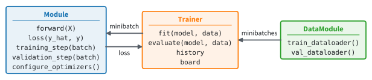
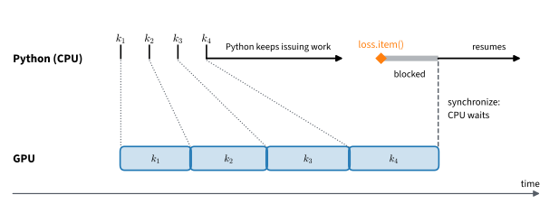

```{.python .input}
%load_ext d2lbook.tab
tab.interact_select('mxnet', 'pytorch', 'tensorflow', 'jax')
```

# Object-Oriented Design for Implementation
:label:`sec_oo-design`

Minibatch stochastic gradient descent, as :numref:`sec_linear_regression`
described it, trains a model with a loop that is the same every time. The
loop runs for a number of *epochs*, each of them one pass over the training
data. In every epoch we draw minibatches, and for each minibatch we compute
the loss, its gradient, and an update of the parameters. After the epoch we
compute the loss on validation data, examples held out from training, to see
how well the model predicts examples it was not trained on. Written out, the
loop reads as follows.

```text
for epoch in range(num_epochs):
    for X, y in train_data:                     # data
        loss = loss_fn(net(X), y)               # model and loss
        update(params, gradient(loss, params))  # optimizer
    val_loss = mean_loss(net, val_data)         # model on held-out data
    record(epoch, val_loss)
```

Only the lines with comments depend on the problem; the loop around them
never changes. Nearly thirty sections of this book train a model, most of
them in several frameworks, so a loop written out in each would exist in
close to a hundred copies. A change to how we train, such as clipping very
large gradients or lowering the learning rate as training proceeds, would
then have to be made in every copy, and the copies would drift apart.

We therefore give the loop a class of its own, written once, and put the
parts that change into two more classes, a design borrowed from libraries
such as [Lightning](https://lightning.ai/):

* **`Module`** holds a model: its parameters, the `forward` computation of
  its predictions, its loss, and its *optimizer*, the object that applies an
  update rule such as minibatch SGD to the parameters. Every model in the
  book is a subclass.
* **`DataModule`** holds a dataset and serves its training and validation
  data in minibatches. Every dataset is a subclass.
* **`Trainer`** runs the loop. It takes minibatches from the `DataModule`,
  asks the `Module` for the loss on each, updates the parameters, and keeps a
  record of the losses.

In the loop above, the `DataModule` supplies `train_data` and `val_data`, the
`Module` supplies `net`, `loss_fn`, and the update rule, and the `Trainer`
runs the two `for` loops, computes the gradients, and records the losses.
:numref:`fig_oo_design` shows how the three work together. This section
writes the three base classes, and the next two sections fill them in for
linear regression: a dataset, then a model together with the two loops
inside the trainer.


:label:`fig_oo_design`

```{.python .input #oo-design-object-oriented-design-for-implementation}
%%tab mxnet
import collections
from d2l import mxnet as d2l
```

```{.python .input #oo-design-object-oriented-design-for-implementation}
%%tab pytorch
import collections
from d2l import torch as d2l
```

```{.python .input #oo-design-object-oriented-design-for-implementation}
%%tab tensorflow
import collections
from d2l import tensorflow as d2l
```

```{.python .input #oo-design-object-oriented-design-for-implementation}
%%tab jax
import collections
from d2l import jax as d2l
from flax import nnx
import jax
```

## Utilities
:label:`oo-design-utilities`

Two helpers make the classes of this book easier to write in a notebook. The
first concerns how the book presents code. Python defines a class in one
block of code, but a class with several methods is easier to explain in
several short cells, each next to the prose about it. The decorator
`add_to_class` registers a function as a method of a class that already
exists, so that one class definition can be spread over several cells. This
is notebook scaffolding, not a design we recommend: in an ordinary Python
module, a class is defined in one place.

```{.python .input #oo-design-utilities-1}
def add_to_class(Class):  #@save
    """Register functions as methods in created class."""
    def wrapper(obj):
        setattr(Class, obj.__name__, obj)
        return obj
    return wrapper
```

`add_to_class(Class)` returns a decorator, and the decorator stores the
function as an attribute of `Class` under the function's own name. To see it
at work, we define a class `A` and create an instance `a` while `A` has no
methods other than its constructor.

```{.python .input #oo-design-utilities-2}
class A:
    def __init__(self):
        self.b = 1

a = A()
```

In a separate cell we define a function `do` and register it with
`@add_to_class(A)`. Python looks up a method on the class at the moment it
is called, so `do` is available to the instance `a` that existed before
it. Inside `do`, `self` is that instance, and the method reads its attribute
`b` like a method written inside the class.

```{.python .input #oo-design-utilities-3}
@add_to_class(A)
def do(self):
    print('Instance attribute "b" is', self.b)

a.do()
```

The second helper removes repetitive code from constructors. A constructor
usually stores each of its arguments as an attribute: `self.lr = lr`,
`self.batch_size = batch_size`, and so on. These arguments are often
hyperparameters, settings such as the learning rate that we choose rather
than learn, hence the name of the class `HyperParameters`. Its method
`save_hyperparameters` stores all arguments of the constructor that calls
it.

```{.python .input #oo-design-utilities-4}
class HyperParameters:  #@save
    """The base class of hyperparameters."""
    def save_hyperparameters(self, ignore=None):
        raise NotImplementedError
```

Here we only declare the method. Its implementation in :numref:`sec_utils`
uses Python's `inspect` module to read the arguments of the method that
called it, and the `d2l` library holds the complete class. A class that
inherits from `d2l.HyperParameters` calls `save_hyperparameters` in its
constructor; arguments named in `ignore` are left out.

```{.python .input #oo-design-utilities-5}
class B(d2l.HyperParameters):
    def __init__(self, a, b, c):
        self.save_hyperparameters(ignore=['c'])
        print('self.a =', self.a, 'self.b =', self.b)
        print('self.c exists:', hasattr(self, 'c'))

b = B(a=1, b=2, c=3)
```

All classes in the rest of this section inherit from `HyperParameters`, so
their constructors store their arguments with a single call.

## Models
:label:`subsec_oo-design-models`

A model in this book is a subclass of `Module`. The subclass creates its
parameters in its constructor and defines two methods: `forward`, which
computes the predictions for a minibatch of inputs, and `loss`, which
compares predictions with labels. (By default, `forward` applies `self.net`,
a network that the constructor of a subclass may store.) A third method,
`configure_optimizers`, returns the optimizer that updates the parameters;
for linear regression it is minibatch SGD with learning rate $\eta$.
`Module` inherits from `d2l.nn_Module`, the library's name for the base
class of networks in each framework, and from `HyperParameters`.

From `forward` and `loss`, the base class builds the two steps that the
trainer calls. A minibatch is a tuple whose last element holds the labels
and whose other elements hold the inputs. `training_step` therefore computes
`self.loss(self(*batch[:-1]), batch[-1])`: calling the model on the inputs
runs `forward`, and `loss` compares the predictions with the labels.
`validation_step` computes the same quantity on a minibatch of validation
data. Both steps *return* their result and do nothing else.

A step returns either the mean loss over the minibatch or a dictionary of
such minibatch means, for instance the loss and the accuracy of a classifier
in :numref:`chap_classification`. A dictionary returned by `training_step`
must contain the key `'loss'`, the quantity that is differentiated. The
values must be means, not sums: to average over an epoch, the trainer
multiplies each value by the number of examples in its minibatch, so a loss
summed over a minibatch of 32 examples would enter the average 32 times too
large. Averaging over the epoch, recording, and plotting are left to the
`Trainer`.

```{.python .input #oo-design-models}
%%tab pytorch, mxnet
class Module(d2l.nn_Module, d2l.HyperParameters):  #@save
    """The base class of models."""
    def loss(self, y_hat, y):
        raise NotImplementedError

    def forward(self, X):
        assert hasattr(self, 'net'), 'Neural network is not defined'
        return self.net(X)

    def training_step(self, batch):
        """The loss on one batch, or a dict of metrics with key 'loss'."""
        return self.loss(self(*batch[:-1]), batch[-1])

    def validation_step(self, batch):
        """The loss on one batch, or a dict of batch-mean metrics."""
        return self.loss(self(*batch[:-1]), batch[-1])

    def configure_optimizers(self):
        raise NotImplementedError
```

```{.python .input #oo-design-models}
%%tab tensorflow
class Module(d2l.nn_Module, d2l.HyperParameters):  #@save
    """The base class of models."""
    def __init__(self):
        super().__init__()
        self.training = None
        self.__dict__.pop('loss', None)

    def loss(self, y_hat, y):
        raise NotImplementedError

    def forward(self, X):
        assert hasattr(self, 'net'), 'Neural network is not defined'
        return self.net(X)

    def call(self, X, *args, training=None, **kwargs):
        if training is not None:
            self.training = training
        return self.forward(X, *args, **kwargs)

    def training_step(self, batch):
        """The loss on one batch, or a dict of metrics with key 'loss'."""
        return self.loss(self(*batch[:-1], training=True), batch[-1])

    def validation_step(self, batch):
        """The loss on one batch, or a dict of batch-mean metrics."""
        return self.loss(self(*batch[:-1], training=False), batch[-1])

    def configure_optimizers(self):
        raise NotImplementedError
```

```{.python .input #oo-design-models}
%%tab jax
class Module(d2l.nn_Module, d2l.HyperParameters):  #@save
    """The base class of models."""
    def loss(self, y_hat, y):
        raise NotImplementedError

    def forward(self, X, *args, **kwargs):
        assert hasattr(self, 'net'), 'Neural network is not defined'
        return self.net(X, *args, **kwargs)

    def __call__(self, X, *args, **kwargs):
        return self.forward(X, *args, **kwargs)

    def training_step(self, batch):
        """The loss on one batch, or a dict of metrics with key 'loss'."""
        return self.loss(self(*batch[:-1]), batch[-1])

    def validation_step(self, batch):
        """The loss on one batch, or a dict of batch-mean metrics."""
        return self.loss(self(*batch[:-1]), batch[-1])

    def configure_optimizers(self):
        raise NotImplementedError
```

:begin_tab:`mxnet`
`Module` is a subclass of `nn.Block`, the base class of neural networks in
Gluon. Calling an instance, `model(X)`, runs its `forward` method, and
`nn.Block` keeps track of the parameters of the blocks that a subclass
stores as attributes. :numref:`sec_model_construction` describes `nn.Block`
in detail.
:end_tab:

:begin_tab:`pytorch`
`Module` is a subclass of `nn.Module`, the base class of neural networks in
PyTorch. Calling an instance, `model(X)`, runs its `forward` method, and
`nn.Module` keeps track of the parameters and layers that a subclass stores
as attributes. :numref:`sec_model_construction` describes `nn.Module` in
detail.
:end_tab:

:begin_tab:`tensorflow`
`Module` is a subclass of `tf.keras.Model`, the base class of neural
networks in Keras. Calling an instance runs its method `call`, which we
redirect to `forward`, the name used throughout the book, passing on all
arguments except `training`. The training step
passes `training=True` and the validation step `training=False`, as Keras's
own training loop does. `call` stores this flag in `self.training`, so that
a forward computation that behaves differently during training, such as the
dropout written from scratch in a later chapter, can read it. The
constructor removes an attribute `loss` that Keras 3 sets to `None`, since
it would hide the method `loss` of our subclasses.
:end_tab:

:begin_tab:`jax`
`Module` is a subclass of `nnx.Module`, the base class of networks in Flax
NNX. An NNX module is an ordinary Python object: its constructor creates the
parameters and stores them, together with any child modules, as attributes.
We redirect `__call__` to `forward`, the name used throughout the book, so
that `model(X)` runs `forward`. Later, `nnx.jit` and `nnx.grad` follow these
attributes to compile and differentiate the steps, without a separate
dictionary of parameters.
:end_tab:

A step may return a single loss or a dictionary. The function `as_metrics`
turns either into a dictionary, so that the trainer handles both in the same
way.

```{.python .input #oo-design-models-1}
def as_metrics(out):  #@save
    """A step returns a loss or a dict of metrics; return a dict."""
    return out if isinstance(out, dict) else {'loss': out}
```

## Data
:label:`oo-design-data`

A dataset in this book is a subclass of `DataModule`. Its constructor
prepares the data, downloading and preprocessing it if needed; the argument
`root` names the directory for downloaded files, and `num_workers` the number
of processes that load data in parallel. A subclass implements one method,
`get_dataloader(train)`. It returns a *data loader*, an object that yields
the data one minibatch at a time when we iterate over it, as the tuples that
the steps of `Module` expect. `train_dataloader` returns the loader for the
training data and `val_dataloader` the loader for the validation data.

```{.python .input #oo-design-data}
class DataModule(d2l.HyperParameters):  #@save
    """The base class of data."""
    def __init__(self, root='../data', num_workers=4):
        self.save_hyperparameters()

    def get_dataloader(self, train):
        raise NotImplementedError

    def train_dataloader(self):
        return self.get_dataloader(train=True)

    def val_dataloader(self):
        return self.get_dataloader(train=False)
```

## Training
:label:`oo-design-training`

### The Training Loop and the History

The `Trainer` class fits the parameters of a `Module` to the data of a
`DataModule`. Its constructor takes the number of epochs, `max_epochs`; the
arguments `num_gpus` and `gradient_clip_val` serve later chapters, which
train on GPUs and clip large gradients. The constructor also creates a
progress board, on which the trainer plots the losses during training; we
define it below. Training begins with three preparations, each a method
that later sections or frameworks override: `prepare_data` asks the
`DataModule` for its data loaders, `prepare_model` readies the model (later
it moves the model to a GPU), and `prepare_optimizer` calls the model's
`configure_optimizers`. The two loops over the data, `fit_epoch` for one
epoch of training and `validate` for one pass over the validation data,
depend on how each framework computes gradients. They are left abstract
here and written in :numref:`sec_linear_scratch`.

```{.python .input #oo-design-training}
class Trainer(d2l.HyperParameters):  #@save
    """Fit a Module to a DataModule, keeping a per-epoch history."""
    def __init__(self, max_epochs, num_gpus=0, gradient_clip_val=0):
        self.save_hyperparameters()
        self.board = ProgressBoard(xlabel='epoch', ylabel='loss')

    def prepare_data(self, data):
        self.train_dataloader = data.train_dataloader()
        self.val_dataloader = data.val_dataloader()

    def prepare_model(self, model):
        self.model = model

    def prepare_optimizer(self, model):
        self.optim = model.configure_optimizers()

    def fit_epoch(self):
        """Train for one epoch; return the mean of each training metric."""
        raise NotImplementedError

    def validate(self):
        """Return the mean of each metric over the validation set."""
        raise NotImplementedError
```

The method `fit` trains a `model`, an instance of `Module`, on `data`, an
instance of `DataModule`. After the three preparations it runs `max_epochs`
epochs. In each, `fit_epoch` updates the parameters once per minibatch and
returns the mean of every quantity that `training_step` reports, and
`validate` returns the means over the validation data. The method `record`
keeps these means.

```{.python .input #oo-design-training-1}
@d2l.add_to_class(Trainer)  #@save
def fit(self, model, data):
    self.prepare_data(data)
    self.prepare_model(model)
    self.prepare_optimizer(model)
    self.history = collections.defaultdict(list)
    self.board.clear()
    self.board.xlim = [0, self.max_epochs]
    for self.epoch in range(self.max_epochs):
        # The training mean averages over the epoch, so it sits mid-epoch
        self.record('train', self.fit_epoch(), x=self.epoch + 0.5)
        if self.val_dataloader is not None:
            self.record('val', self.validate(), x=self.epoch + 1)
        self.board.show(final=False)
    self.board.show()

@d2l.add_to_class(Trainer)  #@save
def record(self, split, metrics, x):
    for name in sorted(metrics, key=lambda name: (name != 'loss', name)):
        self.history[f'{split}_{name}'].append(metrics[name])
        self.board.draw(x, metrics[name], f'{split}_{name}')
```

`fit` stores the epoch in the attribute `self.epoch`, so that the methods it
calls can read it. It skips validation when the `DataModule` has no
validation data, that is, when `val_dataloader` returns `None`. After every
epoch, `self.board.show(final=False)` redraws the board, and the final
`show()` draws it once more after training; the book build skips the
intermediate redraws.

`record` appends each mean to `trainer.history`, a dictionary of lists
whose keys combine the part of the data with the name of the quantity:
`'train_loss'`, `'val_loss'`, and, for a classifier, `'val_acc'`. `fit`
itself returns nothing. `record` takes the loss first and the other metrics
in alphabetical order, so that a curve keeps its color and line style on the
board from one model to the next, whatever order a step reports its metrics
in. After training, `trainer.history['val_loss'][-1]` is
the validation loss after the last epoch, and code that compares several
runs reads its results from `trainer.history`.

### Epoch Means

The means that `fit_epoch` and `validate` return are averages over
examples, not over minibatches: each minibatch counts in proportion to its
size. This matters for the last minibatch of a pass over the data, which is
smaller whenever the minibatch size does not divide the number of examples.
For instance, 1,000 examples in minibatches of 32 make 31 full minibatches
and one of 8. If the trainer averaged the 32 minibatch means with equal
weights, each of the last 8 examples would count four times as much as an
example in a full minibatch.

The model's steps return their means and the trainer averages and records
them, for two reasons. The first is that the model stays free of training
machinery. Lightning, whose design we otherwise follow, lets a step log its
own loss with `self.log`, which requires a reference to the trainer inside
the model. Here nothing in a model refers to the trainer or to the board.
Any loop, not only `fit`, can train or evaluate a model, and a model built
from the layers of a framework saves its parameters with that framework's
own tools (`state_dict` in PyTorch, `save_weights` in Keras, `nnx.state` in
Flax, `save_parameters` in Gluon).

The second reason is speed. A GPU runs *asynchronously*: Python places
operations in the device's queue and continues without waiting for them to
finish. Converting a loss into a Python number, to print or to plot it,
makes Python wait until the device has computed that loss, and the device
then idles until Python sends more work. A step that printed or plotted its
own loss would therefore make Python wait once per minibatch. A step that
returns its loss as an array on the device lets the trainer choose when to
convert: it adds up the returned losses on the device and converts the sums
into Python numbers once per epoch. :numref:`sec_linear_scratch` shows this
accumulation in `fit_epoch`, and :numref:`subsec_async_dispatch` measures
what a conversion costs.

### The Progress Board

`record` also adds each mean to the progress board, which `fit` redraws
after every epoch so that we can watch training in a notebook. The class
`ProgressBoard` keeps one list of points per curve: `draw(x, y, label)`
appends the point `(x, y)` to the curve named `label`, `show` redraws all
curves, and `clear` forgets them. The drawing code is in :numref:`sec_utils`.
The board belongs to the trainer and can be configured before training, for
instance with `trainer.board.yscale = 'log'` for a logarithmic loss axis, or
with `trainer.board.display = False` to train without plotting.

The two curves on the board are computed with different parameters. The
validation mean uses the parameters at the end of the epoch, while the
training mean averages over minibatches seen while the parameters changed
during the epoch. `fit` therefore draws the training mean of each epoch at
the middle of the epoch, at 0.5 for the first epoch, 1.5 for the second, and
so on, and the validation mean at the end of the epoch, at 1, 2, and so on.

```{.python .input #oo-design-utilities-6}
class ProgressBoard(d2l.HyperParameters):  #@save
    """Curves that grow during training; `show` redraws them."""
    def __init__(self, xlabel=None, ylabel=None, xlim=None, ylim=None,
                 xscale='linear', yscale='linear', figsize=(3.5, 2.5),
                 display=True):
        self.save_hyperparameters()
        self.clear()

    def clear(self):
        """Forget all curves; the next `show` starts a new figure."""
        self.data, self.handle = {}, None

    def draw(self, x, y, label):
        """Append the point (x, y) to the curve called `label`."""
        xs, ys = self.data.setdefault(label, ([], []))
        xs.append(x)
        ys.append(y)

    def show(self, final=True):
        raise NotImplementedError
```

### Evaluation

Validation metrics are also needed outside `fit`, for instance to evaluate a
trained model once on a test set. `evaluate` asks `data` for its validation
loader only, readies the model, and returns the means of the metrics of
`model` over `data.val_dataloader()`. It sets the training loader to `None`,
so `data` needs no training data, and nothing in the evaluation draws a
training minibatch. The keys of the dictionary are those that
`validation_step` reports, without the prefix that `history` adds:
`{'loss': ...}` rather than `'val_loss'`.

```{.python .input #oo-design-training-2}
@d2l.add_to_class(Trainer)  #@save
def evaluate(self, model, data):
    """Validation metrics of `model` on `data`, averaged over examples."""
    self.train_dataloader = None
    self.val_dataloader = data.val_dataloader()
    self.prepare_model(model)
    return self.validate()
```

### Optimizers and Schedules

Minibatch SGD with a constant learning rate does not settle at the
minimizer. It keeps fluctuating around it, and lowering the learning rate as
training proceeds, following a schedule, makes the fluctuations smaller
(:numref:`fig_linreg_gd_sgd`). Each framework attaches a schedule to the
optimizer in its own way.

:begin_tab:`pytorch`
PyTorch implements a schedule as a separate scheduler object. The method
`configure_optimizers` may therefore return a pair `(optimizer, scheduler)`.
`prepare_optimizer` unpacks it, and `fit_epoch` calls `scheduler.step()`
after every update.
:end_tab:

:begin_tab:`jax`
In JAX, an optax schedule is passed to the optimizer as its learning rate,
so `configure_optimizers` returns a single optax transformation with or
without a schedule. The trainer wraps it in an `nnx.Optimizer`, which keeps
the state of the optimizer next to the model it updates. It also keeps the
most recent transformation in `optimizer_cache`. The key is the structure of
the model, `jax.tree.structure(model)`, which is everything about the model
except the values of its arrays, including hyperparameters such as `lr`,
together with the method `configure_optimizers` itself, so that redefining
the method gives a new key. A later `fit` of a model with the same structure
and hyperparameters reuses the transformation, and with it the compiled
training step of :numref:`sec_linear_scratch`. This is correct only if
`configure_optimizers` depends on nothing but the model's attributes, as it
does throughout the book. The cache holds a single entry, because a
transformation, such as a schedule that reads `self.lr`, may refer to the
model that created it. `prepare_model` creates
two *views* of the model, one for training and one for validation, in which
layers that behave differently during training, such as the dropout of a
later chapter, are set to the corresponding mode. Both views share the
parameters of `model`.
:end_tab:

:begin_tab:`tensorflow`
In TensorFlow, a Keras schedule is passed to the optimizer as its learning
rate, so the default `prepare_optimizer` suffices. `prepare_model` also
compiles the training and validation steps with `tf.function`; we write it
together with the steps in :numref:`sec_linear_scratch`.
:end_tab:

:begin_tab:`mxnet`
In MXNet, a schedule is passed to the Gluon optimizer as its
`lr_scheduler`, so the default `prepare_optimizer` suffices.
:end_tab:

```{.python .input #oo-design-training-3}
%%tab pytorch
@d2l.add_to_class(Trainer)  #@save
def prepare_optimizer(self, model):
    """`configure_optimizers` may also return a learning-rate scheduler."""
    optim = model.configure_optimizers()
    self.optim, self.scheduler = (optim if isinstance(optim, tuple)
                                  else (optim, None))
```

```{.python .input #oo-design-training-3}
%%tab jax
@d2l.add_to_class(Trainer)  #@save
def prepare_model(self, model):
    self.model = model
    self.train_model = nnx.view(model, deterministic=False,
                                use_running_average=False,
                                raise_if_not_found=False)
    self.val_model = nnx.view(model, deterministic=True,
                              use_running_average=True,
                              raise_if_not_found=False)

#@save
optimizer_cache = {}  # The most recent optax transformation, by its key

@d2l.add_to_class(Trainer)  #@save
def prepare_optimizer(self, model):
    key = (jax.tree.structure(model), type(model).configure_optimizers)
    if key not in optimizer_cache:
        optimizer_cache.clear()  # One entry: it may refer to a model
        optimizer_cache[key] = model.configure_optimizers()
    self.optim = nnx.Optimizer(model, optimizer_cache[key], wrt=nnx.Param)
```

We now have a training loop that every model in the book can use, but
nothing for it to run: no dataset, no model, and no body for the two loops.
The next section supplies a dataset whose true parameters we know, and
:numref:`sec_linear_scratch` the linear regression model together with
`fit_epoch` and `validate`.

## Summary

Every model in this book is trained by the same loop, so we write it once
and keep it apart from what changes between models. A `Module` holds a
model, its loss, and its optimizer; a `DataModule` serves training and
validation data in minibatches; and a `Trainer` runs the loop. A model's
steps return the loss, or a dictionary of metrics, and do nothing else. The
trainer sums them on the device, averages them over the examples of each
epoch, keeps the epoch means in `trainer.history`, and draws them on its
progress board; `trainer.evaluate` computes the same means on the validation
loader of any `DataModule`. New models and
datasets are subclasses, written cell by cell with `add_to_class`, and a
change to training is made in one place.

## Exercises

1. [code] **Methods added later.** `add_to_class` stores a function on a
   class with `setattr(Class, obj.__name__, obj)`.
    1. Register a second method `do` on class `A` with a different body.
       Predict which version `a.do()` runs, then check.
    1. Attach a function `greet(self)` to the instance instead, with
       `setattr(a, 'greet', greet)`, and call `a.greet()`. Explain the
       error, and why the same function works when it is stored on the
       class.

1. [code] **Saving hyperparameters.** `save_hyperparameters` is
   implemented in :numref:`sec_utils` with Python's `inspect` module, which
   gives it access to the local variables of the method that calls it.
    1. Insert the line `d = 4` before the call of `save_hyperparameters` in
       the constructor of `B`. Predict whether `self.d` exists after
       construction, then check.
    1. Implement a version of `save_hyperparameters` that receives the
       values to store as explicit arguments instead of reading the
       caller's local variables. Change `B` to use it, and verify that
       `self.a` and `self.b` exist and `self.c` does not.
    1. State one thing the `inspect`-based version provides that your
       version gives up, and one mistake that your version rules out.

1. **Optimizer and model.** The `Module` class keeps the optimizer in
   `configure_optimizers`, a *method of the model*, rather than passing it
   as an argument to `Trainer`. State the advantages of this design choice,
   and describe a training setup in which putting the optimizer on the
   model becomes awkward.

1. **Reading the training curves.** The trainer draws the mean training
   loss of each epoch at the middle of the epoch and the validation loss
   at its end.
    1. Early in training, the training curve often lies above the
       validation curve, although both sets of examples come from the same
       distribution. Explain why from the way the two means are computed.
    1. Suppose `fit` computed the training loss like the validation loss,
       with the parameters at the end of each epoch. What would this cost
       per epoch, and what would the gap between the two curves then
       measure?

1. [code] **Early stopping.** Training for a fixed number of epochs may
   stop too early or too late. Write a subclass of `d2l.Trainer` whose
   `fit` ends training once the validation loss has not decreased for
   `patience` consecutive epochs, deciding from `self.history` alone.
   Explain why no model or dataset class has to change. Once
   :numref:`sec_linear_scratch` supplies `fit_epoch` and `validate`, test
   your trainer on the synthetic regression data with a large
   `max_epochs`.

1. [code] **Test split.** Once :numref:`sec_linear_scratch` supplies
   `validate`, `trainer.evaluate(model, data)` returns the metrics of
   `model` over `data.val_dataloader()`. Write a subclass of
   `d2l.SyntheticRegressionData` whose constructor also draws a test set
   from the same distribution and whose `val_dataloader` serves it. Train
   a model on the original data, and evaluate it once on
   the test set after the last epoch. Explain why the test set is evaluated
   once at the end rather than after every epoch like the validation data,
   and what would go wrong if the epoch with the best test loss were
   reported. :numref:`sec_generalization_basics` returns to this question.

1. [code] **Synchronizing every minibatch.** ● The `Trainer` adds up the
   minibatch losses on the device and converts them into Python numbers
   once per epoch. Once :numref:`sec_linear_scratch` supplies `fit_epoch`,
   write a variant that calls `float()` on the loss of every minibatch and
   accumulates the Python numbers instead.
    1. Time one epoch of both versions on a GPU for linear regression with
       2 features and with about $10^4$ features, and explain the
       differences you measure with the asynchronous execution described
       in this section.
    1. Repeat the timing on a CPU. State under which conditions the
       per-minibatch conversion is measurably slower and when the two
       versions are indistinguishable.

:begin_tab:`mxnet`
[Discussions](https://d2l.discourse.group/t/6645)
:end_tab:

:begin_tab:`pytorch`
[Discussions](https://d2l.discourse.group/t/6646)
:end_tab:

:begin_tab:`tensorflow`
[Discussions](https://d2l.discourse.group/t/6647)
:end_tab:

:begin_tab:`jax`
[Discussions](https://d2l.discourse.group/t/17974)
:end_tab:

<!-- slides -->

::: {.slide}
::: {.cover}
[Dive into Deep Learning · §2.2]{.kicker}

One training loop for every model<br>
**Module · DataModule · Trainer · steps that return values · trainer.history**
:::
:::

::: {.slide title="Writing the Loop in Every Section Would Make Close to 100 Copies"}
[The problem]{.kicker}

```{.python #oo-design-exercises-3}
for epoch in range(num_epochs):
    for X, y in train_data:                     # data
        loss = loss_fn(net(X), y)               # model and loss
        update(params, gradient(loss, params))  # optimizer
    val_loss = mean_loss(net, val_data)         # model on held-out data
    record(epoch, val_loss)
```

- Only the commented lines change between models; the loop does not.
- Nearly 30 sections of the book train a model, most in several
  frameworks.

::: {.d2l-note}
Clipping gradients or lowering the learning rate would mean editing every
copy. Write the loop **once**.
:::
:::

::: {.slide title="By the End of This Deck You Can"}
[Goals]{.kicker}

- say which part of training `Module`, `DataModule`, and `Trainer` own;
- write a model whose steps return the mean loss of a minibatch;
- compute an epoch mean that counts every example equally;
- read `trainer.history` after training, and evaluate with
  `trainer.evaluate`;
- explain why the trainer reads losses once per epoch;
- split a class across notebook cells with `add_to_class`.

**Running example:** linear regression with $\mathbf{w}^* = (2, -3.4)$,
$b^* = 4.2$; 1,000 training and 1,000 validation examples in minibatches
of 32. The next two decks plug it into these classes.
:::

::: {.slide title="Three Classes Turn the Algorithm Into Reusable Code"}
[Where this fits]{.kicker}

::: {.cols .vc}
::: {.col}
| section | adds |
|---|---|
| Linear Regression | model, loss, closed form, minibatch SGD |
| **Object-Oriented Design** | **`Module`, `DataModule`, `Trainer`** |
| Synthetic Regression Data | data with known $\mathbf{w}^*, b^*$ |
| Implementation from Scratch | SGD and the training loop by hand |
| Concise Implementation | framework layers and losses |
| Generalization | training vs. test error |
| Weight Decay | a penalty on large weights |
:::

::: {.col .narrow}
- **Uses:** the minibatch SGD loop; Python classes and inheritance.
- **Skips:** the drawing code of the progress board; compilation and
  asynchronous execution in depth, covered in the chapter on computation.
:::
:::
:::

::: {.slide}
::: {.divider}
[01]{.dnum}

[Three classes]{.dtitle}

[the model · the data · the loop]{.dsub}
:::
:::

::: {.slide title="Each Line of the Loop Has One Owner"}
[Three classes]{.kicker}

{.nostretch width=90%}

| in the loop | owner | through |
|--------------------------|-----------|------------------------------|
| `train_data`, `val_data` | `DataModule` | `train_dataloader()`, `val_dataloader()` |
| `net`, `loss_fn`, the update rule | `Module` | `forward`, `loss`, `configure_optimizers()` |
| both `for` loops, gradients, `record` | `Trainer` | `fit`, `history` |
:::

::: {.slide title="A Model's Steps Return the Mean Loss and Do Nothing Else"}
[Module]{.kicker}

| method | returns | called |
|---|---|---|
| `forward(X)` | predictions | inside the steps |
| `loss(y_hat, y)` | the mean loss over the minibatch | inside the steps |
| `training_step(batch)` | the loss, or a dict with key `'loss'` | per training minibatch |
| `validation_step(batch)` | the loss, or a dict of metrics | per validation minibatch |
| `configure_optimizers()` | the optimizer; in PyTorch optionally `(optimizer, scheduler)` | once, before training |

A minibatch is a tuple `(inputs..., labels)`. The default step computes
`self.loss(self(*batch[:-1]), batch[-1])`.
:::

::: {.slide title="Module Inherits From Each Framework's Network Class"}
[Module]{.kicker}

| framework | `Module` subclasses | `model(X)` runs | parameters are found |
|---|---|---|---|
| PyTorch | `nn.Module` | `forward` | from attributes, by `nn.Module` |
| TensorFlow | `tf.keras.Model` | `call`, redirected to `forward` | from attributes, by Keras |
| JAX | `nnx.Module` | `__call__`, redirected to `forward` | from attributes, by `nnx.jit` and `nnx.grad` |
| MXNet | `nn.Block` | `forward` | from child blocks, by `nn.Block` |

- `Module` also inherits from `HyperParameters`, which stores constructor
  arguments.
- Every framework's model defines `forward`, the name the book uses.
:::

::: {.slide title="Keras Calls call, So Module Redirects It to forward" only="tensorflow"}
[Module · TensorFlow]{.kicker}

```{.python #oo-design-exercises-4}
def call(self, X, *args, training=None, **kwargs):
    if training is not None:
        self.training = training
    return self.forward(X, *args, **kwargs)

def training_step(self, batch):
    return self.loss(self(*batch[:-1], training=True), batch[-1])
```

- `validation_step` passes `training=False`, as Keras's own loop does;
  dropout, written later, reads `self.training`.
- Keras 3 sets an attribute `loss = None`; the constructor deletes it so
  that the method `loss` is found.
:::

::: {.slide title="A Summed Loss Would Enter the Epoch Mean 32× Too Large"}
[Module]{.kicker}

The trainer multiplies each step's value by the minibatch size $n_b$,
adds, and divides by the number of examples. Every example has loss
0.01; minibatches of 32:

| the step returns | the trainer adds | epoch mean reported |
|---|---|---|
| the mean, $0.01$ | $32 \times 0.01 = 0.32$ | $0.01$ |
| the sum, $0.32$ | $32 \times 0.32 = 10.24$ | $\approx 0.32$ |

- With the last minibatch of 8:
  $(31 \cdot 10.24 + 8 \cdot 0.08)/1000 \approx 0.318$.
- So a step returns minibatch **means**; all averaging over the epoch is
  the trainer's job.

::: {.d2l-note .warn}
The gradient of a sum is also 32× larger: the model would train as if the
learning rate were 32× larger.
:::
:::

::: {.slide title="A DataModule Serves Minibatches Through One Method"}
[DataModule]{.kicker}

```{.python #oo-design-exercises-5}
class DataModule(d2l.HyperParameters):
    def get_dataloader(self, train):     # each dataset writes this
        raise NotImplementedError

    def train_dataloader(self):
        return self.get_dataloader(train=True)

    def val_dataloader(self):
        return self.get_dataloader(train=False)
```

- A **data loader** yields one minibatch, a tuple `(X, y)`, at a time.
- **Validation data:** examples held out from training, which measure
  prediction on examples the model has not seen.
:::

::: {.slide title="Check: Which Class Holds Each Setting?"}
[Check]{.kicker}

The running example trains for 10 epochs with learning rate
$\eta = 0.03$. Which class holds

1. the learning rate $\eta = 0.03$?
2. the minibatch size 32?
3. the 10 epochs?
4. the true $\mathbf{w}^*$ and the noise level $\sigma = 0.01$?
5. the squared loss?

::: {.fragment .fade-up}
::: {.d2l-note}
**Answers.** (1) `Module`: the optimizer from `configure_optimizers`.
(2) `DataModule`. (3) `Trainer`: `max_epochs`. (4) `DataModule`: the
synthetic data. (5) `Module`: its `loss`.
:::
:::
:::

::: {.slide}
::: {.divider}
[02]{.dnum}

[The trainer]{.dtitle}

[the loop · epoch means · history · evaluation]{.dsub}
:::
:::

::: {.slide title="The Trainer Writes the Loop Once"}
[Trainer]{.kicker}

```{.python #oo-design-exercises-1}
def fit(self, model, data):
    ...  # prepare the data, the model, and the optimizer
    self.history = collections.defaultdict(list)
    for self.epoch in range(self.max_epochs):
        # The training mean averages over the epoch: draw it mid-epoch
        self.record('train', self.fit_epoch(), x=self.epoch + 0.5)
        self.record('val', self.validate(), x=self.epoch + 1)
        self.board.show(final=False)
```

- `fit_epoch` and `validate` return the epoch means. They depend on how
  a framework computes gradients: the from-scratch deck writes them.
- The training mean uses parameters that change during the epoch: drawn
  at 0.5, 1.5, …; validation at 1, 2, ….
:::

::: {.slide title="history Keys Join the Split and the Metric Name"}
[Trainer]{.kicker}

A step returns a loss or a dict; `as_metrics` turns both into a dict:

@oo-design-models-1

```{.python #oo-design-exercises-6}
def record(self, split, metrics, x):
    for name in sorted(metrics, key=lambda name: (name != 'loss', name)):
        self.history[f'{split}_{name}'].append(metrics[name])
        self.board.draw(x, metrics[name], f'{split}_{name}')
```

- Keys: `'train_loss'`, `'val_loss'`; a classifier adds `'val_acc'`.
- The loss comes first, then the other metrics alphabetically: each curve
  keeps its color from model to model.
- `fit` returns nothing: read `trainer.history['val_loss'][-1]`.
:::

::: {.slide title="Weighting by Size Counts Every Example 1/1,000"}
[Epoch means]{.kicker}

1,000 examples in minibatches of 32: 31 full ones and one of 8.

| how the epoch mean is formed | one example of a full minibatch | one of the last 8 |
|---|---|---|
| minibatch means, equal weights | $1/32 \cdot 1/32 = 1/1024$ | $1/32 \cdot 1/8 = 1/256$ |
| weighted by size (the trainer) | $1/1000$ | $1/1000$ |

::: {.d2l-note}
Equal weights count each of the last 8 examples **4×** as much as the
others. The trainer adds $n_b \times$ mean and divides by 1,000.
:::
:::

::: {.slide title="Check: What Does the Trainer Report?"}
[Check]{.kicker}

Validation: 1,000 examples, minibatches of 32. The 31 full minibatches have
mean loss 0.010 and the last one, of 8 examples, mean loss 0.050.

1. Which epoch mean does the trainer report?
2. Which would equal weights per minibatch report?

::: {.fragment .fade-up}
::: {.d2l-note}
**Answers.** (1) $(992 \cdot 0.010 + 8 \cdot 0.050)/1000 \approx 0.0103$.
(2) $(31 \cdot 0.010 + 0.050)/32 \approx 0.0113$: 9% too high, because 8
examples count as much as 32.
:::
:::
:::

::: {.slide title="The Device Runs Ahead, So the Trainer Reads Losses Once per Epoch"}
[Speed]{.kicker}

{.nostretch width=75% fig-align="center"}

- `float(loss)` makes Python **wait** for the queue (drawn: PyTorch's
  `loss.item()`).
- The trainer sums the returned losses **on the device**: one wait per
  epoch, not 32.
:::

::: {.slide title="Nothing in a Model Refers to the Trainer"}
[Design]{.kicker}

```{.python #oo-design-exercises-7}
# Lightning: the step logs, so the model needs a trainer
def training_step(self, batch):
    loss = self.loss(self(*batch[:-1]), batch[-1])
    self.log('train_loss', loss)
    return loss

# This book: the step only returns
def training_step(self, batch):
    return self.loss(self(*batch[:-1]), batch[-1])
```

- Any loop can train or evaluate the model, not only `fit`.
- It saves with its framework's tools: `state_dict`, `save_weights`,
  `nnx.state`, `save_parameters`.
:::

::: {.slide title="evaluate Gives the Validation Means of Any Model on Any Data"}
[Trainer]{.kicker}

```{.python #oo-design-exercises-8}
def evaluate(self, model, data):
    self.train_dataloader = None
    self.val_dataloader = data.val_dataloader()
    self.prepare_model(model)
    return self.validate()
```

- Returns `{'loss': ...}`: the keys of `validation_step`, without the
  prefix `'val_'` that `history` adds.
- Only the validation loader is asked for: `data` needs no training data.
- Typical use: a test set, evaluated once after training.
:::

::: {.slide title="A Learning-Rate Schedule Attaches to the Optimizer"}
[Optimizers]{.kicker}

Constant $\eta$: minibatch SGD keeps fluctuating around the minimizer.
Lowering $\eta$ during training shrinks the fluctuations.

| framework | `configure_optimizers` returns | the schedule |
|---|---|---|
| PyTorch | an optimizer, or `(optimizer, scheduler)` | `scheduler.step()` after every update |
| TensorFlow | a Keras optimizer | a Keras schedule as the learning rate |
| JAX | an optax transformation | an optax schedule as the learning rate |
| MXNet | a Gluon optimizer | its `lr_scheduler` |

::: {.d2l-note}
The model chooses its optimizer; the trainer only calls it.
:::
:::

::: {.slide title="In JAX the Trainer Also Holds the Optimizer State and Two Views" only="jax"}
[Trainer · JAX]{.kicker}

```{.python #oo-design-exercises-2}
tx = model.configure_optimizers()       # an optax transformation
self.optim = nnx.Optimizer(model, tx, wrt=nnx.Param)
self.train_model = nnx.view(model, deterministic=False, ...)
self.val_model = nnx.view(model, deterministic=True, ...)
```

- `nnx.Optimizer` keeps the optimizer state next to the model it updates.
- The last `tx` is cached by `jax.tree.structure(model)` and the method
  `configure_optimizers`: a later `fit` of a model with the same structure
  and hyperparameters reuses the compiled training step.
- The two views share the parameters; layers such as dropout read the
  mode from them.
:::

::: {.slide title="add_to_class Adds a Method to a Class That Already Exists"}
[Notebook utilities]{.kicker}

The book explains one class over several cells; a module defines it in
one place.

@oo-design-utilities-2

@oo-design-utilities-3

- Python looks up a method on the class when it is called, so `a`,
  created before `do`, has it.
:::

::: {.slide title="save_hyperparameters Stores Every Constructor Argument"}
[Notebook utilities]{.kicker}

@oo-design-utilities-5

- It reads the caller's arguments with Python's `inspect` module;
  `ignore` leaves some out.
- Every class in this deck inherits it: `Trainer(max_epochs=10)` has
  `self.max_epochs`.
:::

::: {.slide title="Check: Which Class Changes?"}
[Check]{.kicker}

Where does each change go?

1. Train a new network on a new dataset.
2. Report accuracy as well as the loss.
3. Lower the learning rate during training.
4. Stop when the validation loss stops improving.

::: {.fragment .fade-up}
::: {.d2l-note}
**Answers.** (1) New subclasses of `Module` and `DataModule`. (2) The
model's `validation_step` returns a dict with `'loss'` and `'acc'`. (3) The
optimizer that `configure_optimizers` returns (in PyTorch, with a scheduler
next to it). (4) `Trainer.fit`, once, for every model.
:::
:::
:::

::: {.slide title="Recap"}
[Wrap-up]{.kicker}

| class | owns | contract |
|-----------|----------------------|--------------------------------|
| `Module` | parameters, `forward`, `loss`, optimizer | steps **return** the mean loss or a dict of means |
| `DataModule` | training and validation data | `get_dataloader(train)` yields minibatches |
| `Trainer` | the loop, `history`, `board` | means over examples, read once per epoch |

- 1,000 examples in minibatches of 32: every example weighs 1/1,000, and
  the host waits once per epoch, not 32 times.
- `add_to_class` spreads a class over cells; `save_hyperparameters`
  stores constructor arguments.

**Next:** a dataset with known parameters, the first `DataModule`.
:::
