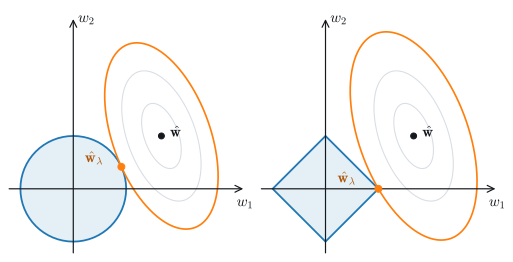
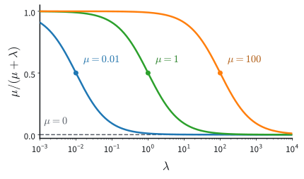

```{.python .input}
%load_ext d2lbook.tab
tab.interact_select('mxnet', 'pytorch', 'tensorflow', 'jax')
```

# Weight Decay
:label:`sec_weight_decay`

The polynomial of degree 19 in :numref:`sec_generalization_basics` passed
through its 20 noisy points by using weights of a million or more, and we
avoided it by choosing a lower degree on validation data. The degree,
however, is a coarse control. Each step adds whole features, and with 20
input variables there are 20 features of degree 1, 210 of degree 2, and
1,540 of degree 3. We would rather keep the features and stop the weights
from growing large.

Large weights do damage even in a model with two features. Suppose that the
features nearly duplicate each other, such as the same quantity measured by
two instruments, and that the label is close to their sum,
$y \approx x_1 + x_2$. The weights $(1, 1)$ fit the training data. The
weights $(501, -499)$ fit them almost as well: they predict
$x_1 + x_2 + 500\,(x_1 - x_2)$, and on the training examples the two
measurements differ only slightly. The data say almost nothing about how to
split the weight between the two features. Least squares settles the split
by fitting the noise in the labels, and since $x_1 - x_2$ is tiny, that
takes large weights of opposite sign. On a new example whose two
measurements differ by 2, the predictions of the two weight vectors differ
by 1,000.

This section adds to the loss a penalty on the size of the weights, whose
strength $\lambda$ we can set on a continuous scale. Among weight vectors
that fit the data about equally well, the penalized loss prefers the
smallest, $(1, 1)$ in the example. We see what the penalty does to a
gradient step, try it on a model with 200 features and 300 noisy examples,
and then ask which directions in weight space it shrinks.

```{.python .input #weight-decay}
%%tab mxnet
import math
import numpy as np
from mxnet import autograd, gluon, init, np as mnp, npx
from mxnet.gluon import nn
from d2l import mxnet as d2l
npx.set_np()
```

```{.python .input #weight-decay}
%%tab pytorch
import math
import numpy as np
import torch
from torch import nn
from torch.nn import functional as F
from d2l import torch as d2l
```

```{.python .input #weight-decay}
%%tab tensorflow
import math
import numpy as np
import tensorflow as tf
from d2l import tensorflow as d2l
```

```{.python .input #weight-decay}
%%tab jax
import math
import numpy as np
import jax
from jax import numpy as jnp
from flax import nnx
import optax
from d2l import jax as d2l
```

## Norm Penalties

### The Penalized Loss

The loss of linear regression in :numref:`sec_linear_regression` is the
average squared error over the $n$ training examples,

$$L(\mathbf{w}, b) = \frac{1}{n}\sum_{i=1}^n \frac{1}{2}\left(\mathbf{w}^\top \mathbf{x}^{(i)} + b - y^{(i)}\right)^2.$$

To penalize large weights, we add the squared $\ell_2$ norm
$\|\mathbf{w}\|^2 = \sum_j w_j^2$ of :numref:`subsec_lin-algebra-norms`,
scaled by a constant $\lambda \geq 0$, and minimize

$$L(\mathbf{w}, b) + \frac{\lambda}{2}\|\mathbf{w}\|^2.$$
:eqlabel:`eq_wd-objective`

The first term measures the errors on the training data and the second the
size of the weights. The *regularization constant* $\lambda$ weighs one
against the other. With $\lambda = 0$ we recover the original loss. As
$\lambda$ grows, the minimizer moves toward $\mathbf{w} = \mathbf{0}$, the
model that ignores its inputs and predicts $b$ everywhere. Note that the
training loss cannot choose $\lambda$ for us, since it is always lowest at
$\lambda = 0$. Like the degree of a polynomial in
:numref:`subsec_generalization-model-selection`, $\lambda$ is a
hyperparameter, chosen on validation data.

The factor $\frac{1}{2}$ is merely convenient: it makes the gradient of the
penalty $\lambda\mathbf{w}$. Leaving out the bias, by contrast, is
deliberate. Adding a constant to every label should move the fit by that
constant at no cost, whereas a penalty on $b$ would pull every prediction
toward zero rather than toward the average label.

A change to training whose purpose is to lower the error on new data rather
than on the training data is called *regularization*. The penalty
:eqref:`eq_wd-objective` is the most common regularizer in deep learning,
where it is called weight decay
:cite:`Hanson.Pratt.1988,Krogh.Hertz.1992` for a reason we see shortly.
Statisticians call linear regression with this penalty *ridge regression*
:cite:`Hoerl.Kennard.1970`.

What does a smaller norm change about the model? For a linear model, the
norm bounds how strongly the prediction can respond to a change of the
input: by the Cauchy--Schwarz inequality
$|\mathbf{u}^\top\mathbf{v}| \leq \|\mathbf{u}\|\,\|\mathbf{v}\|$ of
:numref:`sec_linear-algebra`, the predictions for two inputs $\mathbf{x}$
and $\mathbf{x}'$ differ by at most

$$|\mathbf{w}^\top \mathbf{x} - \mathbf{w}^\top \mathbf{x}'| \leq \|\mathbf{w}\|\, \|\mathbf{x} - \mathbf{x}'\|.$$

A model with small weights cannot amplify a small change of its input, such
as noise in a measurement. In the opening example, the weights $(1, 1)$
have norm $\sqrt{2} \approx 1.4$ and the weights $(501, -499)$ norm about
707, and only the second pair can turn a difference of 2 between the
measurements into a change of 1,000 in the prediction. This reading relies
on the model being linear, so that its weights are the slopes of the
function it computes; in the networks of later chapters, the same function
can be computed by parameters of very different norms.

### Weight Decay in the Gradient Step

What does the penalty do to training? Adding its gradient
$\lambda\mathbf{w}$ to the minibatch SGD update of
:numref:`subsec_linear-regression-minibatch-sgd`, with learning rate $\eta$
and minibatch $\mathcal{B}_t$, gives

$$\mathbf{w} \leftarrow (1 - \eta\lambda)\,\mathbf{w} - \frac{\eta}{|\mathcal{B}|} \sum_{i \in \mathcal{B}_t} \mathbf{x}^{(i)} \left(\mathbf{w}^\top \mathbf{x}^{(i)} + b - y^{(i)}\right),$$
:eqlabel:`eq_wd-update`

while the update of $b$ does not change. The update first multiplies the
weights by $1 - \eta\lambda$, a number slightly below one, and then takes
the usual step toward fitting the minibatch. Without the data term, the
weights would decay geometrically, to $(1 - \eta\lambda)^t$ times their
initial value after $t$ steps, which is why the method is called *weight
decay*. With $\eta = 0.05$ and $\lambda = \frac{1}{3}$, the values of our
experiment, each step keeps $1 - \frac{1}{60} \approx 98.3\%$ of the
weights, and an epoch of 15 steps keeps $0.983^{15} \approx 78\%$. The data
term pulls back wherever the training data favor nonzero weights, strongly
in some directions and weakly in others, and the weights settle where the
two pulls balance.

For minibatch SGD, adding $\frac{\lambda}{2}\|\mathbf{w}\|^2$ to the loss
and multiplying the weights by $1 - \eta\lambda$ in every step are the same
operation, and frameworks apply the decay inside the optimizer rather than
through the loss. The
two forms part ways for optimizers that rescale each coordinate of the
gradient (exercise :exref:`ex_weight-decay-shrinkage-vs-penalty`). Shrinking
the weights directly, whatever the optimizer does with the gradient, is
called *decoupled weight decay* :cite:`Loshchilov.Hutter.2019`, and
:numref:`sec_adamw` shows why the distinction matters for adaptive
optimizers.

### The $\ell_1$ Penalty and Sparsity

Other norms give other penalties. With the $\ell_1$ norm
$\|\mathbf{w}\|_1 = \sum_j |w_j|$ in place of the squared $\ell_2$ norm,
linear regression becomes *lasso* regression :cite:`Tibshirani.1996`. When
the two duplicated measurements of the opening agree, the weights $(1, 1)$
and $(2, 0)$ make the same predictions. The squared $\ell_2$ norm prefers
the even split, 2 against 4, while the $\ell_1$ norm is 2 for both and for
every split in between.

The difference is easiest to see with the penalty written as a constraint.
Minimizing the penalized loss is equivalent to minimizing $L$ subject to
$\|\mathbf{w}\| \leq s$ for ridge, or $\|\mathbf{w}\|_1 \leq s$ for lasso,
with a bound $s$ that depends on $\lambda$
(:numref:`subsec_mdl-weight-decay-duality`). The constrained solution
$\hat{\mathbf{w}}_\lambda$ is the point where the smallest contour of the
loss around the unconstrained minimizer $\hat{\mathbf{w}}$ touches the
constraint region (:numref:`fig_ridge_geometry`). The $\ell_2$ ball is
round, so the contact point usually has every coordinate nonzero: ridge
regression shrinks the weights but rarely sets one to zero. The $\ell_1$
ball is a diamond with its corners on the axes, and a contour often touches
it first at a corner, where some coordinates are zero. Lasso therefore
selects features, which helps when only a few of many features matter. The
rest of this section uses the $\ell_2$ penalty, whose minimizer has a
closed form.


:label:`fig_ridge_geometry`

### A Gaussian Prior on the Weights

The penalty also has a probabilistic reading, and with it comes an opinion
on how large $\lambda$ should be. In
:numref:`subsec_normal_distribution_and_squared_loss` we derived the
squared loss from Gaussian noise. If each label is
$y = \mathbf{w}^\top \mathbf{x} + b + \epsilon$ with
$\epsilon \sim \mathcal{N}(0, \sigma^2)$, the negative log-likelihood of the
training labels is

$$-\log p(\mathbf{y} \mid \mathbf{X}, \mathbf{w}, b) = \frac{1}{2\sigma^2}\sum_{i=1}^n \left(y^{(i)} - \mathbf{w}^\top\mathbf{x}^{(i)} - b\right)^2 + \textrm{const},$$

and maximum likelihood minimizes it.

Maximum likelihood uses only the data. Suppose that before seeing any data
we believe large weights to be unlikely. We can state this belief as a
*prior* distribution on the weights, here independent normal weights
$w_j \sim \mathcal{N}(0, \tau^2)$, whose standard deviation $\tau$ says
how large we expect them to be.

Bayes' theorem (:numref:`sec_prob`) combines the prior with the likelihood
into the *posterior*
$p(\mathbf{w} \mid \mathbf{X}, \mathbf{y}) \propto p(\mathbf{y} \mid \mathbf{X}, \mathbf{w})\, p(\mathbf{w})$,
the distribution of the weights after seeing the data. The weights with the
highest posterior density are the *maximum a posteriori* (MAP) estimate. In
the negative logarithm of the posterior, the prior contributes

$$-\log p(\mathbf{w}) = \frac{1}{2\tau^2}\|\mathbf{w}\|^2 + \textrm{const},$$

a quadratic penalty on the weights. Multiplying the negative log-posterior
by $\sigma^2/n$, which does not move its minimizer, turns it into the
penalized loss :eqref:`eq_wd-objective` with

$$\lambda = \frac{\sigma^2}{n \tau^2}.$$

Weight decay is thus MAP estimation under a Gaussian prior on the weights,
and the formula says how strong the penalty should be. It grows with the
noise level $\sigma$, since noisy labels deserve less trust, and it grows
as the prior narrows, with smaller $\tau$. It falls as $1/n$, since more
data outweigh the prior. The appendix treats MAP estimation in general
(:numref:`subsec_mdl-gaussian-prior-weight-decay`).

## Weight Decay from Scratch

Let us try the penalty on a problem with many weights and noisy labels. The
data come from a linear model with $d = 200$ standard normal features,

$$y = 0.05 + \sum_{j=1}^{200} 0.1\, x_j + \epsilon, \quad \epsilon \sim \mathcal{N}(0, 1),$$

so the true weights are $\mathbf{w}^* = (0.1, \ldots, 0.1)$ and the true
bias is $b^* = 0.05$. The weights have the size $\tau = 0.1$ that the prior
describes. The noise is large: its standard deviation $\sigma = 1$ is not
much smaller than that of the noise-free label,
$\|\mathbf{w}^*\| = \sqrt{2} \approx 1.4$. We train on 300 examples, in
minibatches of 20, and validate on 1,000. Three hundred examples are enough
to determine all 200 weights, but, as we will see, some combinations of
them only poorly. `SyntheticRegressionData` from :numref:`sec_oo-design`
draws such data.

```{.python .input #weight-decay-high-dimensional-linear-regression}
tau, sigma, n = 0.1, 1.0, 300   # size of the weights, noise, examples
data = d2l.SyntheticRegressionData(w=d2l.ones(200) * tau, b=0.05,
                                   noise=sigma, num_train=n, num_val=1000,
                                   batch_size=20)
```

What validation loss should a useful model reach? By
:eqref:`eq_linreg-scratch-expected-loss`, the expected loss is half the
squared distance of the parameters from the true ones, plus $\sigma^2/2$. A
model that ignores its inputs and predicts $b^*$ everywhere therefore has
loss $\frac{1}{2}(\|\mathbf{w}^*\|^2 + \sigma^2) = \frac{1}{2}(2 + 1) = 1.5$,
and the true parameters have loss $\sigma^2/2 = 0.5$. A model is worth its
200 weights only if it lands clearly below 1.5.

### The Penalized Model

The penalty is half the sum of the squared weights.

```{.python .input #weight-decay-defining-ell-2-norm-penalty}
def l2_penalty(w):
    return d2l.reduce_sum(w**2) / 2
```

We extend `LinearRegressionScratch`, the model of
:numref:`sec_linear_scratch` written as a `Module` in :numref:`sec_oo-design`.
Only `training_step` changes: it returns the penalized
loss :eqref:`eq_wd-objective`, which the trainer differentiates and
minimizes. `validation_step` still returns the plain
squared loss, so that validation losses at different values of $\lambda$
all measure the quality of the predictions.

```{.python .input #weight-decay-defining-the-model-1}
%%tab pytorch, tensorflow, jax
class WeightDecayScratch(d2l.LinearRegressionScratch):
    def __init__(self, num_inputs, lambd, lr, sigma=0.01):
        super().__init__(num_inputs, lr, sigma)
        self.save_hyperparameters()

    def training_step(self, batch):
        loss = super().training_step(batch)
        return loss + self.lambd * l2_penalty(self.w)
```

```{.python .input #weight-decay-defining-the-model-1}
%%tab mxnet
class WeightDecayScratch(d2l.LinearRegressionScratch):
    def __init__(self, num_inputs, lambd, lr, sigma=0.01):
        super().__init__(num_inputs, lr, sigma)
        self.save_hyperparameters()

    def training_step(self, batch):
        loss = super().training_step(batch)
        return loss + self.lambd * l2_penalty(self.w.data())
```

### Training with and without the Penalty

`train_scratch` trains a model with regularization constant `lambd`
(`lambda` is a reserved word in Python) on `data` for 50 epochs at learning
rate 0.05, which makes 750 SGD steps. It returns the model, its validation
loss after each epoch, read from `trainer.history`, and the norm of the
learned weights. The plot shows the training and validation losses of each epoch.

```{.python .input #weight-decay-defining-the-model-2}
%%tab pytorch
def train_scratch(lambd, data):
    trainer = d2l.Trainer(max_epochs=50)
    model = WeightDecayScratch(num_inputs=200, lambd=lambd, lr=0.05)
    trainer.fit(model, data)
    norm = float(torch.linalg.vector_norm(model.w.detach()))
    return model, [float(v) for v in trainer.history['val_loss']], norm
```

```{.python .input #weight-decay-defining-the-model-2}
%%tab tensorflow
def train_scratch(lambd, data):
    trainer = d2l.Trainer(max_epochs=50)
    model = WeightDecayScratch(num_inputs=200, lambd=lambd, lr=0.05)
    trainer.fit(model, data)
    norm = float(tf.norm(model.w))
    return model, [float(v) for v in trainer.history['val_loss']], norm
```

```{.python .input #weight-decay-defining-the-model-2}
%%tab jax
def train_scratch(lambd, data):
    trainer = d2l.Trainer(max_epochs=50)
    model = WeightDecayScratch(num_inputs=200, lambd=lambd, lr=0.05)
    trainer.fit(model, data)
    norm = float(jnp.linalg.norm(model.w[...]))
    return model, [float(v) for v in trainer.history['val_loss']], norm
```

```{.python .input #weight-decay-defining-the-model-2}
%%tab mxnet
def train_scratch(lambd, data):
    trainer = d2l.Trainer(max_epochs=50)
    model = WeightDecayScratch(num_inputs=200, lambd=lambd, lr=0.05)
    trainer.fit(model, data)
    norm = float(mnp.linalg.norm(model.w.data()))
    return model, [float(v) for v in trainer.history['val_loss']], norm
```

We start without the penalty.

```{.python .input #weight-decay-training-without-regularization}
model_0, val_losses, norm = train_scratch(0, data)
```

```{.python .input #weight-decay-training-with-and-without-the-penalty-1}
print(f'validation loss {val_losses[-1]:.3f} (lowest {min(val_losses):.3f}, '
      f'epoch {val_losses.index(min(val_losses)) + 1}), norm of w {norm:.2f}')
```

The training loss falls to about 0.2 to 0.3, well below the 0.5 of the
true parameters: the model fits part of the noise in its 300 training
labels. The validation loss is lowest after two or three epochs, at about
0.9, and then climbs, usually to between about 1.2 and 1.9; runs that end
lower are rare. After 50 epochs the model predicts about as well as the
constant $b^*$, which scores 1.5, and in some runs worse. A model with 200
weights that cannot beat a constant has learned mostly noise. Why its loss
is lowest so early, after only 30 or 45 steps, is a question we can answer
once we know which directions in weight space training fits first; we
return to it at the end of the section.

Now we add the penalty. Which $\lambda$? The Gaussian prior answers: with
$\sigma = 1$, $n = 300$, and weights of size $\tau = 0.1$, it asks for
$\lambda = \sigma^2/(n\tau^2) = \frac{1}{3}$.

```{.python .input #weight-decay-using-weight-decay}
lambd = sigma**2 / (n * tau**2)   # the value the prior suggests, 1/3
model_lambd, val_losses, norm = train_scratch(lambd, data)
```

```{.python .input #weight-decay-training-with-and-without-the-penalty-2}
print(f'validation loss {val_losses[-1]:.3f}, norm of w {norm:.2f}')
```

The training curve now shows the penalized loss, which stays above 0.5:
the penalized model no longer chases the noise in the training labels. The
validation loss settles between about 0.8 and 1.0 and stays there, well
below the 1.5 of the constant prediction. The norm of the weights shrinks from about 2 to
about 1.2, below the norm 1.4 of $\mathbf{w}^*$. The penalized weights are
shorter than the true ones, and still they predict far better than the
longer unpenalized weights.

We should be candid about what was gained. Measured against the unpenalized
model after 50 epochs, the penalty removes a quarter to a half of the
validation loss. Measured against the same model stopped at its best epoch,
it removes almost nothing: both land near 0.9. What the penalty changes is
the loss being minimized, so its result holds for as long as we care to
train, whereas the unpenalized run has to be stopped at a moment that its
training loss does not announce. Which part of the weights did the penalty
change?

## Shrinkage Along Eigenvectors
:label:`subsec_wd-shrinkage`

For linear regression we can say exactly what the penalty removed, because
the minimizer of the penalized loss has a closed form. It leaves the
directions in weight space that the data determine well nearly untouched.
Along the directions that the data determine poorly, it damps the large
coordinates that least squares picks up from noise in the labels. We derive
this first, then watch it on the duplicated features, which have one poorly
determined direction, and finally return to the experiment.

### The Ridge Estimator

To keep the formulas short, we drop the bias in this section. With an
unpenalized bias, the same analysis applies after the features and the
labels are centered (exercise :exref:`ex_linear-regression-centering`).
Without the bias, the loss is
$L(\mathbf{w}) = \frac{1}{2n}\|\mathbf{X}\mathbf{w} - \mathbf{y}\|^2$,
with gradient $\frac{1}{n}\mathbf{X}^\top(\mathbf{X}\mathbf{w} - \mathbf{y})$.
Adding the gradient $\lambda\mathbf{w}$ of the penalty and setting the sum
to zero gives

$$\left(\frac{1}{n}\mathbf{X}^\top\mathbf{X} + \lambda\mathbf{I}\right)\mathbf{w} = \frac{1}{n}\mathbf{X}^\top\mathbf{y}.$$
:eqlabel:`eq_wd-ridge-normal`

At $\lambda = 0$ these are the normal equations of
:numref:`subsec_linear-regression-analytic-solution`, divided by $n$. They
have many solutions when the columns of $\mathbf{X}$ are dependent, as they
are whenever there are fewer examples than features. For $\lambda > 0$
the matrix on the left is invertible: for every $\mathbf{v} \neq \mathbf{0}$,
$\mathbf{v}^\top\left(\frac{1}{n}\mathbf{X}^\top\mathbf{X} + \lambda\mathbf{I}\right)\mathbf{v} = \frac{1}{n}\|\mathbf{X}\mathbf{v}\|^2 + \lambda\|\mathbf{v}\|^2 > 0$,
so the matrix maps no nonzero vector to zero. The penalized loss therefore
has exactly one minimizer, the *ridge estimator* $\hat{\mathbf{w}}_\lambda$.

### Shrinkage Factors

The matrix $\frac{1}{n}\mathbf{X}^\top\mathbf{X}$ is symmetric, so it has
perpendicular eigenvectors $\mathbf{v}_1, \ldots, \mathbf{v}_d$ of length 1,
one per dimension, with real eigenvalues $\mu_1, \ldots, \mu_d$
(:numref:`subsec_lin-alg-eigenvalues`). Each eigenvalue measures how
strongly the training data determine the weights along its eigenvector.
Since
$\mu_j = \mathbf{v}_j^\top \left(\frac{1}{n}\mathbf{X}^\top\mathbf{X}\right) \mathbf{v}_j = \frac{1}{n}\|\mathbf{X}\mathbf{v}_j\|^2$,
moving the weights a unit distance along $\mathbf{v}_j$ changes the
predictions on the training inputs by $\mu_j$ in mean square. The
eigenvalues are never negative, and $\mu_j = 0$ means that the move changes
no training prediction at all.

In the basis of eigenvectors, the equations :eqref:`eq_wd-ridge-normal`
separate. We write the weights as $\mathbf{w} = \sum_j c_j \mathbf{v}_j$
and the right-hand side as
$\frac{1}{n}\mathbf{X}^\top\mathbf{y} = \sum_j g_j \mathbf{v}_j$. The
matrix maps $\mathbf{v}_j$ to $(\mu_j + \lambda)\,\mathbf{v}_j$, so the
equations become $(\mu_j + \lambda)\,c_j = g_j$, one for each $j$. Without
the penalty, least squares gives $c_j = g_j/\mu_j$ wherever $\mu_j > 0$.
With the penalty,

$$c_j = \frac{\mu_j}{\mu_j + \lambda} \cdot \frac{g_j}{\mu_j}.$$

The ridge estimator multiplies the least-squares coordinate along each
eigenvector by the *shrinkage factor* $\mu_j/(\mu_j + \lambda)$.

The factor is close to 1 when $\mu_j \gg \lambda$, close to 0 when
$\mu_j \ll \lambda$, and $\frac{1}{2}$ at $\mu_j = \lambda$
(:numref:`fig_ridge_shrinkage`). Directions that the data determine well
keep their coordinates, and directions that they determine poorly are
suppressed. In the poorly determined directions least squares is easily
misled: noise in the labels changes $g_j$ a little, and the least-squares
coordinate $g_j/\mu_j$ a lot when $\mu_j$ is small.


:label:`fig_ridge_shrinkage`

Directions with $\mu_j = 0$ are the extreme case. There
$g_j = \frac{1}{n}\mathbf{v}_j^\top\mathbf{X}^\top\mathbf{y} = \frac{1}{n}(\mathbf{X}\mathbf{v}_j)^\top\mathbf{y} = 0$,
so the least-squares equation $\mu_j c_j = g_j$ reads $0 = 0$ and leaves
$c_j$ undetermined, while the ridge estimator sets $c_j = 0$ for every
$\lambda > 0$. Every model with more weights than examples has such
directions (exercise :exref:`ex_weight-decay-more-weights`).

Adding up the shrinkage factors gives the *effective number of parameters*
(statisticians say degrees of freedom),

$$\textrm{df}(\lambda) = \sum_{j=1}^d \frac{\mu_j}{\mu_j + \lambda}.$$

A direction counts as one parameter if it is kept, as none if it is
suppressed, and as a fraction in between. As $\lambda$ decreases to 0,
$\textrm{df}$ approaches the number of nonzero eigenvalues, and as
$\lambda$ grows it falls continuously to 0. This is the continuous control
of capacity we asked for at the start of the section: instead of adding or
removing whole features, $\lambda$ moves the effective number of
parameters through every value in between.

### Two Duplicated Features

Let us return to the duplicated features of the opening and watch the
damping with numbers. We draw $n = 100$ examples with
$x_1 \sim \mathcal{N}(0, 1)$ and a second feature $x_2 = x_1 + 0.001\,z$
with $z \sim \mathcal{N}(0, 1)$, label them $y = x_1 + x_2 + \epsilon$
with $\epsilon \sim \mathcal{N}(0, 0.1^2)$, and fit without a bias. The
noise, $\sigma = 0.1$, is ten times smaller than in our experiment, so here
the labels are almost exact. The sum direction $(1, 1)/\sqrt{2}$ then has an
eigenvalue between about 1 and 3, and the difference direction
$(1, -1)/\sqrt{2}$ one below $10^{-6}$, so at $\lambda = 0.01$ ridge keeps
the sum and removes the difference. NumPy suffices here: it draws the data
and solves both problems in closed form. We test each fit on 1,000 new
examples drawn in the same way and on 1,000 whose features disagree more,
$x_2 = x_1 + 0.1\,z$.

```{.python .input #weight-decay-two-duplicated-features-1}
rng = np.random.default_rng()  # A new draw on every run

def twins(n, gap):
    """Two near-copies of a feature, x2 = x1 + gap * noise, labeled by
    y = x1 + x2 + noise with standard deviation 0.1."""
    x1 = rng.normal(size=n)
    X = np.stack([x1, x1 + gap * rng.normal(size=n)], axis=1)
    return X, X.sum(axis=1) + 0.1 * rng.normal(size=n)

def mse(w, data):
    """Mean squared error of the weights w on data = (X, y)."""
    X, y = data
    return ((X @ w - y) ** 2).mean()

def ridge(X, y, lambd):
    """The ridge estimator: the solution of eq_wd-ridge-normal."""
    n, d = X.shape
    return np.linalg.solve(X.T @ X / n + lambd * np.eye(d), X.T @ y / n)
```

`ridge` solves the equations :eqref:`eq_wd-ridge-normal`. We fit two
training sets, each by least squares and by ridge regression.

```{.python .input #weight-decay-two-duplicated-features-2}
near, far = twins(1000, 0.001), twins(1000, 0.1)  # the two test sets
for _ in range(2):                                # two training sets
    X, y = twins(100, 0.001)
    w_ls = np.linalg.lstsq(X, y, rcond=None)[0]
    w_ridge = ridge(X, y, lambd=0.01)
    for name, w in (('least squares', w_ls), ('ridge', w_ridge)):
        print(f'{name:>13} ({w[0]:6.2f}, {w[1]:6.2f}): '
              f'test {mse(w, near):.3f}, disagreeing {mse(w, far):.3f}')
mu = np.linalg.eigvalsh(X.T @ X / len(X))         # in increasing order
print(f'eigenvalues of X^T X / n: {mu[0]:.1e}, {mu[1]:.1e}')
```

Least squares returns different weights for each training set. They always
add up to about 2, the sum that the data determine, but the split between
them changes from draw to draw, often by several units and sometimes by
tens, with one weight then large and the other negative. Even almost exact
labels hold enough noise to push the weights that far. Ridge returns about
$(1, 1)$ every time. On new examples like the training examples the difference is
invisible: both fits have a test error of about 0.01, the noise variance
$0.1^2$ of this example. It shows on examples whose features disagree
more, where least squares fails whenever its weights lie far from 1. Since $w_2 - 1 \approx -(w_1 - 1)$, its error
on such an example is about $(w_1 - 1)(x_1 - x_2)$ plus the noise, with
mean square about $0.01\,(w_1 - 1)^2 + 0.01$. The large weights amplify the
disagreement, just as the Cauchy--Schwarz bound allows. Ridge keeps its
error at about 0.01. This is the situation the penalty is made for: a
direction that the data barely determine, and noise ready to fill it.

### The Directions Our Data Determine

Was the experiment with 200 features such a situation? To find out, we
compute the eigenvalues of $\frac{1}{n}\mathbf{X}^\top\mathbf{X}$ for its
300 training inputs (uncentered, which changes the numbers only slightly),
and the shrinkage factors at $\lambda = \frac{1}{3}$. As in
:numref:`sec_linear-algebra`, `eigh` returns the eigenvalues in increasing
order and the eigenvectors as the columns of its second result. We count
the eigenvalues below $\lambda$, the directions in which the penalty
removes more than half of the least-squares coordinate.

```{.python .input #weight-decay-why-shrinkage-helps-the-spectral-view}
%%tab pytorch
X = data.X[:n]                                # the 300 training inputs
mu, V = torch.linalg.eigh(X.T @ X / n)        # increasing eigenvalues
factors = mu / (mu + lambd)                   # shrinkage at lambda = 1/3
k = int((mu < lambd).sum())                   # the poorly determined ones
print(f'mu from {float(mu[0]):.2f} to {float(mu[-1]):.1f}, '
      f'{k} of {len(mu)} below lambda')
print(f'factors from {float(factors[0]):.2f} to {float(factors[-1]):.2f}, '
      f'df = {float(factors.sum()):.0f}')
```

```{.python .input #weight-decay-why-shrinkage-helps-the-spectral-view}
%%tab tensorflow
X = data.X[:n]                                # the 300 training inputs
mu, V = tf.linalg.eigh(tf.transpose(X) @ X / n)  # increasing eigenvalues
factors = mu / (mu + lambd)                   # shrinkage at lambda = 1/3
k = int(tf.reduce_sum(tf.cast(mu < lambd, tf.int32)))  # poorly determined
print(f'mu from {float(mu[0]):.2f} to {float(mu[-1]):.1f}, '
      f'{k} of {len(mu)} below lambda')
print(f'factors from {float(factors[0]):.2f} to {float(factors[-1]):.2f}, '
      f'df = {float(tf.reduce_sum(factors)):.0f}')
```

```{.python .input #weight-decay-why-shrinkage-helps-the-spectral-view}
%%tab jax
X = data.X[:n]                                # the 300 training inputs
mu, V = jnp.linalg.eigh(X.T @ X / n)          # increasing eigenvalues
factors = mu / (mu + lambd)                   # shrinkage at lambda = 1/3
k = int((mu < lambd).sum())                   # the poorly determined ones
print(f'mu from {float(mu[0]):.2f} to {float(mu[-1]):.1f}, '
      f'{k} of {len(mu)} below lambda')
print(f'factors from {float(factors[0]):.2f} to {float(factors[-1]):.2f}, '
      f'df = {float(factors.sum()):.0f}')
```

```{.python .input #weight-decay-why-shrinkage-helps-the-spectral-view}
%%tab mxnet
X = data.X[:n]                                # the 300 training inputs
mu, V = mnp.linalg.eigh(X.T @ X / n)          # increasing eigenvalues
factors = mu / (mu + lambd)                   # shrinkage at lambda = 1/3
k = int((mu < lambd).sum())                   # the poorly determined ones
print(f'mu from {float(mu[0]):.2f} to {float(mu[-1]):.1f}, '
      f'{k} of {len(mu)} below lambda')
print(f'factors from {float(factors[0]):.2f} to {float(factors[-1]):.2f}, '
      f'df = {float(factors.sum()):.0f}')
```

No eigenvalue is zero: 300 examples determine every direction of the
200-dimensional weight space. They determine some far better than others,
though. The eigenvalues run from a few hundredths to about 3.2, and roughly
a quarter of them, 50 to 60, lie below $\lambda$. The shrinkage factors run
from about 0.1 to 0.9, and $\textrm{df}(\frac{1}{3}) \approx 127$: the
regularized model has 200 weights but about 127 effective parameters.

How much does a small eigenvalue hurt least squares? The noise in the
labels contributes
$\frac{1}{n}(\mathbf{X}\mathbf{v}_j)^\top\boldsymbol{\epsilon}$ to $g_j$,
an amount with standard deviation $\sigma\sqrt{\mu_j/n}$, since
$\|\mathbf{X}\mathbf{v}_j\|^2 = n\mu_j$. Divided by $\mu_j$, it moves the
least-squares coordinate $g_j/\mu_j$ by about $\sigma/\sqrt{n\mu_j}$: by
0.06 when $\mu_j = 1$, but by 0.3 when $\mu_j = 0.04$. The true coordinates
are about $\|\mathbf{w}^*\|/\sqrt{200} = 0.1$ in size, so along the
directions with the smallest eigenvalues least squares returns mostly
noise. The validation data, whose features are standard normal, weigh
every direction alike: by :eqref:`eq_linreg-scratch-expected-loss`, an
error $c_j$ along $\mathbf{v}_j$ raises the expected loss by $c_j^2/2$,
whatever $\mu_j$ is. We therefore split the error
$\mathbf{w} - \mathbf{w}^*$ of both trained models into its coordinates
along the eigenvectors, `V.T @ (w - w_star)`, and add up their squares over
the $k$ poorly determined directions and over the rest.

```{.python .input #weight-decay-the-directions-our-data-determine-1}
%%tab pytorch
w_star = d2l.reshape(data.w, (-1, 1))
for name, model in (('lambda = 0', model_0), ('lambda = 1/3', model_lambd)):
    c = V.T @ (model.w.detach() - w_star)     # error along each eigenvector
    print(f'{name:>12}: squared error {float((c[:k] ** 2).sum()):.2f} in the '
          f'{k} poorly determined directions, '
          f'{float((c[k:] ** 2).sum()):.2f} in the rest')
```

```{.python .input #weight-decay-the-directions-our-data-determine-1}
%%tab tensorflow
w_star = d2l.reshape(data.w, (-1, 1))
for name, model in (('lambda = 0', model_0), ('lambda = 1/3', model_lambd)):
    c = tf.transpose(V) @ (model.w - w_star)  # error along each eigenvector
    print(f'{name:>12}: squared error {float(tf.reduce_sum(c[:k] ** 2)):.2f} '
          f'in the {k} poorly determined directions, '
          f'{float(tf.reduce_sum(c[k:] ** 2)):.2f} in the rest')
```

```{.python .input #weight-decay-the-directions-our-data-determine-1}
%%tab jax
w_star = d2l.reshape(data.w, (-1, 1))
for name, model in (('lambda = 0', model_0), ('lambda = 1/3', model_lambd)):
    c = V.T @ (model.w[...] - w_star)         # error along each eigenvector
    print(f'{name:>12}: squared error {float((c[:k] ** 2).sum()):.2f} in the '
          f'{k} poorly determined directions, '
          f'{float((c[k:] ** 2).sum()):.2f} in the rest')
```

```{.python .input #weight-decay-the-directions-our-data-determine-1}
%%tab mxnet
w_star = d2l.reshape(data.w, (-1, 1))
for name, model in (('lambda = 0', model_0), ('lambda = 1/3', model_lambd)):
    c = V.T @ (model.w.data() - w_star)       # error along each eigenvector
    print(f'{name:>12}: squared error {float((c[:k] ** 2).sum()):.2f} in the '
          f'{k} poorly determined directions, '
          f'{float((c[k:] ** 2).sum()):.2f} in the rest')
```

Without the penalty, roughly a quarter of the directions hold more than
half of the squared error, between about 0.9 and 2.2, against about 0.5 in
all the others. The penalty cuts that part by a factor of two to six and
the rest a little, leaving about 0.3 to 0.5 in each. Even along the better
determined directions the noise is not small next to the true coordinates,
and a factor between 0.5 and 0.9 removes more noise than signal. As a
check, half the total squared error plus $\sigma^2/2 = 0.5$ comes close to
the validation loss that we measured for each model. Weight decay did here,
in some fifty directions at once, what it did for the difference of the
two duplicated features.

The eigenvalues also answer the question we left open: why the unpenalized
validation loss was lowest after two or three epochs. A gradient step on
the unpenalized loss multiplies the gap between the coordinate along
$\mathbf{v}_j$ and its least-squares value by $1 - \eta\mu_j$. After one
epoch of 15 steps at $\eta = 0.05$, a direction with $\mu_j = 3.2$ has
closed $1 - 0.84^{15} \approx 93\%$ of its gap, and a direction with
$\mu_j = 0.04$ only $1 - 0.998^{15} \approx 3\%$. After two epochs the
model holds the well-determined coordinates and almost none of the noisy
ones, much as the ridge estimator does; as training goes on, the poorly
determined coordinates fill up with their noise and the validation loss
climbs. Stopping early is therefore a regularizer too, and in this run as
good a one as the penalty. It is harder to control, since the right moment
depends on the learning rate and on the minibatch noise and must be read
off validation data in every run (exercise
:exref:`ex_weight-decay-early-stopping`).

## Concise Implementation

Weight decay is so common that deep learning frameworks build the update
:eqref:`eq_wd-update` into their optimizers, so no penalty needs to appear
in the loss. They also let different parameters follow different rules,
which is how we decay the weights but not the bias.

:begin_tab:`mxnet`
Gluon's `Trainer` takes a weight decay `wd`, which each parameter scales by
its own `wd_mult`. Setting `wd_mult = 0` for the bias exempts it.
:end_tab:

:begin_tab:`pytorch`
PyTorch optimizers take a `weight_decay` argument. Passing the parameters
in two groups decays the weight `net.weight` but not the bias `net.bias`.
As in :numref:`sec_linear_concise`, we initialize the weights from
$\mathcal{N}(0, 0.01^2)$ and the bias with zero, by applying `weight_init`
to the layer once its first call has created the parameters.
:end_tab:

:begin_tab:`tensorflow`
Keras optimizers take a `weight_decay` argument and multiply each variable
by $1 - \eta \cdot$ `weight_decay` before every update. `exclude_from_weight_decay` exempts the bias.
:end_tab:

:begin_tab:`jax`
`optax.sgd` has no weight decay, but optax builds optimizers by chaining
transformations of the gradient. `add_decayed_weights` adds `wd` times the
parameter to its gradient, and `masked` applies it only to the parameters
that a mask selects: here those with more than one dimension, the kernel
but not the bias.
:end_tab:

```{.python .input #weight-decay-concise-implementation-1}
%%tab mxnet
class WeightDecay(d2l.LinearRegression):
    def __init__(self, wd, lr):
        super().__init__(lr)
        self.save_hyperparameters()

    def configure_optimizers(self):
        for p in self.collect_params('.*bias').values():
            p.wd_mult = 0
        return gluon.Trainer(self.collect_params(), 'sgd',
                             {'learning_rate': self.lr, 'wd': self.wd})
```

```{.python .input #weight-decay-concise-implementation-1}
%%tab pytorch
class WeightDecay(d2l.LinearRegression):
    def __init__(self, wd, lr):
        super().__init__(lr)
        self.save_hyperparameters()

    def configure_optimizers(self):
        return torch.optim.SGD([
            {'params': self.net.weight, 'weight_decay': self.wd},
            {'params': self.net.bias}], lr=self.lr)
```

```{.python .input #weight-decay-concise-implementation-1}
%%tab tensorflow
class WeightDecay(d2l.LinearRegression):
    def __init__(self, wd, lr):
        super().__init__(lr)
        self.save_hyperparameters()

    def configure_optimizers(self):
        optimizer = tf.keras.optimizers.SGD(self.lr, weight_decay=self.wd)
        optimizer.exclude_from_weight_decay(var_names=['bias'])
        return optimizer
```

```{.python .input #weight-decay-concise-implementation-1}
%%tab jax
def is_matrix(params):
    """Mask that selects the parameters with more than one dimension."""
    return jax.tree.map(lambda p: p.ndim > 1, params)

class WeightDecay(d2l.LinearRegression):
    def __init__(self, wd, num_inputs, lr, rngs=None):
        super().__init__(num_inputs, lr, rngs)
        self.save_hyperparameters(ignore=['rngs'])

    def configure_optimizers(self):
        return optax.chain(
            optax.masked(optax.add_decayed_weights(self.wd), is_matrix),
            optax.sgd(self.lr))
```

To reproduce `train_scratch(lambd, data)` we have to convert both
hyperparameters. The framework loss lacks our factor $\frac{1}{2}$, so we
halve the learning rate to 0.025, as in :numref:`sec_linear_concise`. The
decay term $\lambda\mathbf{w}$, however, comes from the optimizer and is
not doubled along with the gradient of the loss. At half the learning rate
the weight decay must therefore double, to $2\lambda = \frac{2}{3}$, for
each step to keep the factor $1 - 0.025 \cdot \frac{2}{3} = 1 - \frac{1}{60}$.

```{.python .input #weight-decay-concise-implementation-2}
%%tab pytorch
trainer = d2l.Trainer(max_epochs=50)
model = WeightDecay(wd=2 * lambd, lr=0.025)
model(data.X[:1])  # Creates the parameters of the lazy layer
model.net.apply(model.weight_init)
trainer.fit(model, data)
norm = float(torch.linalg.vector_norm(model.get_w_b()[0]))
```

```{.python .input #weight-decay-concise-implementation-2}
%%tab tensorflow
trainer = d2l.Trainer(max_epochs=50)
model = WeightDecay(wd=2 * lambd, lr=0.025)
trainer.fit(model, data)
norm = float(tf.norm(model.get_w_b()[0]))
```

```{.python .input #weight-decay-concise-implementation-2}
%%tab jax
trainer = d2l.Trainer(max_epochs=50)
model = WeightDecay(wd=2 * lambd, num_inputs=200, lr=0.025)
trainer.fit(model, data)
norm = float(jnp.linalg.norm(model.get_w_b()[0]))
```

```{.python .input #weight-decay-concise-implementation-2}
%%tab mxnet
trainer = d2l.Trainer(max_epochs=50)
model = WeightDecay(wd=2 * lambd, lr=0.025)
trainer.fit(model, data)
norm = float(mnp.linalg.norm(model.get_w_b()[0]))
```

```{.python .input #weight-decay-concise-implementation-3}
print(f'validation loss {trainer.history["val_loss"][-1]:.3f}, '
      f'norm of w {norm:.2f}')
```

The norm of the weights, about 1.2, matches the scratch run at
$\lambda = \frac{1}{3}$, and so does the validation loss: between about 1.6
and 1.9, it is the framework's mean squared error, twice our loss. The
training curve shows the plain mean squared error rather than the penalized
loss, because the decay lives in the optimizer, not in the loss.

In practice, weight decay is this one optimizer argument. Outside a
synthetic experiment we rarely know $\sigma$ and $\tau$, so $\lambda$ is
chosen on validation data, one training run per candidate. What the
argument controls in a deep network, whose parameters are no longer the
slopes of the function, is a harder question, and the bound for linear
models does not answer it.

## Summary

Weight decay adds the penalty $\frac{\lambda}{2}\|\mathbf{w}\|^2$ to the
loss, so that among weight vectors that fit the data about equally well,
training prefers the smallest. Under minibatch SGD the penalty multiplies
the weights by $1 - \eta\lambda$ in every step, and frameworks apply it
inside the optimizer. The penalty is MAP estimation under a
Gaussian prior, which suggests $\lambda = \sigma^2/(n\tau^2)$, and it
shrinks weights where the $\ell_1$ penalty of lasso sets them to zero. For
linear regression it multiplies the coordinate along each eigenvector of
$\frac{1}{n}\mathbf{X}^\top\mathbf{X}$ by $\mu_j/(\mu_j + \lambda)$, so
that directions the data determine well survive, poorly determined ones are
damped, and $\lambda$ moves the effective number of parameters
continuously. For two duplicated features, ridge returned weights near
$(1, 1)$ where least squares returned large weights of opposite sign. With
200 features and 300 noisy examples, the prior's $\lambda$ cut the
validation loss by a quarter to a half, mostly by damping the quarter of
the directions that the data determine poorly. Stopping the unpenalized run
after two epochs does nearly as well, because gradient descent fits those
directions last, but the moment has to be found on validation data.

## Exercises

1. **The $\ell_1$ update.** Replace the penalty
   $\frac{\lambda}{2}\|\mathbf{w}\|^2$ by $\lambda \sum_j |w_j|$.
    1. Derive the minibatch SGD update for $\mathbf{w}$, using the
       subgradient $\operatorname{sign}(w_j)$ of exercise
       :exref:`ex_linear-regression-laplace-noise` in place of the
       derivative of $|w_j|$.
    1. Compare the change that the penalty alone makes to $w_j$ in one step
       of this update with the change it makes in the update
       :eqref:`eq_wd-update`, once for large and once for small $|w_j|$.
    1. The update of (a) almost never sets $w_j$ exactly to zero. Split it
       into a gradient step on $L$ followed by the penalty step, and modify
       the penalty step so that it sets $w_j$ to zero whenever it would
       change the sign of $w_j$. Relate the result to the feature selection
       that lasso performs. The modified step is *soft-thresholding*, the
       proximal step of the $\ell_1$ norm
       (:numref:`subsec_mdl-proximal-operators`).

1. **Shrinkage versus penalty.** Weight decay can be applied by shrinking
   the weights before the gradient step or by adding
   $\frac{\lambda}{2}\|\mathbf{w}\|^2$ to the loss $L$.
    1. Show that the update
       $\mathbf{w} \leftarrow (1-\eta\lambda)\mathbf{w} - \eta\nabla L$ is
       identical to a gradient step on the penalized loss
       $L + \frac{\lambda}{2}\|\mathbf{w}\|^2$.
    1. Suppose that the gradient is rescaled coordinate-wise by fixed
       constants $a_j > 0$ before the step. Shrinking and then stepping
       gives the first update below, and stepping on the penalized gradient
       gives the second:

       $$w_j \leftarrow (1-\eta\lambda)\, w_j - \eta a_j \,\partial_{w_j} L
       \qquad \textrm{and} \qquad
       w_j \leftarrow w_j - \eta a_j \left(\partial_{w_j} L + \lambda w_j\right).$$

       Determine for which $a_j$ the two coincide, and the factor by which
       the second update shrinks $w_j$ in a step with
       $\partial_{w_j} L = 0$. Many optimizers used in deep learning
       rescale the gradient in this way. Which of the two updates keeps
       $\lambda$ a rate of decay that is the same for every weight?

    *Adapted from Simon Prince,
    [Understanding Deep Learning](https://udlbook.github.io/udlbook/),
    Problem 9.5.*
   :exlabel:`ex_weight-decay-shrinkage-vs-penalty`

1. **MAP estimation.** For the prior
   $\mathbf{w} \sim \mathcal{N}(\mathbf{0}, \tau^2\mathbf{I})$ and noise
   variance $\sigma^2$, this section derived
   $\lambda = \sigma^2/(n\tau^2)$.
    1. The duplicated features of :numref:`subsec_wd-shrinkage` have
       noise $\sigma = 0.1$, $n = 100$ examples, and true weights of size
       1. Compute the $\lambda$ that the prior suggests, and compare it
       with the value $\lambda = 0.01$ used there. Use the two
       eigenvalues of that example to explain why both values return
       weights near $(1, 1)$.
    1. Holding $\tau$ and $\sigma$ fixed, describe how $\lambda$ changes as
       $n$ grows, and interpret the change in terms of the relative weight
       of prior and likelihood.
    1. The bias $b$ is not penalized. Which prior on $b$ does this
       correspond to?
   :exlabel:`ex_weight-decay-map`

1. [code] **Ridge as augmented least squares.** Center the 300 training
   inputs and labels so that the bias drops out, and compute the ridge
   estimator for $\lambda = \frac{1}{3}$ in two ways.
    1. Solve the linear system :eqref:`eq_wd-ridge-normal` with `ridge`.
    1. Run ordinary least squares with `lstsq` on $\mathbf{X}$ stacked on
       top of $\sqrt{n\lambda}\,\mathbf{I}$, with the labels $\mathbf{y}$
       followed by $d$ zeros.

    Confirm that the two agree up to rounding errors, and explain why. Then
    compare the norm of the result with the norm that
    `train_scratch(lambd, data)` returned, and name the differences between
    the two procedures that could account for any gap.

    *Adapted from Hastie, Tibshirani, and Friedman,
    [The Elements of Statistical Learning](https://hastie.su.domains/ElemStatLearn/),
    Exercise 3.12.*
   :exlabel:`ex_weight-decay-augmented-least-squares`

1. [code] **The $\lambda$ sweep.** Train `WeightDecayScratch` on `data`
   for $\lambda \in \{0.01, 0.1, 0.3, 1, 3, 10, 30\}$.
    1. Plot the final validation loss and the norm of $\mathbf{w}$ against
       $\lambda$ on a logarithmic axis, with the values of
       `train_scratch(0, data)` as horizontal lines, and report the $\lambda$ with the smallest
       validation loss.
    1. Compute $\textrm{df}(\lambda)$ for the same values from the
       eigenvalues of :numref:`subsec_wd-shrinkage`, and plot the
       validation loss against $\textrm{df}(\lambda)$. Compare the shape
       with :numref:`fig_capacity_vs_error`.
    1. Is the value $\lambda = \frac{1}{3}$ that the prior suggests close
       to the best value of the sweep? Generate data with noise
       $\sigma = 0.5$ and with $\sigma = 2$, recompute the prior's
       $\lambda$ for each, and check whether it follows the best value of
       a sweep.

1. [code] **Stopping early versus decay.** The unpenalized run of this
   section reaches its lowest validation loss after two or three epochs,
   about as low as the run with $\lambda = \frac{1}{3}$ ends.
    1. From weights near zero, gradient descent on the unpenalized loss
       multiplies the gap between the coordinate along $\mathbf{v}_j$ and
       its least-squares value by $1 - \eta\mu_j$ per step, so after $t$
       steps it has built up the fraction $1 - (1 - \eta\mu_j)^t$ of that
       coordinate. Plot this factor against $\mu_j$ for the eigenvalues of
       :numref:`subsec_wd-shrinkage`, with $t$ equal to one, two, and fifty
       epochs of 15 steps at $\eta = 0.05$, next to the ridge factor
       $\mu_j/(\mu_j + \lambda)$ at $\lambda = \frac{1}{3}$. Which $t$ comes
       closest to ridge?
    1. Train `WeightDecayScratch` with $\lambda = 0$ for two epochs and
       split its error along the eigenvectors as
       :numref:`subsec_wd-shrinkage` does. Compare the squared error in the
       $k$ poorly determined directions and in the rest with the values
       printed there for 50 epochs at $\lambda = 0$ and at
       $\lambda = \frac{1}{3}$.
    1. Repeat the unpenalized run at $\eta = 0.01$ and at $\eta = 0.1$ and
       read the best epoch from `trainer.history`. Explain how it moves,
       and state what early stopping requires in practice that the penalty
       does not.
   :exlabel:`ex_weight-decay-early-stopping`

1. [code] **Duplicated features.** Use the functions `twins`, `mse`, and `ridge`
   of :numref:`subsec_wd-shrinkage`.
    1. Sweep $\lambda$ over $10^{-8}, 10^{-7}, \ldots, 10$ and plot both
       ridge weights and both test errors against $\lambda$ on a
       logarithmic axis. For which range of $\lambda$ does ridge do well on
       both test sets? Relate the two ends of the range to the two
       eigenvalues of $\frac{1}{n}\mathbf{X}^\top\mathbf{X}$.
    1. Run gradient descent on the unpenalized loss from $\mathbf{w} = \mathbf{0}$
       with learning rate 0.1 for $10^2$, $10^4$, and $10^6$ steps. Compare
       the weights and test errors with those of least squares and ridge,
       and explain the result with the factor $(1 - \eta\mu_j)^t$ of each
       eigenvector.
    1. Fit least squares to labels without noise, $y = x_1 + x_2$. What
       changes, and why?
   :exlabel:`ex_weight-decay-duplicated-features`

1. [code] **More weights than examples.** ● Generate data with 200
   features and only 20 training examples, true weights $0.01$, bias
   $0.05$, and noise $\sigma = 0.01$, in minibatches of 5.
    1. Compute the eigenvalues of $\frac{1}{n}\mathbf{X}^\top\mathbf{X}$
       for the 20 training inputs. How many are zero, and why does
       gradient descent never change the weights along their
       eigenvectors?
    1. Train with $\lambda = 0$ and with $\lambda = 3$ for 30 epochs at
       learning rate 0.01, once from the random initialization of
       `WeightDecayScratch` and once from $\mathbf{w} = \mathbf{0}$ (pass
       `sigma=0`). Before you run, predict the four validation losses from
       the norm of the initial weights in the undetermined directions;
       then compare.
    1. Compare all four losses with that of a model that predicts $b^*$
       everywhere. What did weight decay achieve here, and what could no
       value of $\lambda$ achieve?
   :exlabel:`ex_weight-decay-more-weights`

:begin_tab:`mxnet`
[Discussions](https://d2l.discourse.group/t/98)
:end_tab:

:begin_tab:`pytorch`
[Discussions](https://d2l.discourse.group/t/99)
:end_tab:

:begin_tab:`tensorflow`
[Discussions](https://d2l.discourse.group/t/236)
:end_tab:

:begin_tab:`jax`
[Discussions](https://d2l.discourse.group/t/17979)
:end_tab:

<!-- slides -->

::: {.slide}
::: {.cover}
[Dive into Deep Learning · §2.7]{.kicker}

A penalty on large weights<br>
**the ℓ2 penalty · the decay step · lasso and the Gaussian prior · shrinkage along eigenvectors**
:::
:::

::: {.slide title="Near-Duplicate Features Admit Weights (1, 1) and (501, −499)"}
[The problem]{.kicker}

Two features measure the same quantity; the label is
$y \approx x_1 + x_2$.

- $(1, 1)$ and $(501, -499)$ both fit the training data: the second adds
  $500\,(x_1 - x_2)$, and $x_1 \approx x_2$ there.
- On a new example with $x_1 - x_2 = 2$, their predictions differ by
  **1,000**.
- Dropping features is coarse: 20 variables give 20, 210, and 1,540
  monomials of degree 1, 2, and 3.

::: {.d2l-note}
Keep every feature; penalize large weights, with a strength $\lambda$ we
can set continuously.
:::
:::

::: {.slide title="By the End of This Deck You Can"}
[Goals]{.kicker}

- write the penalized loss and its SGD update, and say why it is called
  weight decay;
- tell ridge from lasso by the shape of the constraint region;
- derive $\lambda$ from a Gaussian prior on the weights;
- compute the shrinkage factor $\mu/(\mu + \lambda)$ of every direction
  and the effective number of parameters;
- set up weight decay in a framework optimizer.

**Running example:** 200 features, 300 training examples,
$\mathbf{w}^* = (0.1, \ldots, 0.1)$, $b^* = 0.05$, noise $\sigma = 1$;
and two near-duplicate features.
:::

::: {.slide title="Weight Decay Controls Capacity Continuously"}
[Where this fits]{.kicker}

::: {.cols .vc}
::: {.col}
| section | adds |
|---|---|
| Linear Regression | model, loss, closed form, minibatch SGD |
| Synthetic Data | data with known $\mathbf{w}^*, b^*$ |
| Implementation from Scratch | SGD and the training loop by hand |
| Object-Oriented Design | `Module`, `DataModule`, `Trainer` |
| Concise Implementation | framework layers and losses |
| Generalization | training vs. test error |
| **Weight Decay** | **a penalty on large weights** |
:::

::: {.col .narrow}
- **Uses:** normal equations, eigenvectors of a symmetric matrix,
  Gaussian noise and maximum likelihood, validation sets.
- **Skips:** lasso solvers, the proof that penalty and constraint agree,
  and weight decay with adaptive optimizers.
:::
:::
:::

::: {.slide}
::: {.divider}
[01]{.dnum}

[The Penalty]{.dtitle}

[the loss · the update · the geometry · the prior]{.dsub}
:::
:::

::: {.slide title="The Penalty Prefers the Smallest of Equally Good Fits"}
[The penalty]{.kicker}

$$L(\mathbf{w}, b) + \frac{\lambda}{2}\,\|\mathbf{w}\|^2, \qquad L = \frac{1}{n}\sum_{i=1}^n \frac{1}{2}\big(\mathbf{w}^\top\mathbf{x}^{(i)} + b - y^{(i)}\big)^2$$

- $\lambda = 0$: plain loss. Large $\lambda$: $\mathbf{w} \to \mathbf{0}$.
  Choose $\lambda$ on validation data.
- The bias is not penalized.
- Why small weights: by Cauchy–Schwarz,
  $|\mathbf{w}^\top\mathbf{x} - \mathbf{w}^\top\mathbf{x}'| \leq \|\mathbf{w}\|\,\|\mathbf{x} - \mathbf{x}'\|$.
  Norms: $(1, 1) \to 1.4$, $(501, -499) \to 707$.

::: {.d2l-note .warn}
This bound needs a linear model, whose weights are its slopes.
:::
:::

::: {.slide title="Each SGD Step Multiplies the Weights by 1 − ηλ"}
[The penalty]{.kicker}

The gradient of $\frac{\lambda}{2}\|\mathbf{w}\|^2$ is $\lambda\mathbf{w}$:

$$\mathbf{w} \leftarrow (1 - \eta\lambda)\,\mathbf{w} - \frac{\eta}{|\mathcal{B}|}\sum_{i \in \mathcal{B}_t} \mathbf{x}^{(i)}\big(\mathbf{w}^\top\mathbf{x}^{(i)} + b - y^{(i)}\big)$$

- Without data the weights **decay**: $(1 - \eta\lambda)^t$ after $t$
  steps.
- $\eta = 0.05$, $\lambda = \frac{1}{3}$: $1 - \frac{1}{60} \approx 0.983$
  per step; an epoch of 15 steps keeps $0.983^{15} \approx 0.78$.

::: {.d2l-note}
Under SGD, penalty in the loss = shrink factor in the step. Frameworks
apply the decay inside the optimizer, not in the loss.
:::
:::

::: {.slide title="Ridge Shrinks, Lasso Selects"}
[The penalty]{.kicker}

Penalty ⇔ constraint: the smallest loss ellipse around $\hat{\mathbf{w}}$
touches the $\ell_2$ ball (left) or the $\ell_1$ diamond (right) at
$\hat{\mathbf{w}}_\lambda$.

{width=80%}

Lasso ($\lambda\|\mathbf{w}\|_1$): no preference between $(1, 1)$ and
$(2, 0)$; ridge prefers $(1, 1)$.
:::

::: {.slide title="Weight Decay Is MAP Estimation With a Gaussian Prior"}
[The penalty]{.kicker}

Noise $\epsilon \sim \mathcal{N}(0, \sigma^2)$ gives the squared loss;
add a prior $w_j \sim \mathcal{N}(0, \tau^2)$:

$$-\log p(\mathbf{w} \mid \mathbf{X}, \mathbf{y}) = \frac{1}{2\sigma^2}\sum_{i=1}^n \big(y^{(i)} - \mathbf{w}^\top\mathbf{x}^{(i)} - b\big)^2 + \frac{1}{2\tau^2}\|\mathbf{w}\|^2 + \textrm{const}$$

Multiply by $\sigma^2/n$:

$$L(\mathbf{w}, b) + \frac{\lambda}{2}\|\mathbf{w}\|^2 \quad \textrm{with} \quad \lambda = \frac{\sigma^2}{n\tau^2}$$

::: {.d2l-note}
Stronger penalty for noisier labels and narrower priors; weaker as $n$
grows.
:::
:::

::: {.slide title="Check: Which λ Does the Prior Suggest?"}
[Check]{.kicker}

Our running example: label noise $\sigma = 1$, true weights of size
$\tau = 0.1$, and $n = 300$ examples. What is $\lambda$? What does it
become with ten times the data, and with noise $\sigma = 0.5$?

::: {.fragment .fade-up}
::: {.d2l-note}
**Answer.** $\lambda = 1/(300 \cdot 0.01) = \frac{1}{3}$. With $3{,}000$
examples it is $\frac{1}{30}$: the data outweigh the prior. With
$\sigma = 0.5$ it is $0.25/3 = \frac{1}{12}$, four times weaker.
:::
:::
:::

::: {.slide}
::: {.divider}
[02]{.dnum}

[The Experiment]{.dtitle}

[200 features · 300 noisy examples · with and without the penalty]{.dsub}
:::
:::

::: {.slide title="A Useful Model Must Beat the Constant b*, Which Scores 1.5"}
[The experiment]{.kicker}

$y = 0.05 + \sum_{j=1}^{200} 0.1\,x_j + \epsilon$, with $x_j$ and
$\epsilon$ standard normal; 300 training and 1,000 validation examples,
minibatches of 20, 50 epochs at $\eta = 0.05$.

- Expected loss $\frac{1}{2}\|\mathbf{w} - \mathbf{w}^*\|^2 + \frac{1}{2}\sigma^2$
  (at $b = b^*$).
- Constant $b^*$: $\frac{1}{2}(2 + 1) = 1.5$. True parameters: $0.5$.

@weight-decay-defining-ell-2-norm-penalty

::: {.d2l-note}
Training minimizes the penalized loss; validation reports the plain
squared loss, comparable across $\lambda$.
:::
:::

::: {.slide title="Without the Penalty the Model Does No Better Than the Constant"}
[The experiment]{.kicker}

::: {.cols .vc}
::: {.col}
- $\lambda = 0$, 750 SGD steps.
- Training loss 0.2 to 0.3, below the truth's 0.5: it fits noise.
- Validation loss lowest after two or three epochs (about 0.9), then climbs to about
  **1.2 to 1.9** (constant: 1.5).
- Norm of $\mathbf{w}$: about 2 ($\|\mathbf{w}^*\| \approx 1.4$).
:::

::: {.col .fig .big}
@!weight-decay-training-without-regularization
:::
:::
:::

::: {.slide title="The Prior's λ = 1/3 Cuts the Validation Loss by a Quarter to a Half"}
[The experiment]{.kicker}

::: {.cols .vc}
::: {.col}
- The training curve shows the penalized loss, above 0.5.
- Validation loss settles at about **0.8 to 1.0**.
- Norm of $\mathbf{w}$: about 1.2, below
  $\|\mathbf{w}^*\| \approx 1.4$.

::: {.d2l-note}
Shorter than the truth, and still far better.
:::
:::

::: {.col .fig .big}
@!weight-decay-using-weight-decay
:::
:::
:::

::: {.slide title="Check: What Does Shrinking the Truth Cost?"}
[Check]{.kicker}

The expected validation loss is
$\frac{1}{2}\|\mathbf{w} - \mathbf{w}^*\|^2 + 0.5$, with
$\|\mathbf{w}^*\|^2 = 2$. What does $\mathbf{w} = 0.8\,\mathbf{w}^*$
score? Which squared distance $\|\mathbf{w} - \mathbf{w}^*\|^2$ gives the
constant's 1.5?

::: {.fragment .fade-up}
::: {.d2l-note}
**Answer.** $\frac{1}{2} \cdot 0.04 \cdot 2 + 0.5 = 0.54$. A loss of 1.5
needs $\|\mathbf{w} - \mathbf{w}^*\|^2 = 2$, as far as $\mathbf{w} = \mathbf{0}$.
Shrinking costs little; fitting noise costs much.
:::
:::
:::

::: {.slide}
::: {.divider}
[03]{.dnum}

[Why It Works]{.dtitle}

[shrinkage along the eigenvectors of XᵀX/n]{.dsub}
:::
:::

::: {.slide title="Ridge Multiplies Each Eigen-Coordinate by μ/(μ + λ)"}
[Why it works]{.kicker}

No bias (or centered data). $\frac{1}{n}\mathbf{X}^\top\mathbf{X}$ has eigenvectors
$\mathbf{v}_j$, eigenvalues $\mu_j = \frac{1}{n}\|\mathbf{X}\mathbf{v}_j\|^2$.
Write $\mathbf{w} = \sum_j c_j\mathbf{v}_j$ and
$\frac{1}{n}\mathbf{X}^\top\mathbf{y} = \sum_j g_j\mathbf{v}_j$:

$$\Big(\tfrac{1}{n}\mathbf{X}^\top\mathbf{X} + \lambda\mathbf{I}\Big)\mathbf{w} = \tfrac{1}{n}\mathbf{X}^\top\mathbf{y} \;\Longrightarrow\; c_j = \frac{\mu_j}{\mu_j + \lambda}\cdot\frac{g_j}{\mu_j}$$

- $\mu_j \gg \lambda$: kept. $\mu_j \ll \lambda$: suppressed.
  $\mu_j = 0$: set to 0.
- $\textrm{df}(\lambda) = \sum_j \mu_j/(\mu_j + \lambda)$: the effective
  number of parameters.

::: {.d2l-note}
Least squares divides by $\mu_j$, so a small $\mu_j$ amplifies label noise.
:::
:::

::: {.slide title="A Direction Is Kept While λ Is Below Its Eigenvalue"}
[Why it works]{.kicker}

{width=60%}

Duplicated features: the sum direction has $\mu$ between 1 and 3, the
difference $\mu < 10^{-6}$.
:::

::: {.slide title="Least Squares Splits the Sum at Random; Ridge Returns (1, 1)"}
[Why it works]{.kicker}

$x_2 = x_1 + 0.001\,z$, $y = x_1 + x_2 + \epsilon$,
$\sigma = 0.1$, $n = 100$, $\lambda = 0.01$; tests with
$x_2 = x_1 + 0.001\,z$ and with $x_2 = x_1 + 0.1\,z$:

@!weight-decay-two-duplicated-features-2

- Least-squares weights always sum to about 2; their split varies widely.
- Disagreeing features: error $\approx 0.01\,(w_1 - 1)^2 + 0.01$ for least
  squares, about 0.01 for ridge.
:::

::: {.slide title="300 Examples Determine Every Direction, Some Poorly"}
[Why it works]{.kicker}

@!weight-decay-why-shrinkage-helps-the-spectral-view

- No eigenvalue is zero; they run from a few hundredths to about 3.2.
- About a quarter, 50 to 60, lie below $\lambda = \frac{1}{3}$.
- Shrinkage factors from 0.1 to 0.9: **about 127 effective parameters**
  out of 200 weights.
:::

::: {.slide title="The Poorly Determined Quarter Holds Most of the Error"}
[Why it works]{.kicker}

Label noise moves the least-squares coordinate by
$\sigma/\sqrt{n\mu_j}$: 0.06 at $\mu_j = 1$, 0.3 at $\mu_j = 0.04$,
against true coordinates of about 0.1.

@!weight-decay-the-directions-our-data-determine-1

- $\lambda = 0$: about 0.9 to 2.2 in that quarter, about 0.5 in the rest.
- $\lambda = \frac{1}{3}$: that part cut two to six times, the rest a
  little.
- Half the total, plus 0.5, comes close to the validation loss.
:::

::: {.slide title="Check: Why Is the Unpenalized Loss Lowest So Early?"}
[Check]{.kicker}

Gradient descent closes the gap between a coordinate and its
least-squares value by a factor $1 - \eta\mu_j$ per step. After one epoch,
15 steps at $\eta = 0.05$, how much of the gap is closed along
$\mu = 3.2$, and along $\mu = 0.04$?

::: {.fragment .fade-up}
::: {.d2l-note}
**Answer.** $1 - 0.84^{15} \approx 93\%$, but only
$1 - 0.998^{15} \approx 3\%$. The well-determined directions are fit
first, the noisy ones barely move: stopping here acts like a penalty, and
in our run does about as well as $\lambda = \frac{1}{3}$.
:::
:::
:::

::: {.slide title="PyTorch Decays One Parameter Group" only="pytorch"}
[Concise]{.kicker}

`WeightDecay` extends the concise `LinearRegression` and replaces only its
optimizer:

```{.python #weight-decay-exercises-1}
def configure_optimizers(self):
    return torch.optim.SGD([
        {'params': self.net.weight, 'weight_decay': self.wd},
        {'params': self.net.bias}], lr=self.lr)
```

`weight_decay` adds `weight_decay` · $\mathbf{w}$ to the gradient of the
weight group; the bias group has none.
:::

::: {.slide title="Gluon Decays Every Parameter With wd_mult > 0" only="mxnet"}
[Concise]{.kicker}

`WeightDecay` extends the concise `LinearRegression` and replaces only its
optimizer:

```{.python #weight-decay-exercises-2}
def configure_optimizers(self):
    for p in self.collect_params('.*bias').values():
        p.wd_mult = 0
    return gluon.Trainer(self.collect_params(), 'sgd',
                         {'learning_rate': self.lr, 'wd': self.wd})
```

`wd` adds `wd` · $\mathbf{w}$ to the gradient, times `wd_mult`; the bias
gets `wd_mult = 0`.
:::

::: {.slide title="Keras Shrinks Every Variable Except the Bias" only="tensorflow"}
[Concise]{.kicker}

`WeightDecay` extends the concise `LinearRegression` and replaces only its
optimizer:

```{.python #weight-decay-exercises-3}
def configure_optimizers(self):
    optimizer = tf.keras.optimizers.SGD(self.lr, weight_decay=self.wd)
    optimizer.exclude_from_weight_decay(var_names=['bias'])
    return optimizer
```

`weight_decay` multiplies each variable by $1 - \eta\,\cdot$
`weight_decay` before the step; for SGD that equals adding it to the
gradient.
:::

::: {.slide title="Optax Chains a Masked Decay Before SGD" only="jax"}
[Concise]{.kicker}

`WeightDecay` extends the concise `LinearRegression` and replaces only its
optimizer:

```{.python #weight-decay-exercises-4}
def is_matrix(params):
    return jax.tree.map(lambda p: p.ndim > 1, params)

def configure_optimizers(self):
    return optax.chain(
        optax.masked(optax.add_decayed_weights(self.wd), is_matrix),
        optax.sgd(self.lr))
```

`add_decayed_weights` adds `wd` · $\mathbf{w}$ to the gradient; `masked`
restricts it to parameters with more than one dimension (the kernel).
:::

::: {.slide title="Halve η, Double the Decay, and the Steps Match"}
[Concise]{.kicker}

::: {.cols .vc}
::: {.col}
Library losses omit the $\frac{1}{2}$: their gradient is twice ours.

- `lr=0.025` restores our data step at $\eta = 0.05$.
- The decay $\lambda\mathbf{w}$ is not doubled, so `wd=2 * lambd`
  $= \frac{2}{3}$: $1 - 0.025 \cdot \frac{2}{3} = 1 - \frac{1}{60}$.

::: {.d2l-note}
Norm about 1.2, as from scratch; validation MSE 1.6 to 1.9, which is
twice our loss.
:::
:::

::: {.col .fig .big}
@!weight-decay-concise-implementation-2
:::
:::
:::

::: {.slide title="Recap"}
[Wrap-up]{.kicker}

- **Penalty:** $L + \frac{\lambda}{2}\|\mathbf{w}\|^2$; among equal fits,
  the smallest weights win; $\lambda$ chosen on validation data.
- **Update:** multiply by $1 - \eta\lambda$ each step (0.983 here).
- **Lasso** selects (corners); **ridge** shrinks (round ball).
- **MAP:** Gaussian prior, $\lambda = \sigma^2/(n\tau^2)$, $\frac{1}{3}$
  for our data.
- **Shrinkage:** $\mu_j/(\mu_j + \lambda)$ per eigenvector. For duplicated
  features, ridge returns about $(1, 1)$ where least squares splits the
  sum at random. Our data: $\textrm{df}(\frac{1}{3}) \approx 127$ of 200.
- **Experiment:** validation loss 1.2–1.9 → 0.8–1.0; the penalty damped
  the poorly determined quarter of the directions.

**Next:** classification, with the same `Module`, `DataModule`, and
`Trainer`.
:::
