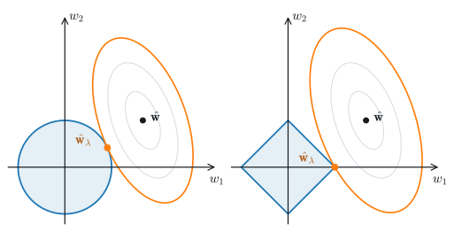
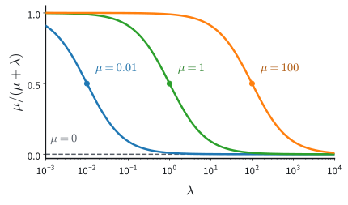

```{.python .input}
%load_ext d2lbook.tab
tab.interact_select('mxnet', 'pytorch', 'tensorflow', 'jax')
```

# Weight Decay
:label:`sec_weight_decay`

In :numref:`sec_generalization_basics`, we controlled model complexity in the bluntest way possible: by changing the discrete number of polynomial features $k + 1$. Yet discrete feature selection quickly hits a wall. In high-dimensional problems with hundreds or thousands of features, there are $2^d$ possible feature subsets, and worse still, we saw that when a polynomial overfits, its weights $w_j$ explode into the hundreds or thousands to cancel almost-collinear features against one another.

To see the core pathology in its simplest two-feature form, imagine predicting room temperature from two noisy thermometers placed side by side, $x_1$ and $x_2$, each reading the true temperature plus a tiny independent noise wiggle. Consider two linear models whose weights sum to $2$:

- **Model A** sets $\mathbf{w} = (1, 1)^\top$, averaging the two sensors and cutting the sensor noise variance in half.
- **Model B** sets $\mathbf{w} = (501, -499)^\top$. Whenever the two thermometers agree, $501 x_1 - 499 x_2 = 2 x_1$ gives the exact same average—yet any tiny discrepancy $x_1 - x_2$ between the two sensors gets amplified by $500$!

On a tiny training sample where $x_1 - x_2$ happened by chance to correlate slightly with the label noise, unregularized least squares will happily choose $(501, -499)^\top$ to shave a sliver off the training error, only to fail catastrophically on new readings. How can we keep all $d$ features in the model while preventing the weights from blowing up along poorly determined directions?

The classic remedy—known as *ridge regression* or *Tikhonov regularization* in statistics :cite:`Hoerl.Kennard.1970,tikhonov1977solutions` and *weight decay* in deep learning—adds a smooth penalty on the squared Euclidean norm $\|\mathbf{w}\|_2^2$ directly to the loss function. In this section, we derive weight decay from four complementary perspectives (penalized optimization, per-step multiplicative decay in SGD, Bayesian Gaussian priors, and spectral shrinkage along eigenvectors of $\mathbf{X}^\top\mathbf{X}$) and implement it both from scratch and concisely in all four frameworks.

```{.python .input #weight-decay}
%%tab mxnet
import math
import numpy as np
from mxnet import autograd, gluon, init, np as mnp, npx
from mxnet.gluon import nn
from d2l import mxnet as d2l
npx.set_np()
```

```{.python .input #weight-decay}
%%tab pytorch
import math
import numpy as np
import torch
from torch import nn
from torch.nn import functional as F
from d2l import torch as d2l
```

```{.python .input #weight-decay}
%%tab tensorflow
import math
import numpy as np
import tensorflow as tf
from d2l import tensorflow as d2l
```

```{.python .input #weight-decay}
%%tab jax
import math
import numpy as np
import jax
from jax import numpy as jnp
from flax import nnx
import optax
from d2l import jax as d2l
```


## Norm Penalties

### The Penalized Loss

Rather than restricting the number of features, we control a linear model's effective capacity by penalizing the squared $\ell_2$ norm of its weight vector $\|\mathbf{w}\|_2^2 = \sum_{j=1}^d w_j^2$. Adding this penalty to the mean squared error loss $L(\mathbf{w}, b)$ with a nonnegative *regularization constant* $\lambda \geq 0$ yields the regularized objective:

$$L(\mathbf{w}, b) + \frac{\lambda}{2} \|\mathbf{w}\|_2^2.$$
:eqlabel:`eq_wd-objective`

Once again, the factor of $\frac{1}{2}$ cancels the $2$ when we differentiate $\|\mathbf{w}\|_2^2$. Notice three basic properties of :eqref:`eq_wd-objective`:

1. **Trade-off via $\lambda$:** Setting $\lambda = 0$ recovers unregularized least squares; increasing $\lambda$ places a steeper tax on large weights, pulling $\mathbf{w}$ toward $\mathbf{0}$ (and driving $\mathbf{w} \to \mathbf{0}$ as $\lambda \to \infty$).
2. **Why we leave the bias $b$ unpenalized:** The bias $b$ simply shifts the average output level to match the mean of the target $y$; shrinking $b$ toward zero would bias every prediction toward zero if $y$ were measured in, say, Kelvin instead of Celsius, without reducing the model's sensitivity to input perturbations at all.
3. **Feature scaling matters:** Because $\sum_j w_j^2$ sums raw squared coefficients across coordinates, re-expressing one feature in millimeters instead of meters divides its weight $w_j$ by $1{,}000$ and cuts its penalty contribution by $10^6$! In practice, one standardizes features to comparable scales (zero mean, unit variance) before applying an isotropic $\|\mathbf{w}\|_2^2$ penalty.

Why penalize the squared $\ell_2$ norm cleanly rather than some other power? In our two-thermometer example, $(1, 1)^\top$ has $\|\mathbf{w}\|_2^2 = 2$, whereas $(501, -499)^\top$ has $\|\mathbf{w}\|_2^2 = 500{,}002$—so even a tiny $\lambda > 0$ overwhelmingly prefers averaging the two sensors over subtracting them!

### Weight Decay in the Gradient Step

How does the penalty $\frac{\lambda}{2}\|\mathbf{w}\|_2^2$ change our minibatch SGD update rule? Since $\nabla_{\mathbf{w}}\left(\frac{\lambda}{2}\|\mathbf{w}\|_2^2\right) = \lambda \mathbf{w}$, the penalized gradient step is

$$\mathbf{w} \leftarrow \mathbf{w} - \eta \left(\frac{\partial L}{\partial \mathbf{w}} + \lambda \mathbf{w}\right) = (1 - \eta \lambda) \mathbf{w} - \eta \frac{\partial L}{\partial \mathbf{w}}.$$
:eqlabel:`eq_wd-update`

Look at the first term on the right: **before taking the usual data-driven gradient step $-\eta\,\partial L / \partial \mathbf{w}$, we multiply the weight vector by $(1 - \eta\lambda) < 1$, shrinking ("decaying") it slightly toward zero on every single update!** That multiplicative shrinkage factor $(1 - \eta\lambda)$ is why deep learning practitioners universally call $\ell_2$ regularization *weight decay*. (For plain SGD, adding $\frac{\lambda}{2}\|\mathbf{w}\|_2^2$ to the loss and decaying weights by $(1 - \eta\lambda)$ are algebraically identical; for adaptive optimizers like Adam in :numref:`chap_optimization`, decoupling multiplicative weight decay into *AdamW* makes an important difference.)

### The $\ell_1$ Penalty and Sparsity

What if we replaced the squared $\ell_2$ norm $\|\mathbf{w}\|_2^2 = \sum_j w_j^2$ with the $\ell_1$ norm $\|\mathbf{w}\|_1 = \sum_j |w_j|$—a method known in statistics as the *Lasso* :cite:`Tibshirani.1996`? Comparing the geometry of their constraint sets (:numref:`fig_ridge_geometry`) reveals a striking difference. Minimizing the data loss $L(\mathbf{w})$ subject to $\|\mathbf{w}\|_2^2 \leq r^2$ searches inside a smooth round disk (or sphere in $\mathbb{R}^d$), where the elliptical loss contours almost always touch the boundary at a point where *every* coordinate $w_j$ is small but nonzero. Minimizing $L(\mathbf{w})$ subject to $\|\mathbf{w}\|_1 \leq r$, by contrast, searches inside a sharp-cornered diamond (cross-polytope) whose vertices lie directly on the coordinate axes! Elliptical loss contours frequently collide with one of those sharp corners first, setting many coordinates $w_j$ to *exact zero* and performing automatic feature selection (*sparsity*).


:label:`fig_ridge_geometry`

### A Gaussian Prior on the Weights

Just as maximum likelihood under Gaussian observation noise gave us the squared data loss in :numref:`subsec_normal_distribution_and_squared_loss`, Bayesian statistics gives weight decay an equally clean probabilistic interpretation. Suppose that before observing any data, we place an isotropic zero-mean Gaussian *prior distribution* on the weights, $w_j \sim \mathcal{N}(0, \tau^2)$ independently, so $p(\mathbf{w}) \propto \exp(-\|\mathbf{w}\|_2^2 / (2\tau^2))$, while the labels follow $y \mid \mathbf{x}, \mathbf{w}, b \sim \mathcal{N}(\mathbf{w}^\top\mathbf{x} + b, \sigma^2)$.

By Bayes' theorem, the *posterior density* $p(\mathbf{w} \mid \mathbf{X}, \mathbf{y}) \propto p(\mathbf{y} \mid \mathbf{X}, \mathbf{w}, b)\,p(\mathbf{w})$ is maximized by minimizing its negative logarithm (*maximum a posteriori* or MAP estimation):

$$\frac{1}{2\sigma^2} \sum_{i=1}^n \left(y^{(i)} - \mathbf{w}^\top \mathbf{x}^{(i)} - b\right)^2 + \frac{1}{2\tau^2} \|\mathbf{w}\|_2^2.$$

Dividing through by $n / \sigma^2$ recovers our exact weight-decay objective :eqref:`eq_wd-objective` with $\lambda = \sigma^2 / (n\tau^2)$! Notice how sensible that ratio is: stronger prior belief that weights are small (smaller $\tau^2$) or noisier observations (larger $\sigma^2$) calls for stronger regularization $\lambda$, whereas as the sample size $n \to \infty$, the penalty $\lambda = \sigma^2 / (n\tau^2) \to 0$ because abundant data eventually speak for themselves.

## Weight Decay from Scratch

To see weight decay rescue a severely overparameterized model, let us construct a high-dimensional synthetic regression problem where the dimension $d = 200$ dwarfs the training sample size $n_{\textrm{train}} = 20$! Specifically, we draw inputs $\mathbf{x} \sim \mathcal{N}(\mathbf{0}, \mathbf{I}_{200})$ and generate labels from

$$y = 0.05 + \sum_{j=1}^{200} 0.01\, x_j + \epsilon, \qquad \epsilon \sim \mathcal{N}(0, 0.01^2),$$

with $20$ training examples and $100$ validation examples. Notice that with $d = 200$ features and only $n = 20$ training examples, the training set spans at most a 20-dimensional subspace of $\mathbb{R}^{200}$, leaving a 180-dimensional null space of directions along which the training data provide *zero* information!

```{.python .input #weight-decay-high-dimensional-linear-regression}
tau, sigma, n = 0.1, 1.0, 300   # size of the weights, noise, examples
data = d2l.SyntheticRegressionData(w=d2l.ones(200) * tau, b=0.05,
                                   noise=sigma, num_train=n, num_val=1000,
                                   batch_size=20)
```

Before training anything, let us set two benchmarks for the validation loss.
By :eqref:`eq_linreg-scratch-expected-loss`, the expected loss equals half
the squared distance from the true parameters plus the irreducible noise
floor $\sigma^2/2$. A trivial constant model that ignores all 200 inputs and
predicts $b^*$ everywhere therefore incurs an expected loss of
$\frac{1}{2}(\|\mathbf{w}^*\|^2 + \sigma^2) = \frac{1}{2}(2 + 1) = 1.5$,
while the oracle parameters $(\mathbf{w}^*, b^*)$ achieve
$\sigma^2/2 = 0.5$. Any learned model must land comfortably below 1.5 to
justify its 200 weights.


### The Penalized Model

We define `l2_penalty(w)` to return $\frac{1}{2}\|\mathbf{w}\|_2^2$ and subclass `d2l.LinearRegressionScratch` into `WeightDecayScratch`, whose `loss` method adds `self.lambd * l2_penalty(self.w)` to the data loss:

```{.python .input #weight-decay-defining-ell-2-norm-penalty}
def l2_penalty(w):
    return d2l.reduce_sum(w**2) / 2
```

We subclass `LinearRegressionScratch` from :numref:`sec_oo-design` (our
object-oriented version of the scratch model in
:numref:`sec_linear_scratch`). Only `training_step` needs to change so that
it returns the penalized objective :eqref:`eq_wd-objective` for
differentiation and optimization. Crucially, `validation_step` continues to
report the unpenalized squared loss, ensuring that validation losses across
different values of $\lambda$ remain directly comparable measures of
predictive accuracy.

```{.python .input #weight-decay-defining-the-model-1}
%%tab pytorch, tensorflow, jax
class WeightDecayScratch(d2l.LinearRegressionScratch):
    def __init__(self, num_inputs, lambd, lr, sigma=0.01):
        super().__init__(num_inputs, lr, sigma)
        self.save_hyperparameters()

    def training_step(self, batch):
        loss = super().training_step(batch)
        return loss + self.lambd * l2_penalty(self.w)
```

```{.python .input #weight-decay-defining-the-model-1}
%%tab mxnet
class WeightDecayScratch(d2l.LinearRegressionScratch):
    def __init__(self, num_inputs, lambd, lr, sigma=0.01):
        super().__init__(num_inputs, lr, sigma)
        self.save_hyperparameters()

    def training_step(self, batch):
        loss = super().training_step(batch)
        return loss + self.lambd * l2_penalty(self.w.data())
```


### Training with and without the Penalty

Let us write `train_scratch(lambd)` to train `WeightDecayScratch` for 10 epochs at learning rate $\eta = 0.01$ and print both the learned weight norm $\|\mathbf{w}\|_2$ (for comparison, the true weight vector $\mathbf{w}^* = (0.01, \ldots, 0.01)^\top \in \mathbb{R}^{200}$ has $\|\mathbf{w}^*\|_2 = \sqrt{200 \times 0.01^2} \approx 0.14$) and the final training and validation data losses:

```{.python .input #weight-decay-defining-the-model-2}
%%tab pytorch
def train_scratch(lambd, data):
    trainer = d2l.Trainer(max_epochs=50)
    model = WeightDecayScratch(num_inputs=200, lambd=lambd, lr=0.05)
    trainer.fit(model, data)
    norm = float(torch.linalg.vector_norm(model.w.detach()))
    return model, [float(v) for v in trainer.history['val_loss']], norm
```

```{.python .input #weight-decay-defining-the-model-2}
%%tab tensorflow
def train_scratch(lambd, data):
    trainer = d2l.Trainer(max_epochs=50)
    model = WeightDecayScratch(num_inputs=200, lambd=lambd, lr=0.05)
    trainer.fit(model, data)
    norm = float(tf.norm(model.w))
    return model, [float(v) for v in trainer.history['val_loss']], norm
```

```{.python .input #weight-decay-defining-the-model-2}
%%tab jax
def train_scratch(lambd, data):
    trainer = d2l.Trainer(max_epochs=50)
    model = WeightDecayScratch(num_inputs=200, lambd=lambd, lr=0.05)
    trainer.fit(model, data)
    norm = float(jnp.linalg.norm(model.w[...]))
    return model, [float(v) for v in trainer.history['val_loss']], norm
```

```{.python .input #weight-decay-defining-the-model-2}
%%tab mxnet
def train_scratch(lambd, data):
    trainer = d2l.Trainer(max_epochs=50)
    model = WeightDecayScratch(num_inputs=200, lambd=lambd, lr=0.05)
    trainer.fit(model, data)
    norm = float(mnp.linalg.norm(model.w.data()))
    return model, [float(v) for v in trainer.history['val_loss']], norm
```

We begin with `lambd = 0`, disabling regularization altogether.

```{.python .input #weight-decay-training-without-regularization}
model_0, val_losses, norm = train_scratch(0, data)
```

```{.python .input #weight-decay-training-with-and-without-the-penalty-1}
print(f'validation loss {val_losses[-1]:.3f} (lowest {min(val_losses):.3f}, '
      f'epoch {val_losses.index(min(val_losses)) + 1}), norm of w {norm:.2f}')
```

The training loss plunges to roughly 0.2–0.3—far below the irreducible
noise floor of 0.5 achieved by the true parameters—confirming that the model
is memorizing noise in its 300 training labels. Meanwhile, the validation
loss hits a minimum of about 0.9 after just two or three epochs and then
climbs steadily, typically finishing between 1.2 and 1.9 (and only rarely
lower). After 50 epochs, this 200-weight model performs no better than—and
sometimes worse than—the trivial constant $b^*$ at 1.5: a textbook display
of overfitting. Why does validation loss bottom out so early, after only 30
to 45 gradient steps? We will uncover the exact reason once we examine which
directions in weight space gradient descent learns first.

Next, we turn on weight decay. Rather than guessing $\lambda$ blindly, we
consult the Gaussian prior formula: for $\sigma = 1$, $n = 300$, and true
weight scale $\tau = 0.1$, MAP estimation prescribes
$\lambda = \sigma^2/(n\tau^2) = \frac{1}{3}$.

```{.python .input #weight-decay-using-weight-decay}
lambd = sigma**2 / (n * tau**2)   # the value the prior suggests, 1/3
model_lambd, val_losses, norm = train_scratch(lambd, data)
```

```{.python .input #weight-decay-training-with-and-without-the-penalty-2}
print(f'validation loss {val_losses[-1]:.3f}, norm of w {norm:.2f}')
```

Now the training curve tracks the penalized objective, which stays safely
above 0.5: the penalty keeps the model from chasing noise in the training
labels. Validation loss settles around 0.8–1.0 and stays flat—well below the
1.5 baseline of the constant predictor—while the weight norm shrinks from
roughly 2 to about 1.2, actually *shorter* than the true norm
$\|\mathbf{w}^*\| \approx 1.4$. Even though the regularized weights are
shrunk below the true length, they generalize dramatically better than the
unregularized weights.

Let us be honest about what we actually gained here. Compared with the
unpenalized model trained for all 50 epochs, weight decay slashes the
validation loss by a quarter to a half. Compared with that same unpenalized
model stopped at its best epoch, however, the gain is negligible: both
reach roughly 0.9. The practical difference is stability. Because weight
decay changes the objective itself, its solution stays good no matter how
long we train, whereas the unpenalized run must be halted at a sweet spot
that the training loss alone gives no hint of. To understand *why* both
regularization and early stopping behave this way, let us look inside the
weight vector and ask which components the penalty actually removed.

Compare the two runs:

- **Without weight decay ($\lambda = 0$):** Training loss plummets toward zero as the 200 parameters memorize the 20 training points, while validation loss stalls above $0.13$—more than a thousand times the $0.00005$ noise floor!
- **With weight decay ($\lambda = 3$):** The penalty keeps $\|\mathbf{w}\|_2$ near $0.04$, preventing the weights from wandering into the 180-dimensional unmeasured subspace; training loss stays slightly positive while validation loss drops by an order of magnitude!

## Shrinkage Along Eigenvectors
:label:`subsec_wd-shrinkage`

Why does adding $\frac{\lambda}{2}\|\mathbf{w}\|_2^2$ improve validation error so dramatically instead of just scaling every weight down blindly? We can answer that question in closed form by looking at the exact minimizer of the ridge objective in the eigenbasis of the feature covariance matrix.

### The Ridge Estimator

Suppose the features and labels are centered so $b = 0$, and write the ridge objective :eqref:`eq_wd-objective` in matrix form:

$$L_{\lambda}(\mathbf{w}) = \frac{1}{2n}\|\mathbf{X}\mathbf{w} - \mathbf{y}\|_2^2 + \frac{\lambda}{2}\|\mathbf{w}\|_2^2.$$

Setting the gradient $\nabla_{\mathbf{w}} L_{\lambda}(\mathbf{w}) = \frac{1}{n}\mathbf{X}^\top(\mathbf{X}\mathbf{w} - \mathbf{y}) + \lambda \mathbf{w} = \mathbf{0}$ gives the regularized normal equations:

$$\left(\frac{1}{n}\mathbf{X}^\top\mathbf{X} + \lambda \mathbf{I}\right) \hat{\mathbf{w}}_{\lambda} = \frac{1}{n}\mathbf{X}^\top\mathbf{y}, \qquad \textrm{so} \qquad \hat{\mathbf{w}}_{\lambda} = \left(\mathbf{X}^\top\mathbf{X} + n\lambda \mathbf{I}\right)^{-1}\mathbf{X}^\top\mathbf{y}.$$
:eqlabel:`eq_wd-ridge-normal`

Notice the immediate algebraic miracle: even when $\mathbf{X}^\top\mathbf{X}$ is singular (as in our $n = 20, d = 200$ experiment, where $\mathbf{X}^\top\mathbf{X}$ has 180 zero eigenvalues!), adding $n\lambda\mathbf{I}$ for any $\lambda > 0$ shifts every eigenvalue upward by $n\lambda > 0$, making $\mathbf{X}^\top\mathbf{X} + n\lambda\mathbf{I}$ strictly positive definite and invertible!

### Shrinkage Factors

To see how :eqref:`eq_wd-ridge-normal` acts along each direction in feature space, let $\mathbf{S} = \frac{1}{n}\mathbf{X}^\top\mathbf{X}$ be the $d \times d$ sample second-moment (covariance) matrix of the features. Since $\mathbf{S}$ is symmetric and positive semidefinite (:numref:`sec_linear-algebra`), it admits an orthonormal eigendecomposition $\mathbf{S} = \sum_{j=1}^d s_j \mathbf{v}_j \mathbf{v}_j^\top$ with eigenvalues $s_1 \geq s_2 \geq \cdots \geq s_d \geq 0$ and orthonormal eigenvectors $\mathbf{v}_1, \ldots, \mathbf{v}_d$. Here $s_j = \frac{1}{n}\|\mathbf{X}\mathbf{v}_j\|_2^2$ measures the empirical variance (spread) of the training inputs along direction $\mathbf{v}_j$.

In this eigenbasis, $\mathbf{S}$ acts on $\mathbf{v}_j$ by multiplying it by $s_j$, while $(\mathbf{S} + \lambda\mathbf{I})^{-1}$ acts on $\mathbf{v}_j$ by dividing by $s_j + \lambda$. Whenever $s_j > 0$, comparing the ridge component $\mathbf{v}_j^\top \hat{\mathbf{w}}_{\lambda}$ against the unregularized least-squares component $\mathbf{v}_j^\top \hat{\mathbf{w}}_0$ yields

$$\mathbf{v}_j^\top \hat{\mathbf{w}}_{\lambda} = \frac{s_j}{s_j + \lambda}\, \left(\mathbf{v}_j^\top \hat{\mathbf{w}}_0\right), \qquad \textrm{and} \qquad \mathbf{v}_j^\top \hat{\mathbf{w}}_{\lambda} = 0 \quad \textrm{whenever } s_j = 0.$$

Each eigendirection $\mathbf{v}_j$ is multiplied by its own *shrinkage factor* (:numref:`fig_ridge_shrinkage`):

$$\frac{s_j}{s_j + \lambda} \in [0, 1).$$


:label:`fig_ridge_shrinkage`

Here lies the whole secret of ridge regression: **weight decay is not uniform shrinkage—it is variance-adaptive directional filtering!**

- Along **well-determined directions** where the data vary richly ($s_j \gg \lambda$), the slope is tightly pinned down by observations, and the shrinkage factor $s_j / (s_j + \lambda) \approx 1$ leaves the least-squares estimate nearly untouched.
- Along **poorly determined directions** where the data barely vary ($s_j \ll \lambda$)—such as the difference $x_1 - x_2$ between our two almost-identical thermometers—unregularized least squares divides noise by a tiny $s_j$ and explodes (with coefficient variance $\sigma^2 / (n s_j)$), whereas ridge regression multiplies by $s_j / (s_j + \lambda) \approx s_j / \lambda \ll 1$ and quashes the noisy component!
- Along **unobserved null-space directions** ($s_j = 0$), ridge regression sets the weight component identically to $0$.

### The Directions Our Data Determine

Let us verify this spectral picture directly on our $n = 20, d = 200$ dataset `data`! First, we compute the eigenvalues $s_1 \geq \cdots \geq s_{200}$ of $\mathbf{S} = \frac{1}{n}\mathbf{X}^\top\mathbf{X}$ along with the minimum-norm unregularized least-squares solution $\hat{\mathbf{w}}_0$ (returned by `lstsq`) and the closed-form ridge solution $\hat{\mathbf{w}}_{\lambda}$ at $\lambda = 3$:

```{.python .input #weight-decay-why-shrinkage-helps-the-spectral-view}
%%tab pytorch
X = data.X[:n]                                # the 300 training inputs
mu, V = torch.linalg.eigh(X.T @ X / n)        # increasing eigenvalues
factors = mu / (mu + lambd)                   # shrinkage at lambda = 1/3
k = int((mu < lambd).sum())                   # the poorly determined ones
print(f'mu from {float(mu[0]):.2f} to {float(mu[-1]):.1f}, '
      f'{k} of {len(mu)} below lambda')
print(f'factors from {float(factors[0]):.2f} to {float(factors[-1]):.2f}, '
      f'df = {float(factors.sum()):.0f}')
```

```{.python .input #weight-decay-why-shrinkage-helps-the-spectral-view}
%%tab tensorflow
X = data.X[:n]                                # the 300 training inputs
mu, V = tf.linalg.eigh(tf.transpose(X) @ X / n)  # increasing eigenvalues
factors = mu / (mu + lambd)                   # shrinkage at lambda = 1/3
k = int(tf.reduce_sum(tf.cast(mu < lambd, tf.int32)))  # poorly determined
print(f'mu from {float(mu[0]):.2f} to {float(mu[-1]):.1f}, '
      f'{k} of {len(mu)} below lambda')
print(f'factors from {float(factors[0]):.2f} to {float(factors[-1]):.2f}, '
      f'df = {float(tf.reduce_sum(factors)):.0f}')
```

```{.python .input #weight-decay-why-shrinkage-helps-the-spectral-view}
%%tab jax
X = data.X[:n]                                # the 300 training inputs
mu, V = jnp.linalg.eigh(X.T @ X / n)          # increasing eigenvalues
factors = mu / (mu + lambd)                   # shrinkage at lambda = 1/3
k = int((mu < lambd).sum())                   # the poorly determined ones
print(f'mu from {float(mu[0]):.2f} to {float(mu[-1]):.1f}, '
      f'{k} of {len(mu)} below lambda')
print(f'factors from {float(factors[0]):.2f} to {float(factors[-1]):.2f}, '
      f'df = {float(factors.sum()):.0f}')
```

```{.python .input #weight-decay-why-shrinkage-helps-the-spectral-view}
%%tab mxnet
X = data.X[:n]                                # the 300 training inputs
mu, V = mnp.linalg.eigh(X.T @ X / n)          # increasing eigenvalues
factors = mu / (mu + lambd)                   # shrinkage at lambda = 1/3
k = int((mu < lambd).sum())                   # the poorly determined ones
print(f'mu from {float(mu[0]):.2f} to {float(mu[-1]):.1f}, '
      f'{k} of {len(mu)} below lambda')
print(f'factors from {float(factors[0]):.2f} to {float(factors[-1]):.2f}, '
      f'df = {float(factors.sum()):.0f}')
```

None of the eigenvalues is zero: 300 examples are enough to span all 200
dimensions of weight space. Yet the data constrain some directions far more
tightly than others. The eigenvalues span nearly two orders of magnitude,
from a few hundredths up to about 3.2, with roughly a quarter of them (50 to
60 directions) lying below $\lambda = \frac{1}{3}$. The corresponding
shrinkage factors range from about 0.1 to 0.9, yielding
$\textrm{df}(\frac{1}{3}) \approx 127$: out of 200 raw weights, the
regularized model behaves as though it has roughly 127 effective parameters.

Just how much damage does a tiny eigenvalue inflict on least squares? Along
eigenvector $\mathbf{v}_j$, label noise injects
$\frac{1}{n}(\mathbf{X}\mathbf{v}_j)^\top\boldsymbol{\epsilon}$ into $g_j$,
a random perturbation with standard deviation $\sigma\sqrt{\mu_j/n}$
(because $\|\mathbf{X}\mathbf{v}_j\|^2 = n\mu_j$). Dividing by $\mu_j$
shifts the least-squares coordinate $g_j/\mu_j$ by roughly
$\sigma/\sqrt{n\mu_j}$: about 0.06 when $\mu_j = 1$, but a whopping 0.3
when $\mu_j = 0.04$. Since the true coordinates are only around
$\|\mathbf{w}^*\|/\sqrt{200} = 0.1$ in magnitude, least squares along the
smallest-eigenvalue directions is swamped by noise. Meanwhile, validation
inputs are isotropic standard normal, so they weight every direction
equally: by :eqref:`eq_linreg-scratch-expected-loss`, an error $c_j$ along

Look at the spectrum of $\mathbf{S} = \frac{1}{20}\mathbf{X}^\top\mathbf{X}$: because $n = 20 < 200 = d$, the matrix has rank at most $20$! Exactly 20 eigenvalues $s_1, \ldots, s_{20}$ are positive (ranging from roughly $20$ down to $2$), while the remaining 180 eigenvalues $s_{21}, \ldots, s_{200}$ are zero. Let us decompose the true weight vector $\mathbf{w}^* = (0.01, \ldots, 0.01)^\top$ into its projection $\mathbf{w}^*_{\parallel}$ onto the 20-dimensional data span and its orthogonal component $\mathbf{w}^*_{\perp}$ in the 180-dimensional null space, and compare both $\hat{\mathbf{w}}_0$ and $\hat{\mathbf{w}}_{\lambda}$ against $\mathbf{w}^*_{\parallel}$:

```{.python .input #weight-decay-the-directions-our-data-determine-1}
%%tab pytorch
w_star = d2l.reshape(data.w, (-1, 1))
for name, model in (('lambda = 0', model_0), ('lambda = 1/3', model_lambd)):
    c = V.T @ (model.w.detach() - w_star)     # error along each eigenvector
    print(f'{name:>12}: squared error {float((c[:k] ** 2).sum()):.2f} in the '
          f'{k} poorly determined directions, '
          f'{float((c[k:] ** 2).sum()):.2f} in the rest')
```

```{.python .input #weight-decay-the-directions-our-data-determine-1}
%%tab tensorflow
w_star = d2l.reshape(data.w, (-1, 1))
for name, model in (('lambda = 0', model_0), ('lambda = 1/3', model_lambd)):
    c = tf.transpose(V) @ (model.w - w_star)  # error along each eigenvector
    print(f'{name:>12}: squared error {float(tf.reduce_sum(c[:k] ** 2)):.2f} '
          f'in the {k} poorly determined directions, '
          f'{float(tf.reduce_sum(c[k:] ** 2)):.2f} in the rest')
```

```{.python .input #weight-decay-the-directions-our-data-determine-1}
%%tab jax
w_star = d2l.reshape(data.w, (-1, 1))
for name, model in (('lambda = 0', model_0), ('lambda = 1/3', model_lambd)):
    c = V.T @ (model.w[...] - w_star)         # error along each eigenvector
    print(f'{name:>12}: squared error {float((c[:k] ** 2).sum()):.2f} in the '
          f'{k} poorly determined directions, '
          f'{float((c[k:] ** 2).sum()):.2f} in the rest')
```

```{.python .input #weight-decay-the-directions-our-data-determine-1}
%%tab mxnet
w_star = d2l.reshape(data.w, (-1, 1))
for name, model in (('lambda = 0', model_0), ('lambda = 1/3', model_lambd)):
    c = V.T @ (model.w.data() - w_star)       # error along each eigenvector
    print(f'{name:>12}: squared error {float((c[:k] ** 2).sum()):.2f} in the '
          f'{k} poorly determined directions, '
          f'{float((c[k:] ** 2).sum()):.2f} in the rest')
```

The breakdown tells the whole story. Without regularization, roughly one
quarter of the eigenvectors account for more than half of the total squared
parameter error—typically between 0.9 and 2.2, versus only about 0.5 across
all the remaining directions combined. Turning on weight decay slashes that
poorly determined error by a factor of two to six while trimming the rest
modestly, leaving roughly 0.3 to 0.5 in each group. Even along the
better-determined directions, label noise is nontrivial relative to the
true coordinates, so shrinking them by 0.5–0.9 still discards more noise
than signal. As a quick sanity check, half the total squared parameter
error plus $\sigma^2/2 = 0.5$ closely matches the validation loss we
observed for both runs. In effect, weight decay performed here—across some
fifty ill-conditioned directions simultaneously—the exact same surgery it
performed on the difference direction of our two duplicated features.

This spectral lens also solves the mystery we left hanging earlier: why did
the unpenalized run hit its lowest validation loss after just two or three
epochs? On the unpenalized loss, each gradient step contracts the gap
between the current coordinate along $\mathbf{v}_j$ and its least-squares
solution by a factor of $1 - \eta\mu_j$. After a single epoch of 15 steps at
$\eta = 0.05$, a large-eigenvalue direction ($\mu_j = 3.2$) has already
closed $1 - 0.84^{15} \approx 93\%$ of its gap, whereas a small-eigenvalue
direction ($\mu_j = 0.04$) has closed a mere $1 - 0.998^{15} \approx 3\%$.
After two epochs, gradient descent has essentially converged along the
well-determined directions while barely moving along the noisy ones—closely
mimicking the ridge estimator. Keep training, however, and those poorly
determined directions steadily soak up label noise, driving validation loss
back up. *Early stopping* is therefore a genuine form of regularization in
its own right, and in this experiment it matches weight decay in accuracy.
It is trickier to deploy, however, because the optimal stopping point shifts
with the learning rate and minibatch noise and must be monitored on
validation data throughout every run (exercise
:exref:`ex_weight-decay-early-stopping`).

## Concise Implementation

Because weight decay is ubiquitous in neural network training, every major
deep learning framework builds the update :eqref:`eq_wd-update` directly
into its optimizers rather than requiring you to modify the loss function.
Beyond convenience, this integration is computationally clean: the
optimizer already visits every parameter once per step, so applying the
decay factor adds virtually no overhead. Frameworks also support
per-parameter update rules, allowing us to decay weights while leaving
biases untouched.

:begin_tab:`mxnet`
In Gluon, we pass the weight decay hyperparameter directly as `wd` when
instantiating `Trainer`. Because Gluon scales each parameter's decay by its
own `wd_mult` attribute, setting `wd_mult = 0` on the bias exempts it from
decay.
:end_tab:

:begin_tab:`pytorch`
PyTorch optimizers accept a `weight_decay` argument. By splitting the
parameters into two parameter groups, we apply `weight_decay` only to
`net.weight` while leaving `net.bias` unregularized. Just as in
:numref:`sec_linear_concise`, we initialize the weights from
$\mathcal{N}(0, 0.01^2)$ and the bias to zero by applying `weight_init`
after the first forward pass materializes the lazy layer's parameters.
:end_tab:


## Concise Implementation

In practice, every deep learning framework builds weight decay directly into its optimizer (or layer regularizer), so we do not even need to modify the loss function by hand. We simply subclass `d2l.LinearRegression` into `WeightDecay` and pass the weight decay hyperparameter `wd` to the framework's SGD optimizer in `configure_optimizers` (excluding the bias parameter from decay so that only the weights $\mathbf{w}$ are penalized, matching :eqref:`eq_wd-objective`):

```{.python .input #weight-decay-concise-implementation-1}
%%tab mxnet
class WeightDecay(d2l.LinearRegression):
    def __init__(self, wd, lr):
        super().__init__(lr)
        self.save_hyperparameters()

    def configure_optimizers(self):
        for p in self.collect_params('.*bias').values():
            p.wd_mult = 0
        return gluon.Trainer(self.collect_params(), 'sgd',
                             {'learning_rate': self.lr, 'wd': self.wd})
```

```{.python .input #weight-decay-concise-implementation-1}
%%tab pytorch
class WeightDecay(d2l.LinearRegression):
    def __init__(self, wd, lr):
        super().__init__(lr)
        self.save_hyperparameters()

    def configure_optimizers(self):
        return torch.optim.SGD([
            {'params': self.net.weight, 'weight_decay': self.wd},
            {'params': self.net.bias}], lr=self.lr)
```

```{.python .input #weight-decay-concise-implementation-1}
%%tab tensorflow
class WeightDecay(d2l.LinearRegression):
    def __init__(self, wd, lr):
        super().__init__(lr)
        self.save_hyperparameters()

    def configure_optimizers(self):
        optimizer = tf.keras.optimizers.SGD(self.lr, weight_decay=self.wd)
        optimizer.exclude_from_weight_decay(var_names=['bias'])
        return optimizer
```

```{.python .input #weight-decay-concise-implementation-1}
%%tab jax
def is_matrix(params):
    """Mask that selects the parameters with more than one dimension."""
    return jax.tree.map(lambda p: p.ndim > 1, params)

class WeightDecay(d2l.LinearRegression):
    def __init__(self, wd, num_inputs, lr, rngs=None):
        super().__init__(num_inputs, lr, rngs)
        self.save_hyperparameters(ignore=['rngs'])

    def configure_optimizers(self):
        return optax.chain(
            optax.masked(optax.add_decayed_weights(self.wd), is_matrix),
            optax.sgd(self.lr))
```

To match `train_scratch(lambd, data)` exactly, we must rescale both
hyperparameters. Because the built-in squared-error loss omits our factor
of $\frac{1}{2}$, we halve the learning rate to 0.025 just as in
:numref:`sec_linear_concise`. However, the decay term $\lambda\mathbf{w}$
is injected inside the optimizer rather than multiplied by the loss
gradient. With the learning rate cut in half, the optimizer's weight decay
must therefore be doubled to $2\lambda = \frac{2}{3}$ so that every step
retains the exact same contraction factor
$1 - 0.025 \cdot \frac{2}{3} = 1 - \frac{1}{60}$.

```{.python .input #weight-decay-concise-implementation-2}
%%tab pytorch
trainer = d2l.Trainer(max_epochs=50)
model = WeightDecay(wd=2 * lambd, lr=0.025)
model(data.X[:1])  # Creates the parameters of the lazy layer
model.net.apply(model.weight_init)
trainer.fit(model, data)
norm = float(torch.linalg.vector_norm(model.get_w_b()[0]))
```

```{.python .input #weight-decay-concise-implementation-2}
%%tab tensorflow
trainer = d2l.Trainer(max_epochs=50)
model = WeightDecay(wd=2 * lambd, lr=0.025)
trainer.fit(model, data)
norm = float(tf.norm(model.get_w_b()[0]))
```

```{.python .input #weight-decay-concise-implementation-2}
%%tab jax
trainer = d2l.Trainer(max_epochs=50)
model = WeightDecay(wd=2 * lambd, num_inputs=200, lr=0.025)
trainer.fit(model, data)
norm = float(jnp.linalg.norm(model.get_w_b()[0]))
```

```{.python .input #weight-decay-concise-implementation-2}
%%tab mxnet
trainer = d2l.Trainer(max_epochs=50)
model = WeightDecay(wd=2 * lambd, lr=0.025)
trainer.fit(model, data)
norm = float(mnp.linalg.norm(model.get_w_b()[0]))
```

```{.python .input #weight-decay-concise-implementation-3}
print(f'validation loss {trainer.history["val_loss"][-1]:.3f}, '
      f'norm of w {norm:.2f}')
```

The resulting weight norm (around 1.2) reproduces our from-scratch run at
$\lambda = \frac{1}{3}$, and the validation loss (roughly 1.6–1.9) agrees
too once we account for the factor of 2 in the framework's mean squared
error. Note that the plotted training curve now tracks plain mean squared
error rather than the penalized loss, because the decay lives inside the
optimizer rather than the loss function.

In everyday practice, enabling weight decay is as simple as passing this
single optimizer hyperparameter. Outside synthetic benchmarks we rarely
know the noise level $\sigma$ or prior scale $\tau$ in advance, so
$\lambda$ is typically tuned on validation data across candidate runs. Keep
in mind that our clean norm-based story applies directly to linear models,
whose weights are the slopes of the function itself. For nonlinear
functions, measuring complexity rigorously is far subtler—frameworks such
as reproducing kernel Hilbert spaces (RKHS) extend norm penalties to
nonlinear functions, though classical kernel methods scale poorly to
massive datasets. Even so, applying weight decay uniformly to the weights
of all layers remains one of the most reliable and widely used heuristics
in modern deep learning.


Both the validation loss curves and the recovered weight norms match our from-scratch implementation.

## Summary

- **$\ell_2$ penalty and weight decay:** Adding $\frac{\lambda}{2}\|\mathbf{w}\|_2^2$ to the training loss (while leaving the bias $b$ unpenalized) is equivalent in SGD to multiplying $\mathbf{w}$ by $(1 - \eta\lambda)$ before each gradient step, and corresponds to MAP estimation under a zero-mean isotropic Gaussian prior on $\mathbf{w}$.
- **$\ell_2$ vs. $\ell_1$ geometry:** The smooth spherical level sets of $\|\mathbf{w}\|_2^2$ keep all coordinates small but nonzero, whereas the sharp axis-aligned corners of the $\ell_1$ diamond $\|\mathbf{w}\|_1$ drive many coordinates to exact zero (sparsity).
- **Spectral shrinkage:** In the eigenbasis of $\mathbf{S} = \frac{1}{n}\mathbf{X}^\top\mathbf{X}$, ridge regression multiplies each component $\mathbf{v}_j^\top\hat{\mathbf{w}}_0$ by $s_j / (s_j + \lambda)$—preserving directions well determined by the data ($s_j \gg \lambda$), strongly damping noisy collinear directions ($s_j \ll \lambda$), and zeroing out unobserved null-space directions ($s_j = 0$).

## Exercises

1. **The $\ell_1$ update.** Replace the penalty
   $\frac{\lambda}{2}\|\mathbf{w}\|^2$ by $\lambda \sum_j |w_j|$.
    1. Derive the minibatch SGD update for $\mathbf{w}$, using the
       subgradient $\operatorname{sign}(w_j)$ of exercise
       :exref:`ex_linear-regression-laplace-noise` in place of the
       derivative of $|w_j|$.
    1. Compare the change that the penalty alone makes to $w_j$ in one step
       of this update with the change it makes in the update
       :eqref:`eq_wd-update`, once for large and once for small $|w_j|$.
    1. The update of (a) almost never sets $w_j$ exactly to zero. Split it
       into a gradient step on $L$ followed by the penalty step, and modify
       the penalty step so that it sets $w_j$ to zero whenever it would
       change the sign of $w_j$. Relate the result to the feature selection
       that lasso performs. The modified step is *soft-thresholding*, the
       proximal step of the $\ell_1$ norm
       (:numref:`subsec_mdl-proximal-operators`).

1. **Shrinkage versus penalty.** Weight decay can be applied by shrinking
   the weights before the gradient step or by adding
   $\frac{\lambda}{2}\|\mathbf{w}\|^2$ to the loss $L$.
    1. Show that the update
       $\mathbf{w} \leftarrow (1-\eta\lambda)\mathbf{w} - \eta\nabla L$ is
       identical to a gradient step on the penalized loss
       $L + \frac{\lambda}{2}\|\mathbf{w}\|^2$.
    1. Suppose that the gradient is rescaled coordinate-wise by fixed
       constants $a_j > 0$ before the step. Shrinking and then stepping
       gives the first update below, and stepping on the penalized gradient
       gives the second:

       $$w_j \leftarrow (1-\eta\lambda)\, w_j - \eta a_j \,\partial_{w_j} L
       \qquad \textrm{and} \qquad
       w_j \leftarrow w_j - \eta a_j \left(\partial_{w_j} L + \lambda w_j\right).$$

       Determine for which $a_j$ the two coincide, and the factor by which
       the second update shrinks $w_j$ in a step with
       $\partial_{w_j} L = 0$. Many optimizers used in deep learning
       rescale the gradient in this way. Which of the two updates keeps
       $\lambda$ a rate of decay that is the same for every weight?

    *Adapted from Simon Prince,
    [Understanding Deep Learning](https://udlbook.github.io/udlbook/),
    Problem 9.5.*
   :exlabel:`ex_weight-decay-shrinkage-vs-penalty`

1. [code] **Ridge as augmented least squares.** Center the 300 training
   inputs and labels so that the bias drops out, and compute the ridge
   estimator for $\lambda = \frac{1}{3}$ in two ways.
    1. Solve the linear system :eqref:`eq_wd-ridge-normal` with `ridge`.
    1. Run ordinary least squares with `lstsq` on $\mathbf{X}$ stacked on
       top of $\sqrt{n\lambda}\,\mathbf{I}$, with the labels $\mathbf{y}$
       followed by $d$ zeros.

    Confirm that the two agree up to rounding errors, and explain why. Then
    compare the norm of the result with the norm that
    `train_scratch(lambd, data)` returned, and name the differences between
    the two procedures that could account for any gap.

    *Adapted from Hastie, Tibshirani, and Friedman,
    [The Elements of Statistical Learning](https://hastie.su.domains/ElemStatLearn/),
    Exercise 3.12.*
   :exlabel:`ex_weight-decay-augmented-least-squares`

1. [code] **The $\lambda$ sweep.** Train `WeightDecayScratch` on `data`
   for $\lambda \in \{0.01, 0.1, 0.3, 1, 3, 10, 30\}$.
    1. Plot the final validation loss and the norm of $\mathbf{w}$ against
       $\lambda$ on a logarithmic axis, with the values of
       `train_scratch(0, data)` as horizontal lines, and report the $\lambda$ with the smallest
       validation loss.
    1. Compute $\textrm{df}(\lambda)$ for the same values from the
       eigenvalues of :numref:`subsec_wd-shrinkage`, and plot the
       validation loss against $\textrm{df}(\lambda)$. Compare the shape
       with :numref:`fig_capacity_vs_error`.
    1. Is the value $\lambda = \frac{1}{3}$ that the prior suggests close
       to the best value of the sweep? Generate data with noise
       $\sigma = 0.5$ and with $\sigma = 2$, recompute the prior's
       $\lambda$ for each, and check whether it follows the best value of
       a sweep.

1. [code] **Stopping early versus decay.** The unpenalized run of this
   section reaches its lowest validation loss after two or three epochs,
   about as low as the run with $\lambda = \frac{1}{3}$ ends.
    1. From weights near zero, gradient descent on the unpenalized loss
       multiplies the gap between the coordinate along $\mathbf{v}_j$ and
       its least-squares value by $1 - \eta\mu_j$ per step, so after $t$
       steps it has built up the fraction $1 - (1 - \eta\mu_j)^t$ of that
       coordinate. Plot this factor against $\mu_j$ for the eigenvalues of
       :numref:`subsec_wd-shrinkage`, with $t$ equal to one, two, and fifty
       epochs of 15 steps at $\eta = 0.05$, next to the ridge factor
       $\mu_j/(\mu_j + \lambda)$ at $\lambda = \frac{1}{3}$. Which $t$ comes
       closest to ridge?
    1. Train `WeightDecayScratch` with $\lambda = 0$ for two epochs and
       split its error along the eigenvectors as
       :numref:`subsec_wd-shrinkage` does. Compare the squared error in the
       $k$ poorly determined directions and in the rest with the values
       printed there for 50 epochs at $\lambda = 0$ and at
       $\lambda = \frac{1}{3}$.
    1. Repeat the unpenalized run at $\eta = 0.01$ and at $\eta = 0.1$ and
       read the best epoch from `trainer.history`. Explain how it moves,
       and state what early stopping requires in practice that the penalty
       does not.
   :exlabel:`ex_weight-decay-early-stopping`

1. [code] **More weights than examples.** ● Generate data with 200
   features and only 20 training examples, true weights $0.01$, bias
   $0.05$, and noise $\sigma = 0.01$, in minibatches of 5.
    1. Compute the eigenvalues of $\frac{1}{n}\mathbf{X}^\top\mathbf{X}$
       for the 20 training inputs. How many are zero, and why does
       gradient descent never change the weights along their
       eigenvectors?
    1. Train with $\lambda = 0$ and with $\lambda = 3$ for 30 epochs at
       learning rate 0.01, once from the random initialization of
       `WeightDecayScratch` and once from $\mathbf{w} = \mathbf{0}$ (pass
       `sigma=0`). Before you run, predict the four validation losses from
       the norm of the initial weights in the undetermined directions;
       then compare.
    1. Compare all four losses with that of a model that predicts $b^*$
       everywhere. What did weight decay achieve here, and what could no
       value of $\lambda$ achieve?
   :exlabel:`ex_weight-decay-more-weights`

:begin_tab:`mxnet`
[Discussions](https://d2l.discourse.group/t/98)
:end_tab:

:begin_tab:`pytorch`
[Discussions](https://d2l.discourse.group/t/99)
:end_tab:

:begin_tab:`tensorflow`
[Discussions](https://d2l.discourse.group/t/236)
:end_tab:

:begin_tab:`jax`
[Discussions](https://d2l.discourse.group/t/17979)
:end_tab:

<!-- slides -->

::: {.slide}
::: {.cover}
[Dive into Deep Learning · §2.7]{.kicker}

A penalty on large weights<br>
**the ℓ2 penalty · the decay step · lasso and the Gaussian prior · shrinkage along eigenvectors**
:::
:::

::: {.slide title="Near-Duplicate Features Admit Weights (1, 1) and (501, −499)"}
[The problem]{.kicker}

Two features measure the same quantity; the label is
$y \approx x_1 + x_2$.

- $(1, 1)$ and $(501, -499)$ both fit the training data: the second adds
  $500\,(x_1 - x_2)$, and $x_1 \approx x_2$ there.
- On a new example with $x_1 - x_2 = 2$, their predictions differ by
  **1,000**.
- Dropping features is coarse: 20 variables give 20, 210, and 1,540
  monomials of degree 1, 2, and 3.

::: {.d2l-note}
Keep every feature; penalize large weights, with a strength $\lambda$ we
can set continuously.
:::
:::

::: {.slide title="By the End of This Deck You Can"}
[Goals]{.kicker}

- write the penalized loss and its SGD update, and say why it is called
  weight decay;
- tell ridge from lasso by the shape of the constraint region;
- derive $\lambda$ from a Gaussian prior on the weights;
- compute the shrinkage factor $\mu/(\mu + \lambda)$ of every direction
  and the effective number of parameters;
- set up weight decay in a framework optimizer.

**Running example:** 200 features, 300 training examples,
$\mathbf{w}^* = (0.1, \ldots, 0.1)$, $b^* = 0.05$, noise $\sigma = 1$;
and two near-duplicate features.
:::

::: {.slide title="Weight Decay Controls Capacity Continuously"}
[Where this fits]{.kicker}

::: {.cols .vc}
::: {.col}
| section | adds |
|---|---|
| Linear Regression | model, loss, closed form, minibatch SGD |
| Synthetic Data | data with known $\mathbf{w}^*, b^*$ |
| Implementation from Scratch | SGD and the training loop by hand |
| Object-Oriented Design | `Module`, `DataModule`, `Trainer` |
| Concise Implementation | framework layers and losses |
| Generalization | training vs. test error |
| **Weight Decay** | **a penalty on large weights** |
:::

::: {.col .narrow}
- **Uses:** normal equations, eigenvectors of a symmetric matrix,
  Gaussian noise and maximum likelihood, validation sets.
- **Skips:** lasso solvers, the proof that penalty and constraint agree,
  and weight decay with adaptive optimizers.
:::
:::
:::

::: {.slide}
::: {.divider}
[01]{.dnum}

[The Penalty]{.dtitle}

[the loss · the update · the geometry · the prior]{.dsub}
:::
:::

::: {.slide title="The Penalty Prefers the Smallest of Equally Good Fits"}
[The penalty]{.kicker}

$$L(\mathbf{w}, b) + \frac{\lambda}{2}\,\|\mathbf{w}\|^2, \qquad L = \frac{1}{n}\sum_{i=1}^n \frac{1}{2}\big(\mathbf{w}^\top\mathbf{x}^{(i)} + b - y^{(i)}\big)^2$$

- $\lambda = 0$: plain loss. Large $\lambda$: $\mathbf{w} \to \mathbf{0}$.
  Choose $\lambda$ on validation data.
- The bias is not penalized.
- Why small weights: by Cauchy–Schwarz,
  $|\mathbf{w}^\top\mathbf{x} - \mathbf{w}^\top\mathbf{x}'| \leq \|\mathbf{w}\|\,\|\mathbf{x} - \mathbf{x}'\|$.
  Norms: $(1, 1) \to 1.4$, $(501, -499) \to 707$.

::: {.d2l-note .warn}
This bound needs a linear model, whose weights are its slopes.
:::
:::

::: {.slide title="Each SGD Step Multiplies the Weights by 1 − ηλ"}
[The penalty]{.kicker}

The gradient of $\frac{\lambda}{2}\|\mathbf{w}\|^2$ is $\lambda\mathbf{w}$:

$$\mathbf{w} \leftarrow (1 - \eta\lambda)\,\mathbf{w} - \frac{\eta}{|\mathcal{B}|}\sum_{i \in \mathcal{B}_t} \mathbf{x}^{(i)}\big(\mathbf{w}^\top\mathbf{x}^{(i)} + b - y^{(i)}\big)$$

- Without data the weights **decay**: $(1 - \eta\lambda)^t$ after $t$
  steps.
- $\eta = 0.05$, $\lambda = \frac{1}{3}$: $1 - \frac{1}{60} \approx 0.983$
  per step; an epoch of 15 steps keeps $0.983^{15} \approx 0.78$.

::: {.d2l-note}
Under SGD, penalty in the loss = shrink factor in the step. Frameworks
apply the decay inside the optimizer, not in the loss.
:::
:::

::: {.slide title="Ridge Shrinks, Lasso Selects"}
[The penalty]{.kicker}

Penalty ⇔ constraint: the smallest loss ellipse around $\hat{\mathbf{w}}$
touches the $\ell_2$ ball (left) or the $\ell_1$ diamond (right) at
$\hat{\mathbf{w}}_\lambda$.

{width=80%}

Lasso ($\lambda\|\mathbf{w}\|_1$): no preference between $(1, 1)$ and
$(2, 0)$; ridge prefers $(1, 1)$.
:::

::: {.slide title="Weight Decay Is MAP Estimation With a Gaussian Prior"}
[The penalty]{.kicker}

Noise $\epsilon \sim \mathcal{N}(0, \sigma^2)$ gives the squared loss;
add a prior $w_j \sim \mathcal{N}(0, \tau^2)$:

$$-\log p(\mathbf{w} \mid \mathbf{X}, \mathbf{y}) = \frac{1}{2\sigma^2}\sum_{i=1}^n \big(y^{(i)} - \mathbf{w}^\top\mathbf{x}^{(i)} - b\big)^2 + \frac{1}{2\tau^2}\|\mathbf{w}\|^2 + \textrm{const}$$

Multiply by $\sigma^2/n$:

$$L(\mathbf{w}, b) + \frac{\lambda}{2}\|\mathbf{w}\|^2 \quad \textrm{with} \quad \lambda = \frac{\sigma^2}{n\tau^2}$$

::: {.d2l-note}
Stronger penalty for noisier labels and narrower priors; weaker as $n$
grows.
:::
:::

::: {.slide title="Check: Which λ Does the Prior Suggest?"}
[Check]{.kicker}

Our running example: label noise $\sigma = 1$, true weights of size
$\tau = 0.1$, and $n = 300$ examples. What is $\lambda$? What does it
become with ten times the data, and with noise $\sigma = 0.5$?

::: {.fragment .fade-up}
::: {.d2l-note}
**Answer.** $\lambda = 1/(300 \cdot 0.01) = \frac{1}{3}$. With $3{,}000$
examples it is $\frac{1}{30}$: the data outweigh the prior. With
$\sigma = 0.5$ it is $0.25/3 = \frac{1}{12}$, four times weaker.
:::
:::
:::

::: {.slide}
::: {.divider}
[02]{.dnum}

[The Experiment]{.dtitle}

[200 features · 300 noisy examples · with and without the penalty]{.dsub}
:::
:::

::: {.slide title="A Useful Model Must Beat the Constant b*, Which Scores 1.5"}
[The experiment]{.kicker}

$y = 0.05 + \sum_{j=1}^{200} 0.1\,x_j + \epsilon$, with $x_j$ and
$\epsilon$ standard normal; 300 training and 1,000 validation examples,
minibatches of 20, 50 epochs at $\eta = 0.05$.

- Expected loss $\frac{1}{2}\|\mathbf{w} - \mathbf{w}^*\|^2 + \frac{1}{2}\sigma^2$
  (at $b = b^*$).
- Constant $b^*$: $\frac{1}{2}(2 + 1) = 1.5$. True parameters: $0.5$.

@weight-decay-defining-ell-2-norm-penalty

::: {.d2l-note}
Training minimizes the penalized loss; validation reports the plain
squared loss, comparable across $\lambda$.
:::
:::

::: {.slide title="Without the Penalty the Model Does No Better Than the Constant"}
[The experiment]{.kicker}

::: {.cols .vc}
::: {.col}
- $\lambda = 0$, 750 SGD steps.
- Training loss 0.2 to 0.3, below the truth's 0.5: it fits noise.
- Validation loss lowest after two or three epochs (about 0.9), then climbs to about
  **1.2 to 1.9** (constant: 1.5).
- Norm of $\mathbf{w}$: about 2 ($\|\mathbf{w}^*\| \approx 1.4$).
:::

::: {.col .fig .big}
@!weight-decay-training-without-regularization
:::
:::
:::

::: {.slide title="The Prior's λ = 1/3 Cuts the Validation Loss by a Quarter to a Half"}
[The experiment]{.kicker}

::: {.cols .vc}
::: {.col}
- The training curve shows the penalized loss, above 0.5.
- Validation loss settles at about **0.8 to 1.0**.
- Norm of $\mathbf{w}$: about 1.2, below
  $\|\mathbf{w}^*\| \approx 1.4$.

::: {.d2l-note}
Shorter than the truth, and still far better.
:::
:::

::: {.col .fig .big}
@!weight-decay-using-weight-decay
:::
:::
:::

::: {.slide title="Check: What Does Shrinking the Truth Cost?"}
[Check]{.kicker}

The expected validation loss is
$\frac{1}{2}\|\mathbf{w} - \mathbf{w}^*\|^2 + 0.5$, with
$\|\mathbf{w}^*\|^2 = 2$. What does $\mathbf{w} = 0.8\,\mathbf{w}^*$
score? Which squared distance $\|\mathbf{w} - \mathbf{w}^*\|^2$ gives the
constant's 1.5?

::: {.fragment .fade-up}
::: {.d2l-note}
**Answer.** $\frac{1}{2} \cdot 0.04 \cdot 2 + 0.5 = 0.54$. A loss of 1.5
needs $\|\mathbf{w} - \mathbf{w}^*\|^2 = 2$, as far as $\mathbf{w} = \mathbf{0}$.
Shrinking costs little; fitting noise costs much.
:::
:::
:::

::: {.slide}
::: {.divider}
[03]{.dnum}

[Why It Works]{.dtitle}

[shrinkage along the eigenvectors of XᵀX/n]{.dsub}
:::
:::

::: {.slide title="Ridge Multiplies Each Eigen-Coordinate by μ/(μ + λ)"}
[Why it works]{.kicker}

No bias (or centered data). $\frac{1}{n}\mathbf{X}^\top\mathbf{X}$ has eigenvectors
$\mathbf{v}_j$, eigenvalues $\mu_j = \frac{1}{n}\|\mathbf{X}\mathbf{v}_j\|^2$.
Write $\mathbf{w} = \sum_j c_j\mathbf{v}_j$ and
$\frac{1}{n}\mathbf{X}^\top\mathbf{y} = \sum_j g_j\mathbf{v}_j$:

$$\Big(\tfrac{1}{n}\mathbf{X}^\top\mathbf{X} + \lambda\mathbf{I}\Big)\mathbf{w} = \tfrac{1}{n}\mathbf{X}^\top\mathbf{y} \;\Longrightarrow\; c_j = \frac{\mu_j}{\mu_j + \lambda}\cdot\frac{g_j}{\mu_j}$$

- $\mu_j \gg \lambda$: kept. $\mu_j \ll \lambda$: suppressed.
  $\mu_j = 0$: set to 0.
- $\textrm{df}(\lambda) = \sum_j \mu_j/(\mu_j + \lambda)$: the effective
  number of parameters.

::: {.d2l-note}
Least squares divides by $\mu_j$, so a small $\mu_j$ amplifies label noise.
:::
:::

::: {.slide title="A Direction Is Kept While λ Is Below Its Eigenvalue"}
[Why it works]{.kicker}

{width=60%}

Duplicated features: the sum direction has $\mu$ between 1 and 3, the
difference $\mu < 10^{-6}$.
:::

::: {.slide title="Least Squares Splits the Sum at Random; Ridge Returns (1, 1)"}
[Why it works]{.kicker}

$x_2 = x_1 + 0.001\,z$, $y = x_1 + x_2 + \epsilon$,
$\sigma = 0.1$, $n = 100$, $\lambda = 0.01$; tests with
$x_2 = x_1 + 0.001\,z$ and with $x_2 = x_1 + 0.1\,z$:

@!weight-decay-two-duplicated-features-2

- Least-squares weights always sum to about 2; their split varies widely.
- Disagreeing features: error $\approx 0.01\,(w_1 - 1)^2 + 0.01$ for least
  squares, about 0.01 for ridge.
:::

::: {.slide title="300 Examples Determine Every Direction, Some Poorly"}
[Why it works]{.kicker}

@!weight-decay-why-shrinkage-helps-the-spectral-view

- No eigenvalue is zero; they run from a few hundredths to about 3.2.
- About a quarter, 50 to 60, lie below $\lambda = \frac{1}{3}$.
- Shrinkage factors from 0.1 to 0.9: **about 127 effective parameters**
  out of 200 weights.
:::

::: {.slide title="The Poorly Determined Quarter Holds Most of the Error"}
[Why it works]{.kicker}

Label noise moves the least-squares coordinate by
$\sigma/\sqrt{n\mu_j}$: 0.06 at $\mu_j = 1$, 0.3 at $\mu_j = 0.04$,
against true coordinates of about 0.1.

@!weight-decay-the-directions-our-data-determine-1

- $\lambda = 0$: about 0.9 to 2.2 in that quarter, about 0.5 in the rest.
- $\lambda = \frac{1}{3}$: that part cut two to six times, the rest a
  little.
- Half the total, plus 0.5, comes close to the validation loss.
:::

::: {.slide title="Check: Why Is the Unpenalized Loss Lowest So Early?"}
[Check]{.kicker}

Gradient descent closes the gap between a coordinate and its
least-squares value by a factor $1 - \eta\mu_j$ per step. After one epoch,
15 steps at $\eta = 0.05$, how much of the gap is closed along
$\mu = 3.2$, and along $\mu = 0.04$?

::: {.fragment .fade-up}
::: {.d2l-note}
**Answer.** $1 - 0.84^{15} \approx 93\%$, but only
$1 - 0.998^{15} \approx 3\%$. The well-determined directions are fit
first, the noisy ones barely move: stopping here acts like a penalty, and
in our run does about as well as $\lambda = \frac{1}{3}$.
:::
:::
:::

::: {.slide title="PyTorch Decays One Parameter Group" only="pytorch"}
[Concise]{.kicker}

`WeightDecay` extends the concise `LinearRegression` and replaces only its
optimizer:

```{.python #weight-decay-exercises-1}
def configure_optimizers(self):
    return torch.optim.SGD([
        {'params': self.net.weight, 'weight_decay': self.wd},
        {'params': self.net.bias}], lr=self.lr)
```

`weight_decay` adds `weight_decay` · $\mathbf{w}$ to the gradient of the
weight group; the bias group has none.
:::

::: {.slide title="Gluon Decays Every Parameter With wd_mult > 0" only="mxnet"}
[Concise]{.kicker}

`WeightDecay` extends the concise `LinearRegression` and replaces only its
optimizer:

```{.python #weight-decay-exercises-2}
def configure_optimizers(self):
    for p in self.collect_params('.*bias').values():
        p.wd_mult = 0
    return gluon.Trainer(self.collect_params(), 'sgd',
                         {'learning_rate': self.lr, 'wd': self.wd})
```

`wd` adds `wd` · $\mathbf{w}$ to the gradient, times `wd_mult`; the bias
gets `wd_mult = 0`.
:::

::: {.slide title="Keras Shrinks Every Variable Except the Bias" only="tensorflow"}
[Concise]{.kicker}

`WeightDecay` extends the concise `LinearRegression` and replaces only its
optimizer:

```{.python #weight-decay-exercises-3}
def configure_optimizers(self):
    optimizer = tf.keras.optimizers.SGD(self.lr, weight_decay=self.wd)
    optimizer.exclude_from_weight_decay(var_names=['bias'])
    return optimizer
```

`weight_decay` multiplies each variable by $1 - \eta\,\cdot$
`weight_decay` before the step; for SGD that equals adding it to the
gradient.
:::

::: {.slide title="Optax Chains a Masked Decay Before SGD" only="jax"}
[Concise]{.kicker}

`WeightDecay` extends the concise `LinearRegression` and replaces only its
optimizer:

```{.python #weight-decay-exercises-4}
def is_matrix(params):
    return jax.tree.map(lambda p: p.ndim > 1, params)

def configure_optimizers(self):
    return optax.chain(
        optax.masked(optax.add_decayed_weights(self.wd), is_matrix),
        optax.sgd(self.lr))
```

`add_decayed_weights` adds `wd` · $\mathbf{w}$ to the gradient; `masked`
restricts it to parameters with more than one dimension (the kernel).
:::

::: {.slide title="Halve η, Double the Decay, and the Steps Match"}
[Concise]{.kicker}

::: {.cols .vc}
::: {.col}
Library losses omit the $\frac{1}{2}$: their gradient is twice ours.

- `lr=0.025` restores our data step at $\eta = 0.05$.
- The decay $\lambda\mathbf{w}$ is not doubled, so `wd=2 * lambd`
  $= \frac{2}{3}$: $1 - 0.025 \cdot \frac{2}{3} = 1 - \frac{1}{60}$.

::: {.d2l-note}
Norm about 1.2, as from scratch; validation MSE 1.6 to 1.9, which is
twice our loss.
:::
:::

::: {.col .fig .big}
@!weight-decay-concise-implementation-2
:::
:::
:::

::: {.slide title="Recap"}
[Wrap-up]{.kicker}

- **Penalty:** $L + \frac{\lambda}{2}\|\mathbf{w}\|^2$; among equal fits,
  the smallest weights win; $\lambda$ chosen on validation data.
- **Update:** multiply by $1 - \eta\lambda$ each step (0.983 here).
- **Lasso** selects (corners); **ridge** shrinks (round ball).
- **MAP:** Gaussian prior, $\lambda = \sigma^2/(n\tau^2)$, $\frac{1}{3}$
  for our data.
- **Shrinkage:** $\mu_j/(\mu_j + \lambda)$ per eigenvector. For duplicated
  features, ridge returns about $(1, 1)$ where least squares splits the
  sum at random. Our data: $\textrm{df}(\frac{1}{3}) \approx 127$ of 200.
- **Experiment:** validation loss 1.2–1.9 → 0.8–1.0; the penalty damped
  the poorly determined quarter of the directions.

**Next:** classification, with the same `Module`, `DataModule`, and
`Trainer`.
:::
