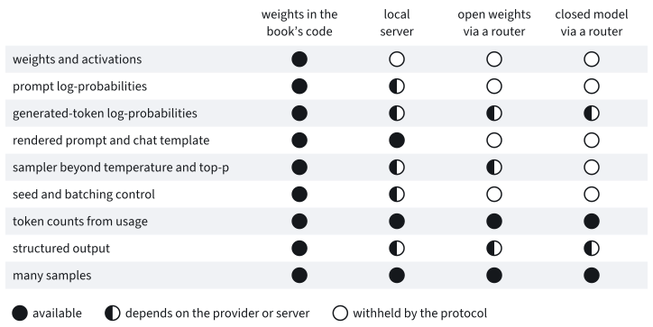

# Models behind an API
:label:`sec_lm_api`

<!-- execution: locked; requires: openrouter -->

Every model in this chapter so far ran on our own GPU. We read its files,
ran its tensors in the book's code, prompted it, scored it and opened it up.
None of these models had more than a few billion parameters.

The open models that people use most are far larger. DeepSeek-V4.1-Flash,
whose weights anyone may download, has about three quarters of a trillion
parameters, more than a server with eight 40 GB GPUs can hold even at four
bits per weight. Yet anyone with an account can send it a grade-school word
problem and read the answer a second or two later, for less than a hundredth
of a cent. The model is then somebody else's service, reached through an
*application programming interface* (API): we send a request over the
network and receive text. What can we still measure about a model that we
cannot hold, and how do we keep those measurements as trustworthy as the
earlier ones?

A client can observe three things about a hosted model: a protocol, a price
and limits. The protocol is the *chat-completions* request, which OpenAI
introduced with its chat models in 2023 and which nearly every company that
hosts models, and every local server, has since adopted. The client is the
measuring instrument, and the theory it needs is old: queueing theory, which
telephone engineers developed to decide how many lines an exchange needs.
Later chapters call hosted models to write questions and training data, so
every number from a service needs a date, the name of the company that
served it, a cost and a record that the book can replay.

We reuse the prompt builder of :numref:`sec_lm_prompting`, the answer
extractor and the GSM8K problems of :numref:`sec_lm_scoring`, and the paired
tests of :numref:`sec_lm_eval_suites`. At the end we ask which of this
chapter's instruments survive behind an API.

```{.python .input #api-imports}
%%tab pytorch
import math
import numpy as np
import torch
from torch import nn
from torch.nn import functional as F
from d2l import torch as d2l
```

```{.python .input #api-imports-extra}
%%tab pytorch
import asyncio
import collections
import contextlib
import datetime
import gc
import hashlib
import heapq
import json
import os
import pandas as pd
import random
import re
import sys
import time
from scipy import stats
from transformers.cli.serving.chat_completion import (
    UNUSED_CHAT_COMPLETION_FIELDS)
```

## The Chat-Completions Protocol
:label:`subsec_lm_chat_protocol`

### Hosted Models and Their Providers

Open weights are hosted by many companies at once, each of which sells
access by the token. We call such a company a *provider*. A *router* is a
service that puts one address and one account in front of many providers and
forwards each request to one of them. We use the router OpenRouter, and for
each model we *pin* one provider, so that every request for that model is
served by the same company.

Calling a service costs money, and a service does not answer the same way
twice. The outputs on this page are therefore a recording. We sent every
request once, on 13 November 2026, and stored the responses, and the cells
below replay them without touching the network
(:numref:`subsec_lm_api_client` shows how). With a key of your own you can
make your own recording. Most of the next cell configures that machinery,
and only its four model names matter now. DeepSeek-V4.1-Flash is the model
that the code and the tables call the *flagship*. Qwen3.8-27B is a much
smaller open-weight model, gpt-5-nano a closed model that appears in one
test only, and Qwen3-4B the model that will run behind a server on our own
GPU.

```{.python .input #api-config}
%%tab pytorch
API_MODE = os.environ.get('D2L_API_MODE', 'replay')  # or record, live
assert API_MODE in ('replay', 'record', 'live'), API_MODE
if API_MODE != 'replay' and not os.environ.get('OPENROUTER_API_KEY'):
    print(f'D2L_API_MODE={API_MODE} needs OPENROUTER_API_KEY: replaying')
    API_MODE = 'replay'
COST_CAP_USD = 5.0  # for all paid calls of one recording
RECORD_DIR = os.path.join('..', 'data', 'lm-api', 'record')
D2L_API_LOG_DIR = os.environ.get(  # logs outside the repository
    'D2L_API_LOG_DIR', os.path.expanduser('~/.local/share/d2l/lm-api'))
FLAGSHIP = 'deepseek/deepseek-v4.1-flash-1017'  # a dated snapshot id
SECOND = 'qwen/qwen3.8-27b'
CLOSED = 'openai/gpt-5-nano'  # probe only; its outputs are never committed
PROVIDERS = {FLAGSHIP: 'novita', SECOND: 'parasail', CLOSED: 'openai'}
LISTED = [FLAGSHIP, SECOND, CLOSED]  # the router models of the listing
LOCAL = 'Qwen/Qwen3-4B'  # behind transformers serve on our GPU
LOCAL_MODEL = f'{LOCAL}@{d2l.HF_REVISIONS[LOCAL]}'  # requests name id@rev
LOCAL_LIVE = API_MODE != 'replay' and torch.cuda.is_available()
LOCAL_MODE = API_MODE if LOCAL_LIVE else 'replay'
API_SHA1 = {  # the committed caches (zips), recorded 2026-11-13
    'lm-api-listing-v1': '4916ce668be31ed37947dac80bc094a70ee75efc',
    'lm-api-fields-v2': '9a12dce5a344f3e746de0c915fa3d2f505ee0f71',
    'lm-api-probe-v2': 'e9aea3523b8ced2383500d3772bfb82893733354',
    'lm-api-sweep-v1': '63250dccbf90eae6143b5affe74ae25972f514b1',
    'lm-api-gsm8k-v1': '1fbb38c4cf5f65fb69da5ba3719cd850ba768dc6',
    'lm-api-determinism-v1': '448e39446d960dac298a5db3a4e6c0b95051683b',
    'lm-api-effort-v1': '7480d44c1bc2b6f8d2ac90aadf9f50689b569b9b'}
for key, sha1 in API_SHA1.items():
    if sha1 is not None:
        d2l.DATA_HUB[key] = (d2l.LM_DATA_URL + key + '.zip', sha1)
rec = d2l.APIRecording(API_MODE, RECORD_DIR, COST_CAP_USD, PROVIDERS)

def usd(api, r):  # cost of one response: the provider's, else the listing's
    cost = r.usage.get('cost')
    return d2l.api_cost(r.usage, api.price) if cost is None else cost

print(f'mode {API_MODE}, cost cap {COST_CAP_USD} USD, local server '
      f'{"live" if LOCAL_LIVE else "replayed"}')
```

The cell reports that it replays. What does a router know about its
providers? For each of them its listing gives the context length, the
prices and the request fields that the provider says it supports, and for
most of them the precision of the served weights. The next cell prints the
rows of our three pinned providers from a snapshot that was taken during
the recording.

```{.python .input #api-listing}
%%tab pytorch
WEIGHTS = {  # the open weights behind each model, at a pinned commit
    FLAGSHIP: ('deepseek-ai/DeepSeek-V4.1-Flash-1017',
               '1bae0e1088993b9b82de08f59de5be5a34e42170'),
    SECOND: ('Qwen/Qwen3.8-27B', '37561816e66b5b9153b1b64c10968c18c1e6f4a0'),
    LOCAL: (LOCAL, d2l.HF_REVISIONS[LOCAL])}
LISTING = rec.snapshot_listing(LISTED, WEIGHTS)  # taken when recording
rows = []
for m in LISTED:
    e = d2l.listing_endpoint(LISTING, m, PROVIDERS[m])
    price = d2l.price_from_listing(LISTING, m, PROVIDERS[m])
    rows.append({'model': m.split('/')[1], 'provider': e['tag'],
                 'context': e['context_length'], 'in': price.input,
                 'out': price.output, 'cached': price.cached_input,
                 **{f: f in e['supported_parameters'] for f in (
                     'seed', 'logprobs', 'reasoning')},
                 'json': 'structured_outputs' in e['supported_parameters']})
print(f'listing retrieved {LISTING["retrieved"]}; prices in USD per million '
      f'tokens')
print(pd.DataFrame(rows).to_string(index=False))
```

Prices are in dollars per million tokens, and a generated token costs four
to nine times as much as a prompt token. The column `cached` is a much lower
price for prompt tokens that the provider has kept from an earlier request.
The last four columns are claims, which we shall test. All of these numbers
are dated, since a listing changes without notice.

The suffix `fp8` in the provider column says that both pinned providers
serve 8-bit weights. For Qwen3.8-27B that is half the precision of the
release, which is in bf16. The flagship was released at low precision in
the first place, one part of its weights in 8 bits and the larger part
in 4.

Why not download these models, as before? The next cell multiplies each
parameter count by 2 bytes (bf16), 1 byte (fp8) and half a byte (4 bits), as
if all weights of a model had one precision. It reports the highest of the
three that fits one 24 GB card and servers with eight GPUs of 40 GB or
80 GB.

```{.python .input #api-weights-arith}
%%tab pytorch
PRECISIONS = (('bf16', 2), ('fp8', 1), ('4 bits', 0.5))  # bytes/weight

def best_fit(n, gb):  # the highest precision whose weights fit in gb
    return next((p for p, b in PRECISIONS if n * b <= gb * 1e9), 'none')

rows = []
for m in (FLAGSHIP, SECOND, LOCAL):
    n = LISTING['hf'][m]['params']
    rows.append({'weights': LISTING['hf'][m]['repo'].split('/')[1],
                 'params (B)': n / 1e9,
                 **{f'{p} (GB)': n * b / 1e9 for p, b in PRECISIONS},
                 '24GB card': best_fit(n, 24), '8x40GB': best_fit(n, 8 * 40),
                 '8x80GB': best_fit(n, 8 * 80)})
print(pd.DataFrame(rows).round(1).to_string(index=False))
```

At four bits per weight the flagship still needs 382 GB, and its release,
with part of the weights in eight bits, needs more. Only the server with
eight 80 GB cards can hold it, and that is before a byte is spent on the
key-value cache. Qwen3-4B fits a 24 GB card in bf16, which makes it our
local model.

### Requests and Responses

A chat-completions request is a JSON object sent by HTTP `POST`. Its field
`messages` holds the conversation as a list of roles and contents, the
structure that we passed to a chat template in :numref:`sec_lm_prompting`.
Here the server applies the template, so the client never sees the tokens
that the model reads. Most other fields are the parameters of the sampler of
:numref:`sec_decoding`: `temperature`, `top_p`, `max_tokens`, `stop` and
`seed`. A few fields request extras. `logprobs` asks for the
log-probabilities of the generated tokens, `response_format` for output that
follows a JSON schema, and `stream` for the reply in pieces, called chunks,
as it is generated.

We send the flagship the first GSM8K test problem of
:numref:`sec_lm_scoring`. The client that the next cell creates may spend
the fraction `share` of the recording's cost cap, and it switches off a
feature called reasoning, to which we come in a moment.

```{.python .input #api-first-call}
%%tab pytorch
gsm_train = pd.read_parquet(d2l.download_keyed('gsm8k-train'))
gsm_test = pd.read_parquet(d2l.download_keyed('gsm8k-test'))
samples = pd.read_json(d2l.download_keyed('lm-gsm8k-samples-v1'),
                       lines=True)
# the 100 test problems of the scoring section, by its seeded rule
GSM_IDS = [int(i) for i in dict.fromkeys(samples.problem_id)]
assert GSM_IDS == list(np.random.default_rng(0).permutation(
    len(gsm_test))[:100])
flagship = rec.hosted(FLAGSHIP, rec.cache('lm-api-probe-v2', 'flagship'),
                      share=0.05, reasoning={'enabled': False})
question = [{'role': 'user', 'content': gsm_test.question[GSM_IDS[0]]}]
r = flagship.chat(question, temperature=0, seed=0, max_tokens=512)
print(r.text)
u = r.usage
print(f'finish {r.finish_reason}; {u["prompt_tokens"]} prompt and '
      f'{u["completion_tokens"]} completion tokens ({u["reasoning_tokens"]} '
      f'reasoning, {u["cached_tokens"]} cached)')
print(f'{r.t_total:.2f} s; served {r.model} by {r.provider}; '
      f'system_fingerprint {r.system_fingerprint}')
print(f'{u["cost"]:.6f} USD billed, {d2l.api_cost(u, flagship.price):.6f} '
      f'USD from the listing')
```

The response carries more than text. The field `finish_reason` says why
generation ended: `stop` at the end-of-sequence token, `length` at
`max_tokens`. The field `model` names the model that served the request, and
the router adds the provider. (The field `system_fingerprint`, meant to
identify the serving configuration, came back empty throughout.) The most
important part is the `usage` block: 36 prompt tokens and 118 completion
tokens. The client cannot count these itself, since it has neither the
provider's tokenizer nor the rendered prompt. The `usage` block is therefore
the only record of what was processed and the basis of the bill, here less
than a hundredth of a cent. The answer, 400, is correct.

Many current models can *reason* before they answer: they first generate
text for their own use and then the reply. The protocol bills this text as
completion tokens and counts it against `max_tokens`, which sets a trap.
Qwen3.8-27B reasons by default. We send it the test problem with the longest
reference solution and a budget of 64 tokens, and then again with reasoning
switched off and a budget of 1,024.

```{.python .input #api-reasoning-trap}
%%tab pytorch
second = rec.hosted(SECOND, rec.cache('lm-api-probe-v2', 'second'),
                    share=0.05)
LONGEST = sorted(GSM_IDS, key=lambda i: -len(gsm_test.answer[i]))
hard = [{'role': 'user', 'content': gsm_test.question[LONGEST[0]]}]
trap = second.chat(hard, temperature=0, seed=0, max_tokens=64)  # thinks
u = trap.usage
print(f'content {trap.text!r}, finish {trap.finish_reason}, '
      f'{len(trap.reasoning or "")} characters of reasoning')
print(f'usage: {u["prompt_tokens"]} prompt, {u["completion_tokens"]} '
      f'completion, {u["reasoning_tokens"]} reasoning tokens')
assert trap.text == '' and trap.finish_reason == 'length'
assert u['reasoning_tokens'] == u['completion_tokens'] == 64
answer = second.chat(hard, temperature=0, seed=0, max_tokens=1024,
                     extra_body={'reasoning': {'enabled': False}})
u, last = answer.usage, answer.text.strip().splitlines()[-1]
print(f'thinking off: last line {last!r} (reference '
      f'{d2l.extract_answer(gsm_test.answer[LONGEST[0]])}), '
      f'{u["completion_tokens"]} completion tokens, finish '
      f'{answer.finish_reason}')
assert not u['reasoning_tokens']
assert answer.finish_reason == 'stop', 'thinking off did not finish either'
```

The first reply is empty. All 64 completion tokens were reasoning tokens,
and the budget ran out before the answer began. An empty reply that ends
with `length` and has as many reasoning tokens as completion tokens is the
signature of this failure. With reasoning off the model writes 871 tokens
and ends on the correct answer. (The cell prints the last line of that
reply and not an extracted answer. The reply uses `####` for its headings,
which would mislead the extractor of :numref:`sec_lm_scoring`.) The three
numbered experiments of this section all run with reasoning off, and each
asserts that no response contains reasoning.

Services that reason usually provide a dial as well, on OpenRouter the
field `reasoning` with an `effort` of `low`, `medium` or `high`. We try it
on the flagship, with the five problems that have the longest reference
solutions. The fifteen requests go out together through `d2l.chat_batch`,
a helper that :numref:`subsec_lm_api_client` shows, and the word `await` in
front of it waits until all of them have returned.

```{.python .input #api-effort}
%%tab pytorch
effort_api = rec.hosted(FLAGSHIP, rec.cache('lm-api-effort-v1', 'flagship'),
                        share=0.2)
EFFORTS = ('low', 'medium', 'high')
batch = [{'messages': [{'role': 'user', 'content': gsm_test.question[i]}],
          'temperature': 0, 'seed': 0, 'max_tokens': 16384,
          'extra_body': {'reasoning': {'effort': e}}}
         for e in EFFORTS for i in LONGEST[:5]]
results = await d2l.chat_batch(effort_api, batch, concurrency=15)
assert not any(isinstance(r, Exception) for r in results), results
effort = pd.DataFrame({
    'effort': [e for e in EFFORTS for _ in range(5)],
    'reasoning tokens': [r.usage['reasoning_tokens'] for r in results],
    'completion tokens': [r.usage['completion_tokens'] for r in results],
    'seconds': [r.t_total for r in results],
    'USD': [usd(effort_api, r) for r in results]})
medians = effort.groupby('effort', sort=False).median()
print('an anecdote: n = 5 problems per effort; medians')
print(medians.round({'reasoning tokens': 0, 'completion tokens': 0,
                     'seconds': 2, 'USD': 6}))
paired = effort['reasoning tokens'].to_numpy().reshape(3, 5)  # by problem
for e, t in zip(EFFORTS, paired):
    print(f'{e:6s} reasoning tokens per problem: {t.tolist()}')
for i, j in ((0, 1), (1, 2), (0, 2)):  # paired, problem by problem
    print(f'{EFFORTS[j]} above {EFFORTS[i]} on '
          f'{(paired[j] > paired[i]).sum()} of 5 problems')
```

The dial is a request, and the model decides what to make of it. At `high`
the flagship spent more reasoning tokens than at either other setting on
each of the five problems: in the median about one and a half times as
many, at a third more cost than `low`. The settings `low` and `medium` could
not be told apart. Their medians lie within a few tokens of each other, and
`low` spent more than `medium` on three of the five problems. The response
has the same fields at every setting. Five problems make an anecdote, and
the cell says nothing about accuracy.

### Endpoints and Their Fields

Providers, routers and local servers all accept the protocol. One client
class therefore reaches every model of this section, and to move from one
endpoint to another it changes two strings, the base URL and the model name.

Our local endpoint is `transformers serve`, the server that comes with the
Transformers library. We start it with *continuous batching*: the server
does not wait for a batch to finish, and admits a new request into the
running batch between two decoding steps. One flag deserves attention now,
because it will set the capacity that we measure in Experiment 1:
`--cb-max-memory-percent 0.2` gives the server's key-value cache at most a
fifth of the card's free memory. (Earlier sections used models of the newer
Qwen3.5 family. The server runs Qwen3-4B because Transformers' continuous
batching rejects the linear-attention layers of Qwen3.5 and would serve such
a model one request at a time. :numref:`chap_lm_serving` treats serving
engines in their own right.)

```{.python .input #api-local-start}
%%tab pytorch
NO_THINK_LOCAL = {'extra_body': {'chat_template_kwargs': {
    'enable_thinking': False}}}
STORY_LOCAL = [{'role': 'user', 'content': 'Write a long story.'}]
LOCAL_HTTP = None  # the local endpoint's HTTP client (None: real HTTP)
if LOCAL_LIVE:
    server = d2l.LocalChatServer([
        os.path.join(os.path.dirname(sys.executable), 'transformers'),
        'serve', LOCAL_MODEL, '--continuous-batching', '--dtype', 'bfloat16',
        '--model-timeout', '-1', '--cb-max-memory-percent', '0.2',
        '--host', '127.0.0.1', '--port', '{port}'])
    LOCAL_URL = server.start()
    warm = d2l.ChatAPI(LOCAL_URL, LOCAL_MODEL, mode='live',
                       default_params=NO_THINK_LOCAL)
    tic = time.monotonic()
    warm.chat([{'role': 'user', 'content': 'Hello'}], max_tokens=8)
    print(f'{LOCAL_URL}: ready after {server.load_time:.0f} s, warm-up '
          f'request {time.monotonic() - tic:.1f} s')
    r = warm.chat(STORY_LOCAL, max_tokens=256)  # one request alone
    print(f'{r.usage["completion_tokens"]} tokens in {r.t_total:.1f} s: '
          f'{r.usage["completion_tokens"] / r.t_total:.1f} tokens/s')
else:  # the request hash keeps the host only, so any port replays
    server, LOCAL_URL = None, 'http://127.0.0.1/v1'
    print(f'{LOCAL_URL}: replayed from the committed caches')

def local(cache, mode=LOCAL_MODE):
    """A client of the local server, thinking switched off."""
    return rec.add(d2l.ChatAPI(LOCAL_URL, LOCAL_MODEL, cache=cache, mode=mode,
                               http_client=LOCAL_HTTP,
                               default_params=NO_THINK_LOCAL))
```

On this page the server does not start: its responses were recorded like
all the others.

That every endpoint accepts a request does not mean that every endpoint does
the same thing with it. We make the router refuse what it can: we forbid
fallbacks to other providers and set `require_parameters`, so that a request
fails unless the pinned provider lists every field in it. That still leaves
the provider that lists a field and ignores it. The only defence is to test
each field by its effect.

The next cell writes out two such *detection rules*. The field `seed` is
honoured if two requests with seed 7, sampled at temperature 1, return the
same text and a third with seed 8 returns a different one. The field
`stop=['5']` is honoured if a request to count from 1 to 10 returns a 4 and
no 5. The rules in the library follow the same pattern.

```{.python .input #api-probe}
%%tab pytorch
STORY = [{'role': 'user', 'content':
          'Write a short paragraph about a lighthouse keeper.'}]
COUNT = [{'role': 'user', 'content':
          'Count from 1 to 10, separated by commas.'}]

def seed_honoured(a, b, c):  # STORY with seed 7 twice (replicas), then 8
    return a.text == b.text != c.text

def stop_honoured(a):  # COUNT with stop=['5']
    return '4' in a.text and '5' not in a.text

FIELDS_FILE = os.path.join(rec.folder('lm-api-fields-v2'),
                           'lm-api-fields.csv')
LOCAL_NAME = 'Qwen3-4B (local server)'
if API_MODE != 'replay':  # replay reads the committed table
    off, on = ({'reasoning': {'enabled': s}} for s in (False, True))
    local_off, local_on = ({'chat_template_kwargs': {'enable_thinking': s}}
                           for s in (False, True))
    closed = rec.hosted(CLOSED, os.path.join(D2L_API_LOG_DIR, 'scratch',
                                             'closed-probe.jsonl'),
                        share=0.05)
    endpoints = {  # client, body of every test, thinking on and off,
        # output budget, the id /v1/models should list
        'DeepSeek-V4.1-Flash (Novita)': (flagship, off, on, off, 64,
                                         FLAGSHIP),
        'Qwen3.8-27B (Parasail)': (second, off, on, off, 64, SECOND),
        'gpt-5-nano (OpenAI)': (closed, None, on, off, 2048,
                                CLOSED)}  # a closed model thinks by default
    if LOCAL_LIVE:
        endpoints[LOCAL_NAME] = (local(rec.cache('lm-api-probe-v2', 'local')),
                                 local_off, local_on, local_off, 64, LOCAL)
    await d2l.record_field_probe(
        FIELDS_FILE, endpoints, local_name=LOCAL_NAME, listing=LISTING,
        providers=PROVIDERS, story=STORY, count=COUNT,
        rules={'seed': seed_honoured, 'stop': stop_honoured})
```

In the table of verdicts, *rejected* means an error status, *ignored* that
the request succeeded and the rule failed, and *honoured* that the rule
held. For the local server the last column adds whether the Transformers
source declares the field unused.

```{.python .input #api-probe-table}
%%tab pytorch
SHORT = {'DeepSeek-V4.1-Flash (Novita)': 'flagship',
         'Qwen3.8-27B (Parasail)': 'Qwen3.8-27B',
         'gpt-5-nano (OpenAI)': 'gpt-5-nano', LOCAL_NAME: 'local'}
SENT = {'seed': ['seed'], 'n=2': ['n'],  # the OpenAI fields each test sends
        'logprobs, top 5': ['logprobs', 'top_logprobs'], "stop=['5']":
        ['stop'], 'response_format': ['response_format'],
        'max_completion_tokens=16': ['max_completion_tokens'],
        'stream usage': ['stream_options']}
fields = pd.read_csv(FIELDS_FILE).replace({'endpoint': SHORT})
table = fields.pivot(index='field', columns='endpoint', values='status')
table = table.loc[fields.field.unique(), fields.endpoint.unique()]
table['serve declares unused'] = [
    ('yes' if set(SENT[f]) <= UNUSED_CHAT_COMPLETION_FIELDS else 'no')
    if f in SENT else '' for f in table.index]
print(table.to_string())
batching = fields[(fields.endpoint == 'local') &
                  (fields.field == '4 concurrent requests')].iloc[0]
LOCAL_BATCHES = batching.status != 'serialized'
print(f'local server: {batching.status} ({batching.evidence})')
```

Read the `seed` row first. All three hosted endpoints list `seed`, and all
three ignored it. Novita lists log-probabilities and returned them for only
part of the reply. No endpoint returned two choices for `n=2`, and none
returned the log-probabilities of a prompt.

The three rejections in the closed model's column are of two kinds. The
router itself refused `logprobs` and `stop`: the listing of this model
lacks both fields, and we had set `require_parameters`. The switch that
turns reasoning off reached OpenAI, which rejected it, since this model
always reasons. Under a cap of 16 completion tokens its `usage` then
reported more reasoning tokens than completion tokens. Our statement that
reasoning tokens are counted inside completion tokens is therefore limited
to the endpoints of our experiments.

The last row sends four requests at once. Where the endpoint batches them,
the latency hardly changes. Parasail answered some of the four with the
status 429, "too many requests".

The local column agrees with the Transformers source in all rows but two.
The server ignores `stop`, which the source does not declare unused: it
hands the field to a generation setting that its continuous-batching path
never reads. And `stream usage` is honoured although the source declares
`stream_options` unused, because this server sends `usage` with the last
chunk of every stream, asked or not. A declaration in the source is a claim,
like a row in a listing. (The row `/v1/models` reads *ignored* because the
server lists its cached models by branch name, and we fetched Qwen3-4B by
commit.) Such a table is a snapshot of a single day. It cost us less than a
cent, and it is worth making before any experiment that relies on a field.

## A Measuring Client
:label:`subsec_lm_api_client`

### Records, Replays and Cost

Every call so far went through one class, `d2l.ChatAPI`. Its plumbing is in
the library, and the methods that carry ideas are shown here. The first idea
is the record. A response from a service cannot be recomputed, so the client
appends each one to a file and looks there before it sends anything. The
lookup key is a hash of the request, and the design lies in what enters it.

Every field that can change the response must be in the hash: the host, the
model, the messages, the sampling and format fields, and the routing fields,
since a different provider is a different service. If one is missing, the
cache silently returns a stale answer to a changed question. Nothing secret
may be in the hash, which excludes the headers with the API key, and nothing
that leaves the response unchanged, such as the choice of streaming.

```{.python .input #api-request-hash}
%%tab pytorch
#@save
def request_hash(base_url, model, messages, params, replica=0):
    """sha256 of the canonical JSON (sorted keys, no whitespace, UTF-8) of
    what can change a response: the endpoint's hostname, the model, the
    messages, the merged parameters (None values dropped) without the
    transport fields stream, stream_options, timeout and extra_headers, and
    the client-side replica number."""
    from urllib.parse import urlsplit  # not in the d2l library preamble
    transport = ('stream', 'stream_options', 'timeout', 'extra_headers')
    params = d2l._chat_merge(params, {})  # drops None values at every level
    params = {k: v for k, v in params.items() if k not in transport}
    key = {'host': urlsplit(base_url).hostname, 'model': model,
           'messages': messages, 'params': params, 'replica': replica}
    blob = json.dumps(key, sort_keys=True, separators=(',', ':'),
                      ensure_ascii=False)
    return hashlib.sha256(blob.encode('utf-8')).hexdigest()
```

One part of the key exists only on the client, the number `replica`. Without
it two identical requests would share one cache entry, and we shall soon
want twenty answers to one question. Which of the five variations in the
next cell should change the hash?

```{.python .input #api-hash-demo}
%%tab pytorch
url = 'https://openrouter.ai/api/v1'
model = 'deepseek/deepseek-v4.1-flash-1017'
messages = [{'role': 'user', 'content': 'What is 17 * 23?'}]
pin = {'only': ['novita'], 'allow_fallbacks': False,
       'require_parameters': True}
params = {'temperature': 0, 'seed': 0, 'max_tokens': 64,
          'extra_body': {'provider': pin}}
variants = {
    'request': (url, params, 0),
    'stream=True': (url, {**params, 'stream': True}, 0),
    'another API key': (url, {**params, 'extra_headers': {
        'Authorization': 'Bearer another-key'}}, 0),
    'replica=1': (url, params, 1),
    'seed=1': (url, {**params, 'seed': 1}, 0),
    'provider parasail': (url, {**params, 'extra_body': {
        'provider': {**pin, 'only': ['parasail']}}}, 0)}
for name, (u, p, replica) in variants.items():
    print(f'{name:18s}', request_hash(u, model, messages, p, replica)[:12])
```

Streaming and a different API key leave the hash unchanged. A replica
number, a seed and a provider each change it. The client uses the cache in
one of three modes. In mode `replay` a miss raises an error, so a page that
replays can never reach the network. Mode `record` sends only what is
missing, and mode `live` always sends. A replay returns one recorded draw
from the service. It makes this page reproducible, and it does not make the
service deterministic, as we shall see.

The second idea is that cost is arithmetic on `usage`. A provider charges
per token at up to three rates, in dollars per million tokens:
$r_\textrm{in}$ for prompt tokens, $r_\textrm{out}$ for completion tokens,
and a lower rate $r_\textrm{cache}$ for prompt tokens that it has kept from
an earlier request with the same beginning, its *prompt cache*. A response
with $n_\textrm{in}$ prompt tokens, of which $n_\textrm{cache}$ were cached,
and $n_\textrm{out}$ completion tokens costs

$$
\frac{(n_\textrm{in} - n_\textrm{cache})\, r_\textrm{in}
+ n_\textrm{cache}\, r_\textrm{cache}
+ n_\textrm{out}\, r_\textrm{out}}{10^6}
$$
:eqlabel:`eq_lm_api_cost`

dollars. Reasoning tokens need no term of their own, because they are part
of $n_\textrm{out}$.

```{.python .input #api-price}
%%tab pytorch
#@save
PricePoint = collections.namedtuple(  # USD per `per` tokens
    'PricePoint', ['input', 'output', 'cached_input', 'per'],
    defaults=(None, 1_000_000))

#@save
def api_cost(usage, price):
    """Cost in USD of one response, ((p - c) input + c cached_input +
    o output) / per, with p prompt, c cached and o completion tokens from
    usage (reasoning tokens are inside o). cached_input None means no
    discount; missing cached tokens count as 0; missing prompt or
    completion tokens raise ValueError."""
    p, o = usage.get('prompt_tokens'), usage.get('completion_tokens')
    if p is None or o is None:
        raise ValueError(f'usage lacks prompt or completion tokens: {usage}')
    c = usage.get('cached_tokens') or 0
    cached = price.input if price.cached_input is None else price.cached_input
    return ((p - c) * price.input + c * cached + o * price.output) / price.per
```

At Novita's rates, 1,000 prompt tokens and 300 completion tokens should cost
$0.000165 + 0.000198 = 0.000363$ dollars. The next cell checks this, and
then asks the listing for the prices of a second provider at two hours of
the same day.

```{.python .input #api-cost-example}
%%tab pytorch
novita = d2l.price_from_listing(LISTING, FLAGSHIP, 'novita')
print(f'Novita, USD per million tokens: {novita.input} in, {novita.output} '
      f'out, {novita.cached_input} cached in')
usage = {'prompt_tokens': 1000, 'completion_tokens': 300}
cost = d2l.api_cost(usage, novita)
assert abs(cost - (1000 * novita.input + 300 * novita.output) / 1e6) < 1e-15
print(f'1,000 prompt and 300 completion tokens: {cost:.6f} USD')
assert f'{cost:.6f}' == '0.000363', 'the text quotes 0.000363 USD: update it'
for hour in (2, 12):  # a Thursday, inside and outside a peak window
    when = datetime.datetime(2026, 11, 12, hour, tzinfo=datetime.timezone.utc)
    price = d2l.price_from_listing(LISTING, FLAGSHIP, 'deepseek', when=when)
    print(f'DeepSeek at {when:%a %H:%M} UTC: {price.input:.3f} in, '
          f'{price.output:.3f} out')
```

On a weekday, DeepSeek's own endpoint for the same model lists twice its
noon price at two in the morning, UTC. A cost therefore needs the hour of
the request as well as the day.

Since the cost of a request can be bounded before it is sent, the client
also enforces a budget. Before each live call it reserves the worst case,
one prompt token per byte of the request plus `max_tokens` completion
tokens, and it refuses to send when the reservation would cross the cap.

### Retries and Full-Jitter Backoff

A service fails in ways that a local model does not. Connections drop,
requests time out, and a busy provider answers with the status 429,
sometimes with a header `Retry-After` that says how long to wait. The client
should retry these failures, but not a malformed request or a bad key (the
statuses 400 and 401), which would fail forever. How long should it wait?

The standard answer is *exponential backoff*: after the failed attempt $a$,
counted from 0, wait at most $d_a = \min(d_{\max}, b\,2^a)$ for a base $b$
and a cap $d_{\max}$. But consider many clients that fail at the same
moment. If each of them waits $d_a$, they all return together and fail
together again. *Full jitter* :cite:`Brooker.2015` breaks the tie: each
client sleeps for a time drawn uniformly from $[0, d_a]$.

```{.python .input #api-backoff}
%%tab pytorch
#@save
def backoff_delay(attempt, base=1.0, cap=60.0, rng=None, retry_after=None):
    """Full-jitter sleep after failed attempt `attempt` (0, 1, ...): uniform
    on [0, min(cap, base 2^attempt)], and at least the server's
    Retry-After."""
    rng = rng or random
    return max(retry_after or 0, rng.uniform(0, min(cap, base * 2**attempt)))
```

A uniform draw from $[0, d_a]$ has mean $d_a/2$. Suppose that each attempt
fails independently with probability $p$. The client sleeps after attempt
$a$ only if the attempts $0, \ldots, a$ all failed, which has probability
$p^{a+1}$. With at most $K$ retries the expected total sleep is therefore

$$
\mathbb{E}[S] = \sum_{a=0}^{K-1} p^{a+1}\, \frac{d_a}{2}.
$$
:eqlabel:`eq_lm_backoff_wait`

Take $b = 1$ s and $d_{\max} = 60$ s. A client that fails six times in a row
sleeps $(1 + 2 + 4 + 8 + 16 + 32)/2 = 31.5$ s on average, against 63 s
without jitter. With $p = 0.3$ and $K = 6$ the terms are
$0.15, 0.09, 0.054, \ldots$, each 0.6 times the one before, and they sum to
0.3575 s. In words: even when three attempts in ten fail, retrying costs a
request about a third of a second on average. Backoff is cheap as long as
failure is the exception.

The method `achat` puts the parts in order: the cache lookup, the cost
reservation, then the retry loop. It is an `async` function, the first in
this book. Python suspends such a function at every `await`, here while it
sleeps or waits for the network, and runs other pending calls in the
meantime, all in one thread. This is how a single notebook cell keeps
dozens of requests in flight. A caller writes `await` in front of the call
to wait for its result, and a notebook cell may do so directly.

```{.python .input #api-achat}
%%tab pytorch
@d2l.add_to_class(d2l.ChatAPI)  #@save
async def achat(self, messages, *, replica=0, stream=False, **params):
    """One chat completion as a d2l.ChatResult. The cache answers first when
    the mode allows; a live call reserves its worst-case cost, retries
    connection errors, timeouts, 408, 429 and 5xx responses and error
    events inside a stream with full-jitter backoff (Retry-After as a
    floor), and raises at once on any other status."""
    import asyncio  # not in the d2l library preamble
    params = d2l._chat_merge(self.default_params, params)
    h = d2l.request_hash(self.base_url, self.model, messages, params, replica)
    self._stats['calls'] += 1
    hit = self._lookup(h, messages)  # raises ReplayMiss in replay mode
    if hit is not None:
        return hit
    reserved = self._reserve(messages, params)  # raises CostCapExceeded
    t_send, n_retries, n_429 = time.monotonic(), 0, 0
    created = time.strftime('%Y-%m-%dT%H:%M:%SZ', time.gmtime())
    try:
        for attempt in range(self.max_retries + 1):
            try:
                out = await self._send(messages, params, stream, h, replica,
                                       attempt)
                break
            except Exception as e:
                retry, status, retry_after = self._retry_info(e)
                n_429 += status == 429
                if not retry or attempt == self.max_retries:
                    e.n_retries, e.n_429 = n_retries, n_429
                    raise
                n_retries += 1
                await asyncio.sleep(d2l.backoff_delay(
                    attempt, self.backoff_base, self.backoff_cap, self.rng,
                    retry_after))
    except BaseException:
        self._settle(reserved, 0.0)
        raise
    return self._record(h, messages, params, replica, out, t_send, created,
                        n_retries, n_429, reserved)
```

Two details matter for measurement. A `Retry-After` header is a floor under
the jittered sleep. And the client counts every 429 itself: the OpenAI SDK
that carries the requests would by default retry twice on its own and hide
those failures, so its retries are switched off. The function `chat_batch`
sends a list of requests with a bound on how many are in flight, and it
returns the results in the order of the requests.

```{.python .input #api-chat-batch}
%%tab pytorch
#@save
async def chat_batch(api, requests, *, concurrency=8):
    """Send requests (dicts with 'messages', optionally 'replica' and request
    parameters) through api with at most `concurrency` in flight; results
    come in input order, a failed request as its exception. A replay miss
    or a capped call is not a result: once every request has finished (the
    paid ones are cached), the first d2l.ReplayMiss or d2l.CostCapExceeded
    is raised, with the whole list as its `results` attribute."""
    import asyncio  # not in the d2l library preamble
    semaphore = asyncio.Semaphore(concurrency)
    async def one(request):
        async with semaphore:
            try:
                request = dict(request)
                return await api.achat(request.pop('messages'), **request)
            except Exception as e:
                return e
    results = await asyncio.gather(*(one(r) for r in requests))
    for r in results:
        if isinstance(r, (d2l.ReplayMiss, d2l.CostCapExceeded)):
            r.results = results
            raise r
    return results
```

We test the retry loop on `d2l.FakeChatServer`, a stand-in inside the
notebook's process that answers after a fixed service time, a given number
of requests at a time. Here it is scripted to answer 429 twice before it
succeeds, and then to answer 401.

```{.python .input #api-retry-mock}
%%tab pytorch
hello = [{'role': 'user', 'content': 'Hello'}]
fake = d2l.FakeChatServer(0.01, 1, script=[429, 429, 200])
api = d2l.ChatAPI('http://fake.local/v1', 'fake-model', mode='live',
                  http_client=fake.transport())
r = api.chat(hello, max_tokens=8)
print(f'attempts {fake.n_requests}, 429s {r.n_429}, retries {r.n_retries}')
assert (fake.n_requests, r.n_429, r.n_retries) == (3, 2, 2)
fake = d2l.FakeChatServer(0.01, 1, script=[401])
api = d2l.ChatAPI('http://fake.local/v1', 'fake-model', mode='live',
                  http_client=fake.transport())
try:
    api.chat(hello, max_tokens=8)
except Exception as e:
    error = e
else:
    raise AssertionError('the 401 was not raised')
print(f'{type(error).__name__} after {fake.n_requests} attempt')
assert getattr(error, 'status_code', None) == 401 and fake.n_requests == 1
```

The first request needed three attempts, and the client counted two 429s.
The second raised its error after one attempt. Next we check
:eqref:`eq_lm_backoff_wait` with 200,000 simulated clients.

```{.python .input #api-backoff-check}
%%tab pytorch
p, K, rng = 0.3, 6, random.Random(0)
def total_sleep():
    sleep = 0.0
    for a in range(K):
        if rng.random() >= p:
            break
        sleep += d2l.backoff_delay(a, 1.0, 60.0, rng)
    return sleep
draws = np.array([total_sleep() for _ in range(200_000)])
formula = sum(p**(a + 1) * min(60, 2**a) / 2 for a in range(K))
print(f'E[S] = {formula:.4f} s; simulated {draws.mean():.4f} '
      f'+- {3 * draws.std() / np.sqrt(len(draws)):.4f} s (3 sigma)')
```

The simulation agrees with the formula. Jitter halves the mean sleep, which
is welcome, but that is not why it exists. The reason shows only when many
clients fail together. In the last simulation 64 clients send at the same
instant to a server that admits ten requests in any window of one second
and rejects the rest, once with the fixed waits $d_a$ and once with full
jitter.

```{.python .input #api-retry-storm}
%%tab pytorch
def retry_storm(n=64, rate=10, jitter=True, seed=0):
    """Simulated time: n clients send at t = 0 to a server that admits at
    most `rate` requests in any one-second window and rejects the rest; a
    rejected client sleeps and retries. Returns attempts and finish time."""
    rng, admitted = random.Random(seed), collections.deque()
    events, attempts, t_done = [(0.0, i, 0) for i in range(n)], 0, 0.0
    while events:
        t, i, a = heapq.heappop(events)
        attempts += 1
        while admitted and admitted[0] <= t - 1:
            admitted.popleft()
        if len(admitted) < rate:
            admitted.append(t)
            t_done = max(t_done, t)
        else:
            d = d2l.backoff_delay(a, rng=rng) if jitter else min(60, 2**a)
            heapq.heappush(events, (t + d, i, a + 1))
    return attempts, t_done

storms = {jitter: np.array([retry_storm(jitter=jitter, seed=k)
                            for k in range(200)]) for jitter in (False, True)}
print('over 200 seeds: median (min to max)')
for jitter, name in ((False, 'no jitter:  '), (True, 'full jitter:')):
    (a_lo, t_lo), (a_mid, t_mid), (a_hi, t_hi) = np.percentile(
        storms[jitter], [0, 50, 100], axis=0)
    print(f'{name} all done at {t_mid:.1f} s ({t_lo:.1f} to {t_hi:.1f}), '
          f'{a_mid:.0f} attempts ({a_lo:.0f} to {a_hi:.0f})')
fewer = (storms[True][:, 0] < storms[False][:, 0]).sum()
print(f'full jitter makes fewer attempts on {fewer} of 200 seeds')
```

Without jitter the clients return in lockstep. Each wave gets ten of them
through, and the last four finish after 63 s, the sum of the six waits
above. With full jitter all clients are done after about 15 s in the median
run, and after about half a minute in the slowest of 200. The number of
attempts hardly differs. What jitter changes is when the retries arrive:
spread over the interval, they find the windows that synchronized clients
leave empty.

## Concurrency and Throughput
:label:`subsec_lm_api_concurrency`

### Little's Law for a Closed Loop

How many requests should a client keep in flight? One at a time wastes a
server that batches, and a thousand at once are answered with a stream of
429s. The answer rests on a result from 1961. *Little's law*
:cite:`Little.1961` relates three averages of any system in a steady state:
the number $L$ of requests inside, the rate $X$ at which requests pass
through, and the time $W$ that a request spends inside. It says that

$$L = X W.$$

A shop that serves two customers a minute, each of whom stays for five
minutes, holds ten customers on average. The law assumes nothing about how
requests arrive or how long each one takes.

Our client runs a *closed loop*: it keeps $c$ requests in flight and sends a
new one the moment one returns. Then $L = c$ is not measured but set, and
the law ties together the two quantities that we do measure, the throughput
$X$ in requests per second and the latency $W$ in seconds: $XW = c$. A
server has two regimes. Lightly loaded, it answers each request in its
unloaded latency $W_0$, so that $X = c/W_0$ grows in proportion to $c$. But
a server also has a capacity $X_{\max}$, and once the throughput has reached
it, the law leaves the latency no choice: $W = c/X_{\max}$. Together,

$$
X(c) = \min\left(\frac{c}{W_0},\, X_{\max}\right), \qquad
W(c) = \max\left(W_0,\, \frac{c}{X_{\max}}\right).
$$
:eqlabel:`eq_lm_littles_law`

The two regimes meet at the *knee* $c^* = X_{\max} W_0$. Below the knee,
more concurrency gives more throughput at the same latency. Beyond it, more
concurrency gives only more latency. With $W_0 = 2$ s and $X_{\max} = 8$
requests per second the knee lies at $c^* = 16$. A client that keeps 32
requests in flight receives the same 8 answers per second and waits 4 s for
each.

To measure $X$ and $W$ we avoid the two ends of a run, where all $c$
requests start together and where the loop drains. The function
`closed_loop_stats` uses only the *steady window*, from the $c$-th to the
$(N - c)$-th of the $N$ completions. For streamed replies it also reports
the *time to first token*, the delay between sending a request and receiving
the first token of its reply.

Two further numbers check the measurement and not the server. The first,
`little`, is the ratio $XW/c$. We set $L = c$ and the law always holds, so
only the way we measure can move this ratio away from 1. The window may be
too short to be steady. Or the latencies vary so much that the requests
wholly inside the window, the only ones that $W$ averages, are not
representative: short requests fit inside more easily, and the ratio falls
below 1. The second number, `sustained`, is the mean number of requests in
flight divided by $c$. It falls below 1 when slots of the loop stand empty,
because a request failed or because the client was slow to send the next
one, and then $L = c$ did not hold. Check that both are near 1, and then
read $X$ and $W$.

```{.python .input #api-closed-loop}
%%tab pytorch
#@save
def closed_loop_stats(results, c):
    """Throughput and latency of a closed loop that kept c requests in
    flight; exceptions count as n_failed. The steady window runs from the
    c-th to the (N - c)-th of the N completions. X is the completions per
    second inside it (X_tokens their completion tokens), W the mean latency
    and ttft_mean the mean time to first token of the requests wholly inside
    it, and Lbar the mean number in flight; little = X W / c, sustained =
    Lbar / c. ttft_p50 and ttft_p90 are over all N."""
    d2l.check_closed_loop(results, c)  # one loop of c, from one run
    ok = [r for r in results if not isinstance(r, BaseException)]
    N = len(ok)
    if N <= 2 * c:
        raise ValueError(f'{N} results at c = {c}; need more than 2c')
    s = np.array([r.t_send for r in ok])
    f = s + np.array([r.t_total for r in ok])
    t_a, t_b = np.sort(f)[[c - 1, N - c - 1]]
    window = t_b - t_a
    if window <= 0:
        raise ValueError('the steady window is empty')
    done = (f > t_a) & (f <= t_b)  # completions inside the window
    inside = (s >= t_a) & (f <= t_b)  # requests wholly inside it
    tokens = [r.usage.get('completion_tokens') for r, d in zip(ok, done) if d]
    X = done.sum() / window
    W = (f - s)[inside].mean() if inside.any() else float('nan')
    Lbar = np.clip(np.minimum(f, t_b) - np.maximum(s, t_a), 0, None).sum()
    # the first token: the first content when the reasoning is only
    # whitespace (the empty think block of a server with thinking off)
    firsts = [r.t_first if (r.reasoning or '').strip() or (
        r.t_first_content is None) else r.t_first_content for r in ok]
    ttft = [None if t is None else t - r.t_send for r, t in zip(ok, firsts)]
    known = [t for t in ttft if t is not None]
    p50, p90 = (map(float, np.percentile(known, [50, 90])) if known
                else (None, None))
    steady = [t for t, i in zip(ttft, inside) if i and t is not None]
    X_tokens = None if None in tokens else float(sum(tokens) / window)
    return {'X': float(X), 'X_tokens': X_tokens,
            'W': float(W), 'Lbar': float(Lbar / window),
            'little': float(X * W / c), 'sustained': float(Lbar / window / c),
            'ttft_p50': p50, 'ttft_p90': p90,
            'ttft_mean': float(np.mean(steady)) if steady else None,
            'n_429': sum(getattr(r, 'n_429', 0) or 0 for r in results),
            'n_retries': sum(getattr(r, 'n_retries', 0) or 0 for r in results),
            'n_failed': len(results) - N, 'window': float(window),
            'n_window': int(done.sum())}
```

We first point the instrument at a server whose answer we know. The fake
server takes 0.1 s per request and serves 8 at a time, so $X_{\max} = 80$
requests per second and $c^* = 8$. Up to 8 requests in flight the throughput
should be about $10c$ per second. At 16 and 32 it should stay at 80, while
the latency doubles to 0.2 s and again to 0.4 s.

```{.python .input #api-littles-fake}
%%tab pytorch
service_time, capacity = 0.1, 8  # X_max = 80 requests per second
api = d2l.ChatAPI('http://fake.local/v1', 'fake-model', mode='live',
                  http_client=d2l.FakeChatServer(service_time,
                                                 capacity).transport())
rows = []
gc.collect()
gc.freeze()  # no collector pauses inside the timed requests
for c in (1, 2, 4, 8, 16, 32):
    batch = [{'messages': [{'role': 'user', 'content': f'question {i}'}],
              'max_tokens': 16} for i in range(8 * c)]
    stats_c = closed_loop_stats(await chat_batch(api, batch,
                                                 concurrency=c), c)
    rows.append({'c': c, 'X': stats_c['X'], 'W': stats_c['W'],
                 'little': stats_c['little'],
                 'sustained': stats_c['sustained']})
table = pd.DataFrame(rows)
W_0 = table['W'][0]  # as the client sees it: service time plus its own work
table['formula X'] = np.minimum(table['c'] / W_0, capacity / service_time)
gc.unfreeze()
assert (abs(table['X'] / table['formula X'] - 1) < 0.05).all(), table
assert (abs(table[['little', 'sustained']] - 1) < 0.02).all().all(), table
table.round(3)
```

The measured throughput follows :eqref:`eq_lm_littles_law` at every level,
and both ratios stay within 2% of 1, as the cell asserts. The instrument
works.

### The Knee of a Local Server

Experiment 1 runs the closed loop against Qwen3-4B on our own server, where
a knee must exist and requests cost nothing. Each request asks a GSM8K
training question, streams the reply, and stops after 64 tokens. We sweep
$c$ from 1 to 128 in powers of two with $8c$ requests per level, twice and
in shuffled order, so that a drift of the server cannot pass for an effect
of $c$. A helper cell defines one level of the loop and the printed table.

```{.python .input #api-sweep-helpers}
%%tab pytorch
async def closed_loop(api, c, first, **params):
    """One level of a closed loop: 8c distinct GSM8K train questions from
    index `first` on, c in flight; closed_loop_stats of the results."""
    batch = [{'messages': [{'role': 'user', 'content': q}], **params}
             for q in gsm_train.question.iloc[first:first + 8 * c]]
    results = await chat_batch(api, batch, concurrency=c)
    failed = [r for r in results if isinstance(r, Exception)]
    assert not failed, (  # a failure is not cached: replay would miss it
        f'c = {c}: {len(failed)} failed, first {failed[0]!r:.100}; delete '
        f'{api.cache_path} and record the arm again')
    assert not any(d2l.chat_thinks(r) for r in results), f'c = {c}: thinking'
    return {'c': c, **closed_loop_stats(results, c)}

def check_little(table, little, sustained):
    for _, row in table.iterrows():
        assert abs(row.little - 1) < little and abs(row.sustained - 1) < (
            sustained), (f'c = {row.c}: little {row.little:.3f}, sustained '
                         f'{row.sustained:.3f}, {row.n_retries} retries, '
                         f'{row.n_window} completions in the window')

def show(table):
    """Print a sweep: X in requests/s, X_tokens in tokens/s, times in s, and
    'in decode' = X (W - ttft_mean), Little's law for the decode stage."""
    table = table.assign(decode=table.X * (table.W - table.ttft_mean))
    columns = [k for k in ('pass', 'c', 'X', 'X_tokens', 'W', 'ttft_p50',
                           'ttft_p90', 'decode', 'little', 'sustained')
               if k in table]
    counts = ['n_429', 'n_retries', 'n_failed']
    if table[counts].to_numpy().any():
        columns += counts
    print(table[columns].rename(columns={'decode': 'in decode'}).to_string(
        index=False, formatters={'X': '{:.2f}'.format,
                                 'X_tokens': '{:.0f}'.format,
                                 'in decode': '{:.1f}'.format},
        float_format='{:.3f}'.format))
    if not table[counts].to_numpy().any():
        print('no 429s, retries or failed requests at any level')
```

Besides $X$ and $W$, the table gives the throughput in completion tokens per
second (`X_tokens`) and the median and the 90th percentile of the time to
first token. The column `in decode` applies Little's law a second time, to a
part of the server. A request first waits for its first token and then
decodes. The mean decoding time is $W$ minus the mean time to first token,
and $X$ times this time is the mean number of requests that are decoding at
once.

```{.python .input #api-sweep-local}
%%tab pytorch
# 64 tokens keep the recording near its 30-minute target
SWEEP = {'max_tokens': 64, 'temperature': 0, 'stream': True}
LEVELS = [1, 2, 4, 8, 16, 32, 64, 128] if LOCAL_BATCHES else [1, 2, 4, 8]
sweep_api = local(rec.cache('lm-api-sweep-v1', 'local'))
rng, order = random.Random(0), []
for p in (1, 2):
    levels = list(LEVELS)
    rng.shuffle(levels)
    order += [(p, c) for c in levels]
first, rows = 4, []  # train items 4, 5, ... in execution order
for p, c in order:
    rows.append({'pass': p, **await closed_loop(sweep_api, c, first,
                                                 **SWEEP)})
    first += 8 * c
sweep = pd.DataFrame(rows).sort_values(['pass', 'c'], ignore_index=True)
check_little(sweep, 0.05, 0.03)
show(sweep)
```

Alone, a request takes about 2.7 s for its 64 tokens, or 24 tokens per
second. Up to 16 requests in flight the throughput nearly doubles with every
doubling of $c$, while the latency creeps up to about 3.1 s. Between 32 and
64 the curve bends. At 128 the server delivers no more than at 64, about 12
requests or 750 to 800 tokens per second, and the latency has doubled to
more than 10 s. The two passes agree closely, and both ratios stay within a
few percent of 1. The ratio `little` falls furthest below it at $c = 128$,
where short requests are favoured in the way that we described.

The last columns show what happens inside the server. At $c = 32$ about 28
requests are decoding at once, and nine in ten receive their first token
within about half a second: the server takes in every request as it
arrives. At 64 about 46 are decoding, and the slowest tenth of the requests
wait more than 3.5 s for a first token. At 128 no more are decoding than at
64, and now the median request waits almost 8 s before its reply begins.
The server admits about 45 sequences into its batch and queues the rest.

This is the capacity of the server as we started it, with a fifth of the
card's free memory for its key-value cache. It is not the capacity of the
GPU. Nor had batching stopped helping: with 64 requests in flight, each
decoding sequence still receives its 64 tokens in about 3.7 s, against 2.6 s
when it is alone.

It remains to fit the two parameters of :eqref:`eq_lm_littles_law`. For each
pass we take $W_0$ as the latency at $c = 1$ and $X_{\max}$ as the largest
throughput observed. As a check that does not rest on the model we also
compute the *efficiency* $E(c) = X W_0 / c$, the fraction of the linear
speedup that level $c$ achieves. We call a level past the knee when $E$
stays below 0.7 from there on, and we claim a knee only if both passes put
it at the same level.

```{.python .input #api-sweep-fit}
%%tab pytorch
def fit(table):
    """W_0, X_max, c* and the knee: the smallest level from which on the
    efficiency X W_0 / c stays below 0.7."""
    table = table.sort_values('c')
    W_0, X_max = table.W[table.c == 1].median(), table.X.max()
    E = (table.X * W_0 / table.c).to_numpy()
    knee = next((c for i, c in enumerate(table.c) if (E[i:] < 0.7).all()),
                None)
    return W_0, X_max, X_max * W_0, knee

knees = []
for p, table in sweep.groupby('pass'):
    W_0, X_max, c_star, knee = fit(table)
    knees.append(knee)
    print(f'pass {p}: W_0 {W_0:.2f} s, X_max {X_max:.1f} requests/s, '
          f'c* {c_star:.1f}, efficiency below 0.7 from c = {knee}')
both = knees[0] is not None and knees[0] == knees[1]
print('knee in both passes:', 'yes' if both else 'no')
assert both, "no knee common to both passes: set the server's batch cap"
W_0, X_max, _, _ = fit(sweep)  # pooled, for the fitted curves
tokens = (sweep.X_tokens / sweep.X).mean()  # completion tokens per request
grid = np.geomspace(1, max(LEVELS), 100)
passes = [sweep[sweep['pass'] == p] for p in (1, 2)]
fig, axes = d2l.plt.subplots(1, 2, figsize=(7.4, 2.6),
                             gridspec_kw={'wspace': 0.4})
d2l.plot([t.c.to_numpy() for t in passes] + [grid],
         [t.X_tokens.to_numpy() for t in passes] +
         [np.minimum(grid / W_0, X_max) * tokens], 'requests in flight c',
         'completion tokens/s', legend=['pass 1', 'pass 2', 'fit'],
         xscale='log', fmts=('o', 's', '-'), axes=axes[0])
d2l.plot([t.c.to_numpy() for t in passes] + [grid],
         [t.W.to_numpy() for t in passes] + [np.maximum(W_0, grid / X_max)],
         'requests in flight c', 'mean latency W (s)',
         legend=['pass 1', 'pass 2', 'fit'], xscale='log',
         fmts=('o', 's', '-'), axes=axes[1])
```

Both passes give $W_0 \approx 2.7$ s and $X_{\max} \approx 12$ requests per
second, so the two straight lines of :eqref:`eq_lm_littles_law` meet at
$c^* \approx 33$. The efficiency rule names $c = 64$, again in both passes.
The two statements agree: the corner lies just above 32, and 64 is the first
level of our grid that is clearly past it. The plot shows the two passes
with the fitted curves, the throughput in tokens per second on the left and
the mean latency on the right. The fit is good at both ends and too sharp in
the middle: at $c = 32$ the server delivers about 550 tokens per second
where the model promises more than 750. Real servers round the corner.

What should a client of this server do? The server decodes up to about 45
sequences at once, so raising $c$ from 32 to 64 still adds more than 40% to
the throughput, while the mean latency grows from about 3.6 s to 5.2 s.
Beyond 64 nothing is gained. At 128 the throughput is no higher, the latency
has doubled, and half of the requests wait almost 8 s for their first token.
A client that wants throughput keeps about 64 requests in flight, and one
that wants short waits stays near 32.

Does a hosted provider have a knee as well? Surely, but one client will not
find it. We run three levels of the same loop against the flagship.

```{.python .input #api-sweep-hosted}
%%tab pytorch
contrast = rec.hosted(FLAGSHIP, rec.cache('lm-api-sweep-v1', 'flagship'),
                      share=0.1, reasoning={'enabled': False})
first, rows = 4084, []  # train items after the local sweep's
for c in (1, 8, 32):
    rows.append(await closed_loop(contrast, c, first, **SWEEP))
    first += 8 * c
hosted_sweep = pd.DataFrame(rows)
check_little(hosted_sweep, 0.10, 0.05)
X_c = hosted_sweep.set_index('c').X
print(f'X(32) / X(1) = {X_c[32] / X_c[1]:.1f}')
show(hosted_sweep)
```

The throughput at 32 requests in flight is about 30 times that at 1, the
latency stays at about 1.4 s, and no level drew a 429. We are far below this
provider's knee, so the 21 requests per second are a lower bound on its
capacity and nothing more. Most of the 1.4 s is the wait for the first
token, about 1 s, which is why a time to first token should be reported
apart from the latency of a whole response. One more caution for anyone who
times a stream: chunks are not tokens. A provider may pack several tokens
into one chunk, so a token rate must come from `usage`.

## Accuracy, Cost and Reproducibility
:label:`subsec_lm_api_repro`

### Hosted and Local Models on GSM8K

Experiment 2 asks the question that a user of these services faces: which
model, at what price? We take the 100 GSM8K test problems of
:numref:`sec_lm_scoring` and send every model the same request. It opens
with four worked examples as alternating user and assistant turns, built by
`d2l.fewshot_prompt` of :numref:`sec_lm_prompting`, followed by the
question. We decode at temperature 0 with seed 0, at most 512 tokens and
reasoning off. Each example ends on a line of the form `#### answer`, the
format that `d2l.extract_answer` looks for first. Where a reply has no such
line, the extractor falls back on the last number in it. The prompt, the
decoding settings and the extractor are the same for every arm. What
differs is the model, and that includes how well it follows the format of
its examples.

```{.python .input #api-gsm8k-setup}
%%tab pytorch
GSM_DEMOS = [(q, re.sub(r'<<[^>]*>>', '', a))  # calculator notes removed
             for q, a in zip(gsm_train.question[:4], gsm_train.answer[:4])]
GSM_MESSAGES = [d2l.fewshot_prompt(GSM_DEMOS, gsm_test.question[i],
                                   template='chat_multi') for i in GSM_IDS]
GSM_GOLD = [d2l.extract_answer(gsm_test.answer[i]) for i in GSM_IDS]
GSM_PARAMS = {'temperature': 0, 'seed': 0, 'max_tokens': 512}
for m in GSM_MESSAGES[0]:
    print(f'{m["role"]:9s} {m["content"][:64]!r}')
print('parameters:', GSM_PARAMS)
print('thinking off: reasoning.enabled=False (router), '
      'enable_thinking=False (local)')
```

There are four arms. The flagship runs twice, as replicas 0 and 1 of
identical requests. The second run costs little and gives what no single run
can: the disagreement of a model with itself, the floor below which no
difference between models means anything. Qwen3.8-27B and the local Qwen3-4B
complete the set, each arm with eight requests in flight.

```{.python .input #api-gsm8k-run}
%%tab pytorch
gsm_flagship = rec.hosted(FLAGSHIP, rec.cache('lm-api-gsm8k-v1', 'flagship'),
                          share=0.2, reasoning={'enabled': False})
gsm_second = rec.hosted(SECOND, rec.cache('lm-api-gsm8k-v1', 'second'),
                        share=0.2, reasoning={'enabled': False})
gsm_local = local(rec.cache('lm-api-gsm8k-v1', 'local'))
ARMS = {'flagship r0': (gsm_flagship, 0, 8),
        'flagship r1': (gsm_flagship, 1, 8),
        'Qwen3.8-27B': (gsm_second, 0, 8),
        'Qwen3-4B local': (gsm_local, 0, 8 if LOCAL_BATCHES else 1)}
outs = await asyncio.gather(*(chat_batch(api, [
    {'messages': m, 'replica': k, **GSM_PARAMS} for m in GSM_MESSAGES],
    concurrency=c) for api, k, c in ARMS.values()))
RESULTS, CORRECT, rows = dict(zip(ARMS, outs)), {}, []
for arm, results in RESULTS.items():
    assert not any(isinstance(r, Exception) for r in results), arm
    assert not any(d2l.chat_thinks(r) for r in results), f'{arm}: thinking'
    correct = np.array([d2l.extract_answer(r.text) == g
                        for r, g in zip(results, GSM_GOLD)], dtype=float)
    CORRECT[arm], ci = correct, d2l.bootstrap_ci(correct)
    p50, p90 = np.percentile([r.t_total for r in results], [50, 90])
    rows.append({'arm': arm, 'concurrency': ARMS[arm][2],
                 'accuracy': ci.mean, 'lo': ci.ci[0], 'hi': ci.ci[1],
                 'prompt tokens': np.mean([r.usage['prompt_tokens']
                                           for r in results]),
                 'completion tokens': np.mean([r.usage['completion_tokens']
                                               for r in results]),
                 'p50 s': p50, 'p90 s': p90})
gsm = pd.DataFrame(rows).set_index('arm')
print(gsm.to_string(formatters={
    'prompt tokens': '{:.0f}'.format, 'completion tokens': '{:.0f}'.format,
    'p50 s': '{:.1f}'.format, 'p90 s': '{:.1f}'.format},
    float_format='{:.2f}'.format))
```

The flagship solves 97 of the 100 problems in both replicas, Qwen3.8-27B
solves 94, and the local Qwen3-4B 83, each with a bootstrap interval several
points wide. The flagship is also the fastest, at about a second and a half
per problem in the median. (Not every reply copied the format of the
examples. Many end on a boxed or a bold number, those of the local model
most often, and the extractor's fallback reads them.)

Note the token columns. The same messages are 462 prompt tokens for one
model and 566 for another, since each has its own tokenizer and template,
and the replies of one model are nearly twice as long as those of another.
Tokens cannot be compared across models, and neither can a price per token.
The quantity to compare is the price of a correct answer: the cost of an
arm divided by the number of problems that it solved. For the local arm the
currency is GPU time.

```{.python .input #api-gsm8k-cost}
%%tab pytorch
rows = []
for arm, (api, _, _) in ARMS.items():
    results, n_correct = RESULTS[arm], max(CORRECT[arm].sum(), 1)
    if api.price is not None:  # hosted: dollars, billed and at list price
        cost = sum(usd(api, r) for r in results)
        listed = sum(d2l.api_cost({**r.usage, 'cached_tokens': 0}, api.price)
                     for r in results)  # as if no prompt token were cached
        cached = sum(r.usage.get('cached_tokens') or 0 for r in results)
        rows.append({'arm': arm, 'cached share': cached / sum(
                         r.usage['prompt_tokens'] for r in results),
                     'USD per 100': 100 * cost / len(results),
                     'USD per 1,000 correct': 1000 * cost / n_correct,
                     'at list price': 1000 * listed / n_correct})
    else:  # local: the arm's wall-clock span on one GPU
        span = (max(r.t_send + r.t_total for r in results) -
                min(r.t_send for r in results))
        rows.append({'arm': arm, 'GPU-s per correct': span / n_correct})
cost = pd.DataFrame(rows).set_index('arm')
ratio = cost.loc['Qwen3.8-27B'] / cost.loc['flagship r0']
print(f'Qwen3.8-27B / flagship: accuracy x '
      f'{gsm.accuracy["Qwen3.8-27B"] / gsm.accuracy["flagship r0"]:.2f}; '
      f'USD per correct x {ratio["USD per 1,000 correct"]:.2f} billed, '
      f'x {ratio["at list price"]:.2f} at list price')
print(cost.to_string(na_rep='-', formatters={
    'cached share': '{:.2f}'.format, 'USD per 100': '{:.4f}'.format,
    'USD per 1,000 correct': '{:.3f}'.format,
    'at list price': '{:.3f}'.format, 'GPU-s per correct': '{:.2f}'.format}))
```

A hundred problems cost less than a cent on the flagship and about five
cents on Qwen3.8-27B. Per correct answer the smaller model is about six
times as expensive as billed and still almost four times at list prices,
while the accuracies differ by three points. Three things add up. Parasail's
price for output tokens is more than three times Novita's. Qwen3.8-27B
writes longer replies. And Novita billed about three quarters of the
flagship's prompt tokens, the four examples that open every request, at its
cached rate, while Parasail cached nothing.

The size of a model is a poor guide to its price. Here the model with about
27 times the parameters is the cheaper one per correct answer. One reason
is its architecture. The flagship is a sparse *mixture of experts*: in
every layer it holds several hundred expert sub-networks and sends each
token through a handful of them, so most of its parameters do no work on
any given token. The parameter count tells a provider how much memory to
hold, and much less about the computation that a token costs.

The local model gets its price from the GPU. It needs about 1.3 GPU-seconds
per correct answer with eight requests in flight, which is 0.37 GPU-hours
for 1,000 correct answers. Suppose that the card rents for one dollar an
hour. The 1,000 answers then cost 37 cents, four times the flagship's bill
of 9 cents, and they come from the least accurate of the three models.
Exercise :exref:`ex_lm_api_break_even` works out the rental prices at which
the comparison turns, and what a busier server changes.

Are these differences real at 100 problems? Three tools come from
:numref:`sec_lm_eval_suites`. All arms answered the same problems, so we
compare two arms problem by problem, and the difference in accuracy gets a
paired bootstrap interval. The *discordant* problems are those that one arm
solved and the other did not. The table counts them in the column `b` (only
the first arm solved the problem) and the column `c` (only the second; this
`c` is not the concurrency). The minimum detectable effect (`MDE`) is the
smallest true difference that a sample of this size would detect with 80%
power.

Two tools are new, and both answer to the small sample. With a handful of
discordant problems no normal approximation can be trusted, so we use the
exact *McNemar test*. If two arms were equally accurate, each discordant
problem would fall to either side with probability one half, and the test
computes the binomial probability of a split at least as uneven as the one
observed. Moreover, three comparisons on the same 100 problems give chance
three opportunities. *Holm's method* adjusts for that: it multiplies the
smallest of the three $p$-values by three and the next by two. A difference
counts as resolved only if its adjusted $p$-value is below 0.05 and its
interval excludes zero. The fourth row is the noise floor, replica 0
against replica 1. Read `difference`, the interval and the counts `b` and
`c` first, and the verdict last.

```{.python .input #api-gsm8k-compare}
%%tab pytorch
def holm(p):  # Holm's step-down adjustment of p-values
    adjusted, running = np.empty(len(p)), 0.0
    for rank, i in enumerate(np.argsort(p)):
        running = max(running, min(1.0, (len(p) - rank) * p[i]))
        adjusted[i] = running
    return adjusted

PAIRS = {'flagship - 27B': ('flagship r0', 'Qwen3.8-27B'),
         'flagship - local': ('flagship r0', 'Qwen3-4B local'),
         '27B - local': ('Qwen3.8-27B', 'Qwen3-4B local'),
         'r0 - r1': ('flagship r0', 'flagship r1')}  # the noise floor
rows = []
for name, (a, b) in PAIRS.items():
    x, y = CORRECT[a], CORRECT[b]
    res = d2l.paired_bootstrap(x, y, n_boot=10000, seed=0)
    n_ab, n_ba = int((x > y).sum()), int((x < y).sum())  # discordant
    p = (stats.binomtest(min(n_ab, n_ba), n_ab + n_ba, 0.5).pvalue
         if n_ab + n_ba else 1.0)
    rows.append({'comparison': name, 'difference': res.mean,
                 'lo': res.ci[0], 'hi': res.ci[1], 'b': n_ab, 'c': n_ba,
                 'McNemar p': p, 'MDE': d2l.min_detectable_effect(
                     np.std(x - y, ddof=1), len(x))})
compare = pd.DataFrame(rows)
compare['Holm p'] = list(holm(compare['McNemar p'][:3].to_numpy())) + [None]
floor = compare.iloc[3]
if floor.lo > 0 or floor.hi < 0:
    print('replicas disagree systematically: no verdicts')
else:
    compare['verdict'] = [
        'resolved' if h < 0.05 and (lo > 0 or hi < 0)
        else 'unresolved at n = 100' for h, lo, hi in zip(
            compare['Holm p'][:3], compare.lo[:3], compare.hi[:3])] + [
        'noise floor']
print(compare.to_string(index=False, na_rep='', formatters={
    'difference': '{:.2f}'.format, 'lo': '{:.2f}'.format,
    'hi': '{:.2f}'.format, 'McNemar p': '{:.4f}'.format,
    'MDE': '{:.2f}'.format, 'Holm p': '{:.4f}'.format}))
```

The two replicas of the flagship differ on two problems, one in each
direction: identical requests at temperature 0 with a seed did not give
identical outcomes. Against this floor, a difference of 0.00 with an
interval of $[-0.03, 0.03]$, the three points between the flagship and
Qwen3.8-27B are unresolved. Five discordant problems split four to one, the
interval $[-0.01, 0.08]$ includes zero, and the minimum detectable effect is
about six points. We cannot say from this experiment which of the two models
is more accurate, and the comparison rests on the price of a correct answer.

Both hosted models are resolved from the local one, by 14 points
$[0.07, 0.22]$ and by 11 points $[0.05, 0.18]$. One caution carries over
from :numref:`sec_lm_eval_suites`. GSM8K has been public for years and may
be in the training data of every one of these models, so the scores order
the models on these 100 problems and say nothing absolute about their
arithmetic.

### Determinism and Model Identity

The two replicas raise a question that Experiment 3 asks directly. We send
the same request many times, at temperature 0 and with a fixed seed, and
count the different replies. The requests are the 4-shot prompts of the
three problems with the longest reference solutions. The flagship receives
each of them 20 times. The local server receives each of them five times in
sequence with nothing else running, and five more times while eight other
clients keep it busy.

```{.python .input #api-determinism}
%%tab pytorch
DET_IDS = LONGEST[:3]  # the longest reference solutions
DET_MESSAGES = [GSM_MESSAGES[GSM_IDS.index(i)] for i in DET_IDS]

def replicas(first, n):  # n replicas of each of the three requests
    return [{'messages': m, 'replica': k, **GSM_PARAMS}
            for m in DET_MESSAGES for k in range(first, first + n)]

N_LOCAL = 5  # 30 local replies of 13-18 s stay inside the 30-min target
det_flagship = rec.hosted(FLAGSHIP, rec.cache('lm-api-determinism-v1',
                                              'flagship'),
                          share=0.1, reasoning={'enabled': False})
det_local = local(rec.cache('lm-api-determinism-v1', 'local'))
on_flagship, alone = await asyncio.gather(
    chat_batch(det_flagship, replicas(0, 20), concurrency=4),
    chat_batch(det_local, replicas(0, N_LOCAL), concurrency=1))
BACKGROUND = [i for i in range(len(gsm_test)) if i not in GSM_IDS][:64]
LANES = 8 if LOCAL_BATCHES else 1  # more would queue at a serial server
print(f'under load: {LANES} background lane(s); the local server '
      f'{"batches" if LOCAL_BATCHES else "runs one request at a time"}')

def background(j):  # request j of the load: 64 other problems, cycled
    return {'messages': d2l.fewshot_prompt(GSM_DEMOS, gsm_test.question[
        BACKGROUND[j % 64]], template='chat_multi'), 'replica': j // 64,
            **GSM_PARAMS}

load = (d2l.BackgroundLoad(local(rec.cache('lm-api-determinism-v1',
                                           'background'), mode='live'),
                           background, LANES)
        if LOCAL_LIVE else contextlib.nullcontext())
async with load:  # the load's responses are logged, never replayed
    under_load = await chat_batch(det_local, replicas(100, N_LOCAL),
                                  concurrency=1)
if LOCAL_LIVE:
    print(f'background: {len(load.failures)} failed requests')
```

For each problem and condition the next cell counts the distinct replies,
the character at which a reply first departs from the most common one, and
the distinct final answers.

```{.python .input #api-determinism-table}
%%tab pytorch
rows = []
for condition, results in (('flagship', on_flagship), ('local alone', alone),
                           ('local under load', under_load)):
    assert not any(isinstance(r, Exception) or d2l.chat_thinks(r)
                   for r in results)
    n = len(results) // len(DET_IDS)  # replicas per problem
    for k, i in enumerate(DET_IDS):
        texts = [r.text for r in results[n * k:n * k + n]]
        modal = collections.Counter(texts).most_common(1)[0][0]
        firsts = [len(os.path.commonprefix([t, modal]))  # in characters
                  for t in texts if t != modal]
        rows.append({'condition': condition, 'problem': i, 'replicas': n,
                     'distinct': len(set(texts)),
                     'diverges at (min)': min(firsts, default=None),
                     '(median)': np.median(firsts) if firsts else None,
                     'answers': len({d2l.extract_answer(t) for t in texts})})
print(pd.DataFrame(rows).to_string(index=False, na_rep='-', formatters={
    'diverges at (min)': '{:.0f}'.format, '(median)': '{:g}'.format}))
```

Twenty identical requests to the flagship return five to seven different
texts. They part ways within the first hundred characters, on one problem at
the very first, and all reach the same final answer. The surprise is the
local server, where we chose the seed and nothing else was running: on two
of the three problems the five replies are not all equal either. Here the
cause is the cache. Continuous batching shares the stored keys and values of
a common prompt prefix between requests. The first request computes the
prompt, and the later ones reuse its cached blocks, along a different
numerical path. (We checked this cause. A field of Transformers'
`ContinuousBatchingConfig`, which `transformers serve` does not expose,
switches prefix sharing off, and then the five replies agree.)

Under load every reply is different, and now the answers differ too: two
distinct answers on one problem and three on another.

The mechanism is that of :numref:`subsec_deterministic_arithmetic`.
Floating-point addition is not associative, so the same sum taken in a
different order differs in its last bits. A serving engine batches whatever
requests happen to be in flight, and its kernels choose the order of their
reductions by the shape of the batch. The logits of our request therefore
depend on who else is being served :cite:`He.2025`. At temperature 0 nothing
is sampled, and the seed is beside the point: the smallest change flips a
near-tie between two tokens, and from that token on the texts diverge.

A seed promises reproducibility only for a sampler and kernels that we
control, and behind an API we control neither.
:numref:`sec_lm_deterministic_inference` shows what it takes to make
inference repeatable. Note also what would not have been evidence. Had all
60 hosted replies been identical, that would not have shown determinism,
only that no near-tie happened to flip.

A second kind of drift is slower. The string that we send as `model` names
an entry of a listing, not a set of weights. We used an identifier with a
date in it, since an undated alias may be pointed at a newer release at any
time. One set of weights is served by many providers at precisions from 4 to
16 bits, and by default a router spreads requests over them by price and
load. An experiment that does not pin its provider may therefore compare a
model with a differently quantized copy of itself.

Whether a provider serves the weights that it names is a statistical
question that a client can ask. :citet:`Gao.Liang.Guestrin.2025` compare
samples from an endpoint with samples from the released weights by a
two-sample test, and found commercial endpoints whose outputs differed.
:citet:`Cai.Shi.Zhao.ea.2025` show that such tests are hard to make reliable
against a provider that wants to hide a substitution. Our client therefore
records the served model and the provider with every response. The local
server has done its work and is stopped.

```{.python .input #api-local-stop}
%%tab pytorch
if server is not None:
    print('server exit code', server.stop())
else:
    print('no local server in replay')
```

The last cell adds up the logs of all clients: live calls, retries, 429s and
dollars per cache, the served model and the provider of every arm, and a
reconciliation of the bill.

```{.python .input #api-manifest}
%%tab pytorch
rows, ids = [], set()
for api in {api.calls_path: api for api in rec.clients}.values():
    t = d2l.api_recorded(api)  # totals of every session of the recording
    key = next((k for k in API_SHA1 if k in api.cache_path), 'scratch')
    arm = os.path.splitext(os.path.basename(api.cache_path))[0]
    rows.append({'cache': key.replace('lm-api-', '') + '/' + arm,
                 **{k: t.get(k, 0) for k in (
                     'live calls', 'retries', '429s', 'failed', 'USD',
                     'usage cost', 'listing cost')}})
    if api.price is not None:  # one provider and one served id per arm
        assert len(t['served']) <= 1 and len(t['providers']) <= 1, t
    ids.update((re.sub(r'@([0-9a-f]{8})[0-9a-f]+', r'@\1', s),
                'local' if p == 'None' else p)
               for s, p in zip(t['served'], t['providers']))
manifest = pd.DataFrame(rows)
spent = sum(api.spent_usd for api in rec.clients)  # this run's live calls
total = manifest.USD.sum()  # every session of the recording
assert spent <= COST_CAP_USD and total <= COST_CAP_USD, (spent, total)
reported = manifest['usage cost'].sum()  # where the provider sent a cost
if reported:
    print('cost from the listing / cost the provider reported: '
          f'{manifest["listing cost"].sum() / reported:.4f}')
if API_MODE != 'replay':  # sessions accumulate in each artifact's manifest
    d2l.write_api_manifests(rec.clients, RECORD_DIR)
if os.environ.get('OPENROUTER_API_KEY'):  # in no cache, log or manifest
    n = d2l.assert_key_absent([RECORD_DIR, os.path.join(
        D2L_API_LOG_DIR, 'scratch')], os.environ['OPENROUTER_API_KEY'])
    print(f'key material: none in {n} files')
print(f'clients of this notebook: {manifest["live calls"].sum()} live '
      f'calls, {total:.4f} USD of {COST_CAP_USD}; this run {spent:.4f} USD')
committed = d2l.api_committed([rec.folder(k) for k in API_SHA1])
print(f'committed caches: {committed["live calls"]} live calls, '
      f'{committed["USD"]:.4f} USD, openai SDK {", ".join(committed["sdk"])}')
print('(the background lanes and the local probe included, the '
      'closed-model probe not)')
for s, p in sorted(ids):
    print(f'served id {s} by {p}')
print(manifest.drop(columns=['usage cost', 'listing cost']).to_string(
    index=False, formatters={'USD': '{:.6f}'.format}))
```

The whole recording made 5,184 live calls, most of them to our own server,
and cost about ten cents. Each arm was served by one provider under one
model identifier, as the pins demanded. The seven 429s all came from
Parasail, and the client retried through them. The cost computed from the
listing equals the cost that the router reported, to four digits. The
router bills by its listing, then, and `d2l.api_cost` computes
:eqref:`eq_lm_api_cost` as the router does. A provider's own invoice is not
part of this check.

## Limits of a Hosted Model
:label:`subsec_lm_api_lost`

Everything that the three experiments measured came through the protocol.
Two kinds of limit remain: what we may do with the replies, and what no
reply contains.

### Terms of Use as an Engineering Input

The first limit is not technical. A prompt that is sent to a service leaves
our machine, and the reply comes back under somebody's terms. Two documents
govern every call: the licence of the weights, and the terms of service of
whoever runs them. :numref:`tab_lm_api_terms` records what we read before we
stored the recorded responses with the book's data.

:Licences and terms of service behind the recorded responses, as read on 14 November 2026. Terms change; the dates are those printed on the documents.
:label:`tab_lm_api_terms`

| Document | What it says | Consequence here |
|---|---|---|
| MIT licence of the DeepSeek-V4.1-Flash weights | use, copying and redistribution permitted with the notice | responses stored with attribution |
| Apache-2.0 licence of the Qwen3.8-27B and Qwen3-4B weights | use and redistribution permitted with the notice | responses stored with attribution |
| OpenRouter terms of service (updated 31 August 2026) | inputs are not stored unless the account opts in to prompt logging; the user agrees to the terms that apply to each model, and rights in an output follow those terms | the router adds no rights of its own, so we read the licence of each model and the terms of its provider |
| Parasail terms of service (dated 10 November 2025) | customer content is not used to train Parasail's models; the customer owns inputs and outputs; content available through the platform may not be used to train or develop machine learning models; performance information about the platform may not be disclosed publicly | responses stored for replay only, never used as training data |

The table has no row for Novita, whose terms we could not obtain in readable
form on that date, and none for the closed model, whose replies are not in
the book's data at all: we kept only the verdicts of the field test.

The Parasail row shows why the second document matters even when the first
is permissive. Apache-2.0 would let us train on the outputs of Qwen3.8-27B.
Whether the service that produced them allows the same is a separate
question, and the clause in the table suggests that it does not. The last
clause of the row is easy to overlook, and it concerns measurements like
ours: the customer may not "publicly disclose to any third party any
performance information or analysis relating to the Platform". The latency
and the rate limits of a named provider are performance information.
Whoever plans to publish such numbers should look for a clause of this kind
first, and should find out how it applies to requests that reach the
provider through a router's account.

Later chapters let hosted models write questions and training examples.
Before any of them does, both documents are read and the answer is recorded
with the data. And whatever the terms say, a prompt is disclosed to the
provider the moment it is sent, so we send only public data, here the
questions of GSM8K.

### Quantities the Protocol Withholds

The other limits are technical. We can now go through the instruments of
this chapter and ask which of them survive. :numref:`fig_lm_api_lost` does
so for four kinds of endpoint, from weights that run in the book's own code
to a closed model behind a router.


:label:`fig_lm_api_lost`

The chat-completions protocol has no field for the log-probabilities of a
prompt. None of the four endpoints that we tested returned them, although
some servers add such a field of their own. Scoring answer options, cloze
scoring and bits per byte (:numref:`sec_lm_scoring`) all need these
log-probabilities, so behind an API an evaluation falls back on generating
text and extracting an answer, as in Experiment 2. Log-probabilities of
generated tokens come only where the provider returns them, and our test of
request fields found one provider that returned them for part of a reply.
Weights and activations are gone, and with them everything of
:numref:`sec_lm_interpretability`: one cannot patch an activation that one
cannot read. The prompt is rendered on the server, and the sampler is
whatever subset of fields the provider honours. Batching is the provider's
business, which is why Experiment 3 came out as it did.

What survives is text, the `usage` block, structured output where the
provider enforces a schema, and as many samples as one is willing to pay
for. (The last row of the figure means repeated requests, since no endpoint
honoured `n=2`.) That is enough for accuracy with error bars, cost, latency
and throughput, the measurements of this section. It is not enough to check
a port layer by layer, to score a given continuation, or to test a claim
about a mechanism.

For those we need the weights, and so the rest of this part works with
models that we hold. The first thing that we shall ask of them is something
that no chat endpoint returns at all: a vector for each text, which a system
that retrieves documents needs. That is the subject of
:numref:`chap_lm_encoders`.

## Summary

A hosted model is a service that a client can measure. The chat-completions
protocol returns text and a `usage` block. From `usage` and a dated price
follow the cost of a response and the price of a correct answer, which
separated two hosted models that accuracy on 100 problems could not. A
client that stores every response under a hash of everything that can change
it makes such measurements replayable. The service itself is not
deterministic: identical requests at temperature 0 returned different texts
from a hosted endpoint and from our own server. Little's law, $XW = c$ in a
closed loop, turns two timestamps per request into throughput, latency and
the knee beyond which more concurrency only adds waiting. The protocol has
no place for the log-probabilities of a prompt, for activations or for
weights, so scoring by likelihood, layer-wise checks and interventions
cannot be done through it.

## Exercises

1. **The closed loop beyond the knee.** Consider the model of a closed
   loop in :eqref:`eq_lm_littles_law`.
    1. From $XW = c$ and $X = X_{\max}$, derive $W(c)$ for $c > c^*$. What
       is the latency at $c = 2c^*$ for $W_0 = 2$ s and $X_{\max} = 8$
       requests per second?
    1. Show that the efficiency $E(c) = X W_0 / c$ equals
       $\min(1, c^*/c)$. At which $c$ does it cross 0.7? With levels at the
       powers of two and $c^* = 33$, which is the first level whose
       efficiency is below 0.7?
    1. Compute $E(32)$ for both passes of Experiment 1 from the printed
       table. The model predicts a value close to 1. Which of its two
       assumptions fails below the knee, and which column shows it?

1. [code] **Equal jitter.** Equal jitter sleeps for
   $d_a/2 + U$ with $U$ uniform on $[0, d_a/2]$.
    1. Derive the mean and the variance of this sleep and compare them
       with those of full jitter. Which schedule spreads clients that
       failed together more widely?
    1. Add equal jitter to `retry_storm` and compare the finish time and
       the number of attempts of the three schedules over 200 seeds.
       Explain the order of the finish times from the first sub-problem.

1. **The price of a local correct answer.** Experiment 2 reports the
   dollars per 1,000 correct answers of the two hosted models and the
   GPU-seconds per correct answer of the local model.
    1. For each hosted model, derive the rental price per GPU-hour below
       which the local model costs less per correct answer. Compare the
       two prices with the rental prices of :numref:`sec_cloud_instances`.
    1. The local figure was measured with eight requests in flight. Use the
       table of Experiment 1 to estimate how the break-even prices change
       when the server runs with 64 requests in flight, and state the
       assumption that your estimate makes about the length of the replies.
    1. Name two things that the comparison leaves out, one in favour of
       the hosted models and one in favour of the local model.
   :exlabel:`ex_lm_api_break_even`

1. [code] **The contents of the request hash.** Consider eight changes to
   a request: the order of the keys in its parameters, `seed`,
   `max_tokens`, the API key, `stream`, the pinned provider, the port of
   the base URL, and `replica`.
    1. For each change, decide whether the hash must change, and give the
       reason in one sentence.
    1. Verify your answers with `d2l.request_hash` by constructing pairs of
       requests that collide and pairs that do not.
    1. The hash contains the hostname and not the port. Describe an
       experiment that this choice makes possible, and a situation in which
       it would return a wrong cache entry.

1. [code] **Chunks and tokens.** The caches of Experiment 1
   (`rec.cache('lm-api-sweep-v1', arm)` for the arms `'local'` and
   `'flagship'`) hold one JSON object per line. Its field `n_chunks` is the
   number of chunks of the stream, and its field `result` holds `usage`,
   `t_send`, `t_first_content`, `t_total` and the gaps `itl` between
   consecutive chunks.
    1. For each arm, compute the ratio of chunks to completion tokens. What
       does a chunk hold on each endpoint?
    1. Compare two estimates of the time per token: the time after the
       first content token divided by the completion tokens, and the median
       gap between chunks. Explain the difference on the hosted endpoint
       from the distribution of the gaps.

1. [code] **Replicas needed to see non-determinism.** Use the 20 replies
   per problem of the flagship in Experiment 3
   (`rec.cache('lm-api-determinism-v1', 'flagship')`).
    1. For each problem and for $k = 2, 3, 5, 10$, estimate the probability
       that $k$ replies drawn without replacement from the 20 are all
       identical.
    1. Suppose that each reply of a service equals its most common reply
       independently with probability $q$, and that all other replies
       differ from one another. How many identical replies in a row must
       you observe before you can reject $q \leq 0.9$ at the 5% level? What
       does this say about a claim of determinism that rests on five
       repetitions?

1. [code] **Prompt caching, measured.** This exercise makes live calls
   that cost a few cents. Build a prefix of about 2,000 tokens that five
   requests share, and give each request its own short question. Send the
   five requests to a provider that lists a cached price, wait five
   minutes, and send them again with new replica numbers.
    1. From `usage`, report the fraction of prompt tokens that were cached
       in each round.
    1. Compute the saving with `d2l.api_cost`, and compare it with the
       cached share of the flagship in Experiment 2. Which requests were
       billed at the full rate, and why?

1. [code] **One set of weights at two precisions.** ● This exercise makes
   live calls that cost about 0.2 dollars. The listing names providers that
   serve the flagship's weights in a 4-bit format and others that serve
   them in an 8-bit format. The release already stores the larger part of
   the weights in 4 bits, so the two labels describe a smaller difference
   than they suggest.
    1. Run Experiment 2 for the flagship through one provider of each kind,
       with two replicas each, and test the difference in accuracy with the
       exact McNemar test. Compare it with the replica noise floor of each
       provider.
    1. Accuracy on 100 problems is a blunt instrument for this question.
       Following :citet:`Gao.Liang.Guestrin.2025`, describe a test on the
       generated texts themselves that could show that two endpoints serve
       different distributions, and say what it needs as a reference.

<!-- slides -->

::: {.slide}
::: {.cover}
[Dive into Deep Learning · §18.7]{.kicker}

Models behind an API<br>
**protocol and usage · a replaying client · cost · retries · Little's law · the price of a correct answer · what a service withholds**
:::
:::

::: {.slide title="The Flagship Needs 382 GB at Four Bits; One Card Has 24 GB"}
[The problem]{.kicker}

| weights | parameters | bf16 | fp8 | 4 bits | fits |
|---|---|---|---|---|---|
| DeepSeek-V4.1-Flash | 763 B | 1,526 GB | 763 GB | 382 GB | 8 × 80 GB only |
| Qwen3.8-27B | 27.8 B | 56 GB | 28 GB | 14 GB | one 24 GB card at 4 bits |
| Qwen3-4B | 4.0 B | 8 GB | 4 GB | 2 GB | one 24 GB card in bf16 |

::: {.d2l-note}
Yet one request to the flagship returns in about 1.5 s for under 0.01 cent.
The model is a service. **What can a client measure, and what is withheld?**
:::

[Weights only, at one precision throughout: no key-value cache, no activations. The flagship's release mixes 8 and 4 bits.]{.small}
:::

::: {.slide title="By the End of This Deck You Can"}
[Goals]{.kicker}

- read a chat-completions request and response, and compute the cost of a
  response from its usage block;
- key a replay cache so that a recorded measurement can be repeated;
- choose a retry schedule and compute its expected wait;
- find the capacity and the knee of a server with Little's law;
- decide whether an accuracy gap is resolved, and price a correct answer;
- name what the chat protocol withholds.

**Idea:** a hosted model is a service with a protocol, a price and limits,
and the client is the measuring instrument. **Running example:**
DeepSeek-V4.1-Flash and Qwen3.8-27B through a router, Qwen3-4B on one
RTX 4090, 100 GSM8K problems.
:::

::: {.slide title="The Last Instrument of the Chapter Looks at Models from Outside"}
[Where this fits]{.kicker}

::: {.cols .vc}
::: {.col}
| movement | sections |
|---|---|
| open a checkpoint | files and configuration; the same tensors in the book's code |
| measure it | prompts; scoring conventions; error bars and judges |
| inside and outside | interventions on activations; **models behind an API** |
:::

::: {.col .narrow}
- **Uses:** the few-shot prompt builder, the GSM8K problems and extractor,
  paired tests.
- **Skips:** tool calls, open-loop traffic, serving engines.
:::
:::
:::

::: {.slide title="A Response Is Text plus a Served Model, a Provider and a Usage Block"}
One GSM8K word problem to the flagship, question only:

| in the response | value |
|---|---|
| text | a worked solution ending in the correct answer |
| `finish_reason` | `stop` |
| `usage` | 36 prompt tokens, 118 completion tokens |
| served model, provider | `deepseek/deepseek-v4.1-flash-1017`, Novita |
| latency, cost | about 1.5 s, 0.000084 dollars |

::: {.d2l-note}
The server applies the chat template, so the client never sees tokens:
**`usage` is the only record of what was processed.**
:::
:::

::: {.slide title="Request Fields Are the Sampler's Parameters"}
| field | meaning |
|---|---|
| `temperature`, `top_p` | scale the logits; keep the most probable tokens |
| `max_tokens`, `stop` | bound the reply; strings that end it |
| `seed` | ask for a reproducible draw |
| `logprobs`, `top_logprobs` | log-probabilities of generated tokens |
| `response_format` | output that follows a JSON schema |
| `stream` | the reply in chunks, as generated |

::: {.d2l-note}
The server renders the prompt. **The client never sees the tokens**, so
`usage` is its only token count.
:::
:::

::: {.slide title="Hidden Reasoning Spends the Output Budget"}
Qwen3.8-27B, reasoning on by default, `max_tokens=64`:

| | content | finish | completion tokens | reasoning tokens |
|---|---|---|---|---|
| reasoning on, 64 tokens | empty | `length` | 64 | 64 |
| reasoning off, 1,024 tokens | correct answer | `stop` | 871 | 0 |

::: {.d2l-note .warn}
Reasoning tokens are generated, billed as completion tokens and counted
against `max_tokens`. **Empty content + `length` + reasoning = completion**
is the signature.
:::
:::

::: {.slide title="A Listed Field Is a Claim; a Detection Rule Tests It"}
Rule for `seed`: seeds 7, 7, 8 at temperature 1. Honoured if the first two
texts agree and the third differs.

| field | flagship | Qwen3.8-27B | closed model | local server |
|---|---|---|---|---|
| `seed` | ignored | ignored | ignored | honoured |
| `logprobs`, top 5 | partial | honoured | rejected | ignored |
| `stop` | honoured | honoured | rejected | ignored |
| `n=2` | ignored | ignored | ignored | ignored |
| prompt log-probabilities | ignored | ignored | ignored | rejected |

All three hosted endpoints list `seed`. The router refused `logprobs` and
`stop` for the closed model, whose listing lacks them.

[Recorded 13 November 2026; one request field per test]{.small}
:::

::: {.slide title="Check: An Empty Reply"}
[Check]{.kicker}

A request with `max_tokens=64` returns empty content and `finish_reason`
`length`. Its usage: 125 prompt, 64 completion, 64 reasoning tokens. Prices:
0.24 in, 2.20 out, in dollars per million tokens. What happened, and what
did it cost?

::: {.fragment .fade-up}
- The whole output budget went to reasoning; the answer never began.
- Cost: $(125 \times 0.24 + 64 \times 2.20)/10^6 \approx 0.00017$ dollars,
  of which the output is 0.00014.
:::
:::

::: {.slide title="A Replay Cache Keys on Everything That Changes the Response, and Nothing Secret"}
@!api-hash-demo

- In the hash: host, model, messages, sampling and routing fields, and a
  client-side `replica`.
- Not in it: `stream`, timeout, headers (the API key).
- Modes: `replay` (a miss is an error), `record`, `live`.
:::

::: {.slide title="Cost Is Arithmetic on Usage and a Dated Price"}
$$\textrm{cost} = \frac{(n_\textrm{in} - n_\textrm{cache})\, r_\textrm{in} + n_\textrm{cache}\, r_\textrm{cache} + n_\textrm{out}\, r_\textrm{out}}{10^6}$$

$n$: prompt, cached and completion tokens from `usage`. $r$: dollars per
million tokens. Reasoning tokens are inside $n_\textrm{out}$.

@!api-cost-example
:::

::: {.slide title="Full Jitter Sleeps a Uniform Time up to the Exponential Bound"}
@-api-backoff

Bound after failed attempt $a$: $d_a = \min(\textrm{cap}, \textrm{base}
\cdot 2^a)$; mean sleep $d_a/2$. Failure probability $p$, at most $K$
retries:

$$\mathbb{E}[S] = \sum_{a=0}^{K-1} p^{a+1}\, \frac{d_a}{2}$$

Base 1 s, six failures in a row: 31.5 s on average, 63 s unjittered.
$p = 0.3$, $K = 6$: 0.36 s per request. Backoff is cheap while failure is
the exception.
:::

::: {.slide title="Jitter Ends a Retry Storm in about 15 s instead of 63 s"}
64 clients fail together; the server admits 10 requests per second.

@!api-retry-storm

- Fixed waits: the clients return in lockstep, ten get through per wave.
- The number of attempts is nearly the same. Jitter changes when the
  retries arrive.
:::

::: {.slide title="In a Closed Loop, Throughput Grows with Concurrency, Then Stops at Capacity"}
- Little's law: requests inside $L$ = throughput $X$ × time inside $W$.
- Closed loop with $c$ requests in flight: $L = c$, so $XW = c$.
- Light load: $W = W_0$, so $X = c/W_0$. At capacity: $X = X_{\max}$, so
  $W = c/X_{\max}$.

$$X(c) = \min\left(\frac{c}{W_0}, X_{\max}\right), \qquad c^* = X_{\max} W_0$$

::: {.d2l-note .rule}
$W_0 = 2$ s, $X_{\max} = 8$/s: knee at 16. At $c = 32$: still 8/s, and 4 s
per request.
:::
:::

::: {.slide title="XW / c Checks the Client; X(c) and W(c) Show the Server"}
Fake server: 0.1 s per request, 8 at a time, so $X_{\max} = 80$/s and
$c^* = 8$.

@!api-littles-fake

Steady window: from the $c$-th to the $(N-c)$-th of $N$ completions.
`little` = $XW/c$ leaves 1 when the window is not steady; `sustained` =
mean in flight / $c$ falls when slots of the loop stand empty.
:::

::: {.slide title="Check: Where Is the Knee?"}
[Check]{.kicker}

A server answers one request in 2.7 s and at most 12 requests per second.
Where is its knee? What latency should a client expect with 128 requests in
flight?

::: {.fragment .fade-up}
- $c^* = X_{\max} W_0 = 12 \times 2.7 \approx 32$ requests in flight.
- $W(128) = 128/12 \approx 10.7$ s, at the same 12 requests per second.
:::
:::

::: {.slide title="The Lines Meet just above 32 in Flight; Throughput Rises until 64"}
@!api-sweep-fit

Qwen3-4B, one RTX 4090, 64 tokens per reply, two shuffled passes.
Efficiency: $E(c) = X W_0 / c$. At $c = 32$ the fit is too sharp: 550
tokens per second against a promised 750.
:::

::: {.slide title="The Server Decodes about 45 Sequences; Further Requests Wait for a Slot"}
| requests in flight $c$ | 16 | 32 | 64 | 128 |
|---|---|---|---|---|
| decoding at once, $X(W - \textrm{TTFT})$ | 15 | 28 | 46 | 42 |
| median time to first token (TTFT) | 0.15 s | 0.36 s | 0.45 s | 7.8 s |
| mean latency $W$ | 3.1 s | 3.6 s | 5.2 s | 10.4 s |
| tokens per second | 330 | 550 | 800 | 750 |

::: {.d2l-note}
32 → 64 in flight: over 40% more throughput. 64 → 128: none, only waiting.
This is the capacity at the cache budget we set, **not the GPU's**.
:::

Hosted flagship: $X(32)/X(1) \approx 30$ at a flat 1.4 s. One client does
not find a large provider's knee.
:::

::: {.slide title="Three Points of Accuracy Are Unresolved at 100 Problems"}
| arm | accuracy | 95% interval |
|---|---|---|
| flagship, replicas 0 and 1 | 0.97 | 0.93 to 1.00 |
| Qwen3.8-27B | 0.94 | 0.89 to 0.98 |
| Qwen3-4B, local | 0.83 | 0.75 to 0.90 |

- Flagship − Qwen3.8-27B: 0.03, interval −0.01 to 0.08, discordant 4 to 1,
  minimum detectable effect 0.06.
- Both hosted models − local: resolved (14 and 11 points).
- Noise floor: the two replicas differ on 2 problems.
:::

::: {.slide title="The Price of a Correct Answer Differs Four- to Sixfold"}
@!api-gsm8k-cost

- Output price 0.66 against 2.20; shorter replies; three quarters of the
  flagship's prompt tokens billed at the cached rate.
- The model with 27 times the parameters is the cheaper one: a sparse
  mixture of experts, most of its parameters idle on any one token.
- Local, at 1 dollar per GPU-hour: 0.37 dollars per 1,000 correct.
:::

::: {.slide title="Temperature 0 and a Seed Do Not Make a Service Deterministic"}
@!api-determinism-table

- Kernels pick their reduction order by batch shape; float addition is not
  associative; a near-tie flips.
- Local, alone: later requests reuse the cached prompt of the first, along
  a different numerical path.
- A replay returns one recorded draw.
:::

::: {.slide title="A Model Id Is Not a Version: Pin the Provider, Record What Served You"}
- A dated snapshot id names one release; an alias can be re-pointed.
- One set of weights, many providers, 4-bit to 16-bit formats; a router
  balances over them by default.
- Pin one provider, forbid fallbacks, store served model and provider with
  every response.

::: {.d2l-note}
This recording: 5,184 calls, about 0.10 dollars, one provider and one served
id per arm; listing cost / billed cost = 1.0000.
:::
:::

::: {.slide title="An API Withholds What This Chapter's Instruments Need"}
{height=430px}

Prompts leave the machine, and two documents govern the replies: the licence
of the weights and the provider's terms of service.
:::

::: {.slide title="Check: Which Instruments Survive behind a Closed API?"}
[Check]{.kicker}

Four measurements: bits per byte of a held-out text, accuracy with a paired
interval, activation patching, the price of a correct answer.

::: {.fragment .fade-up}
- Bits per byte: no. It needs log-probabilities of a given text.
- Paired accuracy: yes. Generate, extract, test on paired outcomes.
- Activation patching: no. It needs activations.
- Price of a correct answer: yes. Usage times a dated price, divided by
  the correct answers.
:::
:::

::: {.slide title="Wrap-up"}
[Wrap-up]{.kicker}

- A response is text plus `usage`; cost is usage times a dated price.
- A cache keyed on everything that changes a response replays a recording;
  the service stays non-deterministic (5 to 7 distinct replies of 20).
- $XW = c$: the local server decodes about 45 sequences at once and peaks
  near 800 tokens per second at 64 in flight.
- 0.97 against 0.94 is unresolved; the price of a correct answer differs
  four- to sixfold.
- The protocol has no field for prompt log-probabilities, activations or
  weights.

**Next:** encoders, which return a vector for each text, something no chat
endpoint does.
:::
