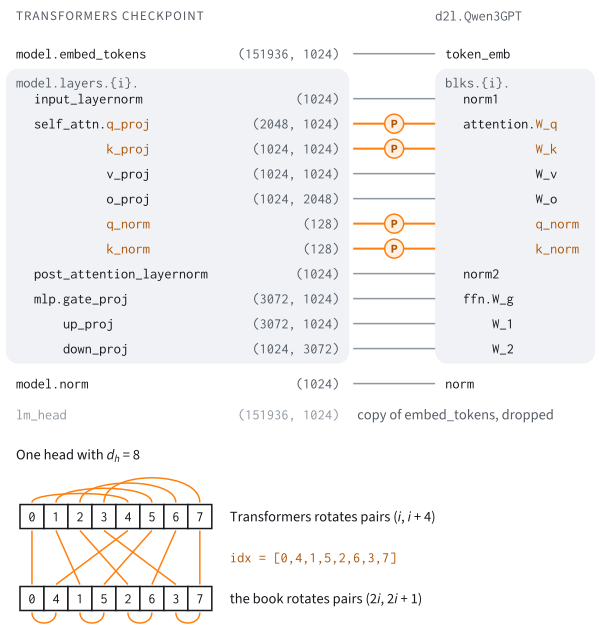

# A Released Checkpoint in the Book's Own Code
:label:`sec_lm_d2l_checkpoint`

In :numref:`subsec_gpt-loading` we loaded GPT-2 into our own `GPT` class with
a dictionary of names and one transpose, and the model wrote fluent English.
In :numref:`sec_lm_hf_models` we loaded a current model through the
Transformers library and read its configuration file field by field. Would
such a model also run in the code we wrote ourselves? And if it ran, how
would we know that it ran *correctly*: the same as what, and to which
precision?

Running released weights in an independent implementation is called
*porting*. Inference engines and from-scratch reimplementations
:cite:`Raschka.2024` do it for every architecture they support. A port has
two parts. The first is a list of the ways in which the released block
differs from a block we already have. For Qwen3
:cite:`Yang.Li.Yang.ea.2025` the list is short: a wider attention head, a
normalization of queries and keys, another convention for rotary positions,
and a few constants. The second is a comparison with the *reference
implementation*, the code that the weights were released with, which for
Qwen3 is Transformers. The comparison should be as tight as rounding allows
and no tighter: two correct programs do not agree to the last bit, and a
wrong one may well agree to the third digit.

The second part is where the care goes. Later chapters fine-tune, quantize,
serve and take apart this very model. A wrong constant that moves the
logits by a fraction of a percent does not show in a sample of text, but it
shifts every measurement built on the model. In this section we port
Qwen3-0.6B into subclasses of `d2l.GPT`, map its weights, and compare the
result with Transformers in its logits, in the text it generates, and layer
by layer. We port Qwen3 and not the Qwen3.5 of the previous section because
Qwen3.5 mixes attention layers with the linear recurrences of
:numref:`chap_modern_rnn`; :numref:`sec_lm_hybrids_at_scale` ports those.
The section ends with a porting bug that the customary check accepts.

```{.python .input #d2l-checkpoint-imports}
%%tab pytorch
import math
import numpy as np
import torch
from torch import nn
from torch.nn import functional as F
from d2l import torch as d2l
```

```{.python .input #d2l-checkpoint-imports-extra}
%%tab pytorch
import collections
import gc
import huggingface_hub
import itertools
import json
import os
import sys
import transformers
from safetensors.torch import load_file
```

Every comparison below runs on the same fixed inputs, stored as token ids
in a file that the next cell registers.

```{.python .input #d2l-checkpoint-data-hub}
%%tab pytorch
#@save
d2l.DATA_HUB['lm-qwen3-port-prompts-v1'] = (
    d2l.LM_DATA_URL + 'lm-qwen3-port-prompts-v1.json',
    'b5840fad4ad3d8d1897c12d522def18f6eb8fa06')
```

The file holds 32 prompts of 64 tokens and one prompt of 4,096 tokens. The
short prompts come in eight groups of four: English prose, Python code,
Chinese, LaTeX, lines of arithmetic, four further languages, random tokens
stated twice, and questions rendered by a chat template. A port that is
wrong only for rare tokens, or only inside a chat turn, should not pass for
lack of such inputs. The setup also names three checkpoints of the Qwen3
family and asserts that PyTorch multiplies fp32 matrices in full precision,
its default, and not in the reduced TF32 format of :numref:`sec_numerics`.
Without a GPU, the notebook shrinks to three prompts of 32 tokens.

```{.python .input #d2l-checkpoint-setup}
%%tab pytorch
QWEN, QWEN_17B_BASE, QWEN_8B = (
    'Qwen/Qwen3-0.6B', 'Qwen/Qwen3-1.7B-Base', 'Qwen/Qwen3-8B')
device = d2l.try_gpu()
SMALL = device.type == 'cpu'  # no GPU: 3 prompts of 32 tokens
# A job given a GPU (CUDA_VISIBLE_DEVICES set) must not fall back to SMALL
assert not (SMALL and os.environ.get('CUDA_VISIBLE_DEVICES')), (
    'a GPU is assigned, but PyTorch sees none')
# The tolerance rule below assumes IEEE fp32 matrix products (no TF32),
# which is PyTorch's default
assert torch.get_float32_matmul_precision() == 'highest'
transformers.logging.set_verbosity_error()  # no notices or progress bars
transformers.logging.disable_progress_bar()
huggingface_hub.utils.disable_progress_bars()
huggingface_hub.utils.logging.set_verbosity_error()
with open(d2l.download('lm-qwen3-port-prompts-v1',
                       os.path.join('..', 'data', 'lm'))) as f:
    prompts = json.load(f)
ids = torch.tensor(prompts['ids'])  # (32, 64): 8 categories of 4 prompts
texts = prompts['texts']  # the 28 prompts that are text (not random ids)
long_ids = torch.tensor(prompts['long']['ids'])
if SMALL:  # the first prompt of three categories, cut to 32 tokens
    rows = [0, 4, 8]
    texts = [texts[prompts['text_rows'].index(r)] for r in rows]
    ids, long_ids = ids[rows, :32], None
NEW_TOKENS = 16 if SMALL else 64  # generated per prompt
print(f'{len(ids)} prompts of {ids.shape[1]} tokens, {len(texts)} of them '
      f'as text; long prompt: '
      f'{"none" if long_ids is None else f"{len(long_ids):,} tokens"}')
```

## The Qwen3 Block as a Diff
:label:`subsec_lm_port_recipe_gaps`

:numref:`tab_modern-recipe` describes Qwen3 by its ingredients:
grouped-query attention, RMSNorm before each sublayer, QK-norm, RoPE, and a
SwiGLU feed-forward network. Except for QK-norm, `d2l.GPT` has them all. A
list of ingredients does not give shapes, however, and a checkpoint loads
only if every shape fits.

### Differences from the Book's GPT

We build the book's `GPT` with the widths of Qwen3-0.6B (28 blocks of width
1,024 with 16 query heads and 8 key--value heads) and set its tensors next
to those of the released file. Nothing is downloaded or allocated for this.
The model is built on PyTorch's meta device, which records shapes and holds
no data (:numref:`subsec_count_without_alloc`), and
`d2l.safetensors_header` of :numref:`sec_lm_hf_models` reads names and
shapes from the header of the file.

```{.python .input #d2l-checkpoint-recipe-diff}
%%tab pytorch
with torch.device('meta'):  # shapes only: no memory is allocated
    gpt_meta = d2l.GPT(151936, num_hiddens=1024, num_heads=16, num_blks=28,
                       num_kv_heads=8)
gpt_shapes = {k: tuple(v.shape) for k, v in gpt_meta.state_dict().items()}
header = d2l.safetensors_header(QWEN)  # name -> (shape, dtype)
roles = [('query, key, value', ['attention.W_qkv'],
          ['self_attn.q_proj', 'self_attn.k_proj', 'self_attn.v_proj']),
         ('attention output', ['attention.W_o'], ['self_attn.o_proj']),
         ('query, key norms', [], ['self_attn.q_norm', 'self_attn.k_norm']),
         ('FFN gate', ['ffn.W_g'], ['mlp.gate_proj']),
         ('FFN up', ['ffn.W_1'], ['mlp.up_proj']),
         ('FFN down', ['ffn.W_2'], ['mlp.down_proj']),
         ('norms', ['norm1', 'norm2'],
          ['input_layernorm', 'post_attention_layernorm'])]
print(f'{"role":19}{"d2l.GPT":21}Qwen3-0.6B (layer 0)')
for role, gpt_names, qwen_names in roles:
    left = [f'{n.split(".")[-1]} {gpt_shapes[f"blks.0.{n}.weight"]}'
            for n in gpt_names] or ['(no counterpart)']
    right = [f'{n.split(".")[-1]} {header[f"model.layers.0.{n}.weight"][0]}'
             for n in qwen_names]
    for i, (a, b) in enumerate(itertools.zip_longest(left, right,
                                                     fillvalue='')):
        print(f'{role if i == 0 else "":19}{a:21}{b}')
```

A shape reads (outputs, inputs), and only the two block norms fit. The first
row looks like a match and is not one. The 2,048 rows of our `W_qkv` are
three matrices stacked: 1,024 rows for the queries and 512 each for the keys
and the values, whose 8 heads are 64 wide. In the released file the queries
alone fill 2,048 rows, twice the width of the model, because each of the 16
heads is 128 wide where ours has $d/H = 64$. Keys and values have matrices
of their own, of 1,024 rows each. The two vectors of 128 gains, `q_norm` and
`k_norm`, have no counterpart: they are the QK-norm of
:numref:`subsec_qk-norm`, which our block left to an exercise. And the
feed-forward network is 3,072 wide, where our SwiGLU chooses
$\mathrm{round}(8d/3) = 2{,}731$.

Other differences are settings that no shape reveals. Some are fields of
the configuration file: the RoPE base, the $\epsilon$ of the norms, and
whether the output layer is tied to the embedding. Two can be learned only
from the source code of the reference implementation: where QK-norm is
applied, and which coordinates RoPE rotates together.
:numref:`tab_lm_qwen3_gaps` lists both kinds. Here $d$ is the width of the
model, $H$ the number of query heads, $d_h$ the width of one head, and
$\theta$ the base of the RoPE frequencies $\omega_i = \theta^{-2i/d_h}$.

:Settings in which Qwen3-0.6B differs from `d2l.GPT` built at the same width, depth and number of heads. The last row differs within the Qwen3 family.
:label:`tab_lm_qwen3_gaps`

| setting | `d2l.GPT` | Qwen3-0.6B |
|:--|:--|:--|
| head width $d_h$ | $d/H = 64$ | 128 |
| query width $H d_h$ | 1,024 | 2,048 |
| projections | one fused `W_qkv` | `q_proj`, `k_proj`, `v_proj` |
| QK-norm | none | RMSNorm per head, before RoPE |
| RoPE base $\theta$ | $10^4$ | $10^6$ |
| RoPE coordinate pairs | $(2i, 2i+1)$ | $(i, i + d_h/2)$ |
| feed-forward width | $\mathrm{round}(8d/3) = 2{,}731$ | 3,072 |
| RMSNorm $\epsilon$ | $10^{-5}$ | $10^{-6}$ |
| output layer | tied to the embedding | tied; untied in Qwen3-8B |

None of the nine rows changes what a transformer block is, and most become
constructor arguments below. The pairing of RoPE coordinates is the
exception. It is a property of how the weights are stored, and
:numref:`subsec_lm_port_name_map` deals with it.

### Attention with QK-Norm and a Wider Head

`Qwen3Attention` is the book's `CausalAttention` (:numref:`sec_gpt`) with
its projections replaced. It keeps the parent's `forward`, which calls `qkv`
and hands the result to the fused attention kernel
`F.scaled_dot_product_attention`, and it changes what `qkv` computes. Three
matrices `W_q`, `W_k` and `W_v` produce $H$ query heads and
$H_\textrm{kv}$ key and value heads of an explicit width `head_dim`, so
the query width $H d_h$ need not equal the width of the model. With
`qk_norm`, the query and the key of each head pass through an RMSNorm
before they are rotated, which keeps the attention logits from growing with
the weights. One vector of $d_h$ gains serves all heads.

The constructor calls `nn.Module.__init__` directly, because the parent's
would allocate a fused `W_qkv` only for us to discard it. A second method,
`forward_step`, serves generation with a KV cache as in
:numref:`subsec_kv-cache-cached-forward`: it writes the keys and values of
the new tokens into preallocated buffers and attends over everything
stored so far. The cell also defines `qwen3_rope_tables`, the port's table
of rotation angles. It differs from the book's `d2l.rope_tables` in one
expression: the frequencies are computed as $1/\theta^{2i/d_h}$, the way
Transformers computes them, where the book writes $\theta^{-2i/d_h}$. On
paper the two are the same number.
:numref:`subsec_lm_port_end_to_end` measures what the difference does in
fp32.

```{.python .input #d2l-checkpoint-qwen3-attention}
%%tab pytorch
#@save
def qwen3_rope_tables(n, head_dim, theta, offset=0, device=None):
    """Cosines and sines, each (n, head_dim / 2) in fp32, of the RoPE angles
    of positions offset, ..., offset + n - 1, with the frequencies computed
    as Transformers computes them."""
    # 1 / theta^(2i/d) on the CPU, as Transformers builds its buffer; the
    # book's theta^(-2i/d) is equal in exact arithmetic but not in fp32
    inv = 1.0 / float(theta) ** (torch.arange(
        0, head_dim, 2, dtype=torch.float32, device='cpu') / head_dim)
    pos = torch.arange(n, dtype=torch.float32, device=device) + offset
    angles = pos[:, None] * inv.to(pos.device)[None, :]
    return torch.cos(angles), torch.sin(angles)

#@save
class Qwen3Attention(d2l.CausalAttention):
    """Causal attention with separate projections, an explicit head width,
    optional RMSNorm of queries and keys per head before RoPE (QK-norm),
    and a step that reads and writes a key-value cache."""
    def __init__(self, num_hiddens, num_heads, num_kv_heads, *, head_dim=None,
                 qk_norm=False, rope_theta=10000.0, norm_eps=1e-6, bias=False,
                 rope=True, causal=True):
        nn.Module.__init__(self)  # CausalAttention's would allocate W_qkv
        if not causal:
            raise ValueError('Qwen3Attention is causal only')
        self.num_heads, self.num_kv_heads = num_heads, num_kv_heads
        self.head_dim = head_dim or num_hiddens // num_heads
        self.qk_norm, self.rope, self.rope_theta = qk_norm, rope, rope_theta
        self.kv_hiddens = num_kv_heads * self.head_dim
        q_hiddens = num_heads * self.head_dim  # may differ from num_hiddens
        self.W_q = nn.Linear(num_hiddens, q_hiddens, bias=bias)
        self.W_k = nn.Linear(num_hiddens, self.kv_hiddens, bias=bias)
        self.W_v = nn.Linear(num_hiddens, self.kv_hiddens, bias=bias)
        self.W_o = nn.Linear(q_hiddens, num_hiddens, bias=bias)
        if qk_norm:  # one gain per coordinate of a head, shared by the heads
            self.q_norm = nn.RMSNorm(self.head_dim, eps=norm_eps)
            self.k_norm = nn.RMSNorm(self.head_dim, eps=norm_eps)

    def qkv(self, X, offset=0, tables=None):
        B, T, _ = X.shape
        q = self.W_q(X).reshape(B, T, self.num_heads, self.head_dim)
        k = self.W_k(X).reshape(B, T, self.num_kv_heads, self.head_dim)
        v = self.W_v(X).reshape(B, T, self.num_kv_heads, self.head_dim)
        if self.qk_norm:  # normalize each head's query and key
            q, k = self.q_norm(q), self.k_norm(k)
        q, k, v = (u.transpose(1, 2) for u in (q, k, v))  # (B, heads, T, d_h)
        if self.rope:
            if tables is None:
                tables = qwen3_rope_tables(T, self.head_dim, self.rope_theta,
                                           offset, X.device)
            q, k = (d2l.rope(u, tables=tables) for u in (q, k))
        return q, k, v

    def forward_step(self, X, cache, tables=None):
        """Attention output for X at positions t, ..., t + T - 1, where cache
        = (ks, vs, t) holds this block's buffers, each (batch, kv heads,
        max_len, head_dim); writes the keys and values of X into them."""
        ks, vs, t = cache
        T = X.shape[1]
        q, k, v = self.qkv(X, t, tables)
        ks[:, :, t:t + T], vs[:, :, t:t + T] = k, v
        Y = F.scaled_dot_product_attention(
            q, ks[:, :, :t + T], vs[:, :, :t + T],
            attn_mask=d2l.causal_mask(T, t + T, X.device),
            enable_gqa=self.num_kv_heads < self.num_heads)
        return self.W_o(Y.transpose(1, 2).flatten(2))
```

### The Feed-Forward Width and the Assembled Model

`SwiGLU` is the book's `FeedForward` with the width as an argument.
`Qwen3GPT` assembles the model through two openings that `d2l.GPT` has had
since :numref:`sec_gpt`: its argument `ffn_factory`, and its class attribute
`CausalAttention`, which a subclass may replace, here by a method that
returns a `Qwen3Attention`. Once the parent's constructor has built the
blocks, the subclass sets $\epsilon$ in every norm and, for an untied
checkpoint, adds an output layer `lm_head`. Its `forward` can apply the
output layer to the last positions only (`logits_to_keep`). With 151,936
tokens in the vocabulary, the logits of a 4,096-token prompt would otherwise
fill 2.5 GB in fp32.

```{.python .input #d2l-checkpoint-swiglu-gpt}
%%tab pytorch
#@save
class SwiGLU(d2l.FeedForward):
    """SwiGLU feed-forward network with an explicit hidden width."""
    def __init__(self, num_hiddens, hidden, bias=False):
        nn.Module.__init__(self)  # FeedForward's would allocate width 8d/3
        self.act = 'swiglu'
        self.W_g = nn.Linear(num_hiddens, hidden, bias=bias)
        self.W_1 = nn.Linear(num_hiddens, hidden, bias=bias)
        self.W_2 = nn.Linear(hidden, num_hiddens, bias=bias)

#@save
class Qwen3GPT(d2l.GPT):
    """d2l.GPT with Qwen3's head width, QK-norm, RoPE base, feed-forward
    width and normalization epsilon, and an optional untied output head."""
    def __init__(self, vocab_size, num_hiddens, num_heads, num_kv_heads,
                 num_blks, *, head_dim=None, qk_norm=True, rope_theta=1e6,
                 ffn_hidden=None, norm_eps=1e-6, tie_embeddings=True,
                 max_len=40960, bias=False):
        head_dim = head_dim or num_hiddens // num_heads
        ffn_hidden = ffn_hidden or round(8 * num_hiddens / 3)
        # read by CausalAttention below while GPT builds the blocks; a plain
        # attribute may be set before nn.Module.__init__ runs
        self.attn_options = dict(head_dim=head_dim, qk_norm=qk_norm,
                                 rope_theta=rope_theta, norm_eps=norm_eps)
        super().__init__(
            vocab_size, num_hiddens=num_hiddens, num_heads=num_heads,
            num_blks=num_blks, max_len=max_len, bias=bias,
            num_kv_heads=num_kv_heads,
            ffn_factory=lambda: SwiGLU(num_hiddens, ffn_hidden, bias))
        for blk in self.blks:
            blk.norm1.eps = blk.norm2.eps = norm_eps
        self.norm.eps = norm_eps
        self.head_width, self.rope_theta = head_dim, rope_theta
        if not tie_embeddings:
            self.lm_head = nn.Linear(num_hiddens, vocab_size, bias=False)
            nn.init.normal_(self.lm_head.weight, std=0.02)

    def CausalAttention(self, d, H, *, bias, rope, num_kv_heads):
        """The attention GPT builds in each block (a method, not a lambda,
        so that the model can be pickled)."""
        return Qwen3Attention(d, H, num_kv_heads, bias=bias, rope=rope,
                              **self.attn_options)

    def forward(self, X, logits_to_keep=None, tables=None):
        if tables is None:  # RoPE angles of positions 0, ..., T - 1
            tables = qwen3_rope_tables(X.shape[1], self.head_width,
                                       self.rope_theta, device=X.device)
        H = self.token_emb(X)
        for blk in self.blks:
            H = blk(H, tables=tables)
        if logits_to_keep is not None:  # the head only where logits are read
            H = H[:, -logits_to_keep:]
        H = self.norm(H)
        if hasattr(self, 'lm_head'):
            return self.lm_head(H)
        return F.linear(H, self.token_emb.weight)
```

Three further methods form the cached path. `init_cache` allocates keys and
values for every block, `forward_cached` runs new tokens through the blocks
with `forward_step`, and `generate_cached` samples with these two as
:numref:`sec_kv-cache` did, from one prompt given as token ids. It is the
counterpart of the parent's `generate`, against which we test it next. The
interface for text and for batches of prompts, `d2l.generate`, is built on
`forward_cached` later in this section.

```{.python .input #d2l-checkpoint-cached-path}
%%tab pytorch
@d2l.add_to_class(Qwen3GPT)  #@save
def init_cache(self, batch_size, max_len):
    """Zeroed keys and values for every block, each (blocks, batch, kv
    heads, max_len, head_dim)."""
    attn = self.blks[0].attention
    shape = (len(self.blks), batch_size, attn.num_kv_heads, max_len,
             attn.head_dim)
    p = self.token_emb.weight
    return (torch.zeros(shape, device=p.device, dtype=p.dtype),
            torch.zeros(shape, device=p.device, dtype=p.dtype))

@d2l.add_to_class(Qwen3GPT)  #@save
@torch.inference_mode()
def forward_cached(self, X, ks, vs, t):
    """Logits after the last of the new tokens X, which sit at positions
    t, t + 1, ...; writes their keys and values into the cache."""
    tables = qwen3_rope_tables(X.shape[1], self.head_width, self.rope_theta,
                               t, X.device)
    H = self.token_emb(X)
    for i, blk in enumerate(self.blks):  # the modules of blk.forward
        H = H + blk.attention.forward_step(blk.norm1(H), (ks[i], vs[i], t),
                                           tables)
        H = H + blk.ffn(blk.norm2(H))
    H = self.norm(H[:, -1])
    if hasattr(self, 'lm_head'):
        return self.lm_head(H), ks, vs
    return F.linear(H, self.token_emb.weight), ks, vs

@d2l.add_to_class(Qwen3GPT)  #@save
@torch.inference_mode()
def generate_cached(self, prefix, num_tokens, temperature=1.0, top_k=None):
    """Sample as generate does, but never recompute the prefix."""
    assert len(prefix) + num_tokens <= self.max_len, 'cache overflow'
    X = torch.tensor(prefix, device=self.token_emb.weight.device)[None]
    ks, vs = self.init_cache(1, len(prefix) + num_tokens)
    logits, ks, vs = self.forward_cached(X, ks, vs, 0)
    tokens = []
    for t in range(len(prefix), len(prefix) + num_tokens):
        tokens.append(d2l.sample_logits(logits, 'sample', temperature,
                                        k=top_k))
        if t + 1 < len(prefix) + num_tokens:  # logits for the next draw
            logits, ks, vs = self.forward_cached(tokens[-1][:, None], ks, vs,
                                                 t)
    return list(prefix) + torch.cat(tokens).tolist()
```

Does the subclass still compute what `d2l.GPT` computes? With every Qwen3
setting switched off it should. The cell copies the weights of a small
`d2l.GPT` into a `Qwen3GPT` with the book's settings, splitting the fused
`W_qkv` by rows, and compares the logits, the cached path against the full
forward pass, and a greedy continuation. For the logits we expect agreement
to rounding or better: the products by `W_q`, `W_k` and `W_v` are row
blocks of the product by `W_qkv`, and every other operation is the same.
The cached path evaluates attention in another order, so rounding error is
the most we can ask of it.

```{.python .input #d2l-checkpoint-generalization}
%%tab pytorch
torch.manual_seed(0)
gpt = d2l.GPT(100, num_hiddens=64, num_heads=4, num_blks=2).eval()
port = Qwen3GPT(100, num_hiddens=64, num_heads=4, num_kv_heads=4,
                num_blks=2, qk_norm=False, rope_theta=1e4, norm_eps=1e-5,
                ffn_hidden=round(8 * 64 / 3)).eval()
state = {}
for name, W in gpt.state_dict().items():  # the fused W_qkv, split by rows
    if 'W_qkv' in name:
        for part, rows in zip(('W_q', 'W_k', 'W_v'), W.split(64)):
            state[name.replace('W_qkv', part)] = rows
    else:
        state[name] = W
port.load_state_dict(state, strict=True)
X = torch.randint(0, 100, (4, 32))
with torch.no_grad():
    book_tables = d2l.rope_tables(32, port.head_width)  # GPT's angles
    full = (port(X, tables=book_tables) - gpt(X)).abs().max().item()
    ks, vs = port.init_cache(4, 32)  # 16 tokens at once, then one by one
    steps = [port.forward_cached(X[:, :16], ks, vs, 0)[0]] + [
        port.forward_cached(X[:, t:t + 1], ks, vs, t)[0]
        for t in range(16, 32)]
    cached = (torch.stack(steps, 1) - port(X)[:, 15:]).abs().max().item()
prefix = X[0, :8].tolist()
same_greedy = (port.generate_cached(prefix, 16, top_k=1)
               == gpt.generate(prefix, 16, top_k=1))
print(f'max |logit difference| from d2l.GPT: {full:.1e}')
print(f'forward_cached against forward: {cached:.1e}')
print(f'same greedy tokens: {same_greedy}')
assert full <= 1e-5 and cached <= 1e-5 and same_greedy
```

The logits agree to the last bit, the cached path to better than a
millionth of a logit, and both models write the same tokens. `Qwen3GPT`
generalizes the book's model and does not replace it: code written for
`d2l.GPT` in earlier chapters runs on it.

The arguments of the constructor come from the configuration file of the
checkpoint. `qwen3_gpt_kwargs` translates its field names into ours. As
important, it refuses a configuration that the port does not implement: a
sliding window, rescaled rotary angles, attention biases, the
mixture-of-experts variants, and Qwen3.5. A port that ignores a field it
does not know is wrong without notice.

```{.python .input #d2l-checkpoint-gpt-kwargs}
%%tab pytorch
#@save
def qwen3_gpt_kwargs(cfg):
    """Qwen3GPT's arguments from a Qwen3 configuration (a dict or a
    Transformers config); raises on settings the port does not implement.
    A dict without head_dim, tie_word_embeddings or a RoPE base gets
    Transformers' Qwen3Config defaults (128, untied, 10,000)."""
    c = cfg if isinstance(cfg, dict) else cfg.to_dict()
    kind = c.get('model_type')
    if kind == 'qwen3_moe':
        raise NotImplementedError('qwen3_moe: expert layers are not ported')
    if kind and kind.startswith('qwen3_5'):
        raise NotImplementedError(
            f'{kind}: its Gated DeltaNet layers are ported in '
            'sec_lm_hybrids_at_scale')
    if kind != 'qwen3':
        raise ValueError(f'not a Qwen3 configuration: {kind!r}')
    rope = c.get('rope_parameters') or {}  # where Transformers 5 keeps theta
    for name, value in [('use_sliding_window', c.get('use_sliding_window')),
                        ('rope_scaling', c.get('rope_scaling')),
                        ('rope_type', rope.get('rope_type', 'default')
                         != 'default'),
                        ('attention_bias', c.get('attention_bias'))]:
        if value:
            raise ValueError(f'{name} is not implemented in Qwen3GPT')
    return dict(
        vocab_size=c['vocab_size'], num_hiddens=c['hidden_size'],
        num_heads=c['num_attention_heads'],
        num_kv_heads=c['num_key_value_heads'],
        num_blks=c['num_hidden_layers'], head_dim=c.get('head_dim', 128),
        qk_norm=True, rope_theta=float(c.get('rope_theta') or rope.get(
            'rope_theta', 1e4)),
        ffn_hidden=c['intermediate_size'], norm_eps=c['rms_norm_eps'],
        tie_embeddings=c.get('tie_word_embeddings', False),
        max_len=c['max_position_embeddings'], bias=False)
```

The first test against the release is the parameter count.
:numref:`sec_lm_hf_models` computed it from the configuration with
`d2l.config_params`, and the file header gives it a third time, as the sum
over the stored shapes. The file of Qwen3-0.6B stores its output layer as a
copy of the embedding, which we subtract. Qwen3-8B has an output layer of
its own.

```{.python .input #d2l-checkpoint-param-count}
%%tab pytorch
def config_json(model_id):
    """The configuration file of a pinned Hub checkpoint, as a dict."""
    with open(huggingface_hub.hf_hub_download(
            model_id, 'config.json',
            revision=d2l.HF_REVISIONS[model_id])) as f:
        return json.load(f)

cfg, cfg_8b = config_json(QWEN), config_json(QWEN_8B)
header_8b = d2l.safetensors_header(QWEN_8B)  # an index and 5 shards
print(f'{"model":7}{"port":>15}{"configuration":>15}{"header":>15}  head')
for name, c, hdr in (('0.6B', cfg, header), ('8B', cfg_8b, header_8b)):
    kwargs = qwen3_gpt_kwargs(c)
    with torch.device('meta'):
        meta_port = Qwen3GPT(**kwargs)
    in_file = sum(math.prod(shape) for shape, _ in hdr.values())
    if kwargs['tie_embeddings'] and 'lm_head.weight' in hdr:
        in_file -= math.prod(hdr['lm_head.weight'][0])  # a stored copy
    counts = d2l.num_params(meta_port), d2l.config_params(c), in_file
    print(f'{name:7}' + ''.join(f'{n:>15,}' for n in counts) + '  '
          + ('tied' if kwargs['tie_embeddings'] else 'lm_head (untied)'))
    assert counts[0] == counts[1] == counts[2]
```

The three counts agree to the last parameter for both checkpoints. The port
has the right shapes. Whether the right numbers reach the right places is
the next question.

## The Weight Map
:label:`subsec_lm_port_name_map`

For GPT-2, the map from the released file to our model was a dictionary of
names and one rule, a transpose (:numref:`subsec_gpt-loading`). Qwen3 needs
a dictionary of names and a permutation of four tensors per layer.
:numref:`fig_lm_weight_map` shows both. Most of its lines are plain
renames. The four marked tensors are another matter, and getting them wrong
produces no error message.


:label:`fig_lm_weight_map`

### The RoPE Pairing Convention

RoPE rotates pairs of coordinates of each query and key by an angle
proportional to the position (:numref:`subsec_pos-rope`). Which coordinates
form a pair is a convention, and a model's weights are trained under one of
them. The book pairs neighbors: its rotation $\mathbf{R}_t$ at position $t$
turns the pair $(x_{2i}, x_{2i+1})$ by the angle $t\,\omega_i$. Transformers
pairs the two halves of the vector: its rotation $\mathbf{R}'_t$ turns
$(x_i, x_{i+d_h/2})$ by the same angle. Weights trained under one convention
and run under the other have the wrong coordinates rotated together, and
every shape still fits.

The remedy is to reorder the coordinates once, in the weights. Let
$\mathbf{P}$ be the permutation that moves the two members of each
Transformers pair next to each other, $(\mathbf{P}\mathbf{x})_{2i} = x_i$
and $(\mathbf{P}\mathbf{x})_{2i+1} = x_{i+d_h/2}$. For $d_h = 4$ it sends
$(x_0, x_1, x_2, x_3)$ to $(x_0, x_2, x_1, x_3)$: the Transformers pairs
$(x_0, x_2)$ and $(x_1, x_3)$ now sit where the book expects its pairs.
Rotating in the book's way after the permutation is then the same as
rotating in Transformers' way before it. Since a permutation matrix is
orthogonal, the score of a query $\mathbf{q}$ at position $s$ and a key
$\mathbf{k}$ at position $t$ is preserved:

$$
\mathbf{R}_t \mathbf{P} = \mathbf{P} \mathbf{R}'_t,
\qquad
(\mathbf{R}_s \mathbf{P}\mathbf{q})^\top (\mathbf{R}_t \mathbf{P}\mathbf{k})
= (\mathbf{R}'_s \mathbf{q})^\top \mathbf{P}^\top \mathbf{P}\, \mathbf{R}'_t \mathbf{k}
= (\mathbf{R}'_s \mathbf{q})^\top (\mathbf{R}'_t \mathbf{k}).
$$
:eqlabel:`eq_lm_rope_layout`

Permuted queries and keys under the book's rotation thus give the attention
scores that Transformers computes. Since
$\mathbf{P}\mathbf{q} = (\mathbf{P}\mathbf{W}_q)\mathbf{x}$, we obtain them
by permuting the rows of `q_proj` and `k_proj` within each head.

One operation stands between the projection and the rotation, namely
QK-norm. RMSNorm divides its input by the root mean square of the
coordinates, which no permutation changes, and multiplies each coordinate
by its own gain. It commutes with $\mathbf{P}$ only if the gains
$\boldsymbol{\gamma}$ move with their coordinates,
$\mathbf{P}\,\mathrm{RMSNorm}_{\boldsymbol{\gamma}}(\mathbf{x}) =
\mathrm{RMSNorm}_{\mathbf{P}\boldsymbol{\gamma}}(\mathbf{P}\mathbf{x})$,
so the gains of `q_norm` and `k_norm` must be permuted as well. Values are
never rotated, and `v_proj` and `o_proj` stay as they are.

The cell defines the index of the permutation and tests
:eqref:`eq_lm_rope_layout` on random queries and keys with a random gain,
against Transformers' rotation written out in four lines. As a control, the
test is repeated with the gain left in the order of the file.

```{.python .input #d2l-checkpoint-rope-permutation}
%%tab pytorch
#@save
def qwen3_rope_permutation(head_dim):
    """Index idx with idx[2i] = i and idx[2i + 1] = i + head_dim / 2: taking
    row idx[j] of a head's rows as row j turns Transformers' split-half
    RoPE pairs into the book's interleaved pairs."""
    half = torch.arange(head_dim // 2)
    return torch.stack([half, half + head_dim // 2], 1).flatten()

# Check: the book's rotation of permuted queries and keys gives the scores
# of Transformers' rotation, if the QK-norm gain is permuted too
def rotate_half(x, cos, sin):  # Transformers' RoPE: pairs (i, i + d_h / 2)
    x1, x2 = x.chunk(2, -1)
    cos, sin = torch.cat([cos, cos], -1), torch.cat([sin, sin], -1)
    return x * cos + torch.cat([-x2, x1], -1) * sin

print('idx for d_h = 8:', qwen3_rope_permutation(8).tolist())
torch.manual_seed(0)
d_h, T = 128, 64
idx = qwen3_rope_permutation(d_h)
q, k = torch.randn(T, d_h), torch.randn(T, d_h)
gamma = 1 + 0.5 * torch.randn(d_h)  # a QK-norm gain
norm = lambda x, g: F.rms_norm(x, (d_h,), g, 1e-6)
tables = qwen3_rope_tables(T, d_h, 1e6)  # positions 0, ..., 63
hf_scores = (rotate_half(norm(q, gamma), *tables)
             @ rotate_half(norm(k, gamma), *tables).T)
port_scores = lambda g: (d2l.rope(norm(q[:, idx], g), tables=tables)
                         @ d2l.rope(norm(k[:, idx], g), tables=tables).T)
scale = hf_scores.abs().max()
with_p, without = ((port_scores(g) - hf_scores).abs().max() / scale
                   for g in (gamma[idx], gamma))
print(f'max |score difference| / max |score|: rows and gain permuted '
      f'{with_p:.1e}, gain not permuted {without:.1e}')
assert with_p <= 1e-5 and without > 1e-2
```

With rows and gains permuted, the scores agree to fp32 rounding. With the
gains forgotten, the largest difference is about 80% of the largest score.
It is an easy mistake to make, since a vector of 128 gains has the same
shape in either order. One consequence matters in later chapters: inside
each head, the query and key coordinates of the port are in the book's
interleaved order, not in the order of the file.

### Strict Accounting and Loading

`map_qwen3_state_dict` turns the tensors read from the file into a state
dictionary for `Qwen3GPT`. Its core is the table `layer`, which pairs each
released name with ours and with a function, `keep` or `permute`. After
applying the table, the function checks its work in both directions. Every
tensor of the file must have been consumed, and every name that the port
expects must have been produced; anything left over raises a `KeyError` that
names it. The function never sees the port: it takes the expected names from
its own table, built from the configuration, and
`load_state_dict(strict=True)` later checks them against the parameters of
the model itself. We call this *strict accounting*. It is cheap, and it
catches the commonest porting mistakes (a renamed tensor, a forgotten
module, a layer too many) before a single number is computed. The one tensor
the function may drop is a stored copy of the embedding named
`lm_head.weight`, and only after verifying that it is a copy.

```{.python .input #d2l-checkpoint-map-load}
%%tab pytorch
#@save
def map_qwen3_state_dict(hf_state, cfg, rope_layout='permute'):
    """A Qwen3GPT state dict from a Transformers Qwen3 state dict. Renames
    every tensor and, per head, permutes the rows of q_proj and k_proj and
    the gains of q_norm and k_norm into the book's RoPE pairing
    (rope_layout='none' skips this). A KeyError lists every tensor not
    consumed and every key not produced."""
    assert rope_layout in ('permute', 'none'), rope_layout
    kw = qwen3_gpt_kwargs(cfg)
    d_h = kw['head_dim'] or kw['num_hiddens'] // kw['num_heads']
    idx = qwen3_rope_permutation(d_h)

    def permute(W):  # W: (heads * d_h, ...) rows, or one head's (d_h,) gains
        if rope_layout == 'none':
            return W
        return W.unflatten(0, (-1, d_h))[:, idx.to(W.device)].flatten(0, 1)

    keep = lambda W: W
    layer = {'input_layernorm': ('norm1', keep),
             'self_attn.q_proj': ('attention.W_q', permute),
             'self_attn.k_proj': ('attention.W_k', permute),
             'self_attn.v_proj': ('attention.W_v', keep),
             'self_attn.o_proj': ('attention.W_o', keep),
             'self_attn.q_norm': ('attention.q_norm', permute),
             'self_attn.k_norm': ('attention.k_norm', permute),
             'post_attention_layernorm': ('norm2', keep),
             'mlp.gate_proj': ('ffn.W_g', keep),
             'mlp.up_proj': ('ffn.W_1', keep),
             'mlp.down_proj': ('ffn.W_2', keep)}
    names = {'model.embed_tokens': ('token_emb', keep)}
    for i in range(kw['num_blks']):
        names.update({f'model.layers.{i}.{hf}': (f'blks.{i}.{ours}', f)
                      for hf, (ours, f) in layer.items()})
    names['model.norm'] = ('norm', keep)
    if not kw['tie_embeddings']:
        names['lm_head'] = ('lm_head', keep)
    left, state, missing = dict(hf_state), {}, []
    head = left.get('lm_head.weight')
    emb = left.get('model.embed_tokens.weight')
    if kw['tie_embeddings'] and head is not None:  # a stored copy of emb
        if not (head.is_meta or emb is None or torch.equal(head, emb)):
            raise ValueError('lm_head.weight differs from the tied embedding')
        del left['lm_head.weight']
    for hf, (ours, f) in names.items():
        if hf + '.weight' in left:
            state[ours + '.weight'] = f(left.pop(hf + '.weight'))
        else:
            missing.append(f'{ours}.weight (from {hf}.weight)')
    if left or missing:
        raise KeyError(f'not consumed: {sorted(left)}; '
                       f'not produced: {missing}')
    return state
```

`load_qwen3` reads the configuration and the weight files of a pinned
revision (the library function `d2l._qwen3_files` downloads them), builds
the model, maps the weights, and returns the model in evaluation mode. Two
details keep it from allocating the model twice. It builds `Qwen3GPT` on
the meta device, so the constructor initializes no weights that the next
line would overwrite. And it loads with `assign=True`, which makes each
parameter *be* the mapped tensor where the default would copy into the
existing one; a meta tensor has no storage to copy into. For the 8 billion
parameters of Qwen3-8B, this avoids filling 32 GB with random numbers
first.

```{.python .input #d2l-checkpoint-load-qwen3}
%%tab pytorch
#@save
def load_qwen3(model_id='Qwen/Qwen3-0.6B', revision=None, *,
               dtype=torch.bfloat16, device=None):
    """A pinned Qwen3 checkpoint from the Hugging Face Hub as a Qwen3GPT in
    eval mode: built on the meta device, then its mapped weights assigned.
    The tokenizer is loaded separately, at model.revision."""
    from safetensors.torch import load_file  # lazy, as in load_gpt2
    revision = revision or d2l.HF_REVISIONS[model_id]
    config_file, generation_file, weight_files = d2l._qwen3_files(
        model_id, revision)
    with open(config_file) as fh:
        cfg = json.load(fh)
    with torch.device('meta'):  # shapes only: no memory is allocated
        model = Qwen3GPT(**qwen3_gpt_kwargs(cfg))
    hf_state = {}
    for path in weight_files:
        hf_state.update(load_file(path))
    device = device or d2l.try_gpu()
    state = {name: W.to(device, dtype)
             for name, W in map_qwen3_state_dict(hf_state, cfg).items()}
    # assign=True: meta tensors cannot be copied into, so take the tensors
    model.load_state_dict(state, strict=True, assign=True)
    model.hf_config, model.revision = cfg, revision
    model.generation_config = None
    if generation_file is not None:
        import transformers
        with open(generation_file) as fh:
            model.generation_config = transformers.GenerationConfig.from_dict(
                json.load(fh))
    return model.eval()
```

Before loading a model, we run the mapper on the released file of
Qwen3-0.6B, and once more after deleting one tensor.

```{.python .input #d2l-checkpoint-strict-accounting}
%%tab pytorch
hf_state = load_file(huggingface_hub.hf_hub_download(
    QWEN, 'model.safetensors', revision=d2l.HF_REVISIONS[QWEN]))
state = map_qwen3_state_dict(hf_state, cfg)
print(f'consumed {len(hf_state)} tensors, produced {len(state)} keys')
print('stored lm_head.weight equals the embedding (dropped):', torch.equal(
    hf_state['lm_head.weight'], hf_state['model.embed_tokens.weight']))
assert (len(hf_state), len(state)) == (311, 310)
del hf_state['model.layers.3.self_attn.k_norm.weight']
try:
    map_qwen3_state_dict(hf_state, cfg)
    raise AssertionError('a missing tensor went unnoticed')
except KeyError as e:
    print('KeyError:', e.args[0].replace('; ', '\n  '))
del hf_state, state
```

The file holds 311 tensors: 11 for each of the 28 layers, the embedding,
the final norm, and the stored copy of the embedding, which the mapper
verified and dropped. That leaves the 310 parameters of the port. With one
`k_norm` removed, the error names the parameter that could not be filled,
under our name and under the file's.

## End-to-End Agreement
:label:`subsec_lm_port_end_to_end`

The model loads. Does it compute the function that Transformers computes
from the same file? In :numref:`subsec_gpt-loading` we were content with a
plausible loss and fluent text. That test passes ports that are slightly
wrong, so we now compare logits, and the first thing to settle is what
"equal" should mean.

### A Reference and a Tolerance

Two correct implementations of one model do not produce the same
floating-point numbers. They add in a different order, fuse different
operations, and round in different places. A tolerance picked by hand, say
$10^{-3}$, is far too loose for fp32 and too tight for bf16. We measure it
instead, against a run in higher precision. Three models, loaded from the
same file, have one role each, and we keep their names fixed from here on.
The port is our `Qwen3GPT`. The *fp64 reference* is Transformers run in
fp64, whose results stand in for the exact ones. And Transformers at the
working precision, fp32 or bf16, shows how far a correct program may be
from the fp64 reference.

Transformers offers several implementations of attention, and two of them
matter here. Its *eager* code is what :numref:`subsec_lm_hf_kernels` called
the reference code: it writes out the score matrix, the softmax and the
weighted sum as separate tensor operations. The other, SDPA, calls the fused
kernel `F.scaled_dot_product_attention`, as our port does. At the working
precision we run Transformers with eager attention. It is the arithmetic
that the model's source file spells out, it does not change with the kernel
that PyTorch selects, and it shares no attention code with the port. Where
the choice matters, in bf16, we print the result for SDPA as well. The fp64
reference uses SDPA, because the eager code computes its softmax in fp32 at
any precision.

```{.python .input #d2l-checkpoint-load-models}
%%tab pytorch
def release():  # return the memory of deleted models to the GPU
    gc.collect()
    torch.cuda.empty_cache()

ours32 = load_qwen3(QWEN, dtype=torch.float32, device=device)
hf32, tok = d2l.load_hf(QWEN, dtype=torch.float32,
                        attn_implementation='eager')
hf64, _ = d2l.load_hf(QWEN, dtype=torch.float64)  # SDPA keeps fp64 softmax
print(f'port: {d2l.num_params(ours32):,} parameters, a d2l.GPT: '
      f'{isinstance(ours32, d2l.GPT)}; Transformers: '
      f'{hf32.num_parameters():,}')
assert d2l.num_params(ours32) == hf32.num_parameters() == 596_049_920
```

The load reports name the attention code of each Transformers model, and
the port has the 596,049,920 parameters that Transformers counts.

Let $\mathbf{L}^{64}$ be the logits of the fp64 reference. For a working
precision $b$, 32 for fp32 and 16 for bf16, we measure how far Transformers
itself (subscript HF, for Hugging Face) is from them, and how far our port
is:

$$
e^b_\textrm{HF} = \textrm{mean}\,\bigl|\mathbf{L}^b_\textrm{HF} - \mathbf{L}^{64}\bigr|,
\qquad
e^b_\textrm{ours} = \textrm{mean}\,\bigl|\mathbf{L}^b_\textrm{ours} - \mathbf{L}^{64}\bigr|,
\qquad
\textrm{accept if } e^b_\textrm{ours} \le 1.5\, e^b_\textrm{HF}.
$$
:eqlabel:`eq_lm_port_rule`

The means run over all positions of a prompt and the whole vocabulary. The
rule asks that the port be no further from the fp64 reference than
Transformers is at the same precision, up to a factor. The factor 1.5 is a
convention, as 5% is for significance tests.

The 32 prompts are a sample, so the ratio
$e^b_\textrm{ours} / e^b_\textrm{HF}$ gets an interval. We resample the
prompts with replacement 2,000 times, each time taking the same prompts for
both errors, and report the central 95% of the resulting ratios. Keeping
the pairs together matters: both errors are large on the same prompts, and
their ratio varies much less than either
(:numref:`subsec_mdl-paired-comparisons`). The rule *passes* only if the
whole interval lies at or below 1.5, and *fails* only if all of it lies
above. The function is provisional; :numref:`sec_lm_eval_suites` builds
the bootstrap that the rest of this part uses.

```{.python .input #d2l-checkpoint-ratio-interval}
%%tab pytorch
def ratio_interval(a, b, num_samples=2000, seed=0):
    """a.mean() / b.mean() for paired per-item errors a, b, and the 95%
    percentile interval of the ratio over items resampled in pairs."""
    a, b = np.asarray(a), np.asarray(b)
    rows = np.random.default_rng(seed).integers(0, len(a),
                                                (num_samples, len(a)))
    ratios = a[rows].mean(1) / b[rows].mean(1)
    return a.mean() / b.mean(), np.percentile(ratios, [2.5, 97.5])

Rule = collections.namedtuple('Rule', 'ratio lo hi verdict')

def port_rule(e_ours, e_ref, factor=1.5):
    """The rule: passes if the whole interval of the ratio is at most
    factor, fails if it is above it, else undecided."""
    ratio, (lo, hi) = ratio_interval(e_ours, e_ref)
    verdict = ('passes' if hi <= factor else 'fails' if lo > factor
               else 'undecided')
    return Rule(ratio, lo, hi, verdict)

def rule_text(rule):
    """The ratio, its interval and the verdict, to two digits."""
    return f'{rule.ratio:.2g} [{rule.lo:.2g}, {rule.hi:.2g}] {rule.verdict}'
```

Three helpers read logits from either kind of model, and `mean_abs`
computes the error of :eqref:`eq_lm_port_rule` for each prompt.

```{.python .input #d2l-checkpoint-read-logits}
%%tab pytorch
def logits(model, X, **kwargs):
    """Logits of the port or of a Transformers model for the ids X."""
    with torch.inference_mode():
        out = model(X.to(next(model.parameters()).device), **kwargs)
    return getattr(out, 'logits', out)

def cached_logits(model, X, keep, chunk=1024):
    """The last keep logits of a Transformers model for the ids X, fed
    through its own cache chunk tokens at a time."""
    cache = None
    with torch.inference_mode():
        for s in range(0, X.shape[1], chunk):
            out = model(X[:, s:s + chunk].to(model.device), use_cache=True,
                        past_key_values=cache, logits_to_keep=keep)
            cache = out.past_key_values
    return out.logits

def mean_abs(L, R):
    """Per prompt: mean |L - R| over positions and vocabulary, in fp64."""
    return (L.double() - R.double()).abs().mean((1, 2)).cpu().numpy()

def batched_errors(model, ref, ids, batch_size):
    """mean_abs per prompt, model in batches of batch_size, ref in 4s."""
    e = []
    for X in ids.split(batch_size):
        L = logits(model, X)
        e += [mean_abs(L[j:j + 4], logits(ref, X[j:j + 4]))
              for j in range(0, len(X), 4)]
    return np.concatenate(e)
```

Now the fp32 check, on the 32 prompts in batches of four. If the port is
right, the ratio should be near 1. The cell also records the largest
difference of a single logit and runs the port twice on one batch. As a
control, it repeats the rule with the port in batches of 1, 4 and 16. How
far does the ratio move under a change that leaves the model alone?

```{.python .input #d2l-checkpoint-fp32-check}
%%tab pytorch
e32_hf, e32_ours, delta32, ours_vs_hf = [], [], 0, 0
for X in ids.split(4):  # batches of 4 prompts
    L64, L_hf, L_ours = (logits(m, X) for m in (hf64, hf32, ours32))
    e32_hf.append(mean_abs(L_hf, L64))
    e32_ours.append(mean_abs(L_ours, L64))
    delta32 = max(delta32, (L_hf - L64).abs().max().item())
    ours_vs_hf = max(ours_vs_hf, (L_ours - L_hf).abs().max().item())
del L64, L_hf, L_ours  # per-batch logits: free their GPU memory
e32_hf, e32_ours = np.concatenate(e32_hf), np.concatenate(e32_ours)
rule32 = port_rule(e32_ours, e32_hf)
L1, L2 = logits(ours32, ids[:4]), logits(ours32, ids[:4])  # twice
deterministic, rerun = torch.equal(L1, L2), (L1 - L2).abs().max().item()
del L1, L2
print(f'fp32: e_HF {e32_hf.mean():.2e}, e_ours {e32_ours.mean():.2e}, '
      f'ratio {rule_text(rule32)}')
print(f'max |L_HF - L_64| {delta32:.1e}, max |L_ours - L_HF| '
      f'{ours_vs_hf:.1e}, deterministic: '
      + ('True' if deterministic else f'to within {rerun:.1e}'))
print(f'{"batch":>5}  {"ratio, Transformers in 4s":28}'
      'ratio, Transformers in the same batches')
batch_rules = {}
for b in (1, 4, 16):  # batch composition alone
    e_ours = batched_errors(ours32, hf64, ids, b)
    e_hf = batched_errors(hf32, hf64, ids, b)
    batch_rules[b] = port_rule(e_ours, e32_hf), port_rule(e_ours, e_hf)
    print(f'{b:5}  {rule_text(batch_rules[b][0]):28}'
          f'{rule_text(batch_rules[b][1])}')
if not SMALL:
    assert rule32.verdict == 'passes'
    assert all(r.verdict == 'passes' for rules in batch_rules.values()
               for r in rules)
```

Both implementations are about $4\times10^{-6}$ from the fp64 reference on
average, and no fp32 logit of Transformers is further than about $10^{-4}$
from its fp64 value. The port passes, and it is deterministic: two runs on
the same batch give the same bits.

The table answers the question, and it is a warning about how to read the
ratio. Its left column changes only how the port's prompts are batched,
with Transformers kept in batches of four, and the ratio moves from about
0.8 to about 1.25. A matrix product of another shape is carried out by
another sequence of additions, and its rounding errors differ
:cite:`He.2025`. The intervals in that column, a few hundredths wide,
reflect the choice of prompts and nothing else. An interval answers the
question it was built for and no other. In the right column both
implementations are batched alike, and the ratio is about 1 at every batch
size. We read no more digits than that.

### Rotary Angles at Long Range

The port computes its rotary frequencies with Transformers' expression
$1/\theta^{2i/d_h}$ and not with the book's $\theta^{-2i/d_h}$, and in fp32
the two need not round alike. How much can that matter? An angle is a
frequency times a position, so a difference in the last bit of a frequency
grows with the position. The cell counts the frequencies that differ and
prints the largest difference in angle at three positions. It then runs the
4,096-token prompt through the port three times, with three tables of
angles. The row `reference` of its output is the port as built, with
Transformers' formula. The row `book` uses the book's formula, and the row
`exact` computes the angles in fp64 and rounds them to fp32 once. One would
expect the most accurate angles to do best.

There is only one long prompt, so the bootstrap cannot resample prompts.
The rule is applied to the logits of the last 256 positions, and the items
are 16 blocks of 16 consecutive positions: blocks and not single positions,
since the errors at neighboring positions are not independent.

Each variant is judged twice, and the reason is a detail of Transformers'
Qwen3 code: it computes its RMSNorm and its rotary angles in fp32 whatever
the precision of the model. The fp64 reference is therefore fp64 except in
these two places. The first column of ratios measures all errors against
the fp64 reference as it is, the second against the same model given fp64
angles.

```{.python .input #d2l-checkpoint-long-prompt}
%%tab pytorch
two_i = torch.arange(0, 128, 2, dtype=torch.float32) / 128
inv_hf, inv_book = 1.0 / 1e6 ** two_i, 1e6 ** -two_i  # equal in exact math
print(f'frequencies that differ: {(inv_hf != inv_book).sum()} of 64')
print('largest angle difference at position ' + ', '.join(
    f'{p:,}: {p * (inv_hf.double() - inv_book).abs().max():.1e}'
    for p in (63, 4095, 32767)))
inv64 = 1 / 1e6 ** (torch.arange(0, 128, 2, dtype=torch.float64) / 128)

class ExactRotary(nn.Module):
    """Transformers' rotary-embedding interface, with the angles in fp64."""
    def forward(self, x, position_ids):
        a = position_ids[..., None].double() * inv64.to(x.device)
        a = torch.cat((a, a), -1)
        return a.cos().to(x.dtype), a.sin().to(x.dtype)

if long_ids is not None:  # the last 256 of 4,096 positions, 16 blocks
    X = long_ids[None]
    blocks = lambda L, R: (L.double() - R).abs().mean(-1).reshape(
        16, 16).mean(1).cpu().numpy()
    exact = torch.arange(4096, dtype=torch.float64)[:, None] * inv64
    angles = {'reference': None,  # the port's default, qwen3_rope_tables
              'book': d2l.rope_tables(4096, 128, base=1e6),
              'exact': (exact.cos().float(), exact.sin().float())}
    L_ours = {name: logits(ours32, X, logits_to_keep=256, tables=None
                           if t is None else tuple(u.to(device) for u in t))
              for name, t in angles.items()}
    L_hf = cached_logits(hf32, X, 256)
    L64 = cached_logits(hf64, X, 256, chunk=512)  # Transformers: fp32 angles
    rotary, hf64.model.rotary_emb = hf64.model.rotary_emb, ExactRotary()
    L64_exact = cached_logits(hf64, X, 256, chunk=512)
    hf64.model.rotary_emb = rotary  # restore the reference
    refs = (L64, L64_exact)
    e_hf = [blocks(L_hf, R).mean() for R in refs]
    print(f'long prompt: e_HF {e_hf[0]:.1e} against the reference, '
          f'{e_hf[1]:.1e} against it with exact angles')
    print(f'{"port angles":12}{"ratio, reference":28}'
          'ratio, reference with exact angles')
    for name, L in L_ours.items():
        rules = [port_rule(blocks(L, R), blocks(L_hf, R)) for R in refs]
        print(f'{name:12}{rule_text(rules[0]):28}{rule_text(rules[1])}')
        if name == 'reference':
            assert rules[0].verdict == 'passes'
    del L_ours, L_hf, L64, L64_exact
```

Of the 64 frequencies, 24 differ in the last bit. At the end of a 64-token
prompt the angles then differ by a few millionths of a radian, which is why
the short prompts could not tell the formulas apart. At position 4,095 the
difference is $2.4\times10^{-4}$, and at 32,767, still inside the context of
this model, $2\times10^{-3}$.

The first column of the table is the verdict of our rule, and it turns the
expectation upside down. With Transformers' formula the port passes at a
ratio of about 1. With the book's formula it fails at about 2.5, and with
the most accurate angles of the three it fails at about 5. The second
column explains this odd ranking. Once the fp64 reference has exact angles,
all three variants pass: the two formulas at a ratio of about 1, the exact
angles at about a quarter. And the error of Transformers in fp32, about
$6\times10^{-6}$ against the fp64 reference as it is, grows fivefold once
that reference has exact angles. At 4,096 tokens the rounding of the angles
is the largest error of Transformers' fp32 computation. The fp64 reference
shares that error, so our rule cannot see it.

The book's formula is therefore no less accurate than Transformers'; it
rounds differently. And the rule measures agreement with a reference
implementation, its rounding habits included, which is not the same as
accuracy. For a port, agreement is the right target, because any remaining
difference then points to a mistake. So compute a port's constants with the
expressions of the reference implementation and in its precision, however
innocent a rewriting looks, and decide separately whether its arithmetic is
the one you want.

### Half Precision

Released weights are stored in bf16 and usually run in bf16, so the check
applied in practice is the bf16 one. The rule is the same, with $b = 16$,
and we should expect much larger errors, since bf16 keeps 8 significant bits
where fp32 keeps 24 (:numref:`sec_numerics`). The cell also measures the
port's error against Transformers' fp32 logits instead of the fp64
reference, the effect of batching, and the ratio against Transformers with
SDPA, its default.

```{.python .input #d2l-checkpoint-bf16-check}
%%tab pytorch
del ours32
release()
ours16 = load_qwen3(QWEN, dtype=torch.bfloat16, device=device)
hf16, _ = d2l.load_hf(QWEN, dtype=torch.bfloat16,
                      attn_implementation='eager')
e16_hf, e16_ours, e16_ours_ref32 = [], [], []
for X in ids.split(4):
    L64, L32, L_hf, L_ours = (logits(m, X)
                              for m in (hf64, hf32, hf16, ours16))
    e16_hf.append(mean_abs(L_hf, L64))
    e16_ours.append(mean_abs(L_ours, L64))
    e16_ours_ref32.append(mean_abs(L_ours, L32))
del L64, L32, L_hf, L_ours
e16_hf, e16_ours, e16_ours_ref32 = map(np.concatenate,
                                       (e16_hf, e16_ours, e16_ours_ref32))
rule16 = port_rule(e16_ours, e16_hf)
change = e16_ours_ref32.mean() / e16_ours.mean() - 1
print(f'bf16: e_HF {e16_hf.mean():.2e}, e_ours {e16_ours.mean():.2e}, '
      f'ratio {rule_text(rule16)}')
print('e_ours against the fp32 instead of the fp64 reference: relative '
      f'change {change:.1e}')
print('ratio with the port in batches of ' + ', '.join(
    f'{b}: {batched_errors(ours16, hf64, ids, b).mean() / e16_hf.mean():.2f}'
    for b in (1, 4, 16)))
hf16.set_attn_implementation('sdpa')  # Transformers' default attention
e16_sdpa = np.concatenate([mean_abs(logits(hf16, X), logits(hf64, X))
                           for X in ids.split(4)])
hf16.set_attn_implementation('eager')  # back to the yardstick above
print(f'Transformers bf16 with SDPA attention: e_HF {e16_sdpa.mean():.2e}, '
      f'ratio {rule_text(port_rule(e16_ours, e16_sdpa))}')
if not SMALL:
    assert rule16.verdict == 'passes'
```

The errors are now a few hundredths of a logit, four orders of magnitude
above those of fp32, and the port passes. Against errors of this size,
Transformers' fp32 logits can stand in for the fp64 reference: the port's
error changes in the seventh digit. We use this below for a larger model.

The ratio is about 0.7, and batching moves it by a few hundredths. The
port's bf16 error is smaller than that of Transformers' eager code, which
says something about where the two programs round and nothing about the
model. Eager attention stores its scores and its attention weights as bf16
tensors between operations, and against Transformers with SDPA the ratio
is about 0.9. A second difference lies in RMSNorm. PyTorch's `nn.RMSNorm`
rounds its result to bf16 once, whereas Transformers' norm rounds the
normalized vector and, after multiplying by the gain, rounds again. Each
program is a legitimate bf16 evaluation of the same weights, which is why
the rule is one-sided: it bounds how much further from the fp64 reference a
port may be, and asks nothing of a port that is closer.

### Generating Text with the Port

Logits are compared number by number. To compare what two implementations
*write*, one decoding loop must drive them both, or a difference in the
text could come from the sampler and not from the model. `d2l.generate` is
that loop, for the port, for a Transformers model and for any module that
maps token ids to logits, and the remaining chapters of this part take
their text from it. Prompts go in as strings, and one `Generation` record
comes out per prompt, with the text, the token ids, optionally the
log-probabilities of the chosen tokens, and the reason why the generation
ended.

The next five cells are library code and print nothing. Two of them hold
an idea: a function `step` that hides how a model obtains its next logits,
and the numbering of positions when prompts are padded on the left. A
reader who is following the verification may pass on to the greedy
comparison of the next subsection and come back when a later section calls
`d2l.generate`.

The sampler comes first. `truncated_probs` and `sample_logits` apply the
temperature, top-$k$, top-$p$ and min-$p$ rules of :numref:`sec_decoding` to
a batch of logit rows. In one respect they follow Transformers and not our
`sample_next`. Where top-$k$ and top-$p$ are combined, top-$p$ counts
probability mass within the top $k$ (:numref:`subsec_lm_hf_generate`),
because the sampling settings that ship with a checkpoint are written for
that convention.

```{.python .input #d2l-checkpoint-sampler}
%%tab pytorch
#@save
Generation = collections.namedtuple(  # finish_reason: 'eos', 'stop', 'length'
    'Generation', 'text token_ids logprobs finish_reason')

#@save
def truncated_probs(logits, temperature=1.0, k=None, p=None, min_p=None):
    """Rows of logits (batch, vocab) -> the temperature-scaled distribution
    truncated by top-k, top-p and min-p and renormalized; ties in rank go
    to the smaller token id. As in Transformers and vLLM (and unlike
    sec_decoding's sample_next), top-p measures mass within the top k."""
    probs = F.softmax(logits.float() / temperature, -1)
    ranked, order = torch.sort(probs, dim=-1, descending=True, stable=True)
    keep = torch.full_like(order[:, :1], probs.shape[-1])  # tokens kept
    if k is not None:  # top-k: a fixed count
        keep = keep.clamp(max=k)
    if p is not None:  # top-p: the smallest head of mass at least p of
        cum = ranked.double().cumsum(-1)  # the top-k mass (1 without k)
        head = (cum < p * cum.gather(-1, keep - 1)).sum(-1, keepdim=True) + 1
        keep = torch.minimum(keep, head)
    if min_p is not None:  # min-p: a fraction of the top probability
        keep = torch.minimum(keep, (ranked >= min_p * ranked[:, :1]).sum(
            -1, keepdim=True))
    ranked = ranked * (torch.arange(probs.shape[-1], device=probs.device)
                       < keep)
    probs = torch.zeros_like(probs).scatter(-1, order, ranked)
    return probs / probs.sum(-1, keepdim=True)

#@save
def sample_logits(logits, strategy='greedy', temperature=1.0, k=None,
                  p=None, min_p=None, generator=None):
    """One token id per row of logits (batch, vocab): the argmax (ties to
    the smaller id), or a draw from truncated_probs by inverting its
    distribution function at a uniform from generator (a torch.Generator,
    or one per row)."""
    if strategy == 'greedy':
        return logits.argmax(-1)
    if strategy != 'sample':
        raise ValueError(f'unknown strategy: {strategy!r}')
    cdf = truncated_probs(logits, temperature, k, p, min_p).double().cumsum(-1)
    if isinstance(generator, (list, tuple)):  # one uniform per row
        u = torch.cat([torch.rand(1, generator=g, dtype=torch.float64)
                       for g in generator])
    else:
        u = torch.rand(len(cdf), generator=generator, dtype=torch.float64)
    u = u.to(cdf.device)[:, None] * cdf[:, -1:]  # in [0, total mass)
    return torch.searchsorted(cdf, u, right=True)[:, 0]
```

Models differ in how the next row of logits is obtained. Each of the next
three functions returns the logits after the prompt and a function `step`
that maps the chosen tokens to the next logits. For our port,
`_lm_cached_steps` fills the KV cache with the prompt and then feeds one
token at a time. For any other module that maps token ids to logits,
`d2l.GPT` included, `_lm_recompute_steps` runs the whole sequence again at
every step.

```{.python .input #d2l-checkpoint-generate-paths}
%%tab pytorch
#@save
def _lm_cached_steps(model, ids, num_new):
    """Prefill equal-length prompts ids (lists of token ids) into the
    model's cache; returns the last logits and step(next_ids) -> logits."""
    X = torch.tensor(ids, device=model.token_emb.weight.device)
    ks, vs = model.init_cache(len(ids), X.shape[1] + num_new)
    t = X.shape[1]
    logits = model.forward_cached(X, ks, vs, 0)[0]

    def step(next_ids):  # next_ids: (batch,), at position t
        nonlocal t
        logits = model.forward_cached(next_ids[:, None], ks, vs, t)[0]
        t += 1
        return logits
    return logits, step

#@save
def _lm_recompute_steps(model, ids):
    """For any model mapping token ids to logits: each step runs the whole
    sequence again."""
    X = torch.tensor(ids, device=next(model.parameters()).device)

    def step(next_ids):
        nonlocal X
        X = torch.cat([X, next_ids[:, None]], 1)
        return model(X)[:, -1]
    return model(X)[:, -1], step
```

A Transformers model brings its own cache and, unlike ours, an attention
mask, so prompts of different lengths can share a batch. `_lm_hf_steps`
pads them on the left, which keeps the last position of every row the one
to predict from. Rotary positions must not shift with the padding, so the
function numbers the positions of each row from its first real token, as
the running count of the mask.

```{.python .input #d2l-checkpoint-generate-hf}
%%tab pytorch
#@save
def _lm_hf_steps(model, ids, pad_id):
    """Prompts of any lengths through a Transformers model and its cache:
    padded on the left, with positions counted from each prompt's first
    token, and logits computed at the last position only."""
    T = max(map(len, ids))
    X = torch.tensor([[pad_id] * (T - len(r)) + r for r in ids],
                     device=model.device)
    mask = torch.tensor([[0] * (T - len(r)) + [1] * len(r) for r in ids],
                        device=model.device)
    cache = None

    def run(X):
        nonlocal cache
        pos = (mask.cumsum(-1) - 1).masked_fill(mask == 0, 1)[:, -X.shape[1]:]
        out = model(input_ids=X, attention_mask=mask, position_ids=pos,
                    past_key_values=cache, use_cache=True, logits_to_keep=1)
        cache = out.past_key_values
        return out.logits[:, -1]

    def step(next_ids):
        nonlocal mask
        mask = torch.cat([mask, mask.new_ones(len(ids), 1)], 1)
        return run(next_ids[:, None])
    return run(X), step
```

The last two cells end a row and run the loop. `_lm_finish` records why a
row ended. `generate` chooses the path, groups the prompts into batches (by
equal length for a model without a mask), and runs the loop: sample,
record, step. Library helpers that we do not show supply the defaults of
its arguments, render chat prompts through the tokenizer's template, and
set up the random streams. Qwen3's tokenizer puts no beginning-of-sequence
token before a text, so an empty prompt has no position to predict from,
and `generate` raises an error for it.

```{.python .input #d2l-checkpoint-finish}
%%tab pytorch
#@save
def _lm_finish(tokens, logprobs, tokenizer, eos_ids, stop):
    """One row's Generation: a final end token is dropped, and the text is
    cut before the first stop string."""
    reason = 'length'
    if tokens and tokens[-1] in eos_ids:
        tokens, reason = tokens[:-1], 'eos'
    text = tokenizer.decode(tokens)
    cuts = [text.find(s) for s in stop or () if s in text]
    if cuts:
        text, reason = text[:min(cuts)], 'stop'
    if logprobs is not None:
        logprobs = logprobs[:len(tokens)]
    return Generation(text, tokens, logprobs, reason)
```

```{.python .input #d2l-checkpoint-generate}
%%tab pytorch
#@save
@torch.inference_mode()
def generate(model, tokenizer, prompts, max_new_tokens=None, *,
             strategy='greedy', temperature=1.0, k=None, p=None, min_p=None,
             seed=0, eos_token_ids=None, stop=None, chat=False,
             enable_thinking=None, return_logprobs=False, batch_size=8):
    """Continue each prompt (a string, or with chat=True also a list of
    messages) and return one Generation per prompt, in input order.
    strategy is 'greedy' or 'sample' (with truncated_probs's temperature,
    k, p and min_p). stop and eos_token_ids take one item or a list. seed
    is an int or a torch.Generator (one stream for the call) or a list of
    one int per prompt (each prompt's draws then depend only on its seed).
    A sampled text can still depend on the batch: batch and padding change
    the logits by rounding, which can flip a near-tie."""
    max_new_tokens, eos_ids, stop = d2l._lm_stopping(
        model, tokenizer, max_new_tokens, eos_token_ids, stop)
    ids = d2l._lm_prompt_ids(tokenizer, prompts, chat, enable_thinking)
    generators = d2l._lm_generators(seed, len(ids))
    hf = sys.modules.get('transformers')  # loaded if model is one of its
    if hf is not None and isinstance(d2l._lm_unwrap(model),
                                     hf.PreTrainedModel):
        pad = getattr(tokenizer, 'pad_token_id', None) or 0
        start = lambda rows: _lm_hf_steps(model, rows, pad)
        groups = [list(range(len(ids)))]  # left padding: input order
    else:  # no attention mask: batch only prompts of equal length
        if hasattr(model, 'forward_cached'):
            start = lambda rows: _lm_cached_steps(model, rows, max_new_tokens)
        else:
            start = lambda rows: _lm_recompute_steps(model, rows)
        groups = [[i for i in range(len(ids)) if len(ids[i]) == n]
                  for n in sorted({len(r) for r in ids})]
    out = [None] * len(ids)
    for rows in (g[j:j + batch_size] for g in groups
                 for j in range(0, len(g), batch_size)):
        logits, step = start([ids[i] for i in rows])
        gen = generators(rows)
        tokens = [[] for _ in rows]
        logprobs = [[] for _ in rows] if return_logprobs else None
        active = set(range(len(rows)))
        for n in range(max_new_tokens):
            nxt = sample_logits(logits, strategy, temperature, k, p, min_p,
                                gen)
            if return_logprobs:  # under the untruncated distribution
                lp = F.log_softmax(logits.float(), -1).gather(
                    -1, nxt[:, None])[:, 0].tolist()
            for j, token in enumerate(nxt.tolist()):
                if j in active:
                    tokens[j].append(token)
                    if return_logprobs:
                        logprobs[j].append(lp[j])
                    text = tokenizer.decode(tokens[j]) if stop else ''
                    if token in eos_ids or any(s in text for s in stop or ()):
                        active.discard(j)
            if not active or n == max_new_tokens - 1:
                break
            logits = step(nxt)
        for j, i in enumerate(rows):
            out[i] = _lm_finish(tokens[j], logprobs and logprobs[j],
                                tokenizer, eos_ids, stop)
    return out
```

### Greedy Agreement and Near-Ties

Greedy decoding is a stricter test, since one different token changes
everything after it. We generate 64 tokens from each of the 28 prompts that
are text with four models, the port and Transformers in fp32 and in bf16,
and check our loop against Transformers' own `generate` method. Where two
continuations differ, the cell looks up the gap between the two largest of
Transformers' fp32 logits at the first differing token. If the port is
right, a difference can arise only at a *near-tie*, where this gap is of the
size of the rounding error: below about $10^{-4}$ in fp32, and around 0.05,
which is common, in bf16.

```{.python .input #d2l-checkpoint-greedy}
%%tab pytorch
del hf64
release()
ours32 = load_qwen3(QWEN, dtype=torch.float32, device=device)
models = {'ours32': ours32, 'hf32': hf32, 'ours16': ours16, 'hf16': hf16}
gen = {name: [g.token_ids for g in generate(m, tok, texts, NEW_TOKENS)]
       for name, m in models.items()}
eos, agree = set(hf32.generation_config.eos_token_id), 0
for s in range(0, len(texts), 8):  # Transformers' own greedy loop
    batch = tok(texts[s:s + 8], padding=True, padding_side='left',
                return_tensors='pt').to(device)
    with torch.inference_mode():
        out = hf32.generate(**batch, do_sample=False,
                            max_new_tokens=NEW_TOKENS)
    for row, ours in zip(out[:, batch['input_ids'].shape[1]:].tolist(),
                         gen['hf32'][s:s + 8]):
        agree += row[:next((i for i, t in enumerate(row) if t in eos),
                           len(row))] == ours
print(f'generate on hf32 equals hf32.generate: {agree} of {len(texts)}')
assert agree == len(texts)

def first_split(a, b):
    """Index of the first token where two continuations differ, or None."""
    return None if a == b else next(
        (i for i, (x, y) in enumerate(zip(a, b)) if x != y), min(len(a),
                                                                len(b)))

def top2_gap(model, tokenizer, text, tokens):
    """The gap between the two largest logits after text and tokens."""
    X = torch.tensor([tokenizer(text, add_special_tokens=False).input_ids
                      + tokens])
    top = logits(model, X)[0, -1].float().topk(2).values
    return (top[0] - top[1]).item()

ref, bf16_error = gen['hf32'], e16_hf.mean()  # Transformers' bf16 error
for name in ('ours32', 'ours16', 'hf16'):
    split = [first_split(g, r) for g, r in zip(gen[name], ref)]
    diverged = [(i, n) for i, n in enumerate(split) if n is not None]
    gaps = [top2_gap(hf32, tok, texts[i], ref[i][:n])
            for i, n in diverged]
    print(f'{name}: {len(texts) - len(diverged)} of {len(texts)} identical '
          f'to hf32 over {NEW_TOKENS} tokens')
    if diverged:  # where the others first differ, and how close a tie
        print(f'  the others first differ at token '
              f'{np.median([n for _, n in diverged]):g} (median); top-2 gap '
              f'there {min(gaps):.1e} to {max(gaps):.1e},')
        print(f'  below the bf16 logit error ({bf16_error:.1e}) for '
              f'{sum(g < bf16_error for g in gaps)} of {len(gaps)}')
    if name == 'ours32':  # in fp32 only a near-tie may flip a token
        for (i, n), g in zip(diverged, gaps):
            print(f'  prompt {i}: token {n}, near-tie {g < 10 * delta32}')
        assert all(g < 10 * delta32 for g in gaps)
```

Our loop reproduces Transformers' greedy loop on all 28 prompts, and in
fp32 the port writes the same 64 tokens as Transformers on every one. In
bf16 about half of the continuations part from the fp32 text somewhere along
the way, for the port and for Transformers alike, at a gap of at most about
0.2 that is in most cases below the bf16 logit error. (The counts depend on
the batching and do not rank the two implementations.) This is the nature of
bf16 inference: the same model, with rounding left to decide wherever two
tokens are nearly tied. Whoever compares two bf16 runs token by token, be it
two libraries, two batch sizes or two GPUs, should look at the gap before
suspecting a bug.

With agreement established, we let the port answer two questions through
the chat template, with the sampling defaults of the checkpoint's
`generation_config.json` and with the template's thinking mode switched off
(:numref:`sec_lm_hf_models`). These defaults are the model card's settings
for the thinking mode. For replies without thinking the card suggests a
temperature of 0.7 and a top-$p$ of 0.8, which the reader may try.

```{.python .input #d2l-checkpoint-chat}
%%tab pytorch
config = ours16.generation_config  # temperature, top-k, top-p of the repo
questions = ['What does a key-value cache store, in one sentence?',
             'Name two differences between a base model and a chat model.']
for q, g in zip(questions, generate(
        ours16, tok, questions, 32 if SMALL else 128, chat=True,
        enable_thinking=False, strategy='sample',
        temperature=config.temperature, k=config.top_k, p=config.top_p,
        seed=0)):
    print(q)
    for line in g.text.splitlines():  # the reply, wrapped
        if line.strip():
            d2l.print_wrapped('  ' + line, width=96)
    print(f'  ({g.finish_reason})')
```

The replies are fluent. Whether they are right is another matter. Nothing
tells a model of this size that the first question means the cache of
:numref:`sec_kv-cache` rather than a key--value store, and a correct port
reproduces a model's misconceptions as faithfully as its abilities.

### Larger Checkpoints

The same loader serves other members of the family. For Qwen3-1.7B-Base we
repeat the bf16 rule with Transformers' fp32 logits in the place of the
fp64 reference, which the bf16 result above permits. Qwen3-8B, with 16 GB
of bf16 weights, is more than we want to load here, but its structure can
be tested without its values. We create meta tensors with the shapes that
the file headers list, map them, and assign them to a `Qwen3GPT` built from
its configuration.

```{.python .input #d2l-checkpoint-ladder}
%%tab pytorch
del models, ours32, hf32, ours16, hf16  # models held them too
release()
if not SMALL:  # Qwen3-1.7B-Base: fp32 reference logits kept on the CPU
    hf32, _ = d2l.load_hf(QWEN_17B_BASE, dtype=torch.float32,
                          attn_implementation='eager')
    ref = [logits(hf32, X).cpu() for X in ids.split(4)]
    del hf32
    release()
    hf16, _ = d2l.load_hf(QWEN_17B_BASE, dtype=torch.bfloat16,
                          attn_implementation='eager')
    ours16 = load_qwen3(QWEN_17B_BASE, dtype=torch.bfloat16, device=device)
    e = {name: np.concatenate([mean_abs(logits(m, X), R.to(device))
                               for X, R in zip(ids.split(4), ref)])
         for name, m in (('hf', hf16), ('ours', ours16))}
    rule = port_rule(e['ours'], e['hf'])
    print(f'Qwen3-1.7B-Base, bf16, {len(ids)} prompts: ratio '
          f'{rule_text(rule)}')
    assert rule.verdict == 'passes'
    del hf16, ours16, ref
    release()
# Qwen3-8B: meta tensors with the header's shapes, mapped and assigned
dtypes = {'BF16': torch.bfloat16, 'F16': torch.float16, 'F32': torch.float32}
meta = {name: torch.empty(shape, dtype=dtypes[dtype], device='meta')
        for name, (shape, dtype) in header_8b.items()}
with torch.device('meta'):
    port_8b = Qwen3GPT(**qwen3_gpt_kwargs(cfg_8b))
state_8b = map_qwen3_state_dict(meta, cfg_8b)
port_8b.load_state_dict(state_8b, strict=True, assign=True)
print(f'Qwen3-8B dry run: {len(meta)} tensors consumed, {len(state_8b)} '
      f'keys produced, untied lm_head: {"lm_head.weight" in state_8b}, '
      f'all on meta: {all(p.is_meta for p in port_8b.parameters())}')
assert len(meta) == len(state_8b) and hasattr(port_8b, 'lm_head')
```

The 1.7B model passes at a ratio of about 0.9 against eager attention. The
dry run of the 8B model consumes all 399 tensors, its separate output layer
among them. A dry run proves that names and shapes fit. It proves nothing
about values, and a forgotten permutation would pass it.

## Localizing a Failing Port
:label:`subsec_lm_port_layerwise`

Suppose the logit rule had failed. It would have told us that something is
wrong among 310 tensors and a dozen settings, and nothing more. A
transformer is a sequence of layers, however, and an error cannot appear
before the layer that causes it. Comparing the intermediate results of the
port with those of the fp64 reference, in the order of execution, finds
that layer.

### Relative Error per Layer

We record four tensors in every block, in the order in which they are
computed: the output of attention (`attn_out`), the residual stream once
that output has been added (`resid_mid`), the output of the feed-forward
network (`mlp_out`), and the stream after the block (`resid_post`).
`collect_hiddens` captures them with forward hooks, and `layer_errors`
computes the relative error $\|\mathbf{A} - \mathbf{A}^{64}\|_F /
\|\mathbf{A}^{64}\|_F$ of each captured tensor $\mathbf{A}$ against the fp64
reference $\mathbf{A}^{64}$, for every prompt, layer and capture point. The
measure is relative because the stream grows by orders of magnitude from the
first block to the last.

The norm runs over positions 1 to $T-1$. Position 0 is left out for two
reasons. As the attention sink of :numref:`subsec_kv-cache-sinks`, its
hidden state is in most blocks so much larger than every other that it alone
would decide the Frobenius norm. And the first token attends only to itself,
so its attention output does not depend on queries or keys, and a bug in
either leaves it exact. Finally, `first_divergence` returns the first layer
and capture point, in execution order, at which the median error over the
prompts exceeds ten times a *floor*: the error that a correct
implementation has at the same point and the same precision.

```{.python .input #d2l-checkpoint-hooks}
%%tab pytorch
#@save
_HIDDEN_POINTS = ('attn_out', 'resid_mid', 'mlp_out', 'resid_post')

#@save
def collect_hiddens(model, input_ids):
    """Per layer, in execution order: the attention output, the residual
    stream after it, the FFN output, and the stream after the block; each
    (layers, batch, T, d) on the CPU, fp64 for an fp64 model, else fp32.
    model is a d2l.GPT or a Transformers Qwen3 model."""
    if isinstance(model, d2l.GPT):
        layers = [(b.attention, b.norm2, b.ffn, b) for b in model.blks]
    else:  # Transformers: attention, second norm and MLP of each layer
        layers = [(b.self_attn, b.post_attention_layernorm, b.mlp, b)
                  for b in model.model.layers]
    dtype = (torch.float64 if next(model.parameters()).dtype == torch.float64
             else torch.float32)
    caps = {name: [] for name in _HIDDEN_POINTS}

    def save(name, x):  # Transformers modules may return tuples
        x = x[0] if isinstance(x, tuple) else x
        caps[name].append(x.detach().to('cpu', dtype))

    handles = []
    try:
        for attn, norm2, ffn, blk in layers:
            handles += [
                attn.register_forward_hook(
                    lambda m, a, y: save('attn_out', y)),
                norm2.register_forward_pre_hook(  # the stream entering norm2
                    lambda m, a: save('resid_mid', a[0])),
                ffn.register_forward_hook(lambda m, a, y: save('mlp_out', y)),
                blk.register_forward_hook(
                    lambda m, a, y: save('resid_post', y))]
        with torch.inference_mode():
            model(input_ids)
    finally:
        for handle in handles:
            handle.remove()
    return {name: torch.stack(caps[name]) for name in _HIDDEN_POINTS}

#@save
def layer_errors(ref, ours, skip_first=1):
    """Relative Frobenius error of each capture of collect_hiddens against a
    reference over positions skip_first, ..., T - 1, per layer, capture
    point and prompt: an array (layers, 4, batch)."""
    errors = []
    for name in _HIDDEN_POINTS:
        r, o = (u[:, :, skip_first:].double().flatten(2)
                for u in (ref[name], ours[name]))
        errors.append(((o - r).norm(dim=-1) / r.norm(dim=-1)).numpy())
    return np.stack(errors, 1)

#@save
def first_divergence(errors, floor, factor=10.0):
    """The first (layer, capture point) in execution order whose median
    error over prompts exceeds factor times the median floor there (the
    clean port's error); None if there is none."""
    above = np.median(errors, -1) > factor * np.median(floor, -1)
    if not above.any():
        return None
    layer, point = np.argwhere(above)[0]  # row-major: layer by layer
    return int(layer), _HIDDEN_POINTS[point]
```

For the correct port we expect no divergence: its error should be of the
size of Transformers' own at every layer. The cell measures both
implementations at both precisions. It prints the error of the stream after
five of the 28 blocks, and then the range, over all layers and capture
points, of the ratio between the port's median error and that of
Transformers. As before, the port is also run in batches of 1 and 16 and, in
bf16, compared with Transformers with SDPA.

```{.python .input #d2l-checkpoint-layer-errors}
%%tab pytorch
def errors_against(ref_model, models, ids, batch_size=4):
    """layer_errors of each model against ref_model on the ids, in batches
    of batch_size: a dict of arrays (layers, capture points, prompts)."""
    errors = {name: [] for name in models}
    for X in ids.split(batch_size):
        X = X.to(next(ref_model.parameters()).device)
        ref = collect_hiddens(ref_model, X)
        for name, m in models.items():
            errors[name].append(layer_errors(ref, collect_hiddens(m, X)))
    return {name: np.concatenate(e, -1) for name, e in errors.items()}

hf64, _ = d2l.load_hf(QWEN, dtype=torch.float64)
err, err_batch = {}, {}  # err_batch[bits, b]: the port in batches of b
for dtype, bits in ((torch.float32, 32), (torch.bfloat16, 16)):
    ours = load_qwen3(QWEN, dtype=dtype, device=device)
    hf, _ = d2l.load_hf(QWEN, dtype=dtype, attn_implementation='eager')
    err.update(errors_against(hf64, {f'ours{bits}': ours, f'hf{bits}': hf},
                              ids))
    for b in (1, 16):  # batch composition alone
        err_batch[bits, b] = errors_against(hf64, {'': ours}, ids, b)['']
    if bits == 16:  # Transformers' default attention instead of eager
        hf.set_attn_implementation('sdpa')
        err_sdpa16 = errors_against(hf64, {'': hf}, ids)['']
    del ours, hf
    release()
median = {k: np.median(e, -1) for k, e in err.items()}  # (layers, points)
layers = [0, 7, 14, 21, len(median['ours32']) - 1]
print('median relative error of resid_post at layer')
print(' ' * 6 + ''.join(f'{l:>9}' for l in layers))
for k, m in median.items():
    print(f'{k:6}' + ''.join(f'{m[l, 3]:9.1e}' for l in layers))

def ratio_range(e_ours, e_hf):
    """Port over Transformers, medians over prompts: its range over every
    layer and point, and the layers where it leaves [0.5, 2]."""
    r = np.median(e_ours, -1) / np.median(e_hf, -1)
    out = sorted(set(np.nonzero((r < 0.5) | (r > 2))[0].tolist()))
    return f'{r.min():.2f} to {r.max():.2f}, outside [0.5, 2]: {out}'

print('port / Transformers (eager) over every layer and point')
for bits, name in ((32, 'fp32'), (16, 'bf16')):
    for b, e in ((1, err_batch[bits, 1]), (4, err[f'ours{bits}']),
                 (16, err_batch[bits, 16])):
        print(f'{name}, port in batches of {b:2}: '
              + ratio_range(e, err[f'hf{bits}']))
print('bf16, Transformers with SDPA:   '
      + ratio_range(err['ours16'], err_sdpa16))
```

In fp32 both implementations stay near $10^{-6}$ from the first block to
the last, and their ratio stays between 0.5 and 2 at every layer, capture
point and batch size. In bf16 the errors are near $10^{-2}$, and the port's
are about half to three quarters of those of Transformers' eager code at
every layer, at or just below half in the first layers. Those are the
layers that the output lists as outside $[0.5, 2]$. They are no alarm: the
port is closer to the fp64 reference there than eager attention is, as it
was in the bf16 logits, and for the same reasons. Against Transformers with
SDPA, every ratio lies between about 0.85 and 0.95. The port agrees with
Transformers all the way through. In bf16 it is, at every layer, no further
from the fp64 reference than either of Transformers' two implementations of
attention.

The fp32 lines of the output matter for what follows. Whoever holds a
failing port has no correct port to measure a floor on. But Transformers in
fp32 is at hand, and at every layer and capture point its error against the
fp64 reference is within a factor of two of the correct port's, however the
prompts are batched.

### Five Porting Bugs

To see the method at work we need ports that fail. We make five, each by
one small change that a tired programmer could make, and each chosen so
that strict accounting cannot see it. Every tensor is still consumed, and
every shape still fits.

- **B1** skips the RoPE permutation of :eqref:`eq_lm_rope_layout`.
- **B2** leaves the RoPE base at the book's $10^4$.
- **B3** swaps the gate and up projections of every feed-forward network,
  two matrices of the same shape.
- **B4** enumerates the layers in the order in which their names sort as
  strings, so that `layers.10` follows `layers.1` and block 2 receives the
  weights of layer 10.
- **B5** leaves $\epsilon$ at the book's $10^{-5}$ in every norm.

Forgetting QK-norm altogether is not on the list, because accounting
rejects it at once: the gains of `q_norm` and `k_norm` would be left
unconsumed. The cell builds each variant as a state dictionary and a set of
changed constructor arguments, next to the correct port, which the tables
call *clean*.

```{.python .input #d2l-checkpoint-bug-states}
%%tab pytorch
def build(state, cfg, dtype, device, **changes):
    """A Qwen3GPT with some arguments changed and its weights assigned from
    state; load_state_dict(strict=True) does the strict accounting."""
    with torch.device('meta'):
        model = Qwen3GPT(**{**qwen3_gpt_kwargs(cfg), **changes})
    model.load_state_dict({k: v.to(device, dtype) for k, v in state.items()},
                          strict=True, assign=True)
    return model.eval()

def swap_gate_up(state):
    """The gate projection's weights in W_1, the up projection's in W_g."""
    swap = {'W_g': 'W_1', 'W_1': 'W_g'}
    return {'.'.join(swap.get(part, part) for part in k.split('.')): v
            for k, v in state.items()}

def reorder_blocks(state, order):
    """Block j gets the weights of layer order[j]."""
    renamed = {}
    for k, v in state.items():
        parts = k.split('.')
        if parts[0] == 'blks':
            parts[1] = str(order.index(int(parts[1])))
        renamed['.'.join(parts)] = v
    return renamed

hf_state = load_file(huggingface_hub.hf_hub_download(
    QWEN, 'model.safetensors', revision=d2l.HF_REVISIONS[QWEN]))
clean = map_qwen3_state_dict(hf_state, cfg)
order = sorted(range(cfg['num_hidden_layers']), key=str)  # 0, 1, 10, ...
bugs = {  # name: (state dict, changed arguments of Qwen3GPT)
    'clean': (clean, {}),
    'B1 RoPE rows not permuted': (
        map_qwen3_state_dict(hf_state, cfg, rope_layout='none'), {}),
    'B2 rope_theta 1e4': (clean, {'rope_theta': 1e4}),
    'B3 gate and up swapped': (swap_gate_up(clean), {}),
    'B4 layers in string order': (reorder_blocks(clean, order), {}),
    'B5 every epsilon 1e-5': (clean, {'norm_eps': 1e-5})}
del hf_state
```

Where should each bug first show? B1, B2 and B5 change the first attention
layer and should diverge at its output. B3 leaves attention alone, so it
should first diverge at the third capture point of layer 0, the output of
the feed-forward network. B4 is the instructive one: blocks 0 and 1 hold
the right weights, so this port should be clean to the last bit until the
attention of block 2. For each variant the cell reports the first
divergence, with the clean port's fp32 error as the floor, and the error
there as a multiple of the floor. It adds the verdicts of the two logit
rules, and at how many of the 2,048 positions of the 32 prompts the
variant's most likely next token is that of the fp64 reference.

```{.python .input #d2l-checkpoint-bugs}
%%tab pytorch
floor, found = err['ours32'], {}  # floor: the clean port's layer errors
for name, (state, changes) in bugs.items():
    bug32, bug16 = (build(state, cfg, dtype, device, **changes)
                    for dtype in (torch.float32, torch.bfloat16))
    errors, e32, e16, top1 = [], [], [], 0
    for X in ids.split(4):
        X = X.to(device)
        errors.append(layer_errors(collect_hiddens(hf64, X),
                                   collect_hiddens(bug32, X)))
        L64, L32 = logits(hf64, X), logits(bug32, X)
        e32.append(mean_abs(L32, L64))
        e16.append(mean_abs(logits(bug16, X), L64))
        top1 += (L32.argmax(-1) == L64.argmax(-1)).sum().item()
    del bug32, bug16, L64, L32
    release()
    errors = np.concatenate(errors, -1)  # (layers, points, prompts)
    e32, e16 = np.concatenate(e32), np.concatenate(e16)
    found[name] = dict(errors=errors, where=first_divergence(errors, floor),
                       rules=(port_rule(e32, e32_hf), port_rule(e16, e16_hf)),
                       e16=e16, top1=top1)
del hf64
release()
print('every state dict passes strict accounting (load_state_dict)')
print(f'{"":26}{"diverges at":14}{"x clean":>9}  {"fp32 rule":15}'
      f'{"bf16 rule":15}top-1 of {ids.numel():,}')
for name, f in found.items():
    there, times = 'none', '-'
    if f['where'] is not None:
        layer, point = f['where']
        j = _HIDDEN_POINTS.index(point)
        over = np.median(f['errors'][layer, j]) / np.median(floor[layer, j])
        there, times = f'{layer}, {point}', f'{over:.2g}'
    print(f'{name:26}{there:14}{times:>9}  ' + ''.join(
        f'{f"{r.ratio:.2g} {r.verdict}":15}' for r in f['rules'])
        + f'{f["top1"]:>5}')
b4 = found['B4 layers in string order']
exact = np.array_equal(b4['errors'][:2], found['clean']['errors'][:2])
print(f'B4: blocks 0 and 1 bitwise equal to the clean port: {exact}')
# blocks 0 and 1 are correct; bitwise only on a deterministic device
assert b4['where'] == (2, 'attn_out') and (exact or not deterministic)
assert found['clean']['where'] is None
if not SMALL:  # the clean port passes both logit rules, B1-B4 fail both
    assert all(r.verdict == 'passes' for r in found['clean']['rules'])
    assert all(r.verdict == 'fails' for name, f in found.items()
               if name[:2] in ('B1', 'B2', 'B3', 'B4') for r in f['rules'])
```

Every prediction holds. Each bug first diverges where it first acts, and its
error at that point is four to six orders of magnitude above the clean
port's. Neither the threshold of ten nor the floor is therefore a delicate
choice: a floor taken from Transformers in fp32, which is off by a factor of
two at most, would give the same six answers. The first four bugs also fail
both logit rules, the fp32 rule by factors above $10^5$ and the bf16 rule by
factors of ten and more.

The last column deserves a second look. With the wrong RoPE base, B2 still
agrees with the fp64 reference on the most likely next token at four
positions in five. Judged by a handful of sampled sentences, such a port
could easily pass. B5 disagrees at 7 positions of 2,048, against 1 for the
clean port.

### Limits of a Logit Check

B5 differs from the other bugs. The fp32 rule rejects it by a factor of
about 2,000. The bf16 rule accepts it at a ratio of 0.77, next to the 0.73
of the clean port. Why is a wrong $\epsilon$ invisible in bf16, and why
does it matter at all, given that $\epsilon$ is a small number added for
numerical safety?

RMSNorm divides its input $\mathbf{x}$ by $\sqrt{m + \epsilon}$, where $m$
is the mean square of the coordinates of $\mathbf{x}$. Replacing $\epsilon$
by $\epsilon'$ rescales the output by
$\sqrt{(m + \epsilon)/(m + \epsilon')}$. For $m \gg \epsilon'$ this is a
relative change of about

$$\frac{\epsilon' - \epsilon}{2m}.$$

A wrong $\epsilon$ is harmless where the input is large and matters where
it is small. The cell prints $m$ at the input of every norm of the first
and the last block, and with it the numbers needed to judge B5.

```{.python .input #d2l-checkpoint-b5}
%%tab pytorch
def mean_square(m, key):  # a hook: mean of x^2 per token, its median
    def hook(module, args):  # over the tokens after the first
        m[key] = (args[0][:, 1:].float() ** 2).mean(-1).median().item()
    return hook

clean32, m = build(clean, cfg, torch.float32, device), {}
norms, last = ('norm1', 'q_norm', 'k_norm', 'norm2'), len(clean32.blks) - 1
for layer in (0, last):  # the input of every norm of the first, last block
    blk = clean32.blks[layer]
    for n, module in zip(norms, (blk.norm1, blk.attention.q_norm,
                                 blk.attention.k_norm, blk.norm2)):
        module.register_forward_pre_hook(mean_square(m, (layer, n)))
logits(clean32, ids[:4])
del clean32, clean
release()
print('m, the mean square of the input of each norm (clean port, fp32)')
print(f'{"layer":>5}' + ''.join(f'{n:>9}' for n in norms))
for layer in (0, last):
    print(f'{layer:5}' + ''.join(f'{m[layer, n]:9.1e}' for n in norms))
b5, ok = found['B5 every epsilon 1e-5'], found['clean']
print(f'median relative error of resid_post at layer 0 and layer {last}')
for name, e in (('B5, fp32', b5['errors']), ('clean, fp32', ok['errors']),
                ('clean, bf16', err['ours16'])):
    print(f'  {name:12}' + ''.join(f'{np.median(e[l, 3]):9.1e}'
                                   for l in (0, last)))
for name, f in (('clean', ok), ('B5', b5)):
    print(f'{name}: fp32 rule {rule_text(f["rules"][0])}; bf16 rule '
          f'{rule_text(f["rules"][1])}')
ratio, (lo, hi) = ratio_interval(b5['e16'], ok['e16'])
print(f"B5's bf16 logit error against the clean port's: {ratio - 1:+.0%} "
      f'[{lo - 1:+.0%}, {hi - 1:+.0%}]')
```

The first norm of the model reads token embeddings, whose mean square is
$7.3\times10^{-4}$. There the formula gives
$4.5\times10^{-6} / 7.3\times10^{-4} \approx 0.6\%$, and the measured error
of the stream after block 0 is 0.45%, of the size predicted. In the last
block, $m$ is a few hundred and the formula gives about $10^{-8}$, less
than one fp32 rounding. The wrong $\epsilon$ does its damage at the
entrance of the network, where the stream is still small, and the later
blocks carry the damage along. This is where the comparison layer by layer
had found it: B5 first diverges at the attention output of block 0, the
first point that we capture after `norm1`.

Now compare with rounding. One bf16 rounding changes a number by up to
$2^{-8} \approx 0.4\%$, and the clean port in bf16 is 0.5% from the fp64
reference after block 0 and 1% after block 27. The error of B5 is as large
as that at the first block and smaller at the last. In its bf16 logits, B5
is about 6% further from the fp64 reference than the clean port, with an
interval that excludes zero. The bug can thus be detected in bf16, but only
by someone who already owns a correct port to compare with. Against
Transformers, batching alone moved a correct port between 0.71 and 0.76, and
a ratio of 0.77 raises no suspicion.

Where do the six ports lie between the fp32 error and the bf16 error of a
correct implementation? The last cell draws the error of the stream after
each block, for the two precisions on the left and for the bugs on the
right, on one scale.

```{.python .input #d2l-checkpoint-divergence-plot}
%%tab pytorch
resid_post = lambda e: np.median(e[:, 3], -1)  # median over prompts
precision = [resid_post(err[k]) for k in ('ours32', 'hf32', 'ours16', 'hf16')]
porting = [resid_post(f['errors']) for f in found.values()]
names = [name.split()[0] for name in found]  # clean, B1, ..., B5
ylim = (min(map(min, precision + porting)) / 2,  # one scale for both
        max(map(max, precision + porting)) * 2)
_, axes = d2l.plt.subplots(1, 2, figsize=(7, 2.6), sharey=True)
with d2l.plt.rc_context({'legend.fontsize': 'x-small'}):
    d2l.plot(np.arange(len(floor)), precision, 'layer', 'relative error',
             ['port fp32', 'Transformers fp32', 'port bf16',
              'Transformers bf16'], ylim=ylim, yscale='log',
             fmts=('C0-', 'C0--', 'C1-', 'C1--'), axes=axes[0])
    d2l.plot(np.arange(len(floor)), porting, 'layer', None, names,
             ylim=ylim, yscale='log',
             fmts=('C7--', 'C0-', 'C1-', 'C2-', 'C3-', 'C4-'), axes=axes[1])
    axes[1].legend(names, ncol=3, loc='center', bbox_to_anchor=(0.58, 0.27))
```

On the left, the port (solid) and Transformers with eager attention (dashed)
coincide in fp32 and lie close together in bf16. On the right, B1, B2 and B3
are far above the clean port from the first block on, and B3 ends above 100:
the stream it produces is by then more than a hundred times larger than the
one it should reproduce. B4 follows the clean curve for two blocks and then
leaves it. B5 runs nearly flat, thousands of times above the fp32 curves. It
starts at the height of the bf16 curves of the left panel and ends about
five times below them: at no depth does the wrong $\epsilon$ rise above the
rounding error of a correct bf16 run.

With the port verified, the model holds no more surprises of our own
making. What it writes is decided by its weights and by the tokens it is
given to read. How much of what we would call a model's ability is decided
by the latter, the prompt, is the next question.

## Summary

A released model runs in the book's code once its differences from
`d2l.GPT` are written down. For Qwen3 these are a wider head, QK-norm,
separate projections, a few widths and constants, and a permutation that
converts Transformers' pairing of rotary coordinates into the book's. A
weight map with strict accounting, which consumes every tensor and
produces every parameter, catches structural mistakes before any
arithmetic. Whether the port computes the right function is decided
against Transformers in fp64: the port may be no further from this
reference than 1.5 times the error of Transformers at the working
precision. Qwen3-0.6B passes in fp32 and in bf16, in its logits and at
every layer. Its greedy text in fp32 is that of Transformers on all 28
prompts, and in bf16 the texts part only where two tokens are nearly tied.
Matching a reference implementation includes matching its rounding, down
to the expression for the rotary frequencies. A failing port is localized
by the first layer at which its error leaves that of a correct
implementation. The customary check of released weights, a comparison of
bf16 logits, cannot see an error of the size of bf16 rounding, such as a
wrong $\epsilon$. The fp32 check rejects it, and the comparison layer by
layer finds it in the first block.

## Exercises

1. [code] **Embeddings and tying.** `d2l.safetensors_header` returns the
   names and shapes of a checkpoint without downloading it.
    1. From the headers of Qwen3-0.6B and Qwen3-8B, compute the share of
       the parameters that the embedding and the output layer hold in each
       model, counting a tied layer once. What would untying add to the
       0.6B model, in parameters and in bytes of bf16?
    1. Which tensor does the file of Qwen3-8B store that the file of
       Qwen3-0.6B-Base does not? Give one reason why a large model can
       afford it more easily than a small one.
    1. If you have a GPU with more than 20 GB of free memory and about
       40 GB of main memory, compute Transformers' fp32 logits of Qwen3-8B
       for eight prompts on the CPU, then load `d2l.load_qwen3(QWEN_8B)`
       and Transformers in bf16 one after the other and apply the bf16
       rule. This is the only test of the untied output layer with real
       weights.

1. **The permutation for a head of width 4.** Let $d_h = 4$ and let the
   two frequencies be $\omega_0$ and $\omega_1$.
    1. Write the book's rotation $\mathbf{R}_t$, Transformers' rotation
       $\mathbf{R}'_t$, and the permutation $\mathbf{P}$ as $4 \times 4$
       matrices, and verify
       $\mathbf{R}_t \mathbf{P} = \mathbf{P} \mathbf{R}'_t$.
    1. Suppose the rows of `q_proj` are permuted and those of `k_proj` are
       not. Show that the score of a query $\mathbf{q}$ at position $s$
       and a key $\mathbf{k}$ at position $t$ still depends on the
       positions only through $t - s$, but equals
       $\mathbf{q}^\top \mathbf{P}^\top \mathbf{R}_{t-s}\, \mathbf{k}$
       where the correct port computes
       $\mathbf{q}^\top \mathbf{P}^\top \mathbf{R}_{t-s}\, \mathbf{P}\mathbf{k}$.
       Already for $s = t$ the score is wrong. Which coordinates of the
       query and the key does it multiply together?
    1. Explain why `v_proj` and `o_proj` need no permutation, and why a
       port that permutes the rows of `v_proj` and the columns of `o_proj`
       consistently would also be correct.

1. **The size of a wrong $\epsilon$.**
    1. Derive the relative change $(\epsilon' - \epsilon)/(2m)$ of the
       output of RMSNorm, and evaluate it for the eight values of $m$ that
       the cell on B5 prints. By which factor does the largest change
       exceed the second largest?
    1. For which $m$ does the change from $\epsilon = 10^{-6}$ to
       $\epsilon' = 10^{-5}$ equal one fp32 rounding of $2^{-24}$, and for
       which $m$ one bf16 rounding of $2^{-8}$? Use the second value to
       explain why B5 is borderline in bf16 at the first block.
    1. The output of `norm1` in block 0 is too small by the factor
       $1 - \delta$. Show that, with QK-norm, the attention weights hardly
       change and the attention output changes by the same factor
       $1 - \delta$ to first order. Compare $\delta$ with the median error
       of B5 at `attn_out` of block 0, which you can read from `found`.

1. [code] **A wrong pairing as a function of position.** Build bug B1 with
   `map_qwen3_state_dict(..., rope_layout='none')` and run it in fp32 on a
   512-token passage of the long prompt.
    1. Plot the mean absolute difference between its logits and those of
       the correct port against the position. Explain why position 0 is
       exact.
    1. Describe how the error depends on the position beyond the first
       few tokens. Use the largest frequency $\omega_0 = 1$ to explain why
       a wrong pairing, unlike the differently rounded frequencies of the
       long-prompt experiment, needs no long range to do its damage.

1. [code] **Prompts in groups.** The 32 prompts are eight groups of four
   of the same kind (rows $4c$ to $4c+3$ form group $c$), and
   `ratio_interval` resamples them as if they were independent.
    1. Rewrite `ratio_interval` to resample whole groups, and apply it to
       `e32_ours` and `e32_hf` and to `e16_ours` and `e16_hf`. Do the
       intervals widen, and do the verdicts of the rule change?
    1. Print the mean bf16 error of each group for the port and for
       Transformers. Which kinds of prompt have the largest errors, and is
       the ratio of the two errors more stable across groups than either
       error?

1. [code] **Sampling and rounding.** Call `d2l.generate` with
   `strategy='sample'`, `p=0.95`, `batch_size=1` and one seed per prompt.
    1. Generate 64 tokens for the 28 text prompts with the fp32 port and
       with the fp32 Transformers model. On how many prompts do the two
       produce the same text? Repeat with the two bf16 models.
    1. Now run the bf16 Transformers model alone, once with
       `batch_size=1` and once with `batch_size=8`, where its prompts are
       padded. Explain why the samples of some prompts change although
       their random numbers are the same and the sampler is correct.
    1. Do sampled texts part earlier or later than the greedy texts of
       the section? Explain your finding with the size of the bf16 logit
       error.

1. [code] **Two roundings in RMSNorm.** The section attributes part of the
   bf16 ratio of 0.9 against Transformers' fused kernel to the order of
   rounding in RMSNorm. Test this explanation.
    1. Write a module with the interface of `nn.RMSNorm` that normalizes
       in fp32, rounds to the input's precision, and then multiplies by
       the gain, and compare its error on random bf16 inputs with that of
       `nn.RMSNorm`, taking an fp64 computation as the truth.
    1. Replace every norm of the bf16 port by your module and repeat the
       bf16 rule against Transformers with SDPA attention. How much of
       the distance of the ratio from 1 does the norm explain?
    1. Does `first_divergence`, with the clean bf16 port as the floor,
       report your modified port? Say what a factor of ten can and cannot
       localize.

1. [code] **Another family.** Choose a dense model family of
   :numref:`tab_modern-recipe` other than Qwen3 whose files you can
   access, and read the configuration and the file header of its smallest
   released checkpoint.
    1. In the format of :numref:`tab_lm_qwen3_gaps`, list its differences
       from `d2l.GPT`. Which rows are covered by the arguments of
       `Qwen3Attention` and `Qwen3GPT`, and which need a new argument or a
       new subclass?
    1. Write the weight map with strict accounting, and decide from the
       code of the reference implementation whether the RoPE pairing needs
       a permutation.
    1. Apply the fp32 rule and the layer comparison. If the rule fails,
       report the first divergence and what it led you to.

<!-- slides -->

::: {.slide}
::: {.cover}
[Dive into Deep Learning · §18.2]{.kicker}

A Released Checkpoint in the Book's Own Code<br>
**the block as a diff · a strict weight map · one tolerance rule at two precisions · localizing a failing port**
:::
:::

::: {.slide title="A Port Can Load, Write Fluent Text, and Still Be Wrong"}
[The problem]{.kicker}

Qwen3-0.6B is 596,049,920 released numbers. We run them in our own
`d2l.GPT` code, and every shape fits.

- RoPE base $10^4$ where the model was trained with $10^6$: the most likely
  next token still matches that of Transformers at 4 positions in 5.
- RMSNorm $\epsilon = 10^{-5}$ where the model uses $10^{-6}$: it matches at
  all but 7 of 2,048 positions.

::: {.d2l-note .warn}
Correct means the same as **what**, and to **which precision**?
:::
:::

::: {.slide title="By the End of This Deck You Can"}
[Goals]{.kicker}

- list how a released block differs from `d2l.GPT` and turn the list into
  subclasses;
- write a weight map that accounts for every tensor, with the permutation
  between two RoPE layouts;
- decide agreement by a measured tolerance: no further from Transformers
  in fp64 than 1.5 times Transformers' own error at the working precision;
- localize a failing port to the first layer where its error leaves that
  of a correct implementation;
- say what a bf16 logit check cannot see.

**Running example:** Qwen3-0.6B (28 blocks of width 1,024, 16 heads of
width 128, 8 key--value heads) on 32 prompts of 64 tokens.
:::

::: {.slide title="The Port Turns a Checkpoint into an Instrument"}
[Where this fits]{.kicker}

::: {.cols .vc}
::: {.col}
| section | adds |
|---|---|
| Pretrained Models with Hugging Face | files, configuration, memory, speed |
| **A Released Checkpoint in the Book's Own Code** | **the same tensors in `d2l.GPT`, checked to rounding** |
| Prompting and In-Context Learning | what the prompt decides |
| Scoring Language Models | the conventions behind a score |
| Evaluation Suites, Judges and Error Bars | when a difference is real |
| Interpretability | claims about the inside, tested |
| Models behind an API | what a hosted model withholds |
:::

::: {.col .narrow}
- **Uses:** `d2l.GPT`, RoPE, the KV cache, GPT-2's name map, safetensors
  headers.
- **Skips:** Qwen3.5 and other hybrids, whose recurrent layers are ported
  in the architectures chapter.
:::
:::
:::

::: {.slide title="The Book's GPT Almost Fits Qwen3-0.6B"}
`d2l.GPT` at the size of Qwen3-0.6B against layer 0 of the released file,
shapes as (rows, columns):

| role | `d2l.GPT` | Qwen3-0.6B |
|:--|:--|:--|
| query, key, value | `W_qkv` (2048, 1024) | `q_proj` (2048, 1024), `k_proj`, `v_proj` (1024, 1024) |
| attention output | `W_o` (1024, 1024) | `o_proj` (1024, 2048) |
| query, key norms | none | `q_norm`, `k_norm` (128) |
| FFN gate, up | `W_g`, `W_1` (2731, 1024) | `gate_proj`, `up_proj` (3072, 1024) |
| FFN down | `W_2` (1024, 2731) | `down_proj` (1024, 3072) |
| block norms | `norm1`, `norm2` (1024) | two norms (1024) |

::: {.d2l-note}
Only the two block norms fit.
:::
:::

::: {.slide title="Nine Settings Separate the Two Models"}
$d$ = 1,024 model width, $H$ = 16 heads, $d_h$ head width, $\theta$ base of
the RoPE frequencies.

| setting | `d2l.GPT` | Qwen3-0.6B |
|:--|:--|:--|
| head width $d_h$ | $d/H = 64$ | 128 |
| query width $H d_h$ | 1,024 | 2,048 |
| projections | fused `W_qkv` | `q_proj`, `k_proj`, `v_proj` |
| QK-norm | none | RMSNorm per head, before RoPE |
| RoPE base $\theta$ | $10^4$ | $10^6$ |
| RoPE pairs | $(2i, 2i+1)$ | $(i, i + d_h/2)$ |
| FFN width | 2,731 | 3,072 |
| RMSNorm $\epsilon$ | $10^{-5}$ | $10^{-6}$ |
| output layer | tied | tied; untied in Qwen3-8B |
:::

::: {.slide title="QK-Norm and a Wider Head Are One Attention Subclass"}
```{.python #d2l-checkpoint-exercises-1}
def qkv(self, X, offset=0, tables=None):
    B, T, _ = X.shape
    q = self.W_q(X).reshape(B, T, self.num_heads, self.head_dim)
    k = self.W_k(X).reshape(B, T, self.num_kv_heads, self.head_dim)
    v = self.W_v(X).reshape(B, T, self.num_kv_heads, self.head_dim)
    q, k = self.q_norm(q), self.k_norm(k)   # QK-norm, per head
    q, k, v = (u.transpose(1, 2) for u in (q, k, v))
    q, k = (d2l.rope(u, tables=tables) for u in (q, k))
    return q, k, v                          # (B, heads, T, d_h)
```

- `head_dim` = 128 is an argument: 16 heads give queries of width 2,048.
- The fused attention kernel is inherited from `d2l.CausalAttention`.
:::

::: {.slide title="With Its Features Off, the Subclass Is the Book's GPT"}
@!d2l-checkpoint-generalization

@!d2l-checkpoint-param-count

- `Qwen3GPT(d2l.GPT)` replaces the parent's `CausalAttention`, passes its
  SwiGLU through `ffn_factory`, sets $\epsilon$, and adds `lm_head` if
  untied.
- Top: weights of a small `d2l.GPT` in a `Qwen3GPT` with the book's
  settings. Bottom: three counts of the parameters.
:::

::: {.slide title="A Strict Map Accounts for Every Tensor"}
@!d2l-checkpoint-strict-accounting

- 311 = 28 layers $\times$ 11 tensors + embedding + final norm + a stored
  copy of the embedding, which is verified and dropped.
- A tensor left unconsumed, or an expected name left unfilled, raises a
  `KeyError` that names it. Here one `k_norm` was deleted.
:::

::: {.slide title="The Two RoPE Layouts Differ by a Permutation of Four Tensors"}
::: {.cols .vc}
::: {.col .fig .big}
{height=520px}
:::

::: {.col}
- Transformers rotates the pairs $(i, i + d_h/2)$, the book the pairs
  $(2i, 2i+1)$, by the same angles.
- Orange: rows of `q_proj`, `k_proj` and gains of `q_norm`, `k_norm` are
  permuted within each head.
- Everything else is renamed.
:::
:::
:::

::: {.slide title="Permuted Queries and Keys Reproduce Transformers' Scores"}
$$\mathbf{R}_t \mathbf{P} = \mathbf{P} \mathbf{R}'_t
\;\Longrightarrow\;
(\mathbf{R}_s \mathbf{P}\mathbf{q})^\top (\mathbf{R}_t \mathbf{P}\mathbf{k})
= (\mathbf{R}'_s \mathbf{q})^\top (\mathbf{R}'_t \mathbf{k})$$

$\mathbf{R}_t$, $\mathbf{R}'_t$: the book's and Transformers' rotation at
position $t$. $\mathbf{P}$: $(\mathbf{P}\mathbf{x})_{2i} = x_i$,
$(\mathbf{P}\mathbf{x})_{2i+1} = x_{i + d_h/2}$, with
$\mathbf{P}^\top \mathbf{P} = \mathbf{I}$.

- Rows of `q_proj`, `k_proj` and both gains permuted: scores agree with
  Transformers' to fp32 rounding.
- Gain of QK-norm not permuted: largest difference 80% of the largest
  score.

::: {.d2l-note .warn}
QK-norm sits between projection and rotation, so its gain must move with
the coordinates. Forgetting it changes no shape.
:::
:::

::: {.slide title="Check: The Permutation for a Head of Width 4"}
[Check]{.kicker}

$d_h = 4$. Transformers rotates the pairs $(x_0, x_2)$ and $(x_1, x_3)$;
the book rotates coordinates $(0, 1)$ and $(2, 3)$. Which index `idx`
reorders the rows of `q_proj`? Must `v_proj` be permuted as well?

::: {.fragment .fade-up}
- `idx = [0, 2, 1, 3]`: row $j$ of the port is row `idx[j]` of the file.
- No. Values are never rotated, so `v_proj` and `o_proj` keep their order.
:::
:::

::: {.slide title="One Rule at Two Precisions: No Further from fp64 Than Transformers Is"}
$$e^b_\textrm{ours} \le 1.5\, e^b_\textrm{HF},
\qquad e^b = \textrm{mean}\,\bigl|\mathbf{L}^b - \mathbf{L}^{64}\bigr|$$

$\mathbf{L}^{64}$: logits of Transformers in fp64, the fp64 reference. $b$:
32 (fp32) or 16 (bf16). HF: Transformers with written-out (eager)
attention. Ours: the port.

- Two correct programs differ by rounding, so the tolerance is measured.
- Interval of the ratio: resample the 32 prompts in pairs, 2,000 times.
  Pass only if the whole 95% interval is at most 1.5.
:::

::: {.slide title="In fp32 the Port Is as Close to fp64 as Transformers Is"}
@!d2l-checkpoint-fp32-check

- Both errors about $4 \times 10^{-6}$; two runs give the same bits.
- Left column: only the port's batch size changes, and the ratio moves
  from 0.8 to 1.25. Right column: equal batches, ratio about 1.

::: {.d2l-note .warn}
An interval over prompts says nothing about batching.
:::
:::

::: {.slide title="Matching a Reference Includes Its Rounding of the Angles"}
@!d2l-checkpoint-long-prompt

- Frequencies $1/\theta^{2i/d_h}$ (row `reference`, Transformers) and
  $\theta^{-2i/d_h}$ (`book`) are equal on paper, not in fp32. `exact`:
  fp64 angles, rounded once.
- First column: against Transformers in fp64, whose angles stay fp32. The
  most accurate angles fail. Second: the same model with fp64 angles. All
  pass.
:::

::: {.slide title="In bf16 the Errors Are 10,000 Times Larger, and the Port Passes"}
@!d2l-checkpoint-bf16-check

- Ratio about 0.7 against Transformers' eager attention, about 0.9 against
  its fused kernel (SDPA): the programs round in different places.
- Against errors of this size, fp32 logits can replace the fp64 reference.
:::

::: {.slide title="Check: Can Rounding Flip a Greedy Token?"}
[Check]{.kicker}

In fp32 no logit is off by more than $10^{-4}$. In bf16 the mean logit
error is 0.05. At one step the two best tokens are 0.01 apart. In which
precision can port and Transformers choose differently, and what follows
for a greedy continuation of 64 tokens?

::: {.fragment .fade-up}
- Only in bf16. One different token changes all later ones.
- fp32: identical text unless a gap falls below $10^{-4}$. bf16: texts
  part at such near-ties.
:::
:::

::: {.slide title="One Sampler Serves the Port, Transformers, and Any Module"}
| model | next logits from | batches |
|:--|:--|:--|
| `Qwen3GPT` | its KV cache | prompts of equal length |
| Transformers | its own cache, left padding, positions counted from the mask | any lengths |
| any `ids -> logits` module | full recomputation | prompts of equal length |

```{.python #d2l-checkpoint-exercises-2}
logits, step = start(prompt_ids)          # logits after the prompt
for n in range(max_new_tokens):
    nxt = sample_logits(logits, strategy, temperature, k, p, min_p)
    logits = step(nxt)                    # one new token per row
```

`d2l.generate`: strings in, one record per prompt out (text, token ids,
log-probabilities, finish reason).
:::

::: {.slide title="Greedy Text Is Identical in fp32 and Parts at Near-Ties in bf16"}
@!d2l-checkpoint-greedy

- 28 prompts, 64 new tokens. Gap: difference of the two largest fp32
  logits of Transformers at the first differing token.
- The bf16 counts shift with batching and do not rank the two
  implementations.
:::

::: {.slide title="The Port Matches Transformers at Every Layer"}
::: {.cols .vc}
::: {.col .fig .big}
@!d2l-checkpoint-divergence-plot
:::

::: {.col}
- Relative error of the residual stream after each block against the fp64
  reference, median of 32 prompts.
- Left: port (solid) and Transformers (dashed). fp32 near $10^{-6}$, bf16
  near $10^{-2}$, the port at half to three quarters of eager attention.
- Right: five ports with one bug each, and the correct port (clean).
:::
:::
:::

::: {.slide title="Each Bug First Diverges Where It First Acts"}
@!d2l-checkpoint-bugs

- Divergence: the first layer and capture point whose error exceeds 10
  times that of the correct (clean) port. Transformers in fp32, within a
  factor of 2 of it, serves as well.
- B4 sorts layer names as strings, so block 2 receives layer 10. Blocks 0
  and 1 stay exact to the last bit.
:::

::: {.slide title="Check: The Size of a Wrong Epsilon"}
[Check]{.kicker}

RMSNorm divides by $\sqrt{m + \epsilon}$, with $m$ the mean square of its
input. Using $\epsilon' = 10^{-5}$ for $\epsilon = 10^{-6}$ changes the
output by about $(\epsilon' - \epsilon)/(2m)$. Evaluate this for the token
embeddings, $m = 7.3 \times 10^{-4}$, and for the last block,
$m \approx 350$. One rounding is $2^{-8} \approx 0.4\%$ in bf16 and
$2^{-24} \approx 6 \times 10^{-8}$ in fp32.

::: {.fragment .fade-up}
- Embeddings: $4.5 \times 10^{-6} / 7.3 \times 10^{-4} \approx 0.6\%$,
  about one bf16 rounding.
- Last block: about $10^{-8}$, less than one fp32 rounding.
:::
:::

::: {.slide title="A Wrong Epsilon Passes the bf16 Logit Check and Fails the fp32 One"}
@!d2l-checkpoint-b5

- fp32 rule: fails by a factor of about 2,000. bf16 rule: 0.77, beside
  0.73 for the correct port.
- The layers say where: in block 0, before the attention output. The
  smallest $m$ points to the first norm.
:::

::: {.slide title="Wrap-up"}
[Wrap-up]{.kicker}

- Qwen3-0.6B runs in subclasses of `d2l.GPT`: nine settings, a strict map
  of 311 tensors, one permutation of four tensors per layer.
- One rule, at most 1.5 times Transformers' own error against fp64: ratio
  about 1 in fp32, about 0.7 in bf16.
- Greedy text is identical in fp32 on all 28 prompts; in bf16 it parts at
  near-ties.
- Five bugs diverge where they first act. A wrong $\epsilon$ fails the
  fp32 rule by about 2,000 and passes the bf16 rule at 0.77.

**Next:** how much of a model's behavior the prompt decides.
:::
