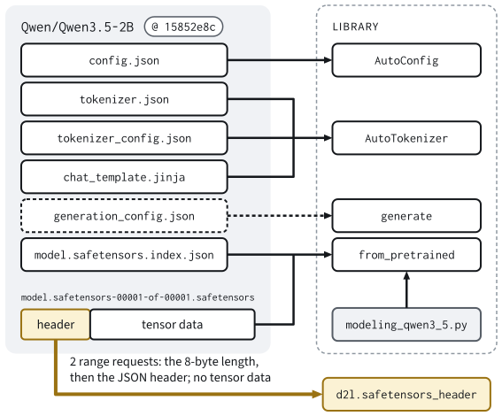
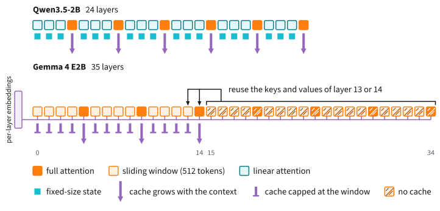

# Pretrained Models with Hugging Face
:label:`sec_lm_hf_models`

In :numref:`subsec_gpt-loading` we loaded the released weights of GPT-2 into
our own `GPT` class, with a constructor call and a hand-written map from the
released tensor names to ours. Ask that model a question and it does what it
was trained to do: it continues the page. The models released today answer
the question, and we no longer write a loader for each of them. A few lines
of the Transformers library download a current open model and run it.

That convenience hides everything this book has taught us to ask about. What
did those lines download? How much memory will the model need for a long
prompt, or for many prompts at once? How fast can it write? And will the
same lines load the same model next month?

Since 2019 the Transformers library :cite:`Wolf.Debut.Sanh.ea.2020` has put
many architectures behind one loading interface. Its companion, the Hugging
Face Hub, stores each model as a git repository that holds a configuration
file, a tokenizer and the tensors. The code that runs the model is part of
the library, and the configuration tells the library which code to run and
with which shapes. The configuration is therefore the blueprint of the
model: every shape follows from it, and with the shapes every byte of
weights, of cache and of memory traffic.

Every later chapter of this part starts by loading such a *checkpoint*, as a
released set of weights is called, and asks first whether it fits on the GPU
and how fast it decodes. The configuration answers both before a single
tensor is downloaded. In this section we read the repositories of two
current models, Qwen3.5-2B, a hybrid of recurrent and attention layers, and
Gemma 4 E2B, a transformer with sliding windows, until every field of their
configurations points to something we built earlier in this book and to a
number of bytes. Then we measure how well those numbers predict memory and
speed on one RTX 4090.

The first cell sets an option of PyTorch's memory allocator, which has to
happen before CUDA starts. :numref:`subsec_lm_hf_measured` explains it.

```{.python .input #hf-models-setup}
%%tab pytorch
import os
# The allocator reads this setting when CUDA starts, so it comes first:
# expandable segments grow in place instead of being fixed in size, so a
# large tensor need not find one free block that fits it
os.environ['PYTORCH_ALLOC_CONF'] = 'expandable_segments:True'
```

```{.python .input #hf-models-imports}
%%tab pytorch
import math
import numpy as np
import torch
from torch import nn
from torch.nn import functional as F
from d2l import torch as d2l
```

```{.python .input #hf-models-imports-extra}
%%tab pytorch
import accelerate
import collections
import functools
import gc
import huggingface_hub
import itertools
import json
import pandas as pd
import re
import transformers
from huggingface_hub import HfApi, file_exists
from safetensors import safe_open
from transformers import (AutoConfig, AutoModelForCausalLM, AutoTokenizer,
                          GenerationConfig)
```

The next cell names the two models and the question we will ask them.
Without a GPU it replaces Qwen3.5-2B by its smallest sibling in fp32, and
the measurements at the end of the section are skipped.
`d2l.bind_hf_kernels()` selects the GPU programs that run these models
(:numref:`subsec_lm_hf_kernels`). It is the first of about a dozen `d2l`
helpers that this section calls without showing their code. They are
plumbing for the measurements (timers, profilers, searches over batch
sizes), and the text says what each one measures. The library versions that
the cell prints belong to the record of any result: the modeling code lives
in the library, so another version may run the same tensors along a
different path.

```{.python .input #hf-models-settings}
%%tab pytorch
QWEN, GEMMA = 'Qwen/Qwen3.5-2B', 'google/gemma-4-E2B-it'
QWEN3 = 'Qwen/Qwen3-0.6B'  # its tokenizer only
NAMES = {QWEN3: 'Qwen3-0.6B', QWEN: 'Qwen3.5-2B', GEMMA: 'Gemma 4 E2B'}
GPU = torch.cuda.is_available()
# On a GPU the studied model runs in bf16; without one, its smallest sibling
# runs in fp32 and the measurements of the last part are skipped
RUN_MODEL, RUN_REV, RUN_DTYPE = (
    (QWEN, '15852e8c16360a2fea060d615a32b45270f8a8fc', torch.bfloat16) if GPU
    else ('Qwen/Qwen3.5-0.8B', '2fc06364715b967f1860aea9cf38778875588b17',
          torch.float32))
QUESTION = ('Why does a language model keep a key-value cache when it '
            'generates text?')
d2l.bind_hf_kernels()  # fused kernels for CUDA bf16, reference code otherwise
transformers.logging.set_verbosity_error()  # no notices or progress bars
transformers.logging.disable_progress_bar()
huggingface_hub.utils.disable_progress_bars()
huggingface_hub.utils.logging.set_verbosity_error()
for module in (torch, transformers, huggingface_hub, accelerate):
    print(f'{module.__name__} {module.__version__}')
```

First the model we already have. GPT-2 gets the question in a form that a
web page might use and writes 32 tokens greedily.

```{.python .input #hf-models-gpt2-question}
%%tab pytorch
gpt2, enc = d2l.load_gpt2().to(d2l.try_gpu()), d2l.gpt2_tokenizer()
out = gpt2.generate(enc.encode(f'Q: {QUESTION}\nA:'), 32, top_k=1)
d2l.print_wrapped(enc.decode(out))
del gpt2
```

GPT-2 writes fluent text about the nearest topic it knows, databases, and
begins to repeat itself. Now a current model. `from_pretrained` loads the
tokenizer and the model, each by the name of its repository and a
`revision`, which fixes the version of the files. The argument `dtype` asks
for 16-bit numbers, half the bytes of fp32 (:numref:`sec_memory_precision`).
`apply_chat_template` wraps the question in the format the model was trained
to answer, and `generate` writes 64 tokens greedily.

```{.python .input #hf-models-three-lines}
%%tab pytorch
tokenizer = AutoTokenizer.from_pretrained(RUN_MODEL, revision=RUN_REV)
model = AutoModelForCausalLM.from_pretrained(
    RUN_MODEL, revision=RUN_REV, dtype=RUN_DTYPE, device_map=d2l.try_gpu())
prompt = tokenizer.apply_chat_template(
    [{'role': 'user', 'content': QUESTION}], add_generation_prompt=True,
    enable_thinking=False, return_dict=True,
    return_tensors='pt').to(model.device)
reply = model.generate(**prompt, max_new_tokens=64, do_sample=False)
n_prompt = prompt['input_ids'].shape[1]
d2l.print_wrapped(tokenizer.decode(reply[0, n_prompt:],
                                   skip_special_tokens=True))
print(f'{type(model).__name__}: {model.num_parameters():,} parameters')
```

This reply has the form of an answer. It addresses the question and starts a
list of reasons before its 64 tokens run out. Whether its content is right
is another matter (a key-value cache is not "often called a context
window"), and judging content takes the tools of later sections. Here we
care about what we loaded, and the last line holds a first surprise: the
model called Qwen3.5-2B has 1.88 billion parameters.

## Checkpoints on the Hub
:label:`subsec_lm_hf_hub`

A repository on the Hub is addressed by a model id such as
`Qwen/Qwen3.5-2B`. We look at how to fix its contents, at what it contains,
and at what a load takes from it.

### Revisions and Licenses

A model id names a repository, and the files of a repository change: authors
correct a chat template, replace a tokenizer file, or upload new weights
under the old name. A *revision* names one commit by its 40-digit hash, and
a commit never changes (:numref:`sec_software_ecosystem`). The load above
passed the same revision to the model and to the tokenizer, whose files
include the chat template. `HF_REVISIONS` pins every model of this chapter
to the commit it was written against, in November 2026. Later sections add
their own entries.

```{.python .input #hf-models-revisions}
%%tab pytorch
#@save
HF_REVISIONS = {
    'Qwen/Qwen3-0.6B': 'c1899de289a04d12100db370d81485cdf75e47ca',
    'Qwen/Qwen3-0.6B-Base': 'da87bfb608c14b7cf20ba1ce41287e8de496c0cd',
    'Qwen/Qwen3-1.7B': '70d244cc86ccca08cf5af4e1e306ecf908b1ad5e',
    'Qwen/Qwen3-1.7B-Base': 'ea980cb0a6c2ae4b936e82123acc929f1cec04c1',
    'Qwen/Qwen3-4B': '1cfa9a7208912126459214e8b04321603b3df60c',
    'Qwen/Qwen3-8B': 'b968826d9c46dd6066d109eabc6255188de91218',
    'Qwen/Qwen3.5-0.8B': '2fc06364715b967f1860aea9cf38778875588b17',
    'Qwen/Qwen3.5-0.8B-Base': 'dc7cdfe2ee4154fa7e30f5b51ca41bfa40174e68',
    'Qwen/Qwen3.5-2B': '15852e8c16360a2fea060d615a32b45270f8a8fc',
    'Qwen/Qwen3.5-4B': '851bf6e806efd8d0a36b00ddf55e13ccb7b8cd0a',
    'google/gemma-4-E2B-it': '4adf15748de9e1a0097b6274cee9c15836c41c37'}
```

For each pin, the Hub reports the license at that commit and the size of the
weight files.

```{.python .input #hf-models-pins}
%%tab pytorch
for m, rev in HF_REVISIONS.items():  # licence and weights at each pin
    card = HfApi().model_info(m, revision=rev, files_metadata=True)
    size = sum(f.size for f in card.siblings
               if f.rfilename.endswith('.safetensors'))
    print(f'{m:24} {rev[:12]}  {card.card_data.license:12} '
          f'{size / 1e9:5.2f} GB')
```

All eleven repositories carry the Apache 2.0 license at their pins, and none
is *gated*, that is, none asks us to accept terms before a download. A
repository can change its license from one revision to the next, so the
license belongs in the record next to the commit. Names that end in `-Base`
are *base* models, trained only to continue text. The others were
*post-trained* by their authors to follow instructions and to hold a
conversation. The two models of this section take 4.55 GB and 10.25 GB on
disk.

The book holds its own files to the same rule. The measured tables,
reference logits and cached API responses of this part are published once
under a versioned name, and `DATA_HUB` pins each of them to its SHA-1 hash
under `LM_DATA_URL`.

```{.python .input #hf-models-lm-data-url}
%%tab pytorch
#@save
LM_DATA_URL = 'https://d2l-data.smola.org/lm/'
```

The first such file is the table of measurements behind the plot at the end
of this section, for readers without a GPU.

```{.python .input #hf-models-data-hub}
%%tab pytorch
#@save
d2l.DATA_HUB['lm-hf-memory-speed-v2'] = (  # fused kernels (fla, flex_sdpa)
    d2l.LM_DATA_URL + 'lm-hf-memory-speed-v2.json',
    'e1a6407448d04a3aef8cc6fff5ed39cfea549f0b')
```

### Repository Anatomy

What does the pinned commit of Qwen3.5-2B contain?

```{.python .input #hf-models-repo-files}
%%tab pytorch
info = HfApi().model_info(QWEN, revision=d2l.HF_REVISIONS[QWEN],
                          files_metadata=True)
for file in info.siblings:
    print(f'{file.size / 1e6:10,.2f} MB  {file.rfilename}')
print(f'safetensors: {info.safetensors.total:,} elements')
```

One of the thirteen files is more than 99% of the repository. `config.json`
holds the shapes. `tokenizer.json` and `tokenizer_config.json` define the
tokenizer (`vocab.json` and `merges.txt` repeat it in the older format of
GPT-2), `chat_template.jinja` wrapped our question, and the two preprocessor
files describe image and video inputs: this model also reads pictures. The
weights are in a single *shard*, a safetensors file, next to an index that
maps tensor names to shards. Larger models have several shards. One file is
absent: many repositories carry a `generation_config.json` with default
sampling settings, and this one has none. :numref:`fig_lm_hub_repo` shows
which part of the library reads which file.


:label:`fig_lm_hub_repo`

The last line of the output counts 2,274,069,824 elements. At two bytes each
they take 4,548 MB, the size of the shard, so the file holds 16-bit numbers
and little else. To find out which tensors they form, we need not download
them. A safetensors file starts with an 8-byte integer, the length of a JSON
header that lists the name, dtype, shape and byte range of every tensor
(:numref:`sec_read_write`). Two HTTP range requests per shard therefore
return every shape and no tensor data. `safetensors_header` does this for a
pinned repository. The format is all in its last loop: eight bytes give the
length `n` of the header, and the next `n` bytes are the JSON. The lines
before the loop deal with access to sharded and to gated repositories, and
`huggingface_hub.get_safetensors_metadata` does the same job in production
code.

```{.python .input #hf-models-safetensors-header}
%%tab pytorch
#@save
def safetensors_header(model_id, revision=None, timeout=30):
    """Shape and dtype of every tensor of a Hub checkpoint, read by HTTP
    range requests without fetching tensor data (in production:
    `huggingface_hub.get_safetensors_metadata`)."""
    import urllib.error
    import urllib.request
    import huggingface_hub
    revision = revision or d2l.HF_REVISIONS.get(model_id)
    if revision is None:
        revision = huggingface_hub.HfApi().model_info(model_id).sha
        print(f'unpinned: {model_id}@{revision}')
    token = huggingface_hub.get_token()  # for gated repositories

    class HubRedirect(urllib.request.HTTPRedirectHandler):
        """Keep the token on redirects within the Hub, not to the CDN."""
        def redirect_request(self, request, *args):
            new = super().redirect_request(request, *args)
            auth = request.unredirected_hdrs.get('Authorization')
            if new and auth and new.host == request.host:
                new.add_unredirected_header('Authorization', auth)
            return new

    opener = urllib.request.build_opener(HubRedirect)

    def fetch(filename, start=None, stop=None):  # bytes start, ..., stop - 1
        request = urllib.request.Request(huggingface_hub.hf_hub_url(
            model_id, filename, revision=revision))
        if start is not None:
            request.add_header('Range', f'bytes={start}-{stop - 1}')
        if token:  # unredirected: dropped when a redirect leaves the Hub
            request.add_unredirected_header('Authorization', f'Bearer {token}')
        with opener.open(request, timeout=timeout) as response:
            if start is None or response.status == 206:
                return response.read()
            return response.read(stop)[start:]  # the server ignored the range

    try:  # a sharded checkpoint lists its shards in an index
        index = json.loads(fetch('model.safetensors.index.json'))
        shards = sorted(set(index['weight_map'].values()))
    except urllib.error.HTTPError as e:
        if e.code != 404:
            raise
        shards = ['model.safetensors']
    tensors = {}
    for shard in shards:
        n = int.from_bytes(fetch(shard, 0, 8), 'little')  # header length
        header = json.loads(fetch(shard, 8, 8 + n))
        header.pop('__metadata__', None)
        tensors.update({name: (tuple(t['shape']), t['dtype'])
                        for name, t in header.items()})
    return tensors
```

We group the tensors by the first part of their names and count elements.

```{.python .input #hf-models-header-read}
%%tab pytorch
def top_prefix(name):  # model.language_model, model.visual or mtp
    return '.'.join(name.split('.')[:2 if name.startswith('model.') else 1])

header = safetensors_header(QWEN)
elements = collections.Counter()
for name, (shape, dtype) in header.items():
    elements[top_prefix(name)] += math.prod(shape)
dtypes = collections.Counter(dtype for _, dtype in header.values())
print(f'{len(header)} tensors {dict(dtypes)}, '
      f'{sum(elements.values()):,} elements')
for prefix, n in elements.items():
    print(f'{n:15,}  {prefix}')
assert sum(elements.values()) == info.safetensors.total
```

The file holds three things. The language model has the 1,881,825,088
elements that the opening reported as parameters. A vision tower of 331
million parameters encodes images, and a head of 61 million (`mtp`) serves
multi-token prediction, the prediction of tokens beyond the next one
:cite:`Gloeckle.Idrissi.Roziere.ea.2024`, which `generate` does not use. All
but 36 tensors are in bf16. The exceptions are two small tensors in each of
the 18 recurrent layers. So the "2B" of the name counts neither what the
file holds, 2.27 billion elements, nor what a text model loads. A model card
rounds. The header does not.

### Pinned Loading and the Text Model

We want the language model alone, and loading a part of a checkpoint can
fail silently. A loader that finds no tensor for a module warns and leaves
the module at its random initialization, and the parameter count looks right
all the same. A multimodal file invites this accident. The names of its
language model's tensors start with a prefix, `model.language_model`, that a
text model does not expect. For Qwen3.5 the library translates the names by
itself. For Gemma 4 it does not, and a careless load of the text model would
find none of its tensors.

The function `load_hf` wraps the loading call for the rest of this part,
with one guard for each thing that can go wrong. It passes the revision from
`HF_REVISIONS` to the configuration, the model and the tokenizer. It refuses
repositories that bring their own Python code (`trust_remote_code=False`)
and pickled weights, which can execute code when they are loaded
(`use_safetensors=True`, :numref:`sec_software_ecosystem`). On a machine
with one GPU it places every module there, because a model that the library
has spread over the GPU and the CPU runs without an error and very slowly.
It adds the tokenizer's end token to the stop tokens of `generate`, because
the end token of the configuration is not always the one that ends a chat
turn.

`load_hf` also decides which model to build. The Auto classes of
Transformers choose a class by the field `model_type` of the configuration.
Asked for a causal language model, they build the text model for Qwen3.5,
which is why the opening printed `Qwen3_5ForCausalLM`, and the multimodal
model for Gemma 4. A multimodal configuration nests that of its language
model, so `load_hf` asks with the inner one (`get_text_config`), and vision
and audio towers stay on disk. It passes the translation of names where the
file needs one (`key_mapping`), and it raises an error if any tensor of the
model is still missing.

The function ends with a *load report* of three lines: the class that was
built and its stop tokens, the tensors of the file that the model ignored,
and the kernels that the model runs. We will read our first report when we
load Gemma 4 E2B, the model that needs these guards.

```{.python .input #hf-models-load-hf}
%%tab pytorch
#@save
def load_hf(model_id, revision=None, dtype=torch.bfloat16, device_map='auto',
            *, attn_implementation=None):
    """A pinned causal language model from the Hugging Face Hub, text part
    only, in eval mode, and its tokenizer; prints a load report and the
    kernels it runs. The tokenizer's end token joins the stop tokens of
    `generate`; the attention defaults to `d2l.hf_attention`'s choice."""
    import collections
    import warnings
    import transformers
    if revision is None:
        revision = d2l.HF_REVISIONS.get(model_id)
    if revision is None:
        import huggingface_hub
        revision = huggingface_hub.HfApi().model_info(model_id).sha
        print(f'unpinned: {model_id}@{revision}')
    if device_map == 'auto':  # one GPU: everything on it; none: the CPU
        n_gpus = torch.cuda.device_count()
        device_map = ('cpu' if n_gpus == 0 else {'': 0} if n_gpus == 1
                      else 'auto')
    pin = dict(revision=revision, trust_remote_code=False)
    config = transformers.AutoConfig.from_pretrained(model_id, **pin)
    text = config.get_text_config()  # the language model's configuration
    renames = {}
    if text is not config and text.model_type in d2l._TEXT_KEY_MAPPING:
        renames['key_mapping'] = d2l._TEXT_KEY_MAPPING[text.model_type]
    d2l.bind_hf_kernels()  # routes fused kernels, registers flex_sdpa
    if attn_implementation is None:  # the device of the first module
        device = (next(iter(device_map.values()))
                  if isinstance(device_map, dict) else device_map)
        attn_implementation = d2l.hf_attention(
            text, 0 if device == 'auto' else device)
    model, info = transformers.AutoModelForCausalLM.from_pretrained(
        model_id, config=text, dtype=dtype, device_map=device_map,
        attn_implementation=attn_implementation, use_safetensors=True,
        output_loading_info=True, **pin, **renames)
    if info['missing_keys']:  # these modules would stay randomly initialized
        del model  # a kept traceback would otherwise hold its memory
        raise RuntimeError(f'no weights for {sorted(info["missing_keys"])}')
    model.revision = revision
    tokenizer = transformers.AutoTokenizer.from_pretrained(model_id, **pin)
    # Without generation_config.json, `generate` stops only at the
    # configuration's end token, which need not be the one ending a chat turn
    stop = model.generation_config.eos_token_id
    stop = ([] if stop is None else [stop] if isinstance(stop, int)
            else list(stop))
    if tokenizer.eos_token_id not in [*stop, None]:
        stop.append(tokenizer.eos_token_id)
        model.generation_config.eos_token_id = stop
    unexpected = collections.Counter(  # keys in the file the model ignores
        '.'.join(key.split('.')[:2]) for key in info['unexpected_keys'])
    print(f'{model_id}@{revision[:12]}: {type(model).__name__}, '
          f'stop tokens {stop}')
    print('0 missing keys; unexpected keys:',
          '(not loaded)' if unexpected else 'none')
    if unexpected:  # by count, then name
        d2l.print_wrapped('    ' + ', '.join(f'{k} {n:,}' for k, n in sorted(
            unexpected.items(), key=lambda kv: (-kv[1], kv[0]))), width=96)
    print('kernels:', ', '.join(f'{k} {v}'
                                for k, v in d2l.hf_kernels(model).items()))
    devices = set(getattr(model, 'hf_device_map', {}).values())
    if len(devices) > 1:
        warnings.warn(f'{model_id} is spread over {sorted(map(str, devices))}')
    return model.eval(), tokenizer
```

Qwen3.5-2B is already in memory, loaded by the plain call of the opening.
We do not load it a second time. We check that load against the pin
instead.

```{.python .input #hf-models-pinned-check}
%%tab pytorch
assert RUN_REV == HF_REVISIONS[RUN_MODEL]
# A pinned load reads its files from a cache folder named after the commit;
# the loaded model holds the tensors of that folder's weights file
key = 'model.language_model.norm.weight'
index = huggingface_hub.hf_hub_download(
    RUN_MODEL, 'model.safetensors.index.json', revision=RUN_REV)
with open(index) as f:
    path = huggingface_hub.hf_hub_download(
        RUN_MODEL, json.load(f)['weight_map'][key], revision=RUN_REV)
with safe_open(path, 'pt') as f:
    pinned = f.get_tensor(key)
assert torch.equal(pinned.to(model.dtype), model.model.norm.weight.cpu())
run_header = safetensors_header(RUN_MODEL)
in_file = sum(math.prod(shape) for shape, _ in run_header.values())
loaded = model.num_parameters()
# Every tensor of the model has its counterpart in the file, where the text
# model's names start with model.language_model; the output layer shares
# the embedding's tensor
tied = {'lm_head.weight'} if model.config.tie_word_embeddings else set()
names = {re.sub(r'^model\.', 'model.language_model.', name)
         for name in model.state_dict().keys() - tied}
assert names <= run_header.keys()
print(os.path.relpath(os.path.dirname(path),
                      huggingface_hub.constants.HF_HUB_CACHE))
print(f'{key} from that file = the loaded tensor, on '
      f'{sorted({str(p.device) for p in model.parameters()})}')
print(f'{loaded:,} parameters loaded, {in_file:,} elements in the file, '
      f'{in_file - loaded:,} left on disk')
```

A pinned load reads its files from a cache folder named after the commit,
and the tensor read from that folder equals the one in the model on the GPU.
The cell also asserts that every tensor of the model has a counterpart in
the file under the prefix `model.language_model`, except the output layer,
which shares the embedding matrix. The other 392,244,736 elements, the
vision tower and the head for multi-token prediction, stay on disk.

## Tokenizers and Generation
:label:`subsec_lm_hf_generate`

Between the text we type and the tensors we loaded stand two more files of
the repository, the tokenizer and the chat template. Between the logits and
the text the model writes stand the arguments of `generate`.

### Tokenizers and Chat Templates

The cell compares four tokenizers: that of GPT-2, those of our two models,
and that of Qwen3-0.6B, a dense predecessor of Qwen3.5 whose family later
sections use. All four split text into subword tokens, like the byte-pair
encoding of :numref:`sec_text-sequence`. The cell counts the vocabulary of
each and the tokens it spends per character on the opening of *The Time
Machine*, on the first 20,000 characters of this book's library, and on a
Chinese paragraph about the key-value cache.

```{.python .input #hf-models-tokenizers}
%%tab pytorch
CHINESE = ('语言模型每次只生成一个词元。为了预测下一个词元，它要用到前面所有词元的'
           '信息。键值缓存把每一层已经算好的键和值保存下来，生成新词元时只需计算这'
           '一个位置，而不必从头处理整段文本。上下文越长，缓存占用的显存就越多，所以'
           '长文本推理常常受限于内存，而不是算力。')
fname = d2l.download(d2l.DATA_URL + 'timemachine.txt', '../data',
                     '090b5e7e70c295757f55df93cb0a180b9691891a')
with open(fname, encoding='utf-8') as f:
    book = f.read()
with open(d2l.__file__, encoding='utf-8') as f:
    library = f.read()
texts = {'The Time Machine': book[:20000], 'd2l/torch.py': library[:20000],
         'Chinese': CHINESE}

def per_char(encode, texts):  # tokens per character of each text
    return {name: len(encode(text)) / len(text)
            for name, text in texts.items()}

table = {'GPT-2': {'vocabulary': enc.n_vocab, 'embedding rows': enc.n_vocab,
                   **per_char(enc.encode_ordinary, texts)}}
tokenizers = {}
for m in (QWEN3, QWEN, GEMMA):
    tokenizers[m] = AutoTokenizer.from_pretrained(m, revision=HF_REVISIONS[m])
    rows = AutoConfig.from_pretrained(
        m, revision=HF_REVISIONS[m]).get_text_config().vocab_size
    encode = functools.partial(tokenizers[m].encode, add_special_tokens=False)
    table[NAMES[m]] = {'vocabulary': len(tokenizers[m]),
                       'embedding rows': rows, **per_char(encode, texts)}
table = pd.DataFrame(table).T.astype({'vocabulary': int,
                                     'embedding rows': int})
print(table.round(2).to_string())
```

On English prose the four agree: about a quarter of a token per character.
On other text they part. GPT-2 spends one and a half to two times as many
tokens on Python code as the newer tokenizers do, and more than two tokens
per Chinese character on average, where the others need about two thirds of
one. The vocabulary column says why. GPT-2 built its 50,257 tokens from
English web text. It spends one token on every space of an indentation, and
a Chinese character, three bytes in UTF-8, falls apart into pieces. The
newer vocabularies are three to five times as large, with tokens for runs
of spaces and for the characters of many languages. The ratio matters
because it converts every per-token quantity of this section, bytes of cache
or milliseconds of decoding, into a quantity per character of text.

One detail of the table enters the counts below. The embedding matrices of
the Qwen models have a few hundred more rows than their tokenizers have
tokens, and the number of rows, `vocab_size`, is what a parameter count
needs.

What did the model of the opening read? Not our question alone:
`apply_chat_template` renders the conversation with the template in
`chat_template.jinja`. The cell prints the result and the ids of its last
nine tokens.

```{.python .input #hf-models-chat-template}
%%tab pytorch
def chat(tok, content):  # one user turn, rendered for generation
    return tok.apply_chat_template(
        [{'role': 'user', 'content': content}], add_generation_prompt=True,
        enable_thinking=False, return_dict=True, return_tensors='pt')

chat_ids = chat(tokenizers[QWEN], QUESTION)['input_ids'][0]
print(tokenizers[QWEN].decode(chat_ids))
tail = chat_ids[-9:].tolist()
print(tail)
print(tokenizers[QWEN].convert_ids_to_tokens(tail))
```

The markers `<|im_start|>` and `<|im_end|>` open and close a turn, each as a
single token (`Ċ` displays a newline). The prompt ends inside the
assistant's turn, which is why the model answers the question and does not
continue it. More exactly, it ends after an empty `<think>` block. Qwen
models can write out reasoning before they answer, and the template, not the
weights, switches this on and off: with `enable_thinking=False` the template
closes the block itself. The default differs between checkpoints. The
post-trained Qwen3 models and Qwen3.5-4B think unless told otherwise, and
Qwen3.5-0.8B and Qwen3.5-2B do not, so every helper in this part passes
`enable_thinking` explicitly. Templates, roles and the difference between
base and post-trained checkpoints are the subject of
:numref:`sec_lm_prompting`.

### Generation Arguments and Defaults

`generate` is the loop of :numref:`sec_decoding`: compute the logits of the
next token, choose a token, append it, and stop at an end token. Its
arguments are the settings of our `sample_next` under other names
(:numref:`tab_lm_hf_sampling_map`).

:The sampling arguments of `generate` in Transformers and their counterparts in the sampler of :numref:`sec_decoding`.
:label:`tab_lm_hf_sampling_map`

| `generate` | `sample_next` | effect |
|---|---|---|
| `do_sample=False` | `temperature=0` | greedy: take the most probable token |
| `temperature` | `temperature` | divide the logits before the softmax |
| `top_k` | `k` | keep the $k$ most probable tokens |
| `top_p` | `p` | keep the smallest set of most probable tokens whose total probability reaches $p$ |
| `min_p` | `min_p` | keep tokens with at least this fraction of the top probability |
| `num_beams` | `d2l.beam_search` | search over several continuations at once |
| `repetition_penalty` | none | lower the logits of tokens already in the text |

The two samplers differ where truncations combine. Transformers applies each
truncation to the renormalized distribution that the previous one left,
whereas `sample_next` computes every cutoff on the full distribution and
keeps the smallest count. With probabilities $(0.4, 0.3, 0.2, 0.1)$, a
top-$k$ of 3 and a top-$p$ of 0.75, `sample_next` keeps three tokens, and
Transformers keeps two, since after renormalization to $(0.44, 0.33, 0.22)$
two tokens pass 0.75. The difference is not academic: the defaults of
Gemma's repository set both arguments.

Is `generate` the loop we think it is? The cell compares 32 greedy tokens
from `generate` with a four-line argmax loop over the model's forward pass,
both without a cache. It then times 32 new tokens after 1,024 and after
8,192 tokens of *The Time Machine*, once with that loop, which reads the
whole prefix again at every step, and once with `generate` and its cache.

```{.python .input #hf-models-greedy-check}
%%tab pytorch
def argmax_loop(model, ids, steps):  # greedy decoding by hand, no cache
    for _ in range(steps):
        logits = model(ids, logits_to_keep=1, use_cache=False).logits
        ids = torch.cat([ids, logits[:, -1].argmax(-1, keepdim=True)], 1)
    return ids

with torch.inference_mode():
    ref = model.generate(**prompt, max_new_tokens=32, do_sample=False,
                         use_cache=False)
    ours = argmax_loop(model, prompt['input_ids'], ref.shape[1] - n_prompt)
    print('identical:', torch.equal(ours, ref))
    assert torch.equal(ours, ref)
    # Without a cache every step reads the whole prefix again, so what the
    # cache saves grows with the prompt
    book_ids = tokenizer(book, return_tensors='pt').input_ids.to(model.device)
    for n in (1024, 8192) if GPU else (64, 128):
        long = book_ids[:, :n]
        for name, f in (
                ('argmax loop without a cache',
                 lambda: argmax_loop(model, long, 32)),
                ('generate with a cache', lambda: model.generate(
                    long, attention_mask=torch.ones_like(long),
                    min_new_tokens=32, max_new_tokens=32, do_sample=False))):
            print(f'{name}: {d2l.Benchmark(f, 0, 1).time:.2f} s for 32 '
                  f'tokens after {n:,} prompt tokens')
```

The tokens are identical. With its cache, `generate` takes about a second
for 32 tokens after either prompt. The loop without a cache takes about 1.5
times as long after 1,024 tokens and about 8 times as long after 8,192, as
:numref:`sec_kv-cache` leads us to expect. But the cached time itself is
suspicious. It amounts to roughly 30 ms per token. The model has 3.8 GB of
weights, and a card that moves about 1 TB per second reads them in about
4 ms. :numref:`subsec_lm_hf_decode` finds the missing time.

When we pass no settings, `generate` takes them from
`generation_config.json` if the repository has one, and from defaults of the
library otherwise. The cell prints what our two models would use.

```{.python .input #hf-models-generation-defaults}
%%tab pytorch
for m in (QWEN, GEMMA):
    rev = HF_REVISIONS[m]
    if file_exists(m, 'generation_config.json', revision=rev):
        source = 'generation_config.json'
        gen = GenerationConfig.from_pretrained(m, revision=rev)
    else:  # Transformers derives one from the model configuration
        source = 'config.json, library defaults'
        gen = GenerationConfig.from_model_config(
            AutoConfig.from_pretrained(m, revision=rev).get_text_config())
    mode = 'sampling' if gen.do_sample else 'greedy'  # unset (None): greedy
    print(f'{NAMES[m]} ({source}): {mode}')
    print(f'    do_sample={gen.do_sample}, temperature={gen.temperature}, '
          f'top_k={gen.top_k}, top_p={gen.top_p}, '
          f'stop tokens {gen.eos_token_id}')
```

Qwen3.5-2B ships no such file, so its defaults are greedy, and its only stop
token is 248044, the end-of-text token of the configuration. A chat turn
ends with `<|im_end|>`, token 248046 in the template above, so a plain call
of `generate` would write past the end of the assistant's turn. This is why
`load_hf` adds the tokenizer's end token. Gemma 4 E2B ships the file and
asks for sampling at temperature 1 with a top-$k$ of 64 and a top-$p$ of
0.95, so two calls with the same prompt return two replies, as we will see.
A comparison that leaves defaults in place compares a greedy model with a
sampling one. In this book, every call that generates text passes its
sampling arguments explicitly.

## Reading a Configuration
:label:`subsec_lm_hf_config`

We now read `config.json` itself, for both models side by side. No field
should remain a mystery: each should point to a layer we have built and to a
number of parameters.

### The Two Configurations

The cell prints the fields of the two language models, the repeating pattern
of their layer types, and the settings of their rotary position embeddings.

```{.python .input #hf-models-config-fields}
%%tab pytorch
configs = {m: AutoConfig.from_pretrained(m, revision=HF_REVISIONS[m])
           for m in (QWEN, GEMMA)}
text_configs = {m: c.get_text_config().to_dict() for m, c in configs.items()}
FIELDS = (
    'hidden_size', 'num_hidden_layers', 'sliding_window',
    'num_attention_heads', 'num_key_value_heads', 'head_dim',
    'attn_output_gate',
    'linear_num_key_heads', 'linear_num_value_heads', 'linear_key_head_dim',
    'linear_value_head_dim', 'linear_conv_kernel_dim', 'mamba_ssm_dtype',
    'num_kv_shared_layers', 'use_double_wide_mlp',
    'hidden_size_per_layer_input', 'intermediate_size', 'hidden_act',
    'hidden_activation', 'vocab_size', 'tie_word_embeddings',
    'final_logit_softcapping', 'mtp_num_hidden_layers',
    'max_position_embeddings')
print(pd.DataFrame({NAMES[m]: {f: t.get(f, '–') for f in FIELDS}
                    for m, t in text_configs.items()}).to_string())

def layer_pattern(types):  # the shortest run-length pattern that repeats
    runs = [(kind, len(list(group)))
            for kind, group in itertools.groupby(types)]
    k = next(k for k in range(1, len(runs) + 1)
             if runs == runs[:k] * (len(runs) // k))
    return runs[:k], len(runs) // k

for m, t in text_configs.items():
    pattern, repeats = layer_pattern(t['layer_types'])
    L = t['num_hidden_layers']
    own = L - (t.get('num_kv_shared_layers') or 0)
    print(f'{NAMES[m]}: {pattern} x {repeats}')
    print(f'    {own} of {L} layers keep a cache or state of their own')
    rope = t['rope_parameters']  # one dict, or one per layer kind
    per_kind = all(isinstance(p, dict) for p in rope.values())
    for kind, p in rope.items() if per_kind else [('all layers', rope)]:
        d2l.print_wrapped(f'    rope ({kind}): ' + ', '.join(
            f'{k} {v}' for k, v in p.items()))
```

The table is long, and four things in it are worth reading first: the
width `hidden_size`, the number of layers, the head fields, and the pattern
of layer types in the lines below the table. The remaining rows are listed
so that no field stays unexplained.

Qwen3.5-2B has 24 layers of width 2,048 in a pattern of three
`linear_attention` layers and one `full_attention` layer, six times over.
Linear attention is the configuration's name for the Gated DeltaNet of
:numref:`sec_deltanet`, a recurrent layer. Each of its heads keeps a matrix
$\mathbf{S}$ of fixed size that maps keys to values. For every token with
key $\mathbf{k}_t$ and value $\mathbf{v}_t$, the head shrinks the matrix by
a decay $a_t$, erases a fraction $\beta_t$ of what is stored under the key,
and writes the same fraction of the value there:

$$
\mathbf{S}_t = a_t\, \mathbf{S}_{t-1}(\mathbf{I} - \beta_t
\mathbf{k}_t\mathbf{k}_t^\top) + \beta_t \mathbf{v}_t \mathbf{k}_t^\top.
$$

This update is the *delta rule*, and $\beta_t$ is its write strength. The
state $\mathbf{S}$ does not grow with the text, so the model is a hybrid in
the sense of :numref:`sec_hybrids`: only its six attention layers keep a
cache that does.

Gemma 4 E2B has 35 layers of width 1,536, four `sliding_attention` layers
followed by one `full_attention` layer, seven times over. A sliding layer
attends to the last 512 positions only (:numref:`sec_attention-at-scale`).
The last 20 layers do something we have not met. They compute no keys and
values and attend to those of an earlier layer, which leaves 15 layers with
a cache of their own (:numref:`fig_lm_hf_layer_layout`).


:label:`fig_lm_hf_layer_layout`

:numref:`tab_lm_hf_config` says what each field means and gives it the
symbol that the formulas below use.

:The configuration fields printed above, their symbols in this section, and where the book builds what they describe.
:label:`tab_lm_hf_config`

| field | symbol | meaning |
|---|---|---|
| `hidden_size` | $d$ | width of the residual stream (:numref:`sec_transformer-block`) |
| `num_hidden_layers` | $L$ | layers; `layer_types` gives the kind of each |
| `num_attention_heads`, `num_key_value_heads`, `head_dim` | $H$, $H_\textrm{kv}$, $d_h$ | query heads, key--value heads and head width of grouped-query attention (:numref:`sec_kv-cache`) |
| `attn_output_gate` | | a sigmoid gate on the output of each head, the remedy for attention sinks of :numref:`subsec_kv-cache-sinks` |
| `sliding_window` | $w$ | positions that a sliding layer attends to |
| `linear_num_key_heads`, `linear_key_head_dim` | $H_k$, $d_k$ | key heads of Gated DeltaNet and their width |
| `linear_num_value_heads`, `linear_value_head_dim` | $H_v$, $d_v$ | value heads and their width; each head keeps a $d_k \times d_v$ state |
| `linear_conv_kernel_dim` | $k_c$ | width of a short causal convolution over queries, keys and values |
| `mamba_ssm_dtype` | | dtype of the recurrent state |
| `num_kv_shared_layers` | | last layers, which reuse earlier keys and values |
| `use_double_wide_mlp` | | twice the MLP width on those layers |
| `hidden_size_per_layer_input` | | width of a second embedding with one vector per token and layer |
| `intermediate_size` | $f$ | width of the gated MLP (:numref:`sec_transformer-block`); `hidden_act` names its activation |
| `vocab_size`, `tie_word_embeddings` | $V$ | rows of the embedding matrix, which the output layer shares |
| `final_logit_softcapping` | | the logits $z$ are squashed to $30 \tanh(z / 30)$ |
| `mtp_num_hidden_layers` | | blocks of the head for multi-token prediction |
| `max_position_embeddings` | | the longest context the model was built for |

Both models use grouped-query attention with 8 query heads and 2 or 1
key--value heads. Qwen3.5 rotates a quarter of each head's dimensions, 64 of
256, in its rotary position embedding
(:numref:`sec_positional-information`), and the `mrope` entries concern
positions inside images. The larger Qwen3.6 and Qwen3.8 models carry the
same fields with more and wider layers, so what we read here is read for a
family.

### Parameter Counts

Can we predict the 1,881,825,088 parameters of Qwen3.5-2B from these fields?
Take $V$ embedding rows of width $d$ with a tied output layer, $L_f$
full-attention layers and $L_l$ linear-attention layers. Each layer has the
part that moves information between positions, attention or Gated DeltaNet,
with $A_f$ or $A_l$ parameters. It also has a gated MLP of three matrices
between the widths $d$ and $f$, and two normalizations of $d$ weights each.
With a final normalization, the model has

$$
P = Vd + L_f\,(A_f + 3df + 2d) + L_l\,(A_l + 3df + 2d) + d
$$
:eqlabel:`eq_lm_hf_params`

parameters. A full-attention layer has

$$
A_f = 2\,d H d_h + 2\,d H_\textrm{kv} d_h + H d_h d + 2 d_h
$$

of them: the query projection, twice as wide as usual because it also
produces the output gate, the key and value projections, the output
projection, and a normalization of queries and of keys. For Qwen3.5-2B,
$A_f = 14{,}680{,}576$, and the MLP has $3 \cdot 2048 \cdot 6144 =
37{,}748{,}736$ parameters, which is 72% of the layer's 52,433,408. Most of
a transformer's weights are in its MLPs.

A Gated DeltaNet layer has more parts, and we count them one by one.
Projections map the input to queries, keys and values of total width
$C = 2 H_k d_k + H_v d_v$ and to an output gate of width $U = H_v d_v$,
with $dC + dU$ parameters. A short convolution of width $k_c$ per channel
runs over queries, keys and values, with $C k_c$. Two projections compute
the decay $a_t$ and the write strength $\beta_t$ for each value head, with
$2\,d H_v$. And an output projection maps the result back to the width $d$,
with $U d$. In total,

$$
A_l = dC + dU + C k_c + 2\,d H_v + U d + (2 H_v + d_v).
$$

The bracket holds two constants per head and one normalization. Here
$C = 6{,}144$, $U = 2{,}048$ and $A_l = 21{,}061{,}792$, so a recurrent
layer of this model has more parameters than an attention layer.

`config_params` is :eqref:`eq_lm_hf_params` in code. The equation is the
loop over `_hf_layers`: the inner function `attention` returns $A_f$, and
the branch for `linear_attention` adds $A_l$. Everything else extends the
count to the fields of Gemma 4, to the head for multi-token prediction and
to the vision tower, and can be skipped at a first reading. The function
refuses a configuration whose layout it does not know, such as a mixture of
experts, because a plausible wrong count is worse than an error.

```{.python .input #hf-models-config-params}
%%tab pytorch
#@save
def _hf_text_config(config):
    """A configuration and its text part, as plain dicts."""
    c = config.to_dict() if hasattr(config, 'to_dict') else dict(config)
    return c, c.get('text_config') or c

#@save
def _hf_layers(t):
    """Kind, head dimension, KV heads and KV sharing of every layer."""
    L, H = t['num_hidden_layers'], t['num_attention_heads']
    first_shared = L - (t.get('num_kv_shared_layers') or 0)
    overrides = {int(i): o
                 for i, o in (t.get('per_layer_config') or {}).items()}
    layers = []
    for i, kind in enumerate(t.get('layer_types') or ['full_attention'] * L):
        d_h = t.get('head_dim') or t['hidden_size'] // H
        H_kv = t.get('num_key_value_heads') or H
        if kind == 'full_attention':  # Gemma 4's global layers are wider
            d_h = t.get('global_head_dim') or d_h
            if t.get('attention_k_eq_v'):
                H_kv = t.get('num_global_key_value_heads') or H_kv
        o = overrides.get(i, {})
        layers.append((kind, o.get('head_dim', d_h),
                       o.get('num_key_value_heads', H_kv), i >= first_shared))
    return layers

#@save
def config_params(config, include_vision=False, include_mtp=False,
                  by_group=False):
    """Parameters of a dense or hybrid model (Qwen3, Qwen3.5, Gemma 4),
    counted from its configuration; other layouts raise."""
    c, t = _hf_text_config(config)
    if (t.get('num_experts') or t.get('n_routed_experts')
            or t.get('enable_moe_block')):
        raise NotImplementedError('use d2l.config_stats (14.1)')
    known = ('qwen3', 'qwen3_5_text', 'gemma4_text')  # QK norms, no biases
    if (t['model_type'] not in known or t.get('attention_bias')
            or t.get('mlp_bias')):
        raise NotImplementedError(f'{t["model_type"]} layout, not one of '
                                  f'{known} without biases')
    d, f, H, V = (t['hidden_size'], t['intermediate_size'],
                  t['num_attention_heads'], t['vocab_size'])
    gemma = t['model_type'] == 'gemma4_text'
    gate = 2 if (t.get('attn_output_gate')  # gated attention output
                 or t['model_type'] == 'qwen3_5_text') else 1
    g = dict.fromkeys(['embed', 'per_layer_embed', 'attention',
                       'linear_attention', 'mlp', 'per_layer_proj', 'norm',
                       'lm_head', 'vision', 'mtp'], 0)
    g['embed'] = V * d
    g['lm_head'] = 0 if t.get('tie_word_embeddings', True) else V * d

    def attention(kind, d_h, H_kv, shared):  # Q (+ gate), K, V, O, QK norms
        n_kv = (0 if shared else
                1 if t.get('attention_k_eq_v') and kind == 'full_attention'
                else 2)
        norms = d_h * (1 if shared else 2)
        return gate * d * H * d_h + n_kv * d * H_kv * d_h + H * d_h * d + norms

    for kind, d_h, H_kv, shared in _hf_layers(t):
        if kind == 'linear_attention':  # Gated DeltaNet
            H_v, d_v = t['linear_num_value_heads'], t['linear_value_head_dim']
            K = t['linear_num_key_heads'] * t['linear_key_head_dim']
            U, C = H_v * d_v, 2 * K + H_v * d_v  # C: convolution channels
            g['linear_attention'] += (d * C + 2 * d * U + 2 * d * H_v + 2 * H_v
                                      + C * t['linear_conv_kernel_dim'] + d_v)
        else:
            g['attention'] += attention(kind, d_h, H_kv, shared)
        wide = 2 if shared and t.get('use_double_wide_mlp') else 1
        g['mlp'] += 3 * d * f * wide
        g['norm'] += (4 if gemma else 2) * d
    g['norm'] += d  # final norm
    p, L = t.get('hidden_size_per_layer_input') or 0, t['num_hidden_layers']
    if p:  # Gemma 4: per-layer embeddings, their projections and norms
        g['per_layer_embed'] = t['vocab_size_per_layer_input'] * L * p
        g['per_layer_proj'] = d * L * p + L * 2 * d * p
        g['norm'] += p + L * d
    if include_mtp and t.get('mtp_num_hidden_layers'):  # Qwen3.5
        block = attention('full_attention', t.get('head_dim') or d // H,
                          t['num_key_value_heads'], False) + 3 * d * f + 2 * d
        g['mtp'] = t['mtp_num_hidden_layers'] * block + 2 * d * d + 3 * d
    v = c.get('vision_config')
    if include_vision and v:
        if (v['model_type'] not in ('qwen3_5', 'qwen3_5_vision')
                or v.get('deepstack_visual_indexes')):
            raise NotImplementedError(f'vision tower of {v["model_type"]}')
        D, I, m = v['hidden_size'], v['intermediate_size'], (
            v['spatial_merge_size'] ** 2)
        patch = (v['in_channels'] * v['temporal_patch_size']
                 * v['patch_size'] ** 2)
        block = 4 * D * D + 2 * D * I + 9 * D + I  # with biases, LayerNorms
        g['vision'] = ((patch + 1 + v['num_position_embeddings']) * D
                       + v['depth'] * block + 2 * D
                       + (D * m + 1) * (D * m + v['out_hidden_size']))
    return g if by_group else sum(g.values())
```

We compare its counts with the three groups of the header, and print the
terms of :eqref:`eq_lm_hf_params`.

```{.python .input #hf-models-reconcile}
%%tab pytorch
groups = config_params(configs[QWEN], include_vision=True, include_mtp=True,
                       by_group=True)
derived = {'model.language_model': sum(n for g, n in groups.items()
                                       if g not in ('vision', 'mtp')),
           'model.visual': groups['vision'], 'mtp': groups['mtp']}
buckets = pd.DataFrame({'from config': derived, 'from header': elements})
buckets.loc['total'] = buckets.sum()
print(buckets.map('{:,}'.format).to_string())
assert derived == dict(elements)
print(f'{RUN_MODEL} as loaded: {model.num_parameters():,} parameters, from '
      f'its configuration {config_params(model.config):,}')
assert model.num_parameters() == config_params(model.config)

def one_layer(kind):  # a stack of one such layer minus an empty stack
    t = text_configs[QWEN] | {'num_hidden_layers': 1, 'layer_types': [kind]}
    return config_params(t) - config_params(
        t | {'num_hidden_layers': 0, 'layer_types': []})

print(f'embedding {groups["embed"]:,}; one layer: full attention '
      f'{one_layer("full_attention"):,}, linear attention '
      f'{one_layer("linear_attention"):,}')
```

The configuration reproduces the file to the last element in each group, and
the printed terms let us check the language model by hand:
$508{,}559{,}360 + 6 \cdot 52{,}433{,}408 + 18 \cdot 58{,}814{,}624 +
2{,}048 = 1{,}881{,}825{,}088$. An exact match says more than it may seem
to. A count that is off by one normalization vector means that we have
misread the architecture somewhere. A count that agrees in all ten digits
means that every shape in the file is accounted for.

### The Gemma 4 Configuration

The derivation is the same for Gemma 4 E2B, with different fields. The cell
counts its layers by kind and head width, prints the parameter groups, and
compares their sum with the text tensors of the file.

```{.python .input #hf-models-gemma-config}
%%tab pytorch
gemma_text = text_configs[GEMMA]
overrides = {int(i): o for i, o in gemma_text['per_layer_config'].items()}
head_dims = collections.Counter(  # global layers override the head width
    (kind, overrides.get(i, {}).get('head_dim', gemma_text['head_dim']))
    for i, kind in enumerate(gemma_text['layer_types']))
print('layers by kind and head width:', dict(head_dims))
print(f'per-layer embeddings: {gemma_text["vocab_size_per_layer_input"]:,} x '
      f'{gemma_text["num_hidden_layers"]} x '
      f'{gemma_text["hidden_size_per_layer_input"]}')
gemma_groups = config_params(configs[GEMMA], by_group=True)
for g, n in gemma_groups.items():
    if n:
        print(f'{n:15,}  {g}')
gemma_header, first_shared = safetensors_header(GEMMA), (
    gemma_text['num_hidden_layers'] - gemma_text['num_kv_shared_layers'])

def unused(name):  # K/V of the KV-sharing layers: stored, never built
    m = re.match(r'model\.language_model\.layers\.(\d+)\.self_attn\.'
                 r'(k_proj|v_proj|k_norm)\.', name)
    return m is not None and int(m.group(1)) >= first_shared

def numel(keep):  # elements of the header's tensors whose name passes keep
    return sum(math.prod(shape) for name, (shape, _) in gemma_header.items()
               if keep(name))

text_total = numel(lambda name: name.startswith('model.language_model.'))
residual = text_total - sum(gemma_groups.values())
scalars = numel(lambda name: name.endswith('.layer_scalar'))  # buffers
print(f'text tensors in the file {text_total:,}, from the configuration '
      f'{sum(gemma_groups.values()):,}')
print(f'difference {residual:,} = {numel(unused):,} unused K/V '
      f'+ {scalars} layer scalars')
assert residual == numel(unused) + scalars
print(f'parameters read per token: '
      f'{sum(gemma_groups.values()) - gemma_groups["per_layer_embed"]:,}')
```

Three things here have no counterpart in the models we have built. The first
is the group `per_layer_embed`, a second embedding table that holds, for
every token, a vector of width 256 for each of the 35 layers. It has
$262{,}144 \times 35 \times 256 = 2{,}348{,}810{,}240$ parameters, half of
the text model. This table is looked up, not multiplied: a forward pass
reads one row of it per token.

The second is the sharing of keys and values. The last 20 layers have no key
and value projections. Each attends to the keys and values of the last
earlier layer of its kind, layer 13 or layer 14, and has an MLP twice as
wide. The file nevertheless stores projections for these layers, 18,880,512
elements that the library never builds. With 35 single numbers that the
library keeps as buffers, they are the whole difference between the file and
our count. Sharing across layers is a way of shrinking a cache that
:numref:`sec_kv-cache` did not list. It reduces the number of layers that
keep one, here from 35 to 15.

The third is the head width: the seven full-attention layers override
`head_dim` with heads of width 512.

Of Gemma's 4,628,569,344 parameters, a forward pass therefore multiplies
2,279,759,104, everything except the per-layer table. This is the
"effective" size that the E in the model's name refers to. The model
occupies memory like one of 4.6 billion parameters, and we will see that it
computes like one of 2.3 billion.

## Memory and Speed
:label:`subsec_lm_hf_memory`

The parameter count gives the bytes of the weights. A running model needs
memory for three more things: what it remembers of each sequence, the
activations of a forward pass, and the logits. All of them follow from the
same fields. We derive them, test the derivation on Qwen3.5-2B, and then
exchange the model on the GPU for Gemma 4 E2B, so that each model is
measured with the card to itself. The speed of both models comes last.

### Weights, Caches and State

Each attention layer caches one key and one value vector of
$H_\textrm{kv} d_h$ numbers per token (:numref:`sec_kv-cache`). The smallest
case is one full-attention layer of Qwen3.5-2B: 2 key--value heads of width
256 at $b = 2$ bytes per number cache $2 \cdot 2 \cdot 256 \cdot 2 =
2{,}048$ bytes per token. A sliding layer caches as much per token, but only
for the positions in its window. A linear-attention layer caches nothing per
token. It keeps a state of $H_v d_k d_v$ numbers and the last inputs of its
convolution. For $B$ sequences of $n$ tokens the model then needs

$$
\begin{aligned}
M(n, B) = bP &+ B \Big[ \sum_{\textrm{full}} 2 H_\textrm{kv} d_h\, b\, n
+ \sum_{\textrm{sliding}} 2 H_\textrm{kv} d_h\, b \min(n, w_c)
+ L_l\,(H_v d_k d_v\, s + C k_c\, b) \Big] \\
&+ \textrm{Act}(n, B) + B\, n_\textrm{out} V b
\end{aligned}
$$
:eqlabel:`eq_lm_hf_memory`

bytes. The first term is the weights. The bracket is the memory of one
sequence: the caches of the full and of the sliding layers that keep one,
and the state of the linear-attention layers at $s$ bytes per number.
$\textrm{Act}$ stands for the activations of a forward pass, and the last
term for the logits of the $n_\textrm{out}$ positions that are kept. Two
constants follow the library. A window of $w = 512$ covers the current token
and 511 earlier ones, so $w_c = w - 1$ positions are cached. And although a
causal convolution of width 4 needs three earlier inputs, all $k_c = 4$ are
kept.

`config_memory` evaluates the five terms. Its loop over `_hf_layers` is the
bracket of :eqref:`eq_lm_hf_memory`: the first branch adds the state of a
linear-attention layer, and the last lines add the cache of an attention
layer that keeps one. The quantity `mixer` belongs to the activation term,
which counts the residual stream and the tensors of the widest layer while
a prompt is processed. This term is an estimate assembled from the tensors
that the kernels allocate, and it has to be tested.

```{.python .input #hf-models-config-memory}
%%tab pytorch
#@save
def config_memory(config, seq_len, batch_size, dtype_bytes=2, *,
                  state_bytes=4, conv_bytes=None, conv_taps=None,
                  window_cached=None, include_vision=False, include_mtp=False,
                  logits_to_keep=1):
    """Bytes to run a model on `batch_size` sequences of `seq_len` tokens.

    The defaults store what Transformers 5.22.2 stores: a sliding layer keeps
    `sliding_window - 1` positions, a linear-attention layer all
    `linear_conv_kernel_dim` convolution inputs; a prefill holds every
    position until it ends: `window_cached=seq_len`. `activations` counts
    what a prefill holds at its peak with the kernels `load_hf` binds: the
    residual stream and the largest layer's tensors, rotary tables (under
    3%) aside. `logits_to_keep` of None or 0 keeps every position's logits."""
    import warnings
    c, t = _hf_text_config(config)
    n, B, b = seq_len, batch_size, dtype_bytes
    if n > t.get('max_position_embeddings', n):
        warnings.warn(f'seq_len {n} exceeds max_position_embeddings '
                      f'{t["max_position_embeddings"]}')
    if window_cached is None and t.get('sliding_window'):
        window_cached = t['sliding_window'] - 1
    conv_bytes = b if conv_bytes is None else conv_bytes
    if conv_taps is None:
        conv_taps = t.get('linear_conv_kernel_dim')
    d, H = t['hidden_size'], t['num_attention_heads']
    gate = 2 if (t.get('attn_output_gate')  # gated attention output
                 or t['model_type'] == 'qwen3_5_text') else 1
    kv = state = mixer = 0  # mixer: entries per token of the widest layer
    for kind, d_h, H_kv, shared in _hf_layers(t):
        if kind == 'linear_attention':  # fixed matrix state + conv inputs
            H_v, d_k = t['linear_num_value_heads'], t['linear_key_head_dim']
            d_v, K = t['linear_value_head_dim'], (
                t['linear_num_key_heads'] * d_k)
            V, C = H_v * d_v, 2 * K + H_v * d_v
            state += H_v * d_k * d_v * state_bytes + C * conv_taps * conv_bytes
            # Chunked kernel (64 tokens): the convolved q, k, v and their
            # copy, normalized q, k, w, u, new values, output, output gate,
            # one d_k x d_v state per chunk and a 64 x 64 block per chunk
            mixer = max(mixer, 2 * C + 3 * K + 4 * V
                        + H_v * (d_k * d_v // 64 + 64))
            continue
        # Q (and gate), K, V, normalized and rotated Q and K, output (gated)
        mixer = max(mixer, (3 + 4 * (gate - 1)) * H * d_h + 4 * H_kv * d_h)
        if not shared:  # a KV-sharing layer reads an earlier layer's cache
            kept = min(n, window_cached) if kind == 'sliding_attention' else n
            kv += 2 * H_kv * d_h * b * kept
    f = t['intermediate_size'] * (2 if t.get('use_double_wide_mlp')
                                  and t.get('num_kv_shared_layers') else 1)
    # The embeddings, the layer input and its normalized copy live across a
    # layer; the MLP adds the attention's residual and its three f-wide
    # products. Gemma 4 keeps its per-layer inputs for the whole pass.
    per_layer = t['num_hidden_layers'] * (
        t.get('hidden_size_per_layer_input') or 0)
    params = config_params(config, include_vision, include_mtp)
    n_out = min(logits_to_keep, n) if logits_to_keep else n
    memory = {'params': params, 'weights': params * b,
              'kv_cache': B * kv, 'recurrent_state': B * state,
              'activations': B * n * b * (max(3 * d + mixer, 4 * d + 3 * f)
                                          + per_layer),
              'logits': B * n_out * t['vocab_size'] * b}
    memory['total'] = sum(memory.values()) - params
    return memory
```

The next cell tabulates the terms for one sequence, up to the maximum
context of each model. A word on units first. Memory that the allocator
hands out is counted in GiB and MiB, $2^{30}$ and $2^{20}$ bytes, as PyTorch
reports it. File sizes and bytes moved per second are counted in GB and MB,
$10^9$ and $10^6$ bytes, as the Hub and the datasheets report them. A GiB is
7% more than a GB, so the 3.8 GB of Qwen's weights appear in the table as
3.505 GiB.

The last column of the table is the cache of an imagined model of the same
shape in which every layer keeps its own keys and values at every position.
For Qwen3.5-2B we can predict where the real model falls below it. Six
attention layers cache $6 \cdot 2{,}048 = 12{,}288$ bytes per token. Each of
the 18 recurrent layers holds 16 states of $128 \times 128$ numbers at
$s = 4$ bytes, since the field `mamba_ssm_dtype` asks for a state in fp32,
and four convolution inputs of 6,144 numbers in bf16. Together they hold
$18\,(16 \cdot 128 \cdot 128 \cdot 4 + 6{,}144 \cdot 4 \cdot 2) =
19{,}759{,}104$ bytes at any context. And 24 attention layers would cache
49,152 bytes per token. The two are equal when
$12{,}288\,n + 19{,}759{,}104 = 49{,}152\,n$, at $n = 536$.

```{.python .input #hf-models-memory-table}
%%tab pytorch
GiB = 2**30
TERMS = ('weights', 'kv_cache', 'recurrent_state', 'activations', 'logits',
         'total')

def all_attention(config):
    """The text configuration with every layer keeping its own keys and
    values; with window_cached=n, sliding layers keep every position too."""
    t = config.get_text_config().to_dict()
    t['layer_types'] = ['full_attention' if kind == 'linear_attention'
                        else kind for kind in t['layer_types']]
    t['num_kv_shared_layers'] = 0
    return t

def crossover(config):
    """The smallest context at which the cache and state take fewer bytes
    than the all-attention counterfactual's cache, by bisection."""
    def smaller(n):
        mem = config_memory(config, n, 1)
        return mem['kv_cache'] + mem['recurrent_state'] < config_memory(
            all_attention(config), n, 1, window_cached=n)['kv_cache']

    hi = 1
    while not smaller(hi):
        hi *= 2
    lo = hi // 2  # smaller(lo) fails, smaller(hi) holds
    while hi - lo > 1:
        mid = (lo + hi) // 2
        lo, hi = (lo, mid) if smaller(mid) else (mid, hi)
    return hi

rows = []
for m, c in configs.items():
    for n in (1024, 4096, 16384, 65536,
              c.get_text_config().max_position_embeddings):
        mem = config_memory(c, n, 1)
        kv_all = config_memory(all_attention(c), n, 1, window_cached=n)
        rows.append({'model': NAMES[m], 'n': n,
                     **{k: mem[k] / GiB for k in TERMS},
                     'all-attn kv': kv_all['kv_cache'] / GiB})
print(pd.DataFrame(rows).rename(columns={'recurrent_state': 'state'})
      .round(3).to_string(index=False))
for m, c in configs.items():
    mem, mem_next = config_memory(c, 4096, 1), config_memory(c, 4097, 1)
    slope = mem_next['kv_cache'] - mem['kv_cache']  # B/token beyond windows
    fixed = mem['kv_cache'] + mem['recurrent_state'] - 4096 * slope
    slope_all = config_memory(all_attention(c), 1, 1,
                              window_cached=1)['kv_cache']
    n_star = crossover(c)
    print(f'{NAMES[m]}: {slope:,} B/token + {fixed:,} B; all attention '
          f'{slope_all:,} B/token')
    print('    smaller ' + ('at every context' if n_star == 1 else
                            f'beyond {n_star - 1:,} tokens')
          + f', {(slope * 16384 + fixed) / (slope_all * 16384):.2f} of it '
          f'at 16,384')
logits = config_memory(configs[QWEN], 16384, 1, logits_to_keep=None)
print(f'logits of all 16,384 positions: {logits["logits"] / 1e9:.1f} GB')
```

The memory of a hybrid per sequence is a slope plus a constant
(:numref:`fig_hy-cache`). Below 536 tokens Qwen3.5-2B holds more memory per
sequence than a transformer of its shape would. At 16,384 tokens it holds
0.27 of it, on the way to the quarter that its share of attention layers
predicts. Gemma 4 E2B caches 6,144 bytes per token in its three
full-attention layers that keep a cache, and at most 6.0 MiB in its twelve
sliding ones: 0.15 of its all-attention counterpart at 16,384 tokens.

Two terms are larger than the caches. Processing a prompt in one pass holds
about 74 KiB of activations per token for Qwen3.5-2B, six times its cache
per token, so a long prompt may not fit in one pass although its cache
would. At the maximum context of 262,144 tokens the cache takes 3 GiB and
the activations 18.5 GiB. And the logits column shows zero only because the
table, like `generate`, keeps the logits of one position. A forward pass
returns logits for every position unless told otherwise, and those of
16,384 positions over 248,320 vocabulary entries take 8.1 GB, or 7.6 GiB,
more than twice the weights. Generation needs the last position alone,
which is what `logits_to_keep=1` computes.

### Measured Memory
:label:`subsec_lm_hf_measured`

We now test the formula on the GPU. One other measurement has to come
first, because the harness below times decode steps in the same pass in
which it measures memory. Reading those times will take the memory bandwidth
$\beta$, the rate at which the GPU moves bytes between its memory and its
arithmetic units (:numref:`sec_hardware`). The cell doubles an array of
about a gigabyte, which reads the array once and writes one of the same
size.

```{.python .input #hf-models-bandwidth}
%%tab pytorch
BETA_DATASHEET = 1.0e12  # bytes/s, RTX 4090
if GPU:
    x = torch.randn(256 * 1024 * 1024, device=d2l.try_gpu())  # 1 GB fp32
    beta = 2 * x.nbytes / d2l.Benchmark(lambda: x * 2.0).time
    del x
    print(f'measured {beta / 1e12:.2f} TB/s '
          f'(datasheet {BETA_DATASHEET / 1e12:.1f} TB/s)')
```

The card streams about 0.9 TB/s, a little less than the 1.0 TB/s of its
datasheet (:numref:`tab_gpu_specs`).

Now the memory. We process a prompt in one pass and measure three things,
and each can catch an error that the other two would miss.

The first is the cache itself. `cache_bytes` walks every tensor that can be
reached from the cache object and adds up the bytes by dtype, and we compare
the sum with the bracket of :eqref:`eq_lm_hf_memory`. Only this count sees
the dtype of each tensor. The second is the growth of the allocator from
before the pass to after it, compared with the bracket plus the logits that
are kept. Only the allocator sees memory that the pass left behind without
a reference from the cache object. The third is the allocator's peak during
the pass, compared with the whole formula. Only the peak tests the
activation estimate.

`cache_bytes` returns two counts. Its *logical* bytes count every distinct
tensor once, and its *resident* bytes count every underlying block of memory
once. The two differ when a small view keeps a large block alive. The tables
below report their ratio in the column `held`, and a cache that occupies
only what it uses has a `held` of 1.

```{.python .input #hf-models-cache-bytes}
%%tab pytorch
#@save
def cache_bytes(cache):
    """Bytes of the floating-point tensors reachable from a cache object,
    by dtype: logical (every distinct view) and resident (every underlying
    storage once). Integer tensors are bookkeeping, not cache."""
    import collections
    logical, resident = collections.Counter(), collections.Counter()
    views, storages, visited, todo = set(), set(), set(), [cache]
    while todo:
        obj = todo.pop()
        if isinstance(obj, torch.Tensor) and obj.is_floating_point():
            if (obj.data_ptr(), obj.shape) not in views:
                views.add((obj.data_ptr(), obj.shape))
                logical[obj.dtype] += obj.nbytes
            storage = obj.untyped_storage()
            if storage.data_ptr() not in storages:
                storages.add(storage.data_ptr())
                resident[obj.dtype] += storage.nbytes()
        elif id(obj) not in visited:
            visited.add(id(obj))
            if isinstance(obj, dict):
                todo.extend(obj.values())
            elif isinstance(obj, (list, tuple)):
                todo.extend(obj)
            elif type(obj).__module__.startswith('transformers.'):
                todo.extend(vars(obj).values())  # cache and layer objects
    return logical, resident
```

Processing a prompt in one pass and keeping its cache is called a *prefill*
(:numref:`sec_kv-cache`). The helper `d2l.hf_measure` prefills the first
256, 1,024, 4,096 and 16,384 tokens of *The Time Machine*, takes the three
measurements, times the decode steps, and asserts that the bytes found by
`cache_bytes` equal the formula's. `d2l.hf_memory_table` prints that count
in MiB (the column `walker`) next to the formula, and the other measurements
divided by their derived values. At 256 tokens we expect
$12{,}288 \cdot 256 + 19{,}759{,}104$ bytes, or 21.84 MiB.

```{.python .input #hf-models-run-qwen}
%%tab pytorch
MiB, BUDGET = 2**20, 15 * GiB  # a 15 GiB slot of a 24 GB card

def close(measured, derived, rel=0.05):  # allocator rounding: 2 MiB
    return abs(measured - derived) <= max(rel * derived, 2 * MiB)

if GPU:
    qwen_rows = d2l.hf_measure(model, configs[QWEN], book_ids, beta)
    print(d2l.hf_memory_table(qwen_rows).to_string(index=False))
    for row in qwen_rows:  # right after the prefill; the prefill's peak
        assert close(row['growth'], row['growth_derived'])
        assert close(row['peak'], row['peak_formula'], 0.1)
```

`cache_bytes` finds the bytes of the formula at every context, to the byte.
The first two lines of the output confirm what the field `mamba_ssm_dtype`
announced: the model runs in bf16 and keeps its recurrent state in fp32, the
$s = 4$ of the formula. The allocator grows by what the formula derives, the
cache and the logits of one position, after the prefill and again after one
decode step, and the cache keeps no block alive that it does not use (`held`
is 1). The peak is 0.98 of the estimate. This agreement is the least
impressive of the three. We assembled the activation term from the tensors
that these kernels allocate, so it confirms that the list is complete, not
that we could have predicted it.

Two more checks. A prefill that keeps the logits of all 4,096 positions
should grow by $4{,}096 \cdot 248{,}320 \cdot 2 = 2{,}034{,}237{,}440$ bytes
beyond the cache. And the formula should tell us what fits into a budget of
15 GiB, about what a 16 GB card offers. We search for the largest batch of
4,096-token prompts and, in powers of two, for the longest single prompt
that a prefill survives. The table of terms predicts the batch. Its total
at 4,096 tokens is 3.860 GiB, of which the weights are 3.505 GiB, so each
sequence adds 0.355 GiB. Then $(15 - 3.505) / 0.355 = 32.4$, and 32
sequences should fit.

```{.python .input #hf-models-qwen-capacity}
%%tab pytorch
def capacity(model, config, ids):
    """The largest batch at 4,096 tokens and the longest context that fit
    BUDGET: measured against the formula."""
    (b, n), (b_formula, n_formula), overhead = d2l.hf_capacity(
        model, config, ids, BUDGET)
    print(f'within 15 GiB, measured: batch {b} at 4,096 tokens, {n:,} '
          f'tokens at batch 1')
    print(f'by the formula: batch {b_formula}, {n_formula:,} tokens; '
          f'allocator overhead {overhead / MiB:.0f} MiB')
    assert abs(b - b_formula) <= max(1, 0.1 * b_formula)
    assert n == n_formula

if GPU:
    out, _, growth, _ = d2l.hf_prefill(model, book_ids, 4096, keep=0)
    del out  # it kept every position's logits
    mem = config_memory(configs[QWEN], 4096, 1, logits_to_keep=0)
    extra = growth - mem['kv_cache'] - mem['recurrent_state']
    print(f'logits of all 4,096 positions: growth beyond the cache '
          f'{extra:,} B, derived {mem["logits"]:,} B')
    assert abs(extra - mem['logits']) <= 0.05 * mem['logits']
    capacity(model, configs[QWEN], book_ids)
```

The logits term is exact, and the search finds a batch of 32 and a context
of 131,072 tokens, as the formula says. A configuration file and a page of
arithmetic would have told us what this model can serve before the download.

The agreement depends on the allocator setting in the first cell of this
section. PyTorch's allocator obtains memory in large segments and reuses
freed blocks inside them (:numref:`fig_bg_allocator`). A tensor larger than
every free block needs a new segment, so a batch can run out of memory while
gigabytes are free in pieces. With `expandable_segments` a segment grows in
place, and the allocator holds only 167 MiB beyond what the tensors request.
The formula counts requests. A capacity plan reaches it only with an
allocator that does not fragment.

### Fused Kernels
:label:`subsec_lm_hf_kernels`

So far we have taken the code that runs the model as given. But the same
tensors can be run by different GPU programs, and the choice changes how
much memory a prompt needs and how long it takes.

Every PyTorch operation on a GPU tensor launches a *kernel*, a compiled GPU
program that reads its inputs from the memory of the GPU and writes its
result back. Each launch costs the host 5 to 15 µs
(:numref:`subsec_comp-overhead`), and every intermediate result between two
kernels occupies memory and is written and read once more. A *fused* kernel
performs a chain of operations in one launch and keeps the intermediate
values in registers (:numref:`subsec_comp-fusion`). The modeling code of
Transformers is written to be read, as a sequence of PyTorch operations. We
call it the *reference* code. For two operations of our models fused kernels
exist, and `load_hf` selects them wherever they can run. The first is the
delta rule.

The recurrent layers of Qwen3.5 do not apply the delta rule token by token
when they read a prompt. They take 64 tokens at a time and solve one small
triangular system per chunk for everything that the chunk writes
(:numref:`sec_deltanet`). The reference code copies queries, keys, values,
decays and write strengths to fp32 and builds every intermediate matrix of
this computation for all chunks at once. Then it visits the chunks in a
Python loop, with several launches per chunk and layer. The package
`flash-linear-attention` (`fla`) replaces all of this by a few fused kernels
per layer. They read the bf16 inputs and keep their fp32 sums on the chip,
in registers and in the small memory that the threads of a kernel share. To
the memory of the GPU they write little more than the solutions of the
triangular systems, one state per chunk and the output. The fp32 copies, the
padding and the per-chunk temporaries of the reference code never reach it.
These kernels need a GPU and 16-bit inputs.

The cell prefills three prompt lengths in both ways.
`d2l.reference_kernels` switches a model to the reference code inside a
`with` block. The columns give the peak above the weights in GiB, as
:eqref:`eq_lm_hf_memory` estimates it and as measured, and the times of the
prefill and of a decode step.

```{.python .input #hf-models-kernel-compare}
%%tab pytorch
if GPU:  # the opening's model, routed by d2l.bind_hf_kernels
    print('kernels:', ', '.join(f'{k} {v}'
                                for k, v in d2l.hf_kernels(model).items()))
    qwen_compare = d2l.hf_compare_kernels(model, configs[QWEN], book_ids,
                                          (4096, 16384, 65536))
    print(qwen_compare.to_string(index=False, na_rep=''))
```

The first line names what the model runs: PyTorch's fused attention (`sdpa`,
the FlashAttention of :numref:`sec_attention-at-scale`), `fla` for the delta
rule, and plain PyTorch for the short convolution. The fused prefill needs
about two thirds of the reference's memory and about half its time at every
length. A prompt of 65,536 tokens takes 5.3 GiB above the weights, where the
reference takes 8.2 GiB. A decode step gains less, about 26 ms against about
30 ms.

Do the two compute the same function? Not bit for bit, because they add the
same bf16 numbers in a different order. The last two columns compare the
logits at the last 64 positions of each prompt, and the most probable next
token agrees at 97% to 100% of them. The row `ref., batch 2` gives the
scale. It compares the reference code with itself at a batch size of 2
instead of 1, and that agreement is 98%. At 4,096 tokens, switching kernels
moves the logits about as much as changing the batch size does. In bf16,
near-ties flip, which is worth remembering whenever two runs of a model
disagree about a token.

The second operation is attention under a sliding window. Neither Qwen model
has one, so this comparison needs the second model.

### The Second Model

Gemma 4 E2B has waited since the configurations were read, and three open
items have waited with it. We have not seen a load report of `load_hf`. We
have not run the sampling defaults of Gemma's repository. And the memory
formula has been tested on one architecture only. We free Qwen3.5-2B first
and check that its memory was returned. `load_hf` then loads the text model,
and the cell generates three times: twice with the defaults of the
repository, and once greedily on our question.

```{.python .input #hf-models-load-gemma}
%%tab pytorch
if GPU:
    del model, prompt, reply, ref, ours
    gc.collect()
    torch.cuda.empty_cache()
    left = torch.cuda.memory_allocated()  # a stray reference keeps 3.8 GB
    print(f'allocated after freeing Qwen: {left / MiB:.0f} MiB')
    assert left < GiB
    gemma, gemma_tok = load_hf(GEMMA)
    assert gemma.num_parameters() == config_params(configs[GEMMA])
    print(f'{gemma.num_parameters():,} parameters, as config_params says')
    sea = chat(gemma_tok, 'Write one sentence about the sea.').to(
        gemma.device)
    torch.manual_seed(0)
    n_sea = sea['input_ids'].shape[1]
    replies = [gemma_tok.decode(  # the repository's sampling defaults
        gemma.generate(**sea, max_new_tokens=32)[0, n_sea:],
        skip_special_tokens=True) for _ in range(2)]
    for r in replies:
        d2l.print_wrapped(r)
    print('the two replies differ:', replies[0] != replies[1])
    question = chat(gemma_tok, QUESTION).to(gemma.device)
    greedy = gemma.generate(**question, max_new_tokens=64, do_sample=False,
                            top_k=None, top_p=None)
    d2l.print_wrapped(gemma_tok.decode(
        greedy[0, question['input_ids'].shape[1]:], skip_special_tokens=True))
```

The load report reads as it should. The class is the text model
`Gemma4ForCausalLM`, and no tensor is missing. The 1,400 ignored tensors
belong to an audio tower and a vision tower with their embedding layers.
They close the account of the file: its text tensors take 9.3 GB at two
bytes each, and the towers the remaining 1 GB of the 10.25 GB. (The unused
key and value projections of the sharing layers are not listed, because the
library knows to skip them.) The model has the 4,628,569,344 parameters that
its configuration predicted. The last line of the report names a kernel,
`flex_sdpa`, that the next subsection explains.

With the defaults of the repository the same prompt gave two different
sentences about the sea, because those defaults sample. The greedy reply to
our question starts on the right track, with text generated one token at a
time, before its 64 tokens run out.

We repeat the memory measurements for Gemma.

```{.python .input #hf-models-run-gemma}
%%tab pytorch
if GPU:
    gemma_ids = gemma_tok(book, return_tensors='pt').input_ids.to(
        gemma.device)
    gemma_rows = d2l.hf_measure(gemma, configs[GEMMA], gemma_ids, beta)
    print(d2l.hf_memory_table(gemma_rows).to_string(index=False))
    for row in gemma_rows:  # after the first decode step; the prefill's peak
        assert close(row['growth_after_step'],
                     row['growth_after_step_derived'])
        assert close(row['peak'], row['peak_formula'], 0.1)
    capacity(gemma, configs[GEMMA], gemma_ids)
```

The cache again matches the formula to the byte, and the growth of the
allocator and the peak of the prefill match within 3%. The column to watch
is `held`. Transformers implements the window by keeping a view of the last
511 positions of each sliding layer's keys and values, and after a prefill
this view keeps those of the whole prompt alive. At 16,384 tokens the cache
occupies 2.8 times the bytes it uses. The first decode step copies the
window and releases the rest (`after step`). The column `growth` matches
right after the prefill only because we derived it with every position
counted.

A capacity plan has to count the same way. From the table of terms, one
sequence of 4,096 tokens adds $9.048 - 8.621 = 0.427$ GiB to Gemma's
weights, and $(15 - 8.621) / 0.427 = 14.9$ would promise 14 sequences. But
during the prefill each of the twelve sliding layers holds all 4,096
positions and not 511, at 1,024 bytes per position for the keys and values
of its one head of width 256. That is another 0.04 GiB and makes 0.467 GiB
per sequence. Then $(15 - 8.621) / 0.467 = 13.7$, and the search finds 13
sequences, or a single one of 32,768 tokens. The model with the smaller
cache serves fewer sequences than Qwen3.5-2B, for two reasons: its weights
take 8.6 GiB of the budget against 3.5, and each of its sequences needs
0.47 GiB during a prefill against 0.36.

### Sliding Windows and Flex Attention

A sliding window is a mask that is neither absent nor plainly causal.
PyTorch's fused attention accepts such a mask only as a tensor, and the
reference code builds one: a byte for every pair of positions, $n^2$ bytes
per sequence, 0.25 GiB at 16,384 tokens and 4 GiB at 65,536. The quadratic
memory that fused attention had removed
(:numref:`subsec_attn-counting-memory`) comes back through the mask. *Flex
attention*, a newer interface of PyTorch, takes the mask as a function and
compiles it into the kernel, with a small table that marks each tile of the
score matrix as empty, full or mixed. Empty tiles are skipped, so a sliding
layer works in proportion to $n$ times the window. For one decode token
nothing can be skipped, and the plain kernel is faster. The `flex_sdpa` of
the load report is our name for the combination: flex attention on a prompt
and `sdpa` on a single token.

The cell prefills four prompt lengths with the fused kernel and with the
reference code.

```{.python .input #hf-models-gemma-compare}
%%tab pytorch
if GPU:
    gemma_compare = d2l.hf_compare_kernels(
        gemma, configs[GEMMA], gemma_ids, (4096, 16384, 32768, 65536))
    print(gemma_compare.to_string(index=False, na_rep=''))
```

At 4,096 tokens the reference costs little. Then the mask takes over. The
peak of the reference exceeds that of the fused run by 0.015 GiB at 4,096
tokens, 0.25 GiB at 16,384 and 1.15 GiB at 32,768, and a mask of $n^2$ bytes
takes 0.016, 0.25 and 1 GiB at these lengths. At 65,536 tokens the fused
prefill peaks at 7.7 GiB above the weights, and the reference runs out of
memory on a 24 GB card. Time follows memory: the fused prefill is 1.3 times
faster at 4,096 tokens, about 2 times at 16,384 and 2.5 times at 32,768.
Decode steps take the same time either way, to within 2%, as they run the
same kernel. The most probable next token agrees at 95% to 100% of the last
64 positions.

The practical advice is short: know which kernels a model runs. The load
report prints them, and `d2l.hf_kernels(model)` returns them. On a CPU both
models run the reference code, as do the recurrent layers in fp32 and the
sliding windows on older GPUs, and the numbers of these comparisons then do
not apply. When a model card quotes the memory or the speed of a long
prompt, the kernel is part of the claim.

### Decode Throughput
:label:`subsec_lm_hf_decode`

What remains is the speed of writing. A decode step produces one token, and
:numref:`sec_hardware` bounded its time from below. The step reads every
weight once and performs about one floating-point operation per byte, so it
cannot finish before the bytes it reads have passed through the memory
bandwidth $\beta$. One step of our models reads

$$
R(n) = b\,(P - P_g) + \textrm{KV}_\textrm{read}(n) + 2S
$$
:eqlabel:`eq_lm_hf_decode_bytes`

bytes and takes at least $R(n) / \beta$. Here $P_g$ counts the parameters
that are looked up and not multiplied, which is Gemma's per-layer table.
(The ordinary embedding is looked up as well, but it is read in full as the
output layer.) $\textrm{KV}_\textrm{read}$ is the cache that the layers
attend to. For Gemma it includes the 20 sharing layers, which read the
caches of layers 13 and 14 again. $S$ is the recurrent state in bytes, read
and written once per step. `bytes_read` evaluates the formula.

```{.python .input #hf-models-bytes-read}
%%tab pytorch
#@save
def bytes_read(config, n, b=2):
    """Bytes a decode step reads at context n: the weights except the
    gathered per-layer table, every cache a layer attends to (a KV-sharing
    layer re-reads its source's), and the state, read and written."""
    t = config.get_text_config().to_dict()
    t['num_kv_shared_layers'] = 0
    mem = config_memory(t, n, 1, b)
    groups = config_params(config, by_group=True)
    return (b * (sum(groups.values()) - groups['per_layer_embed'])
            + mem['kv_cache'] + 2 * mem['recurrent_state'])
```

`d2l.hf_measure` has already timed the decode steps: at each context, 64
greedy steps from a copy of the prefilled cache, ten times after three
repeats of warm-up. `d2l.hf_profile_steps` now profiles single steps and
records the time the GPU spends in each kernel, first for Gemma, which is in
memory, and then for Qwen3.5-2B, which the cell loads again. Profiling comes
last, because a profiler that has run once slows every later launch in the
process. The tables give, in ms per decode step, the median wall time with
its quartiles, the time the device was busy, the part of it spent in matrix
products, the number of kernel launches, and $R / \beta$ for the bandwidth
of the datasheet and for the measured one.

```{.python .input #hf-models-profile-compare}
%%tab pytorch
if GPU:  # profiling comes after every timed decode step
    gemma_kernels = d2l.hf_profile_steps(gemma, gemma_ids, gemma_rows)
    del gemma
    gc.collect()
    torch.cuda.empty_cache()
    model = AutoModelForCausalLM.from_pretrained(
        RUN_MODEL, revision=RUN_REV, dtype=RUN_DTYPE, device_map=d2l.try_gpu())
    qwen_kernels = d2l.hf_profile_steps(model, book_ids, qwen_rows)
    for m, rows, kernels in ((QWEN, qwen_rows, qwen_kernels),
                             (GEMMA, gemma_rows, gemma_kernels)):
        print(f'{NAMES[m]}, ms per decode step:')
        print(d2l.hf_time_table(rows, BETA_DATASHEET).to_string(index=False))
        for n in (1024, 16384):
            if n in kernels:
                print(f'kernels with the most device time at {n:,} tokens:')
                d2l.show_kernels(kernels[n])
```

Read the last column first. One step of Qwen3.5-2B reads 3.8 GB, which takes
4.1 ms at the measured bandwidth, and one step of Gemma 4 E2B reads 4.6 GB,
or 5.0 ms. If the bound decided, the models would write about 240 and 200
tokens per second. The wall times are far from it: about 26 ms for
Qwen3.5-2B, six times its bound, and about 45 ms for Gemma 4 E2B, nine times
its bound. The column `busy` says where the time is not. The GPU works for
about 6 ms of Qwen's 26 and for 10 to 20 ms of Gemma's 45, and waits for the
rest. The next cell turns the columns into three ratios and asserts each.

```{.python .input #hf-models-ratios}
%%tab pytorch
if GPU:
    at = {r['model']: r for r in qwen_rows + gemma_rows if r['n'] == 1024}
    for m, rows in ((QWEN, qwen_rows), (GEMMA, gemma_rows)):
        # The host launches one kernel after another and the device works
        # in between, so the wall time is the launches' time
        share = [r['busy_ms'] / r['wall_ms_median'] for r in rows]
        us_per_launch = [1e3 * r['wall_ms_median'] / r['launches']
                         for r in rows]
        print(f'{NAMES[m]}: device busy {min(share):.0%}-{max(share):.0%} '
              f'of the step, {min(us_per_launch):.1f}-'
              f'{max(us_per_launch):.1f} us of wall time per launch')
        assert max(share) < 0.5
        by_n = {r['n']: r for r in rows}
        if 256 in by_n and 16384 in by_n:  # within 25% is nearly flat
            grow = {k: by_n[16384][k] / by_n[256][k] for k in (
                'wall_ms_median', 'busy_ms', 'bytes_read')}
            print('    16,384 / 256 tokens: wall {:.2f}, busy {:.2f}, bytes '
                  'read {:.2f}'.format(*grow.values()))
            assert grow['wall_ms_median'] <= 1.25
    held = config_params(configs[GEMMA]) / config_params(configs[QWEN])
    read = (bytes_read(configs[GEMMA], 1024)
            / bytes_read(configs[QWEN], 1024))
    ratio = at[GEMMA]['matmul_ms'] / at[QWEN]['matmul_ms']
    print(f'matrix products Gemma/Qwen: {ratio:.2f} (bytes read {read:.2f}, '
          f'bytes held {held:.2f})')
    assert ratio < math.sqrt(read * held)  # closer to bytes read
    for m, c in configs.items():
        groups = config_params(c, by_group=True)
        weights_ms = 2e3 * (sum(groups.values()) - groups['per_layer_embed']
                            ) / beta
        print(f'{NAMES[m]}: matrix products {at[m]["matmul_ms"]:.2f} ms, '
              f'weights read at measured bandwidth {weights_ms:.2f} ms')
        assert at[m]['matmul_ms'] <= 2 * weights_ms
```

*The host sets the pace.* The device is busy for about a quarter of a step,
and for up to about 40% of Gemma's at 16,384 tokens. A step launches about
1,500 kernels for Qwen3.5-2B and about 3,200 for Gemma 4 E2B, and the wall
time divided by the launches is about 15 µs for both (14 to 18). That is the
cost of issuing one operation from Python (:numref:`subsec_comp-overhead`),
with the library's own Python around it. Gemma's steps take longer because
they launch twice as many kernels, and the size of the model has little to
do with it.

This also explains the 30 ms per token of the cached `generate` that looked
suspicious earlier. The cache removed most of the GPU's work, and the GPU's
work was not what we were waiting for. These shares belong to this host and
to an eager loop: a faster CPU would shorten the wall time and leave the
device time where it is. Transformers, then, is the reference implementation
of these models and not the fast path. The 20 ms and more that every step
spends on the host are what compiled decode loops and serving engines
remove, by taking Python out of the loop as the CUDA graphs of
:numref:`subsec_comp-overhead` did.

*Matrix products run at the speed of memory.* At batch size 1 every linear
layer multiplies a matrix by one vector (`gemv` in the kernel names) and
reads the matrix once. These kernels take 4.35 ms for Qwen3.5-2B, against
4.09 ms for reading its weights at the measured bandwidth, and 5.50 ms
against 4.96 ms for Gemma 4 E2B: within about 10% of the bound. Gemma's
matrix products take about 1.3 times as long as Qwen's. This is close to the
ratio of the bytes the two models read, 1.2, and far from the ratio of the
bytes they hold, 2.5. Half of Gemma's parameters cost memory and no time.
One kernel of its profile shows the bound at work. It takes 0.89 ms, the
time to read the output layer once: $262{,}144 \times 1{,}536$ numbers in
bf16, or 805 MB.

*The context barely matters, with one exception.* From 256 to 16,384 tokens
the bytes read grow by 5% for both models, and the wall time stays within
2%. Qwen's device time grows by 10%, and its profile at 16,384 tokens shows
why. The kernel that appends the new token's keys and values copies each
attention layer's whole cache at every step, and at this length the copy
takes 0.35 ms. Gemma's device time doubles, and the bound does not explain
it. Its seven full-attention layers read about 0.2 GB of cache at 16,384
tokens, a quarter of a millisecond at this bandwidth, yet the attention
kernel (`fmha` in the profile) takes 10 ms, half of the device time.
PyTorch's attention kernel for this case, a single query against a long
cache of wide heads, works far below the speed of memory. The wall time
hides this, since the host is slower still.

A last plot collects the measurements of both models. The cell before it
stores the measured rows, and without a GPU the plot reads the published
copy.

```{.python .input #hf-models-save-table}
%%tab pytorch
if GPU:  # the candidate file; a download never writes to this path
    measured = {'rows': qwen_rows + gemma_rows, 'beta_measured': beta,
                'transformers': transformers.__version__}
    path = os.path.join('..', 'data', 'lm', 'rerun',
                        'lm-hf-memory-speed.json')
    os.makedirs(os.path.dirname(path), exist_ok=True)
    with open(path, 'w') as f:
        json.dump(measured, f, indent=1)
```

```{.python .input #hf-models-plot}
%%tab pytorch
if not GPU:  # the rows of the run behind the published figure
    with open(d2l.download('lm-hf-memory-speed-v2',
                           os.path.join('..', 'data', 'lm'))) as f:
        measured = json.load(f)
curves = {'mem': {}, 'time': {}}  # (panel, model, style): (x, y)
for m, c in configs.items():
    rows = [r for r in measured['rows'] if r['model'] == m]
    n_run = [r['n'] for r in rows]
    ns = [2**k for k in range(
        8, c.get_text_config().max_position_embeddings.bit_length())]
    mem = [config_memory(c, n, 1) for n in ns]
    curves['mem'] |= {
        (m, '-'): (ns, [(f['kv_cache'] + f['recurrent_state']) / MiB
                        for f in mem]),
        (m, '--'): (ns, [config_memory(all_attention(c), n, 1,
                                       window_cached=n)['kv_cache'] / MiB
                         for n in ns]),
        (m, 'o'): (n_run, [r['walker_logical'] / MiB for r in rows])}
    curves['time'] |= {(m, style): (n_run, [r[k] for r in rows])
                       for k, style in (('wall_ms_median', '-'),
                                        ('busy_ms', '--'),
                                        ('r_over_beta_measured_ms', ':'))}
# The solid curves of both models, then the first model's other curves: a
# legend of four names the models by colour and the rest by line style
_, axes = d2l.plt.subplots(1, 2, figsize=(7.5, 3.2))
color = {QWEN: 'C0', GEMMA: 'C1'}
for ax, panel, ylabel, yscale, xlim, ylim, loc, solid, styles in (
        (axes[0], 'mem', 'cache + state (MiB)', 'log', None, (2, 2e5),
         'upper left', 'formula', {'--': 'all attention', 'o': 'measured'}),
        (axes[1], 'time', 'ms per decode step', 'linear', (128, 32768),
         (0, 95), 'upper left', 'wall',
         {'--': 'device busy', ':': 'bytes read / β'})):
    keys = ([(QWEN, '-'), (GEMMA, '-')] + [(QWEN, s) for s in styles]
            + [(GEMMA, s) for s in styles])
    X, Y = zip(*(curves[panel][k] for k in keys))
    d2l.plot(list(X), list(Y), 'context (tokens)', ylabel,
             [f'{NAMES[QWEN]} {solid}', f'{NAMES[GEMMA]} {solid}',
              *styles.values()], xlim=xlim, ylim=ylim, xscale='log',
             yscale=yscale, fmts=[color[m] + s for m, s in keys], axes=ax,
             legend_loc=loc)
```

On the left, the measured points lie on the lines derived from the
configuration. The hybrid starts nearly flat, just above its 18.8 MiB of
state, and crosses below its dashed all-attention line at 536 tokens. On the
right, the three curves of each model keep one order at every context: the
dotted bound $R(n) / \beta$ lies below the dashed device time, and the
device time far below the solid wall time.

Everything in this section ran on modeling code that we did not write and
have not read. Qwen3.5's dense predecessor Qwen3 differs from the
transformer block of this book in a short list of places, which invites a
test: would its released tensors run in the book's own code, and agree with
Transformers layer by layer (:numref:`sec_lm_d2l_checkpoint`)?

## Summary

A released model is one commit of a repository: a configuration, a tokenizer
with its chat template, and tensors, run by code that lives in the library.
A load that can be repeated therefore pins the commit, checks which tensors
were loaded, and passes its sampling arguments explicitly. The configuration
fixes every shape, and from its fields we counted, before any download, the
parameters, the memory of each sequence as a slope per token plus a
constant, and the bytes that a decode step must read. The GPU confirmed the
memory to within a few percent, provided that the allocator does not
fragment and that fused kernels run. For the speed of writing the
configuration gives only a bound, 4 to 5 ms per token here. The eager loop
of Transformers takes 26 to 45 ms, because the host spends about 15 µs on
each of thousands of kernel launches.

## Exercises

1. **The cache of Gemma 4 E2B.** Use the fields of the configuration
   printed in :numref:`subsec_lm_hf_config`.
    1. Derive the cache bytes per token of Gemma 4 E2B in bf16 for contexts
       beyond its window, and the constant that its sliding layers add.
       Check both against the table of memory terms in
       the first part of :numref:`subsec_lm_hf_memory`.
    1. At which context would the cache of one sequence equal the bytes of
       the per-layer embedding table? Compare the answer with the model's
       maximum context.
    1. At the maximum context, how many sequences does it take for their
       caches to outweigh the table? Which term dominates the memory of
       this model when it serves one user, and which when it serves many?

1. [code] **Batched decoding of a hybrid.** A decode step of $B$ sequences
   reads the weights once and the cache and state of every sequence
   (:numref:`subsec_kv-cache-batching`).
    1. From :eqref:`eq_lm_hf_decode_bytes`, derive the batch size $B^*(n)$
       at which the caches and states of the batch equal the weights in
       bytes read, for Qwen3.5-2B and for its all-attention counterpart.
       Evaluate both at $n = 1{,}024$ and at $n = 16{,}384$.
    1. Measure the time of a decode step of Qwen3.5-2B for batch sizes from
       1 to 32 at a context of 1,024 tokens. Where does the time per step
       begin to grow? Explain the result with the device-busy share and the
       launch count of :numref:`subsec_lm_hf_decode`, and compare it with
       $B^*$.

1. [code] **Two files for one architecture.** The post-trained Qwen3-0.6B
   and its base model have the same architecture, yet the weight files
   listed in :numref:`subsec_lm_hf_hub` differ by a quarter in size.
    1. Read both headers with `d2l.safetensors_header` and find the tensor
       that accounts for the difference.
    1. Predict what `model.num_parameters()` and `len(model.state_dict())`
       return for each of the two models after `d2l.load_hf`, then check.
       Which of the two counts a tied tensor twice?

1. **Crossover contexts.** ● The cache and state of Qwen3.5-2B fall below
   the cache of an all-attention model beyond 536 tokens.
    1. Express the crossover context $n^*$ through the symbols of
       :numref:`tab_lm_hf_config` for a hybrid in which one layer in $r$ is
       full attention. Which fields move $n^*$, and in which direction?
    1. Compute $n^*$ from the configuration of Qwen3.5-4B with
       `d2l.config_memory`.
    1. The recurrent state is read and written at every decode step, and
       the cache is only read. For many long requests on one GPU, which
       limit does a hybrid reach first, the memory of the card or the bytes
       it can move per step?

1. [code] **A table on the host.** ● The per-layer embedding table of
   Gemma 4 E2B is looked up, never multiplied.
    1. Predict the GPU memory that is saved by keeping the table
       (`embed_tokens_per_layer`) in host memory, and the bytes that then
       cross from the host to the GPU at every decode step and for a prompt
       of 4,096 tokens.
    1. Move the table to the CPU, route the lookup accordingly, and measure
       the memory and the time of a prefill and of a decode step. Was time
       lost where you predicted it?

1. [code] **Two top-$p$ rules.** Collect the next-token distributions of
   Qwen3.5-2B at 1,000 positions of *The Time Machine*.
    1. At $p = 0.9$, compare the set of tokens kept by Transformers'
       `TopPLogitsWarper` with the set kept by the `sample_next` function
       of :numref:`sec_decoding`. Then construct logits with an exact tie
       for which the two sets differ.
    1. Repeat the comparison with Gemma's defaults, a top-$k$ of 64 followed
       by a top-$p$ of 0.95. At how many positions do the combined rules
       keep different sets, and which rule keeps more tokens?

1. [extended] **A model passport.** ●● Write a function that takes a model
   id and prints, from `config.json` and the safetensors headers alone: the
   parameters by group, the bytes of weights, of cache and of state for a
   workload of your choice, the license and whether the repository is
   gated, and every field of the configuration that your function does not
   understand. Run it on five recent models of different families. Which
   fields break it, and which of them change the memory?

1. [code] **Prediction before the download.** Before you load Qwen3.5-4B,
   use `d2l.config_memory` to predict the memory of a prefill of 4
   sequences of 32,768 tokens. Does it fit a budget of 15 GiB, and does it
   fit a 24 GB card? Then load the model with `d2l.load_hf`, run the
   largest such workload that fits, and compare its peak with your
   prediction. Which term did the prediction miss by the most, and why was
   that the term to expect?

1. [code] **The cost of a mask.** Inside `d2l.reference_kernels`, measure
   the peak memory of a Gemma 4 E2B prefill at 8,192, 16,384 and 32,768
   tokens for batch sizes 1 and 2, and subtract the peak of the fused run.
   Fit the excess to $c\,B\,n^2$ and compare $c$ with the one byte per pair
   of positions that a Boolean mask takes. What does the fit predict for a
   single prompt at the maximum context of 131,072 tokens?

<!-- slides -->

::: {.slide}
::: {.cover}
[Dive into Deep Learning · §18.1]{.kicker}

Pretrained Models with Hugging Face<br>
**repositories and pins · templates and sampling defaults · configurations · memory · fused kernels · decode speed**
:::
:::

::: {.slide title="The Card Says 2B, the File Holds 2.27B, the Model Loads 1.88B"}
[The problem]{.kicker}

A few library calls download Qwen3.5-2B and it answers a question.

- The weight file: 4.55 GB, 2,274,069,824 numbers.
- The loaded model: 1,881,825,088 parameters.
- Will a prompt of 16,384 tokens fit next to it? How many prompts at once?
- How fast can it write on a card that moves 1 TB/s?

::: {.d2l-note}
A released model is **a configuration file plus tensors**. Its memory and
its speed follow from the configuration, before any download.
:::
:::

::: {.slide title="By the End of This Deck You Can"}
[Goals]{.kicker}

- read every tensor's shape from a repository without downloading weights;
- pin a load so that it returns the same model next month;
- count a model's parameters from its configuration, to the last one;
- derive the memory per sequence and the largest batch within a budget;
- bound the time of a decode step and find where an eager step spends it.

**Running example:** Qwen3.5-2B in bf16 on one RTX 4090 (24 GB,
1.0 TB/s): 24 layers of width 2,048, 3.5 GiB of weights.
**Second model:** Gemma 4 E2B, 35 layers, 8.6 GiB.
:::

::: {.slide title="First Open a Checkpoint, Then Measure It"}
[Where this fits]{.kicker}

::: {.cols .vc}
::: {.col}
| section | question |
|---|---|
| **Pretrained Models with Hugging Face** | **what is in a checkpoint, and what does it cost to run?** |
| A Released Checkpoint in the Book's Own Code | do its tensors run in our code? |
| Prompting and In-Context Learning | how much does the prompt decide? |
| Scoring Language Models | which convention gives which score? |
| Evaluation Suites, Judges and Error Bars | is a difference real? |
| Interpretability | how is a claim about the inside tested? |
| Models behind an API | what does a hosted model withhold? |
:::

::: {.col .narrow}
- **Uses:** `d2l.GPT` with GPT-2's weights, the KV cache, hybrids, the
  bandwidth bound on decoding.
- **Skips:** fine-tuning, serving engines, licenses in depth (Tools
  appendix).
:::
:::
:::

::: {.slide title="GPT-2 Continues the Question; a Current Model Answers It"}
GPT-2 (2019), 32 greedy tokens:

@!hf-models-gpt2-question

Qwen3.5-2B, 64 greedy tokens after `apply_chat_template`:

@!hf-models-three-lines
:::

::: {.slide title="A Repository Is One Commit of Configuration, Tokenizer and Tensors"}
::: {.cols .vc}
::: {.col}
- `config.json`: every shape.
- Tokenizer files and `chat_template.jinja`: text to token ids.
- One safetensors *shard*: 4,548 MB of 4,571 MB.
- `generation_config.json`: optional, absent here.
- The modeling code is **in the library**, selected by `model_type`.
:::

::: {.col .fig .big}

:::
:::
:::

::: {.slide title="Two Range Requests Read Every Tensor's Shape"}
| bytes of a safetensors file | content |
|---|---|
| 0 to 7 | length $m$ of the header, an integer |
| 8 to $7 + m$ | JSON: name, dtype, shape and byte range of each tensor |
| the rest | tensor data, 4.5 GB |

@!hf-models-header-read

The file holds a language model, a vision tower and a head for multi-token
prediction. A text model loads the first and leaves 392,244,736 numbers on
disk.
:::

::: {.slide title="A Pin Fixes the Files; a Load Report Checks the Load"}
| risk | guard in `d2l.load_hf` |
|---|---|
| the repository changes | `revision=` one commit hash, for model **and** tokenizer |
| the library changes | print its version: the code lives there |
| code in the repository | `trust_remote_code=False`, `use_safetensors=True` |
| a module finds no tensor: it stays random, the count looks right | error on any missing key |
| a tower we do not need | text class and `key_mapping`; ignored tensors listed by prefix |

::: {.d2l-note .warn}
A loader that finds no weights for a module **only warns**. The load report
is the check.
:::
:::

::: {.slide title="The Model Reads the Rendered Template, Not the Question"}
@!hf-models-chat-template

- The markers that open and close a turn are one token each (248045 and
  248046).
- `enable_thinking=False`: the **template** closes the `<think>` block; the
  weights are the same. Defaults differ between checkpoints, so pass it.
- English: about 4 characters per token for GPT-2, Qwen and Gemma alike.
:::

::: {.slide title="The Arguments of generate Are the Book's Sampler"}
| `generate` | sampler of the decoding section |
|---|---|
| `do_sample=False` | temperature 0: greedy |
| `temperature`, `top_k`, `top_p`, `min_p` | temperature, top-$k$, top-$p$, min-$p$ |
| `num_beams` | beam search |

@!hf-models-greedy-check

- A four-line argmax loop reproduces greedy `generate` token for token.
- The cache saves more as the prompt grows: about 1.5 times at 1,024
  tokens, about 8 times at 8,192.
:::

::: {.slide title="Sampling Defaults Hide in the Repository"}
@!hf-models-generation-defaults

- No `generation_config.json`: greedy, and the only stop token is not the
  one that ends a chat turn.
- With one: Gemma samples, so two calls give two replies.

::: {.d2l-note .rule}
Pass every sampling argument explicitly. Otherwise a comparison sets a
greedy model against a sampling one.
:::
:::

::: {.slide title="Check: Top-k and Top-p Together"}
[Check]{.kicker}

Next-token probabilities $(0.4, 0.3, 0.2, 0.1)$, top-$k$ = 3,
top-$p$ = 0.75. How many tokens can be sampled if (a) each cutoff is
computed on the full distribution and the smaller count wins, (b) top-$p$
is applied to the renormalized top-$k$ distribution?

::: {.fragment .fade-up}
- (a) The book's sampler: top-$k$ keeps 3; top-$p$ needs 3, since two
  tokens hold only 0.7. **Three tokens.**
- (b) Transformers: drop the fourth, renormalize to $(0.44, 0.33, 0.22)$;
  two tokens hold 0.78. **Two tokens.**
:::
:::

::: {.slide title="Qwen3.5 Has One Attention Layer in Four; Gemma 4 One in Five"}
{width=92%}

- Qwen3.5-2B: (3 Gated DeltaNet layers, 1 attention layer) × 6. Only 6 of
  24 layers keep a cache that grows.
- Gemma 4 E2B: (4 sliding-window layers, 1 full layer) × 7. The last 20
  layers reuse earlier keys and values: 15 of 35 keep a cache.
:::

::: {.slide title="The Configuration Counts the Parameters to the Last One"}
$$P = Vd + L_f\,(A_f + 3df + 2d) + L_l\,(A_l + 3df + 2d) + d$$

$V$ vocabulary rows, $d$ width, $f$ MLP width, $L_f$ attention layers with
$A_f$ mixer parameters each, $L_l$ recurrent layers with $A_l$ each.

@!hf-models-reconcile

$508{,}559{,}360 + 6 \cdot 52{,}433{,}408 + 18 \cdot 58{,}814{,}624 +
2{,}048 = 1{,}881{,}825{,}088$. The MLP, $3df$, is 72% of an attention layer.
:::

::: {.slide title="Half of Gemma 4 E2B Is a Table Read One Row per Token"}
| group | parameters |
|---|---|
| per-layer embedding, $262{,}144 \times 35 \times 256$ | 2,348,810,240 |
| embedding, shared with the output layer | 402,653,184 |
| attention, MLPs, projections and norms of 35 layers | 1,877,105,920 |
| **loaded text model** | **4,628,569,344** |
| multiplied in a forward pass | 2,279,759,104 |

- The table is looked up: it costs memory, not time.
- The file stores 18,880,512 more numbers: key and value projections of
  the 20 sharing layers, which the library never builds.
:::

::: {.slide title="A Hybrid's Memory per Sequence Is a Slope Plus a Constant"}
Bytes per sequence at context $n$, in bf16, with an fp32 state:

| | per token | constant |
|---|---|---|
| Qwen3.5-2B: 6 attention layers, 18 states | $6 \cdot 2{,}048 = 12{,}288$ | 19,759,104 |
| the same shape, 24 attention layers | 49,152 | 0 |
| Gemma 4 E2B: 3 full, 12 sliding layers | 6,144 | at most 6,279,168 |
| the same shape, 35 caches, no window | 43,008 | 0 |

- One attention layer: 2 (keys, values) × 2 heads × 256 × 2 bytes = 2,048
  bytes per token.
- $12{,}288\,n + 19{,}759{,}104 = 49{,}152\,n$ at $n = 536$; at 16,384
  tokens the hybrid holds 0.27 of the all-attention cache.
:::

::: {.slide title="The Live Cache Matches the Formula to the Byte"}
@!hf-models-run-qwen

- `walker`: bytes of all tensors in the cache. `growth`, `after step`,
  `peak`: the allocator, over the derived value. `held`: bytes occupied
  over bytes used.
- The state is fp32 although the model runs in bf16.
- Keeping all logits of 16,384 positions would add 8.1 GB, twice the
  weights: `logits_to_keep=1`.
:::

::: {.slide title="Check: How Many Prompts Fit in 15 GiB?"}
[Check]{.kicker}

Qwen3.5-2B: weights 3.505 GiB. A prefill of 4,096 tokens needs 0.355 GiB
per sequence (cache, state, activations). How many sequences fit a budget
of 15 GiB? And for Gemma 4 E2B, with 8.621 GiB and 0.467 GiB?

::: {.fragment .fade-up}
- $(15 - 3.505) / 0.355 = 32.4$: **32 sequences.** Measured: 32.
- Gemma: $(15 - 8.621) / 0.467 = 13.7$: **13.** Measured: 13. A prefill
  holds every position of the sliding layers, not the window.
- Only with an allocator that does not fragment
  (`expandable_segments:True`); its overhead is then 167 MiB.
:::
:::

::: {.slide title="A Fused Kernel Takes Two Thirds of the Memory and Half the Time"}
@!hf-models-kernel-compare

- A kernel launch costs the host 5 to 15 µs, and intermediates between
  kernels pass through memory.
- Reference: fp32 copies, all intermediates of every 64-token chunk in
  memory, a Python loop over chunks.
- Fused (`fla`): a few kernels per layer, no fp32 copies, intermediates
  mostly in registers.
- Same top token at 97% to 100% of positions; batch 2 against 1: 98%.
:::

::: {.slide title="A Sliding-Window Mask Costs n² Bytes; Flex Attention Compiles It Away"}
@!hf-models-gemma-compare

- Reference: a Boolean mask, one byte per pair of positions: 0.25 GiB at
  16,384 tokens, 1 GiB at 32,768, 4 GiB at 65,536.
- Flex attention: the mask is a function inside the kernel; empty tiles
  are skipped.
:::

::: {.slide title="A Decode Step Reads the Weights Once: at Least 4 ms"}
$$R(n) = b\,(P - P_g) + \textrm{KV}_\textrm{read}(n) + 2S, \qquad
t_\textrm{step} \ge R(n) / \beta$$

$b$ bytes per number, $P$ parameters, $P_g$ of them looked up, not
multiplied; cache read; state $S$ read and written; $\beta$ bandwidth.

| | bytes held | bytes read per step | $R / \beta$ at 0.92 TB/s |
|---|---|---|---|
| Qwen3.5-2B | 3.8 GB | 3.8 GB | 4.1 ms |
| Gemma 4 E2B | 9.3 GB | 4.6 GB | 5.0 ms |
| ratio | 2.46 | 1.20 | |
:::

::: {.slide title="An Eager Decode Step Spends Three Quarters of Its Time on the Host"}
@!hf-models-plot

Right: wall time (solid), device busy (dashed), bytes read / $\beta$
(dotted). Qwen3.5-2B: about 26 ms per token against a bound of 4 ms.
:::

::: {.slide title="Matrix Products Follow Bytes Read: 1.3 Times, Not 2.5"}
@!hf-models-ratios

- About 1,500 and 3,200 kernel launches per step, about 15 µs of wall
  time each: the host sets the pace.
- Matrix products run within about 10% of the bandwidth bound.
- Gemma's device time doubles by 16,384 tokens: its attention kernel for
  one query takes 10 ms there.
:::

::: {.slide title="Check: The Bound and the Clock"}
[Check]{.kicker}

Qwen3.5-2B at batch 1 reads 3.8 GB per decode step at 0.92 TB/s, and a
step launches 1,490 kernels at about 17 µs of wall time each. What does the
bound allow, and what does the clock show?

::: {.fragment .fade-up}
- Bound: $3.8 / 0.92 \approx 4.1$ ms, about 240 tokens per second.
- Clock: $1{,}490 \times 17$ µs $\approx$ 26 ms, about 40 tokens per
  second.
- A compiled decode loop removes the launches, not the 4 ms.
:::
:::

::: {.slide title="Wrap-up"}
[Wrap-up]{.kicker}

- A checkpoint is a pinned commit: configuration, tokenizer, template,
  tensors. The code is in the library.
- The configuration of Qwen3.5-2B gives its 1,881,825,088 parameters
  exactly, and its memory per sequence: 12,288 bytes per token plus
  18.8 MiB.
- Within 15 GiB: 32 prompts of 4,096 tokens, as derived.
- Fused kernels: two thirds of the memory, half the prefill time.
- Decode: bound 4 ms, matrix products within 10% of it, wall time 26 ms.

**Next:** the same kind of tensors in the book's own code, checked layer by
layer.
:::
