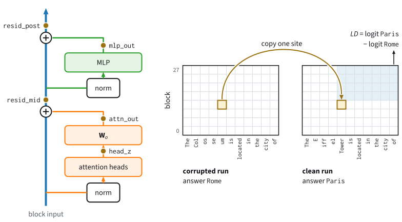
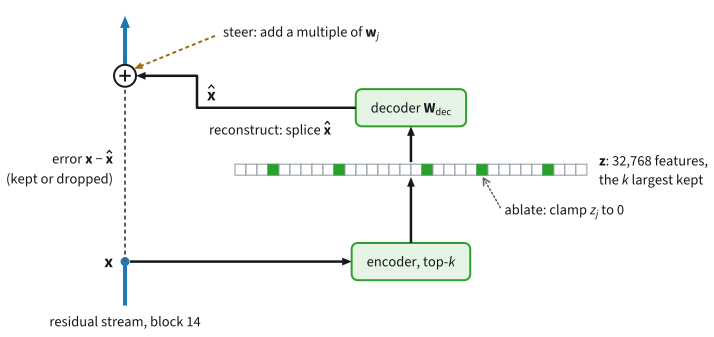

# Interpretability
:label:`sec_lm_interpretability`

When we ported Qwen3-0.6B to the book's own code, we recorded four tensors
in every block, to find the layer at which a faulty port leaves its
reference (:numref:`subsec_lm_port_layerwise`). A neuroscientist would envy
us those hooks. We can read every intermediate result of the model, on any
input and as often as we like, and we can also overwrite it and let the
computation run on.

So let us ask the model something whose answer we know. Given the text "The
Eiffel Tower is located in the city of", it continues with " Paris".
Somewhere in its 28 blocks the name of a tower became the name of a city.
Where? And once we have an answer, how would we know that it is true and
not merely plausible?

The obvious first step is to read. Every block adds its output to one
vector per position, the residual stream, and at the end the output layer
turns that vector into logits. Nothing stops us from applying the output
layer to the stream after an earlier block. This is the *logit lens*
:cite:`nostalgebraist.2020`, and it shows the answer taking shape on the
way up. :citet:`Meng.Bau.Andonian.ea.2022` asked a sharper question. They
damaged the input until the model no longer recognized what the sentence
was about, then restored single activations from an undamaged run, and
recorded which of them brought the answer back. We do the same with a
gentler kind of damage. We replace the tower by the Colosseum, copy one
activation from that run into the run on the Eiffel Tower, and see whether
Paris gives way to Rome. Reading the stream suggests where the fact is
handled. Overwriting it tests the suggestion.

The distinction matters because explanations of neural networks are cheap
to produce and hard to refute. A classifier that reads grammatical
categories from the stream may be accurate because it has memorized the
words, and a direction that we would happily name "Chinese text" may
respond to under half of it. Both will happen below. The protection is an
experiment that could have come out otherwise, and where a threshold
decides its verdict, we fixed the threshold before the run. An intervention
also has a cost. A model that has been pushed into writing Chinese and has
forgotten what it was writing about is of little use, so we measure the
damage beside the effect.

The study of a network through its internal computations is called
*mechanistic interpretability*. :numref:`tab_induction-evidence` ordered
the evidence for the induction heads of a two-block model by strength, from
behavior through activations and weights to interventions. This section
goes through the same levels on a released model. It is long, and it holds
two investigations. The first asks where a computation happens: we read the
stream of Qwen3-0.6B with two lenses and a probe, and then overwrite it.
The second asks whether the stream can be written in units that we can name
and use. For it we move to Qwen3-1.7B-Base, for which a dictionary of such
units has been released, and from landmarks to a concept that can be
checked token by token, the language of a text. Each of the four parts ends
on a result of its own and can be read in one sitting.

```{.python .input #interpretability-imports}
%%tab pytorch
import math
import numpy as np
import torch
from torch import nn
from torch.nn import functional as F
from d2l import torch as d2l
```

```{.python .input #interpretability-extras}
%%tab pytorch
import contextlib
import io
import itertools
import json
import os
import pandas as pd
import re
import unicodedata
import zipfile
from huggingface_hub import HfApi, hf_hub_download
from scipy.stats import spearmanr
from transformers import AutoTokenizer
```

The setup cell loads Qwen3-0.6B with `d2l.load_qwen3`
(:numref:`sec_lm_d2l_checkpoint`), in fp32 and with its parameters frozen.
A few objects of this section had to be trained, which takes longer than a
reader should have to wait. As in :numref:`sec_lm_scoring`, a run with the
environment variable `D2L_RERUN` set, the *regeneration run*, produced them
once and published them under versioned names. An ordinary run downloads
them and repeats every measurement. Without a GPU the notebook takes a
reduced path, `SMALL`: it uses fewer examples, stays with Qwen3-0.6B to the
end, and prints beside each of its results the number of the full run,
which is the one that the text quotes. The `d2l` helpers that the cells
call without showing them are plumbing: partial reads of files on the Hub,
resampling for intervals, and the files of the regeneration run.

```{.python .input #interpretability-setup}
%%tab pytorch
SMALL = not torch.cuda.is_available()  # the CPU path: Qwen3-0.6B only
ARTIFACTS = {'tuned-lens': 'lm-tuned-lens-qwen3-0.6b-v1',
             'sae-06b': 'lm-sae-r1-l14-v1', 'sae-17b': 'lm-sae-q17b-l14-v1',
             'results': 'lm-interp-results-v3'}
RERUN = d2l.lm_rerun(ARTIFACTS)  # D2L_RERUN: the artifacts to regenerate
assert not (SMALL and RERUN), 'regenerating the artifacts needs a GPU'
SIZES = (dict(pairs=10, heldout=32, steer=20, cost=20, contrast=60,
              label=40, words=(5_000, 2_000, 2_000), random=2,
              wds=(1e-3, 1e-2)) if SMALL else
         dict(pairs=40, heldout=200, steer=100, cost=200, contrast=300,
              label=100, words=(20_000, 5_000, 5_000), random=5,
              wds=(1e-4, 1e-3, 1e-2, 1e-1)))
TRAIN_TOKENS, LENS_STEPS, SAE_STEPS = 8_000_000, 250, 5_000  # RERUN only
RESULTS = {}  # the members of the results archive, by name
SUMMARY = {'config': {'small': SMALL}}  # its summary.json
torch.manual_seed(0)
MODEL_ID = 'Qwen/Qwen3-0.6B'
model = d2l.load_qwen3(MODEL_ID, dtype=torch.float32).requires_grad_(False)
tok = AutoTokenizer.from_pretrained(MODEL_ID, revision=model.revision)
dev, L = model.token_emb.weight.device, len(model.blks)
print(f'SMALL={SMALL}, regenerating: {", ".join(sorted(RERUN)) or "none"}, '
      f'device {dev}')
print(f'{MODEL_ID} at {model.revision}: '
      f'{sum(p.numel() for p in model.parameters()):,} parameters')
```

The model has 596 million parameters in 28 blocks of width 1,024. One more
repository joins the pinned revisions of :numref:`sec_lm_hf_models`. It
holds the released dictionary, which we meet in
:numref:`subsec_lm_sae_release`.

```{.python .input #interpretability-revisions}
%%tab pytorch
#@save
d2l.HF_REVISIONS['Qwen/SAE-Res-Qwen3-1.7B-Base-W32K-L0_50'] = (
    'ce1a79d9c5163932d65c417380e53230e1086370')
```

The small files of the section are registered next: a treebank for the
probe, a list of landmarks with their cities, and the trained objects just
mentioned.

```{.python .input #interpretability-data-hub}
%%tab pytorch
#@save
d2l.DATA_HUB['lm-ud-ewt-train'] = (
    'https://raw.githubusercontent.com/UniversalDependencies/UD_English-EWT/'
    '6b021622f3ab7902730f313fa5955a8b8cdd52b8/en_ewt-ud-train.conllu',
    '59e9ff791f828f7cd3dcd2e55dc4f30ea7bbd5f9')
d2l.DATA_HUB['lm-ud-ewt-dev'] = (
    'https://raw.githubusercontent.com/UniversalDependencies/UD_English-EWT/'
    '6b021622f3ab7902730f313fa5955a8b8cdd52b8/en_ewt-ud-dev.conllu',
    '1e3226c7b533354e4f79e7bae7a1aa56a7dd9c94')
d2l.DATA_HUB['lm-ud-ewt-test'] = (
    'https://raw.githubusercontent.com/UniversalDependencies/UD_English-EWT/'
    '6b021622f3ab7902730f313fa5955a8b8cdd52b8/en_ewt-ud-test.conllu',
    '41b279558051f482d78fff4ea7b3c8c98c91ecd4')
# The recall pairs (tools/oneshot/build_lm_recall_pairs.py)
d2l.DATA_HUB['lm-interp-recall-v1'] = (
    d2l.LM_DATA_URL + 'lm-interp-recall-v1.json',
    'e3025b0216df5384d8a14f1e8e10c4cab080ebbf')
# What the regeneration run (D2L_RERUN) trained and measured
d2l.DATA_HUB['lm-tuned-lens-qwen3-0.6b-v1'] = (
    d2l.LM_DATA_URL + 'lm-tuned-lens-qwen3-0.6b-v1.pt',
    'e1a9275950de634b8f8a6e7dd516de662755834e')
d2l.DATA_HUB['lm-sae-r1-l14-v1'] = (
    d2l.LM_DATA_URL + 'lm-sae-r1-l14-v1.pt',
    'b7d9589fda439d7bdd9e52572a24c6ea58efb263')
d2l.DATA_HUB['lm-sae-q17b-l14-v1'] = (
    d2l.LM_DATA_URL + 'lm-sae-q17b-l14-v1.pt',
    '11982ca32f0382eb9bf594faee58e808d61be12d')
d2l.DATA_HUB['lm-interp-results-v3'] = (
    d2l.LM_DATA_URL + 'lm-interp-results-v3.zip',
    '75606ff34dc535f0705dfeb9194e4791c2820484')
```

Two sources supply text. Each is read at a pinned revision and in a fixed
order, so that every subset below is the same in every run. FineWeb-Edu
:cite:`Penedo.Kydlicek.BenAllal.ea.2024`, a collection of web pages
selected for their educational content (ODC-By license), is our ordinary
English text: we measure on it and cut prompts from it, and the trained
objects were trained on it. The Chinese and the English Wikipedia
(CC BY-SA) give us, for the second investigation, two sets of articles that
differ in language and in little else. To these the cell adds our own list
of 40 landmarks, `lm-interp-recall-v1`. Its printout lists what was read,
and each set of documents is introduced where we first use it.

```{.python .input #interpretability-data}
%%tab pytorch
FINEWEB = ('HuggingFaceFW/fineweb-edu', 'sample/10BT/013_00000.parquet',
           '87f09149ef4734204d70ed1d046ddc9ca3f2b8f9')
WIKI = {lang: ('wikimedia/wikipedia', f'20231101.{lang}/{shard}.parquet',
               'b04c8d1ceb2f5cd4588862100d08de323dccfbaa')
        for lang, shard in (('zh', 'train-00002-of-00006'),
                            ('en', 'train-00028-of-00041'))}
STRIDE = {'zh': 11_000, 'en': 7_500}  # 20 blocks spread over each shard
HAN = re.compile('[\u3400-\u4dbf\u4e00-\u9fff\uf900-\ufaff]')  # ideographs
ids_of = lambda text: tok(text, add_special_tokens=False).input_ids

def first_tokens(n, min_len):  # the rule: a document's first n tokens
    return lambda ids: ids[:n] if len(ids) >= min_len else None

def clean_prompt(ids):  # 32 tokens without Han that survive a round trip
    text = tok.decode(ids[:32])
    keep = len(ids) >= 32 and not HAN.search(text) and ids_of(text) == ids[:32]
    return ids[:32] if keep else None

def walk(label, source, rows, subsets):  # the first qualifying documents
    docs, seen = d2l.lm_walk_docs(ids_of, source, rows, subsets)
    k = seen['blocks']
    print(f'{label}: ' + ', '.join(f'{name} {len(d)}' for name, d in
                                   docs.items())
          + f' docs from rows {seen["rows"][0]}-{seen["rows"][1]} '
          f'({k} block{"s" * (k > 1)}, {seen["nbytes"] / 1e6:.1f} MB read)')
    return docs

fineweb = walk('FineWeb-Edu', FINEWEB, itertools.count(8000), {
    'held-out': (SIZES['heldout'], first_tokens(256, 257)),
    'steering': (SIZES['steer'], clean_prompt),
    'cost': (SIZES['cost'], first_tokens(129, 129))})
wiki = {lang: {
    **walk(f'Wikipedia {lang}', WIKI[lang], d2l.lm_round_robin(STRIDE[lang]),
           {'contrast': (SIZES['contrast'], first_tokens(128, 129))}),
    **walk(f'Wikipedia {lang}', WIKI[lang],
           d2l.lm_round_robin(STRIDE[lang], first=STRIDE[lang] // 2),
           {'label': (SIZES['label'], first_tokens(128, 129))})}
        for lang in WIKI}
heldout, cost_docs = fineweb['held-out'], fineweb['cost']
steer_texts = tok.batch_decode(fineweb['steering'])
pieces = tok.batch_decode([[v] for v in range(len(tok))])  # each token alone
han_tokens = torch.zeros(model.token_emb.num_embeddings, dtype=torch.bool)
han_tokens[:len(tok)] = torch.tensor([HAN.search(p) is not None
                                      for p in pieces])
print(f'{int(han_tokens.sum()):,} of {len(tok):,} tokens hold a Han '
      'character')
with open(d2l.download_keyed('lm-interp-recall-v1')) as f:
    recall = json.load(f)['rows'][:SIZES['pairs']]
if RERUN - {'results'}:  # every 256-token window of rows 0 to 7,999
    texts, nbytes = d2l.lm_hub_rows(*FINEWEB, 0, 8000)
    windows = [ids[i:i + 256] for ids in ids_of(texts)
               for i in range(0, len(ids) - 255, 256)]
    train_windows = torch.tensor(windows[:TRAIN_TOKENS // 256])
    print(f'training windows: {train_windows.numel():,} tokens, '
          f'{nbytes / 1e6:.1f} MB read')
FULL = None  # the full run's summary, shown beside the CPU path's numbers
if SMALL:
    with zipfile.ZipFile(d2l.lm_artifact(ARTIFACTS['results'])) as z:
        FULL = json.loads(z.read('summary.json'))
    assert not FULL['config']['small'], 'the archive of a CPU-path run'
```

## Reading the Residual Stream

Before we can look for Paris we need two tools: a way to read and to
overwrite the stream at any block, and the formula for what the output
layer makes of the vector that it finds there. The first subsection
supplies both, and the Eiffel prompt gets its answer in the second.

### The Residual Stream as a Sum
:label:`subsec_lm_stream_sum`

In the attention-only model of :numref:`sec_what-attention-computes`, each
block added the outputs of its heads to the vector at each position, and
the output layer scored the final vector against the embeddings. The
sequence of these vectors was the *residual stream*
(:numref:`fig_residual-stream`). A block of Qwen3 adds twice
(:numref:`sec_transformer-block`): first the output of its attention layer,
then the output of its feed-forward network, each computed from a
normalized copy of the stream. The interpretability literature calls the
feed-forward network the MLP, and in this section so do we.

We count blocks as the code does, from 0 to $L - 1 = 27$, and look at one
position. Let $\mathbf{h}^{(\ell)}$ be the stream after block $\ell$, and
$\mathbf{a}^{(\ell)}$ and $\mathbf{m}^{(\ell)}$ what the attention layer and
the MLP of block $\ell$ add to it. (:numref:`sec_what-attention-computes`
counted blocks from 1 and wrote $\mathbf{h}^{(0)}$ for the embedding, so
its index is ours plus one.) The final stream is then the embedding
$\mathbf{e}_x$ of the input token $x$ plus 56 additions:

$$
\mathbf{h}^{(L-1)} = \mathbf{e}_x + \sum_{\ell=0}^{L-1} \left(\mathbf{a}^{(\ell)} + \mathbf{m}^{(\ell)}\right).
$$
:eqlabel:`eq_lm_stream_sum`

The identity holds for any network with skip connections and says nothing
about how the blocks compute. Its use is that every term in it is a place
where we can read or write. `d2l.intervene` names five such places in each
block, which we call *sites*. The left half of :numref:`fig_lm_patching`
shows them, and its right half belongs to :numref:`subsec_lm_patching`.
`attn_out` and `mlp_out` are the two additions. `resid_mid` and
`resid_post` are the stream after each of them, so that `resid_post` of
block $\ell$ is $\mathbf{h}^{(\ell)}$. These are the four tensors of
:numref:`subsec_lm_port_layerwise`. The fifth, `head_z`, is the input of
the output projection $\mathbf{W}_o$ of the attention layer, where the
outputs of the individual heads still lie side by side. A site is written
as a pair such as `('resid_post', 14)`. The text works with `resid_post`,
`attn_out` and `mlp_out`, and the other two wait for the exercises.


:label:`fig_lm_patching`

The next cell implements the sites with PyTorch hooks, functions that a
module calls before or after its `forward`. `d2l.intervene` returns a
context manager. Inside its `with` block, every site listed in `record` is
stored in `ctx.cache`, and every site in the dictionary `sites` is passed
through the function given for it, whose return value takes the place of
the activation. The smallest use is
`with d2l.intervene(model, record=[site]) as ctx: model(X)`. Afterwards
`ctx.cache[site]` is a list with one tensor for each forward pass made
inside the block, of shape (batch, tokens, width). Most cells below make
one pass and take `ctx.cache[site][0]`.

The class is long because hooks are fiddly, and most of it can be skimmed.
One detail is worth knowing. The stream is not the output of any module,
since the block's own `forward` does the adding. To overwrite the stream
with a value $\mathbf{y}$ where it would have been $\mathbf{r}$, the hook
shifts the output of the sublayer by $\mathbf{y} - \mathbf{r}$ and lets the
block add as usual. Of the remaining arguments, `stop_after` ends a forward
pass at a site when nothing above it is needed, and `record_grad` waits for
:numref:`subsec_lm_atp`. Libraries such as TransformerLens offer these
operations for many models. We write them out so that nothing stands
between us and the activations.

```{.python .input #interpretability-intervene}
%%tab pytorch
#@save
class _InterveneStop(Exception):
    """Raised right after the stop_after site, to end a forward early."""

#@save
class _Intervention:
    """The context manager that d2l.intervene returns."""
    KINDS = ('resid_post', 'resid_mid', 'attn_out', 'mlp_out', 'head_z')

    def __init__(self, model, sites, record, record_grad, stop_after):
        self.model, self.record_grad = model, record_grad
        self.sites, self.record, self.stop_after = d2l._intervene_args(
            model, sites, record, stop_after)
        self.cache = {s: [] for s in self.record}
        self.wanted = set(self.sites) | self.record

    @property
    def grad_cache(self):
        """The gradient at each recorded tensor; read after a backward."""
        return {s: [x.grad for x in xs] for s, xs in self.cache.items()}

    def _site(self, site, x):
        """Apply the site's fn to x and record the result. Returns fn's
        value (None without a fn) and a term to add to what the module
        passes on (None without record_grad)."""
        self.fired.add(site)
        fn, y, zero = self.sites.get(site), None, None
        if fn is not None:
            y = fn(x)
            if not (torch.is_tensor(y) and y.shape == x.shape
                    and y.dtype == x.dtype):
                raise ValueError(f'{site}: fn must return a tensor of shape '
                                 f'{tuple(x.shape)} and dtype {x.dtype}')
        if site in self.record:
            v = (x if y is None else y).detach()
            if self.record_grad:
                if not torch.is_grad_enabled():
                    raise RuntimeError('record_grad needs gradients enabled')
                # leaf - leaf.detach() is exactly 0: adding it leaves the
                # forward unchanged and makes leaf.grad the gradient there
                v.requires_grad_()
                zero = v - v.detach()
            self.cache[site].append(v)
        if site == self.stop_after:
            raise _InterveneStop(self)
        return y, zero

    def _write_hook(self, inner, outer, base):
        """Forward hook on a module whose output a block adds to its stream
        (W_o, the FFN): site inner sees that output, site outer the stream
        after the add, r = base[0] + output."""
        def hook(module, args, out):
            new = out
            if inner in self.wanted:
                y, zero = self._site(inner, out)
                new = new if y is None else y
                new = new if zero is None else new + zero
            if outer in self.wanted:
                r = base[0] + new  # the stream, as the block's add makes it
                y, zero = self._site(outer, r)
                if y is not None:  # the block's own add then yields about y,
                    new = new + (y - r)  # exactly r wherever y equals r
                new = new if zero is None else new + zero
            return None if new is out else new
        return hook

    def _z_hook(self, site):
        """Forward pre-hook on W_o: site head_z sees its input."""
        def hook(module, args):
            y, zero = self._site(site, args[0])
            new = args[0] if y is None else y
            new = new if zero is None else new + zero
            return None if new is args[0] else (new,)
        return hook

    @staticmethod
    def _store_hook(box):
        """Forward pre-hook that keeps the module's input in box[0]."""
        def hook(module, args):
            box[0] = args[0]
        return hook

    def __enter__(self):
        self.fired, self.handles = set(), []
        for l, blk in enumerate(self.model.blks):
            kinds = {kind for kind, layer in self.wanted if layer == l}
            W_o, hooks = blk.attention.W_o, []
            if 'head_z' in kinds:
                hooks.append(W_o.register_forward_pre_hook(
                    self._z_hook(('head_z', l))))
            if kinds & {'attn_out', 'resid_mid'}:
                x_in = [None]  # the block's input, the stream before it
                hooks += [
                    blk.norm1.register_forward_pre_hook(
                        self._store_hook(x_in)),
                    W_o.register_forward_hook(self._write_hook(
                        ('attn_out', l), ('resid_mid', l), x_in))]
            if kinds & {'mlp_out', 'resid_post'}:
                mid = [None]  # the stream after attention, as norm2 sees it
                hooks += [
                    blk.norm2.register_forward_pre_hook(
                        self._store_hook(mid)),
                    blk.ffn.register_forward_hook(self._write_hook(
                        ('mlp_out', l), ('resid_post', l), mid))]
            self.handles += hooks
        return self

    def __exit__(self, exc_type, exc, tb):
        for h in self.handles:
            h.remove()
        self.handles = []
        if isinstance(exc, _InterveneStop):
            return exc.args[0] is self  # another context's stop goes on
        if exc_type is None:
            unfired = sorted(self.wanted - self.fired)
            if unfired:
                raise RuntimeError(f'sites that never fired: {unfired}')
        return False

#@save
def intervene(model, sites=None, *, record=(), record_grad=False,
              stop_after=None):
    """Context manager over a d2l.GPT that overwrites the sites (kind,
    layer) -> fn(x) and records the sites in record."""
    return _Intervention(model, sites, record, record_grad, stop_after)
```

What does one term of :eqref:`eq_lm_stream_sum` contribute to the output?
The output layer of Qwen3-0.6B is an RMSNorm followed by the embedding
matrix $\mathbf{E}$, which the model uses a second time as its output
weights. RMSNorm (:numref:`subsec_rmsnorm`) divides a vector
$\mathbf{v} \in \mathbb{R}^d$ by its root mean square
$\rho(\mathbf{v}) = \sqrt{\tfrac{1}{d} \sum_i v_i^2 + \epsilon}$ and
multiplies the result, coordinate by coordinate, with a learned gain
$\boldsymbol{\gamma}$. The logit of token $t$ is therefore

$$
z_t = \frac{\mathbf{e}_t^\top (\boldsymbol{\gamma} \odot \mathbf{h}^{(L-1)})}{\rho(\mathbf{h}^{(L-1)})} = \sum_{\mathbf{p}} c_t(\mathbf{p}), \qquad c_t(\mathbf{p}) = \frac{\mathbf{e}_t^\top (\boldsymbol{\gamma} \odot \mathbf{p})}{\rho(\mathbf{h}^{(L-1)})},
$$
:eqlabel:`eq_lm_dla`

where $\mathbf{e}_t$ is the row of $\mathbf{E}$ for token $t$ and the sum
runs over the 57 parts $\mathbf{p}$ of :eqref:`eq_lm_stream_sum`: the
embedding, 28 attention outputs and 28 MLP outputs. Once the denominator is
fixed, the logit is linear in the stream. Each part then has a contribution
$c_t(\mathbf{p})$ of its own, and the contributions add up to the logit
exactly.

It is tempting to print the 57 contributions for " Paris" and to read off
who wrote the answer. We shall not, because the list would mislead. A
contribution counts only what a part writes directly into the output. A
part that writes for the parts above it, say an early layer that works out
which landmark is meant, may contribute next to nothing in this sense while
the answer depends on it entirely. Contributions describe the last step of
a computation. For the steps before it we need the interventions of
:numref:`subsec_lm_patching`.

The logit lens applies the same output layer to the stream after an
earlier block:

$$
\mathbf{z}^{(\ell)} = \frac{\mathbf{E}\, (\boldsymbol{\gamma} \odot \mathbf{h}^{(\ell)})}{\rho(\mathbf{h}^{(\ell)})}.
$$
:eqlabel:`eq_lm_lens`

It is instructive to compare this with :eqref:`eq_lm_dla`. The numerator
holds the contributions that have arrived by block $\ell$. Only the
denominator differs: the lens divides by the size of the stream at block
$\ell$, the model by its size at the end. The lens at block $\ell$ is thus
the partial sum of the model's own contributions, multiplied by the
positive number $\rho(\mathbf{h}^{(L-1)}) / \rho(\mathbf{h}^{(\ell)})$. A
positive factor on all logits changes how confident the read-out looks. It
cannot change the order of two tokens.

A case small enough to compute by hand shows both effects. Take $d = 2$,
$\boldsymbol{\gamma} = \mathbf{1}$, $\epsilon = 0$ and
$\mathbf{E} = \mathbf{I}$, an embedding $(1, 0)$ and a single block that
adds $(0, 3)$. The final stream $(1, 3)$ has the root mean square
$\sqrt{5} = 2.24$, so the logits are $(0.45, 1.34)$, the sum of the
contributions $(0.45, 0)$ of the embedding and $(0, 1.34)$ of the block.
The second token wins. The lens at the embedding sees $(1, 0)$, with root
mean square $0.71$, and reads $(1.41, 0)$. It names the first token, as the
partial sum $(0.45, 0)$ does, because the block that will decide otherwise
has not written yet. The factor $2.24 / 0.71 = 3.2$ only makes the lens
three times surer of its wrong answer.

The function `d2l.logit_lens` is :eqref:`eq_lm_lens` in code, computed in
fp32.

```{.python .input #interpretability-logit-lens}
%%tab pytorch
#@save
def logit_lens(model, hidden):
    """The model's final norm and output head applied in fp32 to hidden
    (..., d), a stream read at any block; returns logits (..., V)."""
    norm, h = model.norm, hidden.float()
    f32 = lambda p: None if p is None else p.float()  # no affine, no bias
    if isinstance(norm, nn.RMSNorm):
        h = F.rms_norm(h, norm.normalized_shape, f32(norm.weight), norm.eps)
    else:  # nn.LayerNorm
        h = F.layer_norm(h, norm.normalized_shape, f32(norm.weight),
                         f32(norm.bias), norm.eps)
    head = model.lm_head if hasattr(model, 'lm_head') else model.token_emb
    return F.linear(h, head.weight.float())
```

How large is the factor in practice? The next cell records all 56
additions and the stream after every block on eight prompts of the landmark
list. It asserts that the 57 contributions to the logit of the correct city
sum to that logit and that the lens at the last block returns the model's
logits, and it prints the factor
$\rho(\mathbf{h}^{(27)}) / \rho(\mathbf{h}^{(\ell)})$ at every fourth
block.

```{.python .input #interpretability-dla-check}
%%tab pytorch
assert not hasattr(model, 'lm_head')  # Qwen3-0.6B ties its output head
gamma, E = model.norm.weight, model.token_emb.weight
rho = lambda h: (h.pow(2).mean(-1) + model.norm.eps).sqrt()
sites = [(k, l) for l in range(L) for k in ('attn_out', 'mlp_out')]
blocks = [('resid_post', l) for l in range(L)]
ratios = []
for r in recall[:8]:
    X = torch.tensor([ids_of(r['template'].format(r['landmark']))], device=dev)
    city = ids_of(' ' + r['city'])[0]
    with torch.no_grad(), d2l.intervene(model, record=sites + blocks) as ctx:
        z = model(X)[0, -1]
        h0 = model.token_emb(X)[0, -1]
    h = torch.stack([ctx.cache[s][0][0, -1] for s in blocks])  # (L, d)
    parts = torch.stack([h0] + [ctx.cache[s][0][0, -1] for s in sites])
    c = parts @ (gamma * E[city]) / rho(h[-1])  # eq_lm_dla, one per part
    assert abs(float(c.sum() - z[city])) < 1e-3
    assert torch.allclose(d2l.logit_lens(model, h[-1]), z, rtol=0, atol=1e-4)
    ratios.append((rho(h[-1]) / rho(h[::4])).tolist())
print(pd.DataFrame(np.mean(ratios, 0)[None], index=['rho_27 / rho_l'],
                   columns=[f'block {l}' for l in range(0, L, 4)]).to_string(
    float_format='{:.1f}'.format))
```

Both assertions pass. The stream grows about 55-fold from the first block
to the last, and at block 20 it is still two and a half times too small. A
lens at block 0 thus reports logits 55 times larger than the contribution
of the same vector to the final logits. Its probabilities are far too
sharp, and every measure built on probabilities, such as an entropy or a KL
divergence, inherits the error. Ranks do not.

### Logit Lens and Tuned Lens
:label:`subsec_lm_lenses`

Now for the question of the introduction. We print the five most probable
next tokens for the Eiffel prompt, and then, at every fourth block, the
token that the logit lens puts first and the rank that it gives to
" Paris".

```{.python .input #interpretability-eiffel}
%%tab pytorch
eiffel = recall[0]['template'].format(recall[0]['landmark'])
paris = ids_of(' Paris')[0]
with torch.no_grad(), d2l.intervene(model, record=blocks) as ctx:
    p = F.softmax(model(torch.tensor([ids_of(eiffel)], device=dev))[0, -1], -1)
top5 = p.topk(5)
print(eiffel)
print(pd.DataFrame({
    'next token': map(repr, tok.batch_decode(top5.indices[:, None])),
    'probability': top5.values.tolist()}).round(3).to_string(index=False))
lens_rows = []
for l in [*range(0, L, 4), L - 1]:
    z = d2l.logit_lens(model, ctx.cache[blocks[l]][0][0, -1])
    rank = int((z > z[paris]).sum()) + 1
    lens_rows.append((l, repr(tok.decode(z.argmax())), rank))
print(pd.DataFrame(lens_rows, columns=['block', 'logit-lens top-1',
                                       'rank of " Paris"']).to_string(
    index=False))
```

The model gives " Paris" a probability of 0.91. Through block 16 the lens
has no idea of it: among some 150,000 tokens the city ranks in the
thousands, and at the lowest blocks in the tens of thousands. At block 20
it is third, and from block 24 on it is first. What the lens reads at the
lowest blocks, " construction" and " substance", has nothing to do with
towers or cities. So early, the last position knows little beyond its own
token.

Is the city really absent below block 20, or is it written in a form that
the output layer cannot read? The logit lens assumes that every block
writes in the coordinates in which the output layer reads, and nothing in
training enforces that. The *tuned lens*
:cite:`Belrose.Ostrovsky.McKinney.ea.2023` drops the assumption. For each
block it learns an affine map, a *translator*, which is applied to the
stream before the output layer,

$$
\mathbf{h}^{(\ell)} \mapsto \mathbf{h}^{(\ell)} + \mathbf{A}_\ell \mathbf{h}^{(\ell)} + \mathbf{b}_\ell,
$$

and it trains $\mathbf{A}_\ell$ and $\mathbf{b}_\ell$ on ordinary text so
that the lens's distribution over the next token comes close, in KL
divergence, to the final distribution of the model. Both start at zero, so
training starts from the logit lens. A translator can correct the scale and
a change of coordinates. It cannot do the work of the blocks above it,
except for the part of that work that happens to be an affine function of
the stream at the same position.

```{.python .input #interpretability-tuned-lens}
%%tab pytorch
#@save
class TunedLens(nn.Module):
    """One affine translator h + A_l h + b_l per block but the last (the
    identity), applied before the logit lens; A_l and b_l start at zero,
    so a fresh lens is the logit lens."""
    def __init__(self, d_model, num_layers):
        super().__init__()
        self.num_layers = num_layers
        self.translators = nn.ModuleList(
            nn.Linear(d_model, d_model) for _ in range(num_layers - 1))
        for t in self.translators:
            nn.init.zeros_(t.weight)
            nn.init.zeros_(t.bias)

    def forward(self, hidden, layer):
        if not 0 <= layer < self.num_layers:
            raise IndexError(f'layer {layer} of {self.num_layers}')
        if layer == self.num_layers - 1:
            return hidden
        t = self.translators[layer]
        h = hidden.to(t.weight.dtype)
        return h + t(h)

    def _check(self, model):
        if len(model.blks) != self.num_layers:
            raise ValueError(f'a lens of {self.num_layers} layers for a '
                             f'model of {len(model.blks)} blocks')

    def logits(self, model, hidden, layer):
        self._check(model)
        return d2l.logit_lens(model, self(hidden, layer))

    def fit(self, model, batches, *, steps, lr=1e-3, frac=0.25, seed=0,
            chunk=512):
        """Adam on KL(final || lens) summed over the layers, at a random
        fraction frac of the positions >= 1 of each (B, T) batch of ids;
        returns the loss of each step."""
        assert not any(p.requires_grad for p in model.parameters()), (
            'freeze the model first: model.requires_grad_(False)')
        self._check(model)
        L, dev = self.num_layers, self.translators[0].weight.device
        sites = [('resid_post', l) for l in range(L)]
        optimizer = torch.optim.Adam(self.parameters(), lr=lr)
        gen, batches, losses = torch.Generator().manual_seed(seed), iter(
            batches), []
        for _ in range(steps):
            X = next(batches, None)
            if X is None:
                raise ValueError(f'batches ran out before {steps} steps')
            with torch.no_grad(), d2l.intervene(
                    model, record=sites, stop_after=sites[-1]) as ctx:
                model(X.to(model.token_emb.weight.device))
            B, T = X.shape
            n = max(1, round(frac * (T - 1)))  # positions per sequence
            cols = torch.stack([torch.randperm(T - 1, generator=gen)[:n] + 1
                                for _ in range(B)]).flatten()
            rows = torch.arange(B).repeat_interleave(n)
            H = [ctx.cache[s][0][rows, cols].to(dev, torch.float32)
                 for s in sites]  # each (B * n, d), detached
            del ctx
            optimizer.zero_grad()
            total = 0.0
            # each layer's loss is backpropagated alone, chunk positions at
            # a time: the memory holds one chunk of logits
            for i in range(0, len(rows), chunk):
                with torch.no_grad():  # the final distribution, the target
                    target = F.log_softmax(
                        d2l.logit_lens(model, H[-1][i:i + chunk]), -1)
                for l in range(L - 1):
                    lens = F.log_softmax(self.logits(model, H[l][i:i + chunk],
                                                     l), -1)
                    kl = F.kl_div(lens, target, reduction='sum',
                                  log_target=True) / len(rows)
                    kl.backward()
                    total += kl.item()
            optimizer.step()
            losses.append(total)
        return losses
```

Fitting the 27 translators takes 250 steps on a million tokens of
FineWeb-Edu and belongs to the regeneration run. Your run loads the result
and prints the hash of its file.

```{.python .input #interpretability-tuned-lens-fit}
%%tab pytorch
lens = d2l.TunedLens(model.num_hiddens, L).to(dev)
if 'tuned-lens' in RERUN:  # LENS_STEPS batches of 16 windows: 1M tokens
    losses = lens.fit(model, train_windows[:16 * LENS_STEPS].split(16),
                      steps=LENS_STEPS)
    print(f'KL summed over blocks: {losses[0]:.2f} at the first step, '
          f'{losses[-1]:.2f} at the last')
    state = {k: v.half() for k, v in lens.state_dict().items()}
    d2l.lm_save_rerun('lm-tuned-lens-qwen3-0.6b.pt',
                      lambda p: torch.save(state, p))
    lens.load_state_dict(state)  # go on with the fp16 values it publishes
else:
    key = ARTIFACTS['tuned-lens']
    lens.load_state_dict(torch.load(d2l.download_keyed(key),
                                    map_location='cpu', weights_only=True))
    print(f'{key}: sha1 {d2l.DATA_HUB[key][1]}')
lens.requires_grad_(False);
```

One prompt is an anecdote. We repeat the measurement on all 40 prompts of
the list, "The X is located in the city of" for 40 landmarks X in 25
cities. Each row of the list also names a second landmark in another city,
which we need from :numref:`subsec_lm_patching` on. The cell keeps a row
only if the model answers it correctly and tells the two landmarks apart:
the logit of the right city minus that of the other city, the `LD` of the
code, must fall by at least 2 when the landmark is exchanged. For each lens
the cell finds the first block at which the median rank of the correct city
is 10 or better. The interval comes from a bootstrap
(:numref:`sec_lm_eval_suites`) that resamples cities and not prompts, since
two landmarks in Paris share their answer.

```{.python .input #interpretability-lens-compare}
%%tab pytorch
def last_position(text):  # logits and the stream after each block, at -1
    with torch.no_grad(), d2l.intervene(model, record=blocks) as ctx:
        z = model(torch.tensor([ids_of(text)], device=dev))[0, -1]
    return z, torch.stack([ctx.cache[s][0][0, -1] for s in blocks])

LENSES = {'logit lens': lambda h, l: d2l.logit_lens(model, h),
          'tuned lens': lambda h, l: lens.logits(model, h, l)}
ranks, LD, kept = {name: [] for name in LENSES}, [], []
for r in recall:  # keep rule: correct top-1, and LD drops by 2 or more
    a, b = ids_of(' ' + r['city'])[0], ids_of(' ' + r['corrupt_city'])[0]
    z, H = last_position(r['template'].format(r['landmark']))
    z_x, _ = last_position(r['template'].format(r['corrupt_landmark']))
    LD.append((float(z[a] - z[b]), float(z_x[a] - z_x[b])))
    kept.append(int(z.argmax()) == a and LD[-1][0] - LD[-1][1] >= 2)
    for name, f in LENSES.items() if kept[-1] else ():
        zl = torch.stack([f(H[l], l) for l in range(L)])  # (L, V)
        ranks[name].append(((zl > zl[:, a:a + 1]).sum(-1) + 1).tolist())
cities = [r['city'] for r, k in zip(recall, kept) if k]

def first10(R):  # the first block where the median rank is at most 10
    hit = np.median(R, 0) <= 10
    return int(np.argmax(hit)) if hit.any() else np.nan

for name, R in ranks.items():
    R = ranks[name] = np.array(R)
    key = f'{name}: first block of median rank <= 10'
    lo, hi = d2l.percentile_ci([first10(R[idx]) for idx in
                                d2l.cluster_resample(cities)], names=[key])
    SUMMARY[key] = [float(first10(R)), lo, hi]
    print(f'{name}: median rank at most 10 from block {first10(R)}, '
          f'95% interval [{lo:.0f}, {hi:.0f}]')
    if FULL is not None:
        print(f'  full run: {FULL[key]}')
```

The city becomes readable at block 22 under the logit lens and at block 20
under the tuned lens, and the two intervals do not overlap. A bootstrap
over as few as 25 clusters tends to understate the spread, so both
intervals are somewhat too narrow. The conclusion does not hang on their
last digit: under either lens the answer cannot be read at the last
position during the first two thirds of the network, and training the lens
gains two blocks.

The plot shows the whole course, together with a second quantity: the KL
divergence from the final distribution of the model to that of each lens,
averaged over the positions of 200 held-out documents.

```{.python .input #interpretability-lens-kl}
%%tab pytorch
KL = {name: [[] for _ in range(L - 1)] for name in LENSES}
with torch.no_grad():
    for X in heldout[:, :128].split(4):  # 4 x 127 positions per chunk
        with d2l.intervene(model, record=blocks) as ctx:
            target = F.log_softmax(model(X.to(dev))[:, 1:].float(), -1)
        for l in range(L - 1):  # the last block: both lenses are exact
            for name, f in LENSES.items():
                lp = F.log_softmax(f(ctx.cache[blocks[l]][0][:, 1:], l), -1)
                KL[name][l].append(F.kl_div(lp, target, reduction='none',
                                            log_target=True).sum(-1).ravel())
kl_doc = np.repeat(np.arange(len(heldout)), 127)

def mean_ci(values):  # over positions, resampling whole documents
    r = d2l.bootstrap_ci(torch.cat(values).cpu().numpy(), cluster=kl_doc)
    return [r.mean, *r.ci]

KL = {name: np.array([mean_ci(v) for v in kls]) for name, kls in KL.items()}
fig, axes = d2l.plt.subplots(1, 2, figsize=(7, 2.8), layout='constrained')
q = {name: np.percentile(R, [50, 25, 75], axis=0) for name, R in ranks.items()}
d2l.plot(list(range(L)), [q[n][0] for n in q] + [q[n][i] for n in q
                                                  for i in (1, 2)],
         'block', 'rank of the answer', legend=list(q), yscale='log',
         fmts=('C0-', 'C1-', 'C0--', 'C0--', 'C1--', 'C1--'), axes=axes[0])
axes[0].invert_yaxis()
d2l.plot(list(range(L - 1)), [KL[n][:, 0] for n in KL] + [
    KL[n][:, i] for n in KL for i in (1, 2)], 'block', 'KL to final (nats)',
         legend=list(KL), yscale='log', axes=axes[1],
         fmts=('C0-', 'C1-', 'C0:', 'C0:', 'C1:', 'C1:'))
```

A logarithmic axis is hard to read to within a factor of two, so the next
cell prints three points of each curve: the first block, the middle of the
network, and the last block but one.

```{.python .input #interpretability-lens-numbers}
%%tab pytorch
print('at blocks 0, 14 and 26:')  # the two panels in numbers
for name in LENSES:
    print(f'  {name}: median rank ' + ', '.join(
        f'{np.median(ranks[name][:, l]):.0f}' for l in (0, 14, 26))
          + '; KL to final ' + ', '.join(
              f'{KL[name][l, 0]:.2f}' for l in (0, 14, 26)) + ' nats')
```

The left panel shows the median rank of the correct city (solid) and its
quartiles (dashed), on a logarithmic axis with rank 1 at the top. Below
block 20 the tuned lens ranks the city far better than the logit lens, and
still far from well. At block 14 the median rank is 260 under the tuned
lens and about 18,000 under the logit lens. Neither is a rank at which
anybody would say that the lens reads the city. The translators of the
tuned lens have removed what was a matter of coordinates. What remains, we
suspect, is computation that has not happened yet, and
:numref:`subsec_lm_patching` will put the suspicion to a test.

The right panel shows the KL divergence in nats. Its 95% intervals over
documents, the dotted lines, are so narrow that they hide behind the
curves. The tuned lens is closer to the final distribution at every block:
3.4 nats against 11 at block 0, 2.1 against 6.1 at block 14, and 0.2
against 0.4 one block before the end. It has to be closer. It was trained
to minimize this very quantity, and with zero weights it is the logit lens.
The gap between the two curves is therefore no finding. Part of it is the
scale error of the logit lens that we computed above. Ranks, on the left,
do not see the scale.

Both lenses are read-outs of activations. They show at which depth an
answer can be decoded. They are silent on which component put it there, and
on whether the model itself reads it in this way.

### Linear Probes and Control Tasks
:label:`subsec_lm_probes`

A lens reads the model's own prediction. A *probe*, a linear classifier fit
to the activations of a frozen model (:numref:`subsec_lm_icl_vs_probe`),
reads anything that we have labels for. The classic question for a probe is
whether a model that was trained only to predict the next token knows
grammar. If the stream at some block records whether a word is a noun or a
verb, a linear classifier should be able to read the part of speech from
it.

Our labels come from the English Web Treebank
:cite:`Silveira.Dozat.DeMarneffe.ea.2014` in its Universal Dependencies
version (CC BY-SA 4.0), in which every word carries a part-of-speech tag
such as NOUN, VERB or ADP. The cell reads every tenth sentence of the
training split and every fifth of the other two and runs the model on
them. It keeps two vectors per word, both taken at the last token of the
word: the token embedding, which knows nothing of the context, and the
stream after block 14, halfway up.

```{.python .input #interpretability-probe-data}
%%tab pytorch
ud = {split: d2l.read_conllu(d2l.download_keyed(f'lm-ud-ewt-{split}'),
                             stride, n)
      for split, stride, n in zip(('train', 'dev', 'test'), (10, 5, 5),
                                  SIZES['words'])}
feats = {split: d2l.lm_word_features(model, tok, s, 14)
         for split, s in ud.items()}
words = {split: [w for _, ws in s for w in ws] for split, s in ud.items()}
sentence_of = np.repeat(np.arange(len(ud['test'])),
                        [len(ws) for _, ws in ud['test']])
for split, s in ud.items():
    print(f'{split}: {len(words[split]):,} words, {len(s):,} sentences, '
          f'{len({w[2] for w in words[split]}):,} word types')
test_types = {w[2] for w in words['test']}
unseen = test_types - {w[2] for w in words['train']}
print(f'unseen in training: {len(unseen) / len(test_types):.2f} of the test '
      f'word types, {np.mean([w[2] in unseen for w in words["test"]]):.2f} '
      'of the test words')
```

This gives about 20,000 words for fitting and 5,000 each for choosing the
weight decay and for testing. Almost half of the distinct words of the test
set never occur in the training set. They are rare words, however, and make
up only a fifth of the running text.

A probe that reaches a high accuracy has shown less than it seems. Most
words have one usual tag, so a classifier can score well by recognizing
words, without any grammar in the representation.
:citet:`Hewitt.Liang.2019` proposed a test. In a *control task* every
distinct word, or word *type*, is assigned a tag at random, once and for
all of its occurrences. These tags mean nothing, so a probe can learn them
only by memorizing which word is which. The *selectivity* of a probe is its
accuracy on the real task minus its accuracy on the control task, that is,
the part of its success that memorization does not explain. We fit a
multinomial logistic regression to each of the two representations, for
the real tags and for five control tasks. Beside the probes stands a
baseline that is all memory, a *lookup table*: for each word type it
returns the most frequent tag that the type had in training. Intervals
resample sentences.

```{.python .input #interpretability-probe}
%%tab pytorch
UPOS = sorted({w[3] for ws in words.values() for w in ws})
TYPES = sorted({w[2] for ws in words.values() for w in ws})  # all splits
labels = {s: np.array([UPOS.index(w[3]) for w in words[s]]) for s in words}
freq = np.bincount(labels['train'], minlength=len(UPOS)) / len(words['train'])

def control(seed):  # one tag per word type, drawn from the train tags
    tag = dict(zip(TYPES, np.random.default_rng(seed).choice(
        len(UPOS), len(TYPES), p=freq)))
    return {s: np.array([tag[w[2]] for w in words[s]]) for s in words}

def fit_probe(X, y, wd):  # multinomial logistic regression, L-BFGS
    W = torch.zeros(X.shape[1], len(UPOS), device=dev, requires_grad=True)
    b = torch.zeros(len(UPOS), device=dev, requires_grad=True)
    opt = torch.optim.LBFGS([W, b], max_iter=500,
                            line_search_fn='strong_wolfe')
    def closure():
        opt.zero_grad()
        loss = F.cross_entropy(X @ W + b, y) + wd * W.pow(2).sum()
        loss.backward()
        return loss
    opt.step(closure)
    return W.detach(), b.detach()

def probe(layer, y):  # weight decay chosen on dev; correct per test word
    mu, sd = feats['train'][layer].mean(0), feats['train'][layer].std(0)
    X = {s: ((feats[s][layer] - mu) / sd).to(dev) for s in feats}
    Y = {s: torch.tensor(y[s], device=dev) for s in y}
    correct = lambda Wb, s: (X[s] @ Wb[0] + Wb[1]).argmax(-1) == Y[s]
    fits = {wd: fit_probe(X['train'], Y['train'], wd) for wd in SIZES['wds']}
    wd = max(fits, key=lambda w: float(correct(fits[w], 'dev').float().mean()))
    return correct(fits[wd], 'test').cpu().numpy(), (*fits[wd], mu, sd)

def majority(y):  # the most frequent train tag of each word type
    pred = d2l.type_tag_baseline([w[2] for w in words['train']], y['train'],
                                 [w[2] for w in words['test']])
    return pred == y['test'], None

controls = [control(seed) for seed in range(5)]
probe_table, selectivity, weights = {}, {}, {}
for name, f in (('majority tag per type', majority),
                ('embedding', lambda y: probe('embedding', y)),
                ('block 14', lambda y: probe('block 14', y))):
    task, weights[name] = f(labels)
    ctrl = np.mean([f(c)[0] for c in controls], 0)
    selectivity[name] = task.astype(float) - ctrl
    probe_table[name] = [d2l.fmt_ci(r.mean, r.ci) for r in (
        d2l.bootstrap_ci(v, cluster=sentence_of)
        for v in (task, ctrl, selectivity[name]))]
probe_table = pd.DataFrame(probe_table, index=[
    'task accuracy', 'control accuracy', 'selectivity']).T
print(probe_table.to_string())
top_tag = int(freq.argmax())  # the majority class, from the training tags
majority_rate = float((labels['test'] == top_tag).mean())
print(f'majority class {UPOS[top_tag]}: {majority_rate:.3f} of test words')
diff = d2l.paired_bootstrap(selectivity['block 14'], selectivity['embedding'],
                            cluster=sentence_of)
print(f'selectivity, block 14 minus embedding: {d2l.fmt_ci(diff.mean, diff.ci)}')
SUMMARY['probe'] = {**probe_table.to_dict('index'),
                    'difference': d2l.fmt_ci(diff.mean, diff.ci),
                    'majority class rate': round(majority_rate, 3)}
buffer = io.BytesIO()
torch.save({n: weights[n] for n in ('embedding', 'block 14')}, buffer)
RESULTS['probe.pt'] = buffer.getvalue()
if FULL is not None:
    print('full run:', json.dumps(FULL['probe'], indent=1))
```

The first surprise is in the first two rows. NOUN, the most frequent tag,
covers 16% of the test words, and a probe on the bare token embedding
reaches 0.88. Does the embedding encode grammar, then? The lookup table,
the row "majority tag per type", encodes nothing and reaches 0.80. It even
scores higher on the control task, 0.83, than on the real one, and its
selectivity is negative. The reason is simple. A random tag is a function
of the word, so the table reproduces it for every word that it has seen. A
real tag depends on the sentence: *run* is a noun in one and a verb in the
next. A lookup table is better at nonsense than at grammar.

The stream at block 14 raises the accuracy by four points, to 0.92. If
accuracy were all we had, we would conclude that the context adds little.
The control task says otherwise. Its accuracy falls from 0.77 on the
embedding to 0.51 at block 14. The stream has mixed in the context: it has
become a worse record of which word stands at a position, and a better
record of what the word does there. Selectivity rises from 0.11 to 0.41, a
difference of 0.30 with an interval of 0.29 to 0.31. Accuracy barely
separates the two representations. Selectivity does.

Even a selective probe is evidence about activations only. It shows that
the tag can be read from the stream by a linear map. Whether any later
block reads it there, the probe cannot say, and to find out we must
intervene. Before we do, note the simplest probe of all. For two classes
it is the projection on the difference between the two class means, which
needs no fitting. We use this direction twice below, once to detect and
once to steer.

## Activation Patching

### Clean and Corrupted Runs
:label:`subsec_lm_patching`

An intervention takes three decisions: which behavior to measure, which
activation to change, and what to change it to. The ablations of
:numref:`sec_what-attention-computes` set a component to zero. That shows
whether the component is needed, and it also pushes the stream to values
that it never takes in ordinary operation. *Activation patching* replaces
an activation by the value that it has on another input. The model then
stays within its ordinary range, and the experiment isolates whatever
differs between the two inputs.

For recall, the two inputs are a *clean* prompt, "The Eiffel Tower is
located in the city of", and a *corrupted* prompt, "The Colosseum is
located in the city of". They differ only in the landmark, which this
literature calls the *subject* of the prompt (:numref:`fig_lm_patching`,
right). We measure the behavior by the *logit difference* at the final
position,

$$
\mathrm{LD} = z_{\textrm{Paris}} - z_{\textrm{Rome}},
$$

in which each city stands for its first token, and Rome is the city of the
corrupted prompt. LD is large and positive in the clean run and large and
negative in the corrupted run. Now we run the clean prompt again and, at
one site $s$ and at some of the positions, overwrite the activation
$\mathbf{v}_s$ with the value $\mathbf{v}_s^{\mathrm{x}}$ that it had in
the corrupted run. The *patching effect* is the logit difference that is
lost, and the *normalized effect* divides it by the whole distance between
the two runs:

$$
\mathrm{PE}(s) = \mathrm{LD}(\textrm{clean}) - \mathrm{LD}(\textrm{clean},\ \mathbf{v}_s \leftarrow \mathbf{v}_s^{\mathrm{x}}), \qquad
\mathrm{NE}(s) = \frac{\mathrm{PE}(s)}{\mathrm{LD}(\textrm{clean}) - \mathrm{LD}(\textrm{corrupted})}.
$$
:eqlabel:`eq_lm_patch`

An NE of 0 means that the patch made no difference, and an NE of 1 that it
did all the damage that replacing the whole prompt would do. One case can
be predicted. If we patch `resid_post` of some block at *every* position,
everything above that block computes on the corrupted stream, the output is
that of the corrupted run, and NE is 1. A complete cut through the network
recovers the total effect. Do the effects of the single sites of a cut add
up to 1 as well?

Let us consider the smallest case: two sites $a$ and $b$ that are 1 in the
clean run and 0 in the corrupted run. If the output is the product $ab$, an
AND, patching either site alone destroys it. Each site has NE 1, and the
two effects sum to 2 where the joint effect is 1. If the output is
$\max(a, b)$, an OR, patching either site alone changes nothing. Each site
has NE 0, and the joint effect is still 1. So the effects of single sites
need not add. They count twice what two sites compute together, and they
miss what one site can do in place of another. Copying from the corrupted
run into the clean one, as we do, is called *noising*, and it tests whether
a site is necessary. The opposite direction, *denoising*, copies clean
activations into the corrupted run and tests whether a site is sufficient.
There the two cases change roles :cite:`Heimersheim.Nanda.2024`.

The corrupted prompt needs as much care as the metric. Meng et al.
corrupted the subject by adding noise to its embeddings, which gives the
model an input unlike any text. Later studies replace tokens by other
tokens of the same kind
:cite:`Wang.Variengien.Conmy.ea.2023,Zhang.Nanda.2024`, as we do. Three
rules went into our list of pairs. The two prompts differ in one thing
only, the landmark, or we could not say what an effect is an effect of. The
two landmarks have the same number of tokens, so that positions correspond.
And no two cities of the list begin with the same token: for New York and
New Delhi the logit difference would compare " New" with itself.

The next cell collects the pairs that passed the test of
:numref:`subsec_lm_lenses` and sorts the tokens of each prompt into eight
classes of positions. The tokens of the subject before its last are pooled
into one class. The last token of the subject is a class of its own, and so
is each of the six tokens of " is located in the city of".

```{.python .input #interpretability-recall-pairs}
%%tab pytorch
assert int(p.argmax()) == paris  # without a chat template: " Paris"
assert kept[0] and recall[0]['corrupt_landmark'] == 'Colosseum'
pairs = [r for r, k in zip(recall, kept) if k]
assert SMALL or (len(pairs) >= 30 and len(set(cities)) >= 15)
dropped = [r['landmark'] for r in recall if r not in pairs]
print(f'{len(pairs)} of {len(recall)} pairs kept, {len(set(cities))} cities'
      + (f'; discarded: {", ".join(dropped)}' if dropped else ''))
m_clean, m_corrupt = torch.tensor([ld for ld, k in zip(LD, kept) if k]).T
gap = m_clean - m_corrupt
print(f'mean LD: clean {m_clean.mean():.2f}, corrupted {m_corrupt.mean():.2f}')
CLASSES = ['subject', 'subject last', ' is', ' located', ' in', ' the',
           ' city', ' of']
by_length = {}
for i, r in enumerate(pairs):  # prompts of one length share their classes
    X, X_x = (ids_of(r['template'].format(r[k]))
              for k in ('landmark', 'corrupt_landmark'))
    assert len(X) == len(X_x) and tok.batch_decode(
        [[t] for t in X[-6:]]) == CLASSES[2:]
    by_length.setdefault(len(X), []).append(
        (i, X, X_x, ids_of(' ' + r['city'])[0],
         ids_of(' ' + r['corrupt_city'])[0]))
groups = [{'idx': torch.tensor([g[0] for g in G]),
           'X': torch.tensor([g[1] for g in G]),
           'X_x': torch.tensor([g[2] for g in G]),
           'ab': torch.tensor([g[3:] for g in G]),
           'cls': torch.tensor([-1] + [0] * (T - 8) + list(range(1, 8)))}
          for T, G in by_length.items()]  # 'The' is in no class (-1)
print('pairs per prompt length: ' + ', '.join(
    f'{T} tokens {len(by_length[T])}' for T in sorted(by_length)))
```

All 40 pairs are kept. The mean logit difference is 8.6 on the clean
prompts and $-8.9$ on the corrupted ones, so exchanging the landmark moves
it by about 17.5. The prompts have 9 to 12 tokens.

### The Patching Map

We patch three kinds of site, `resid_post`, `attn_out` and `mlp_out`, at
each of the 28 blocks and each of the eight classes of positions. This
makes 672 patched runs per pair. `patched_ld` runs them in batches: one
forward pass serves one site, with all pairs of one prompt length and all
eight classes. After the sweep the cell checks the two cases that we can
predict at every block, the complete cut with NE 1 and a patch that copies
nothing with NE 0.

```{.python .input #interpretability-patch}
%%tab pytorch
KINDS = ('resid_post', 'attn_out', 'mlp_out')
SITES = [(kind, l) for kind in KINDS for l in range(L)]
PATTERNS = [(c,) for c in range(8)]  # one per position class
for g in groups:  # the corrupted run, recorded at every site
    with torch.no_grad(), d2l.intervene(model, record=SITES) as ctx:
        model(g['X_x'].to(dev), logits_to_keep=1)
    g['acts'] = {s: ctx.cache[s][0] for s in SITES}

def masks(cls, patterns):  # (patterns, T): the positions each one patches
    return torch.stack([torch.ones_like(cls, dtype=torch.bool) if p == 'all'
                        else torch.isin(cls, torch.tensor(p, dtype=cls.dtype))
                        for p in patterns])

def patched_ld(site, patterns):
    """LD of each kept pair's clean prompt with the corrupted activation
    written at site, at each pattern's positions: (pairs, patterns)."""
    out, n = torch.empty(len(pairs), len(patterns)), len(patterns)
    for g in groups:
        M = masks(g['cls'], patterns).repeat(len(g['idx']), 1)[..., None]
        M, a_x = M.to(dev), g['acts'][site].repeat_interleave(n, 0)
        with torch.no_grad(), d2l.intervene(
                model, {site: lambda x: torch.where(M, a_x, x)}):
            z = model(g['X'].to(dev).repeat_interleave(n, 0),
                      logits_to_keep=1)[:, -1]
        ab = g['ab'].to(dev).repeat_interleave(n, 0)
        out[g['idx']] = (z.gather(1, ab) @ torch.tensor(
            [1.0, -1.0], device=dev)).view(-1, n).cpu()
    return out

def ne(site, patterns):  # (patterns, pairs)
    return ((m_clean[:, None] - patched_ld(site, patterns)) / gap[:, None]).T

NE = torch.empty(len(KINDS), L, len(PATTERNS), len(pairs))
def sweep():
    for i, site in enumerate(SITES):
        NE[i // L, i % L] = ne(site, PATTERNS)
sweep_time = d2l.Benchmark(sweep, warmup=0, repeats=1).time
NE = NE.numpy()
for site in SITES:  # the checks, outside the timed sweep
    if site[0] == 'resid_post':  # all positions of the stream: NE = 1
        assert (ne(site, ['all']) - 1).abs().max() < 1e-3
    assert ne(site, [()]).abs().max() < 1e-3  # a null patch: NE = 0
AXES = [('kind', KINDS), ('block', range(L)), ('position', CLASSES),
        ('landmark', [r['landmark'] for r in pairs])]
RESULTS['patching.csv'] = d2l.long_csv(NE, AXES, 'ne')
print(f'effect tensor {NE.shape} (kinds, blocks, positions, pairs)')
print(f'{NE.size:,} patched forwards, {NE[..., 0].size} per pair')
```

Before the map, we settle the question left by the AND and OR example. We
expect the effect to sit at the subject in the lower blocks, where nothing
else distinguishes the two prompts, and at the final position in the upper
blocks, where the answer is read. Let us call the first block at which the
final position has a larger effect than the last token of the subject the
*handover* block. Both positions matter there, so we patch each of the two
alone and then both together.

```{.python .input #interpretability-patch-additivity}
%%tab pytorch
SUBJ_LAST, FINAL = 1, 7  # position classes: subject's last token, final one

def handover_of(mean):  # first block where final overtakes subject last
    after = mean[0, :, FINAL] > mean[0, :, SUBJ_LAST]
    return int(np.argmax(after)) if after.any() else np.nan

mean = NE.mean(-1)  # (kinds, blocks, positions)
handover = handover_of(mean)
both = (m_clean - patched_ld(('resid_post', handover),
                             [(SUBJ_LAST, FINAL)])[:, 0]) / gap
print(f'block {handover}: NE(subject last) {mean[0, handover, SUBJ_LAST]:.2f}'
      f' + NE(final) {mean[0, handover, FINAL]:.2f} = '
      f'{mean[0, handover, SUBJ_LAST] + mean[0, handover, FINAL]:.2f}; '
      f'NE(both) {float(both.mean()):.2f}')
```

The handover is at block 20. The single effects, 0.11 and 0.55, sum to
0.66, and the joint patch gives 0.68. Here, then, the effects do add, to
within 0.02. The example showed that this cannot be assumed, and it took
one more run to find out. That the joint effect is 0.68 and not 1 has a
plain reason: the two positions are not a complete cut. At block 20 the
rest of the effect still sits on the earlier tokens of the subject and at
" in".

The next two cells give the map, first in numbers and then as a picture.
Look at the picture first. The printed lines are the numbers that the
paragraphs below the picture quote. They begin with the entries of the map
(the printout calls them cells) whose effect is reliably large: the lower
end of a 95% bootstrap interval over cities exceeds a threshold. The
threshold is 0.5 for the stream and for attention, and 0.1 for the MLPs, of
which no single one was expected to carry much. The remaining lines are
explained as we use them.

```{.python .input #interpretability-patch-map}
%%tab pytorch
reps = np.stack([NE[..., idx].mean(-1)
                 for idx in d2l.cluster_resample(cities)])
lower = d2l.percentile_ci(reps)[0]
SUMMARY['patching'] = {'handover': [handover, *d2l.percentile_ci(
    [handover_of(r) for r in reps], names=['handover']).tolist()]}
for i, (kind, t) in enumerate(zip(KINDS, (0.5, 0.5, 0.1))):
    cells = [(int(l), CLASSES[c]) for l, c in zip(*np.nonzero(lower[i] > t))]
    SUMMARY['patching'][kind] = cells
    print(f'{kind}, lower bound above {t}: {d2l.block_runs(cells, CLASSES)}')
print('handover block {}, 95% interval [{:.0f}, {:.0f}]'.format(
    *SUMMARY['patching']['handover']))
attn = mean[1, :, FINAL]  # attn_out at the final position, per block
lo, hi = d2l.percentile_ci(reps[:, 1, handover, FINAL])
others = [l for l in np.argsort(-attn) if l != handover][:2]
SUMMARY['patching']['attn_out, final, handover'] = [
    float(attn[handover]), lo, hi]
print(f'attn_out at the final position, block {handover}: '
      f'{d2l.fmt_ci(attn[handover], (lo, hi), 2)}')
print('  next highest: ' + ', '.join(f'block {l} {attn[l]:.2f}'
                                     for l in others))
early, last = NE[0, :handover, :SUBJ_LAST + 1].mean(0)  # per pair
share = last / (early + last)
order = np.argsort(share)
q = np.percentile(early + last, [25, 50, 75])
print(f'resid_post, blocks 0-{handover - 1}, per pair: the subject classes '
      f'together NE {q[1]:.2f} (quartiles {q[0]:.2f}, {q[2]:.2f})')
for where, idx in (('earlier tokens', order[share[order] < 1 / 3]),
                   ('last token', order[share[order] > 2 / 3][::-1])):
    print(f'  over 2/3 on the {where}: {len(idx)} pairs, e.g. '
          + ', '.join(pairs[i]['landmark'] for i in idx[:3]))
neg = np.argwhere(mean < -0.05)
print(f'cells with mean NE below -0.05: {len(neg)}' + ''.join(
    f'; {KINDS[k]}, block {l}, {CLASSES[c]!r}: {mean[k, l, c]:.2f}'
    for k, l, c in neg))
if FULL is not None:
    print('full run: handover', FULL['patching']['handover'])
    for kind in KINDS:
        print(f'  {kind}: {d2l.block_runs(FULL["patching"][kind], CLASSES)}')
```

```{.python .input #interpretability-patch-map-plot}
%%tab pytorch
d2l.show_heatmaps(torch.tensor(mean).clamp(min=0)[None], 'position', 'block',
                  titles=list(KINDS), figsize=(7, 4.5), xticklabels=CLASSES)
for ax in d2l.plt.gcf().axes[:len(KINDS)]:  # the names read vertically
    ax.tick_params('x', labelrotation=90)
d2l.plt.gcf().axes[-1].set_ylabel('mean NE');  # the colour bar
```

Each panel has the 28 blocks as rows and the eight classes of positions as
columns, and its color is the mean NE over the 40 pairs. Negative means are
drawn as zero.

We start with `resid_post`, on the left. Its dark entries form two bands
and little else. Up to block 19 the effect sits on the subject, and from
block 20 on it sits at the final position, " of". Of the five tokens in
between, only " in" shows at all, as a faint column from block 20 on. The
bootstrap interval of the handover consists of block 20 alone. Block 20 is
also where the tuned lens first read the city. The lens was right, then,
about when the answer arrives at the last position. It is the map that
tells us so.

Two cautions apply to the band at the subject. First, its large values at
blocks 0 to 3 teach us nothing. Overwriting the stream of a subject token
just above the embedding is nearly the same as typing the other landmark.
Second, the printed list ends at block 3, although the band in the plot
runs down to block 19. The reason is that the effect of the subject is
divided among its tokens. Through blocks 0 to 19 the two subject classes
together have an NE near 1 (median 0.97 over the pairs), and neither class
alone stays reliably above 0.5.

Nor is the division the same for all pairs. In 17 pairs more than two
thirds of the effect lies on the earlier tokens, as for the Bolshoi Theatre
and the Shibuya Crossing. In 11 pairs it lies on the last token, as for Big
Ben and the Pantheon, and the other 12 fall in between. It is tempting to
look for a rule, for instance that the effect sits on the word that tells
one landmark from another. The pairs do not bear it out. The White House
and the Western Wall end in a generic word, as the Bolshoi Theatre does,
and have their effect on that last word. A column of the map pools tokens
that play different roles in different prompts, and its mean describes
neither kind.

How does the information get from the subject to the final position?
Positions interact only through attention, so the middle panel should show
it, and it does. One entry stands out at the final position, at block 20,
with a mean NE of 0.42 (interval 0.38 to 0.47). The next largest attention
layers at that position have 0.14 and 0.09. A single attention layer has by
far the largest share, three times that of any other. It does not do the
moving alone: its patch removes well under half of the logit difference.
:citet:`Geva.Bastings.Filippova.ea.2023` describe the same sequence in
other models: a representation of the subject is built up at the subject's
own position, and attention in the upper part of the network extracts the
attribute from there to the last position.

The right panel is the quiet one. An MLP output passes its threshold of
0.1 only at the tokens of the subject in blocks 0 to 2 and at the final
position in blocks 21 and 22. The causal tracing of Meng et al. located
factual recall in the MLPs of the middle blocks, at the last token of the
subject, and our map shows no such band. The two results do not contradict
each other. We replace the output of one MLP while the other 27 still
compute on the clean subject. If several of them can supply the fact,
single patches hide them all, as in the OR example. Meng et al. restored a
window of several adjacent layers, in the denoising direction, after a
different corruption and in a different model. Our map shows where single
sites are necessary. It does not show where a fact is stored.

One entry is clearly negative: the MLP of the last block at the final
position, with $-0.17$. Giving this MLP the output that it had in the
corrupted run *raises* the logit difference. The simplest reading is that
the last MLP dampens whichever city leads, so that the copy taken from the
Rome prompt dampens Rome.

### Attribution Patching
:label:`subsec_lm_atp`

The map took 672 forward passes per pair, for three kinds of site and
coarse classes of positions. Single heads or single positions would
multiply that number, and a larger model multiplies the cost of each pass.
*Attribution patching* :cite:`Nanda.2023` estimates all effects from three
passes.

Fix a site, and regard the logit difference of the clean run as a function
$g(\mathbf{v})$ of the value at that site, with everything below the site
as in the clean run. The patching effect is
$g(\mathbf{v}^{\mathrm{c}}) - g(\mathbf{v}^{\mathrm{x}})$, where
$\mathbf{v}^{\mathrm{c}}$ and $\mathbf{v}^{\mathrm{x}}$ are the clean and
the corrupted value. A first-order expansion of $g$ around the clean value
gives

$$
\mathrm{PE}(s) \approx -(\mathbf{v}^{\mathrm{x}} - \mathbf{v}^{\mathrm{c}})^\top \nabla g(\mathbf{v}^{\mathrm{c}}).
$$
:eqlabel:`eq_lm_atp`

The estimate is the change of the activation times the sensitivity of the
output to it. One forward and one backward pass on the clean prompt yield
$\nabla g(\mathbf{v}^{\mathrm{c}})$ at every site at once, because
backpropagation computes the gradient with respect to every intermediate
result, and one forward pass on the corrupted prompt yields every
$\mathbf{v}^{\mathrm{x}}$.

The estimate is exact if $g$ is affine on the segment between the two
values. Otherwise it follows the tangent of $g$ at the clean value,
wherever the tangent leads (Exercise :exref:`ex_lm_interp_atp`). Let us
consider a gate, $g(v) = 1 / (1 + e^{-v})$, that is open at the clean value
6 and shut at the corrupted value $-6$. Exchanging the two takes $g$ from
0.998 to 0.002, an effect of 0.995. At $v = 6$ the gate is saturated and
its slope is 0.0025, so the estimate is $12 \times 0.0025 = 0.03$, too
small by a factor of more than 30.

Nothing is wrong with the gradient in this example. A gate that is firmly
open does not respond to a small change, and the exchange is not a small
change. In a transformer, functions that are flat where they stand and
steep elsewhere are nothing exotic. A softmax that puts nearly all of its
weight on one position is another.

The cell computes :eqref:`eq_lm_atp` for all 672 entries of the map and
times the computation against the sweep. It needs gradients at sites that
are not parameters, and some of them not even the output of a module. With
`record_grad=True` the hook therefore adds to each recorded activation a
term that is exactly zero but depends on a fresh variable, a copy of the
activation. The forward pass is unchanged, and a backward pass leaves in
`ctx.grad_cache` the gradient with respect to that copy, which is the
gradient at the site.

```{.python .input #interpretability-atp}
%%tab pytorch
def atp():
    """First-order NE at every site and position class, per group of
    equal-length prompts: a clean forward and backward, a corrupted one."""
    out = torch.empty(len(KINDS), L, 8, len(pairs))
    for g in groups:
        with d2l.intervene(model, record=SITES, record_grad=True) as clean:
            z = model(g['X'].to(dev), logits_to_keep=1)[:, -1]
            (z.gather(1, g['ab'].to(dev)) @ torch.tensor(
                [1.0, -1.0], device=dev)).sum().backward()
        with torch.no_grad(), d2l.intervene(model, record=SITES) as corrupt:
            model(g['X_x'].to(dev), logits_to_keep=1)
        M = masks(g['cls'], PATTERNS).float().to(dev)  # (8, T)
        for i, s in enumerate(SITES):
            delta = corrupt.cache[s][0] - clean.cache[s][0].detach()
            pe = -(delta * clean.grad_cache[s][0]).sum(-1)  # (pairs, T)
            out[i // L, i % L, :, g['idx']] = (M @ pe.T).cpu() / gap[g['idx']]
    return out.numpy()

atp_time = d2l.Benchmark(atp, warmup=1, repeats=3).time
NE_atp = atp()
RESULTS['atp.csv'] = d2l.long_csv(NE_atp, AXES, 'atp_ne')
print(f'AtP tensor {NE_atp.shape}')
print(f'patching: {sweep_time:.2f} s for {3 * L * 8} forwards per pair; '
      f'AtP: {atp_time:.2f} s for 3 passes; ratio {sweep_time / atp_time:.0f}')
```

The estimate is about 20 times faster. The count of passes, 3 against 672,
promises more. The sweep recovers most of the difference by running about a
hundred patches in one batch.

Speed is of no use if the estimate is wrong, so we compare the two maps by
the rank correlation between estimated and exact effects. It is taken over
the entries whose exact effect exceeds 0.05 in absolute value, since among
entries near zero the order is noise. Our bar was set in advance: the two
maps agree if the lower end of the interval of the pooled correlation is at
least 0.6. At its end the cell also walks from the clean stream to the
corrupted one in eight equal steps, at one block. We shall need that walk
to explain the verdict. The cell after it plots one map against the other.

```{.python .input #interpretability-atp-agreement}
%%tab pytorch
def spearman(E, A):  # per kind and pooled, cells with |exact NE| > 0.05
    keep = np.abs(E) > 0.05
    pooled = spearmanr(E[keep], A[keep]).statistic
    return [spearmanr(E[k][keep[k]], A[k][keep[k]]).statistic
            for k in range(len(KINDS))] + [pooled]

exact, approx = NE.mean(-1), NE_atp.mean(-1)
big = np.abs(exact) > 0.05  # the cells the rank agreement uses
rho = spearman(exact, approx)
rho_ci = d2l.percentile_ci(
    [spearman(NE[..., idx].mean(-1), NE_atp[..., idx].mean(-1))
     for idx in d2l.cluster_resample(cities)], names=[*KINDS, 'pooled'])
SUMMARY['atp spearman'] = {}
print('Spearman over the cells with |exact NE| > 0.05:')
for j, (name, n) in enumerate(zip([*KINDS, 'pooled'],
                                  [*big.sum((1, 2)), big.sum()])):
    SUMMARY['atp spearman'][name] = d2l.fmt_ci(rho[j], rho_ci[:, j], 2)
    print(f'  {name} ({n} cells): {d2l.fmt_ci(rho[j], rho_ci[:, j], 2)}')
print('mean absolute error on those cells, by blocks: ' + ', '.join(
    f'{b[0]}-{b[-1]} {np.abs(approx - exact)[:, b][big[:, b]].mean():.2f}'
    for b in np.array_split(np.arange(L), 4)))
for what, cols, bs in (('both subject classes', [0, SUBJ_LAST],
                        range(handover)),
                       ('final position', [FINAL], range(handover, L))):
    e, a = (x[0, bs][:, cols].sum(-1) for x in (exact, approx))
    print(f'resid_post, {what}, blocks {bs[0]}-{bs[-1]}: '
          f'NE exact {e.mean():.2f}, AtP {a.mean():.2f} (block means)')
if FULL is not None:
    print('full run:', json.dumps(FULL['atp spearman'], indent=1))

def ne_path(site, cls, fractions):
    """Mean NE over pairs with the stream at site, at the positions of
    the classes cls, moved a fraction t from its clean toward its corrupted
    value, for each t in fractions."""
    out = torch.empty(len(fractions), len(pairs))
    for g in groups:
        with torch.no_grad(), d2l.intervene(model, record=[site]) as ctx:
            model(g['X'].to(dev), logits_to_keep=1)
        a, a_x = ctx.cache[site][0], g['acts'][site]
        M = masks(g['cls'], [cls])[0].to(dev)[None, :, None]
        for j, t in enumerate(fractions):
            with torch.no_grad(), d2l.intervene(model, {site: lambda x: (
                    torch.where(M, a + t * (a_x - a), x))}):
                z = model(g['X'].to(dev), logits_to_keep=1)[:, -1]
            out[j, g['idx']] = (z.gather(1, g['ab'].to(dev)) @ torch.tensor(
                [1.0, -1.0], device=dev)).cpu()
    return ((m_clean[None] - out) / gap[None]).mean(1)

t = np.linspace(0, 1, 9)  # block 10: halfway to the handover
path = ne_path(('resid_post', 10), (0, SUBJ_LAST), t)
print('resid_post, block 10, both subject classes moved a fraction t of the '
      'way\nto the corrupted stream:')
print('  t   ' + ''.join(f'{a:6.3f}' for a in t))
print('  NE  ' + ''.join(f'{v:6.2f}' for v in path.tolist()))
```

```{.python .input #interpretability-atp-agreement-plot}
%%tab pytorch
ends = [min(exact.min(), approx.min()), max(exact.max(), approx.max())]
d2l.plot([exact[k].ravel() for k in range(3)] + [ends],
         [approx[k].ravel() for k in range(3)] + [ends], 'exact NE',
         'attribution patching NE', legend=list(KINDS),
         fmts=('o', 's', '^', 'k--'), figsize=(4, 4))
```

The estimate fails that test by a wide margin. The pooled correlation is
0.42, with an interval of 0.17 to 0.56, and no kind of site does better.
The intervals for attention, which rests on 14 entries, and for the MLPs
include zero. The next three lines show where the error lies. In blocks 21
to 27 the mean absolute error is 0.05, and at the final position from block
20 on the estimate is low but close, 0.62 against 0.75. Below the handover
it collapses. The two subject classes together have an exact effect of
0.98, and the estimate says 0.10. Attribution patching misses the largest
effects of the whole map.

In the plot, every point is an entry of the map, and on the dashed diagonal
the estimate would be exact. The points that run along the diagonal,
somewhat below it, belong to the final position in the upper blocks. The
cloud at the lower right, large exact effects with estimates near zero, is
the subject below the handover.

Why there? The estimate follows the tangent of $g$ at the clean value, and
the tangent accounts for a tenth of the drop. The rest must come further
along the segment between the two landmarks, and the last lines of the
printout go and look. After block 10, halfway up to the handover, the cell
moves the stream at the tokens of the subject a fraction $t$ of the way
from its clean to its corrupted value and measures the NE. On a straight
line an eighth of the way would cost an eighth of the effect, 0.12. It
costs 0.02, and a quarter of the way costs 0.09. Then the curve turns
steep. Between three eighths and five eighths the NE rises from 0.25 to
0.71, almost half of the whole effect in a quarter of the way, and towards
the corrupted end it flattens again, at 0.97.

This is the gate of our small example, drawn by the model itself. A small
step away from the Eiffel Tower still leaves the model with the Eiffel
Tower. The gradient says what a small change of the activation would do,
and it says so correctly: not much. Replacing one landmark by another is
not a small change.

The walk shows the shape of $g$ and not the mechanism behind it.
:citet:`Kramar.Lieberum.Shah.ea.2024` study such misses and name two main
sources, a saturated attention softmax and the cancellation of a direct
effect by indirect ones. Which of them flattens $g$ at the subject, neither
our three passes nor the nine points of the walk can say.

In practice the estimate serves as a screen. Where it reports an effect, an
exact patch confirms and measures it at little cost. Where it reports none,
it has shown nothing, and no site can be ruled out with it.

## Sparse Autoencoders

### Dictionary Learning on the Residual Stream
:label:`subsec_lm_sae`

Patching told us where the stream matters, and when. It told us nothing
about what the stream contains. So we turn to the second question: can a
vector of the stream be written in units that we could name? For this
question we leave the landmarks. Such units have to be learned from
millions of positions. A good set has been published for Qwen3-1.7B-Base
and none for Qwen3-0.6B, and a released set is what we want to examine.
The model will therefore change below, and the concept with it, from the
city of a landmark to one that can be checked token by token: the language
of a text.

The coordinates of the stream are of no help as units: no single one of
them has a meaning that we could read. Besides, a model has many more
things to represent than its stream has coordinates, so the things that it
represents, its *features*, must share directions. This is called
superposition :cite:`Elhage.Hume.Olsson.ea.2022`.

A small case shows why sharing need not end in confusion. Take three
features and give them three directions in the plane, 120 degrees apart.
Two coordinates cannot give each of the three an axis of its own. But
suppose that at most two of the features are present at a time, in
nonnegative amounts. Every vector of the plane lies between two of the
three directions, and it can then be written in one way only, as a
combination of those two. Now let all three be present in equal amounts.
They cancel, and the stream reads zero. Features that outnumber the
coordinates can be told apart as long as few of them are active at once.

The proposal for taking such a mixture apart is older than deep learning.
:citet:`olshausen1996emergence` described patches of natural images as sums
of a few elements chosen from a learned *dictionary*, which may hold more
elements than a patch has pixels, and the elements that they learned
resembled the receptive fields of simple cells in the visual cortex.
Applied to a language model
:cite:`Bricken.Templeton.Batson.ea.2023,Cunningham.Ewart.Riggs.ea.2024`,
the idea is to write each stream vector $\mathbf{x} \in \mathbb{R}^d$, the
stream $\mathbf{h}^{(\ell)}$ of one block at one position, as

$$
\mathbf{x} \approx \mathbf{W} \mathbf{z} + \mathbf{b}, \qquad \mathbf{z} \geq 0 \textrm{ with few nonzero entries}.
$$

The columns $\mathbf{w}_j$ of $\mathbf{W} \in \mathbb{R}^{d \times m}$ are
$m \gg d$ candidate directions of features, and the entry $z_j$ of the
*code* $\mathbf{z}$ says how strongly feature $j$ is present. We say that
a feature *fires* at a position where its entry is positive. The letter
$\mathbf{z}$ follows the literature and our code. Logits, which had it
until now, do not occur in the rest of the section. A *sparse autoencoder*
(SAE) computes the code with one linear layer and a nonlinearity, its
encoder, and is trained to reconstruct $\mathbf{x}$
(:numref:`fig_lm_sae_splice`).

![A sparse autoencoder on the residual stream. The encoder keeps the $k$ largest of many feature activations, and the decoder adds up the directions of these features. Splicing the reconstruction $\hat{\mathbf{x}}$ into the stream in place of $\mathbf{x}$ drops the error $\mathbf{x} - \hat{\mathbf{x}}$ (dotted) and shows what the dictionary loses. The figure also marks two interventions on a single feature, of which we use the second: setting $z_j$ to 0, and adding a multiple of the direction $\mathbf{w}_j$ to the stream.](../img/mdl-lm-pretrained-sae-splice.svg)
:label:`fig_lm_sae_splice`

How is the code made sparse? The classical choice is a penalty on its
size. With the bias left out,

$$
\min_{\mathbf{W},\, \mathbf{z} \geq 0}\ \tfrac{1}{2} \|\mathbf{x} - \mathbf{W} \mathbf{z}\|^2 + \lambda \|\mathbf{z}\|_1,
$$
:eqlabel:`eq_lm_sae`

summed over the training vectors, each with a code of its own. Two
properties of this objective explain the design of current SAEs.

The first is a loophole. Multiply a column $\mathbf{w}_j$ by $c$ and divide
$z_j$ by $c$: the reconstruction is unchanged and the penalty is $c$ times
smaller. Without a bound on the columns the penalty can be scaled away, and
the minimum is never attained. The columns are therefore held at unit norm.

The second is a bias. Suppose that the columns are orthonormal. This
requires $m \leq d$ and is not the case of interest, but it shows the
mechanism. Write $y_j = \mathbf{w}_j^\top \mathbf{x}$. The objective then
separates into one problem per feature, with the solution

$$
z_j = \max(y_j - \lambda,\, 0).
$$
:eqlabel:`eq_lm_sae_shrink`

Features below the threshold $\lambda$ are switched off, which is the
intent. Every active feature is also reported too small by $\lambda$, which
is not. For $\mathbf{x} = 3 \mathbf{w}_1$ and $\lambda = 1$ the code is 2,
and the reconstruction $2 \mathbf{w}_1$ misses the input by 1, although the
dictionary holds the direction of the input exactly.

*Top-$k$* autoencoders :cite:`Gao.DupreLaTour.Tillman.ea.2025` do without
the penalty. The encoder keeps the $k$ largest entries of $\mathbf{y}$ and
sets all others to zero. Sparsity is then a setting, at most $k$ active
features at every position, and nothing shrinks: the top-1 code of
$3 \mathbf{w}_1$ is 3. All dictionaries of this section are of this kind.
They keep the unit norm, so that the activations of different features can
be compared.

### A Top-k Autoencoder

Before we open a released dictionary we build one ourselves: 8,192
features, of which $k = 50$ are active, for the stream after block 14,
halfway up the network. It will not be a good one and does not have to be.
Its use is to show what goes into such an object, and to stand beside the
released one when we measure both. The code is a class, a training loop,
and four short cells that train the dictionary in the regeneration run and
download it otherwise. In your run these print a parameter count and a
hash, and all of it may be skimmed. Two explanations on the way should not
be missed: why the model changes, and why the first position of every
window of text is left out.

The class uses the parameter names and shapes of the released files that we
load later, so that one class serves both: an encoder `W_enc` with bias
`b_enc`, and a decoder `W_dec` with bias `b_dec`. With `center=True` the
encoder first subtracts `b_dec` from its input, as Gao et al. do. Top-$k$
and the unit norm we have just met, and `topk_relu` and
`normalize_decoder_` implement them. One more idea deserves a sentence,
that of *dead* features. A feature that is never among the $k$ largest
receives no gradient and stays out for good. The method `loss` therefore
returns an auxiliary term, in which the features that have not fired for a
while are asked to reconstruct what the others left over. The last method,
`remove_parallel_grad_`, removes the part of a gradient that the return to
unit norm would undo anyway, and can be forgotten.

```{.python .input #interpretability-topk-sae}
%%tab pytorch
#@save
class TopKSAE(nn.Module):
    """Top-k sparse autoencoder with Qwen-Scope's parameter names and
    shapes: W_enc (d_sae, d_model), b_enc, W_dec (d_model, d_sae), b_dec.
    With center=True the encoder subtracts b_dec from its input first.
    seed fixes the random initial dictionary (default: the global RNG)."""
    def __init__(self, d_model, d_sae, k, *, center=False, seed=None):
        super().__init__()
        self.d_model, self.d_sae, self.k = d_model, d_sae, k
        self.center = center  # a plain attribute: the encoder's convention
        gen = None if seed is None else torch.Generator().manual_seed(seed)
        W = torch.randn(d_model, d_sae, generator=gen)
        W = W / W.norm(dim=0, keepdim=True)  # unit decoder columns
        self.W_dec = nn.Parameter(W)
        self.W_enc = nn.Parameter(W.T.clone())
        self.b_enc = nn.Parameter(torch.zeros(d_sae))
        self.b_dec = nn.Parameter(torch.zeros(d_model))

    def pre_acts(self, x):
        x = x.to(self.W_enc.dtype)
        return F.linear(x - self.b_dec if self.center else x, self.W_enc,
                        self.b_enc)

    @staticmethod
    def topk_relu(pre, k):
        """ReLU of the k largest entries of each row, zero elsewhere; equal
        values at the cut go to the lower indices."""
        cut = pre.topk(k, dim=-1).values[..., -1:]
        keep = pre >= cut
        ties = keep.sum(-1) > k  # rows where the cut value repeats
        if ties.any():
            p, c = pre[ties], cut[ties]
            above, at = p > c, p == c
            keep[ties] = above | (at & (at.cumsum(-1)
                                        <= k - above.sum(-1, keepdim=True)))
        return torch.where(keep, F.relu(pre), 0.0)

    def encode(self, x):
        return self.topk_relu(self.pre_acts(x), self.k)

    def decode(self, z):
        return F.linear(z, self.W_dec, self.b_dec)

    def forward(self, x):
        z = self.encode(x)
        return self.decode(z), z

    def loss(self, x, dead=None, k_aux=256):
        """Squared error normalized by the batch variance; the auxiliary
        loss, the same for the residual x - x_hat reconstructed from the
        k_aux largest pre-activations of the dead features (a mask); and
        the codes."""
        x = x.to(self.W_enc.dtype).reshape(-1, self.d_model)
        pre = self.pre_acts(x)
        z = self.topk_relu(pre, self.k)
        x_hat = self.decode(z)
        nmse = lambda u, v: ((u - v) ** 2).sum(-1).mean() / (
            (v - v.mean(0)) ** 2).sum(-1).mean()
        aux = x_hat.new_zeros(())
        if dead is not None and dead.any():
            e = (x - x_hat).detach()
            z_dead = self.topk_relu(pre.masked_fill(~dead, -torch.inf),
                                    min(k_aux, int(dead.sum())))
            aux = nmse(F.linear(z_dead, self.W_dec), e)
        return nmse(x_hat, x), aux, z

    @torch.no_grad()
    def normalize_decoder_(self):
        """Project each decoder column onto the unit sphere (columns already
        of norm 1 to within 1e-6 are left as they are)."""
        n = self.W_dec.norm(dim=0, keepdim=True)
        self.W_dec.div_(torch.where((n - 1).abs() > 1e-6, n.clamp_min(1e-12),
                                    1.0))

    @torch.no_grad()
    def remove_parallel_grad_(self):
        """Remove from W_dec.grad each column's component along the column,
        the part a unit-norm projection would undo."""
        W, G = self.W_dec, self.W_dec.grad
        if G is not None:
            G.sub_(W * (W * G).sum(0, keepdim=True) / (W * W).sum(
                0, keepdim=True))
```

The training loop, `d2l.train_sae`, is plain Adam over random rows of a
table of activations. It starts the decoder bias at the mean of the data
and the encoder at the transpose of the decoder, and it counts for each
feature the steps since it last fired.

```{.python .input #interpretability-train-sae}
%%tab pytorch
#@save
def train_sae(sae, activations, *, steps, batch_size=4096, lr=2e-4,
              aux_coef=1/32, dead_after=200, seed=0):
    """Train a TopKSAE with Adam on random rows of activations (N, d), with
    unit decoder columns and the auxiliary loss of the features idle for
    dead_after steps; seed fixes the batches. Returns the losses."""
    dev, dtype = sae.W_dec.device, sae.W_dec.dtype
    gen, N = torch.Generator().manual_seed(seed), len(activations)
    with torch.no_grad():  # b_dec at the data mean, W_enc = W_dec^T
        sample = activations[torch.randperm(N, generator=gen)[:65536]]
        sae.b_dec.copy_(sample.to(dev, dtype).mean(0))
        sae.W_dec.div_(sae.W_dec.norm(dim=0, keepdim=True))
        sae.W_enc.copy_(sae.W_dec.T)
    optimizer = torch.optim.Adam(sae.parameters(), lr=lr)
    idle = torch.zeros(sae.d_sae, dtype=torch.long, device=dev)
    losses = []
    for _ in range(steps):
        x = activations[torch.randint(N, (batch_size,), generator=gen)].to(
            dev, dtype)
        mse, aux, z = sae.loss(x, idle >= dead_after)
        loss = mse + aux_coef * aux
        with torch.no_grad():  # steps since each feature last fired
            idle = torch.where((z > 0).any(0), 0, idle + 1)
        optimizer.zero_grad()
        loss.backward()
        sae.remove_parallel_grad_()
        optimizer.step()
        sae.normalize_decoder_()
        losses.append(loss.item())
    return losses
```

Training takes 5,000 steps. The first of the four cells trains a dictionary
for Qwen3-0.6B, which only the `SMALL` path uses. On a GPU it does nothing.

```{.python .input #interpretability-sae-r1}
%%tab pytorch
def train_ours(acts, name):  # TopKSAE(d, 8192, k=50), seed 0, fp16 file
    sae = d2l.TopKSAE(model.num_hiddens, 8192, 50, center=True,
                      seed=0).to(dev)
    losses = d2l.train_sae(sae, acts, steps=SAE_STEPS)
    print(f'loss at steps 0, {SAE_STEPS // 2}, {SAE_STEPS}: ' + ', '.join(
        f'{losses[i]:.3f}' for i in (0, SAE_STEPS // 2, -1)))
    d2l.lm_save_sae(sae, len(acts), name)
    return sae, len(acts)

def load_ours(key):
    sae, tokens = d2l.lm_load_sae(key, dev)
    print(f'{key}: sha1 {d2l.DATA_HUB[key][1]}')
    return sae, tokens

if 'sae-06b' in RERUN:
    sae_06b, tokens_06b = train_ours(
        d2l.cache_stream(model, train_windows, 14), 'lm-sae-r1-l14.pt')
elif SMALL:
    sae_06b, tokens_06b = load_ours(ARTIFACTS['sae-06b'])
```

Here is the change of models that we announced. It is a nuisance and cannot
be helped, since the comparison with a released dictionary is the point of
what follows. The cell frees the small model and loads Qwen3-1.7B-Base with
the same loader, in bf16. Both models use the same vocabulary, so the token
ids of our data remain valid.

```{.python .input #interpretability-load-17b}
%%tab pytorch
if SMALL:
    print('CPU path: Qwen3-0.6B with its own SAE; the release is skipped')
else:
    BASE_MODEL = 'Qwen/Qwen3-1.7B-Base'
    del model, lens, ctx  # a context keeps the model it instruments
    del E, gamma, target, lp  # Qwen3-0.6B's embedding, held-out logits
    for g in groups:  # the corrupted activations of the patching runs
        del g['acts']
    d2l.lm_free()
    assert torch.cuda.memory_allocated() < 2**29, 'Qwen3-0.6B is still held'
    model = d2l.load_qwen3(BASE_MODEL).requires_grad_(False)  # bf16
    # the same vocabulary, so the token ids of the data cell stay valid
    assert AutoTokenizer.from_pretrained(
        BASE_MODEL, revision=model.revision).get_vocab() == tok.get_vocab()
    print(f'{BASE_MODEL} at {model.revision}: '
          f'{sum(p.numel() for p in model.parameters()):,} parameters')
```

The last two cells record the stream of the new model after block 14 and
train our dictionary on it, or download the result. One detail of the
recording matters for every measurement that follows. The text is cut into
windows of 256 tokens, and as in :numref:`subsec_lm_port_layerwise` the
first position of every window is left out. The first token is an attention
sink whose stream is far larger than any other
(:numref:`subsec_kv-cache-sinks`), and it alone would decide a squared
error. The few other positions of extreme norm are dropped for the same
reason. About seven million positions of FineWeb-Edu remain.

```{.python .input #interpretability-act-cache}
%%tab pytorch
if 'sae-17b' in RERUN:
    acts = d2l.cache_stream(model, train_windows, 14)
    print(f'{len(acts):,} positions cached, {acts.numel() * 2 / 1e9:.1f} GB '
          'of host memory')
```

```{.python .input #interpretability-sae-train-or-load}
%%tab pytorch
if SMALL:
    sae, sae_tokens = sae_06b, tokens_06b
elif 'sae-17b' in RERUN:
    sae, sae_tokens = train_ours(acts, 'lm-sae-q17b-l14.pt')
    del acts
else:
    sae, sae_tokens = load_ours(ARTIFACTS['sae-17b'])
```

### A Released Dictionary
:label:`subsec_lm_sae_release`

A good dictionary takes far more data and care than we have spent, and
research groups have begun to publish theirs, as they publish models.
Qwen-Scope :cite:`Deng.Wang.Wang.ea.2026` is such a release for several
Qwen models. Among its dictionaries is, for Qwen3-1.7B-Base, one top-$k$
SAE with 32,768 features and $k = 50$ for the stream after each of the 28
blocks. Its model card carries a paragraph headed "Caution", which
restricts what the SAEs may be used for. Terms of this kind are part of
what we download, so we print the paragraph from the pinned revision before
anything else.

```{.python .input #interpretability-caution}
%%tab pytorch
SAE_REPO = 'Qwen/SAE-Res-Qwen3-1.7B-Base-W32K-L0_50'
revision = d2l.HF_REVISIONS[SAE_REPO]
with open(hf_hub_download(SAE_REPO, 'README.md', revision=revision)) as f:
    d2l.print_wrapped(re.search(r'## Caution\n(.*?)\n## ', f.read(),
                                re.S)[1].strip())
sizes = [s.size for s in HfApi().model_info(
    SAE_REPO, revision=revision, files_metadata=True).siblings
         if s.rfilename.endswith('.sae.pt')]
mb = ', '.join(str(m) for m in sorted({round(b / 1e6) for b in sizes}))
print(f'{len(sizes)} files of {mb} MB; this notebook downloads one')
```

Measuring what steering does to a base model is scientific research in the
sense of the paragraph, and we use the SAE for nothing else. Its file is
downloaded when the notebook runs, 537 MB for the one block that we need,
and none of its contents is distributed with the book.

The loader fetches one file and checks its tensors against the shapes in
the configuration of the repository. One of its arguments deserves
attention. A `.pt` file is a pickle, and unpickling can run code that the
author of the file put there. With `weights_only=True`, `torch.load`
refuses everything but tensors and plain containers. Current versions of
PyTorch do so by default. We write the argument out all the same, and no
downloaded `.pt` file should be loaded without it.

```{.python .input #interpretability-load-qwen-scope}
%%tab pytorch
#@save
def load_qwen_scope_sae(repo_id, layer, revision=None, *, device=None,
                        dtype=torch.float32, center=False):
    """The TopKSAE of one layer of a Qwen-Scope repository, downloaded
    at the pinned revision and loaded with weights_only=True."""
    from huggingface_hub import hf_hub_download
    revision = revision or d2l.HF_REVISIONS[repo_id]
    get = lambda f: hf_hub_download(repo_id, f, revision=revision)
    with open(get('config.json')) as f:
        cfg = json.load(f)
    if cfg.get('model_type') != 'topk_sae':
        raise ValueError(f'not a top-k SAE: {cfg.get("model_type")!r}')
    if layer not in cfg['layers']:
        raise ValueError(f'{repo_id} has no layer {layer}: {cfg["layers"]}')
    state = torch.load(get(f'layer{layer}.sae.pt'), weights_only=True,
                       map_location='cpu')
    d, m = cfg['d_model'], cfg['d_sae']
    shapes = {'W_enc': (m, d), 'b_enc': (m,), 'W_dec': (d, m), 'b_dec': (d,)}
    if not isinstance(state, dict) or set(state) != set(shapes):
        found = sorted(state) if isinstance(state, dict) else type(state)
        raise KeyError(f'expected the tensors {sorted(shapes)}, found {found}')
    for name, shape in shapes.items():
        if tuple(state[name].shape) != shape:
            raise ValueError(f'{name}: shape {tuple(state[name].shape)}, '
                             f'expected {shape}')
    with torch.device('meta'):  # no random initialization to overwrite
        sae = TopKSAE(d, m, cfg['k'], center=center)
    sae.load_state_dict(state, assign=True)
    return sae.to(device=device, dtype=dtype)
```

How good is a dictionary? `d2l.sae_metrics` computes three numbers on
held-out text. $L_0$ is the mean number of active features per position.
The *fraction of variance unexplained* (FVU) is the squared reconstruction
error divided by the squared deviation of the stream from its mean, so 0 is
perfect and 1 is no better than a constant. The third number asks what the
model makes of the reconstruction. The function splices
$\hat{\mathbf{x}}$ into the stream in place of $\mathbf{x}$, lets the model
run on, and measures the cross-entropy of the next token. Two reference
points turn this into a scale: the cross-entropy of the unchanged model,
and that of a model whose stream is replaced by its mean, which is called
*mean ablation*. Then

$$
\textrm{loss recovered} = \frac{\mathrm{CE}_{\textrm{mean}} - \mathrm{CE}_{\textrm{splice}}}{\mathrm{CE}_{\textrm{mean}} - \mathrm{CE}_{\textrm{orig}}}
$$

is 1 if the splice costs nothing and 0 if it is as bad as the mean.

```{.python .input #interpretability-sae-metrics}
%%tab pytorch
#@save
@torch.no_grad()
def sae_metrics(sae, model, token_batches, layer):
    """L0, FVU, loss recovered and firing density of sae on the stream
    after block layer of model over token_batches ((B, T) ids), at the
    positions >= 1 whose norm is at most 10 times the batch median."""
    if sae.W_dec.shape[0] != model.num_hiddens:
        raise ValueError(f'SAE width {sae.W_dec.shape[0]} != model width '
                         f'{model.num_hiddens}')
    site, dev = ('resid_post', layer), model.token_emb.weight.device
    token_batches = list(token_batches)  # read twice

    def ce(logits, X, keep):  # per row: summed loss and count, kept t
        loss = torch.stack([F.cross_entropy(row[:-1].float(), x[1:],
                                            reduction='none')
                            for row, x in zip(logits, X)])  # a row at a time
        m = keep[:, :-1]
        return (loss * m).sum(1), m.sum(1)

    keeps, ce_orig, total, n = [], [], 0.0, 0
    for X in token_batches:  # pass 1: the clean run and the kept positions
        X = X.to(dev)
        with d2l.intervene(model, record=[site]) as ctx:
            logits = model(X)
        x = ctx.cache[site][0].float()
        norms = x.norm(dim=-1)
        keep = norms <= 10 * norms[:, 1:].median()
        keep[:, 0] = False
        keeps.append(keep)
        ce_orig.append(ce(logits, X, keep))
        del logits  # not alive during the next forward
        total = total + x[keep].double().sum(0)
        n += int(keep.sum())
    mean = (total / n).float()
    sse, sst = [], []  # per row, over its kept positions
    fired = torch.zeros(sae.d_sae, device=sae.W_dec.device)
    nnz, ce_splice, ce_mean = 0, [], []
    for X, keep in zip(token_batches, keeps):  # pass 2: the two splices
        X, k = X.to(dev), keep[..., None]

        def splice(x):
            nonlocal nnz, fired
            x_hat, z = sae(x)
            xf, x_hat = x.float(), x_hat.float()
            sse.append((((x_hat - xf) ** 2).sum(-1) * keep).sum(1))
            sst.append((((xf - mean) ** 2).sum(-1) * keep).sum(1))
            active = (z > 0) & k
            nnz += int(active.sum())
            fired = fired + active.flatten(0, 1).sum(0)
            return torch.where(k, x_hat.to(x.dtype), x)

        with d2l.intervene(model, {site: splice}):
            ce_splice.append(ce(model(X), X, keep))
        with d2l.intervene(model, {site: lambda x: torch.where(
                k, mean.to(x.dtype), x)}):
            ce_mean.append(ce(model(X), X, keep))
    cat = lambda xs: torch.cat(xs).double().cpu().numpy()
    pooled = lambda pairs: (sum(float(s.sum()) for s, _ in pairs)
                            / sum(int(c.sum()) for _, c in pairs))
    ce_o, ce_s, ce_m = pooled(ce_orig), pooled(ce_splice), pooled(ce_mean)
    density = (fired / n).cpu().numpy()
    return {'l0': nnz / n, 'fvu': float(cat(sse).sum() / cat(sst).sum()),
            'ce_orig': ce_o, 'ce_splice': ce_s, 'ce_mean_ablate': ce_m,
            'loss_recovered': (ce_m - ce_s) / (ce_m - ce_o),
            'unfired_frac': float((density == 0).mean()), 'density': density,
            'n_tokens': n}
```

Before we believe any feature of the release, we check that we apply it as
its authors do. One convention is at stake: whether the encoder first
subtracts the decoder bias from its input, as Gao et al. and our own class
do, or reads the stream as it is, as the example on the model card does.
Nothing in the tensors of a file says which convention it was trained with.
A wrong guess raises no error. It yields a dictionary whose features fire,
have contexts on which they fire most and can be given names, and which
describes the model badly.

So we do not take even the card's word for it. The cell tries both
conventions on 200 held-out documents and keeps the one with the smaller
FVU. By a rule set in advance, it uses the release only if its FVU is then
below 0.5 and its loss recovered above 0.5.

```{.python .input #interpretability-sae-instrument}
%%tab pytorch
eval_batches = list(heldout.split(8))  # 8 documents x 256 tokens each
USE_RELEASE = False
if SMALL:
    print('CPU path: no released SAE')
else:
    release = d2l.load_qwen_scope_sae(SAE_REPO, 14, device=dev)
    checks = {}
    for center in (False, True):  # app.py's raw input, then minus b_dec
        release.center = center
        checks[center] = m = d2l.sae_metrics(release, model, eval_batches, 14)
        print(f'center={center}: FVU {m["fvu"]:.3f}, loss recovered '
              f'{m["loss_recovered"]:.3f}, L0 {m["l0"]:.1f}')
    release.center = min(checks, key=lambda c: checks[c]['fvu'])
    m_release = checks[release.center]
    USE_RELEASE = m_release['fvu'] < 0.5 and m_release['loss_recovered'] > 0.5
    print(f'kept center={release.center}; release used: {USE_RELEASE}')
```

The release reads the raw stream, as its card says. Under that convention a
quarter of the variance is unexplained, and under the other 88%. The check
is of the same kind as the one in :numref:`sec_lm_d2l_checkpoint`, where
the port was compared with its reference before any use. A released
artifact is an instrument, and an instrument is checked before it is read.
Note also what the loss recovered says of the wrong convention: 0.95. We
return to this number in a moment.

Now our own dictionary, on the same positions.

```{.python .input #interpretability-sae-compare}
%%tab pytorch
m_ours = d2l.sae_metrics(sae, model, eval_batches, 14)
rows = {'ours': (sae.d_sae, sae_tokens, m_ours)}
if not SMALL:  # the release states no token count
    rows['Qwen-Scope'] = (release.d_sae, None, m_release)
COLUMNS = {'FVU': 'fvu', 'CE orig': 'ce_orig', 'CE splice': 'ce_splice',
           'CE mean-ablate': 'ce_mean_ablate',
           'loss recovered': 'loss_recovered'}
sae_table = pd.DataFrame({name: {
    'width': f'{width:,}',
    'training tokens': 'not stated' if t is None else f'{t:,}',
    'L0': f'{m["l0"]:.0f}',
    **{col: f'{m[key]:.3f}' for col, key in COLUMNS.items()},
    'unfired features': f'{int((m["density"] == 0).sum()):,}'}
                          for name, (width, t, m) in rows.items()}).T
print(f'{m_ours["n_tokens"]:,} positions of {len(heldout)} documents')
print(sae_table.T.to_string())  # one column per SAE
SUMMARY['sae'] = sae_table.to_dict('index')
RESULTS['sae_metrics.json'] = json.dumps({
    name: {k: v for k, v in m.items() if k != 'density'}
    for name, (_, _, m) in rows.items()}, indent=1).encode()
if FULL is not None:
    print('full run:', json.dumps(FULL['sae'], indent=1))
```

The table is not a contest. The released dictionary is four times wider,
and its card does not say on how many tokens it was trained, presumably far
more than our seven million. That our FVU of 0.29 comes close to its 0.26
is pleasant and proves little. The table is here for what it teaches about
the instruments.

FVU says that a quarter of the variance of the stream is missing from
either reconstruction. Loss recovered says 0.98, which sounds as if almost
nothing were lost. Both are right. Loss recovered is measured against mean
ablation, and mean ablation is a catastrophe: it takes the cross-entropy
from 2.48 to 9.2 nats per token, most of the way to the 11.9 nats of a
uniform guess over the vocabulary (:numref:`subsec_lm_icl_copying`). On a
scale that long, anything that leaves the model working scores close to 1,
including the release under the wrong convention. The number to look at is
the cross-entropy that the splice adds: 0.13 nats per token for the release
and 0.17 for ours. That is a real loss. Even for the better dictionary the
perplexity rises by about 14%. An analysis that goes through an SAE
describes this slightly worse model, and not quite the one that we set out
to understand.

The last row counts the features that never fire on these 51,000
positions: 3 of ours, and 8,147 of the release, a quarter of its
dictionary. It would be rash to call them dead. Our held-out text is
English prose from educational web pages, and a large dictionary has
features for other languages, for code and for much else that such text
does not offer. The next subsection meets a feature that fires on a third
of all positions in Chinese text and hardly ever in English.

One warning before we use the features. A dictionary describes the
checkpoint that it was trained on. Applying it to another one, say to the
post-trained sibling of a base model, is an assumption, and the
reconstruction check tests it.

### Features and Their Labels
:label:`subsec_lm_sae_features`

What do the features of the released dictionary stand for? The usual
procedure is to look at the text on which a feature is most active and to
give it a name. Which features we look at must not depend on whether we
like what we see, so we choose three by rules. The first comes from a
contrast: among all 32,768 features we take the one whose firing rate
differs most between 300 Chinese and 300 English Wikipedia articles. Both
sets have the same source, so language is what separates them. (The data
cell took the articles from 20 places spread over each Wikipedia file,
because neighbors in such a file share topics.) The other two features are
drawn at random among those that fire on between 0.1% and 1% of the
held-out positions.

For each of the three we print its *top contexts*, the eight on which its
activation is highest. A line shows the activation, the text up to and
including the token at which the feature fires, and in brackets the token
that follows.

```{.python .input #interpretability-features}
%%tab pytorch
feature_sae = (release if USE_RELEASE else sae).requires_grad_(False)
density = (m_release if USE_RELEASE else m_ours)['density']  # held-out
SITE = ('resid_post', 14)
H = {lang: {part: d2l.lm_stream(model, docs, SITE)
            for part, docs in wiki[lang].items()} for lang in wiki}
rate = {lang: d2l.sae_fire_rate(feature_sae, H[lang]['contrast'])
        for lang in H}
contrast_top = (rate['zh'] - rate['en']).topk(5).indices
print(pd.DataFrame({'feature': contrast_top.tolist(),
                    'rate zh': rate['zh'][contrast_top].tolist(),
                    'rate en': rate['en'][contrast_top].tolist()}).round(
    3).to_string(index=False))
feature = int(contrast_top[0])
d_mean = (H['zh']['contrast'].flatten(0, 1).float().mean(0)
          - H['en']['contrast'].flatten(0, 1).float().mean(0))
print(f'features never firing on the held-out text: {(density == 0).sum():,}'
      f'; dense (above 0.1): {(density > 0.1).sum():,}')
alive = np.flatnonzero((density >= 1e-3) & (density <= 1e-2))  # by index
alive = alive[alive != feature]
FEATS = [feature, *alive[np.random.default_rng(0).permutation(len(alive))[:2]]]
context_docs = torch.cat([wiki['zh']['contrast'], wiki['en']['contrast'],
                          heldout[:, :128]])
A = torch.cat([d2l.sae_acts(feature_sae, H[lang]['contrast'], FEATS)
               for lang in H] + [d2l.sae_acts(feature_sae, d2l.lm_stream(
                   model, heldout[:, :128], SITE), FEATS)])
for j, f in enumerate(FEATS):  # top-8 contexts: 11 tokens, then [token]
    print(f'feature {f}:')
    for i, t in (divmod(int(k), A.shape[1]) for k in A[..., j].ravel().topk(8)
                 .indices):
        before, at = tok.decode(context_docs[i, max(0, t - 10):t + 1]), (
            tok.decode(context_docs[i, t + 1:t + 2]))
        print(f'  {A[i, t, j]:6.1f}  {before}[{at}]'.replace('\n', '\\n'))
```

The contrast is clear-cut. Feature 24946 fires on 35% of the Chinese
positions and hardly ever on an English one, and four more features follow
with rates between 14% and 27%. Its top contexts are Chinese prose on
organizations, archaeology and software, and a label suggests itself:
*Chinese text*. The printout also counts 12 *dense* features, which fire on
more than a tenth of the held-out positions and can stand for nothing as
specific as the examples here. The random draw leaves them out.

Feature 24639 was drawn at random and is just as easy to name. It fires at
" Fort" before " Worth", at " San" before " Francisco", and at " the"
before " Atlanta", " Vancouver" and " Arizona": a place name is about to be
written or completed. The feature concerns the token to come and not the
one that it sits on. Its first context lies in a Chinese article, so it
does not care about the language around it. Feature 11270, the third, fires
in Chinese and in English, before " calls", " who" and "tra", and we cannot
name it. Galleries of published features show the first two kinds. A random
draw also returns the third.

A name given on the strength of eight contexts is a hypothesis about the
largest activations of a feature. It claims nothing about the weaker ones,
nor about the text on which the feature should fire and does not. So we
test the label "Chinese text" as a rule, on 100 Chinese and 100 English
articles that took no part in the choice. A token counts as Chinese if it
contains a *Han character*, which is Unicode's name for the characters of
the Chinese script, or Chinese punctuation. The feature predicts "Chinese"
wherever it fires. The rule is an instrument, too. A rule that asked for a
Han character alone would score every Chinese comma on which the feature
fires as a false alarm, and we would blame the feature for an error of the
label. Tokens that are fragments of the bytes of a character cannot be
labeled alone and are left out.

Two competitors are scored beside the feature. One is the five features of
the contrast table together, active where any of them is. The other needs
no dictionary. It is the two-class probe of :numref:`subsec_lm_probes`: the
projection of the stream on the difference between the mean Chinese and the
mean English stream of the contrast articles, with its threshold halfway
between the two means. Precision is the fraction of the predicted tokens
that are Chinese, and recall the fraction of the Chinese tokens that are
predicted. The AUC is the probability that a Chinese token receives a
higher score than a token that is not Chinese.

```{.python .input #interpretability-label-test}
%%tab pytorch
# the rule: a token is Chinese if it holds a CJK ideograph, CJK punctuation
# or a fullwidth form; a token that decodes alone to U+FFFD (part of a
# character's bytes) cannot be labelled alone and is left out
CHINESE = re.compile('[\u3000-\u303f\u3400-\u4dbf\u4e00-\u9fff'
                     '\uf900-\ufaff\uff00-\uffef]')
zh_tokens = np.array([CHINESE.search(p) is not None for p in pieces])
fragments = np.array(['\ufffd' in p for p in pieces])
label_ids = torch.cat([wiki[lang]['label'][:, 1:] for lang in H]).numpy()
keep = ~fragments[label_ids].ravel()
y = zh_tokens[label_ids].ravel()[keep]
label_doc = np.repeat(np.arange(len(label_ids)), label_ids.shape[1])[keep]
doc_lang = np.repeat(list(H), [len(wiki[lang]['label']) for lang in H])
H_test = torch.cat([H[lang]['label'] for lang in H])
acts5 = d2l.sae_acts(feature_sae, H_test, contrast_top.tolist())
score = {'feature': acts5[..., 0], 'probe': H_test.float() @ d_mean,
         'any of the top 5': acts5.max(-1).values}
score = {name: s.cpu().numpy().ravel()[keep] for name, s in score.items()}
threshold = {'feature': 0.0, 'any of the top 5': 0.0, 'probe': float(np.mean(
    [(H[lang]['contrast'].float() @ d_mean).mean().item() for lang in H]))}
print(f'{len(y):,} tokens labelled, {y.sum():,} of them Chinese; '
      f'{(~keep).sum():,} byte fragments left out')

def label_stats(idx):  # per score: precision, recall, AUC
    return [v for name, s in score.items() for v in d2l.detection_stats(
        y[idx], s[idx], threshold[name])]

STATS = [f'{stat}, {name}' for name in score
         for stat in ('precision', 'recall', 'AUC')]
with np.errstate(invalid='ignore', divide='ignore'):  # no active token
    label_est = label_stats(np.arange(len(y)))
    label_reps = np.array([label_stats(idx) for idx in
                           d2l.cluster_resample(label_doc)])
label_ci = d2l.percentile_ci(label_reps, names=STATS)
results = {name: [d2l.fmt_ci(label_est[3 * j + i], label_ci[:, 3 * j + i])
                  for i in range(3)] for j, name in enumerate(score)}
print(pd.DataFrame(results, index=['precision', 'recall', 'AUC']).T.to_string())
for name, s in score.items():
    active = doc_lang[np.unique(label_doc[s > threshold[name]])]
    print(f'{name}: active in ' + ', '.join(
        f'{(active == lang).sum()} of {(doc_lang == lang).sum()} {lang}'
        for lang in H) + ' documents')
d_auc = d2l.fmt_ci(label_est[2] - label_est[5], d2l.percentile_ci(
    label_reps[:, 2] - label_reps[:, 5]))
print(f'AUC, feature minus probe: {d_auc}')
SUMMARY['label test'] = {**results, 'AUC difference': d_auc}
if FULL is not None:
    print('full run:', json.dumps(FULL['label test'], indent=1))
```

The label is right about where the feature fires and wrong about how much
it covers. Where the feature is active, the token is Chinese in 88% of the
cases. Since the feature fires in none of the English articles, the other
12% are tokens inside Chinese articles that the rule does not count, such
as numerals and Latin names. But the feature is active on only 44% of the
Chinese tokens, with an interval of 37% to 51%. "Chinese text" would
describe a feature that fires on all of them. This one fires on some
Chinese text, and its top contexts do not reveal on which.

The five features together reach a recall of 0.81. The dictionary has
spread the concept over several features, each of which covers a part.
This is known as *feature splitting*. A general feature may also fall
silent in the cases that a more specific one has taken over
:cite:`Chanin.WilkenSmith.Dulka.ea.2024`. Either way the label of a feature
promises more than the feature keeps.

As a detector, the plain projection beats them all. It finds 98% of the
Chinese tokens, and its AUC of 0.97 exceeds the 0.70 of the feature by
0.27, with an interval of 0.23 to 0.30. Its precision of 0.81 is lower, and
it crosses its threshold somewhere in 65 of the 100 English articles, where
the feature never fires. :citet:`Kantamneni.Engels.Rajamanoharan.ea.2025`
and :citet:`Smith.Rajamanoharan.Conmy.ea.2025` report the same, the first
over many probing datasets: for detecting a concept that is known in
advance, the features of sparse autoencoders have not reliably beaten
linear probes.

A direction that is read from the stream while a model runs is called a
*monitor*. :citet:`Chen.Arditi.Sleight.ea.2025` watch for traits of a
model's character with directions of this kind, obtained from contrasting
prompts. Our table shows what a monitor is: a detector, whose precision and
recall have to be measured before its flag means anything.

What a dictionary offers is of another kind. A probe answers a question
that we thought to ask. The dictionary proposed "a place name comes next"
without being asked, and every such proposal then has to be tested as we
tested the first.

## Steering

### Steering Directions
:label:`subsec_lm_steering`

If a direction of the stream stands for Chinese, then adding it to the
stream should make the model write Chinese. This is *steering*, the most
direct intervention of all, and the Qwen-Scope report demonstrates it with
features for languages. What such demonstrations tend to leave out is the
cost. A vector added to the stream at every position disturbs everything
else that the model computes there. We therefore measure both the behavior
and the damage, as functions of the strength.

At block 14 we replace the stream at every position $i \geq 1$ by

$$
\mathbf{h}_i^{(14)} + \alpha\, \bar{n}\, \mathbf{u},
$$
:eqlabel:`eq_lm_steer`

where $\mathbf{u}$ is a direction of unit length and $\bar{n}$ is the
median norm of the stream at this block on English text. The *strength*
$\alpha$ is thus a fraction of the typical length of the stream. This puts
the strengths of different directions on one scale. What a given strength
costs still has to be measured. Position 0, the attention sink, is left
alone.

Four interventions compete. The first direction is the decoder column of
feature 24946. The second is the difference between the mean streams on
Chinese and on English text, which served as a probe above.
:citet:`Rimsky.Gabrieli.Schulz.ea.2024` steer with such a difference of
means, and :citet:`Zou.Phan.Chen.ea.2023` with a principal component of
such differences. We call these two the *informed* directions, as the code
does. Five random directions give the floor: they show what any vector of
this length does. The fourth intervention changes no activation. It puts a
Chinese sentence in front of the prompt, which announces that the text will
continue in Chinese. We wrote the sentence down before any run and did not
tune it.

```{.python .input #interpretability-directions}
%%tab pytorch
directions = {
    'SAE feature': F.normalize(feature_sae.W_dec[:, feature].float(), dim=0),
    'difference of means': F.normalize(d_mean, dim=0)}
for seed in range(SIZES['random']):
    g = torch.Generator().manual_seed(seed)
    directions[f'random {seed}'] = F.normalize(
        torch.randn(model.num_hiddens, generator=g), dim=0).to(dev)
INFORMED, RANDOM = list(directions)[:2], list(directions)[2:]
n_bar = float(d2l.lm_stream(model, cost_docs, SITE).float().norm(
    dim=-1).median())
cos = lambda u, v: float(u @ v)
print(f'median stream norm on English text: {n_bar:.1f}')
print(f'cosine of the feature and the difference of means: '
      f'{cos(*(directions[n] for n in INFORMED)):.2f}')
worst = max(abs(cos(directions[r], directions[i]))
            for r in RANDOM for i in INFORMED)
print(f'largest |cosine| of a random direction with either: {worst:.3f}')
if not SMALL:  # its decoder column is all we keep of the release
    del release, feature_sae
    d2l.lm_free()
```

The stream has a median norm of about 190. The two directions that both
"mean" Chinese are far from parallel, with a cosine of 0.28. A concept does
not single out one direction of the stream. The random directions are
nearly orthogonal to both.

### The Steering Frontier

We measure behavior on 100 prompts, the first 32 tokens of English web
documents. The steered model continues each of them greedily for 48 tokens,
and a continuation counts as *switched* if at least 30% of its characters
are Han characters. This rule is cruder than that of the label test, which
also counted punctuation, and it can afford to be: at 30% of a whole
continuation a few commas decide nothing.

We measure cost on 200 other English documents, as the increase of the
cross-entropy per token under the same intervention. The cost comes in two
versions. The plain cross-entropy charges the model for all the probability
that it moves to Chinese tokens, which is the very thing we asked for. The
second version first renormalizes the distribution of the model over the
tokens without Han characters. (The data cell marked the others, about one
token in six of the vocabulary.) It measures the collateral damage: how
much worse the model predicts English once we disregard its new inclination
to switch. A cost of 0.5 nats per token, which raises the perplexity by
about two thirds, is the largest that we consider, and we call it the
*cap*.

The strengths run from 1/16 to 2, each larger than the last by a factor of
$\sqrt{2}$. A first run on this grid showed the whole transition of both
informed directions inside one step, so between 1/16 and 1/4 these two get
a finer grid, in steps of about 6%. For each of them the cell prints the
largest strength whose plain cost stays below the cap, and the next one.

```{.python .input #interpretability-steer}
%%tab pytorch
COARSE = [2 ** (j / 2) for j in range(-8, 3)]  # 1/16 to 2, half-octave
FINE = [2 ** (j / 12) for j in range(-48, -23)]  # 1/16 to 1/4, 1/12 octave
GRID = {}
for name in directions:  # each grid starts at alpha = 0
    if SMALL:  # the CPU path: half-octave steps up to 1/2, and quarter-
        # octave steps between 1/8 and 1/4 for the informed directions
        alphas = ([a for a in COARSE if a <= 0.5] + [2 ** -2.75, 2 ** -2.25]
                  if name in INFORMED else [0.125, 0.5])
    elif name in INFORMED:
        alphas = sorted(set(COARSE) | set(FINE))
    else:
        alphas = COARSE
    GRID[name] = [0.0] + sorted(alphas)
PREFIX = '下面的文字将用中文继续。\n\n'  # declared before any run, not tuned
SWITCH = 0.3  # a continuation switched: at least 30% Han characters
CAP = 0.5  # the cost cap: nats per token on English text
lengths = [{len(ids_of(pre + t)) for t in steer_texts} for pre in ('', PREFIX)]
assert all(len(n) == 1 for n in lengths)  # one bucket of prompts each
print(f'{len(steer_texts)} prompts of {lengths[0].pop()} tokens, '
      f'{lengths[1].pop()} with the prefix')

def steer(v):  # adds v at every position but the first
    def fn(x):
        if x.shape[1] == 1:  # a decode step
            return x + v.to(x.dtype)
        return torch.cat([x[:, :1], x[:, 1:] + v.to(x.dtype)], 1)
    return fn

def steering(fn):
    return contextlib.nullcontext() if fn is None else d2l.intervene(
        model, {SITE: fn})

def run(fn=None, prefix=''):  # Han fractions per prompt, CE per document
    with steering(fn):
        gens = d2l.generate(model, tok, [prefix + t for t in steer_texts],
                            max_new_tokens=48, batch_size=len(steer_texts))
        return (np.array([d2l.char_fraction(g.text, HAN) for g in gens]),
                d2l.lm_doc_ce(model, cost_docs, ids_of(prefix), han_tokens))

base, runs = run(), {}
for name, d in directions.items():
    runs[name, 0.0] = base  # alpha = 0 is one shared run
    for alpha in GRID[name][1:]:
        runs[name, alpha] = run(steer(alpha * n_bar * d))
runs['prefix', 0.0] = run(prefix=PREFIX)
switched = lambda n, a: (runs[n, a][0] >= SWITCH).mean()
cost_of = lambda n, a: (runs[n, a][1] - base[1])[:, 0].mean()
below = {n: max(i for i, a in enumerate(GRID[n]) if cost_of(n, a) < CAP)
         for n in directions}  # the largest alpha below the cap
print('switched at the largest alpha below the cap (cost in nats), then at '
      'the next alpha:')
for n in INFORMED:
    print(f'  {n}: ' + '; '.join(
        f'{switched(n, a):.2f} at alpha {a:.3g} ({cost_of(n, a):.2f})'
        for a in GRID[n][below[n]:below[n] + 2]))
i = max(below[n] for n in RANDOM)  # the random draws share their grid
print(f'  random ({len(RANDOM)} draws): at most '
      f'{max(switched(n, a) for n in RANDOM for a in GRID[n]):.2f} '
      'switched at any alpha;\n    cost ' + ', '.join(
          f'{min(cost_of(n, a) for n in RANDOM):.2f}-'
          f'{max(cost_of(n, a) for n in RANDOM):.2f} at alpha {a:.3g}'
          for a in GRID[RANDOM[0]][i:i + 2]))
print(f'prefix: switched {switched("prefix", 0.0):.2f} '
      f'(cost {cost_of("prefix", 0.0):.2f})')
RESULTS['steering_prompts.csv'] = pd.DataFrame(
    [(n, a, i, h) for (n, a), (hs, _) in runs.items()
     for i, h in enumerate(hs)],
    columns=['direction', 'alpha', 'prompt', 'han_fraction']
).to_csv(index=False).encode()
RESULTS['steering_docs.csv'] = pd.DataFrame(
    [(n, a, i, *c) for (n, a), (_, cs) in runs.items()
     for i, c in enumerate(cs)],
    columns=['direction', 'alpha', 'doc', 'ce', 'ce_without_han']
).to_csv(index=False).encode()
```

Three things stand out. First, random directions do not switch a single
prompt at any strength, although they do their share of damage: 0.35 to
0.41 nats at $\alpha = 0.7$. The switch is the work of the direction and
not of the disturbance. Surprisingly, the model tolerates a great deal of
disturbance as long as it points nowhere in particular: a random vector 70%
as long as the stream itself costs about as much as an informed one of 10%
to 16%.

Second, steering is not a dial with a comfortable range. Between
$\alpha = 0.157$ and $\alpha = 0.167$, a step of about 6%, the feature goes
from 29% to 52% of the prompts, and its cost from 0.25 to 0.62 nats. The
difference of means makes the same jump near $\alpha = 0.1$. That it acts
at a smaller strength is no advantage, since it does its damage at a
smaller strength as well. A strength alone says little, then, and from here
on we compare the two directions by cost.

Third, the prefix switches 1 prompt in 100. Its cost is small, 0.05 nats
per token, and so is its effect. A base model continues the document in
front of it, and an instruction placed before an English document is one
more sentence that the document then ignores.
:citet:`Wu.Arora.Geiger.ea.2025` found prompting ahead of every steering
method that they tried, on models trained to follow instructions. Our
prefix does not test their claim. Exercise
:exref:`ex_lm_interp_instruct` does.

To compare the directions, we plot the fraction of switched prompts against
the cost and take for each direction its *frontier*: the largest fraction
that it reaches at a given cost or less. One number summarizes a frontier,
the area under it between zero cost and the cap. A direction that switched
every prompt at no cost would have an area of 0.5, the width of the cap.
The cell computes the area under both versions of the cost, the fraction
switched at the cap, and the cost at which half of the prompts switch. The
cap falls between two measured strengths, in the middle of the cliff, so
the fraction at the cap is read off the frontier by linear interpolation.
The intervals come from 2,000 bootstrap replicates that resample prompts
and documents and use the same resample for both directions, so that
differences are paired.

```{.python .input #interpretability-frontier}
%%tab pytorch
SW = {n: np.array([runs[n, a][0] >= SWITCH for a in GRID[n]])
      for n in directions}  # (alphas, prompts)
CE = {n: np.array([runs[n, a][1] - base[1] for a in GRID[n]])
      for n in directions}  # (alphas, documents, plain or without Han)
sw_p = runs['prefix', 0.0][0] >= SWITCH
ce_p = runs['prefix', 0.0][1] - base[1]
COSTS = ('plain', 'without Han')  # CE[n][..., 0] and CE[n][..., 1]
ROWS = [*(f'area, {n}' for n in INFORMED), 'area difference',
        *(f'switched at the cap, {n}' for n in INFORMED),
        *(f'cost of half switched, {n}' for n in INFORMED)]

def frontier_stats(ip, idoc):  # the declared statistics, resampled
    out = []
    for m in range(len(COSTS)):  # per alpha: (mean cost, switched fraction)
        curve = {n: (CE[n][:, idoc, m].mean(1), SW[n][:, ip].mean(1))
                 for n in directions}
        a = [d2l.frontier_area(*curve[n], CAP) for n in INFORMED]
        out += [*a, a[0] - a[1], *(np.interp(CAP, *d2l.frontier_envelope(
            *curve[n])) for n in INFORMED), *(d2l.cost_of_half(*curve[n])
                                               for n in INFORMED)]
        if m == 0:
            plain = curve
    excess = max(plain[n][1][np.flatnonzero(plain[n][0] < CAP).max()]
                 for n in RANDOM) - plain[RANDOM[0]][1][0]
    cp, sp = ce_p[idoc, 0].mean(), sw_p[ip].mean()
    return out + [excess, *(sp - np.interp(cp, *d2l.frontier_envelope(
        *plain[n])) for n in INFORMED)]

n_p, n_d = len(steer_texts), len(cost_docs)
NAMES = [f'{r}, cost {c}' for c in COSTS for r in ROWS] + [
    'random excess', *(f'prefix minus {n}' for n in INFORMED)]
est = frontier_stats(np.arange(n_p), np.arange(n_d))
# bootstrap seeds: 0 for the prompts, 1 for the documents (independent)
est_reps = np.array([frontier_stats(ip, idoc) for ip, idoc in zip(
    d2l.cluster_resample(range(n_p)),
    d2l.cluster_resample(range(n_d), seed=1))])
est_ci = d2l.percentile_ci(est_reps, names=NAMES)
cells = [d2l.fmt_ci(v, est_ci[:, j]) for j, v in enumerate(est)]
SUMMARY['steering'] = dict(zip(NAMES, cells))
excess_bound = float(np.quantile(est_reps[:, NAMES.index('random excess')],
                                 0.95))
below_0 = float(np.mean(est_reps[:, 2] <= 0))
SUMMARY['steering']['random excess, upper 95% bound'] = excess_bound
SUMMARY['steering']['area difference, replicates at most 0'] = below_0
print(pd.DataFrame({f'cost {c}': cells[len(ROWS) * m:len(ROWS) * (m + 1)]
                    for m, c in enumerate(COSTS)}, index=ROWS).to_string())
print(f'area difference, plain cost: {below_0:.1%} of replicates at most 0')
print(f'random directions, switched beyond the unsteered rate below the cap: '
      f'{est[NAMES.index("random excess")]:.3f} (upper 95% bound '
      f'{excess_bound:.3f})')
for n in INFORMED:
    print(f'prefix minus {n}, at the prefix\'s cost: '
          f'{SUMMARY["steering"][f"prefix minus {n}"]}')
if FULL is not None:
    print('full run:', json.dumps(FULL['steering'], indent=1))
cost = {n: CE[n][..., 0].mean(1) for n in directions}  # plain, per alpha
frac = {n: SW[n].mean(1) for n in directions}
peak = {n: len(frac[n]) - 1 - int(np.argmax(frac[n][::-1]))
        for n in INFORMED}  # the last alpha of the most switched
env = {n: d2l.frontier_envelope(cost[n], frac[n]) for n in INFORMED}
past = [np.concatenate([v[n][peak[n] + 1:] for n in INFORMED])
        for v in (cost, frac)]  # past the peak: the output breaks down
RESULTS['summary.json'] = json.dumps(SUMMARY, indent=1, default=float,
                                     ensure_ascii=False).encode()
if 'results' in RERUN:  # the CPU path's numbers are never published
    d2l.lm_save_rerun('lm-interp-results.zip',
                      lambda p: d2l.lm_write_zip(p, RESULTS))
```

```{.python .input #interpretability-frontier-plot}
%%tab pytorch
d2l.plot([env[n][0] for n in INFORMED]
         + [np.mean([cost[n] for n in RANDOM], 0), [ce_p[:, 0].mean()],
            past[0]] + [cost[n][:peak[n] + 1] for n in INFORMED] + [[CAP, CAP]],
         [env[n][1] for n in INFORMED]
         + [np.mean([frac[n] for n in RANDOM], 0), [sw_p.mean()], past[1]]
         + [frac[n][:peak[n] + 1] for n in INFORMED] + [[0, 1]],
         'cross-entropy increase on English (nats per token)',
         'fraction switched to Chinese',
         legend=[*INFORMED, f'random (mean of {len(RANDOM)})', 'prefix',
                 'past the peak'],
         fmts=('C0-', 'C1-', 'C2x', 'C3*', 'C7o', 'C0o', 'C1s', 'k--'),
         figsize=(5, 3.5), legend_loc='upper left')
ax = d2l.plt.gca()
ax.set_xscale('symlog', linthresh=0.01)  # linear up to 0.01 nats, then log
ax.set_xlim(min(0, *(c.min() for c in cost.values())),
            2 * max(c.max() for c in cost.values()));
```

The first result is that the question "does steering work within the cap?"
has no answer until we say what counts as damage. Under the plain cost
neither direction switches half of the prompts within the cap. The largest
strengths below it switch 29% and 17%, at the cap itself the frontiers
stand at 45% and 37%, and half of the prompts takes about 0.6 and 0.9 nats.
Under the cost without Han tokens the feature gets there, with half of the
prompts at about 0.3 nats and 65% at the cap. The difference of means comes
to about one half at the cap: 54%, with an interval of 45% to 63%. A report
on steering has to say which cost it used.

The second result reverses the order of the label test. As a detector, the
difference of means was far better than the feature
(:numref:`subsec_lm_sae_features`). As a direction to push along, it is no
better. The direction that best separates two sets of activations need not
be the best one for moving the model from one to the other. On these
prompts the feature is in fact slightly ahead. Its area under the plain
cost is 0.124, a quarter of the 0.5 that a free switch would give, against
0.099. The paired difference of 0.025 has an interval of 0.001 to 0.052,
and without Han tokens it is 0.036, with an interval of 0.007 to 0.067. One
hundred prompts barely resolve a lead of this size: 2% of the replicates
have the other sign. The reversal does not depend on it.

The last lines of the printout add nothing new. Below the cap no random
direction switches a prompt, and the prefix, with its one prompt, is no
better than either direction at its cost of 0.05 nats.

In the plot, the lines are the two frontiers, the markers on them the
single strengths, and the dashed line is the cap. The cost axis is
logarithmic above 0.01 nats, so the areas that we computed, which belong to
a linear axis, cannot be compared by eye. Both curves do rise to nearly all
prompts, far to the right of the cap.

The gray points are strengths beyond the best one of each direction. There
the fraction falls again, at the largest strengths to zero. More of a
direction that stands for Chinese does not give more Chinese. What it gives
instead is best seen in the text that the model writes.

So, finally, what does a steered model write? The cell takes each direction
at its largest strength below the cap, where 29% and 17% of the prompts
switch. It prints the continuations of three of the prompts and of the
Eiffel prompt, with the collateral cost of each setting. Then it goes to
the gray points and prints the Eiffel prompt at two of them for each
direction: the first strength past the peak, and the largest, $\alpha = 2$.

```{.python .input #interpretability-steer-samples}
%%tab pytorch
def print_folded(text, width=76, indent='    '):  # Han takes two columns
    cols = lambda s: sum(1 + (unicodedata.east_asian_width(c) in 'WF')
                         for c in s)
    lines, line = [], ''
    for word in text.split(' '):
        sep = ' ' if line.strip() else ''
        if cols(line + sep + word) <= width:
            line += sep + word
        elif cols(word) == len(word) and len(indent + word) <= width:
            lines.append(line)  # a word without wide characters: next line
            line = indent + word
        else:  # a run of wide characters: fill the line, then go on
            line += sep
            for c in word:
                if cols(line + c) > width:
                    lines.append(line)
                    line = indent
                line += c
    print('\n'.join(l.rstrip() for l in lines + [line]))

samples = [*steer_texts[:3], eiffel]
conditions = {'unsteered': (None, '', 0.0),
              'prefix': (None, PREFIX, ce_p[:, 1].mean())}
for n in INFORMED:  # the smallest alpha that switches half below the cap
    under = cost[n] < CAP
    hit = np.flatnonzero(under & (SW[n].mean(1) >= 0.5))
    i = hit[0] if len(hit) else np.flatnonzero(under).max()
    print(f'{n}: alpha {GRID[n][i]:.3g}'
          + ('' if len(hit) else ' (the largest below the cap; no half)'))
    conditions[n] = (steer(GRID[n][i] * n_bar * directions[n]), '',
                     CE[n][i, :, 1].mean())
for name, (fn, prefix, renorm) in conditions.items():
    with steering(fn):
        gens = d2l.generate(model, tok, [prefix + s for s in samples],
                            max_new_tokens=48)
    print(f'--- {name} (cost without Han: {renorm:+.3f} nats per token)')
    for s, g in zip(samples, gens):
        print_folded(f'...{s[-30:]}|{g.text}'.replace('\n', ' '))
print('--- past the peak: the Eiffel prompt, the next and the largest alpha')
for n in INFORMED:
    for i in sorted({peak[n] + 1, len(GRID[n]) - 1} - {len(GRID[n])}):
        with steering(steer(GRID[n][i] * n_bar * directions[n])):
            g, = d2l.generate(model, tok, [eiffel], max_new_tokens=48)
        print(f'{n}, alpha {GRID[n][i]:.3g} (switched {frac[n][i]:.2f}, '
              f'cost {cost[n][i]:.2f}):')
        print_folded(f'    ...{eiffel[-30:]}|{g.text}'.replace('\n', ' '))
```

None of the three web prompts switches to Chinese under any intervention,
as most prompts do not at these strengths. The second is a Dutch title and
stays Dutch. They are not untouched, though. Under the difference of means
the apricot of the first prompt becomes "a popular fruit in China". A
direction computed from the Chinese and the English Wikipedia separates
more than the language.

The Eiffel prompt switches under both directions, in the middle of a
sentence. With the feature the model writes "It is 324米高" and goes on to
say in Chinese what the unsteered model said in English: that the tower
was built in 1889 for the hundredth anniversary of the French Revolution.
The language changed and the facts did not. With the difference of means
the sentence turns after "324米 high" into a school exercise that asks for
the unit of the 324, and then into another exercise altogether. Two
directions of almost the same cost produce very different text, and no
number on the frontier shows it.

The last four continuations belong to the gray points. One step past its
peak, at $\alpha = 0.71$, the feature still switches 80% of the prompts,
and its Eiffel Tower is Chinese from the first token on: the tower stands
in the center of Paris (巴黎), rises into the clouds, and is made of iron.
The city has survived. The engineer has not: he is now a Henry Edgar Edgar.
The difference of means, one step past its peak at $\alpha = 0.35$,
still switches 65% of the prompts. To this one it replies with a
multiple-choice question, "A. Paris B. London C. Berlin D.莫斯科" (the
last is Moscow). It gives A as the answer and starts on a second question,
in which Chinese characters stand inside English words. It is the school
exercise again. The prose is gone, and the answer is still Paris.

At $\alpha = 2$ the two directions meet. Both print rows of brackets,
full-width ones under the feature and plain ones under the difference of
means, and no prompt counts as switched. The cost does not keep track of
this decline. The difference of means costs 9.1 nats one step past its peak
and 6.8 nats at $\alpha = 2$, and in the plot the gray points at the bottom
reach as far left as about 1 nat. Past the peak, neither axis of the
frontier orders the strengths any more, and only the text shows what has
happened.

### Levels of Evidence
:label:`subsec_lm_interp_evidence`

:numref:`tab_lm_interp_evidence` arranges the checks of this section as
:numref:`tab_induction-evidence` arranged those of the induction heads, by
the level of evidence that each provides. Its last column is the one to
read. Every check that only read activations left open whether the model
uses what was read, and each time it took an intervention to say more.

:Evidence about Qwen3 gathered in this section, by level.
:label:`tab_lm_interp_evidence`

| check in this section | evidence level | supported conclusion | remaining limitation |
|:--|:--|:--|:--|
| continuation of the prompt | behavioral | the model recalls the city | identifies no component |
| exchange of the landmark | input intervention | the answer follows the subject | says nothing about the inside |
| logit lens, tuned lens | activation | the city can be decoded at the last position in the last third of the network only | a read-out; the scale of the logit lens is wrong |
| probe with a control task | activation | the stream at mid-depth records the part of speech beyond the identity of the word | does not show that the model uses it |
| activation patching | component intervention | recall needs the subject in the lower blocks and the final position in the upper ones; one attention layer has the largest share of the transfer | single sites, one direction, one corruption; redundancy stays hidden |
| attribution patching | gradient | a fast estimate that is close in the upper blocks | misses the largest effects, at the subject below the handover |
| splice of the reconstruction | component intervention | the release, applied as checked, leaves the model nearly as good a predictor | a quarter of the variance is not in the dictionary |
| feature label | activation | one feature fires on Chinese text | drawn from the strongest activations only |
| label as a tested rule | activation, with a baseline | the label is precise and covers under half of the concept; a difference of means detects better | one concept, one rule for the label |
| steering against cost | component intervention | two directions switch the language, random ones do not | the cost rises as steeply as the effect; one concept |

Every row below the second needed the weights of the model, and the
interventions needed write access to its activations. The largest models
cannot be opened in this way at all. They answer over a network, and what
comes back is text. :numref:`sec_lm_api` has to make do with that.

## Summary

A claim about what a model computes is tested by changing its activations,
and reading them only suggests what to test. Lenses and probes show what
can be decoded from the residual stream, and a control task, or a baseline
as plain as a lookup table, shows how much of a probe's accuracy is the
model's doing. Activation patching located the recall of a landmark's city
in Qwen3-0.6B at the subject up to block 19 and at the final position from
block 20, with one attention layer carrying the largest share across. The
fast first-order estimate of the same map missed its largest effects. A
sparse autoencoder decomposes the stream into features that can be named,
at a loss that the reconstruction measures, and such a name is a
hypothesis: ours had a precision of 0.88 and a recall of 0.44, and a
difference of means detected the same concept better. Steering along a
direction changes the language of the model only near the strength at which
it begins to damage everything else, so an effect is reported together with
its cost and with a random direction as the floor.

## Exercises

1. **The lens at the embedding.**
    1. The lens at block 0 multiplies the contributions that have arrived
       there by the factor 55 that we measured. Suppose that these
       contributions favor one token over another by 0.1. Which odds
       between the two tokens does the lens report, and which odds do the
       contributions imply? Why does the factor leave the rank of every
       token as it is?
    1. Applied to the embedding $\mathbf{e}_x$ alone, the lens is a
       function of the current token only. Which statistics of text can
       such a read-out reproduce at best?
    1. [code] Compute this read-out for the 1,000 most frequent tokens of
       the held-out documents. For how many of them is the first-ranked
       token the input token itself? Explain the result from the fact that
       the model uses $\mathbf{E}$ both as its embedding and as its output
       weights.

1. **Reading a control task.**
    1. Our control task draws one tag for each word type. Suppose that it
       drew a tag anew for every occurrence of a word. Which accuracy
       could a probe then reach on the control task, whatever the
       representation, and why would such a control say nothing about
       memorization?
    1. The lookup table reaches 0.83 on the control task. Predict this
       value from two numbers that the section prints: the fraction of the
       test words whose type does not occur in training, and the frequency
       of the most frequent tag.
    1. [code] Compute the task accuracy, the control accuracy and the
       selectivity of a probe on the stream after blocks 0, 4, 8, 12, 16,
       20, 24 and 27, with `d2l.lm_word_features`. At which depth is the
       selectivity largest, and how does it change towards the last block?
       Relate what you find to the job of the last blocks, which is to
       predict the next token.

1. [code] **Denoising.** ● Compute the map of
   :numref:`subsec_lm_patching` in the denoising direction: run the
   corrupted prompt, copy single sites from the clean run, and normalize
   the gain in logit difference as in :eqref:`eq_lm_patch`.
    1. List the entries in which the two maps differ by more than 0.2,
       and explain each group with the AND and OR cases.
    1. Does the `mlp_out` panel now show a band at the last token of the
       subject? Restore the MLP outputs of five adjacent blocks at once
       and compare.
    1. Add `resid_mid` to both maps. In which blocks does it differ from
       `resid_post`, and what does the difference isolate?

1. **The error of attribution patching.**
    1. Derive :eqref:`eq_lm_atp` from Taylor's theorem, and show that its
       error is at most
       $\tfrac{1}{2} \sup_{t \in [0, 1]} |\boldsymbol{\delta}^\top \mathbf{H}(\mathbf{v}^{\mathrm{c}} + t \boldsymbol{\delta})\, \boldsymbol{\delta}|$,
       where $\boldsymbol{\delta} = \mathbf{v}^{\mathrm{x}} - \mathbf{v}^{\mathrm{c}}$
       and $\mathbf{H}$ is the Hessian of $g$. When is the estimate exact?
    1. For the gate of :numref:`subsec_lm_atp` the estimate was too small.
       Let now $g(v) = v^2$, with the clean value 1 and the corrupted value
       0, and compute the effect and the estimate. Then find a clean and a
       corrupted value for which the estimate has the wrong sign.
    1. Show that
       $\mathrm{PE} = -\boldsymbol{\delta}^\top \int_0^1 \nabla g(\mathbf{v}^{\mathrm{c}} + t \boldsymbol{\delta})\, dt$
       holds exactly.
    1. [code] Approximate the integral by the mean of the gradients at 8
       points of the segment, for `resid_post` at the two subject classes
       in blocks 0 to 19. A site can be overwritten and recorded with its
       gradient in the same `d2l.intervene` context. How close does the
       estimate come to the exact effect of 0.98, and how many passes does
       it take? Which of the 8 points contribute most to the mean? Compare
       with the walk that the section printed for block 10. Then repeat the
       walk at blocks 2 and 18. Does the curve keep its shape?
   :exlabel:`ex_lm_interp_atp`

1. **Shrinkage.** Let the columns of $\mathbf{W}$ be orthonormal.
    1. Derive :eqref:`eq_lm_sae_shrink` from :eqref:`eq_lm_sae`.
    1. Let $\mathbf{x} = \sum_{j \in S} y_j \mathbf{w}_j$ with $|S| = k$
       and all $y_j > \lambda$. Show that the squared reconstruction error
       of the L1 code is $k \lambda^2$, and that the top-$k$ code
       reconstructs $\mathbf{x}$ exactly.
    1. Give an input for which the L1 code and the top-$k$ code have
       different sets of active features. Which of the two reconstructs it
       better, and which one would you call sparser?

1. [code] **A second concept.** ● Repeat
   :numref:`subsec_lm_sae_features` and :numref:`subsec_lm_steering` for
   French against English Wikipedia.
    1. Report the precision, recall and AUC of the best contrast feature
       and of the difference-of-means probe on held-out articles.
    1. Report the areas of the two frontiers under both costs, with the
       paired interval of their difference. The switching rule needs a
       replacement for the test on Han characters. State yours.
    1. Is the order of the two directions the same as for Chinese, in
       detection and in steering?

1. [code] **Prompting a model that follows instructions.** ● The prefix
   of :numref:`subsec_lm_steering` was tested on a base model. Load the
   post-trained Qwen3-1.7B with `d2l.load_qwen3`.
    1. Compute the FVU and the loss recovered of the released dictionary
       on this model. Does it pass the rule of
       :numref:`subsec_lm_sae_release`?
    1. Render the 100 prompts with the chat template, once with the
       request to continue the text in Chinese and once without, and
       measure the switched fraction and both costs of the request.
    1. Steer the model with the two directions on the prompts without
       the request, and put all three on one frontier. Does the request
       beat both directions at equal cost, as
       :citet:`Wu.Arora.Geiger.ea.2025` report for their models?
   :exlabel:`ex_lm_interp_instruct`

1. [code] **Induction heads by ablation.** ●● The experiment of
   :numref:`subsec_lm_icl_copying` showed that Qwen3-1.7B-Base copies a
   repeated random sequence and named no component.
    1. With the `head_z` site, replace the output of one head at a time
       by its mean over all positions and sequences, for every head of
       the model, and record the rise of the loss on the second copy.
    1. Which heads matter most, and in which blocks do they lie? Compare
       their effect with that of five heads drawn at random.
    1. Ablate the five most important heads together. Is the joint
       effect larger or smaller than the sum of the single effects, and
       which of the two cases of :numref:`subsec_lm_patching` does this
       resemble?
   :exlabel:`ex_lm_interp_induction`

1. [extended] **Transcoders and an attribution graph.** ●● A
   *transcoder* is a sparse dictionary that is trained to reproduce the
   output of an MLP from its input. Since its features replace the MLP,
   the effect of a feature in one block on a feature in a later block is
   linear once the attention patterns and the normalization factors are
   fixed, and these effects form an *attribution graph*
   :cite:`Ameisen.Lindsey.Pearce.ea.2025`. Gemma Scope 2 publishes
   transcoders for the Gemma 3 models, for instance
   `transcoder/layer_13_width_16k_l0_small` in the repository
   `google/gemma-scope-2-1b-pt` for `google/gemma-3-1b-pt`. The model is
   gated: its terms have to be accepted on the Hub first. The
   `config.json` beside the parameters names the two activations of block
   13 that the transcoder connects, the outputs of
   `pre_feedforward_layernorm` and of `post_feedforward_layernorm`, and its
   nonlinearity, a JumpReLU: a feature is active, with the value of its
   pre-activation, wherever that value exceeds the feature's own
   threshold. This is a project for a weekend.
    1. Load the model with Transformers and the parameters of the
       transcoder from their safetensors file, and apply the
       reconstruction check of :numref:`subsec_lm_sae_release` to the
       activation that the transcoder predicts.
    1. For one prompt of the landmark list, find the ten transcoder
       features with the largest contribution to the logit of the correct
       city in the sense of :eqref:`eq_lm_dla`, and look at their top
       contexts on held-out text.
    1. Test one of these features by intervention: set it to zero and
       measure the change of the logit difference. Does the contribution
       predict the change?

<!-- slides -->

::: {.slide}
::: {.cover}
[Dive into Deep Learning · §18.6]{.kicker}

Interpretability<br>**lenses · probes and control tasks · activation patching · sparse autoencoders · steering and its cost**
:::
:::

::: {.slide title="Reading Suggests Where a Fact Is Handled; Overwriting Tests It"}
[The problem]{.kicker}

Qwen3-0.6B continues "The Eiffel Tower is located in the city of" with
" Paris", probability 0.91. Which of its 28 blocks decided that?

Every block adds its output to one vector per position, the **residual
stream**. **Logit lens:** the output layer applied to that vector after an
earlier block.

| after block | 0 | 8 | 16 | 20 | 24 | 27 |
|---|---|---|---|---|---|---|
| first token under the lens | construction | 's | . | (space) | Paris | Paris |
| rank of Paris | 14,924 | 2,512 | 3,412 | 3 | 1 | 1 |

- Reading: the city appears near block 20. That is a suggestion.
- Test: swap in the Colosseum, copy one activation across, and see whether
  Paris gives way to Rome.

::: {.d2l-note .warn}
An explanation counts once an experiment could have refuted it.
:::
:::

::: {.slide title="By the End of This Deck You Can"}
[Goals]{.kicker}

- read the residual stream with a lens and say what its scale distorts;
- tell a probe that reads a property from one that memorizes words;
- design a patching experiment and read its map;
- say where the gradient estimate of a patch fails;
- check a released sparse autoencoder and test the label of a feature;
- report steering as an effect against a cost, with a random floor.

**First question:** where does a computation happen? The Eiffel Tower and
Paris in Qwen3-0.6B (28 blocks, width 1,024), 40 landmarks in 25 cities.
**Second question:** can the stream be written in units with names?
Qwen3-1.7B-Base, a released dictionary of 32,768 features, Chinese text.
:::

::: {.slide title="The Last Deck That Holds the Weights; the Next One Has Only Text"}
[Where this fits]{.kicker}

::: {.cols .vc}
::: {.col}
| movement | section |
|---|---|
| open a checkpoint | Pretrained Models with Hugging Face |
| | A Released Checkpoint in the Book's Own Code |
| measure it | Prompting and In-Context Learning |
| | Scoring Language Models |
| | Evaluation Suites, Judges and Error Bars |
| inside and outside | **Interpretability** |
| | Models behind an API |
:::

::: {.col .narrow}
- **Uses:** the port of Qwen3 with its four recorded tensors per block,
  greedy generation, bootstrap intervals over clusters.
- **Skips:** circuits of single heads, training dictionaries at scale,
  attribution graphs.
:::
:::
:::

::: {.slide title="The Residual Stream Is an Exact Sum of 57 Parts"}
One position, blocks $\ell = 0, \ldots, 27$. $\mathbf{h}^{(\ell)}$: the
stream after block $\ell$. $\mathbf{a}^{(\ell)}$, $\mathbf{m}^{(\ell)}$:
what its attention layer and its MLP add. $\mathbf{e}_x$: embedding of the
input token.

$$\mathbf{h}^{(27)} = \mathbf{e}_x + \sum_{\ell=0}^{27} \left(\mathbf{a}^{(\ell)} + \mathbf{m}^{(\ell)}\right)$$

The output layer divides by the root mean square
$\rho(\mathbf{h}^{(27)})$, scales by a gain $\boldsymbol{\gamma}$ and scores
against the embedding $\mathbf{e}_t$ of token $t$. So each part
$\mathbf{p}$ has its own share of the logit $z_t$:

$$c_t(\mathbf{p}) = \frac{\mathbf{e}_t^\top (\boldsymbol{\gamma} \odot \mathbf{p})}{\rho(\mathbf{h}^{(27)})}, \qquad z_t = \sum_{\mathbf{p}} c_t(\mathbf{p})$$

::: {.d2l-note}
A share counts what a part writes directly into the output, not what it
does for later blocks.
:::
:::

::: {.slide title="An Early Lens Divides by the Wrong Size: 55 Times Too Sharp"}
The lens at block $\ell$ divides by the size of the stream there:

$$\mathbf{z}^{(\ell)} = \frac{\mathbf{E}\, (\boldsymbol{\gamma} \odot \mathbf{h}^{(\ell)})}{\rho(\mathbf{h}^{(\ell)})} = \frac{\rho(\mathbf{h}^{(27)})}{\rho(\mathbf{h}^{(\ell)})} \times \textrm{(shares that have arrived by block } \ell)$$

@!interpretability-dla-check

- On eight prompts the 57 shares sum to the logit within $10^{-3}$.
- By hand: embedding $(1, 0)$, one block adds $(0, 3)$. Logits
  $(0.45, 1.34)$. The lens at the embedding reads $(1.41, 0)$: the wrong
  token, because the block has not written yet, and 3.2 times surer.

::: {.d2l-note .rule}
A positive factor changes probabilities, entropies and KL divergences. It
never changes a rank.
:::
:::

::: {.slide title="A Trained Lens Reads the City at Block 20, the Plain One at Block 22"}
::: {.cols .vc}
::: {.col}
- **Tuned lens** (Belrose et al., 2023): an affine map per block,
  $\mathbf{h} + \mathbf{A}_\ell \mathbf{h} + \mathbf{b}_\ell$, before the
  output layer, trained to match the final distribution in KL.
- 40 prompts, 25 cities. First block where the median rank of the city is
  10 or better: **22** (interval 21 to 22) and **20** (20 to 20).
- **Left:** rank of the city, 1 at the top. **Right:** KL divergence to
  the final distribution.
:::

::: {.col .fig .big}
@!interpretability-lens-kl
:::
:::

::: {.d2l-note}
The gap on the right is no finding: the tuned lens was trained to close it.
:::
:::

::: {.slide title="Selectivity, Not Accuracy, Tells a Probe from a Lookup Table"}
[Probes]{.kicker}

- **Probe:** a linear classifier on activations of a frozen model. Here:
  the part of speech of 5,000 test words.
- **Control task** (Hewitt and Liang, 2019): each distinct word gets a
  random tag, learnable only by memorizing words.
- **Selectivity:** task accuracy minus control accuracy.

| | task | control | selectivity |
|---|---|---|---|
| lookup table: each word's usual tag | 0.80 | 0.83 | $-0.03$ |
| probe on the token embedding | 0.88 | 0.77 | 0.11 |
| probe on the stream after block 14 | 0.92 | 0.51 | 0.41 |

::: {.d2l-note}
From the embedding to block 14, accuracy gains 4 points and selectivity
30 (interval 29 to 31). The most frequent tag, NOUN, has 16%.
:::
:::

::: {.slide title="Check: What Does a 95% Probe Show?"}
[Check]{.kicker}

A probe reaches 95% at some block, and 92% on the control task. What does
the block encode? And why does the lookup table score higher on random
tags (0.83) than on real ones (0.80)?

::: {.fragment .fade-up}
::: {.d2l-note}
**Answer.** Selectivity is 3 points: the probe mostly recognizes words. A
random tag is a function of the word, so the table gets every word right
that it has seen. A real tag depends on the sentence: *run* is a noun in
one and a verb in the next.
:::
:::
:::

::: {.slide title="Patching Copies One Activation from the Corrupted Run"}
{height=415px}

**Left:** the sites that `d2l.intervene` reads and overwrites in a block.
**Right:** the experiment. The shaded part is what the patch can change.
:::

::: {.slide title="Single-Site Effects Need Not Add"}
$$\mathrm{NE}(s) = \frac{\mathrm{LD}(\textrm{clean}) - \mathrm{LD}(\textrm{clean}, s \textrm{ patched})}{\mathrm{LD}(\textrm{clean}) - \mathrm{LD}(\textrm{corrupted})}$$

**Normalized effect:** 0 for no change, 1 for a change of the whole prompt.

| output of sites $a$, $b$ (clean 1, corrupted 0) | NE, patch $a$ | NE, patch $b$ | NE, patch both | sum of singles |
|---|---|---|---|---|
| $ab$ (AND) | 1 | 1 | 1 | 2 |
| $\max(a, b)$ (OR) | 0 | 0 | 1 | 0 |

- **Noising** (corrupted into clean, as here) tests necessity.
  **Denoising** (clean into corrupted) tests sufficiency: the rows swap.

@!interpretability-patch-additivity

::: {.d2l-note}
On the model the two effects add within 0.02. It took one more run to know.
:::
:::

::: {.slide title="Recall Moves from the Subject to the Final Position at Block 20"}
::: {.cols .vc}
::: {.col}
40 pairs of landmarks, one site patched at a time. Panels: the stream, the
attention output, the MLP output. Color: mean NE.

- **Stream:** the subject up to block 19 (its tokens together 0.98), the
  final position from block 20 (0.75).
- **Attention:** block 20, final position, 0.42 (0.38 to 0.47). Next
  largest: 0.14.
- **MLPs:** no band. One is patched while 27 others still see the clean
  subject.

::: {.d2l-note}
One attention layer carries the largest share across: three times any
other, and well under half of the whole.
:::
:::

::: {.col .fig}
@!interpretability-patch-map-plot
:::
:::
:::

::: {.slide title="Check: A Blank Map"}
[Check]{.kicker}

Noising either of two MLPs alone gives NE 0. Noising both gives NE 1. What
will denoising each of them alone give? What does a blank entry of a
noising map show?

::: {.fragment .fade-up}
::: {.d2l-note}
**Answer.** This is the OR case: either MLP can supply the fact.
Denoising one alone restores the answer, NE 1. A blank entry of a noising
map shows that the site is not necessary alone. It may still be
sufficient.
:::
:::
:::

::: {.slide title="Three Passes Estimate Every Patch, and Miss the Largest Ones"}
::: {.cols .vc}
::: {.col}
$g(\mathbf{v})$: LD of the clean run with the site set to $\mathbf{v}$
(clean value $\mathbf{v}^{\mathrm{c}}$, corrupted
$\mathbf{v}^{\mathrm{x}}$). Its tangent at the clean value gives

$$\mathrm{PE} \approx -(\mathbf{v}^{\mathrm{x}} - \mathbf{v}^{\mathrm{c}})^\top \nabla g(\mathbf{v}^{\mathrm{c}})$$

| mean NE of the stream | exact | estimate |
|---|---|---|
| subject, blocks 0 to 19 | 0.98 | 0.10 |
| final position, blocks 20 to 27 | 0.75 | 0.62 |

- 3 passes, not 672 per pair: about 20 times faster.
- Rank correlation of the two maps: 0.42 (0.17 to 0.56). The bar set in
  advance was 0.6.

::: {.d2l-note}
The cloud at the lower right is the subject below block 20.
:::
:::

::: {.col .fig}
@!interpretability-atp-agreement-plot
:::
:::
:::

::: {.slide title="The Effect Is Flat at the Clean Run and Steep on the Way"}
- **By hand:** a gate $g(v) = 1 / (1 + e^{-v})$, open at the clean value
  6 and shut at the corrupted value $-6$. Effect 0.995. Slope at 6:
  0.0025. Estimate $12 \times 0.0025 = 0.03$.
- **On the model:** the stream at the subject after block 10, moved a
  fraction $t$ of the way to its corrupted value.

| $t$ | 0 | 1/8 | 1/4 | 3/8 | 1/2 | 5/8 | 3/4 | 7/8 | 1 |
|---|---|---|---|---|---|---|---|---|---|
| NE | 0.00 | 0.02 | 0.09 | 0.25 | 0.47 | 0.71 | 0.86 | 0.94 | 0.97 |

- A straight line would give 0.12 at $t = 1/8$. The gradient at the clean
  run sees only the flat start.

::: {.d2l-note .rule}
A screen, not a verdict: a zero from the estimate rules nothing out.
:::
:::

::: {.slide title="A Sparse Autoencoder Writes the Stream as a Few of Many Directions"}
[Sparse autoencoders]{.kicker}

{height=300px}

$\mathbf{x} \approx \mathbf{W} \mathbf{z} + \mathbf{b}$, with
$\mathbf{z} \geq 0$ and few nonzero entries. $\mathbf{x}$: the stream at
one position. Column $\mathbf{w}_j$: the direction of **feature** $j$.
$z_j$: how strongly it is present.

::: {.d2l-note}
Three directions 120° apart in a plane: every vector has one code with at
most two of them active. Features may outnumber coordinates if few are
active at once.
:::
:::

::: {.slide title="An L1 Penalty Can Be Scaled Away and Shrinks Every Code; Top-k Does Neither"}
$$\min_{\mathbf{W},\, \mathbf{z} \geq 0}\ \tfrac{1}{2} \|\mathbf{x} - \mathbf{W} \mathbf{z}\|^2 + \lambda \|\mathbf{z}\|_1$$

- **Loophole:** $\mathbf{w}_j \to c\, \mathbf{w}_j$, $z_j \to z_j / c$
  keeps the reconstruction and divides the penalty by $c$. Remedy: columns
  of unit norm.
- **Shrinkage:** for orthonormal columns and
  $y_j = \mathbf{w}_j^\top \mathbf{x}$, the minimizer is
  $z_j = \max(y_j - \lambda, 0)$.
- $\mathbf{x} = 3 \mathbf{w}_1$, $\lambda = 1$: code 2, reconstruction
  short by 1.
- **Top-$k$** (Gao et al., 2025): keep the $k$ largest $y_j$, zero the
  rest. The code of $3 \mathbf{w}_1$ is 3.

::: {.d2l-note}
All dictionaries here: top-$k$ with $k = 50$, on the stream after block 14
of Qwen3-1.7B-Base, the model for which a released dictionary exists.
:::
:::

::: {.slide title="A Released Dictionary Is Checked by Reconstruction before Its Features Are Read"}
Qwen-Scope: 32,768 features per block of Qwen3-1.7B-Base, in `.pt` files
(pickles: load with `weights_only=True`). Does the encoder read the raw
stream, as the card's example does, or first subtract the decoder bias
(`center=True`), as ours does?

@!interpretability-sae-instrument

- **FVU:** squared error over squared deviation from the mean. 0 is
  perfect.
- **Loss recovered:** splice the reconstruction into the model. 1 if the
  cross-entropy is unchanged, 0 if it equals that of the mean stream.
- Rule set in advance: FVU below 0.5 and loss recovered above 0.5.

::: {.d2l-note .warn}
The wrong convention raises no error. Only the FVU shows it: 0.88 against 0.26.
:::
:::

::: {.slide title="Loss Recovered 0.98 Hides a Quarter of the Variance and 0.13 Nats"}
51,000 held-out positions, cross-entropy (CE) in nats per token:

| | ours | Qwen-Scope |
|---|---|---|
| features | 8,192 | 32,768 |
| FVU | 0.29 | 0.26 |
| CE: model, with the splice, with the mean stream | 2.48, 2.64, 9.21 | 2.48, 2.61, 9.21 |
| loss recovered | 0.975 | 0.981 |
| features that never fire here | 3 | 8,147 |

- The mean stream is a weak baseline: 9.2 of the 11.9 nats of guessing.
  The release under the wrong convention still scores 0.95.

::: {.d2l-note .rule}
Report the cross-entropy that the splice adds.
:::
:::

::: {.slide title="Check: Loss Recovered by Hand"}
[Check]{.kicker}

Our dictionary: the model has a cross-entropy of 2.477 nats, 2.643 with
the splice, 9.208 with the mean stream. What is the loss recovered? By how
much does the splice raise the perplexity?

::: {.fragment .fade-up}
::: {.d2l-note}
**Answer.** $(9.208 - 2.643) / (9.208 - 2.477) = 0.975$. The splice adds
0.166 nats, and $e^{0.166} = 1.18$: a perplexity 18% higher, behind a
score that reads 97.5%.
:::
:::
:::

::: {.slide title="A Feature Named Chinese Text Fires on 44% of Chinese Tokens"}
[Features and labels]{.kicker}

Feature 24946 fires on 35% of Chinese Wikipedia positions and hardly ever
on an English one. The label "Chinese text", tested token by token on 200
other articles:

| detector of Chinese tokens | precision | recall | AUC |
|---|---|---|---|
| feature 24946 | 0.88 | 0.44 | 0.70 |
| any of the five best contrast features | 0.92 | 0.81 | 0.89 |
| difference of means: one direction, no dictionary | 0.81 | 0.98 | 0.97 |

- AUC, feature minus difference of means: $-0.27$ ($-0.30$ to $-0.23$).
- Several features share the concept: **feature splitting**.

::: {.d2l-note}
A probe answers a question we asked. A dictionary proposes questions, and
each proposal needs this test.
:::
:::

::: {.slide title="Steering Is Measured as Behavior against Cost, with a Random Floor"}
[Steering]{.kicker}

$$\mathbf{h}_i^{(14)} \leftarrow \mathbf{h}_i^{(14)} + \alpha\, \bar{n}\, \mathbf{u}, \qquad i \geq 1$$

$\mathbf{u}$: unit direction. $\bar{n} = 193$: median norm of the stream
after block 14. $\alpha$: strength, a fraction of that norm.

- **Directions:** the decoder column of feature 24946; the difference of
  means, Chinese minus English (cosine 0.28 with the first); 5 random
  ones. **No direction:** a Chinese sentence before the prompt.
- **Behavior:** share of 100 English prompts whose 48-token continuation
  is at least 30% Han characters, the characters of the Chinese script.
- **Cost:** rise of the cross-entropy on 200 English documents, plain, and
  renormalized over the tokens without Han characters. Cap: 0.5 nats.
:::

::: {.slide title="The Switch Is a Cliff: 29% to 52% within a 6% Step of Strength"}
::: {.cols .vc}
::: {.col}
- Feature, $\alpha$ from 0.157 to 0.167: 29% to 52% of prompts switched,
  cost 0.25 to 0.62 nats. The cap (dashed) falls on the cliff.
- Random directions: 0 of 100 at any strength, at 0.35 to 0.41 nats for
  $\alpha = 0.7$.
- The sentence before the prompt: 1 of 100, at 0.05 nats.
- Gray: past its peak a direction switches fewer prompts. At
  $\alpha = 2$ both print rows of brackets.
:::

::: {.col .fig}
@!interpretability-frontier-plot
:::
:::

::: {.d2l-note}
**Frontier** (the lines): the largest share switched at a given cost or
less. The cost axis is logarithmic above 0.01 nats.
:::
:::

::: {.slide title="The Far Better Detector Is No Better at Steering"}
| | feature | difference of means |
|---|---|---|
| AUC as a detector of Chinese tokens | 0.70 | 0.97 |
| switched at the cap (interpolated), plain cost | 45% | 37% |
| the same, cost without Han tokens | 65% | 54% |
| cost of switching half, plain | 0.6 nats | 0.9 nats |
| area under the frontier, plain cost from 0 to the cap (at most 0.5) | 0.124 | 0.099 |

- Paired difference of the areas: 0.025 (0.001 to 0.052). One hundred
  prompts barely resolve it.
- Which cost? Half of the prompts switch within the cap only when the
  probability moved to Chinese tokens is not charged.

::: {.d2l-note}
The direction that best separates two sets of activations need not be the
best one for moving the model between them.
:::
:::

::: {.slide title="Steered by the Feature, the Model States the Same Facts in Chinese"}
"The Eiffel Tower is located in the city of", 48 greedy tokens, each
direction at its largest strength below the cap:

| setting | continuation |
|---|---|
| unsteered | Paris, France. It was built in 1889 to celebrate the 100th anniversary of the French Revolution. The tower is 324 meters tall … |
| feature, $\alpha = 0.157$ | Paris, France. It is 324米高，是世界上最高的铁塔。它建于1889年，是为了庆祝法国大革命100周年而建造的。… |
| difference of means, $\alpha = 0.094$ | Paris, France. It is 324米 high,其中的324米是用____作单位的． … |

- Feature: 324 meters, 1889, the hundredth anniversary, now in Chinese.
- Difference of means: a school exercise about the unit of the 324.

::: {.d2l-note}
Two directions of almost the same cost write very different text. No
number on the frontier shows it.
:::
:::

::: {.slide title="Check: The Honesty Feature"}
[Check]{.kicker}

A report says: "Feature 123 is the honesty feature. Adding it to the
stream makes the model honest." Which numbers do you ask for?

::: {.fragment .fade-up}
::: {.d2l-note}
**Answer.** The reconstruction check of the dictionary on this
checkpoint. Precision and recall of the label as a rule on held-out text,
beside a difference of means. The cost of steering at the strength used,
beside random directions of the same length. And whether a plain
instruction does the same.
:::
:::
:::

::: {.slide title="Wrap-up"}
- The stream is a sum of 57 parts. A lens reads Paris from block 20 or
  22, and its scale is 55 times off at block 0.
- A lookup table tags 80% correctly. Selectivity, 0.11 at the embedding
  and 0.41 at block 14, shows what the probe adds.
- Patching: the subject up to block 19, the final position from block 20,
  one attention layer with NE 0.42 between them. The gradient estimate
  says 0.10 where the effect is 0.98.
- A released dictionary passes its check and still costs 0.13 nats. Its
  "Chinese text" feature has recall 0.44, and a difference of means
  detects better.
- Steering switches the language only near the strength that breaks the
  model. Random directions switch nothing.

**Next:** models that return text and nothing else.
:::
