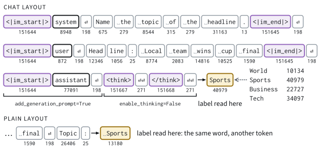

# Prompting and In-Context Learning
:label:`sec_lm_prompting`

Anyone who has used a chat assistant knows the routine: we type a question and
read the answer. The model that we loaded in :numref:`sec_lm_hf_models` and
rebuilt in :numref:`sec_lm_d2l_checkpoint` offers less. It takes tokens and
returns probabilities for the next one. So let us ask it for the topic of a
news headline. What does the model see when we ask, and how much of its answer
is decided by the text around the question?

```{.python .input #prompting-imports}
%%tab pytorch
import math
import numpy as np
import torch
from torch import nn
from torch.nn import functional as F
from d2l import torch as d2l
```

```{.python .input #prompting-imports-extra}
%%tab pytorch
import gc
import hashlib
import itertools
import json
import os
import re
import string
import textwrap
import time
import pandas as pd
import transformers
from sklearn.linear_model import LogisticRegression
from sklearn.preprocessing import StandardScaler
from transformers import AutoTokenizer
```

We work with two checkpoints of one architecture. Qwen3-1.7B-Base is a *base*
model, trained only to predict the next token. Qwen3-1.7B is its
*post-trained* sibling, trained further to hold conversations and follow
instructions; we call it the *instruct* model. The task comes from AG News
:cite:`Zhang.Zhao.LeCun.2015`, a dataset of news items in four classes: World,
Sports, Business and Sci/Tech. The setup cell defines a headline `QUERY`, four
solved headlines `DEMOS`, their format `FMT` and a plain question `ASK`. Its
other names serve the experiment of :numref:`subsec_lm_grid`. All headlines
printed in this section are invented, since the dataset is released for
non-commercial use only.

```{.python .input #prompting-setup}
%%tab pytorch
SMALL = not torch.cuda.is_available()  # no GPU: the 0.6B pair in fp32
RERUN = os.environ.get('D2L_RERUN', '0') == '1' and not SMALL
BASE, INST = (('Qwen/Qwen3-0.6B-Base', 'Qwen/Qwen3-0.6B') if SMALL
              else ('Qwen/Qwen3-1.7B-Base', 'Qwen/Qwen3-1.7B'))
NATURAL = ['World', 'Sports', 'Business', 'Tech']  # AG News's 4 classes
ABSTRACT = ['foo', 'bar', 'baz', 'zip']
FMT = 'Headline: {x}\nTopic: {y}'
ASK = 'What is the topic of this news headline?\n{x}\n'
INSTRUCTION = 'Name the topic of each news headline: {}, {}, {} or {}.'
SYSTEM = INSTRUCTION.format(*NATURAL)  # World, Sports, Business or Tech
SYSTEMS = [None, SYSTEM, INSTRUCTION.format(*NATURAL[::-1])]  # by 'instr'
QUERY = 'Local team wins cup final'  # invented, as are all examples below
DEMOS = [('Leaders meet to settle a border dispute', 'World'),
         ('Striker signs a new three-year contract', 'Sports'),
         ('Chip maker shares climb after strong earnings', 'Business'),
         ('New phone battery lasts a whole week', 'Tech')]
HEADLINES = [QUERY, 'Parliament votes on a new trade treaty',
             'Oil prices fall as supply grows',
             'Researchers build a faster quantum chip']
transformers.logging.set_verbosity_error()  # no notices or progress bars
transformers.logging.disable_progress_bar()

def print_table(rows, digits=3):  # a list of dicts, or a DataFrame
    print(pd.DataFrame(rows).to_string(
        index=False, na_rep='', float_format=f'{{:.{digits}f}}'.format))
```

`d2l.load_hf` (:numref:`sec_lm_hf_models`) loads each model at its pinned
revision.

```{.python .input #prompting-load-models}
%%tab pytorch
dtype = torch.float32 if SMALL else torch.bfloat16
base, tok = d2l.load_hf(BASE, dtype=dtype)
inst, tok_i = d2l.load_hf(INST, dtype=dtype)
for name, model in ((BASE, base), (INST, inst)):
    print(f'{name}: {model.num_parameters():,} parameters in {model.dtype}')
if SMALL:
    print('No GPU: the 0.6B pair in fp32 stands in for the 1.7B models,\n'
          'so the outputs below differ from those quoted in the text.')
```

Both models have 1.72 billion parameters. We ask the base model twice with the
greedy `d2l.generate` of :numref:`sec_lm_d2l_checkpoint`: with the question as
one would type it, and with the four solved headlines in front of ours,
arranged by `d2l.fewshot_prompt` (:numref:`subsec_lm_formats`).

```{.python .input #prompting-opening-generate}
%%tab pytorch
for prompt in (ASK.format(x=QUERY),
               d2l.fewshot_prompt(DEMOS, QUERY, fmt=FMT)):
    reply = d2l.generate(base, tok, [prompt], max_new_tokens=12)[0]
    print(f'{prompt}<continuation>{reply.text!r}\n')
```

Asked plainly, the base model does not answer. It continues the text, with a
sentence that restates the headline. With four solved examples in front, its
continuation begins with the word Sports, and then, having no reason to stop,
it writes another headline of its own and the next `Topic:`. The model did the
same thing both times: it continued a pattern of tokens. The solved examples
changed the pattern.

This observation became a new way of using language models.
:citet:`brown2020language` showed with GPT-3 that a model pretrained on enough
text performs a task it was never trained for when a few solved examples,
called *demonstrations*, precede the query, and no weight changes. Acquiring a
task from the context is called *in-context learning* (ICL). A prompt with $k$
demonstrations is a *$k$-shot* prompt, and one with none is *zero-shot*.

Every score in the rest of this part is measured through a prompt, so the
5-shot accuracy on a model card belongs to a model and a prompt together. If
one line of instruction moves it by several points, a comparison of two models
must hold the prompt fixed, or it compares prompts. This section measures how
much the prompt decides. We look at a prompt as the model receives it, read a
label from the probabilities of the next token, and vary the demonstrations
and the text around them in one controlled experiment. At the end we compare
learning from the context with fitting a classifier to the same labeled
examples.

## Prompts as Token Sequences

### Chat Templates
:label:`subsec_lm_templates`

The instruct model was trained on conversations: lists of messages, each with
a text and a *role*, which is `system` for framing instructions, `user`, or
`assistant`. The model still reads one sequence of tokens. The translation is
done by the *chat template*, a short program in the Jinja template language
that ships with the tokenizer files (:numref:`sec_lm_hf_models`) and turns a
list of messages into one string. We render a conversation with an
instruction, one solved headline and our query, and print the string again
token by token. Tokens in brackets are *special tokens*, which mark structure
and do not occur in ordinary text.

```{.python .input #prompting-chat-template}
%%tab pytorch
conversation = [
    {'role': 'system', 'content': 'Name the topic of the headline.'},
    {'role': 'user', 'content': 'Headline: ' + DEMOS[1][0]},
    {'role': 'assistant', 'content': DEMOS[1][1]},
    {'role': 'user', 'content': 'Headline: ' + QUERY}]
chat_text = tok_i.apply_chat_template(
    conversation, tokenize=False, add_generation_prompt=True,
    enable_thinking=False)
print(chat_text)
start = tok_i.convert_tokens_to_ids('<|im_start|>')
special = set(tok_i.added_tokens_decoder)  # <|im_start|>, <think>, ...
line = []
for i in tok_i(chat_text, add_special_tokens=False)['input_ids']:
    if i == start and line:  # one paragraph per message
        print(textwrap.fill(' '.join(line), 79))
        line = []
    t = tok_i.decode([i]).replace('\n', '\\n')
    line.append(f'[{i}:{t}]' if i in special else f'{i}:{t}')
print(textwrap.fill(' '.join(line), 79))
```

Each message is wrapped in `<|im_start|>` and `<|im_end|>`, and its role is
spelled in ordinary tokens: `system` is token 8948, `user` 872 and
`assistant` 77091. The string does not end with the last message. The
argument `add_generation_prompt=True` appends `<|im_start|>assistant` and a
newline, the *generation prefix*: the beginning of the reply, written for
the model so that its next token starts an answer. Qwen3's post-trained
models may precede an answer with reasoning enclosed in `<think>` and
`</think>`, called *thinking*. The argument `enable_thinking=False` appends
an empty block of that kind, four more tokens that tell the model its
thinking is already over (:numref:`fig_lm_chat_template`).


:label:`fig_lm_chat_template`

When `enable_thinking` is not given, the template decides. The next cell
renders one user message with the templates of our two checkpoints and of two
models of the Qwen3.5 family, and prints what follows `<|im_start|>assistant`
and its newline.

```{.python .input #prompting-template-tails}
%%tab pytorch
PREFIX = '<|im_start|>assistant\n'  # every template's tail starts so
rows = []
for name in ('Qwen/Qwen3-1.7B', 'Qwen/Qwen3-1.7B-Base', 'Qwen/Qwen3.5-2B',
             'Qwen/Qwen3.5-4B'):
    t = AutoTokenizer.from_pretrained(name, revision=d2l.HF_REVISIONS[name])
    render = lambda **kw: t.apply_chat_template(
        [{'role': 'user', 'content': QUERY}], tokenize=False, **kw)
    body = render(add_generation_prompt=False)
    unset, off = (render(add_generation_prompt=True, **kw)[len(body):]
                  for kw in ({}, {'enable_thinking': False}))
    assert unset.startswith(PREFIX) and off.startswith(PREFIX)
    rows.append({'model': name, 'unset': repr(unset[len(PREFIX):]),
                 'enable_thinking=False': repr(off[len(PREFIX):]),
                 'thinks by default': 'no' if '</think>' in unset else 'yes'})
print(f'tail after the user turn: {PREFIX!r}, then')
print_table(rows)
```

With the argument unset, the template of Qwen3-1.7B stops after the newline
and leaves it to the model to open a think block. The template of Qwen3.5-4B
opens the block, and that of Qwen3.5-2B closes it, so that model answers at
once. The default is set by each checkpoint's template, and two models of one
family can differ in it, which is why :numref:`sec_lm_hf_models` made it a
rule to pass `enable_thinking` explicitly. Note the second row.
Qwen3-1.7B-Base ships a version of its post-trained sibling's template, with
the same thinking switch, so rendering a conversation for the base model
raises no error, and the last column says that it thinks by default. That
column describes the file, not the model. A base model was never taught to
think, and we will measure in :numref:`subsec_lm_template_match` what a think
block does to it.

### Reading a Label from the Next Token
:label:`subsec_lm_label_reader`

For a classification task we do not need the model to write anything. Its
forward pass already assigns a probability to every possible next token, and
we can ask how that probability is divided among the label words. Let $x$ be
the input to classify, a headline placed in some prompt, and let $t_y$ be the
first token of the word for label $y$ as it would follow that prompt. With
$z_t$ the logit of token $t$ at the position after the prompt, we define

$$
p(y \mid x) = \frac{\exp(z_{t_y})}{\sum_{y'} \exp(z_{t_{y'}})},
$$
:eqlabel:`eq_lm_label_reader`

where the sum runs over the labels only. This is the softmax of
:numref:`sec_softmax`, restricted to as many tokens as there are labels, and
the predicted label is its largest entry. We call $p(\cdot \mid x)$ the
*read-out* of the prompt. The language model has become a classifier whose
output layer consists of four rows of its own. One case we can read already.
For the 4-shot prompt of the opening, greedy decoding wrote Sports, so the
token for Sports had the largest logit of the whole vocabulary, and with it
the largest of the four.

`d2l.label_logprobs` computes $\log p(y \mid x)$ for a batch of prompts. Three
of its lines carry the idea: the last hidden state `h` of each prompt, the
rows `W.weight[lab]` of the output layer that belong to the label tokens, and
the `log_softmax` of their products. The rest is batching, with prompts padded
on the left so that every row ends where its prompt ends. Note that the
function computes the label logits itself, in fp32, where it could have asked
the model for them. The check after the cell shows why.

```{.python .input #prompting-label-logprobs}
%%tab pytorch
#@save
def label_logprobs(model, tokenizer, prompts, label_words, *, batch_size=8,
                   chat=False, enable_thinking=False, sep=None):
    """Log-probabilities (len(prompts), len(label_words)), float32 on the
    CPU, of each label word's first token as the next token, normalized
    over the label tokens only. A word follows its prompt after sep, by
    default a space, but none after whitespace or next to Chinese text.
    With chat=True a prompt is a message list (a string is one user
    message), rendered with the generation prefix. The label logits are
    computed in float32 from the last hidden state and the label words'
    rows of the output layer (bf16 logits of size 20 to 40 are 1/8 to 1/4
    apart and tie)."""
    if chat:
        opts = {} if enable_thinking is None else {
            'enable_thinking': enable_thinking}
        prompts = [tokenizer.apply_chat_template(
            [{'role': 'user', 'content': m}] if isinstance(m, str) else m,
            tokenize=False, add_generation_prompt=True, **opts)
                   for m in prompts]
    ids, labels = d2l.label_token_ids(tokenizer, prompts, label_words, sep)
    if not chat:  # as d2l.generate: a plain prompt gets the BOS, if any
        ids = [d2l._lm_bos_ids(tokenizer) + r for r in ids]
    if not all(ids):
        raise ValueError('an empty prompt has no position to predict from')
    W = d2l._label_output_layer(model)
    if W is None:  # a d2l GPT, or a soft-capped output layer
        return d2l._label_logprobs_logits(model, tokenizer, ids, labels,
                                          batch_size)
    decoder = d2l._lm_unwrap(model).get_decoder()
    pad = getattr(tokenizer, 'pad_token_id', None) or 0
    device = next(model.parameters()).device
    out = torch.empty(len(ids), len(label_words))
    for j in range(0, len(ids), batch_size):  # left-padded, in input order
        rows, lab = ids[j:j + batch_size], labels[j:j + batch_size]
        T = max(len(r) for r in rows)
        X = torch.tensor([[pad] * (T - len(r)) + r for r in rows],
                         device=device)
        mask = torch.tensor([[0] * (T - len(r)) + [1] * len(r)
                             for r in rows], device=device)
        pos = (mask.cumsum(-1) - 1).masked_fill(mask == 0, 1)
        with torch.inference_mode():
            h = decoder(input_ids=X, attention_mask=mask, position_ids=pos,
                        use_cache=False).last_hidden_state[:, -1]
            lab = torch.tensor(lab, device=device)  # (batch, labels)
            z = torch.einsum('bd,bld->bl', h.float(), W.weight[lab].float())
            if W.bias is not None:
                z = z + W.bias[lab].float()
            lp = z.log_softmax(-1).cpu()
        out[j:j + batch_size] = lp  # out is an ordinary tensor
    return out
```

Every later number passes through this function, so we check it on four 4-shot
prompts. The cell compares it with the full softmax over the whole vocabulary,
computed in fp32 from the same hidden state and renormalized over the labels,
and then with the same quantity from the model's own bf16 logits. Finally it
compares one padded batch with scoring the prompts one at a time.

```{.python .input #prompting-reader-check}
%%tab pytorch
def renorm(z, ids):  # the full softmax, renormalized over the labels
    lp = z.float().log_softmax(-1)[ids]
    return (lp - lp.logsumexp(-1)).cpu()

prompts = [d2l.fewshot_prompt(DEMOS, h, fmt=FMT) for h in HEADLINES]
_, label_ids = d2l.label_token_ids(tok, prompts, NATURAL)
one = d2l.label_logprobs(base, tok, prompts, NATURAL, batch_size=1)
W = base.lm_head.weight.float()  # the whole output layer, in fp32
for prompt, ids, lp in zip(prompts, label_ids, one):
    x = tok(prompt, return_tensors='pt').input_ids.to(base.device)
    with torch.inference_mode():  # every logit at the last position
        h = base.model(input_ids=x, use_cache=False).last_hidden_state[0, -1]
        ref = renorm(h.float() @ W.T, ids)
        ref16 = renorm(base.lm_head(h), ids)  # the model's own logits
    err, err16 = ((lp - r).abs().max().item() for r in (ref, ref16))
    print(f'reader vs full softmax: {err:.1e} nats (from its own logits: '
          f'{err16:.1e})')
    assert err <= 1e-4
del W
batched = d2l.label_logprobs(base, tok, prompts, NATURAL, batch_size=4)
screen = 1e-4 if SMALL else 0.25  # a mask or position bug costs whole nats
for e in (batched - one).abs().max(-1).values.tolist():
    print(f'batched vs one at a time: {e:.1e} nats (screen {screen:.1e})')
    assert e <= screen
assert torch.equal(batched.argmax(-1), one.argmax(-1))  # same predictions
```

The first comparison agrees to within $10^{-5}$ nats. On paper the two are one
computation, so this confirms that the function picks the right rows at the
right position. The model's own logits are off by about a tenth of a nat. They
are bf16 numbers with eight significant bits, so logits between 16 and 64 lie
on a grid with a spacing of 1/8 to 1/4. On such a grid two close labels tie,
and a tie goes to whichever label we happened to list first. Four products in
fp32 remove the grid.

Batching moves the result by as much, up to 0.14 nats here, and changes no
prediction. That part we cannot remove: the hidden state itself is computed in
bf16, and the shape of a batch changes how a matrix product is rounded, as
:numref:`sec_lm_d2l_checkpoint` found. A tenth of a nat is therefore the noise
floor of every log-probability in this section.

The definition :eqref:`eq_lm_label_reader` hides one quantity. Dividing by the
sum over the labels removes the probability that the full softmax gives to the
label tokens together, which we call the *label mass*. If it is 0.9, the
read-out is close to what the model would write. If it is 0.001, the model is
about to write something else, and the read-out tells us only which of the
four words it prefers to the other three. Such a preference can be well
informed, and we will meet one that is right two times in three. It is still
no answer. A renormalized distribution sums to one however little probability
it started from, so we will print the label mass beside every read-out whose
meaning depends on it.

```{.python .input #prompting-label-mass-fn}
%%tab pytorch
def label_mass(model, tokenizer, texts, ids):
    """Full-softmax probability of the label tokens ids[i] as the next
    token after texts[i], one text at a time."""
    mass = []
    for text, i in zip(texts, ids):
        x = tokenizer(text, return_tensors='pt').input_ids.to(model.device)
        with torch.inference_mode():
            z = model(input_ids=x, use_cache=False,
                      logits_to_keep=1).logits[0, -1]
        mass.append(z.float().softmax(-1)[i].sum().item())
    return np.array(mass)
```

Which token is $t_y$? Tokens of this vocabulary carry their leading space, so
the answer depends on what precedes the label. `d2l.label_token_ids` appends
each label word to the prompt, with a space unless the prompt ends in
whitespace, and returns the first new token. It raises an error where a silent
score would be wrong: when the last token of the prompt merges with the label,
when two labels share a first token, and when a label has several tokens.

```{.python .input #prompting-label-tokens}
%%tab pytorch
_, (after_colon,) = d2l.label_token_ids(tok, ['Topic:'], NATURAL)
_, (after_newline,) = d2l.label_token_ids(tok_i, [chat_text], NATURAL)
d2l.label_token_ids(tok, ['Topic:'], ABSTRACT)  # raises unless 1 token
print(pd.DataFrame({
    'word': NATURAL,
    'after "Topic:"': [f'{i} {tok.decode([i])!r}' for i in after_colon],
    'after a newline': [f'{i} {tok.decode([i])!r}' for i in after_newline]
    }).to_string(index=False))
assert not set(after_colon) & set(after_newline)
spaced = [p + ' ' for p in prompts]  # the space typed into the prompt
mass = [label_mass(base, tok, texts, [ids] * len(texts)).mean()
        for texts, ids in ((prompts, after_colon), (spaced, after_newline))]
print(f'label mass after "Topic:": {mass[0]:.3f}; after "Topic: ", read '
      f'at the bare words: {mass[1]:.3f}')
for texts, words in ((spaced, NATURAL),
                     (prompts, ['World', 'Sports', 'Business', 'Sci/Tech'])):
    try:
        d2l.label_logprobs(base, tok, texts, words)
    except ValueError as e:
        print(textwrap.fill(f'ValueError: {e}', 79))
```

After the colon the label is the token for Sports with its space (13180), and
after the newline of the generation prefix it is the token without one
(40979). No id is shared, so label tokens looked up for one kind of prompt are
wrong for the other. If we type the space ourselves and read at the bare
words, the labels receive a mass of 0.000, because in ordinary text that space
is part of the next word's token. `d2l.label_logprobs` refuses such a prompt.
It also refuses the dataset's own class name `Sci/Tech`, which is three
tokens, and this is why our fourth label word is `Tech`.

After `Topic:` the four labels hold about a third of the probability on these
4-shot prompts, a middling value: the labels are serious candidates for the
next token, and two thirds of the probability belong to other continuations
(Exercise :exref:`ex_lm_prompting-mass`).

When is a read-out the model's answer? The next cell scores one zero-shot
prompt, our cup-final headline after a line that names the four labels, and
prints the label mass beside each read-out. The instruct model receives the
prompt through its chat template and as plain text, the base model through the
template with the empty think block and with the template's default ending.

```{.python .input #prompting-template-mismatch}
%%tab pytorch
chat = d2l.fewshot_prompt([], QUERY, 'chat_multi', system=SYSTEM)
plain = d2l.fewshot_prompt([], QUERY, fmt=FMT, system=SYSTEM)
render = lambda t, **kw: t.apply_chat_template(  # thinking off: empty block
    chat, tokenize=False, add_generation_prompt=True, **kw)
runs = {'instruct, chat template': (inst, tok_i, render(
            tok_i, enable_thinking=False)),
        'instruct, plain text': (inst, tok_i, plain),
        'base, chat template': (base, tok, render(tok, enable_thinking=False)),
        'base, chat template, no think block': (base, tok, render(tok))}
rows = {}
for name, (m, t, text) in runs.items():  # text: the rendered prompt
    _, ids = d2l.label_token_ids(t, [text], NATURAL)
    p = d2l.label_logprobs(m, t, [text], NATURAL)[0].exp()
    rows[name] = [*p.tolist(), label_mass(m, t, [text], ids)[0]]
table = pd.DataFrame(rows, index=NATURAL + ['label mass']).T
print(table.to_string(float_format='{:.3f}'.format))
```

Four pairings give four distributions for one headline, and none favors
Sports. They fail for two different reasons. The rows of the base model rest
on a label mass of 0.000 and of about 0.02, so they show at best a preference
among words that the model will not write. The instruct model has a label mass
of about 0.4 with the template and almost 1 in plain text, and it gives World
a probability of nearly one for a headline about a cup final. Is that the
model's answer, or a fault of our read-out? We let the model write, with and
without the instruction line.

```{.python .input #prompting-instruct-replies}
%%tab pytorch
for system in (SYSTEM, None):
    chats = [d2l.fewshot_prompt([], h, 'chat_multi', system=system)
             for h in HEADLINES]
    replies = d2l.generate(inst, tok_i, chats, max_new_tokens=6, chat=True,
                           enable_thinking=False)
    print('SYSTEM line' if system else 'no instruction line')
    for h, r in zip(HEADLINES, replies):
        print(f'  {h:40} -> {r.text!r}')
```

The read-out was right. With the instruction line the instruct model writes
World for three of the four headlines, wrongly for the cup final and for the
oil price. For the quantum chip it names the right topic, but its reply begins
with markdown, which a read-out of label words cannot see. Without the line it
replies in sentences and names no label. The label mass tells us how far a
read-out is the model's answer. It does not tell us whether the answer is
right, and we return to this stubborn World in
:numref:`subsec_lm_template_match`.

## Few-Shot Prompting

### Demonstrations and Layouts
:label:`subsec_lm_formats`

A few-shot prompt has to put the demonstrations and the query somewhere.
`d2l.fewshot_prompt` takes demonstrations as pairs $(x, y)$ of input and
label, and a query, and arranges them in one of four *layouts*, selected by
its argument `template`. The `plain` layout repeats a *format string* such as
our `Headline: {x}\nTopic: {y}` and ends after the label field of the query,
without a trailing space, and `qa` does the same with `Q:` and `A:`. The two
chat layouts return messages for the model's chat template to render:
`chat_multi` makes every demonstration a user turn followed by an assistant
turn, and `chat_single` puts the plain text into one user message. An optional
`system` line carries an instruction.

```{.python .input #prompting-fewshot-prompt}
%%tab pytorch
#@save
def fewshot_prompt(demos, query, template='plain', *, fmt=None,
                   label_map=None, system=None):
    """Demonstrations demos, a list of (x, y), and a query x as a prompt.
    'plain' (fmt, default 'Input: {x}\\nOutput: {y}') and 'qa'
    ('Q: {x}\\nA: {y}') give a string whose blocks are separated by a blank
    line and which ends after the query's label field, without a space;
    'chat_single' gives the same text as one user message, 'chat_multi'
    one user and one assistant message per demonstration. label_map maps
    each y to its label word."""
    if template not in ('plain', 'qa', 'chat_single', 'chat_multi'):
        raise ValueError(f'unknown template: {template!r}')
    if fmt is not None:
        import string
        if template not in ('plain', 'chat_single'):
            raise ValueError(f'template {template!r} takes no fmt')
        parts = list(string.Formatter().parse(fmt))
        fields = [f for _, f, _, _ in parts if f is not None]
        tail = parts[-1][0] if parts and parts[-1][1] is None else ''
        if (set(fields) != {'x', 'y'} or fields.count('y') > 1 or
                fields[-1] != 'y' or tail.strip()):
            raise ValueError('fmt needs the fields {x} and {y}, with {y} '
                             f'once and last: {fmt!r}')

    def word(y):
        if label_map is not None:
            if y not in label_map:
                raise KeyError(f'label {y!r} is not in label_map')
            y = label_map[y]
        if not isinstance(y, str):
            raise TypeError(f'label {y!r} is not a string: pass label_map')
        return y
    demos = [(x, word(y)) for x, y in demos]
    head = [] if system is None else [{'role': 'system', 'content': system}]
    if template == 'chat_multi':
        return head + [{'role': r, 'content': c} for x, y in demos
                       for r, c in (('user', x), ('assistant', y))] + [
                           {'role': 'user', 'content': query}]
    fmt = 'Q: {x}\nA: {y}' if template == 'qa' else (
        fmt or 'Input: {x}\nOutput: {y}')
    text = '\n\n'.join([fmt.format(x=x, y=y) for x, y in demos] +
                       [fmt.format(x=query, y='').rstrip()])
    if template == 'chat_single':
        return head + [{'role': 'user', 'content': text}]
    return text if system is None else system + '\n\n' + text
```

Here are two demonstrations and our query in the four layouts, the chat ones
as the template of the instruct model renders them.

```{.python .input #prompting-formats}
%%tab pytorch
layouts = {
    'plain': d2l.fewshot_prompt(DEMOS[:2], QUERY, fmt=FMT),
    'qa': d2l.fewshot_prompt(DEMOS[:2], QUERY, 'qa'),
    'chat_multi': d2l.fewshot_prompt(DEMOS[:2], QUERY, 'chat_multi',
                                     system=SYSTEM),
    'chat_single': d2l.fewshot_prompt(DEMOS[:2], QUERY, 'chat_single',
                                      fmt=FMT)}
for name, prompt in layouts.items():
    if not isinstance(prompt, str):  # a message list
        prompt = tok_i.apply_chat_template(
            prompt, tokenize=False, add_generation_prompt=True,
            enable_thinking=False)
    print(f'--- {name}\n{prompt}')
```

The four prompts hold the same examples and differ in almost every token
around them. In this cell `chat_multi` also carries an instruction line and
has no field names. It differs in one more respect that is easy to miss: a
demonstrated answer follows `assistant` and a newline directly, while the
prefix of the query also carries the empty think block. Details of this kind
matter. :citet:`Sclar.Choi.Tsvetkov.ea.2024` found that separators, casing and
field names, choices that nobody would defend as meaningful, move few-shot
accuracy by many points. From here on, the *plain* layout is the format string
above and the *chat* layout is `chat_multi` with thinking off. The other two
layouts are raw material for Exercise :exref:`ex_lm_prompting-layout`.

### A Grid of Paired Conditions
:label:`subsec_lm_grid`

To find out what in a prompt matters we need many prompts that differ in one
respect at a time, all scored on the same test items. We build such a
collection once, the *grid*, and read every later result from it. A
*condition* is one setting of the factors in :numref:`tab_lm_prompt_grid`. The
reference condition is the base model with eight correctly labeled
demonstrations in the plain layout and no instruction line.

:The factors of the grid, each varied for both models from the reference condition. The chat layout carries the instruction line `SYSTEM` unless the line is the factor.
:label:`tab_lm_prompt_grid`

| factor | values | varied at |
|:--|:--|:--|
| number of demonstrations $k$ | 0, 1, 2, 4, 8, 16, and 32 and 64 for the base model | plain layout; chat layout of the instruct model |
| layout | plain, chat, chat without the think block (base model) | $k = 8$ |
| instruction line | none; `SYSTEM`: "Name the topic of each news headline: World, Sports, Business or Tech."; the same with the labels reversed | plain layout at $k = 0$; chat layout of the instruct model at $k = 0, 1, 4, 8$ |
| order of the demonstrations | four orders of the same eight | $k = 8$ |
| labels of the demonstrations | a fraction $\rho$ of them wrong; all of them relabeled consistently | $k = 8$ |
| label words | natural; abstract (`foo`, `bar`, `baz`, `zip`) | every setting of the labels |

The cells of this subsection build, score and store the grid, and they can be
skimmed. Two facts and one rule are needed later. A *draw* is one random
choice of demonstrations, every condition is scored on the same 200 test
titles, and the rule for reading a difference between two conditions stands at
the end of the subsection. The first cell registers the dataset and the stored
grid.

```{.python .input #prompting-data-hub}
%%tab pytorch
#@save
d2l.DATA_HUB['ag-news-train'] = (
    'https://huggingface.co/datasets/sh0416/ag_news/resolve/'
    '70e3fa1915be9a8daebec5e840f20df9a8e18793/train.jsonl',
    '4b8aa80c8d0e1bea19ec0924b720317a6a61b040')
d2l.DATA_HUB['ag-news-test'] = (
    'https://huggingface.co/datasets/sh0416/ag_news/resolve/'
    '70e3fa1915be9a8daebec5e840f20df9a8e18793/test.jsonl',
    '6c874e265fe5ff35861f27eaf3e681dda147ba12')
d2l.DATA_HUB['lm-fewshot-grid-v2'] = (
    d2l.LM_DATA_URL + 'lm-fewshot-grid-v2.csv',
    '0c2a1c87635bbfcdca9cedb479723901b3d5cbd5')
```

We use the title of each news item alone. The titles carry leftover escape
codes, which `d2l.clean_ag_news` resolves and the next cell counts. And some
training titles repeat a test title, up to case, punctuation, spacing or a
trailing source tag such as `(AP)`. A demonstration that repeats a test item
hands the model its answer, so we compare titles by a key that ignores all
four.

```{.python .input #prompting-data-clean}
%%tab pytorch
def read_jsonl(key):
    path = d2l.download(key, os.path.join('..', 'data', 'lm', key))
    with open(path, encoding='utf-8') as f:
        return pd.DataFrame([json.loads(line) for line in f])

def dedup_key(title):  # no source tag such as '(AP)', no punctuation
    title = re.sub(r'\s*\([^()]*\)\s*$', '', title).lower()
    title = title.translate(str.maketrans('', '', string.punctuation))
    return ' '.join(title.split())
```

The test items are the first 50 test titles of each class. Demonstrations come
from the training titles whose key matches no test title.

```{.python .input #prompting-data}
%%tab pytorch
N_PER_CLASS = 50
train, test = read_jsonl('ag-news-train'), read_jsonl('ag-news-test')
TRAIN_TITLES, changed_train = d2l.clean_ag_news(list(train.title))
TEST_TITLES, changed_test = d2l.clean_ag_news(list(test.title))
TRAIN_Y, TEST_Y = train.label.to_numpy() - 1, test.label.to_numpy() - 1
ITEMS = np.sort(test.groupby('label').head(N_PER_CLASS).index.to_numpy())
GOLD = TEST_Y[ITEMS]
assert np.bincount(GOLD).tolist() == [N_PER_CLASS] * 4
test_keys = {dedup_key(t) for t in TEST_TITLES}
in_pool = np.array([dedup_key(t) not in test_keys for t in TRAIN_TITLES])
POOL = [np.flatnonzero(in_pool & (TRAIN_Y == c)) for c in range(4)]
print(f'{len(ITEMS)} test items, the first {N_PER_CLASS} of each class in '
      'file order')
print(f'demonstration pool per class: {[len(p) for p in POOL]}')
print(f'{(~in_pool).sum()} train titles removed as duplicates of test '
      'titles; titles changed by each cleanup rule:')
print(pd.DataFrame({'train': changed_train, 'test': changed_test}).T
      .to_string())
```

About 1,900 training titles duplicate a test title and leave the pool. We use
five draws. Each is a list of 64 blocks with one title of every class in
random order, and the $k$-shot prompt uses the first $k$ titles, so the
prompts of a draw are nested and, for multiples of four, balanced. The cell
also fixes the reorderings and the wrong labels for :numref:`subsec_lm_order`
and :numref:`subsec_lm_label_correctness`. Every random choice comes from a
seed written in the cell, and no seed was picked after looking at a result.

```{.python .input #prompting-draws}
%%tab pytorch
DRAWS = range(5)
DRAW = {}  # train rows of each draw: blocks of one title per class
for s in DRAWS:
    rng = np.random.default_rng(s)
    picks = [rng.choice(POOL[c], 64, replace=False) for c in range(4)]
    DRAW[s] = np.array([picks[c][b] for b in range(64)
                        for c in rng.permutation(4)])
ORDERS = {s: [np.arange(8)] + [np.random.default_rng(100 + 10 * s + o)
                               .permutation(8) for o in (1, 2, 3)]
          for s in DRAWS}
NOISE = {}  # per draw: a wrong label per position, and the order of use
for s in DRAWS:
    rng = np.random.default_rng(1000 + s)
    wrong = (TRAIN_Y[DRAW[s][:8]] + rng.integers(1, 4, size=8)) % 4
    NOISE[s] = wrong, rng.permutation(8)
DERANGEMENTS = [p for p in itertools.permutations(range(4))
                if all(i != j for i, j in enumerate(p))]
SIGMA = {s: np.array(DERANGEMENTS[np.random.default_rng(2000 + s)
                                  .integers(len(DERANGEMENTS))])
         for s in DRAWS}
```

The function `conditions` writes :numref:`tab_lm_prompt_grid` out as a list of
dictionaries that override fields of the reference `COND`. The fields `rho`
and `derange` are the two ways of changing labels, `chat_default` is the chat
layout without the think block, and `instr` numbers the instruction lines.

```{.python .input #prompting-grid-def}
%%tab pytorch
MODELS, WORDS = ['base', 'instruct'], ['natural', 'abstract']
K_BASE, K_INST = [0, 1, 2, 4, 8, 16, 32, 64], [0, 1, 2, 4, 8, 16]
COND = dict(model='base', layout='plain', k=8, words='natural', rho=0.0,
            derange=False, order=0, instr=0)  # the reference condition
INSTR = {0: 'none', 1: 'SYSTEM', 2: 'SYSTEM, labels reversed'}  # SYSTEMS
CONTENT_FREE = ['N/A', '', '[MASK]']  # in place of a headline

def conditions():
    """Every (condition, draw) of the grid; without demonstrations a
    condition has the single draw -1."""
    out = []
    def add(**kw):
        for s in ([-1] if kw.get('k', 8) == 0 else DRAWS):
            out.append(dict(COND, **kw, seed=s))
    for model, ks in zip(MODELS, (K_BASE, K_INST)):
        for k in ks:
            add(model=model, k=k)
        for instr in (1, 2):  # an instruction names the labels
            add(model=model, k=0, instr=instr)
        for k in ks if model == 'instruct' else [8]:  # the chat layout
            add(model=model, layout='chat', k=k, instr=1)
        if model == 'instruct':  # no instruction, or its labels reversed
            for instr, k in itertools.product((0, 2), (0, 1, 4, 8)):
                add(model=model, layout='chat', k=k, instr=instr)
        if model == 'base':  # the template's default end: no think block
            add(model=model, layout='chat_default', instr=1)
        for order in (1, 2, 3):
            add(model=model, order=order)
        for words, rhos in (('natural', (0.25, 0.5, 0.75, 1.0)),
                            ('abstract', (0.0, 0.25, 0.5, 0.75, 1.0))):
            for rho in rhos:
                add(model=model, words=words, rho=rho)
            add(model=model, words=words, derange=True)
    return out
```

The function `demos` returns the demonstrations of a condition, and
`build_prompts` its prompts.

```{.python .input #prompting-grid-prompts}
%%tab pytorch
def demos(cond):
    """The (title, label index) demonstrations of one condition."""
    s, k = cond['seed'], cond['k']
    if k == 0:
        return []
    rows = DRAW[s][:k][ORDERS[s][cond['order']]] if k == 8 else DRAW[s][:k]
    y = TRAIN_Y[rows].copy()
    wrong, positions = NOISE[s]
    hit = positions[:round(8 * cond['rho'])]  # nested in rho
    assert not len(hit) or (k == 8 and cond['order'] == 0)
    y[hit] = wrong[hit]
    return list(zip(TRAIN_TITLES[rows],
                    SIGMA[s][y] if cond['derange'] else y))

def build_prompts(cond, titles):
    """One condition's prompts for the titles: strings, or message lists
    in the chat layout."""
    words = dict(enumerate(NATURAL if cond['words'] == 'natural'
                           else ABSTRACT))
    if cond['layout'] == 'ask':
        return [ASK.format(x=x) for x in titles]
    ds, system = demos(cond), SYSTEMS[cond['instr']]
    if cond['layout'].startswith('chat'):
        chats = [d2l.fewshot_prompt(ds, x, 'chat_multi', label_map=words,
                                    system=system) for x in titles]
        if cond['layout'] == 'chat':  # rendered by the reader, no thinking
            return chats
        return [tok.apply_chat_template(  # base only: the default end
            m, tokenize=False, add_generation_prompt=True) for m in chats]
    return [d2l.fewshot_prompt(ds, x, fmt=FMT, label_map=words,
                               system=system) for x in titles]
```

Besides the 200 test titles, every condition is scored on three inputs without
content, `N/A`, the empty string and `[MASK]`, which
:numref:`subsec_lm_calibration` will need. Counting tokens tells us what the
grid costs.

```{.python .input #prompting-grid-size}
%%tab pytorch
def n_tokens(tokenizer, prompts):  # per prompt, as the reader sees it
    texts = [p if isinstance(p, str) else tokenizer.apply_chat_template(
        p, tokenize=False, add_generation_prompt=True, enable_thinking=False)
             for p in prompts]
    return [len(i) for i in
            tokenizer(texts, add_special_tokens=False)['input_ids']]

GRID, TITLES = conditions(), list(TEST_TITLES[ITEMS]) + CONTENT_FREE
TOKENS = {}
for model, tokenizer in zip(MODELS, (tok, tok_i)):
    conds = [c for c in GRID if c['model'] == model]
    TOKENS[model] = sum(sum(n_tokens(tokenizer, build_prompts(c, TITLES)))
                        for c in conds)
    print(f'{model}: {len(conds)} (condition, draw) pairs, '
          f'{len(conds) * len(TITLES):,} prompts, {TOKENS[model]:,} tokens')
assert [sum(c['model'] == m for c in GRID) for m in MODELS] == [118, 156]
```

The grid has 274 pairs of condition and draw and about ten million prompt
tokens. Scoring a condition yields one row per item, with the four label
log-probabilities and the prediction.

```{.python .input #prompting-grid-score}
%%tab pytorch
COLS = ['model', 'exp', 'layout', 'k', 'words', 'rho', 'perm', 'order',
        'instr', 'seed', 'item', 'lp0', 'lp1', 'lp2', 'lp3', 'pred', 'valid']
IDS = list(ITEMS) + [-1, -2, -3]  # test rows, then the content-free inputs

def head(cond, exp='icl'):  # the condition columns of a grid row
    perm = ''.join(map(str, SIGMA[cond['seed']])) if cond['derange'] else ''
    return [cond['model'], exp, cond['layout'], cond['k'], cond['words'],
            cond['rho'], perm, cond['order'], cond['instr'], cond['seed']]

def score(cond):
    """Grid rows of one condition: its test items and content-free inputs,
    in fixed batches (bf16 results depend on the batch)."""
    model, tokenizer = (base, tok) if cond['model'] == 'base' else (
        inst, tok_i)
    words = NATURAL if cond['words'] == 'natural' else ABSTRACT
    lp = d2l.label_logprobs(
        model, tokenizer, build_prompts(cond, TITLES), words,
        batch_size=32 if cond['k'] <= 16 else 8, chat=cond['layout'] == 'chat')
    return [head(cond) + [i, *r.tolist(), int(r.argmax()), 1]
            for i, r in zip(IDS, lp)]

def read_grid(path):
    return pd.read_csv(path, dtype={'perm': str}).fillna({'perm': ''})

def matched(new, old, exp):  # rows of both files, keyed by condition, item
    return new[new.exp == exp].merge(old[old.exp == exp], on=COLS[:11],
                                     suffixes=('', '_old'))
```

For three conditions of the base model we also let the model write: the plain
question of the opening, and the plain layout without demonstrations and with
four. A greedy reply of eight tokens counts as a label if its first non-empty
line, stripped of surrounding whitespace and punctuation and compared without
regard to case, is one of the four label words. The rule was fixed in advance.

```{.python .input #prompting-grid-gen}
%%tab pytorch
GEN = [dict(COND, k=0, layout='ask', seed=-1), dict(COND, k=0, seed=-1)] + [
    dict(COND, k=4, seed=s) for s in DRAWS]  # free generation, base model

def answer(text):
    """A free generation's label index by the declared rule, else -1."""
    line = next((s for s in text.split('\n') if s.strip()), '')
    word = line.strip(string.whitespace + string.punctuation).lower()
    return next((j for j, w in enumerate(NATURAL) if w.lower() == word), -1)

def generations(cond):  # greedy, 8 tokens, the test items only
    out = d2l.generate(base, tok, build_prompts(cond, TITLES[:len(ITEMS)]),
                       max_new_tokens=8, batch_size=32)
    return [head(cond, 'gen') + [i, None, None, None, None, p, int(p >= 0)]
            for i, p in zip(ITEMS, (answer(g.text) for g in out))]
```

Scoring ten million tokens takes several minutes on one GPU. A normal run of
the notebook therefore downloads the stored grid and checks it against the
live model by scoring one condition again. With the environment variable
`D2L_RERUN=1` the cell recomputes all of it.

```{.python .input #prompting-grid-run}
%%tab pytorch
RERUN_PATH = os.path.join('..', 'data', 'lm', 'rerun', 'lm-fewshot-grid.csv')
GRID_KEY = 'lm-fewshot-grid-v2'
registered = read_grid(d2l.download(GRID_KEY,
                                    os.path.join('..', 'data', 'lm')))
if RERUN:  # regenerate the grid (probe rows: prompting-probe)
    torch.cuda.reset_peak_memory_stats()
    tic = time.time()
    rows = [r for c in GRID for r in score(c)]
    scored = time.time() - tic  # the label read-out alone
    rows += [r for c in GEN for r in generations(c)]
    wall = time.time() - tic
    os.makedirs(os.path.dirname(RERUN_PATH), exist_ok=True)
    pd.DataFrame(rows, columns=COLS).to_csv(RERUN_PATH, index=False,
                                            float_format='%.6g')
    grid = read_grid(RERUN_PATH)
    tokens = sum(TOKENS.values())
    print(f'{len(grid):,} rows in {wall / 60:.1f} min; {tokens:,} prompt '
          f'tokens scored in {scored / 60:.1f} min ({tokens / scored:,.0f} '
          f'tokens/s); peak {torch.cuda.max_memory_allocated() / 2**30:.1f}'
          ' GiB')
    for exp in ('icl', 'gen'):
        m = matched(grid, registered, exp)
        print(f'{exp}: {(m.pred == m.pred_old).sum():,} of {len(m):,} '
              'predictions as registered')
else:
    grid = registered
    print(f'{GRID_KEY}: {len(grid):,} rows')
    if not SMALL:  # one declared condition, re-scored live
        m = matched(pd.DataFrame(score(dict(COND, seed=0)), columns=COLS),
                    registered, 'icl')
        m = m[m.item >= 0]
        print(f'base, plain, k = 8, draw 0, re-scored: '
              f'{(m.pred == m.pred_old).sum()} of {len(m)} predictions as '
              'registered')
        margin = lambda cols: np.diff(np.sort(m[cols].to_numpy(float), 1)[
            :, -2:], axis=1)[:, 0]  # top label minus the runner-up
        lp = ['lp0', 'lp1', 'lp2', 'lp3']
        for i, a, b, same in zip(m.item, margin(lp),
                                 margin([c + '_old' for c in lp]),
                                 m.pred == m.pred_old):
            if not same:
                print(f'  item {i}: margin {a:.3f} live, {b:.3f} registered')
```

All 200 predictions of the re-scored condition equal the stored ones, so
scoring is repeatable. Three helpers read a condition back as an array with
one row per draw and one column per item.

```{.python .input #prompting-grid-select}
%%tab pytorch
def grid_values(cols, items=ITEMS, **cond):
    """Columns cols of one condition, (draws, items, cols); a condition
    without demonstrations has one draw, repeated for every draw."""
    c = {**COND, 'exp': 'icl', **cond}
    keep = (grid.perm != '') == c.pop('derange')
    for key, v in c.items():
        keep &= grid[key] == v
    r = grid[keep].set_index(['seed', 'item'])
    seeds = sorted(r.index.unique('seed'))
    v = r.loc[pd.MultiIndex.from_product([seeds, list(items)]), cols]
    v = v.to_numpy(float).reshape(len(seeds), len(items), len(cols))
    return v.repeat(len(DRAWS), 0) if seeds == [-1] else v

def pred(**cond):  # predicted label indices, (draws, items)
    return grid_values(['pred'], **cond)[..., 0].astype(int)

def correct(**cond):  # 1.0 where the prediction is the gold label
    return (pred(**cond) == GOLD).astype(float)
```

With 200 items, an accuracy near one half has a 95% interval of about $\pm 7$
points, since $1.96 \sqrt{0.25/200} \approx 0.07$, which is wider than most
effects we are after. But every condition was scored on the same items, so two
conditions can be compared item by item, and only the items on which they
differ contribute noise (:numref:`subsec_mdl-paired-comparisons`). The
function `paired_ci` computes the mean difference per item and a bootstrap
interval for it, the central 95% of the means of 2,000 resamples of the items
(:numref:`subsec_mdl-bootstrap`). It is a stand-in for `d2l.paired_bootstrap`,
which :numref:`sec_lm_eval_suites` develops properly. The function `compare`
also counts in how many of the five draws the difference has the sign of the
mean, and `order_null` belongs to the experiment on order.

We read a difference as an effect only if its interval excludes zero and at
least four draws agree. The rule is necessary and not sufficient. Its interval
resamples the items and keeps the five draws, so it says what other test items
would give with these demonstrations and nothing about other demonstrations,
and five draws are few. Effects of twenty points and more leave no doubt. An
effect of five or ten points that passes the rule may still belong to our five
draws, and we will meet one that we do not believe.

```{.python .input #prompting-paired-ci}
%%tab pytorch
def paired_ci(a, b=0, n_boot=2000, seed=0):
    """Mean of a - b over items, with its 95% bootstrap interval."""
    d = np.asarray(a, dtype=float) - b
    idx = np.random.default_rng(seed).integers(0, len(d), (n_boot, len(d)))
    lo, hi = np.percentile(d[idx].mean(1), [2.5, 97.5])
    return d.mean(), lo, hi

def order_null(correct, n_perm=2000, seed=0):
    """SD of accuracy over orders (correct: draws x orders x items), mean
    over draws, and its p-value when each item's order labels are
    permuted within a draw."""
    stat = lambda c: c.mean(-1).std(-1, ddof=1).mean()
    rng = np.random.default_rng(seed)
    null = np.array([stat(rng.permuted(correct, axis=1))
                     for _ in range(n_perm)])
    return stat(correct), (1 + (null >= stat(correct)).sum()) / (1 + n_perm)

def compare(a, b):
    """a - b for (draws, items) arrays: the difference with its paired
    interval over items, and in how many draws it has the same sign
    ('n/a' when neither array varies over draws: no demonstrations)."""
    diff, lo, hi = paired_ci(a.mean(0), b.mean(0))
    same = (np.sign(a.mean(1) - b.mean(1)) == np.sign(diff)).sum()
    fixed = all((v == v[0]).all() for v in (a, b))
    return {'diff': diff, 'lo': lo, 'hi': hi,
            'draws': 'n/a' if fixed else f'{same}/{len(a)}'}

def show(r):  # a difference with its interval, as one string
    s = f"{r['diff']:+.3f} [{r['lo']:+.3f}, {r['hi']:+.3f}]"
    return s if r['draws'] == 'n/a' else f"{s} in {r['draws']} draws"
```

### Number of Demonstrations
:label:`subsec_lm_num_demos`

How much do demonstrations help, and how many does it take? The first table
gives accuracy against $k$ for the base model in the plain layout, the
instruct model in the chat layout with the `SYSTEM` line, and the instruct
model in the plain layout. In this table and in all later ones, `diff` is the
difference in accuracy from the reference of the row, here $k = 0$ of the same
curve. The columns `lo` and `hi` are the ends of its interval, and `draws`
counts the draws that agree with its sign. Beyond eight demonstrations the
last column compares with $k = 8$ as well. The second table reads the free
generations of the base model.

```{.python .input #prompting-k-table}
%%tab pytorch
curves = {'base, plain': dict(model='base'),
          'instruct, chat': dict(model='instruct', layout='chat', instr=1),
          'instruct, plain': dict(model='instruct')}
rows = []
for name, c in curves.items():
    zero, eight = correct(**dict(c, k=0)), correct(**dict(c, k=8))
    for k in K_BASE if name == 'base, plain' else K_INST:
        acc = correct(**dict(c, k=k))
        rows.append({'curve': name, 'k': k, 'accuracy': acc.mean(),
                     **(compare(acc, zero) if k else {}),
                     **({'vs k = 8': show(compare(acc, eight))} if k > 8
                        else {})})
print_table(rows)
gain = lambda m: correct(model=m, k=4) - correct(model=m, k=0)
print('gain from k = 0 to 4, plain, instruct minus base:',
      show(compare(gain('instruct'), gain('base'))))
gen = {'question': pred(exp='gen', layout='ask', k=0),
       'plain, k = 0': pred(exp='gen', k=0),
       'plain, k = 4': pred(exp='gen', k=4)}
rows = []
for what, f in (('valid label', lambda p: (p >= 0) * 1.0),
                ('exact match', lambda p: (p == GOLD) * 1.0)):
    for name, p in gen.items():
        rows.append({'prompt': name, 'rate of': what, 'rate': f(p).mean(),
                     'vs question': '' if name == 'question' else show(
                         compare(f(p), f(gen['question'])))})
print_table(rows)
```

For the base model, four demonstrations raise accuracy from 0.65 to 0.76. The
gain of 0.11 has an interval from 0.06 to 0.15 and appears in all five draws.
A single demonstration does not help. From four to 32 demonstrations the curve
moves by less than the width of its intervals. At 64 it lies 0.045 above its
value at eight, with an interval from 0.01 to 0.08 in four draws of five, so
we cannot call the curve saturated.

Ten points is a modest gain for the change that the opening showed, and the
second table explains why. In free generation the zero-shot base model writes
a label word in at most 1 reply of 200. With four demonstrations 83% of its
replies are a label word, and exact-match accuracy rises from nothing to 0.65,
with an interval from 0.60 to 0.71. The read-out asks which of four words the
model prefers, and the zero-shot model already prefers the right one in two
cases of three. This is the well-informed preference that we announced: a
later table will show that the four words together hold less than 2% of the
zero-shot model's probability. Generation asks whether the model names a label
at all. What the demonstrations teach first is the form of the answer.

The instruct model is less tidy. In the chat layout it starts at 0.275, the
World answer of :numref:`subsec_lm_label_reader` at the scale of the test set.
One demonstration lifts it to 0.67, and the curve then stays between 0.66 and
0.71. In the plain layout it starts about where the base model does and gains
nothing measurable until it has eight demonstrations (0.09, interval 0.03 to
0.15). Its gain from zero to four is smaller than that of the base model in
every draw, by 0.11 on average. Most of that average comes from a single draw,
in which its 4-shot prompt collapses onto two of the four labels (Exercise
:exref:`ex_lm_prompting-draws`). How much of the jump of the chat curve is due
to the instruction line?

### Templates and Instructions
:label:`subsec_lm_template_match`

The chat curve differs from the plain curves in two respects at once: its
prompts pass through the chat template, and they carry the instruction line.
The next table compares each row with the plain layout at the same $k$,
without an instruction. For the base model it includes the chat layout with
the default ending of the template, which has no think block.

```{.python .input #prompting-format-table}
%%tab pytorch
rows = []
for model in MODELS:
    pairs = {'chat, k = 8': (dict(layout='chat', instr=1), {}),
             'plain + instruction, k = 0': (dict(k=0, instr=1), dict(k=0))}
    if model == 'base':  # the same template without the empty think block
        pairs['chat, no think block, k = 8'] = (
            dict(layout='chat_default', instr=1), {})
    if model == 'instruct':
        pairs['chat, k = 0'] = (dict(layout='chat', k=0, instr=1), dict(k=0))
    for name, (c, ref) in pairs.items():
        a, b = correct(model=model, **c), correct(model=model, **ref)
        rows.append({'model': model, 'prompt': name, 'accuracy': a.mean(),
                     'plain, same k': b.mean(), **compare(a, b)})
print_table(rows)
```

In the chat layout as we render it, with the empty think block, the base model
scores 0.26 with eight demonstrations, the accuracy of guessing. The label
mass had warned us: in :numref:`subsec_lm_label_reader` the same ending left
the labels 0.000 of the probability. Without the think block the base model
scores 0.77, level with plain text (difference 0.03, interval $-0.01$ to
0.06), in a comparison that tests the template together with the instruction
line that the chat prompt carries. So the base model handles the chat layout.
What it cannot handle is the four tokens `<think>\n\n</think>\n\n`, which tell
its post-trained sibling that thinking is over and tell a model that was never
taught to think nothing at all. Four tokens at the end of a prompt of well
over a hundred take the base model from 0.77 to chance.

The second row is as instructive. One line that names the labels, without any
demonstration, gives the base model about 0.75, the same as eight
demonstrations; its gain over the bare prompt is 0.105, with an interval from
0.05 to 0.16. For the instruct model the same line does the opposite at
$k = 0$: it takes the model from 0.68 to 0.31 in the plain layout, and in the
chat layout the model scores 0.275.

The row of the instruct model at $k = 8$ lies ten points below plain text, in
all five draws and with an interval that excludes zero. This is the effect
that we do not believe. In the previous table the chat curve reads 0.71 at
four demonstrations, 0.66 at eight and 0.71 at 16, a dip that passes our rule
in its turn, although every 16-shot prompt begins with the 8-shot prompt of
its draw. And at four demonstrations the same comparison comes out the other
way, because of the one plain prompt that collapsed. Differences of this size
depend on which five draws we happen to have, and an interval that resamples
only the items cannot say so. For the instruct model we draw no conclusion
about which layout is better, and Exercise :exref:`ex_lm_prompting-draws`
builds the interval that such a conclusion would need.

The zero-shot rows hold for one particular line, so we vary it: no line,
`SYSTEM`, and `SYSTEM` with its labels reversed. The first table follows the
instruct model in the chat layout over $k$ and adds the most frequently
predicted label and its share of the predictions, which is 0.25 for a
predictor without preference. The second applies the three lines to both
models in the plain layout at $k = 0$.

```{.python .input #prompting-instruction-lines}
%%tab pytorch
def top(p):  # the most-predicted label and its share, over draws and items
    counts = np.bincount(p.ravel(), minlength=4)
    return NATURAL[counts.argmax()], counts.max() / counts.sum()

rows = []
for instr, line in INSTR.items():
    c = dict(model='instruct', layout='chat', instr=instr)
    for k in (0, 1, 4, 8):
        label, top_share = top(pred(**c, k=k))
        rows.append({'instruction': line, 'k': k,
                     'accuracy': correct(**c, k=k).mean(), 'top label': label,
                     'top share': top_share, **(compare(
                         correct(**c, k=k), correct(**c, k=0)) if k else {})})
print('instruct, chat layout; each k against k = 0 with the same line')
print_table(rows)
rows = []  # each line against none
for model, (instr, line) in itertools.product(MODELS, INSTR.items()):
    label, top_share = top(pred(model=model, k=0, instr=instr))
    acc = correct(model=model, k=0, instr=instr)
    rows.append({'model': model, 'plain, k = 0, instruction': line,
                 'accuracy': acc.mean(), 'top label': label,
                 'top share': top_share, **(compare(acc, correct(
                     model=model, k=0)) if instr else {})})
print('\nplain layout, k = 0; each line against none')
print_table(pd.DataFrame(rows).drop(columns='draws'))
```

Reversing a list of four words changes what the zero-shot instruct model does.
World takes 97.5% of its predictions with one line and 73% with the other, in
which it is named last, and accuracy is 0.275 and 0.37. The gain from four
demonstrations is accordingly 0.44 with one line and 0.27 with the other. A
statement such as "four demonstrations add 40 points" means nothing without
the line it was measured with. In the plain layout the base model gains 0.105
with `SYSTEM`, while its gain of 0.05 with the reversed list is not
established, since the interval runs from 0 to 0.10. The instruct model loses
0.37 and 0.195. The same sentence helps one checkpoint and harms its sibling.

We have not commented on the first block of the table, the chat layout without
any line, whose accuracies look respectable. The next table says why. It
computes the label mass over the 200 test items for the read-outs we have
used. For prompts with demonstrations it uses draw 0 only, and its accuracy
column is that of draw 0, so those entries differ from the five-draw means
above.

```{.python .input #prompting-label-mass}
%%tab pytorch
MASS = [('base', 'plain', 0, 0), ('base', 'plain', 0, 1),
        ('base', 'plain', 4, 0), ('instruct', 'plain', 0, 0),
        ('instruct', 'plain', 0, 1), ('instruct', 'chat', 0, 0),
        ('instruct', 'chat', 0, 1), ('instruct', 'chat', 0, 2),
        ('instruct', 'chat', 4, 0), ('instruct', 'chat', 4, 1),
        ('instruct', 'chat', 8, 0)]
rows = []
for model, layout, k, instr in MASS:  # (model, layout, k, line)
    cond = dict(model=model, layout=layout, k=k, instr=instr,
                seed=0 if k else -1)  # k > 0: draw 0 only
    m, t = (base, tok) if model == 'base' else (inst, tok_i)
    texts = build_prompts(dict(COND, **cond), TEST_TITLES[ITEMS])
    if layout == 'chat':  # rendered as the reader renders it
        texts = [t.apply_chat_template(x, tokenize=False,
                                       add_generation_prompt=True,
                                       enable_thinking=False) for x in texts]
    _, ids = d2l.label_token_ids(t, texts, NATURAL)
    mass = label_mass(m, t, texts, ids)
    row = {'model': model, 'layout': layout, 'k': k,
           'instruction': INSTR[instr], 'mean mass': mass.mean(),
           'median mass': np.median(mass)}
    if not SMALL:  # the grid's accuracy for the same condition
        row['accuracy'] = correct(**cond).mean()
    rows.append(row)
print_table(rows)
del inst  # not needed below
gc.collect()
torch.cuda.empty_cache()
```

Without an instruction line and without demonstrations, the four labels hold
between 0 and 2% of the model's probability. The zero-shot accuracies of 0.65
and 0.68 that have served as baselines are preferences among words that the
model was not going to write, and free generation showed what it writes
instead. They remain fair baselines for a read-out, as long as nobody takes
them for the accuracy of a model that answers.

For the instruct model in the chat layout without a line, the mass stays below
1% even with eight demonstrations, and we do not interpret that curve at all.
The think block that the query has and the demonstrated answers lack
(:numref:`subsec_lm_formats`) is not by itself the obstacle: with the line,
the same layout puts 0.99 of the probability on the labels at $k = 4$.

For the base model either source of information moves the mass onto the
labels: 0.84 with the line alone, 0.64 with four demonstrations alone. The
most instructive rows are those of the instruct model at $k = 0$ with a line.
Their mass lies between 0.55 and 0.7, so these read-outs are the model's
answer. At 0.275 to 0.37 they are far less accurate than the preference of
0.68 that the same model showed in plain text without the line. The label mass
says whether a read-out is the model's answer. It does not say that the answer
is good.

Why World? We can say what the cause is not. It is not our read-out, since the
model writes World when it generates. It is not the place of the word in the
list, since World keeps most of the predictions when it is named last. It is
not the chat template, since the plain layout shows the same preference. What
it is, we do not know. We tried one sentence in two versions, with thinking
switched off, and the finding reaches no further: an instruction that reads
sensibly to us made this checkpoint worse than no instruction at all. Whoever
writes a system line should measure what it does.

Before trusting a read-out, then, print its label mass, and after raising the
mass with a line or with demonstrations, measure the accuracy again.

## Sensitivity to the Demonstrations

The experiments on order and on labels return to the reference condition for
both models: eight demonstrations in the plain layout, without an instruction
line, where the base model scores 0.75 and the instruct model 0.77.

### Order
:label:`subsec_lm_order`

The eight demonstrations of a prompt have to come in some order, and nothing
about the task says which. For each draw we score the same eight in four
orders. The cell reports the accuracy of each order, the *flip rate*, which is
the fraction of test items whose predicted label differs between two orders,
and the standard deviation of accuracy over the four orders. To judge whether
that standard deviation is more than noise, `order_null` shuffles each item's
four outcomes among the orders, which keeps the item's difficulty and removes
any systematic difference between orders. The $p$-value is the fraction of
2,000 shuffles whose standard deviation is at least the observed one.

```{.python .input #prompting-order}
%%tab pytorch
ORDER_ACC = {}
p_text = lambda p: '<0.001' if p < 0.001 else f'{p:.3f}'  # p >= 1/2001
for model in MODELS:
    C = np.stack([correct(model=model, order=o) for o in range(4)], 1)
    P = np.stack([pred(model=model, order=o) for o in range(4)], 1)
    acc = ORDER_ACC[model] = C.mean(-1)  # (draws, orders)
    table = pd.DataFrame(acc, columns=[f'order {o}' for o in range(4)])
    table['SD over orders'] = acc.std(1, ddof=1)
    table['flip rate'] = np.mean([(P[:, a] != P[:, b]).mean(-1) for a, b in
                                  itertools.combinations(range(4), 2)], 0)
    p_draws = [order_null(C[s:s + 1])[1] for s in range(len(C))]
    sd, p = order_null(C)  # pooled over draws
    table.loc['pooled'] = [*acc.mean(0), sd, table['flip rate'].mean()]
    table['p (null)'] = [p_text(v) for v in p_draws + [p]]
    print(f"{model}:\n{table.to_string(float_format='{:.3f}'.format)}")
    print(f'  SD over orders, mean over draws: {acc.std(1, ddof=1).mean():.3f}'
          f'; SD over draws, order 0: {acc[:, 0].std(ddof=1):.3f}')
```

The order changes about one prediction in eight, 13% for the base model and
12% for the instruct model. Scoring the same prompts twice changed none of 200
predictions, so these flips are the work of the order. Accuracy moves less,
because flips in the two directions cancel: its standard deviation over orders
is 0.033 and 0.023, more than shuffling produces when pooled over the draws
($p < 0.001$ and $p = 0.004$). The draws differ a great deal. In draw 3 the
base model ranges from 0.655 to 0.78 over four orders of the same eight
examples, while in draw 2 its orders cannot be told apart.

Each block ends with the standard deviation over draws in one fixed order,
0.056 for the base model and 0.022 for the instruct model. This is the spread
that the intervals of our tables leave out. Five draws are too few to say
whether order or the choice of demonstrations matters more, and Exercise
:exref:`ex_lm_prompting-order-draws` settles it with twenty of each.

:citet:`Lu.Bartolo.Moore.ea.2022` documented this sensitivity, and
:citet:`Zhao.Wallace.Feng.ea.2021` traced part of it to *recency*: the labels
of the last demonstrations pull the prediction towards themselves (Exercise
:exref:`ex_lm_prompting-recency`). The plot shows all forty accuracies.

```{.python .input #prompting-order-plot}
%%tab pytorch
x = [i + np.repeat(np.linspace(-0.3, 0.3, len(DRAWS)), 4) for i in (0, 1)]
d2l.plot(x, [ORDER_ACC[m].ravel() for m in MODELS], 'draws of each model',
         'accuracy at k = 8', legend=MODELS, fmts=('o', 'o'), figsize=(4, 3))
ax = d2l.plt.gca()
ax.set_xticks([0, 1], MODELS)
for i, m in enumerate(MODELS):  # draw means, then the model's mean
    ax.hlines(ORDER_ACC[m].mean(1), x[i][::4] - 0.05, x[i][::4] + 0.05,
              color=f'C{i}')
    ax.axhline(ORDER_ACC[m].mean(), color=f'C{i}', linestyle='--', lw=0.8)
```

Each column of dots is one draw in its four orders, with a bar at their mean,
and the dashed lines are the means of the two models. The spread within a
column is due to order alone.

### Label Correctness and Label Words
:label:`subsec_lm_label_correctness`

Do the demonstrations teach the model which label goes with which input? If
so, wrong labels should do damage. :citet:`Min.Lyu.Holtzman.ea.2022` reported
that random labels barely hurt, and concluded that demonstrations mainly
convey the format, the set of labels and the kind of input.
:citet:`Wei.Wei.Tay.ea.2023` found that it depends on the size of the model:
large models follow labels that contradict the meaning of the label words, and
small ones do not. We run both tests at $k = 8$.

In the first, a fraction $\rho$ of the eight labels is replaced by wrong ones;
at $\rho = 0.75$ one label in four is right, as with random labels. In the
second, every label $y$ is replaced by $\sigma(y)$, where $\sigma$ is a
permutation of the four classes that leaves none in place. The demonstrations
are then perfectly consistent, and they consistently contradict the words:
every sports headline is called, say, Business. We score the predictions
against the true labels $y$ and against the demonstrated mapping $\sigma(y)$.

Both tests run with the natural label words and with the abstract words `foo`,
`bar`, `baz` and `zip`. With abstract words the model can learn only from the
pairing of inputs and labels, and a consistent relabeling merely renames the
classes. Accuracy against $\sigma(y)$ should then equal the accuracy at
$\rho = 0$, which gives us a control. The cell prints the accuracies and,
below them, the differences that the text quotes.

```{.python .input #prompting-labels}
%%tab pytorch
RHOS = [0.0, 0.25, 0.5, 0.75, 1.0]
SIGMA_Y = np.stack([SIGMA[s][GOLD] for s in DRAWS])  # demonstrated labels
LABEL_ACC, rows, effects = {}, [], []
for model in MODELS:
    for words in WORDS:
        c = dict(model=model, words=words)
        sigma = (pred(**c, derange=True) == SIGMA_Y) * 1.0
        LABEL_ACC[model, words] = [correct(**c, rho=r).mean() for r in RHOS]
        LABEL_ACC[model, words, 'sigma'] = sigma.mean()
        rows.append({'model': model, 'words': words,
                     **dict(zip(map(str, RHOS), LABEL_ACC[model, words])),
                     'deranged vs y': correct(**c, derange=True).mean(),
                     'deranged vs sigma(y)': sigma.mean()})
        if words == 'natural':  # accuracies, each with its interval
            for name, v in (('y', correct(**c, derange=True)),
                            ('sigma(y)', sigma)):
                d, lo, hi = paired_ci(v.mean(0))
                effects.append({'model': model, 'effect': 'natural, '
                                f'deranged: accuracy against {name}',
                                'diff': d, 'lo': lo, 'hi': hi})
        else:  # the control: renaming abstract classes changes nothing
            effects.append({'model': model, 'effect': 'abstract: sigma(y) '
                            'deranged minus rho = 0', **compare(
                                sigma, correct(**c, rho=0.0))})
    drop = lambda w: (correct(model=model, words=w, rho=0.0) -
                      correct(model=model, words=w, rho=1.0))
    effects += [{'model': model, 'effect': f'drop rho 0 to 1, {w}',
                 **compare(drop(w), np.zeros_like(drop(w)))} for w in WORDS]
    effects += [
        {'model': model, 'effect': 'drop rho 0 to 1, abstract minus natural',
         **compare(drop('abstract'), drop('natural'))},
        {'model': model, 'effect': 'natural: rho = 0.75 minus k = 0',
         **compare(correct(model=model, rho=0.75),
                   correct(model=model, k=0))}]
print_table(rows)
print()
print_table(effects)
```

With natural words, accuracy falls as labels are corrupted. The base model
goes from 0.75 with correct labels to 0.63 at $\rho = 0.75$ and 0.45 when
every label is wrong. Its drop of 0.30 has an interval from 0.25 to 0.35, and
the instruct model drops by 0.22 (0.18 to 0.26). So the labels are read, and
they count for more here than Min et al. found. With three labels in four
wrong, eight demonstrations are no better than none: against $k = 0$ the
difference is $-0.02$ for the base model and $-0.045$ for the instruct model,
with intervals that include zero. The whole gain of eight correct
demonstrations is gone, where their account lets most of it survive.

Another comparison is kinder to that account. One line that named the labels
gave the base model, without a single demonstration, the ten points that eight
correct demonstrations gave it (:numref:`subsec_lm_template_match`), and in
free generation the form of the answer was worth far more
(:numref:`subsec_lm_num_demos`). What the wrong labels add is that
demonstrations can display the label words and still fail to deliver those ten
points.

With abstract words there is little to take away. Eight correct demonstrations
yield 0.31 and 0.335, a few points above the 0.25 of guessing: these models
hardly learn a mapping from headlines to arbitrary words from eight examples.
The control comes out as it should, since scoring the relabeled prompts
against $\sigma(y)$ changes accuracy by 0.01 (interval $-0.03$ to 0.05) and by
0.00 ($-0.05$ to 0.055). So close to guessing, though, it had little room to
come out otherwise.

The consistent relabeling with natural words gives one of the clearest results
of the section. When eight demonstrations agree that sports is called
Business, the models still give the true label for about half of the items
(0.51 and 0.52) and follow the demonstrated mapping for about 15%, less often
than a random guess would. At 1.7 billion parameters the meaning of a label
word mostly outweighs eight consistent examples to the contrary, as Wei et al.
found for small models. In the plot, open markers show the relabeled prompts
scored against $\sigma(y)$.

```{.python .input #prompting-labels-plot}
%%tab pytorch
keys = [(m, w) for m in MODELS for w in WORDS]
names = [f'{m}, {w}' for m, w in keys]
d2l.plot(RHOS, [LABEL_ACC[key] for key in keys], 'fraction of wrong labels',
         'accuracy', legend=names, xlim=(-0.05, 1.12), ylim=(0, 1),
         fmts=('C0-o', 'C0--s', 'C1-o', 'C1--s'), figsize=(4.5, 3))
ax = d2l.plt.gca()
ax.legend(names, loc='lower center', bbox_to_anchor=(0.5, 1.0), ncol=2)
ax.axhline(0.25, color='gray', linestyle=':')  # chance
for i, (m, w) in enumerate(keys):  # derangement, scored against sigma(y)
    ax.plot([1.06], [LABEL_ACC[m, w, 'sigma']], 'os'[i % 2], mfc='none',
            color=f'C{i // 2}', markersize=8)
```

Circles are natural words and squares are abstract words, and the dotted line
is the accuracy of guessing. The open circles lie below it. It would be a
stretch to say that these models learned the task from the demonstrations.
They were told which task it was.

### Contextual Calibration
:label:`subsec_lm_calibration`

A prompt can favor a label before the query is read. A single demonstration
shows one label and no other, late demonstrations weigh more than early ones,
and some label words are simply more frequent.
:citet:`Zhao.Wallace.Feng.ea.2021` proposed to measure this preference and
remove it.

The idea takes three lines. Suppose the read-out behaves like a posterior that
combines evidence from the query $x$ with a prior $\pi(y)$ that the rest of
the prompt induces,

$$\log p(y \mid x) = \log q(x \mid y) + \log \pi(y) - \log Z(x),$$

where $q(x \mid y)$ measures how well the query fits label $y$, and $Z(x)$
normalizes. Now replace the query by an input $x_0$ without content, such as
`N/A`. If such an input fits every label equally well, $q(x_0 \mid y) = c$,
the read-out returns the prior,
$\log p(y \mid x_0) = \log \pi(y) + \textrm{const}$. Subtracting this from the
first equation leaves

$$
\log p_\textrm{cal}(y \mid x) = \log p(y \mid x) - \log p(y \mid x_0) + \textrm{const},
$$
:eqlabel:`eq_lm_ctx_calibration`

which is the posterior under a uniform prior. Take two labels with
$p(\cdot \mid x) = (0.6, 0.4)$ and $p(\cdot \mid x_0) = (0.8, 0.2)$. The
ratios are $(0.75, 2)$, which normalize to $(0.27, 0.73)$. The prompt favored
the first label so strongly that a probability of 0.6 for it is evidence for
the second, and the prediction flips.

The ratio is the one that corrects for label shift in
:numref:`subsec_label-shift-correction`, $p_T(y)/p_S(y)$ for the class
proportions in target and source. There it weights the training loss. Here it
rescales a prediction, with the prior of the prompt as the source and a
uniform target. The name should not be confused with the calibration of
:numref:`sec_classification`, which asks whether the confidence of a
classifier matches its accuracy. `d2l.calibrate_labels` implements
:eqref:`eq_lm_ctx_calibration` and averages the log-probabilities of several
content-free inputs.

```{.python .input #prompting-calibrate}
%%tab pytorch
#@save
def calibrate_labels(logprobs, content_free_logprobs):
    """Contextual calibration: subtract the mean log-probabilities (M, L)
    of content-free inputs from logprobs (N, L) and renormalize over the
    L labels; one content-free input may be given as an (L,) row. The
    mean is taken in log space; Zhao et al. (2021) average the
    probabilities instead."""
    logprobs = torch.as_tensor(logprobs)
    cf = torch.as_tensor(content_free_logprobs)
    if cf.ndim not in (1, 2) or cf.shape[-1] != logprobs.shape[-1]:
        raise ValueError(f'content-free log-probabilities {tuple(cf.shape)}'
                         f' are not (M, {logprobs.shape[-1]}) or '
                         f'({logprobs.shape[-1]},)')
    return torch.log_softmax(logprobs - cf.reshape(-1, cf.shape[-1]).mean(0),
                             dim=-1)
```

We apply it to both models in the plain layout at $k = 0$, 1 and 4, with
`N/A`, the empty string and `[MASK]` in place of the headline. The first table
gives accuracy before and after, and the second the share of the most
frequently predicted label, which is 0.25 for balanced predictions.

```{.python .input #prompting-calibrate-grid}
%%tab pytorch
LP, n = ['lp0', 'lp1', 'lp2', 'lp3'], len(ITEMS)
item_boot = np.random.default_rng(0).integers(0, n, (2000, n))
draw_top_share = lambda p: (p[..., None] == np.arange(4)).mean(-2).max(-1)
CAL, acc_rows, share_rows = {}, [], []  # CAL: (before, after) predictions
for model, k in itertools.product(MODELS, (0, 1, 4)):
    v = torch.tensor(grid_values(LP, IDS, model=model, k=k))
    before = v[:, :n].argmax(-1).numpy()  # (draws, items)
    after = torch.stack([d2l.calibrate_labels(d[:n], d[n:])
                         for d in v]).argmax(-1).numpy()
    CAL[model, k] = before, after
    acc_rows.append({'model': model, 'k': k,
                     'before': (before == GOLD).mean(),
                     'after': (after == GOLD).mean(),
                     **compare((after == GOLD) * 1.0, (before == GOLD) * 1.0)})
    change = draw_top_share(after) - draw_top_share(before)  # per draw
    lo, hi = np.percentile((draw_top_share(after[:, item_boot]) -
                            draw_top_share(before[:, item_boot])).mean(0),
                           [2.5, 97.5])
    same = (np.sign(change) == np.sign(change.mean())).sum()
    share_rows.append({'model': model, 'k': k,
                       'before': draw_top_share(before).mean(),
                       'after': draw_top_share(after).mean(),
                       'change': show({'diff': change.mean(), 'lo': lo,
                                       'hi': hi, 'draws': 'n/a' if k == 0
                                       else f'{same}/{len(change)}'})})
print('accuracy, before and after calibration')
print_table(acc_rows)
print('\nshare of the most-predicted label, before and after calibration')
print_table(share_rows)
```

A single demonstration makes the predictions lopsided. One label takes 52% of
the predictions of the base model and 44% of those of the instruct model, and
calibration brings both to about a third, in each of our five draws. Without
demonstrations there was no comparable imbalance to remove. At $k = 4$
calibration does the opposite for the instruct model: the share of its
favorite label rises from 0.36 to 0.42, with an interval for the change from
0.02 to 0.09, in four draws of five. A correction can add a preference as well
as remove one.

Balance is not accuracy. Only one row of the first table passes our rule, the
instruct model at $k = 1$ with a gain of 0.03 (interval 0.005 to 0.06, four
draws of five). The larger average gain of the base model has the same sign in
only two draws. The next table looks at $k = 1$ draw by draw: the label of the
single demonstration, the probability that the content-free prior gives it,
and the share of the predictions that go to it.

```{.python .input #prompting-calibrate-draws}
%%tab pytorch
rows = []
for model in MODELS:
    v = torch.tensor(grid_values(LP, IDS, model=model, k=1))
    before, after = CAL[model, 1]
    for s in DRAWS:
        y = TRAIN_Y[DRAW[s][0]]  # the one demonstrated label
        prior = v[s, n:].mean(0).softmax(-1)  # as calibrate_labels uses it
        rows.append({'model': model, 'draw': s, 'demo': NATURAL[y],
                     'prior of demo': prior[y].item(),
                     'acc. before': (before[s] == GOLD).mean(),
                     'acc. after': (after[s] == GOLD).mean(),
                     'share before': (before[s] == y).mean(),
                     'share after': (after[s] == y).mean()})
print('k = 1, by draw; share: of the predictions, the demonstrated label')
print_table(rows)
```

Before calibration the demonstrated label attracts 41 to 65% of the
predictions. The content-free prior gives that label a probability between
0.74 and 0.98 in nine of the ten rows, and subtracting it overcorrects. For
the base model the demonstrated label ends with 7 to 17% of the predictions,
less than its fair quarter, in every draw. A model with nothing to read copies
the one label it has seen more readily than it does for a real headline, so
the assumption behind :eqref:`eq_lm_ctx_calibration`, that one prior acts on
every input, holds only roughly. Accuracy rises by 14 and by 25 points in the
two draws whose demonstration was Business or World, and it does not rise in
the three whose demonstration was Tech. We have no explanation for that
difference, and five draws are too few to go looking for one.

Contextual calibration is therefore a correction for a visibly lopsided
prompt, to be checked by the share of the predicted labels before and after.
Balanced demonstrations remove the cause, which is better.

## In-Context Learning and Weight Updates

### Copying in Context
:label:`subsec_lm_icl_copying`

What does a model do when it uses its context? One mechanism is familiar. In
:numref:`sec_what-attention-computes` a two-block model completed random
patterns that it had never seen. Its *induction head* attends to the token
that followed the previous occurrence of the current token and copies it
(:numref:`subsec_unseen-patterns`), and such heads form in large language
models too (:numref:`subsec_induction-larger-models`). We look for their
signature in the released model with the test used there, a sequence of random
tokens that is repeated once.

We know what to expect. Whatever a model predicts, its expected cross-entropy
on a target drawn uniformly from $V$ tokens is at least the entropy of the
target, $\log V$. With the $V = 151{,}643$ ordinary tokens of this vocabulary,
no model can average less than 11.93 nats on the first copy, and a model that
expects text will be above that. On the second copy, a model that copies
should be close to zero.

```{.python .input #prompting-induction}
%%tab pytorch
V = tok.vocab_size  # ordinary tokens; the ids above are special or padding
assert V == min(tok.added_tokens_decoder)
seq = torch.randint(0, V, (32, 64), generator=torch.Generator().manual_seed(0))
X = torch.cat([seq, seq], 1)[:8 if SMALL else 32]
losses = []
for chunk in X.split(8):  # the full logits of 8 sequences at a time
    chunk = chunk.to(base.device)
    with torch.inference_mode():
        logits = base(input_ids=chunk, use_cache=False).logits[:, :-1]
        losses.append(F.cross_entropy(logits.float().transpose(1, 2),
                                      chunk[:, 1:], reduction='none').cpu())
loss = torch.cat(losses)  # loss[:, j]: predicting token j + 1
first, second = loss[:, :63].mean(1), loss[:, 64:].mean(1)  # without 64
print(f'{len(X)} sequences of 2 x 64 tokens; bound ln {V:,} = '
      f'{math.log(V):.2f} nats')
for name, v in (('first copy', first), ('second copy', second)):
    print(f'{name}: {v.mean():.2f} nats per token (SD over sequences '
          f'{v.std():.2f})')
```

The first copy costs 14.25 nats per token, above the bound as expected, and
the second 0.33 nats, a geometric-mean probability of about 0.7 for the right
token out of 151,643. Nothing but the context can tell the model what comes
next.

This is behavioral evidence, the first level of
:numref:`tab_induction-evidence`: it shows that the model copies and names no
component that does the copying, which takes interventions on the activations
(:numref:`sec_lm_interpretability`). We have already seen the same behavior
inside a task, when the label of a single demonstration took 41 to 65% of the
predictions. Classifying a new headline asks for more, since the right label
must be chosen among those in the context. Whether a pretrained model does
this by something like a step of gradient descent on the demonstrations, which
one linear attention head can compute
(:numref:`subsec_in-context-regression`), is disputed
:cite:`Oswald.Niklasson.Randazzo.ea.2023,Shen.Mishra.Khashabi.2024`. We leave
the mechanism open and compare procedures: the same labeled examples go to
in-context learning and to an explicit weight update, and we see which
predicts better.

### A Probe on Frozen Features
:label:`subsec_lm_icl_vs_probe`

The simplest weight update that uses a pretrained model leaves the model
alone. A *probe* is a linear classifier fit to features that a frozen model
computes. Ours is deliberately plain. It takes the last hidden states of the
base model for a headline, with no prompt around it, averages them over the
tokens, standardizes them, and fits a logistic regression with an L2 penalty
to the labeled examples. Neither the layer nor the penalty is tuned.

```{.python .input #prompting-probe-def}
%%tab pytorch
def features(model, tokenizer, titles, batch_size=64):
    """Mean-pooled last hidden states of the titles alone, (n, d) fp32."""
    out = []
    for i in range(0, len(titles), batch_size):
        enc = tokenizer(list(titles[i:i + batch_size]), padding=True,
                        return_tensors='pt').to(model.device)
        pos = (enc.attention_mask.cumsum(-1) - 1).clamp(min=0)
        with torch.inference_mode():
            h = model.model(**enc, position_ids=pos,
                            use_cache=False).last_hidden_state.float()
        m = enc.attention_mask.unsqueeze(-1).float()
        out.append(((h * m).sum(1) / m.sum(1)).cpu())
    return torch.cat(out).numpy()

def probe_accuracy(X_train, y_train, X_test, y_test):
    """Accuracy and log-probabilities of a logistic-regression probe on
    standardized features (L2, C = 1) fit to the labelled examples."""
    scale = StandardScaler().fit(X_train)
    probe = LogisticRegression(C=1.0, max_iter=2000).fit(
        scale.transform(X_train), y_train)
    logp = probe.predict_log_proba(scale.transform(X_test))
    assert logp.shape[1] == 4, 'every class needs a labelled example'
    return (logp.argmax(1) == y_test).mean(), logp
```

The stored grid holds the predictions of the probe for every draw at 4 to 64
examples, the same titles that served as demonstrations, and at 256. One fit
is repeated live.

```{.python .input #prompting-probe}
%%tab pytorch
K_PROBE = [4, 8, 16, 32, 64, 256]
if RERUN:  # every draw and size; completes the regenerated grid
    test_x, rows = features(base, tok, TEST_TITLES[ITEMS]), []
    for s in DRAWS:
        train_x = features(base, tok, TRAIN_TITLES[DRAW[s]])
        for k in K_PROBE:
            _, logp = probe_accuracy(train_x[:k], TRAIN_Y[DRAW[s][:k]],
                                     test_x, GOLD)
            cond = dict(COND, layout='none', k=k, seed=s)
            rows += [head(cond, 'probe') + [i, *r, int(r.argmax()), 1]
                     for i, r in zip(ITEMS, logp)]
    pd.concat([grid, pd.DataFrame(rows, columns=COLS)]).to_csv(
        RERUN_PATH, index=False, float_format='%.6g')
    grid = read_grid(RERUN_PATH)
    with open(RERUN_PATH, 'rb') as f:
        sha1 = hashlib.sha1(f.read()).hexdigest()
    print(f'{RERUN_PATH}: {len(grid):,} rows, sha1 {sha1}')
    m = matched(grid, registered, 'probe')
    print(f'probe: {(m.pred == m.pred_old).sum():,} of {len(m):,} '
          'predictions as registered')
elif not SMALL:  # one fit, live: the 16 demonstrations of draw 0
    train_x = features(base, tok, TRAIN_TITLES[DRAW[0]])  # batched as above
    acc, logp = probe_accuracy(train_x[:16], TRAIN_Y[DRAW[0][:16]],
                               features(base, tok, TEST_TITLES[ITEMS]), GOLD)
    same = (logp.argmax(1) == pred(exp='probe', layout='none', k=16)[0]).sum()
    print(f'probe, draw 0, 16 examples: accuracy {acc:.3f}; {same} of '
          f'{len(ITEMS)} predictions as registered')
else:
    print('probe, draw 0, 16 examples: accuracy '
          f'{correct(exp="probe", layout="none", k=16)[0].mean():.3f}\n'
          '(the registered 1.7B run; without a GPU the probe is not fit)')
```

With the 16 demonstrations of draw 0 the probe reaches 0.565 and reproduces
its stored predictions. The plot puts the probe beside the three in-context
curves, and the table compares the in-context accuracy of the base model with
the probe at equal numbers of labeled examples.

```{.python .input #prompting-icl-vs-probe-plot}
%%tab pytorch
series = {'base, ICL (plain)': (K_BASE, dict(model='base')),
          'instruct, ICL (chat)': (K_INST, dict(model='instruct',
                                                layout='chat', instr=1)),
          'instruct, ICL (plain)': (K_INST, dict(model='instruct')),
          'base, probe': (K_PROBE, dict(exp='probe', layout='none'))}
acc = [np.array([correct(**c, k=k).mean(1) for k in ks])  # (k, draws)
       for ks, c in series.values()]
at = lambda ks: np.log2(np.maximum(ks, 0.5))  # a log2 axis, 0 at the left
d2l.plot([at(ks) for ks, _ in series.values()], [a.mean(1) for a in acc],
         'labelled examples', 'accuracy', legend=list(series),
         ylim=(0.25, 0.85), fmts=[f'C{i}-o' for i in range(4)],
         figsize=(5, 3.2))
ticks = sorted(set(K_BASE + K_PROBE))
ax = d2l.plt.gca()
for i in (0, 3):  # the range over draws: base ICL and the probe
    ks = list(series.values())[i][0]
    ax.fill_between(at(ks), acc[i].min(1), acc[i].max(1), color=f'C{i}',
                    alpha=0.15, lw=0)
ax.set_xticks(at(ticks), [str(k) for k in ticks])
ax.legend(list(series), loc='lower center', bbox_to_anchor=(0.5, 1.0),
          ncol=2)  # above the axes, clear of the curves
rows = [{'examples': k, **compare(correct(k=k), correct(
    exp='probe', layout='none', k=k))} for k in K_PROBE[:-1]]
print('ICL (base, plain) minus probe, at equal labelled data')
print_table(rows)
print(f'probe at 256: '
      f'{correct(exp="probe", layout="none", k=256).mean():.3f}')
```

The lines are means over the five draws, and the bands show the range over
draws for the in-context curve of the base model and for the probe. The
leftmost point of the instruct model's chat curve is the zero-shot read-out
that depends on the instruction line. In-context learning is ahead of this
probe at every size we can compare, in all five draws. Its lead is 0.365 at
four examples, 0.17 at 16 (interval 0.12 to 0.23), and still 0.07 at 32 and at
64 (intervals from 0.02 to 0.11). The gap narrows and does not close. With 256
examples the probe arrives at 0.76, the accuracy that the prompt had with four
to eight. A tuned probe on better features would presumably be closer, and we
have not tried one.

The reason for the gap is not hard to see. The prompt starts from what the
model knows about the word Sports. The probe starts from nothing and must find
four directions in about two thousand dimensions from a handful of points. At
the other end, long-context models keep improving for hundreds or thousands of
demonstrations :cite:`Agarwal.Singh.Zhang.ea.2024`, a regime that our 64 only
touch.

The comparison is at equal labeled data, and the costs are far from equal. A
demonstration is processed again with every query, whereas the examples of the
probe are processed once, when it is fit. The last cell counts the prompt
tokens per query and the memory of the key--value cache
(:numref:`sec_kv-cache`). For every token the cache stores a key and a value
for each of 8 key--value heads of width 128 in each of 28 layers, that is,
$2 \cdot 28 \cdot 8 \cdot 128$ numbers of two bytes.

```{.python .input #prompting-cost}
%%tab pytorch
cfg = base.config  # K and V of every layer, per token, in bf16 as served
kv_bytes = (cfg.num_hidden_layers * 2 * cfg.num_key_value_heads *
            cfg.head_dim * torch.bfloat16.itemsize)
probe_tokens = np.mean(n_tokens(tok, list(TEST_TITLES[ITEMS])))  # headline
rows = []
for k in K_BASE:
    cond = dict(COND, k=k, seed=-1 if k == 0 else 0)
    t = np.mean(n_tokens(tok, build_prompts(cond, TEST_TITLES[ITEMS])))
    rows.append({'k': k, 'tokens per query': t, 'vs probe': t / probe_tokens,
                 'KV cache (MB)': t * kv_bytes / 1e6})
table = pd.DataFrame(rows)
table.insert(2, 'vs k = 0', table['tokens per query'] / table.iloc[0, 1])
print(f'probe: {probe_tokens:.1f} tokens per query; KV cache {kv_bytes:,} '
      'bytes per token in bf16')
print_table(table, digits=1)
```

A headline has 10 tokens, and that is all the forward pass of the probe reads.
A 16-shot prompt has about 290 tokens, 30 times as many, and occupies 34 MB of
cache; at 64 shots it has over a thousand tokens and 133 MB. This is the cost
on a server that computes every prompt from scratch. The demonstrations are a
prefix shared by all queries, so a server can compute their keys and values
once, after which a query costs about its own tokens (Exercise
:exref:`ex_lm_prompting-prefix-cache`).

Conditioning on demonstrations changes no weight and is repeated with every
query. A probe changes the weights of a small classifier and leaves the model
as it is. Fine-tuning changes the model itself. For a handful of labeled
examples and a few queries the prompt is the right tool, by a wide margin. For
a fixed task with hundreds of labeled examples and many queries, a fitted
classifier reaches the accuracy of the 8-shot prompt and is far cheaper to
run.

### The Scope of a Few-Shot Score

What, then, does a few-shot score measure? The number that comes out belongs
to everything that went in: the checkpoint, the template and its thinking
switch, the instruction line, the demonstrations, their number and order, the
label words, and the way the answer is read. A report should state all of
them, average over draws and orders, and compare models only under the same
prompt. We have varied all of these but the last. Apart from one comparison
with free generation, every number in this section came from one next token,
restricted to four words that we knew in advance, with the model's thinking
switched off. Most tasks have no answers of that kind: their options are whole
sentences, or the answer is generated, or the model is meant to reason before
it replies. How the way of reading an answer changes a score is the question
of :numref:`sec_lm_scoring`.

## Summary

A prompt reaches the model as token ids, and for a chat model the template
chooses them, down to a generation prefix that switches thinking on or off. A
label can be read from the next token by restricting the softmax to the label
words, and the label mass says whether that read-out is the model's answer or
only its preference among words it would not write. On two checkpoints of 1.7
billion parameters, four tokens of an empty think block took the base model
from 0.77 to chance, and one instruction line was worth eight demonstrations
to the base model and misled its sibling. The demonstrations taught the form
of the answer first, changed one prediction in eight through their order
alone, and mostly failed to overrule the meaning of the label words. At equal
labeled data, in-context learning beat a plain linear probe up to 64 examples,
at many times the tokens per query. Every one of these numbers describes a
model together with a prompt and a way of reading the answer.

## Exercises

1. **Sample size for a paired difference.** Two conditions are scored on
   the same $n$ items. Their predictions differ in correctness on 15% of
   the items, and their accuracies differ by 3 points.
    1. Show that the standard error of the paired difference is close to
       $\sqrt{0.15/n}$, and find the $n$ at which the 95% half-width
       $1.96 \sqrt{0.15/n}$ equals the difference of 3 points.
    1. If the two conditions were scored on different items, each
       accuracy near one half, how many items per condition would the
       same half-width take?
    1. Compute the paired half-width for the 200 items of this section and
       compare it with the intervals in the tables. How large must an
       effect of order or of format be before 200 items can establish it?

1. **Contextual calibration, examined.** Assume
   $\log p(y \mid x) = \log q(x \mid y) + \log \pi(y) - \log Z(x)$.
    1. Write the constant in :eqref:`eq_lm_ctx_calibration` as a sum over
       the labels. Does it depend on $x$, and can it change a prediction?
    1. Suppose the content-free input carries evidence,
       $q(x_0 \mid y) = c(y)$. Show that the calibrated distribution
       keeps a bias $-\log c(y)$. Which rows of the draw-by-draw table of
       :numref:`subsec_lm_calibration` look like such a bias?
    1. Calibration adds one constant per class to the logits. Show that
       it cannot correct an item on which the evidence term
       $q(x \mid y)$ itself ranks a wrong label first.
    1. `d2l.calibrate_labels` averages log-probabilities over the
       content-free inputs, while :citet:`Zhao.Wallace.Feng.ea.2021`
       average probabilities. Construct two content-free distributions
       over two labels for which the two averages lead to different
       predictions for $p(\cdot \mid x) = (0.6, 0.4)$. Which average is
       dominated by one confident content-free input?
   :exlabel:`ex_lm_prompting-calibration`

1. [code] **Draw by draw.** The tables of this section average over five
   draws. All parts run on the stored grid, without a GPU.
    1. For both models in the plain layout, compute the gain from
       $k = 0$ to $k = 4$ separately for each draw. Which draw supplies
       most of the mean difference of $-0.11$ between the two gains?
       Tabulate the labels that the instruct model predicts with the
       4-shot prompt of that draw. Which two labels are left?
    1. Recompute the difference of the gains, with its paired interval,
       without that draw.
    1. The intervals of `compare` resample items and keep the five draws
       fixed. Write a bootstrap that first resamples the draws with
       replacement and then the items, and apply it to the chat row of
       the instruct model at $k = 8$ in the format table. Compare the two
       intervals, and explain why five fresh draws could reverse the sign
       of a difference whose item interval excludes zero.
   :exlabel:`ex_lm_prompting-draws`

1. [code] **Where the mass goes.** The label mass says how much of the
   probability the labels hold. It does not say what holds the rest.
    1. For the four 4-shot prompts of :numref:`subsec_lm_label_reader`,
       print the ten most probable next tokens of the base model after
       `Topic:`. Which tokens share the two thirds of the probability
       that the four labels lack? Would other label words have collected
       more?
    1. Print the same list for the instruct model in the chat layout,
       for the four headlines without demonstrations, with the `SYSTEM`
       line and without it. How do the replies begin that do not begin
       with a label?
    1. Add the four demonstrations as assistant turns and leave the line
       out. In :numref:`subsec_lm_template_match` the label mass of such
       prompts was below 1%. What does the model begin to write? Leave
       the empty think block out of the prefix of the query and compare.
   :exlabel:`ex_lm_prompting-mass`

1. [code] **Copying, position by position.** The experiment of
   :numref:`subsec_lm_icl_copying` averages the loss over each copy and
   leaves out the first token of the second copy.
    1. Why can no model predict that token?
    1. Plot the mean loss against the position for all 127 predicted
       tokens. How many tokens into the second copy does the loss fall
       below 1 nat, and why not at once?
    1. Append a third copy. Is it cheaper than the second? Repeat with
       sequences of 8 and of 256 tokens, and describe how the cost of the
       second copy depends on the length of the pattern.

1. [code] **Prefix caching.** ● The demonstrations of a few-shot prompt
   are a prefix shared by all queries.
    1. For the 16-shot plain prompts of draw 0, check that the token ids
       of every prompt begin with the token ids of the shared prefix. At
       which character must the prefix end for this to hold?
    1. Run the base model once over the prefix with `use_cache=True`,
       keep the returned `past_key_values`, expand them to the batch
       size, and compute the label log-probabilities of the 200 test
       items from the cached prefix. Check that the predictions equal
       those of `d2l.label_logprobs` and that the log-probabilities
       differ by no more than batching did in the check
       of :numref:`subsec_lm_label_reader`.
    1. Time both paths with `d2l.Benchmark`, and compare the speedup
       with the ratio of the prompt tokens at $k = 16$ and at $k = 0$ in
       the last table of the section. What limits the speedup?
   :exlabel:`ex_lm_prompting-prefix-cache`

1. [code] **Recency.** ● For each draw and each class $c$, reorder the
   eight demonstrations so that the two of class $c$ come last, and score
   the 200 test items and the three content-free inputs with the base
   model in the plain layout.
    1. By how much does the share of predictions for class $c$ exceed its
       share when the two demonstrations of class $c$ come first? Give a
       paired interval.
    1. Apply `d2l.calibrate_labels`. Does the excess disappear, and does
       accuracy change? Is recency a prior in the sense of
       :eqref:`eq_lm_ctx_calibration`?
   :exlabel:`ex_lm_prompting-recency`

1. [code] **Order against draws.** ●● A reported 8-shot accuracy is one
   draw in one order. For the base model in the plain layout, score 20
   draws of eight demonstrations, each in 20 random orders, on the 200
   test items.
    1. Estimate the variance of accuracy between draws and the variance
       between the orders of one draw, each with a bootstrap interval
       over draws and orders, after subtracting the part that item
       sampling alone contributes to each.
    1. Which of the two is larger? How many draws and orders should a
       report average over so that the standard error of its mean
       accuracy from these two sources is below one point?
    1. Repeat the permutation test of :numref:`subsec_lm_order` for each
       of the 20 draws. In what fraction of draws is $p$ below 0.05?
   :exlabel:`ex_lm_prompting-order-draws`

1. [extended] **A better prompt for the base model.** ●● The base model
   scores 0.75 with eight demonstrations in the plain layout. Design a
   prompt that beats it by a margin that fresh draws confirm. You may
   change the layout (`qa` and `chat_single` of
   :numref:`subsec_lm_formats` are places to start), the format string,
   the instruction line, the label words and the order, but not the
   demonstrations. Develop the prompt on draws 0 to 4 and report it on
   five draws that you did not look at before, and say why that
   separation is needed. Report accuracy with paired intervals, the
   label mass, and the prompt tokens per query of each prompt.
   :exlabel:`ex_lm_prompting-layout`

<!-- slides -->

::: {.slide}
::: {.cover}
[Dive into Deep Learning · §18.3]{.kicker}

Prompting and In-Context Learning<br>**chat templates · reading a label · demonstrations · order and labels · calibration · probes**
:::
:::

::: {.slide title="Four Solved Examples Change What a Base Model Writes"}
[The problem]{.kicker}

| prompt | Qwen3-1.7B-Base continues with |
|---|---|
| `What is the topic of this news headline?` `Local team wins cup final` | `The topic of this news headline is a local team winning a` |
| four solved headlines, then `Headline: Local team wins cup final` `Topic:` | `Sports`, then another headline of its own |

- Solved examples in a prompt are **demonstrations**. Acquiring a task from
  them, with no weight change, is **in-context learning (ICL)**.
- Of 200 replies, 1 is a label word without demonstrations. With four, 83%
  are, and 65% are right.

::: {.d2l-note .warn}
The model continues a pattern of tokens. How much of a score does the
pattern decide?
:::
:::

::: {.slide title="By the End of This Deck You Can"}
[Goals]{.kicker}

- read a chat template as the token ids a model receives;
- read a label from one next token, and check the label mass behind it;
- design a paired few-shot experiment and read its intervals;
- say what the number, order and labels of demonstrations and one line of
  instruction do to accuracy;
- correct a prompt's label prior, and compare a prompt with a probe at
  equal labeled data.

**Running example:** the headline "Local team wins cup final", four topics
(World, Sports, Business, Tech), 200 AG News titles, and two checkpoints of
1.72 billion parameters. Qwen3-1.7B-Base (**base**) was trained only to
predict the next token. Qwen3-1.7B (**instruct**) was trained further on
conversations and instructions.
:::

::: {.slide title="The Prompt Is the First Thing a Score Depends On"}
[Where this fits]{.kicker}

::: {.cols .vc}
::: {.col}
| movement | section |
|---|---|
| open a checkpoint | Pretrained Models with Hugging Face |
| | A Released Checkpoint in the Book's Own Code |
| measure it | **Prompting and In-Context Learning** |
| | Scoring Language Models |
| | Evaluation Suites, Judges and Error Bars |
| inside and outside | Interpretability |
| | Models behind an API |
:::

::: {.col .narrow}
- **Uses:** a pinned loader and a greedy generator for released
  checkpoints.
- **Skips:** answers of several tokens, reasoning before the answer,
  fine-tuning.
:::
:::
:::

::: {.slide title="A Chat Model Reads Token Ids, and the Template Chooses Them"}
[Prompts as token sequences]{.kicker}

{width=100%}

The **chat template**, a program shipped with the tokenizer, turns messages
with roles into tokens and opens the reply. **Thinking** is reasoning in a
think block before the answer; `enable_thinking=False` writes an empty one.
:::

::: {.slide title="The Default Thinking State Belongs to Each Template File"}
What follows `<|im_start|>assistant\n` when `enable_thinking` is not given,
for our two checkpoints and two models of the Qwen3.5 family:

| template of | continues with | thinks by default |
|---|---|---|
| Qwen3-1.7B | nothing | yes |
| Qwen3-1.7B-Base | nothing | yes |
| Qwen3.5-2B | `<think>\n\n</think>\n\n` | no |
| Qwen3.5-4B | `<think>\n` | yes |

With `enable_thinking=False` all four end in the empty block.

::: {.d2l-note .rule}
Pass `enable_thinking` explicitly. The base model ships a version of its
sibling's template: the column describes the file, not a model that was
never taught to think.
:::
:::

::: {.slide title="A Language Model Becomes a Classifier by Reading One Next Token"}
[Reading a label]{.kicker}

$$p(y \mid x) = \frac{\exp(z_{t_y})}{\sum_{y'} \exp(z_{t_{y'}})}$$

- $x$: the headline, inside a prompt. $t_y$: first token of the word for
  label $y$. $z_t$: logit of token $t$ at the next position. The sum runs
  over the labels. This is the **read-out**.
- **Label mass:** the probability that the full softmax gives to the label
  tokens together. The formula divides it out.
- Label logits are computed in fp32: bf16 logits lie on a grid of 1/8 to
  1/4 and tie. Batching still moves a log-probability by 0.1 nats.

::: {.d2l-note}
A renormalized distribution sums to one however little probability it
started from.
:::
:::

::: {.slide title="One Label Word Is Two Different Tokens"}
| word | id after `Topic:` | id after a newline |
|---|---|---|
| World | 4337 | 10134 |
| Sports | 13180 | 40979 |
| Business | 8025 | 22727 |
| Tech | 17374 | 34097 |

- A token carries its leading space: no id is shared between the two kinds
  of prompt.
- Prompt ends in `Topic:`: label mass 0.32. We type the space ourselves:
  0.000.
- The dataset's class name `Sci/Tech` is three tokens, so the label word
  is `Tech`.
:::

::: {.slide title="Check: Which of These Read-Outs Is the Model's Answer?"}
[Check]{.kicker}

One prompt without demonstrations: a line that names the four labels,
then "Local team wins cup final".

@!prompting-template-mismatch

::: {.fragment .fade-up}
::: {.d2l-note}
**Answer.** Only the instruct rows. The base rows rest on a label mass of
0.000 and 0.02: a preference among words the model will not write. The
instruct model's greedy reply is `World`: the answer is its own, and wrong.
:::
:::
:::

::: {.slide title="One Set of Demonstrations Has Four Layouts"}
[Few-shot prompting]{.kicker}

| layout | a demonstration | the prompt ends with |
|---|---|---|
| `plain` | `Headline: …` `Topic: Sports` | `Topic:` |
| `qa` | `Q: …` `A: Sports` | `A:` |
| `chat_multi` | a user turn, then an assistant turn `Sports` | the generation prefix |
| `chat_single` | the plain text, in one user message | the generation prefix |

- $k$ demonstrations make a $k$-shot prompt. With none it is zero-shot.
- In `chat_multi` the prefix of the query carries the empty think block,
  and the demonstrated answers do not.
- Separators, casing and field names move accuracy by many points (Sclar
  et al., 2024).
- Below, **plain** is `plain` and **chat** is `chat_multi`, thinking off.
:::

::: {.slide title="Every Comparison Is Paired: Same 200 Items, Five Draws"}
[The experiment]{.kicker}

::: {.cols .vc}
::: {.col}
| factor | values |
|---|---|
| model | base, instruct |
| layout | plain, chat, chat without think block |
| demonstrations $k$ | 0, 1, 2, 4, 8, 16, 32, 64 |
| instruction line | none, labels named, labels reversed |
| order | 4 orders of the same 8 |
| labels | fraction wrong; relabeled; natural or abstract words |
:::

::: {.col .narrow}
- 200 AG News test titles, 50 per class.
- A **draw**: one random choice of demonstrations. Its $k$-shot prompt is
  its first $k$ titles. 5 draws.
- Unpaired interval at 200 items: $\pm 7$ points.
:::
:::

::: {.d2l-note .rule}
An effect: the 95% bootstrap interval of the paired difference excludes 0
and 4 of 5 draws agree in sign. The interval resamples items, not draws.
:::
:::

::: {.slide title="Four Demonstrations Add 10 Points to the Read-Out and 65 to Generation"}
[Number of demonstrations]{.kicker}

| base model, plain layout | $k = 0$ | $k = 4$ | $k = 8$ | $k = 64$ |
|---|---|---|---|---|
| read-out over four labels, accuracy | 0.65 | 0.76 | 0.75 | 0.79 |
| generation, reply is a label word | 0.005 | 0.83 | | |
| generation, exact match | 0.005 | 0.65 | | |

- Read-out, 0 to 4: +0.11, interval 0.06 to 0.15. 64 over 8: +0.045,
  interval 0.01 to 0.08.
- The read-out asks which label the model prefers. Generation asks whether
  it names a label at all.
- At $k = 0$ the four labels hold under 2% of the probability.

::: {.d2l-note}
Demonstrations first teach the form of the answer.
:::
:::

::: {.slide title="Four Tokens of an Empty Think Block Drop the Base Model to Chance"}
[Templates]{.kicker}

Base model, 8 demonstrations:

| prompt | accuracy |
|---|---|
| plain text | 0.75 |
| chat template, empty think block | 0.26 |
| chat template, default ending | 0.77 |

- 0.26 is guessing among four labels.
- Without the block the template costs nothing: +0.03 against plain text,
  interval $-0.01$ to 0.06.
- The base model reads the chat layout. It was never taught what
  `<think>\n\n</think>\n\n` means.
:::

::: {.slide title="One Instruction Line Helps the Base Model and Misleads Its Sibling"}
[Instructions]{.kicker}

No demonstrations, plain layout, accuracy of the read-out:

| instruction line | base | instruct |
|---|---|---|
| none | 0.65 | 0.68 |
| "Name the topic of each news headline: World, Sports, Business or Tech." | 0.755 | 0.31 |
| the same, labels reversed | 0.70 | 0.485 |

- Base: the line alone equals 8 demonstrations (0.747).
- Instruct, chat layout: 0.275 or 0.37 by label order. `World` is 97.5% or
  73% of its predictions. Four demonstrations add 0.44 or 0.27.
- Why `World`? Not the read-out (the model writes it), not the place in
  the list, not the template. The cause is unknown.
:::

::: {.slide title="Label Mass Says Whose Answer a Read-Out Is, Not Whether It Is Right"}
No demonstrations, plain layout: mean label mass over the 200 titles, and
accuracy of the read-out.

| instruction line | base: mass | accuracy | instruct: mass | accuracy |
|---|---|---|---|---|
| none | 0.016 | 0.65 | 0.008 | 0.68 |
| labels named | 0.84 | 0.755 | 0.685 | 0.31 |

- Low mass: a preference among words the model will not write. It can be
  well informed.
- High mass: the model's answer. For the instruct model it is the worse
  of the two.
- Instruct, chat layout, no line: mass below 0.01 even with 8
  demonstrations. With the line and 4 demonstrations: 0.99.

::: {.d2l-note .rule}
Print the label mass beside a read-out. After raising it, measure accuracy
again.
:::
:::

::: {.slide title="Check: How Many Items for a Half-Width of 3 Points?"}
[Check]{.kicker}

Two prompts differ in correctness on 15% of the items and by 3 points in
accuracy. How many items give a 95% half-width of 3 points when both
prompts are scored on the same items? And on different items?

::: {.fragment .fade-up}
::: {.d2l-note}
**Answer.** Paired: $1.96\sqrt{0.15/n} = 0.03$ gives $n \approx 640$.
Unpaired, accuracies near one half: $1.96\sqrt{0.5/n} = 0.03$ gives
$n \approx 2{,}100$ for each prompt. With 200 paired items the half-width
is 5 points.
:::
:::
:::

::: {.slide title="Order Alone Changes One Prediction in Eight"}
[Sensitivity to the demonstrations]{.kicker}

::: {.cols .vc}
::: {.col}
- The same 8 demonstrations in 4 orders, for 5 draws (columns of dots).
- Predictions that flip between two orders: 13% (base), 12% (instruct).
  Scoring the same prompts twice flips none.
- Standard deviation of accuracy over orders: 0.033 and 0.023.
- More than shuffling each item's outcomes among the orders gives:
  $p < 0.001$ and $p = 0.004$.
- One draw of the base model: 0.655 to 0.78.
:::

::: {.col .fig}
@!prompting-order-plot
:::
:::
:::

::: {.slide title="Wrong Labels Cost Accuracy, but Word Meaning Beats Eight Examples"}
::: {.cols .vc}
::: {.col .fig .big}
@!prompting-labels-plot
:::

::: {.col}
- Natural words, every label wrong: $-0.30$ (base), $-0.22$ (instruct).
- Three labels in four wrong: the gain of 8 demonstrations is gone. Min et
  al. (2022) found that random labels barely hurt.
- Abstract words such as `foo`: 0.31 and 0.335 at best. Guessing: 0.25.
- Each label swapped for a fixed other one (open circles): true label in
  half of the items, demonstrated label in 0.16 (base), 0.14 (instruct).
:::
:::
:::

::: {.slide title="Contextual Calibration Divides Out the Label Prior of the Prompt"}
[Calibration]{.kicker}

Read-out as evidence $q$ from the headline $x$ times a prior $\pi$ induced
by the rest of the prompt, with normalizer $Z$:

$$\log p(y \mid x) = \log q(x \mid y) + \log \pi(y) - \log Z(x)$$

A content-free input $x_0$ such as `N/A` returns the prior. Subtract it:

$$\log p_\textrm{cal}(y \mid x) = \log p(y \mid x) - \log p(y \mid x_0) + \textrm{const}$$

::: {.d2l-note}
$p(\cdot \mid x) = (0.6, 0.4)$ and $p(\cdot \mid x_0) = (0.8, 0.2)$ give
ratios $(0.75, 2)$ and calibrated $(0.27, 0.73)$. The prediction flips
(Zhao et al., 2021).
:::
:::

::: {.slide title="Calibration Balances a One-Shot Prompt; Accuracy Does Not Reliably Follow"}
One demonstration, plain layout:

| | base | instruct |
|---|---|---|
| share of the most predicted label, before | 0.52 | 0.44 |
| after calibration | 0.35 | 0.33 |
| accuracy, before | 0.64 | 0.70 |
| after calibration | 0.71 | 0.73 |
| draws in which accuracy rises | 2 of 5 | 4 of 5 |

- In 9 of 10 draws the content-free prior gives the demonstrated label
  0.74 to 0.98: more than its pull on real headlines.
- Calibration overcorrects: that label falls to 7 to 17% of the base
  model's predictions.

::: {.d2l-note .rule}
Balanced demonstrations remove the cause.
:::
:::

::: {.slide title="A Released Model Copies a Repeated Random Sequence"}
[In-context learning]{.kicker}

32 sequences of 64 uniformly random tokens, each repeated once, through
the base model:

@!prompting-induction

- First copy: no model can average below $\log V = 11.93$ nats for
  $V = 151{,}643$ equally likely tokens.
- Second copy: 0.33 nats, a geometric-mean probability of about 0.7 for
  the right token.
- The same behavior in the task: one demonstration's label takes 41 to
  65% of the predictions.

::: {.d2l-note}
Behavioral evidence: the model copies from its context. No component is
identified.
:::
:::

::: {.slide title="The Prompt Beats a Plain Probe at Every Size up to 64 Examples"}
[Prompt or probe]{.kicker}

A **probe** is a linear classifier on features of a frozen model: here, on
the mean last hidden state of the base model for the headline alone.

| labeled examples | 4 | 8 | 16 | 32 | 64 |
|---|---|---|---|---|---|
| prompt, accuracy | 0.76 | 0.75 | 0.75 | 0.75 | 0.79 |
| prompt minus probe | 0.365 | 0.265 | 0.17 | 0.07 | 0.07 |

- The prompt leads in all 5 draws at every size. At 64 the interval of its
  lead is 0.03 to 0.11.
- With 256 examples the probe reaches 0.76, the accuracy of the 8-shot
  prompt.

::: {.d2l-note}
The prompt starts from what the model knows about the word Sports. The
probe starts from nothing.
:::
:::

::: {.slide title="A 16-Shot Prompt Costs 30 Times the Tokens of a Probe"}
The probe reads the headline alone, 10 tokens. The prompt reads its $k$
demonstrations again with every query.

| $k$ labeled titles | prompt tokens per query | against the probe's 10 | KV cache |
|---|---|---|---|
| 0 | 15 | 1.5 | 1.8 MB |
| 4 | 90 | 9 | 10 MB |
| 16 | 293 | 29 | 34 MB |
| 64 | 1,163 | 117 | 133 MB |

- Cache per token: keys and values of 8 heads of width 128 in 28 layers,
  $2 \cdot 28 \cdot 8 \cdot 128$ numbers of 2 bytes.
- The demonstrations are a prefix shared by all queries. Cached once, a
  query costs about its own tokens.
:::

::: {.slide title="Check: Prompt or Probe?"}
[Check]{.kicker}

Case A: 12 labeled headlines and 50 queries. Case B: 2,000 labeled
headlines and a million queries a day. Which method for each?

::: {.fragment .fade-up}
::: {.d2l-note}
**Answer.** A: the prompt. At 16 examples the probe trails by 17 points,
and 50 queries make the longer prompt cheap. B: a fitted classifier. With
256 examples the probe already matches the 8-shot prompt, and it reads 10
tokens per query, not hundreds.
:::
:::
:::

::: {.slide title="Wrap-up"}
- A prompt is token ids. The template chooses them, and four tokens of an
  empty think block took the base model from 0.77 to 0.26.
- A label read from one next token needs the right label token and a
  label mass. With little mass it is a preference, not an answer.
- Four demonstrations: +10 points in the read-out, 0 to 65% exact match in
  generation. One instruction line: +10 points for the base model, $-37$
  for the instruct model.
- Order flips one prediction in eight. Word meaning beats eight
  consistent examples. Calibration balances a one-shot prompt.
- The prompt beats a plain probe up to 64 labeled examples, at 30 times
  the tokens for 16 shots.

**Next:** the same models under different ways of reading an answer.
:::
