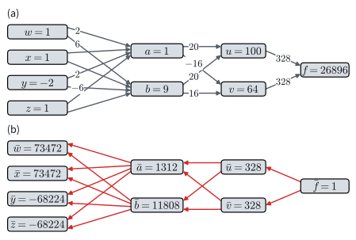
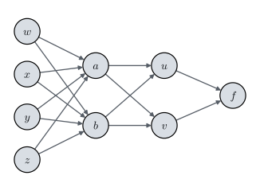
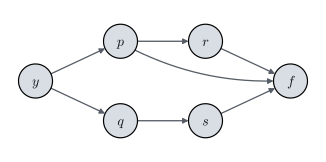

# The Chain Rule on Computational Graphs
:label:`sec_mdl-chain-rule-graphs`

Every training step in this book began with one call, `backward()` or
`grad`, and that one call returned the slope of the loss with respect to
every weight. :numref:`sec_mdl-multivariable_calculus` said what these slopes
mean: together they form the gradient, the vector that predicts the effect
of any small joint move. It did not say how a program finds a million of
them for the price of a few evaluations of the network. The obvious method,
nudging one weight and running the network again, needs one run per weight.

The chain rule does much better, and the reason can be stated before any
algebra. A network is a long composition of simple functions, and the
derivatives with respect to its many weights share most of their work, since
every one of them has to pass through the last layer. A formula for the
composition hides this sharing. A graph shows it: draw a node for each
intermediate value and an edge for each direct dependence. On the graph the
chain rule is a sum over paths, and the shared work becomes a choice of how
to group the sum. If we group the paths from the output backward, one pass
yields the slope with respect to every input. This grouping is
backpropagation.

We work the idea out on graphs of scalars that are small enough to compute
by hand, with integer values throughout, so that every claim can be checked.
The section needs one fact from :numref:`sec_mdl-multivariable_calculus`:
near a point, a differentiable function changes by the dot product of the
step with its gradient, the linear model :eqref:`eq_mdl-nabla_use`. Layers
that map vectors to vectors, and the cost of the method on a real network,
come in the two sections that follow.

```{.python .input #mdl-chain-rule-graphs-the-chain-rule-on-computational-graphs}
#@tab mxnet
import math
import numpy as np
from mxnet import autograd, gluon, init, np as mnp, npx
from mxnet.gluon import nn
from d2l import mxnet as d2l
npx.set_np()
```

```{.python .input #mdl-chain-rule-graphs-the-chain-rule-on-computational-graphs}
#@tab pytorch
import math
import numpy as np
import torch
from torch import nn
from torch.nn import functional as F
from d2l import torch as d2l
```

```{.python .input #mdl-chain-rule-graphs-the-chain-rule-on-computational-graphs}
#@tab tensorflow
import math
import numpy as np
import tensorflow as tf
from d2l import tensorflow as d2l
```

```{.python .input #mdl-chain-rule-graphs-the-chain-rule-on-computational-graphs}
#@tab jax
import math
import numpy as np
import jax
from jax import numpy as jnp
from flax import nnx
import optax
from d2l import jax as d2l
```

## The Chain Rule as a Sum over Paths
:label:`subsec_mdl-chain-rule-paths`

### A Graph of Scalars

Our first example is a toy: four inputs $w, x, y, z$ flow through
intermediate quantities to a scalar output,

$$
\begin{aligned}
f(u, v) & = (u+v)^{2}, \\
u(a, b) & = (a+b)^{2}, \qquad v(a, b) = (a-b)^{2}, \\
a(w, x, y, z) & = (w+x+y+z)^{2}, \qquad b(w, x, y, z) = (w+x-y-z)^2.
\end{aligned}
$$
:eqlabel:`eq_mdl-multi_func_def`

The dependencies form a graph (:numref:`fig_mdl-chain-1`): each node is a
value, and each edge a direct functional dependence. Nothing about the
squares is special; they keep the numbers whole. Throughout the section $f$
denotes the output of the graph at hand.


:label:`fig_mdl-chain-1`

### Two Paths through One Step

Take the last composite step, $f(u(a,b), v(a,b))$, and perturb $a$ by a
small $\epsilon$. Each intermediate moves by its partial derivative,
$u \to u + \epsilon\frac{\partial u}{\partial a}$ and
$v \to v + \epsilon\frac{\partial v}{\partial a}$. Feeding these moves into the
first-order expansion :eqref:`eq_mdl-nabla_use` of $f$ gives

$$
f\!\left(u + \epsilon\tfrac{\partial u}{\partial a},\, v + \epsilon\tfrac{\partial v}{\partial a}\right)
\approx f(u, v) + \epsilon\left[\frac{\partial f}{\partial u}\frac{\partial u}{\partial a} + \frac{\partial f}{\partial v}\frac{\partial v}{\partial a}\right].
$$

The coefficient of $\epsilon$ is the derivative of the composite with respect
to $a$, and the result is the multivariable chain rule,

$$
\frac{\mathrm{d} f}{\mathrm{d} a} = \frac{\partial f}{\partial u}\frac{\partial u}{\partial a} + \frac{\partial f}{\partial v}\frac{\partial v}{\partial a}.
$$

The two kinds of $d$ are deliberate, and this chapter keeps them apart from
here on. The symbol $\partial$ is reserved for the derivative of one node's function with
respect to one of its arguments, the others held fixed. The *total* derivative
$\mathrm{d}f/\mathrm{d}a$ lets everything downstream of $a$ respond. (For an
input, the total is the ordinary partial derivative of $f$ regarded as a
function of the inputs alone.) There are two *paths* by which $a$ influences
$f$, $a \to u \to f$ and $a \to v \to f$. Each path contributes the product of
the derivatives along its edges, and the total is the sum over the paths.

The argument is the one-variable proof of the chain rule again
(:numref:`sec_mdl-derivative_table`): feed the change of the inner functions
into the linear model of the outer one. Note, however, that it feeds two
simultaneous moves into one linear expansion. That needs $f$ to be
*differentiable*, not merely to have partial derivatives. For the
counterexample $2xy/(x^2+y^2)$ of :numref:`subsec_mdl-gradient` along the
line $x = y = t$, the rule would predict derivative $0$ at $t = 0$ from the
two zero partials, yet the function jumps from $0$ to $1$ there.

### Edge Derivatives and Total Derivatives

The rule extends to any graph. Call the *edge derivative* of a node with
respect to one of its parents the partial derivative of the node's function
with respect to that parent, holding its other parents fixed. Then for an
output $f$ and an input $x$,

$$
\frac{\mathrm{d} f}{\mathrm{d} x} = \sum_{\text{directed paths } x \to \cdots \to f} \;\; \prod_{\text{edges on the path}} (\text{edge derivative}).
$$
:eqlabel:`eq_mdl-chain-rule-paths`

Each path multiplies the local rates along its edges, and the paths add. A
graph in which one node feeds the output both directly and through a later
node shows why edge derivatives must be kept apart from totals. Consider

$$
\begin{aligned}
p(x, y) & = x + y, \qquad q(x, y) = x - y, \\
r(p) & = p^2, \qquad s(q) = q^2, \\
f(r, p, s) & = r + p + s.
\end{aligned}
$$
:eqlabel:`eq_mdl-multi_func_def_2`

The output $f$ depends on $r$, on $s$, and also directly on $p$, a skip edge
(:numref:`fig_mdl-chain-2`). The input $y$ reaches $f$ by three paths,
$y \to p \to r \to f$, $y \to p \to f$, and $y \to q \to s \to f$. The edge
derivatives are $\partial f/\partial r = \partial f/\partial p =
\partial f/\partial s = 1$, $\partial r/\partial p = 2p$, $\partial s/\partial q
= 2q$, $\partial p/\partial y = 1$, and $\partial q/\partial y = -1$, so

$$
\frac{\mathrm{d} f}{\mathrm{d} y} = \underbrace{1 \cdot 2p \cdot 1}_{y \to p \to r \to f} + \underbrace{1 \cdot 1}_{y \to p \to f} + \underbrace{1 \cdot 2q \cdot (-1)}_{y \to q \to s \to f} = 2p + 1 - 2q = 1 + 4y.
$$

Direct substitution, $f = (x+y)^2 + (x+y) + (x-y)^2$, confirms the sum
$1 + 4y$. At $(x, y) = (1, 2)$, $p = 3$ and $q = -1$, and the paths contribute
$6 + 1 + 2 = 9 = 1 + 4 \cdot 2$. The *edge* derivative $\partial f/\partial p$ is
$1$, but the *total* derivative $\mathrm{d}f/\mathrm{d}p$, through the skip
edge and through $r$, is $2p + 1 = 7$. Confusing the two is the usual way to
get the multivariable chain rule wrong.


:label:`fig_mdl-chain-2`

The sum over paths is how gradients flow through a network. Architectural
choices that open or close paths, such as the gates of an LSTM
(:numref:`sec_lstm`) or the skip connections of a residual block
(:numref:`sec_resnet`), shape learning by controlling which paths carry
gradient.

## Backpropagation
:label:`subsec_mdl-backpropagation`

As a formula the sum over paths is complete: it gives every derivative of
every graph. As an algorithm it is hopeless, because the number of paths
grows quickly with depth. A chain of $m$ stages with two parallel nodes per
stage already has $2^m$ paths from end to end. Luckily the paths share
edges, and a product that many paths share needs to be computed only once.
The way we group the shared products decides the cost.

### Forward Mode

We compare two groupings on the four-input function
:eqref:`eq_mdl-multi_func_def` at $(w, x, y, z) = (1, 1, -2, 1)$. A
*forward pass* evaluates the nodes in order: $a = 1^2 = 1$, $b = 3^2 = 9$,
$u = 10^2 = 100$, $v = (-8)^2 = 64$, and $f = 164^2 = 26896$. The edge
derivatives at these values are

$$
\begin{aligned}
\frac{\partial f}{\partial u} = \frac{\partial f}{\partial v} &= 2(u+v) = 328, \\
\frac{\partial u}{\partial a} = \frac{\partial u}{\partial b} &= 2(a+b) = 20, \qquad
\frac{\partial v}{\partial a} = 2(a-b) = -16, \qquad \frac{\partial v}{\partial b} = -2(a-b) = 16, \\
\frac{\partial a}{\partial w} = \frac{\partial a}{\partial x} = \frac{\partial a}{\partial y} = \frac{\partial a}{\partial z} &= 2(w+x+y+z) = 2, \\
\frac{\partial b}{\partial w} = \frac{\partial b}{\partial x} = 2(w+x-y-z) &= 6, \qquad \frac{\partial b}{\partial y} = \frac{\partial b}{\partial z} = -6.
\end{aligned}
$$

Every edge derivative is a number we can compute locally, from the values of a
node and its parents.

The four paths from $w$ to $f$ go through $a$ or $b$ and then through $u$ or
$v$. Pushing $w$ forward through the graph collects them as

$$
\begin{aligned}
\frac{\mathrm{d} f}{\mathrm{d} w} &= \frac{\partial f}{\partial u}\Bigl(\frac{\partial u}{\partial a}\frac{\partial a}{\partial w} + \frac{\partial u}{\partial b}\frac{\partial b}{\partial w}\Bigr) + \frac{\partial f}{\partial v}\Bigl(\frac{\partial v}{\partial a}\frac{\partial a}{\partial w} + \frac{\partial v}{\partial b}\frac{\partial b}{\partial w}\Bigr) \\
&= 328\,(20\cdot 2 + 20 \cdot 6) + 328\,(-16 \cdot 2 + 16 \cdot 6) = 328 \cdot 224 = 73472.
\end{aligned}
$$

The bracketed sums are $\mathrm{d}u/\mathrm{d}w = 160$ and
$\mathrm{d}v/\mathrm{d}w = 64$, the total derivatives of the intermediates
with respect to $w$. Carrying the dependence on one input forward through the
graph in this way is called *forward mode*. In plain Python:

```{.python .input #multivariable-calculus-the-backpropagation-algorithm-1}
w, x, y, z = 1, 1, -2, 1
# Forward pass: node values
a, b = (w + x + y + z)**2, (w + x - y - z)**2
u, v = (a + b)**2, (a - b)**2
f = (u + v)**2
print('a, b, u, v, f =', a, b, u, v, f)

# Edge derivatives
df_du, df_dv = 2*(u + v), 2*(u + v)
du_da, du_db, dv_da, dv_db = 2*(a + b), 2*(a + b), 2*(a - b), -2*(a - b)
da_dw, db_dw = 2*(w + x + y + z), 2*(w + x - y - z)

# Forward mode: push the dependence on w through the graph
du_dw, dv_dw = du_da*da_dw + du_db*db_dw, dv_da*da_dw + dv_db*db_dw
df_dw = df_du*du_dw + df_dv*dv_dw
print('df/dw =', df_dw)
```

Forward mode returns $\mathrm{d}f/\mathrm{d}w = 73472$, but nothing in it can
be reused for $x$, $y$, or $z$: $\mathrm{d}u/\mathrm{d}w$ and
$\mathrm{d}v/\mathrm{d}w$ belong to $w$ alone. Training needs the derivative
of one loss with respect to every parameter, and this grouping computes them
one input at a time.

### Adjoints and the Backward Pass

The remedy is to keep the output fixed instead of the input. Forward mode
asked, for one input, how every later node responds to it. We now ask, for
the one output, how it responds to every earlier node. The *adjoint*
$\bar{n}$ of a node $n$ is the total derivative $\mathrm{d}f/\mathrm{d}n$ of
the output with respect to that node: the sum, over all paths from $n$ to
$f$, of the products of the edge derivatives. Every such path leaves $n$
through one of its children $c$, the nodes that use $n$ directly, and the
paths from $c$ onward sum to $\bar{c}$. Grouping the sum
:eqref:`eq_mdl-chain-rule-paths` by this first edge turns it into a
recursion,

$$
\bar{f} = 1, \qquad
\bar{n} = \sum_{\text{children } c \text{ of } n} \bar{c}\,\frac{\partial c}{\partial n},
$$
:eqlabel:`eq_mdl-adjoint`

in which only edge derivatives and the adjoints of later nodes appear.
Starting from $\bar f = 1$ and visiting the nodes from the output backward,
each adjoint is ready when it is needed. In the skip-edge graph
:eqref:`eq_mdl-multi_func_def_2` the recursion gives $\bar r = 1$ and
$\bar p = \bar r \cdot 2p + \bar f \cdot 1 = 7$, the total found there. For
the four-input graph:

* $\bar{u} = \bar{v} = 328$;
* $\bar{a} = \bar{u}\cdot 20 + \bar{v}\cdot(-16) = 1312$ and
  $\bar{b} = \bar{u}\cdot 20 + \bar{v}\cdot 16 = 11808$;
* $\bar{w} = \bar{x} = \bar{a}\cdot 2 + \bar{b}\cdot 6 = 73472$ and
  $\bar{y} = \bar{z} = \bar{a}\cdot 2 - \bar{b}\cdot 6 = -68224$.

One *backward pass* gives the derivatives with respect to all four inputs
(:numref:`fig_mdl-cal-backward-sweep`). The code reuses the edge derivatives
of the forward-mode cell.


:label:`fig_mdl-cal-backward-sweep`

```{.python .input #multivariable-calculus-the-backpropagation-algorithm-2}
da_dy, db_dy = 2*(w + x + y + z), -2*(w + x - y - z)  # also for x, z
# Backward pass: adjoints from the output toward the inputs
u_bar, v_bar = df_du, df_dv
a_bar = u_bar*du_da + v_bar*dv_da
b_bar = u_bar*du_db + v_bar*dv_db
print(f'adjoints: u {u_bar}, v {v_bar}, a {a_bar}, b {b_bar}')
w_bar = a_bar*da_dw + b_bar*db_dw  # x enters a, b like w
y_bar = a_bar*da_dy + b_bar*db_dy  # z enters a, b like y
print('gradient:', {'w': w_bar, 'x': w_bar, 'y': y_bar, 'z': y_bar})
```

The derivatives with respect to $w$ and $x$ agree, and so do those with
respect to $y$ and $z$, because $f$ depends on its inputs only through $w + x$
and $y + z$.

Counting multiplications shows the saving. Forward mode needs six per input
(two each for $\mathrm{d}u/\mathrm{d}w$, $\mathrm{d}v/\mathrm{d}w$, and
$\mathrm{d}f/\mathrm{d}w$), 24 for four inputs. The backward pass needs four
for $\bar a$ and $\bar b$ and then two per input, 12 in all: it does the work
on the shared part of the graph once. A factor of two is nothing to boast
of. But the saving grows with the number of inputs: each further input costs
forward mode a whole pass and the backward pass two multiplications.

### Backpropagation in a Framework

Computing derivatives from the output back toward the inputs is
*backpropagation* :cite:`Rumelhart.Hinton.Williams.ea.1988`, which
:numref:`sec_backprop` applies to a multilayer perceptron. Each framework's
automatic differentiation runs the same two passes: it records values and
edge derivatives on the way forward and accumulates adjoints on the way
back. Here it is on the same four inputs.

```{.python .input #multivariable-calculus-the-backpropagation-algorithm-3}
#@tab mxnet
wxyz = mnp.array([1., 1., -2., 1.])
wxyz.attach_grad()
with autograd.record():
    w, x, y, z = wxyz[0], wxyz[1], wxyz[2], wxyz[3]
    a, b = (w + x + y + z)**2, (w + x - y - z)**2
    u, v = (a + b)**2, (a - b)**2
    f = (u + v)**2
f.backward()  # one backward pass
print(wxyz.grad)
```

```{.python .input #multivariable-calculus-the-backpropagation-algorithm-3}
#@tab pytorch
wxyz = torch.tensor([1., 1., -2., 1.], requires_grad=True)
w, x, y, z = wxyz
a, b = (w + x + y + z)**2, (w + x - y - z)**2
u, v = (a + b)**2, (a - b)**2
f = (u + v)**2
f.backward()  # one backward pass
print(wxyz.grad)
```

```{.python .input #multivariable-calculus-the-backpropagation-algorithm-3}
#@tab tensorflow
wxyz = tf.Variable([1., 1., -2., 1.])
with tf.GradientTape() as t:
    w, x, y, z = tf.unstack(wxyz)
    a, b = (w + x + y + z)**2, (w + x - y - z)**2
    u, v = (a + b)**2, (a - b)**2
    f = (u + v)**2
print(t.gradient(f, wxyz).numpy())  # one backward pass
```

```{.python .input #multivariable-calculus-the-backpropagation-algorithm-3}
#@tab jax
def f_graph(wxyz):
    w, x, y, z = wxyz
    a, b = (w + x + y + z)**2, (w + x - y - z)**2
    u, v = (a + b)**2, (a - b)**2
    return (u + v)**2

print(jax.grad(f_graph)(jnp.array([1., 1., -2., 1.])))  # one backward pass
```

The library returns $(73472, 73472, -68224, -68224)$, the adjoints of our hand
computation. The agreement is exact, not approximate: all the numbers
involved are integers below $2^{24}$, which single precision represents
without rounding.

Every node here was a scalar, and we counted multiplications on a graph that
fits on a napkin. A layer of a network maps a vector to a vector. Its edge
derivatives are matrices, and the order in which matrices are multiplied
matters far more than the order of numbers.
:numref:`sec_mdl-matrix-calculus` takes that step.

## Summary

The derivative of an output with respect to an input is the sum, over the
paths between them, of the products of the edge derivatives. The adjoint of a
node, the total derivative of the output with respect to it, collects all
paths leaving the node. Grouping them by their first edge gives a recursion
that, run from the output backward, yields every adjoint in one pass. This
is backpropagation. Carrying one input forward instead gives that input's
derivative alone, so a loss with many inputs is differentiated backward.

## Exercises

1. [code] **Backward pass for two tanh units.** A network with one input
   $x$, two hidden units, and one output computes, for a target $t$,

   $$h_i = \tanh(w_i x + b_i) \quad (i = 1, 2), \qquad f = v_1 h_1 + v_2 h_2, \qquad \ell = \tfrac12 (f - t)^2.$$

    1. Draw the dependency graph of $\ell$. In plain Python, write a forward
       pass that stores every intermediate value and a backward pass that
       returns the partial derivatives of $\ell$ with respect to all six
       parameters $w_1, b_1, w_2, b_2, v_1, v_2$. Check them against
       automatic differentiation at $x = 1.5$, $t = 0.5$, and
       $(w_1, b_1, w_2, b_2, v_1, v_2) = (0.5, 0, -1, 0.2, 1, -0.5)$.
       Which intermediate derivative does every one of the six partials
       reuse?
    1. Set $w_1 = 5$ and $x = 2$, keeping the other values. Compute
       $\partial \ell / \partial w_1$ with the plain-Python backward pass
       and explain its size from the product of edge derivatives along its
       path. Compare it with the value that automatic differentiation returns
       in single precision, and explain the difference. What does this imply
       for training a unit whose pre-activation is large?
    1. Set $w_1 = w_2$, $b_1 = b_2$, and $v_1 = v_2$. Show from the backward
       pass that both units receive identical gradients, so that gradient
       descent keeps them identical at every step. What does this imply for
       the initialization of hidden units?

1. **Paths through a residual stack.** ● In a one-dimensional model of the
   residual networks of :numref:`sec_resnet`, scalar blocks compute
   $x_{l+1} = x_l + g_l(x_l)$ for $l = 0, \ldots, m-1$ with differentiable
   functions $g_l$.
    1. Use the chain rule to write $\partial x_m / \partial x_0$ as a product
       of $m$ factors.
    1. Expand the product and match each term to a directed path from $x_0$
       to $x_m$ in the dependency graph. How many paths are there, and how
       many of them pass through exactly $k$ of the functions $g_l$? Compare
       the number of paths with the number of multiplications that a
       backward pass needs to compute $\partial x_m / \partial x_0$.
    1. For a trained network of $m = 54$ residual blocks,
       :citet:`Veit.Wilber.Belongie.2016` found that almost all of the
       gradient flows along the paths through $5$ to $17$ blocks. What
       fraction of all paths are these? Now assume that
       $g_l'(x_l) = c > 0$ for every block. Which value of $c$ makes the
       paths through about $11$ blocks contribute the most to
       $\partial x_m / \partial x_0$, and what share of the derivative do the
       paths through $5$ to $17$ blocks then carry?

1. [code] **Gradient checks in single precision.** ● A gradient check
   compares a backward pass with the central difference
   $\bigl(f(w + h, x, y, z) - f(w - h, x, y, z)\bigr) / (2h)$. Let $f$ be the
   function of :eqref:`eq_mdl-multi_func_def`, whose exact partial derivative
   at $(w, x, y, z) = (1, 1, -2, 1)$ is
   $\partial f / \partial w = 73472$.
    1. Implement $f$ in NumPy and compute the central difference at this point
       for $h = 10^{-1}, 10^{-2}, \ldots, 10^{-12}$, once in `float64` and
       once in `float32`. Plot the relative error against $h$ on log-log axes
       for both precisions, and read off the best $h$ and the smallest
       relative error of each.
    1. The error of the central difference is a truncation part of order
       $h^2$ plus a rounding part of order
       $\varepsilon_{\textrm{mach}} |f| / h$, where the machine epsilon
       $\varepsilon_{\textrm{mach}}$ is about $2.2 \times 10^{-16}$ for
       `float64` and $1.2 \times 10^{-7}$ for `float32`. By which factors
       should the best $h$ and the smallest relative error change from
       `float64` to `float32`? Compare the predicted factors with the plot.
    1. Which tolerance on the relative error can a `float32` gradient check
       use without rejecting a correct backward pass? Why are gradient
       checks run in double precision?
    1. Why does the `float32` estimate become exactly zero for the smallest
       values of $h$?
   :exlabel:`ex_mdl-multivariable-calculus-gradient-check`

[Discussions](https://d2l.discourse.group/t/36877)

<!-- slides -->

::: {.slide}
::: {.cover}
[Dive into Deep Learning · §25.2]{.kicker}

The Chain Rule on Computational Graphs<br>
**edge and total derivatives · sum over paths · one backward pass**
:::
:::

::: {.slide title="One Call Returns Every Slope of the Loss"}
[The problem]{.kicker}

`backward()` returns the slope of one loss with respect to every weight.

- Nudging one weight and rerunning the network: one run per weight.
- Yet the slopes share most of their work: each passes through the last layer.
- A formula hides the sharing. A graph of the computation shows it.

::: {.d2l-note .warn}
On the graph the chain rule is a sum over paths. How should the sum be
grouped so that shared work is done once?
:::
:::

::: {.slide title="By the End of This Deck You Can"}
[Goals]{.kicker}

- tell an edge derivative from a total derivative;
- write the derivative of a graph as a sum over its paths;
- carry one input forward, or one output backward, through a graph by hand;
- say why a loss with many inputs is differentiated backward.

**Running example:** $f = (u+v)^2$ on four inputs $w, x, y, z$, all values integers.

**The idea:** group the paths by their first edge, starting from the output.
:::

::: {.slide title="From One Gradient to an Algorithm"}
[Where this fits]{.kicker}

::: {.cols .vc}
::: {.col}
| section | adds |
|---|---|
| Single Variable Calculus | derivative, Taylor, corners |
| Multivariable Calculus | gradient, Hessian, critical points |
| **The Chain Rule on Computational Graphs** | **sum over paths, backward pass** |
| Matrix Calculus | Jacobians, a layer's backward rule |
| Automatic Differentiation | forward and reverse mode |
| Integral Calculus | areas, change of variables, the Gaussian integral |
| Expectations and Their Gradients | score-function and pathwise estimators |
:::

::: {.col .narrow}
- **Uses:** the linear model of a differentiable function.
- **Scope:** scalar nodes; layers come next.
:::
:::
:::

::: {.slide title="A Nudge Reaches the Output along Every Path"}
::: {.cols .vc}
::: {.col}
$f(u(a,b), v(a,b))$: nudge $a$ by $\epsilon$, and both $u$ and $v$ move.

$$\frac{\mathrm{d} f}{\mathrm{d} a} = \frac{\partial f}{\partial u}\frac{\partial u}{\partial a} + \frac{\partial f}{\partial v}\frac{\partial v}{\partial a}$$

- $\partial$: one node's function, one argument, the others fixed (an *edge*).
- $\mathrm{d}$: everything downstream responds (the *total*).
- Two paths, $a \to u \to f$ and $a \to v \to f$: multiply along, add across.
:::

::: {.col .fig .big}

:::
:::
:::

::: {.slide title="The Chain Rule Sums Products over Paths"}
::: {.cols .vc}
::: {.col}
$$\frac{\mathrm{d} f}{\mathrm{d} x} = \sum_{\text{paths } x \to f}\ \prod_{\text{edges}} (\text{edge derivative})$$

$p = x + y$, $q = x - y$, $r = p^2$, $s = q^2$, $f = r + p + s$.

- Three paths from $y$: $2p\cdot 1 + 1 + 2q\cdot(-1) = 1 + 4y$.
- Edge derivative $\partial f/\partial p = 1$; total $\mathrm{d}f/\mathrm{d}p = 2p + 1$.

::: {.d2l-note}
Requires $f$ to be differentiable, not only to have partials.
:::
:::

::: {.col .fig .big}

:::
:::
:::

::: {.slide title="Forward Mode Carries One Input through the Graph"}
$f = (u+v)^2$, $u = (a+b)^2$, $v = (a-b)^2$, $a = (w+x+y+z)^2$, $b = (w+x-y-z)^2$
at $(1, 1, -2, 1)$:

@!multivariable-calculus-the-backpropagation-algorithm-1

- $328\,(20\cdot 2 + 20\cdot 6) + 328\,(-16\cdot 2 + 16\cdot 6) = 73472$.
- 6 multiplications per input; nothing is reused for $x, y, z$.
:::

::: {.slide title="One Backward Pass Gives All Four Partials"}
::: {.cols .vc}
::: {.col}
Adjoint $\bar n = \mathrm{d}f/\mathrm{d}n$, the total derivative of the output. Group the paths by their first edge:

$$\bar f = 1, \qquad \bar n = \sum_{\text{children } c}\bar c\,\frac{\partial c}{\partial n}$$

- $\bar u = \bar v = 328$; $\bar a = 1312$, $\bar b = 11808$.
- 12 multiplications instead of 24.
- $N$ inputs: one backward pass instead of $N$ forward ones.
:::

::: {.col .fig .big}

:::
:::
:::

::: {.slide title="Check: Input Gradients from Two Adjoints"}
[Check]{.kicker}

With $\bar a = 1312$, $\bar b = 11808$, $\partial a/\partial(\cdot) = 2$,
and $\partial b/\partial w = 6$, $\partial b/\partial y = -6$: what are
the adjoints $\bar w$ and $\bar y$?

::: {.fragment .fade-up}
::: {.d2l-note}
**Answer.** $1312\cdot 2 + 11808\cdot 6 = 73472$ and
$1312\cdot 2 - 11808\cdot 6 = -68224$. The sign flips because $y$ enters
$b = (w+x-y-z)^2$ with a minus.
:::
:::
:::

::: {.slide title="Autograd Runs the Same Backward Pass"}
@multivariable-calculus-the-backpropagation-algorithm-3

- The forward pass records values and edge derivatives; the backward pass accumulates adjoints.
- The result equals the hand computation exactly: integers below $2^{24}$.
- This is backpropagation.
:::

::: {.slide title="Recap: Sum over Paths, Grouped from the Output"}
[Wrap-up]{.kicker}

- Total derivative = sum over paths of products of edge derivatives.
- Edge $\partial f/\partial p = 1$, total $\mathrm{d}f/\mathrm{d}p = 2p + 1 = 7$ on the skip-edge graph.
- Forward mode: one input per pass, $24$ multiplications for four inputs.
- Backward pass: every adjoint in one pass, $12$ multiplications; $\bar w = 73472$, $\bar y = -68224$.
- One output and many inputs: go backward.

::: {.d2l-note}
Next: a layer maps a vector to a vector, so its edge derivatives are
matrices, and the order of multiplication decides the cost.
:::
:::
