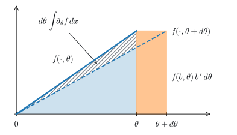

# Expectations and Their Gradients
:label:`sec_mdl-expectation-gradients`

Almost every loss we have minimized so far is an average: over a minibatch of
examples, over random dropout masks, or over noise injected into an input. As
long as the source of randomness does not depend on the model parameters,
differentiating such an average is straightforward. The derivative of an
average equals the average of the derivatives, so minibatch gradient descent
computes it directly without any extra machinery. The difficulty arises when
the parameters control the probability distribution itself. A variational
autoencoder draws its latent code from a distribution whose mean and variance
are produced by its encoder; a policy-gradient agent
(:numref:`sec_policygradient`) samples actions from the very policy it is
trying to improve. In both cases, the objective is an expectation over samples
whose distribution shifts with the parameters, yet a sample, once drawn, is
just a number. It carries no memory of the parameter that generated it.

Consider the simplest problem of this kind. Let $X\sim\mathcal N(\theta,1)$ be
a normal random variable with mean $\theta$ and unit variance, and take the
expected squared loss

$$
\ell(\theta)=\mathbb{E}\bigl[X^2\bigr]=\theta^2+1 .
$$

The closed form follows immediately by writing $X=\theta+Z$ with $Z$ standard
normal:
$\mathbb{E}[(\theta+Z)^2]=\theta^2+2\theta\,\mathbb{E}[Z]+\mathbb{E}[Z^2]$,
where $\mathbb{E}[Z]=0$ by symmetry and $\mathbb{E}[Z^2]=1$
(:numref:`subsec_mdl-integration-by-parts`). At $\theta=1.5$, the exact
derivative is $\ell'(1.5)=3$. In practice, however, a model can draw samples of
$X$ but cannot evaluate $\ell(\theta)$ in closed form. How, then, can we
estimate $\ell'(\theta)$ from samples alone?

Calculus offers two fundamentally different answers. Both express the
expectation as an integral (:numref:`sec_mdl-integral_calculus`) and pass the
derivative inside it. From there they diverge: the *score-function* estimator
differentiates the probability density while leaving the samples untouched,
whereas the *pathwise* estimator differentiates the samples while leaving the
noise density untouched. Neither method dominates in every setting, and
comparing them (:numref:`subsec_mdl-stochastic-gradient-estimators`) is the
central goal of this section. First, we briefly recall how expectations are
written as integrals and establish when passing a derivative inside an integral
is valid, because that step is where subtle errors can creep in.

```{.python .input #mdl-expectation-gradients-expectations-and-their-gradients}
#@tab mxnet
import math
import numpy as np
from mxnet import autograd, gluon, init, np as mnp, npx
from mxnet.gluon import nn
from d2l import mxnet as d2l
npx.set_np()
```

```{.python .input #mdl-expectation-gradients-expectations-and-their-gradients}
#@tab pytorch
import math
import numpy as np
import torch
from torch import nn
from torch.nn import functional as F
from d2l import torch as d2l
```

```{.python .input #mdl-expectation-gradients-expectations-and-their-gradients}
#@tab tensorflow
import math
import numpy as np
import tensorflow as tf
from d2l import tensorflow as d2l
```

```{.python .input #mdl-expectation-gradients-expectations-and-their-gradients}
#@tab jax
import math
import numpy as np
import jax
from jax import numpy as jnp
from flax import nnx
import optax
from d2l import jax as d2l
```

## Expectations as Integrals
:label:`subsec_mdl-integration-in-probability`

Before differentiating anything, let us fix our notation for densities and
expectations. The probability chapter develops both notions in detail
(:numref:`sec_mdl-random_variables`); here we restate them in the integral
language of the preceding section. A probability **density** on a domain
$\mathcal X$ is a nonnegative function whose total integral equals $1$:

$$
p(x)\ge 0, \qquad \int_{\mathcal X} p(x)\,dx = 1 .
$$
:eqlabel:`eq_mdl-density`

The probability that a random variable $X$ with density $p$ lands in an
interval $[a, b]$ is the area under $p$ over that interval,
$P(a\le X\le b)=\int_a^b p(x)\,dx$ (:eqref:`eq_mdl-pdf_int_int`). Because a
density measures probability per unit length rather than probability itself,
its value can exceed $1$; for example, the uniform density on $[0,\tfrac12]$
equals $2$ everywhere on its support. Our main running example is the
**standard normal** distribution $\mathcal N(0,1)$, whose density
$p(z)=e^{-z^2/2}/\sqrt{2\pi}$ is normalized by the Gaussian integral of
:numref:`sec_mdl-integral_calculus`.

An **expectation** computes the weighted average of $X$, or of a function
$g(X)$, weighting each outcome by its probability density:

$$
\mathbb{E}[X] = \int_{\mathcal X} x\,p(x)\,dx,
\qquad
\mathbb{E}[g(X)] = \int_{\mathcal X} g(x)\,p(x)\,dx .
$$
:eqlabel:`eq_mdl-expectation`

The expectation $\mathbb{E}[g(X)]$ is well defined whenever the integral
converges absolutely, $\int_{\mathcal X}|g(x)|\,p(x)\,dx<\infty$. Heavy-tailed
distributions can violate this condition; the Cauchy density in exercise
:exref:`ex_mdl-integral-calculus-heavy-tails`, for instance, has no finite
mean.

In deep learning, expectations rarely have closed-form expressions, and they
often live in thousands of dimensions where numerical quadrature on a grid is
out of the question. Instead, we draw independent samples $x_1,\ldots,x_n$ from
$p$ and form the sample average $\frac1n\sum_{i=1}^n g(x_i)$, known as the
*Monte Carlo* estimate. If a single sample $g(X)$ has standard deviation
$\sigma$, the Monte Carlo average has root-mean-square error $\sigma/\sqrt n$,
regardless of the dimension (:numref:`subsec_mdl-monte-carlo`). Both gradient
estimators in this section are Monte Carlo averages of this form. Because both
are unbiased for the same true gradient, they differ only in the spread of a
single sample, making the single-sample standard deviation $\sigma$ the natural
yardstick for comparing them.

## Differentiation under the Integral Sign

### The Swap

Our toy loss $\ell(\theta)=\mathbb{E}[X^2]$ is an integral that varies with a
parameter $\theta$. In general, a parameter can affect an integral in two
places: through the limits of integration, which the fundamental theorem of
calculus :eqref:`eq_mdl-ftc` handles, or through the integrand itself.

When the limits of integration are fixed and only the integrand depends on
$\theta$, we differentiate by passing the derivative inside the integral:

$$
\frac{d}{d\theta} \int f(x, \theta)\,dx
= \int \frac{\partial f}{\partial\theta}(x, \theta)\,dx .
$$
:eqlabel:`eq_mdl-diff-under-integral`

Geometrically, the rate of change of the total area equals the integral of the
pointwise rate of change of the height. We will refer to this exchange of
derivative and integral as the *swap*; both gradient estimators depend on it.
At first glance the identity looks harmless, since a derivative is a limit of
difference quotients, an integral is a limit of sums, and finite sums and
differences always commute. Yet exchanging two limits is never automatic and
requires regularity conditions. On a bounded interval of $x$, continuity of
$\partial_\theta f$ in both variables is enough. On an unbounded domain, we
also need an integrable function of $x$ that dominates
$|\partial_\theta f(x,\theta')|$ for all $\theta'$ near $\theta$ (an immediate
consequence of the dominated convergence theorem, quoted without proof from
:cite:`Folland.1999`). For our running example $f(x,\theta)=x^2p_\theta(x)$
with a normal density, such a dominating bound always exists because the
Gaussian tail decays faster than any polynomial grows.

### The Leibniz Rule

When the limits of integration also move with $\theta$, the plain swap is
incomplete and gives the wrong answer. The Leibniz rule supplies the missing
boundary terms: the interior change and the sweeping boundaries simply add
(:numref:`fig_mdl-leibniz-boundary`).

**Proposition (Leibniz rule).** *Let $f$ and $\partial_\theta f$ be continuous
on a region containing $\{(x,\theta):x\in[a(\theta),b(\theta)]\}$ for $\theta$
in an open interval, and let $a$ and $b$ be differentiable. Then*

$$
\frac{d}{d\theta} \int_{a(\theta)}^{b(\theta)} f(x, \theta)\,dx
= \int_{a(\theta)}^{b(\theta)} \frac{\partial f}{\partial\theta}(x,\theta)\,dx
+ f\bigl(b(\theta), \theta\bigr)\,b'(\theta)
- f\bigl(a(\theta), \theta\bigr)\,a'(\theta) .
$$
:eqlabel:`eq_mdl-leibniz`

**Proof.** Define $H(\alpha,\beta,\theta)=\int_\alpha^\beta f(x,\theta)\,dx$.
By the fundamental theorem of calculus, $\partial_\beta H=f(\beta,\theta)$ and
$\partial_\alpha H=-f(\alpha,\theta)$, while the swap on the bounded interval
$[\alpha,\beta]$ gives $\partial_\theta H=\int_\alpha^\beta\partial_\theta f\,dx$.
Since all three partial derivatives are continuous, the multivariable chain
rule (:numref:`sec_mdl-chain-rule-graphs`) applies to the composition
$\theta\mapsto H(a(\theta),b(\theta),\theta)$ and combines the three terms
weighted by $a'(\theta)$, $b'(\theta)$, and $1$. $\blacksquare$

![The Leibniz rule for $f(x,\theta)=x/\theta$ on $[0,\theta]$, the uniform example. When $\theta$ increases by $d\theta$, the integrand curve shifts to $f(\cdot,\theta+d\theta)$ (dashed; here it drops, so the hatched region represents lost area), while the right boundary moves outward and sweeps in a strip of height $f(b,\theta)$ and width $b'\,d\theta$.](../img/mdl-cal-leibniz-boundary.svg)
:label:`fig_mdl-leibniz-boundary`

Ignoring the boundary term is not a minor inaccuracy; it can flip the sign of
the derivative. Suppose $X$ is uniform on $[0,\theta]$, with density $1/\theta$
on that interval. Its mean is
$\mathbb{E}[X]=\int_0^\theta\frac x\theta\,dx=\frac\theta2$, whose derivative
is $+\tfrac12$. Differentiating only the integrand gives
$\int_0^\theta-\frac{x}{\theta^2}\,dx=-\tfrac12$, which has the wrong sign.
Adding the upper boundary contribution
$f(\theta,\theta)\,b'(\theta)=\frac\theta\theta\cdot1=1$ restores the true
derivative, $-\tfrac12+1=+\tfrac12$. Whenever the support of a distribution
depends on the parameter, the plain swap alone is not valid (exercise
:exref:`ex_mdl-integral-calculus-moving-support` works out $\mathbb{E}[X^2]$).

### Log-Integral-Exp

The swap also produces the continuous counterpart of the log-sum-exp function.
Applying the chain rule and :eqref:`eq_mdl-diff-under-integral` to
$\log\int e^{\theta x}p(x)\,dx$ yields

$$
\frac{d}{d\theta}\log\int e^{\theta x}p(x)\,dx=\frac{\int x\,e^{\theta x}p(x)\,dx}{\int e^{\theta x}p(x)\,dx}.
$$

The right-hand side is the mean of $x$ under the exponentially *tilted* density
proportional to $e^{\theta x}p(x)$. For the standard normal density, completing
the square via $\theta z-\tfrac12z^2=\tfrac12\theta^2-\tfrac12(z-\theta)^2$
shows that the tilted density is $\mathcal N(\theta,1)$ and that
$\log\mathbb{E}[e^{\theta Z}]=\theta^2/2$, whose derivative $\theta$ is indeed
the tilted mean. Just as the gradient of log-sum-exp is the softmax vector, the
gradient of log-integral-exp is an expectation. We will encounter this identity
again as the derivative $A'(\eta)$ of the log-partition function in
:numref:`sec_mdl-exponential-family`.

## Score-Function and Pathwise Gradients
:label:`subsec_mdl-stochastic-gradient-estimators`

Applying the swap to an expected loss gives the integral
$\int g(x)\,\partial_\theta p_\theta(x)\,dx$. Unfortunately, we cannot estimate
this integral directly by Monte Carlo sampling: $\partial_\theta p_\theta$ is
not a probability density (it takes both positive and negative values and
integrates to zero), so we cannot draw samples from it. Two simple identities
rewrite this integral back into an expectation that samples can estimate.

### The Score-Function Estimator

Let $p_{\boldsymbol\theta}$ be a density parameterized by
$\boldsymbol\theta$. Applying the chain rule to $\log p_{\boldsymbol\theta}(x)$
yields the **log-derivative identity**:

$$
\nabla_{\boldsymbol\theta}\,p_{\boldsymbol\theta}(x)=p_{\boldsymbol\theta}(x)\,\nabla_{\boldsymbol\theta}\log p_{\boldsymbol\theta}(x).
$$
:eqlabel:`eq_mdl-log-derivative`

In words, the gradient of a density equals the density itself multiplied by the
gradient of its logarithm, a vector known as the **score**
$\nabla_{\boldsymbol\theta}\log p_{\boldsymbol\theta}$. Whenever the swap is
valid and the support of $p_{\boldsymbol\theta}$ does not move with
$\boldsymbol\theta$, the score has expectation zero:
$\mathbb{E}[\nabla_{\boldsymbol\theta}\log p_{\boldsymbol\theta}(X)]=\int\nabla_{\boldsymbol\theta}p_{\boldsymbol\theta}\,dx=\nabla_{\boldsymbol\theta}\int p_{\boldsymbol\theta}\,dx=\nabla_{\boldsymbol\theta}1=\mathbf 0$.
The uniform density on $[0,\theta]$ shows why fixed support is essential: its
score is $\partial_\theta\log(1/\theta)=-1/\theta$, whose expectation is
$-1/\theta\ne0$, because differentiating $\int_0^\theta p_\theta(x)\,dx=1$ also
picks up the boundary term $p_\theta(\theta)=1/\theta$. The mean-zero property
of the score is also the starting point for Fisher information
(:numref:`sec_mdl-maximum_likelihood`).

Multiplying :eqref:`eq_mdl-log-derivative` by a function $g(x)$ that does not
depend on $\boldsymbol\theta$ and integrating gives the **score-function
identity**:

$$
\nabla_{\boldsymbol{\theta}}\,\mathbb{E}_{X\sim p_{\boldsymbol{\theta}}}[g(X)]
=\int g(x)\,\nabla_{\boldsymbol\theta}p_{\boldsymbol\theta}(x)\,dx
= \mathbb{E}\bigl[g(X)\,\nabla_{\boldsymbol{\theta}}\log
p_{\boldsymbol{\theta}}(X)\bigr].
$$
:eqlabel:`eq_mdl-score-function-gradient`

This identity turns the gradient of an expected loss back into an expectation
under $p_{\boldsymbol\theta}$: each sample's loss $g(x)$ is weighted by how
strongly $\boldsymbol\theta$ increases that sample's log-probability. To
estimate it by Monte Carlo, we draw samples $x_i\sim p_{\boldsymbol\theta}$ and
average $g(x_i)\nabla_{\boldsymbol\theta}\log p_{\boldsymbol\theta}(x_i)$. In
reinforcement learning, this is the REINFORCE estimator of policy-gradient
methods :cite:`Williams.1992`. (If $g$ also depends directly on
$\boldsymbol\theta$, the product rule simply adds the term
$\mathbb{E}[\nabla_{\boldsymbol\theta}g(X,\boldsymbol\theta)]$.)

Because the score has mean zero, we may subtract any constant **baseline** $b$
(independent of $x$) from $g(X)$ without biasing the estimator:
$\mathbb{E}[(g(X)-b)\nabla_{\boldsymbol\theta}\log p_{\boldsymbol\theta}(X)]=\mathbb{E}[g(X)\nabla_{\boldsymbol\theta}\log p_{\boldsymbol\theta}(X)]$.
Choosing $b$ well can substantially reduce the variance of the estimate.

### The Pathwise Estimator

The second identity restores the sample's memory of $\boldsymbol\theta$. Often,
a sample from $p_{\boldsymbol\theta}$ can be generated by applying a
deterministic transformation $x=T_{\boldsymbol\theta}(\mathbf z)$ to an
auxiliary noise variable $\mathbf z\sim q$ whose distribution does not depend
on $\boldsymbol\theta$. A normal random variable $\mathcal N(\mu,\sigma^2)$,
for instance, is simply $\mu+\sigma z$ with $z\sim\mathcal N(0,1)$. Rewriting
the expectation as an integral over $\mathbf z$ removes $\boldsymbol\theta$
from the density entirely, so the swap yields the **pathwise identity**:

$$
\nabla_{\boldsymbol\theta}\,
\mathbb{E}_{X\sim p_{\boldsymbol\theta}}[g(X)]
=\nabla_{\boldsymbol\theta}\int g\bigl(T_{\boldsymbol\theta}(\mathbf z)\bigr)\,q(\mathbf z)\,d\mathbf z
=\mathbb{E}_{\mathbf z\sim q}
\Bigl[\nabla_{\boldsymbol\theta}\,
 g\bigl(T_{\boldsymbol\theta}(\mathbf z)\bigr)\Bigr].
$$
:eqlabel:`eq_mdl-pathwise-gradient`

Instead of differentiating the density, this estimator differentiates right
through the sample: automatic differentiation traces the path from
$\boldsymbol\theta$ through $T_{\boldsymbol\theta}$ into $g$. Known as the
*reparameterization trick*, this is how variational autoencoders backpropagate
through Gaussian latent variables :cite:`Kingma.Welling.2014`. Valid use
requires $T_{\boldsymbol\theta}$ to be differentiable in $\boldsymbol\theta$,
$g$ to be differentiable along the path (a Lipschitz $g$ suffices when $X$ has
a continuous density), and an integrable dominating bound for the swap. Notice
that no boundary term ever appears, even if the support of $X$ moves with
$\boldsymbol\theta$, because the integral is taken over $\mathbf z$ whose
density $q$ stays fixed.

The differentiability requirement on $g$ is not a technicality we can ignore.
Consider the step function $g(x)=\mathbf{1}(x>0)$, which equals $1$ for
positive $x$ and $0$ otherwise, with $X=\theta+z$. The true expectation
$\mathbb{E}[g(X)]=P(z>-\theta)$ has derivative
$\varphi(\theta)=e^{-\theta^2/2}/\sqrt{2\pi}$, which evaluates to about $0.13$
at $\theta=1.5$. Yet the pathwise sample $\partial_\theta\mathbf{1}(\theta+z>0)$
is $0$ for every $z$ except the single point $z=-\theta$ (an event of
probability zero), so the pathwise estimator returns $0$ with probability $1$.
By contrast, the score-function sample $\mathbf{1}(x>0)\,z$ has expectation
$\int_{-\theta}^\infty z\,\varphi(z)\,dz=\bigl[-\varphi(z)\bigr]_{-\theta}^\infty=\varphi(\theta)$,
recovering the exact derivative. Because the score-function estimator never
differentiates through $g$ or the sampling step, it applies equally well to
discontinuous losses and to discrete distributions such as Bernoulli or
categorical choices, where no differentiable path from $\boldsymbol\theta$ to
the sample exists.

### The Two Estimators Compared

We now have two unbiased estimators of the same derivative, and our running
example $\ell(\theta)=\mathbb{E}[X^2]$ with $X=\theta+z$ is simple enough to
compute the variance of both by hand. For the pathwise estimator, a single
sample contributes $\partial_\theta(\theta+z)^2 = 2X$, whose variance is
$\textrm{Var}(2X)=4$. For the score-function estimator, the score of the normal
location family is $\partial_\theta\log p_\theta(X)=X-\theta=z$, so one sample
contributes $X^2z$, or $(X^2-b)z$ when using a baseline $b$. To find the
variance of $X^2z$, we use the standard normal moments $\mathbb{E}[z^2]=1$,
$\mathbb{E}[z^4]=3$, and $\mathbb{E}[z^6]=15$, all of which follow from Stein's
identity $\mathbb{E}[g'(Z)]=\mathbb{E}[Z\,g(Z)]$
(:numref:`subsec_mdl-integration-by-parts`). By symmetry, all odd powers of $z$
vanish in the second moment:

$$
\mathbb{E}\bigl[(\theta+z)^4z^2\bigr]=\theta^4\,\mathbb{E}[z^2]+6\theta^2\,\mathbb{E}[z^4]+\mathbb{E}[z^6]=\theta^4+18\theta^2+15.
$$

Subtracting the squared mean $(2\theta)^2$ leaves a variance of
$\theta^4+14\theta^2+15$. The variance-minimizing constant baseline turns out
to be $b^\star=\theta^2+3$, reducing the variance to $8\theta^2+6$ (exercise
:exref:`ex_mdl-integral-calculus-quartic-estimators`). At $\theta=1.5$, the
three single-sample standard deviations are $2$ for the pathwise estimator,
$7.18$ for the plain score-function estimator, and $4.90$ for the
score-function estimator with the optimal baseline. Although the baseline
helps noticeably, it cannot close the gap for this loss, since $8\theta^2+6>4$
for every $\theta$.

Let us test all three closed-form predictions in a single Monte Carlo
simulation. Because the pathwise derivative is simply $2x_i$, we do not even
need automatic differentiation here. If our algebra is right, the three sample
standard deviations should land near $2$, $7.18$, and $4.90$, and each sample
mean should fall within a few standard errors $\mathrm{sd}/\sqrt n$ of the
true derivative $3$.

```{.python .input #mdl-integral-calculus-score-function-and-pathwise-gradients-1}
theta, n = 1.5, 200_000
z = np.random.default_rng().standard_normal(n)     # noise, independent of theta
x = theta + z                                      # samples of N(theta, 1)
pathwise = 2 * x                                   # d/dtheta (theta + z_i)^2
score = x**2 * z                                   # g(x) times the score x - theta
baseline = (x**2 - (theta**2 + 3)) * z             # with the optimal baseline
exact_sd = {'pathwise': 2, 'score': math.sqrt(theta**4 + 14 * theta**2 + 15),
            'score+baseline': math.sqrt(8 * theta**2 + 6)}
print(f'true derivative 2*theta = {2 * theta}')
for name, s in zip(exact_sd, [pathwise, score, baseline]):
    print(f'{name:15s} mean={s.mean():.4f}  sd={s.std():.3f} '
          f'(exact {exact_sd[name]:.3f})  se={s.std() / math.sqrt(n):.4f}')
```

In typical runs, all three means lie within a couple of standard errors of $3$,
and the empirical standard deviations match the closed-form predictions to
within a few percent. For a fixed sample budget, the pathwise estimate is about
$3.6$ times more accurate than the plain score-function estimate; equivalently,
the plain score-function estimator needs roughly thirteen times as many samples
to reach the same precision.

It would be a mistake, however, to conclude that the pathwise estimator always
has lower variance. Consider an oscillating loss $g(x)=\sin(\omega x)$, for
which the true derivative of the expectation is
$\omega\cos(\omega\theta)e^{-\omega^2/2}$. The pathwise sample
$\omega\cos(\omega X)$ scales with the frequency $\omega$ and has standard
deviation close to $\omega/\sqrt2$, whereas the score-function sample
$\sin(\omega X)\,z$ has standard deviation at most
$\sqrt{\mathbb{E}[z^2]}=1$ because $|\sin|\le1$. Whenever an integrand
oscillates rapidly, its derivative can be huge even while its values remain
bounded. Let us compare the two estimators at $\omega=1$ and $\omega=3$,
reusing the samples already drawn.

```{.python .input #integral-score-wins}
for omega in [1, 3]:
    true = omega * math.cos(omega * theta) * math.exp(-omega**2 / 2)
    path, score = omega * np.cos(omega * x), np.sin(omega * x) * z
    print(f'omega={omega}  true={true:+.4f}  pathwise {path.mean():+.4f} '
          f'(sd {path.std():.2f})  score {score.mean():+.4f} (sd {score.std():.2f})')
```

Even at $\omega=1$, the score-function estimator already has the smaller spread
(about $0.5$ versus $0.7$), and at $\omega=3$ it wins by a factor of three
(about $0.7$ versus $2.1$). Both sample means agree with the exact derivatives
within a few standard errors.

Neither estimator dominates in every problem. The pathwise estimator
differentiates $g$, so its variance grows whenever $g'$ is large; the
score-function estimator multiplies $g$ by the score, so its variance grows
whenever $g$ itself is large. In both cases, the single-sample standard
deviation $\sigma$ governs how many samples are needed for a given accuracy.
Because $\sigma$ also depends on the distribution from which we draw samples,
choosing a proposal distribution that makes $\sigma$ small leads directly to
importance sampling, which we take up in :numref:`sec_mdl-bayesian-computation`.

## Summary

When a model's parameters govern the distribution of its samples, the gradient
of an expected loss must be rewritten as an expectation before Monte Carlo
sampling can estimate it. Both ways of doing so pass the derivative inside the
integral, a step that requires an integrable dominating bound and, whenever the
limits of integration move with the parameter, the boundary terms of the
Leibniz rule. The score-function identity differentiates the log-density; it
works for arbitrary losses $g$ and discrete random variables, though its
samples scale with the magnitude of $g$ and can be noisy without a good
baseline. The pathwise identity differentiates through a reparameterized
sample; it requires a differentiable $g$ and often, though not always, achieves
much lower variance. Because both estimators have root-mean-square error
$\sigma/\sqrt n$ (:numref:`subsec_mdl-monte-carlo`), the single-sample standard
deviation $\sigma$ decides which one is preferable for a given problem.

## Exercises

1. **A moving support.** Let $X$ be uniform on $[0,\theta]$ with
   $\theta>0$, so that
   $\ell(\theta)=\mathbb{E}[X^2]=\int_0^\theta \tfrac{x^2}{\theta}\,dx=\tfrac{\theta^2}{3}$
   and $\ell'(\theta)=\tfrac{2\theta}{3}$.
    1. Differentiate $\ell$ with the Leibniz rule :eqref:`eq_mdl-leibniz`.
       Which part of the result does the plain swap
       :eqref:`eq_mdl-diff-under-integral` produce, and which part does it
       miss?
    1. On the support, $\log p_\theta(x)=-\log\theta$. Compute the
       expectation of the score-function estimator
       $X^2\,\partial_\theta\log p_\theta(X)$
       of :eqref:`eq_mdl-score-function-gradient`. Then let $g$ be continuous
       on $[0,\infty)$. Show that the mean of
       $g(X)\,\partial_\theta\log p_\theta(X)$ equals the plain swap
       :eqref:`eq_mdl-diff-under-integral` applied to
       $\mathbb{E}[g(X)]=\int_0^\theta g(x)\,p_\theta(x)\,dx$. What is its
       bias as an estimate of $\frac{d}{d\theta}\mathbb{E}[g(X)]$, in terms
       of $g(\theta)$ and $\theta$?
    1. Write $X=\theta U$ with $U$ uniform on $[0,1]$ and compute the
       expectation of the pathwise estimator
       of :eqref:`eq_mdl-pathwise-gradient`. Why does it need no boundary term,
       although the support of $X$ moves with $\theta$?
   :exlabel:`ex_mdl-integral-calculus-moving-support`

1. [code] **Estimator variance for a quartic.** ● Let
   $X\sim\mathcal N(\theta,1)$, write $X=\theta+z$, and let
   $s(X)=\partial_\theta\log p_\theta(X)=z$ be the score.
    1. Take $g(X)=X^4$, so that
       $\frac{d}{d\theta}\mathbb{E}[X^4]=4\theta^3+12\theta$. Derive the
       single-sample pathwise estimator from
       :eqref:`eq_mdl-pathwise-gradient` and the single-sample score-function
       estimator from :eqref:`eq_mdl-score-function-gradient`. Use the
       identity of exercise
       :exref:`ex_mdl-integral-calculus-gaussian-normalizers` (b) to show
       that both have mean $4\theta^3+12\theta$.
    1. For a constant baseline $b$, show that the variance of
       $(g(X)-b)\,s(X)$ is minimized by
       $b^\star=\mathbb{E}[g(X)s(X)^2]/\mathbb{E}[s(X)^2]$. For $g(X)=X^2$ show
       that $b^\star=\theta^2+3$, and use $\mathbb{E}[z^2]=1$,
       $\mathbb{E}[z^4]=3$, $\mathbb{E}[z^6]=15$ to derive the three variances
       $4$, $\theta^4+14\theta^2+15$ and $8\theta^2+6$ that the text quotes.
    1. Evaluate $b^\star$ for $g(X)=X^4$. With $10^6$ samples at
       $\theta\in\{0,1,2\}$, estimate the standard deviations of the
       pathwise estimator, the score-function estimator, and the
       score-function estimator with the baseline. For which $\theta$ is the
       baseline's gain largest, and does it ever close the gap to the
       pathwise estimator? Explain the ordering from the sizes of $g'$ and
       of $g$.
    1. Take $g(x)=\mathbf{1}(x>0)$ at $\theta=1.5$. The text shows that the
       pathwise estimator is $0$ for almost every sample, while the
       score-function estimator $\mathbf{1}(x>0)\,z$ has the correct mean
       $\varphi(\theta)=0.1295$. Verify both by simulation.
   :exlabel:`ex_mdl-integral-calculus-quartic-estimators`

1. [extended] **Gradients through a coin flip.** ●● When $x$ is a discrete
   choice there is no differentiable path from $\theta$ to the sample, so
   the pathwise estimator does not exist. Continuous relaxations such as
   Gumbel-softmax :cite:`Jang.Gu.Poole.2017,Maddison.Mnih.Teh.2017` create a
   differentiable surrogate, and straight-through estimators
   :cite:`Bengio.Leonard.Courville.2013` use the hard sample in the forward
   pass and the surrogate in the backward pass; both are biased for the
   original objective. This problem measures that bias.
   :citet:`Tucker.Mnih.Maddison.ea.2017` illustrate it on a toy problem. A
   single Bernoulli variable $b\in\{0,1\}$ has $P(b=1)=\sigma(\theta)$ for a
   logit $\theta$, and the objective is $\ell(\theta)=\mathbb{E}[(b-t)^2]$ with
   target $t=0.45$. Let $U$ be uniform on $(0,1)$, let
   $\zeta=\log U-\log(1-U)$, and, for a temperature $\tau>0$, let
   $z=\sigma\bigl((\theta+\zeta)/\tau\bigr)$, the two-class case of the
   Gumbel-softmax relaxation.
    1. Compute $\ell(\theta)$ and $\ell'(\theta)$ in closed form. Which probability
       $\sigma(\theta)$ minimizes $\ell$, and does a finite $\theta$ attain it?
    1. Show that $b=\mathbf{1}(z>\tfrac12)$ satisfies $P(b=1)=\sigma(\theta)$
       for every $\tau$.
    1. Implement three single-sample estimators of $\ell'(\theta)$: REINFORCE
       :eqref:`eq_mdl-score-function-gradient` with the baseline
       $\ell(\theta)$; the relaxed estimator $\frac{d}{d\theta}(z-t)^2$; and the
       straight-through estimator $2(b-t)\frac{dz}{d\theta}$, which uses the
       hard sample in the loss and the relaxed sample in the derivative.
       Tabulate the mean and the standard deviation of each estimator
       against $\ell'(\theta)$ for $\theta\in\{-2,0,2\}$ and
       $\tau\in\{1,0.5,0.1\}$. How does the bias of each estimator depend on
       $\theta$ and $\tau$?
    1. Run stochastic gradient descent on $\theta$ from $\theta=0$ with step
       size $1$ for $5000$ steps with REINFORCE and with the relaxed and
       straight-through estimators at each $\tau$, replacing the REINFORCE
       baseline by an exponential moving average of past losses.
       Plot $\ell(\theta)$ along each run. Compute the relaxed objective
       $R_\tau(\theta)=\mathbb{E}[(z-t)^2]$ by quadrature over $U$, and compare
       its minimizer with the values of $\theta$ at which the relaxed runs
       settle. How does lowering $\tau$ trade the bias of the relaxed
       estimator against its variance?
   :exlabel:`ex_mdl-integral-calculus-coin-flip`

[Discussions](https://d2l.discourse.group/t/36878)

<!-- slides -->

::: {.slide}
::: {.cover}
[Dive into Deep Learning · §25.2]{.kicker}

Expectations and Their Gradients<br>**the swap · the Leibniz rule · score-function and pathwise estimators**
:::
:::

::: {.slide title="When the Parameter Moves the Distribution, What Is the Gradient?"}
[The problem]{.kicker}

A VAE samples its latent code; a policy samples its actions. The loss is
$\mathbb{E}_{X\sim p_\theta}[g(X)]$, and $\theta$ sits in the distribution.

- Smallest case: $X\sim\mathcal N(\theta,1)$, $\ell(\theta)=\mathbb{E}[X^2]=\theta^2+1$, so $\ell'(1.5)=3$.
- A real model can draw samples of $X$ but cannot write $\ell$ in closed form.
- A sample, once drawn, is a number. It does not remember $\theta$.

::: {.d2l-note .warn}
How do we estimate $\ell'(\theta)$ from samples?
:::
:::

::: {.slide title="By the End of This Deck You Can"}
[Goals]{.kicker}

- move a derivative inside an integral, and correct for moving limits;
- write the gradient of an expectation as an expectation, in two ways;
- say which estimator applies to a discrete choice, and which to a kink;
- predict which of the two estimates is quieter.

**Running example:** $\ell(\theta)=\mathbb{E}[X^2]$, $X=\theta+z$, $\theta=1.5$.

**The idea:** differentiate the density, or differentiate the sample.
:::

::: {.slide title="From Areas to Gradients of Expectations"}
[Where this fits]{.kicker}

::: {.cols .vc}
::: {.col}
| section | adds |
|---|---|
| Single Variable Calculus | derivative, Taylor, corners |
| Multivariable Calculus | gradient, Hessian, critical points |
| The Chain Rule on Computational Graphs | sum over paths, backward pass |
| Matrix Calculus | Jacobians, a layer's backward rule |
| Automatic Differentiation | forward and reverse mode |
| Integral Calculus | areas, change of variables, the Gaussian integral |
| **Expectations and Their Gradients** | **score-function and pathwise estimators** |
:::

::: {.col .narrow}
- **Uses:** integrals, the chain rule, Monte Carlo (Statistics).
- **Skips:** measure theory, discrete relaxations.
:::
:::
:::

::: {.slide title="The Swap: the Derivative Passes inside the Integral"}
$$\frac{d}{d\theta}\int f(x,\theta)\,dx=\int\frac{\partial f}{\partial\theta}(x,\theta)\,dx$$

The rate of change of the area is the integral of the rate of change of the height.

- Bounded range: $\partial_\theta f$ continuous in both variables.
- Infinite range: also an integrable bound on $|\partial_\theta f|$ near $\theta$.
- Example: $\frac{d}{d\theta}\log\int e^{\theta x}p(x)\,dx$ is the mean of $x$ under
  the tilted density $\propto e^{\theta x}p(x)$. Standard normal: $\tfrac{d}{d\theta}\tfrac{\theta^2}{2}=\theta$.

::: {.d2l-note}
Log-sum-exp has the softmax as gradient; log-integral-exp has an expectation.
:::
:::

::: {.slide title="The Leibniz Rule: Swap Inside, Then Add What the Moving Edge Sweeps"}
$$\frac{d}{d\theta}\!\int_{a(\theta)}^{b(\theta)}\!f\,dx=\int_a^b\partial_\theta f\,dx+f(b,\theta)\,b'-f(a,\theta)\,a'$$

::: {.cols .vc}
::: {.col}
$X$ uniform on $[0,\theta]$, $\mathbb{E}[X]=\theta/2$:

- plain swap: $-\tfrac12$
- boundary term: $+1$
- truth: $+\tfrac12$
:::

::: {.col .fig}

:::
:::
:::

::: {.slide title="Score Function: Differentiate the Density"}
$$\nabla_\theta p_\theta=p_\theta\,\nabla_\theta\log p_\theta
\quad\Longrightarrow\quad
\nabla_\theta\,\mathbb{E}[g(X)]=\mathbb{E}\bigl[g(X)\,\nabla_\theta\log p_\theta(X)\bigr]$$

- Sample $x_i\sim p_\theta$, average $g(x_i)\nabla\log p_\theta(x_i)$: REINFORCE.
- $g$ is never differentiated: works for steps and for discrete choices.
- The score has mean zero (fixed support), so a baseline $b$ is free:
  $\mathbb{E}[(g-b)\nabla\log p_\theta]$ is unchanged.
- $\mathcal N(\theta,1)$: score $=x-\theta=z$; one sample of $\ell'$ is $X^2z$.
:::

::: {.slide title="Pathwise: Differentiate the Sample"}
$$x=T_\theta(\mathbf z),\ \mathbf z\sim q
\quad\Longrightarrow\quad
\nabla_\theta\,\mathbb{E}[g(X)]=\mathbb{E}_{\mathbf z\sim q}\bigl[\nabla_\theta\,g(T_\theta(\mathbf z))\bigr]$$

- $\mathcal N(\mu,\sigma^2)$ is $\mu+\sigma z$: the reparameterization of a VAE.
- The density $q$ of the noise does not move, so the swap applies and no boundary term appears.
- Needs $g$ differentiable along the path.
- $X=\theta+z$: one sample of $\ell'$ is $2X$.
:::

::: {.slide title="Pathwise sd 2 Beats Score 7.2, but sin(ωx) Flips the Order"}
@!mdl-integral-calculus-score-function-and-pathwise-gradients-1

@!integral-score-wins

::: {.d2l-note}
Variances at $\theta$: pathwise $4$, score $\theta^4+14\theta^2+15$, with the
best baseline $8\theta^2+6$. Large derivatives favor the score function;
large values favor the path.
:::
:::

::: {.slide title="Check: Gradient Through a Step"}
[Check]{.kicker}

$g(x)=\mathbf{1}(x>0)$, $X=\theta+z$, $\theta=1.5$. What does the pathwise
estimator return? What is the true derivative?

::: {.fragment .fade-up}
::: {.d2l-note}
**Answer.** Pathwise: $0$ for almost every sample. Truth:
$\varphi(1.5)=0.13$. The score sample $\mathbf{1}(x>0)\,z$ has mean
$\varphi(\theta)$.
:::
:::
:::

::: {.slide title="Recap: Two Identities, One Gradient"}
[Wrap-up]{.kicker}

- The swap: $\frac{d}{d\theta}\int f\,dx=\int\partial_\theta f\,dx$; moving limits add a boundary term.
- Score function: any $g$; one sample $X^2z$, sd $7.2$, with baseline $4.9$.
- Pathwise: differentiable $g$; one sample $2X$, sd $2$.
- $\sin(\omega x)$ reverses the order; a step function leaves only the score.
- Either way the error is $\sigma/\sqrt n$: compare estimators by their $\sigma$.

::: {.d2l-note}
Next: $\sigma$ also depends on where the samples are drawn. Choosing that
distribution is importance sampling (Bayesian Computation).
:::
:::
