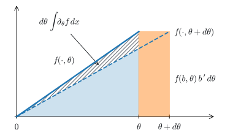

# Expectations and Their Gradients
:label:`sec_mdl-expectation-gradients`

Every loss we have minimized was an average: over a minibatch, over the
masks of dropout, over the noise added to an input. As long as the
randomness does not depend on the parameters, such an average is easy to
differentiate. The derivative of an average is the average of the
derivatives, and minibatch gradient descent computes it without a second
thought. The difficulty begins when the parameters control the distribution
itself. A variational autoencoder draws its latent code from a distribution
that its encoder outputs. A policy-gradient method
(:numref:`sec_policygradient`) draws actions from the very policy it is
trying to improve. The loss is then an expectation over samples whose
distribution moves with the parameters, and a sample, once drawn, is just a
number: it does not remember the parameter that produced it.

Here is the smallest such problem. Let $X\sim\mathcal N(\theta,1)$, a normal
variable with mean $\theta$, and let the loss be

$$
\ell(\theta)=\mathbb{E}\bigl[X^2\bigr]=\theta^2+1 .
$$

The value follows by writing $X=\theta+Z$ with $Z$ standard normal:
$\mathbb{E}[(\theta+Z)^2]=\theta^2+2\theta\,\mathbb{E}[Z]+\mathbb{E}[Z^2]$,
where $\mathbb{E}[Z]=0$ by symmetry and $\mathbb{E}[Z^2]=1$
(:numref:`subsec_mdl-integration-by-parts`). At $\theta=1.5$ the derivative
is $\ell'(1.5)=3$. A real model can draw samples of $X$, but it cannot write
$\ell$ in closed form. How do we estimate $\ell'(\theta)$ from samples?

Calculus gives two answers, and they differ in kind. Both write the
expectation as an integral (:numref:`sec_mdl-integral_calculus`) and move
the derivative inside it. The *score-function* estimator then differentiates
the density and leaves the samples alone. The *pathwise* estimator
differentiates the samples and leaves the density alone. Neither always
wins, and comparing the two
(:numref:`subsec_mdl-stochastic-gradient-estimators`) is the main business
of this section. Before that we recall what an expectation is, and settle
when a derivative may be moved inside an integral, which is the step that
needs care.

```{.python .input #mdl-expectation-gradients-expectations-and-their-gradients}
#@tab mxnet
import math
import numpy as np
from mxnet import autograd, gluon, init, np as mnp, npx
from mxnet.gluon import nn
from d2l import mxnet as d2l
npx.set_np()
```

```{.python .input #mdl-expectation-gradients-expectations-and-their-gradients}
#@tab pytorch
import math
import numpy as np
import torch
from torch import nn
from torch.nn import functional as F
from d2l import torch as d2l
```

```{.python .input #mdl-expectation-gradients-expectations-and-their-gradients}
#@tab tensorflow
import math
import numpy as np
import tensorflow as tf
from d2l import tensorflow as d2l
```

```{.python .input #mdl-expectation-gradients-expectations-and-their-gradients}
#@tab jax
import math
import numpy as np
import jax
from jax import numpy as jnp
from flax import nnx
import optax
from d2l import jax as d2l
```

## Expectations as Integrals
:label:`subsec_mdl-integration-in-probability`

Before anything is differentiated we fix what an expectation is. The
probability chapter treats the two definitions below at length
(:numref:`sec_mdl-random_variables`); here they are a recall, in the
language of the previous section. A probability **density** on a set
$\mathcal X$ is a nonnegative function whose total integral is $1$:

$$
p(x)\ge 0, \qquad \int_{\mathcal X} p(x)\,dx = 1 .
$$
:eqlabel:`eq_mdl-density`

A random variable $X$ with density $p$ falls in an interval with probability
equal to the area above it, $P(a\le X\le b)=\int_a^bp(x)\,dx$
(:eqref:`eq_mdl-pdf_int_int`). Being a probability per unit length and not a
probability, a density can exceed $1$: the uniform density on $[0,\tfrac12]$
equals $2$. Our standard example is the **standard normal** $\mathcal N(0,1)$
with density $p(z)=e^{-z^2/2}/\sqrt{2\pi}$, whose constant is the Gaussian
integral of :numref:`sec_mdl-integral_calculus`.

An **expectation** averages a function of $X$, weighting each value by its
density:

$$
\mathbb{E}[X] = \int_{\mathcal X} x\,p(x)\,dx,
\qquad
\mathbb{E}[g(X)] = \int_{\mathcal X} g(x)\,p(x)\,dx .
$$
:eqlabel:`eq_mdl-expectation`

The expectation $\mathbb{E}[g(X)]$ is defined when
$\int_{\mathcal X}|g(x)|\,p(x)\,dx<\infty$; the Cauchy density of exercise
:exref:`ex_mdl-integral-calculus-heavy-tails` has no mean for this reason.

Most expectations in deep learning have no closed form, and many are over
thousands of dimensions, where no grid is affordable. They are estimated by
drawing samples $x_1,\ldots,x_n$ from $p$ and averaging,
$\frac1n\sum_ig(x_i)$. This is the *Monte Carlo* estimate. If one sample
$g(X)$ has standard deviation $\sigma$, the estimate has root-mean-square
error $\sigma/\sqrt n$, whatever the dimension
(:numref:`subsec_mdl-monte-carlo`). The gradient estimators of this section
are Monte Carlo estimates of this kind. Two unbiased estimators of the same
gradient differ only in the spread of a single sample, so its standard
deviation $\sigma$ is what we compare.

## Differentiation under the Integral Sign

### The Swap

The loss $\ell(\theta)=\mathbb{E}[X^2]$ is an integral that depends on a
parameter. A parameter can enter an integral in two places: through the
limits of integration, which the fundamental theorem :eqref:`eq_mdl-ftc`
handles, or through the integrand.

For the integrand, the derivative passes inside the integral:

$$
\frac{d}{d\theta} \int f(x, \theta)\,dx
= \int \frac{\partial f}{\partial\theta}(x, \theta)\,dx .
$$
:eqlabel:`eq_mdl-diff-under-integral`

The rate of change of the area is the integral of the rate of change of the
height. We call this exchange of derivative and integral the *swap*, and
both gradient estimators rest on it. It looks innocent, since a derivative
is a limit of difference quotients and an integral a limit of sums, and
finite sums and differences commute. But two limits are being exchanged, and
that needs a hypothesis. On a bounded range of $x$ it
holds when $\partial_\theta f$ is continuous in both variables. On an
infinite range it needs in addition an integrable function of $x$ that
bounds $|\partial_\theta f(x,\theta')|$ for all $\theta'$ near $\theta$ (a
consequence of dominated convergence, quoted without proof from
:cite:`Folland.1999`). For $f(x,\theta)=x^2p_\theta(x)$ with the normal
density such a bound exists, because the Gaussian factor dominates every
polynomial.

### The Leibniz Rule

The swap alone is wrong when the limits of integration move with the
parameter. The Leibniz rule supplies the correction: the two effects add
(:numref:`fig_mdl-leibniz-boundary`).

**Proposition (Leibniz rule).** *Let $f$ and $\partial_\theta f$ be continuous
on a region containing $\{(x,\theta):x\in[a(\theta),b(\theta)]\}$ for $\theta$
in an open interval, and let $a$ and $b$ be differentiable. Then*

$$
\frac{d}{d\theta} \int_{a(\theta)}^{b(\theta)} f(x, \theta)\,dx
= \int_{a(\theta)}^{b(\theta)} \frac{\partial f}{\partial\theta}(x,\theta)\,dx
+ f\bigl(b(\theta), \theta\bigr)\,b'(\theta)
- f\bigl(a(\theta), \theta\bigr)\,a'(\theta) .
$$
:eqlabel:`eq_mdl-leibniz`

**Proof.** Let $H(\alpha,\beta,\theta)=\int_\alpha^\beta f(x,\theta)\,dx$. By
the fundamental theorem, $\partial_\beta H=f(\beta,\theta)$ and
$\partial_\alpha H=-f(\alpha,\theta)$. By the swap on the bounded range
$[\alpha,\beta]$, $\partial_\theta H=\int_\alpha^\beta\partial_\theta f\,dx$.
All three partial derivatives are continuous, so the chain rule of
:numref:`sec_mdl-chain-rule-graphs` applies to
$\theta\mapsto H(a(\theta),b(\theta),\theta)$ and adds the three
contributions, weighted by $a'(\theta)$, $b'(\theta)$ and $1$. $\blacksquare$

![The Leibniz rule for $f(x,\theta)=x/\theta$ on $[0,\theta]$, the uniform example. When $\theta$ grows by $d\theta$ the curve changes to $f(\cdot,\theta+d\theta)$ (dashed; here it falls, so the hatched band between the curves is lost area), and the right edge moves, sweeping in the strip of height $f(b,\theta)$ and width $b'\,d\theta$.](../img/mdl-cal-leibniz-boundary.svg)
:label:`fig_mdl-leibniz-boundary`

Dropping the boundary term gives a wrong answer. Let $X$ be uniform on
$[0,\theta]$, with density $1/\theta$ there. Then
$\mathbb{E}[X]=\int_0^\theta\frac x\theta\,dx=\frac\theta2$, with derivative
$+\tfrac12$. Differentiating only the integrand gives
$\int_0^\theta-\frac{x}{\theta^2}\,dx=-\tfrac12$, the wrong sign. The boundary
term $f(\theta,\theta)\,b'(\theta)=\frac\theta\theta\cdot1=1$ restores
$-\tfrac12+1=+\tfrac12$. Whenever the support of a density moves with the
parameter, the plain swap is not enough (exercise
:exref:`ex_mdl-integral-calculus-moving-support` does $\mathbb{E}[X^2]$).

### Log-Integral-Exp

The swap also gives the continuous version of this chapter's log-sum-exp. Differentiating $\log\int e^{\theta x}p(x)\,dx$ with
the chain rule and :eqref:`eq_mdl-diff-under-integral` gives

$$
\frac{d}{d\theta}\log\int e^{\theta x}p(x)\,dx=\frac{\int x\,e^{\theta x}p(x)\,dx}{\int e^{\theta x}p(x)\,dx},
$$

the mean of $x$ under the *tilted* density
$e^{\theta x}p(x)/\int e^{\theta x}p$. For the standard normal, completing the
square, $\theta z-\tfrac12z^2=\tfrac12\theta^2-\tfrac12(z-\theta)^2$, shows
that the tilted density is $\mathcal N(\theta,1)$ and that
$\log\mathbb{E}[e^{\theta Z}]=\theta^2/2$, whose derivative $\theta$ is indeed
the tilted mean. The gradient of log-sum-exp is the softmax; the gradient of
log-integral-exp is an expectation. This is the derivative $A'(\eta)$ of the
log-partition function in :numref:`sec_mdl-exponential-family`.

## Score-Function and Pathwise Gradients
:label:`subsec_mdl-stochastic-gradient-estimators`

By the swap, the derivative of an expectation is an integral,
$\int g(x)\,\partial_\theta p_\theta(x)\,dx$. Unfortunately it is not an
expectation: $\partial_\theta p_\theta$ is not a density, and we cannot draw
samples from it. Two identities turn the integral into an expectation that
samples can estimate.

### The Score-Function Estimator

Write $p_{\boldsymbol\theta}$ for a density that
depends on parameters $\boldsymbol\theta$. The chain rule for $\log$ gives the
**log-derivative identity**

$$
\nabla_{\boldsymbol\theta}\,p_{\boldsymbol\theta}(x)=p_{\boldsymbol\theta}(x)\,\nabla_{\boldsymbol\theta}\log p_{\boldsymbol\theta}(x).
$$
:eqlabel:`eq_mdl-log-derivative`

The gradient of a density is the density times the gradient of its logarithm,
the **score** $\nabla_{\boldsymbol\theta}\log p_{\boldsymbol\theta}$. When the
swap is valid and the support of $p_{\boldsymbol\theta}$ does not move with
$\boldsymbol\theta$, the score has mean zero:
$\mathbb{E}[\nabla_{\boldsymbol\theta}\log p_{\boldsymbol\theta}(X)]=\int\nabla_{\boldsymbol\theta}p_{\boldsymbol\theta}\,dx=\nabla_{\boldsymbol\theta}\int p_{\boldsymbol\theta}\,dx=\nabla_{\boldsymbol\theta}1=\mathbf 0$.
The uniform density on $[0,\theta]$ shows why the support matters: its score
is $\partial_\theta\log(1/\theta)=-1/\theta$, whose mean is $-1/\theta\ne0$,
because differentiating $\int_0^\theta p_\theta=1$ also produces the boundary
term $p_\theta(\theta)=1/\theta$. The mean-zero score is the starting point of
Fisher information (:numref:`sec_mdl-maximum_likelihood`).

Multiplying the identity by $g$ and integrating gives the **score-function
identity**, for $g$ that does not depend on $\boldsymbol\theta$:

$$
\nabla_{\boldsymbol{\theta}}\,\mathbb{E}_{X\sim p_{\boldsymbol{\theta}}}[g(X)]
=\int g(x)\,\nabla_{\boldsymbol\theta}p_{\boldsymbol\theta}(x)\,dx
= \mathbb{E}\bigl[g(X)\,\nabla_{\boldsymbol{\theta}}\log
p_{\boldsymbol{\theta}}(X)\bigr].
$$
:eqlabel:`eq_mdl-score-function-gradient`

The gradient of an expected loss is the average loss, weighted by how much the
parameter raises the log-probability of each sample. It is estimated by Monte
Carlo: sample $x_i$, average $g(x_i)\nabla\log p_{\boldsymbol\theta}(x_i)$.
This is the REINFORCE estimator of policy-gradient methods
:cite:`Williams.1992`. If $g$ also depends on $\boldsymbol\theta$, add
$\mathbb{E}[\nabla_{\boldsymbol\theta}g(X,\boldsymbol\theta)]$.

Because the score has mean zero, any **baseline** $b$ that does not depend on
$x$ can be subtracted from $g$ without changing the mean:
$\mathbb{E}[(g(X)-b)\nabla\log
p_{\boldsymbol\theta}(X)]=\mathbb{E}[g(X)\nabla\log p_{\boldsymbol\theta}(X)]$.
A good $b$ lowers the variance.

### The Pathwise Estimator

The second identity gives the sample its memory back. Often a sample can be
produced by transforming noise that does not depend on $\boldsymbol\theta$: $x=T_{\boldsymbol\theta}(\mathbf z)$
with $\mathbf z\sim q$. The normal $\mathcal N(\mu,\sigma^2)$ is $\mu+\sigma z$
with $z\sim\mathcal N(0,1)$. Then the expectation is an integral over
$\mathbf z$, whose density $q$ does not move, and the swap gives the **pathwise
identity**

$$
\nabla_{\boldsymbol\theta}\,
\mathbb{E}_{X\sim p_{\boldsymbol\theta}}[g(X)]
=\nabla_{\boldsymbol\theta}\int g\bigl(T_{\boldsymbol\theta}(\mathbf z)\bigr)\,q(\mathbf z)\,d\mathbf z
=\mathbb{E}_{\mathbf z\sim q}
\Bigl[\nabla_{\boldsymbol\theta}\,
 g\bigl(T_{\boldsymbol\theta}(\mathbf z)\bigr)\Bigr].
$$
:eqlabel:`eq_mdl-pathwise-gradient`

The estimator differentiates the sample itself: automatic differentiation
follows the path from $\boldsymbol\theta$ through $T_{\boldsymbol\theta}$ to
$g$. This *reparameterization* is how variational autoencoders backpropagate
through a Gaussian latent variable :cite:`Kingma.Welling.2014`. It needs $T$
differentiable in $\boldsymbol\theta$, $g$ differentiable along the path (a
Lipschitz $g$ suffices when $X$ has a density), and a dominating bound for the
swap. No boundary term appears, even when the support of $X$ moves, because the
integral is over $\mathbf z$ and $q$ stays put.

The hypothesis on $g$ cannot be dropped. Take $g(x)=\mathbf{1}(x>0)$, which is
$1$ for positive $x$ and $0$ otherwise, and $X=\theta+z$. Then
$\mathbb{E}[g(X)]=P(z>-\theta)$ has derivative
$\varphi(\theta)=e^{-\theta^2/2}/\sqrt{2\pi}$, which is $0.13$ at $\theta=1.5$.
The pathwise sample $\partial_\theta\mathbf{1}(\theta+z>0)$ is $0$ for every
$z$ except $z=-\theta$, an event of probability zero, so the pathwise estimator
returns $0$. The score sample $\mathbf{1}(x>0)\,z$ has mean
$\int_{-\theta}^\infty
z\,\varphi(z)\,dz=\bigl[-\varphi(z)\bigr]_{-\theta}^\infty=\varphi(\theta)$,
the right answer. The score estimator never differentiates through the sample,
which is why it also covers Bernoulli and categorical choices, where no
differentiable path from $\boldsymbol\theta$ to the sample exists.

### The Two Estimators Compared

We now have two unbiased estimators of the same derivative, and the smallest
problem is simple enough to compute the variance of both by hand. For
$\ell(\theta)=\mathbb{E}[X^2]$ with $X=\theta+z$, one sample contributes $2X$
to the pathwise estimator, with variance $\textrm{Var}(2X)=4$. The score of the normal location family
is $\partial_\theta\log p_\theta(X)=X-\theta=z$, so one sample contributes
$X^2z$ to the score-function estimator, and $(X^2-b)z$ with a baseline. The
variance of $X^2z$ needs the Gaussian moments $\mathbb{E}[z^2]=1$,
$\mathbb{E}[z^4]=3$ and $\mathbb{E}[z^6]=15$, all from Stein's identity
$\mathbb{E}[g'(Z)]=\mathbb{E}[Z\,g(Z)]$
(:numref:`subsec_mdl-integration-by-parts`). The odd powers of $z$ drop out of the second moment,

$$
\mathbb{E}\bigl[(\theta+z)^4z^2\bigr]=\theta^4\,\mathbb{E}[z^2]+6\theta^2\,\mathbb{E}[z^4]+\mathbb{E}[z^6]=\theta^4+18\theta^2+15,
$$

and subtracting the squared mean $(2\theta)^2$ leaves the variance
$\theta^4+14\theta^2+15$. The variance-minimizing constant baseline is
$b^\star=\theta^2+3$, and it leaves $8\theta^2+6$ (exercise
:exref:`ex_mdl-integral-calculus-quartic-estimators`). At $\theta=1.5$ the
three standard deviations are $2$ for the pathwise estimator, $7.18$ for the
score function, and $4.90$ with the baseline. The baseline helps, but it
cannot close the gap for this $g$, since $8\theta^2+6>4$ for every $\theta$.

A simulation can test all of this at once. The pathwise sample is
$\partial_\theta(\theta+z_i)^2=2x_i$, so no automatic differentiation is
needed. If the closed forms are right, the three sample standard deviations
should come out near $2$, $7.18$ and $4.90$, and each mean should lie within
a few standard errors $\mathrm{sd}/\sqrt n$ of $3$.

```{.python .input #mdl-integral-calculus-score-function-and-pathwise-gradients-1}
theta, n = 1.5, 200_000
z = np.random.default_rng().standard_normal(n)     # noise, independent of theta
x = theta + z                                      # samples of N(theta, 1)
pathwise = 2 * x                                   # d/dtheta (theta + z_i)^2
score = x**2 * z                                   # g(x) times the score x - theta
baseline = (x**2 - (theta**2 + 3)) * z             # with the optimal baseline
exact_sd = {'pathwise': 2, 'score': math.sqrt(theta**4 + 14 * theta**2 + 15),
            'score+baseline': math.sqrt(8 * theta**2 + 6)}
print(f'true derivative 2*theta = {2 * theta}')
for name, s in zip(exact_sd, [pathwise, score, baseline]):
    print(f'{name:15s} mean={s.mean():.4f}  sd={s.std():.3f} '
          f'(exact {exact_sd[name]:.3f})  se={s.std() / math.sqrt(n):.4f}')
```

In most runs the three means lie within about two standard errors of $3$, and
the sample standard deviations match the closed forms to within a few
percent. With the same number of samples, the pathwise estimate is about
$3.6$ times more precise than the plain score estimate. Put differently, the
score estimate needs about thirteen times as many samples for the same
precision.

It would be wrong to conclude that the pathwise estimator always has the
smaller variance. Take $g(x)=\sin(\omega x)$, for which the derivative of the
mean is $\omega\cos(\omega\theta)e^{-\omega^2/2}$. The pathwise sample
$\omega\cos(\omega X)$ has standard deviation close to $\omega/\sqrt2$, while
the score sample $\sin(\omega X)\,z$ has standard deviation at most
$\sqrt{\mathbb{E}[z^2]}=1$, because $|\sin|\le1$. An oscillating integrand has
large derivatives but bounded values. We compare the two at $\omega=1$ and
$\omega=3$, reusing the samples.

```{.python .input #integral-score-wins}
for omega in [1, 3]:
    true = omega * math.cos(omega * theta) * math.exp(-omega**2 / 2)
    path, score = omega * np.cos(omega * x), np.sin(omega * x) * z
    print(f'omega={omega}  true={true:+.4f}  pathwise {path.mean():+.4f} '
          f'(sd {path.std():.2f})  score {score.mean():+.4f} (sd {score.std():.2f})')
```

At $\omega=1$ the score estimator already has the smaller spread, about $0.5$
against $0.7$; at $\omega=3$ it wins by a factor of three, about $0.7$
against $2.1$. Both means agree with the true values within a few standard
errors.

Neither estimator wins everywhere, then. The pathwise estimator
differentiates $g$ and suffers where $g'$ is large; the score-function
estimator multiplies $g$ by noise and suffers where $g$ itself is large. In
both, the standard deviation $\sigma$ of a single sample decides how many
samples are needed. It depends on the distribution the samples are drawn
from, and choosing that distribution to make $\sigma$ small, which is called
importance sampling, is taken up in :numref:`sec_mdl-bayesian-computation`.

## Summary

When a parameter moves the distribution of the samples, the gradient of an
expected loss has to be rewritten as an expectation before samples can
estimate it. Both ways of doing so move the derivative inside the integral,
which needs a dominating bound and, when the limits move with the parameter,
the boundary term of the Leibniz rule. The score-function identity
differentiates the density. It works for any $g$, including discrete
choices, but its samples scale with $g$ and can have high variance. The
pathwise identity differentiates the sample. It needs a differentiable $g$
and often, though not always, has the lower variance. Either estimate has
root-mean-square error $\sigma/\sqrt n$ (:numref:`subsec_mdl-monte-carlo`),
so the standard deviation $\sigma$ of one sample is the quantity to compare.

## Exercises

1. **A moving support.** Let $X$ be uniform on $[0,\theta]$ with
   $\theta>0$, so that
   $\ell(\theta)=\mathbb{E}[X^2]=\int_0^\theta \tfrac{x^2}{\theta}\,dx=\tfrac{\theta^2}{3}$
   and $\ell'(\theta)=\tfrac{2\theta}{3}$.
    1. Differentiate $\ell$ with the Leibniz rule :eqref:`eq_mdl-leibniz`.
       Which part of the result does the plain swap
       :eqref:`eq_mdl-diff-under-integral` produce, and which part does it
       miss?
    1. On the support, $\log p_\theta(x)=-\log\theta$. Compute the
       expectation of the score-function estimator
       $X^2\,\partial_\theta\log p_\theta(X)$
       of :eqref:`eq_mdl-score-function-gradient`. Then let $g$ be continuous
       on $[0,\infty)$. Show that the mean of
       $g(X)\,\partial_\theta\log p_\theta(X)$ equals the plain swap
       :eqref:`eq_mdl-diff-under-integral` applied to
       $\mathbb{E}[g(X)]=\int_0^\theta g(x)\,p_\theta(x)\,dx$. What is its
       bias as an estimate of $\frac{d}{d\theta}\mathbb{E}[g(X)]$, in terms
       of $g(\theta)$ and $\theta$?
    1. Write $X=\theta U$ with $U$ uniform on $[0,1]$ and compute the
       expectation of the pathwise estimator
       of :eqref:`eq_mdl-pathwise-gradient`. Why does it need no boundary term,
       although the support of $X$ moves with $\theta$?
   :exlabel:`ex_mdl-integral-calculus-moving-support`

1. [code] **Estimator variance for a quartic.** ● Let
   $X\sim\mathcal N(\theta,1)$, write $X=\theta+z$, and let
   $s(X)=\partial_\theta\log p_\theta(X)=z$ be the score.
    1. Take $g(X)=X^4$, so that
       $\frac{d}{d\theta}\mathbb{E}[X^4]=4\theta^3+12\theta$. Derive the
       single-sample pathwise estimator from
       :eqref:`eq_mdl-pathwise-gradient` and the single-sample score-function
       estimator from :eqref:`eq_mdl-score-function-gradient`. Use the
       identity of exercise
       :exref:`ex_mdl-integral-calculus-gaussian-normalizers` (b) to show
       that both have mean $4\theta^3+12\theta$.
    1. For a constant baseline $b$, show that the variance of
       $(g(X)-b)\,s(X)$ is minimized by
       $b^\star=\mathbb{E}[g(X)s(X)^2]/\mathbb{E}[s(X)^2]$. For $g(X)=X^2$ show
       that $b^\star=\theta^2+3$, and use $\mathbb{E}[z^2]=1$,
       $\mathbb{E}[z^4]=3$, $\mathbb{E}[z^6]=15$ to derive the three variances
       $4$, $\theta^4+14\theta^2+15$ and $8\theta^2+6$ that the text quotes.
    1. Evaluate $b^\star$ for $g(X)=X^4$. With $10^6$ samples at
       $\theta\in\{0,1,2\}$, estimate the standard deviations of the
       pathwise estimator, the score-function estimator, and the
       score-function estimator with the baseline. For which $\theta$ is the
       baseline's gain largest, and does it ever close the gap to the
       pathwise estimator? Explain the ordering from the sizes of $g'$ and
       of $g$.
    1. Take $g(x)=\mathbf{1}(x>0)$ at $\theta=1.5$. The text shows that the
       pathwise estimator is $0$ for almost every sample, while the
       score-function estimator $\mathbf{1}(x>0)\,z$ has the correct mean
       $\varphi(\theta)=0.1295$. Verify both by simulation.
   :exlabel:`ex_mdl-integral-calculus-quartic-estimators`

1. [extended] **Gradients through a coin flip.** ●● When $x$ is a discrete
   choice there is no differentiable path from $\theta$ to the sample, so
   the pathwise estimator does not exist. Continuous relaxations such as
   Gumbel-softmax :cite:`Jang.Gu.Poole.2017,Maddison.Mnih.Teh.2017` create a
   differentiable surrogate, and straight-through estimators
   :cite:`Bengio.Leonard.Courville.2013` use the hard sample in the forward
   pass and the surrogate in the backward pass; both are biased for the
   original objective. This problem measures that bias.
   :citet:`Tucker.Mnih.Maddison.ea.2017` illustrate it on a toy problem. A
   single Bernoulli variable $b\in\{0,1\}$ has $P(b=1)=\sigma(\theta)$ for a
   logit $\theta$, and the objective is $\ell(\theta)=\mathbb{E}[(b-t)^2]$ with
   target $t=0.45$. Let $U$ be uniform on $(0,1)$, let
   $\zeta=\log U-\log(1-U)$, and, for a temperature $\tau>0$, let
   $z=\sigma\bigl((\theta+\zeta)/\tau\bigr)$, the two-class case of the
   Gumbel-softmax relaxation.
    1. Compute $\ell(\theta)$ and $\ell'(\theta)$ in closed form. Which probability
       $\sigma(\theta)$ minimizes $\ell$, and does a finite $\theta$ attain it?
    1. Show that $b=\mathbf{1}(z>\tfrac12)$ satisfies $P(b=1)=\sigma(\theta)$
       for every $\tau$.
    1. Implement three single-sample estimators of $\ell'(\theta)$: REINFORCE
       :eqref:`eq_mdl-score-function-gradient` with the baseline
       $\ell(\theta)$; the relaxed estimator $\frac{d}{d\theta}(z-t)^2$; and the
       straight-through estimator $2(b-t)\frac{dz}{d\theta}$, which uses the
       hard sample in the loss and the relaxed sample in the derivative.
       Tabulate the mean and the standard deviation of each estimator
       against $\ell'(\theta)$ for $\theta\in\{-2,0,2\}$ and
       $\tau\in\{1,0.5,0.1\}$. How does the bias of each estimator depend on
       $\theta$ and $\tau$?
    1. Run stochastic gradient descent on $\theta$ from $\theta=0$ with step
       size $1$ for $5000$ steps with REINFORCE and with the relaxed and
       straight-through estimators at each $\tau$, replacing the REINFORCE
       baseline by an exponential moving average of past losses.
       Plot $\ell(\theta)$ along each run. Compute the relaxed objective
       $R_\tau(\theta)=\mathbb{E}[(z-t)^2]$ by quadrature over $U$, and compare
       its minimizer with the values of $\theta$ at which the relaxed runs
       settle. How does lowering $\tau$ trade the bias of the relaxed
       estimator against its variance?
   :exlabel:`ex_mdl-integral-calculus-coin-flip`

[Discussions](https://d2l.discourse.group/t/36878)

<!-- slides -->

::: {.slide}
::: {.cover}
[Dive into Deep Learning · §25.2]{.kicker}

Expectations and Their Gradients<br>**the swap · the Leibniz rule · score-function and pathwise estimators**
:::
:::

::: {.slide title="When the Parameter Moves the Distribution, What Is the Gradient?"}
[The problem]{.kicker}

A VAE samples its latent code; a policy samples its actions. The loss is
$\mathbb{E}_{X\sim p_\theta}[g(X)]$, and $\theta$ sits in the distribution.

- Smallest case: $X\sim\mathcal N(\theta,1)$, $\ell(\theta)=\mathbb{E}[X^2]=\theta^2+1$, so $\ell'(1.5)=3$.
- A real model can draw samples of $X$ but cannot write $\ell$ in closed form.
- A sample, once drawn, is a number. It does not remember $\theta$.

::: {.d2l-note .warn}
How do we estimate $\ell'(\theta)$ from samples?
:::
:::

::: {.slide title="By the End of This Deck You Can"}
[Goals]{.kicker}

- move a derivative inside an integral, and correct for moving limits;
- write the gradient of an expectation as an expectation, in two ways;
- say which estimator applies to a discrete choice, and which to a kink;
- predict which of the two estimates is quieter.

**Running example:** $\ell(\theta)=\mathbb{E}[X^2]$, $X=\theta+z$, $\theta=1.5$.

**The idea:** differentiate the density, or differentiate the sample.
:::

::: {.slide title="From Areas to Gradients of Expectations"}
[Where this fits]{.kicker}

::: {.cols .vc}
::: {.col}
| section | adds |
|---|---|
| Single Variable Calculus | derivative, Taylor, corners |
| Multivariable Calculus | gradient, Hessian, critical points |
| The Chain Rule on Computational Graphs | sum over paths, backward pass |
| Matrix Calculus | Jacobians, a layer's backward rule |
| Automatic Differentiation | forward and reverse mode |
| Integral Calculus | areas, change of variables, the Gaussian integral |
| **Expectations and Their Gradients** | **score-function and pathwise estimators** |
:::

::: {.col .narrow}
- **Uses:** integrals, the chain rule, Monte Carlo (Statistics).
- **Skips:** measure theory, discrete relaxations.
:::
:::
:::

::: {.slide title="The Swap: the Derivative Passes inside the Integral"}
$$\frac{d}{d\theta}\int f(x,\theta)\,dx=\int\frac{\partial f}{\partial\theta}(x,\theta)\,dx$$

The rate of change of the area is the integral of the rate of change of the height.

- Bounded range: $\partial_\theta f$ continuous in both variables.
- Infinite range: also an integrable bound on $|\partial_\theta f|$ near $\theta$.
- Example: $\frac{d}{d\theta}\log\int e^{\theta x}p(x)\,dx$ is the mean of $x$ under
  the tilted density $\propto e^{\theta x}p(x)$. Standard normal: $\tfrac{d}{d\theta}\tfrac{\theta^2}{2}=\theta$.

::: {.d2l-note}
Log-sum-exp has the softmax as gradient; log-integral-exp has an expectation.
:::
:::

::: {.slide title="The Leibniz Rule: Swap Inside, Then Add What the Moving Edge Sweeps"}
$$\frac{d}{d\theta}\!\int_{a(\theta)}^{b(\theta)}\!f\,dx=\int_a^b\partial_\theta f\,dx+f(b,\theta)\,b'-f(a,\theta)\,a'$$

::: {.cols .vc}
::: {.col}
$X$ uniform on $[0,\theta]$, $\mathbb{E}[X]=\theta/2$:

- plain swap: $-\tfrac12$
- boundary term: $+1$
- truth: $+\tfrac12$
:::

::: {.col .fig}

:::
:::
:::

::: {.slide title="Score Function: Differentiate the Density"}
$$\nabla_\theta p_\theta=p_\theta\,\nabla_\theta\log p_\theta
\quad\Longrightarrow\quad
\nabla_\theta\,\mathbb{E}[g(X)]=\mathbb{E}\bigl[g(X)\,\nabla_\theta\log p_\theta(X)\bigr]$$

- Sample $x_i\sim p_\theta$, average $g(x_i)\nabla\log p_\theta(x_i)$: REINFORCE.
- $g$ is never differentiated: works for steps and for discrete choices.
- The score has mean zero (fixed support), so a baseline $b$ is free:
  $\mathbb{E}[(g-b)\nabla\log p_\theta]$ is unchanged.
- $\mathcal N(\theta,1)$: score $=x-\theta=z$; one sample of $\ell'$ is $X^2z$.
:::

::: {.slide title="Pathwise: Differentiate the Sample"}
$$x=T_\theta(\mathbf z),\ \mathbf z\sim q
\quad\Longrightarrow\quad
\nabla_\theta\,\mathbb{E}[g(X)]=\mathbb{E}_{\mathbf z\sim q}\bigl[\nabla_\theta\,g(T_\theta(\mathbf z))\bigr]$$

- $\mathcal N(\mu,\sigma^2)$ is $\mu+\sigma z$: the reparameterization of a VAE.
- The density $q$ of the noise does not move, so the swap applies and no boundary term appears.
- Needs $g$ differentiable along the path.
- $X=\theta+z$: one sample of $\ell'$ is $2X$.
:::

::: {.slide title="Pathwise sd 2 Beats Score 7.2, but sin(ωx) Flips the Order"}
@!mdl-integral-calculus-score-function-and-pathwise-gradients-1

@!integral-score-wins

::: {.d2l-note}
Variances at $\theta$: pathwise $4$, score $\theta^4+14\theta^2+15$, with the
best baseline $8\theta^2+6$. Large derivatives favor the score function;
large values favor the path.
:::
:::

::: {.slide title="Check: Gradient Through a Step"}
[Check]{.kicker}

$g(x)=\mathbf{1}(x>0)$, $X=\theta+z$, $\theta=1.5$. What does the pathwise
estimator return? What is the true derivative?

::: {.fragment .fade-up}
::: {.d2l-note}
**Answer.** Pathwise: $0$ for almost every sample. Truth:
$\varphi(1.5)=0.13$. The score sample $\mathbf{1}(x>0)\,z$ has mean
$\varphi(\theta)$.
:::
:::
:::

::: {.slide title="Recap: Two Identities, One Gradient"}
[Wrap-up]{.kicker}

- The swap: $\frac{d}{d\theta}\int f\,dx=\int\partial_\theta f\,dx$; moving limits add a boundary term.
- Score function: any $g$; one sample $X^2z$, sd $7.2$, with baseline $4.9$.
- Pathwise: differentiable $g$; one sample $2X$, sd $2$.
- $\sin(\omega x)$ reverses the order; a step function leaves only the score.
- Either way the error is $\sigma/\sqrt n$: compare estimators by their $\sigma$.

::: {.d2l-note}
Next: $\sigma$ also depends on where the samples are drawn. Choosing that
distribution is importance sampling (Bayesian Computation).
:::
:::
