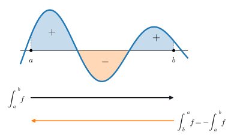
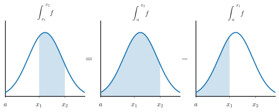
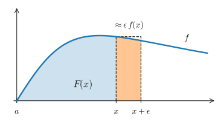
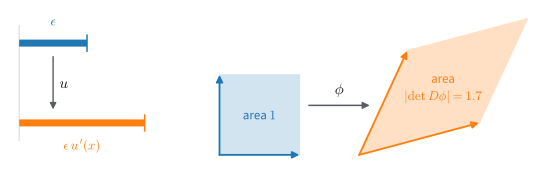
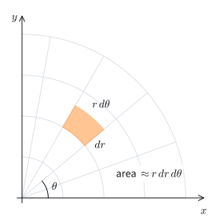
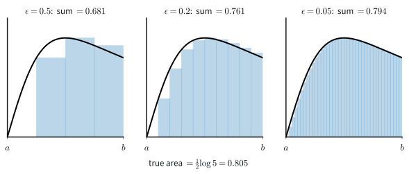
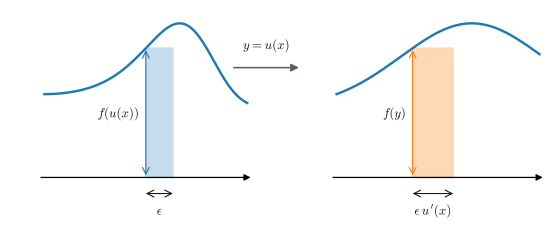
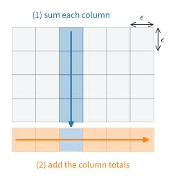
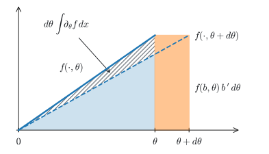

# Integral Calculus
:label:`sec_mdl-integral_calculus`

The earlier chapters used continuous random variables without asking how
their probabilities are computed. A normal distribution was described by its
density, an expected loss was an average over that density, and both were
taken as given. The previous sections of this chapter differentiated
functions. This section asks a different question: how do we add up a
quantity that is spread continuously over an interval?

The standard normal distribution, the bell curve, shows why the question
needs care. A standard normal random variable $Z$ has the density
$p(z)=e^{-z^2/2}/\sqrt{2\pi}$. Its value at $z=0$ is $0.40$, yet $P(Z=0)=0$,
and the same holds at every other single point. Intervals do carry
probability: $P(-1\le Z\le 1)\approx 0.68$. That number is the area under
$p$ between $-1$ and $1$, and the constant $1/\sqrt{2\pi}$ is the one that
makes the total area under $p$ equal to $1$. Where does the constant come
from, and how is $0.68$ computed?

The question is not special to the bell curve. Every probability and every
expected loss over a continuous variable is an area of this kind, a sum of
infinitely many slices of negligible weight. Training a model through random
sampling, as variational autoencoders and policy-gradient methods do, needs
one more thing: the derivative of such an area with respect to a parameter.

The plan is to cut the area into thin slices, add them, and let the slices
shrink; the limit is the integral. Adding slices by hand is slow, and the
fundamental theorem of calculus replaces it by reversing differentiation. The
bell curve has no elementary reverse, so we take two other routes: pass to
two dimensions, where the integral becomes elementary and $\sqrt{2\pi}$
appears, or average random samples. Last, we differentiate an integral with
respect to a parameter, with the same two tools. Along the way the section
answers both halves of the opening question: the constant $1/\sqrt{2\pi}$ in the
Gaussian integral and the $0.68$ in the subsection on densities. Measure
theory and the Lebesgue integral are left out;
:numref:`sec_mdl-calculus-further-reading` points to them.

```{.python .input #integral-imports}
#@tab mxnet
import math
import numpy as np
from mxnet import autograd, gluon, init, np as mnp, npx
from mxnet.gluon import nn
from d2l import mxnet as d2l
npx.set_np()
```

```{.python .input #integral-imports}
#@tab pytorch
import math
import numpy as np
import torch
from torch import nn
from torch.nn import functional as F
from d2l import torch as d2l
```

```{.python .input #integral-imports}
#@tab tensorflow
import math
import numpy as np
import tensorflow as tf
from d2l import tensorflow as d2l
```

```{.python .input #integral-imports}
#@tab jax
%matplotlib inline
import math
import numpy as np
import jax
from jax import numpy as jnp
from d2l import jax as d2l
jax.config.update('jax_enable_x64', True)
```

## The Definite Integral

### Riemann Sums

A density gives probability per unit length. Over a short interval of width
$\epsilon$ on which the density is nearly constant, the probability is about
density times width. Over a long interval we cut it into thin slices, form
density times width on each slice, and add. This is how $P(-1\le Z\le1)$ is
assembled, and the recipe works for any function, not only densities.

**The smallest case, by hand.** Take $f(x)=x^2$ on $[0,1]$ and cut the interval
into $N$ slices of width $\epsilon=1/N$. The $i$-th slice is
$[i/N,(i+1)/N]$; give it the height of $f$ at its left end, $(i/N)^2$. The
rectangles add up to

$$
\sum_{i=0}^{N-1}\frac1N\Bigl(\frac iN\Bigr)^2
=\frac{1}{N^3}\sum_{i=0}^{N-1}i^2
=\frac{(N-1)N(2N-1)}{6N^3}
=\frac13-\frac1{2N}+\frac1{6N^2},
$$

where the middle step uses the classical formula
$\sum_{i=0}^{N-1}i^2=(N-1)N(2N-1)/6$. Thus the sum of rectangles is $\tfrac13$
minus a correction that shrinks like $1/N$. At $N=10$ the sum is $0.285$, at
$N=100$ it is $0.32835$, and at $N=1000$ it is $0.332834$.

Three facts are visible. The sums have a limit, $\tfrac13$. The error is about
$\frac1{2N}$, first order in the slice width $\epsilon$. And the computation needed a closed
form for $\sum i^2$. Most integrands have no such formula, and the fundamental
theorem below removes the need for one.

The cell below checks the formula. It defines the **left-endpoint rule**: cut
$[a,b]$ into slices of width $\epsilon$ and tag each slice at its left end, as
in :numref:`fig_mdl-riemann`.

```{.python .input #mdl-integral-calculus-riemann-sums-1}
def left_sum(f, a, b, eps):
    """Left-endpoint Riemann sum of f on [a, b] with slices of width eps."""
    x = a + eps * np.arange(round((b - a) / eps))   # left ends of the slices
    return float(np.sum(eps * f(x)))

for N in [10, 100, 1000]:
    print(f'N={N:<5} left sum={left_sum(lambda x: x**2, 0, 1, 1 / N):.6f}  '
          f'formula={1/3 - 1/(2*N) + 1/(6*N**2):.6f}')
```

The computed sums agree with $\tfrac13-\tfrac1{2N}+\tfrac1{6N^2}$ to all
printed digits.

**The definition.** Nothing in the recipe needed equal widths or left ends. A
*partition* $P:a=x_0<x_1<\cdots<x_N=b$ cuts $[a,b]$ into slices, a *tag*
$\xi_i\in[x_{i-1},x_i]$ picks a point in each slice, and the *mesh*
$\|P\|=\max_i(x_i-x_{i-1})$ is the width of the widest slice. A bounded
function $f$ is **Riemann integrable** on $[a,b]$ if there is a number $I$ that
every tagged sum approaches as the mesh tends to zero, whatever the tags:

$$
\int_a^b f(x)\,dx = I = \lim_{\|P\|\to0}\sum_{i=1}^N f(\xi_i)(x_i-x_{i-1}).
$$
:eqlabel:`eq_mdl-riemann`

In words, the integral is the value that the slice sums approach as the slices
become thin. The variable of integration is a dummy, so
$\int_a^b f(x)\,dx=\int_a^b f(z)\,dz$. The smallest case gives
$\int_0^1x^2\,dx=\tfrac13$. Every continuous function on $[a,b]$ is Riemann
integrable, and so is every bounded function with finitely many jumps
:cite:`Folland.1999`.

Two properties follow from the definition, and the proofs below use both. The
integral is **monotone**: if $f\le g$ on $[a,b]$, then every tagged sum of $f$
is at most the same tagged sum of $g$, and limits preserve $\le$, so
$\int_a^b f\,dx\le\int_a^b g\,dx$. It is **additive over subintervals**:
$\int_a^c f\,dx=\int_a^b f\,dx+\int_b^c f\,dx$ for $a\le b\le c$, because
partitions that include the point $b$ split into a partition of $[a,b]$ and
one of $[b,c]$.

Not every bounded function has an integral. The function that is $1$ on the
rationals and $0$ elsewhere has, on $[0,1]$, tagged sums equal to $1$ when every
tag is rational and $0$ when every tag is irrational, at any mesh, so the sums
never settle. Probability theory uses a more general integral, the Lebesgue
integral, which agrees with this one on every function in this book.

**The running example.** The integral

$$
\int_0^2\frac{x}{1+x^2}\,dx=\tfrac12\log5=0.80472
$$

will carry us through this part of the section (the next subsection shows why
its value is $\tfrac12\log5$). :numref:`fig_mdl-riemann` shows left-endpoint
rectangles under this curve for three slice widths.

![Left-endpoint rectangles under $f(x)=x/(1+x^2)$ on $[0,2]$ for slice widths $\epsilon=0.5$, $0.2$ and $0.05$. Each slice takes the height of $f$ at its left end; the rectangle sums approach the area $\tfrac12\log 5$ as $\epsilon\to0$.](../img/mdl-cal-riemann.svg)
:label:`fig_mdl-riemann`

How fast do the sums approach $\tfrac12\log5$? The cell refines the slices by
factors of ten and prints the error beside $0.2\,\epsilon$.

```{.python .input #integral-riemann-converge}
f = lambda x: x / (1 + x**2)
truth = math.log(5) / 2
for eps in [1e-1, 1e-2, 1e-3, 1e-4]:
    s = left_sum(f, 0, 2, eps)
    print(f'eps={eps:.0e}  sum={s:.6f}  truth-sum={truth - s:.2e}  '
          f'0.2*eps={0.2 * eps:.0e}')
print(f'truth = (1/2) log 5 = {truth:.6f}')
```

Each time $\epsilon$ shrinks by ten, so does the error, which is about
$0.2\,\epsilon$, and every sum lies below the truth. Both facts follow from a
first-order expansion of $f$ on each slice (exercise
:exref:`ex_mdl-integral-calculus-midpoint-rule`): the left rule's error is
about

$$
\text{left sum}-\int_a^b f(x)\,dx\approx\frac\epsilon2\bigl(f(a)-f(b)\bigr).
$$

For $x^2$ on $[0,1]$ this is $-\tfrac\epsilon2=-\tfrac1{2N}$, the leading
correction of the smallest case. For the running example, $f(0)=0$ and
$f(2)=0.4$ give $-0.2\,\epsilon$: on an increasing function the left ends are
the low ends, so the rectangles fall short.

### Signed Area

Rectangles below the axis have negative height $f(\xi_i)<0$, so they enter the
sum with a minus sign. The integral therefore measures *signed* area, governed
by two sign rules. First, where $f<0$ the area counts as negative:
$\int_0^1(-1)\,dx=-1$. Second, integrating from right to left negates the
result, $\int_b^a f\,dx=-\int_a^b f\,dx$; this is the convention that keeps
additivity true for every order of $a$, $b$, $c$. Each flip, reflecting across
the $x$-axis or reversing the limits, contributes one minus sign, so
$\int_0^{-1}1\,dx=-1$ (one flip) while $\int_0^{-1}(-1)\,dx=1$ (two flips,
which cancel). :numref:`fig_mdl-signed-area` shows both rules on one curve.


:label:`fig_mdl-signed-area`

In one dimension the order of the limits carries the sign. Regions in
$\mathbb R^n$ have no such order, so the $n$-dimensional rule later in this
section integrates over sets and uses the absolute value of a determinant, the
volume factor whose sign records orientation (:numref:`sec_mdl-linear-maps`).

## The Fundamental Theorem

### The Theorem

Adding slices gave $\tfrac13$ only because $\sum i^2$ has a closed form. For
the running example the left sum is
$\sum_i\epsilon\cdot i\epsilon/(1+i^2\epsilon^2)$, and no formula collapses it.
We need a method that does not add slices at all.

The method comes from letting the upper limit vary. Fix a base point $a$ and
define the **area-so-far function**

$$
F(x) = \int_a^x f(y)\,dy,
$$
:eqlabel:`eq_mdl-area-fn`

the signed area accumulated from $a$ out to $x$. One function holds every
definite integral of $f$: by additivity, the area over any interval
$[x_1,x_2]$ is a difference of two accumulated areas,

$$
\int_{x_1}^{x_2} f(x)\,dx = F(x_2) - F(x_1),
$$

because the area out to $x_2$ minus the area out to $x_1$ leaves the area
between them (:numref:`fig_mdl-area-subtract`). So it suffices to find $F$.


:label:`fig_mdl-area-subtract`

How does $F$ change when $x$ moves a little to the right?
:numref:`fig_mdl-ftc-sliver` shows the area out to $x$ and the strip of width
$\epsilon$ that moving to $x+\epsilon$ adds. The strip is nearly a rectangle of
height $f(x)$, so $F(x+\epsilon)-F(x)\approx\epsilon f(x)$, and dividing by
$\epsilon$ suggests $F'(x)=f(x)$.


:label:`fig_mdl-ftc-sliver`

**Theorem (Fundamental theorem of calculus).** *Let $f$ be Riemann integrable
on $[a,b]$, let $F(x)=\int_a^x f(y)\,dy$, and let $f$ be continuous at a point
$x\in(a,b)$. Then $F$ is differentiable at $x$ and*

$$
\frac{dF}{dx}(x) = f(x).
$$
:eqlabel:`eq_mdl-ftc`

*The rate at which area accumulates is the current height of the curve.*

**Proof.** Nudge $x$ by $\epsilon>0$ and measure the new area. By
:eqref:`eq_mdl-area-fn` and additivity, the increment is a single sliver,

$$
F(x+\epsilon) - F(x) = \int_x^{x+\epsilon} f(y)\,dy .
$$

Write $m_\epsilon = \inf_{[x,x+\epsilon]} f$ and
$M_\epsilon = \sup_{[x,x+\epsilon]} f$ for the tightest constant bounds on $f$
over the sliver; they are finite because an integrable function is bounded.
Since $m_\epsilon\le f\le M_\epsilon$ on the sliver, monotonicity of the
integral pins its area between two rectangles of width $\epsilon$:

$$
\epsilon\, m_\epsilon
\ \le\ F(x+\epsilon) - F(x)\ \le\
\epsilon\, M_\epsilon .
$$

Divide by $\epsilon$. Because $f$ is continuous at $x$, for any $\delta>0$ the
whole interval $[x,x+\epsilon]$ eventually lies where $|f(y)-f(x)|<\delta$.
Hence $m_\epsilon$ and $M_\epsilon$ both converge to $f(x)$ as
$\epsilon \to 0$, and the squeeze forces
$\lim_{\epsilon\to 0}\frac{F(x+\epsilon)-F(x)}{\epsilon}=f(x)$. For
$\epsilon<0$ the sliver sits to the left of $x$, and the same bounds apply with
both sign flips canceling in the quotient. That limit is $F'(x)$.
$\blacksquare$

The proof needed only monotonicity and additivity, the two properties proved
from the definition. The theorem turns the search for an area into the search
for an **antiderivative**, a function $G$ with $G'=f$, which we can read off
the derivative table of :numref:`sec_mdl-derivative_table`. Any antiderivative
gives the integral, through the **evaluation rule**: *if $f$ is continuous on
$[a,b]$ and $G'=f$ on all of $[a,b]$, then*

$$
\int_a^b f(x)\,dx = G(b) - G(a).
$$
:eqlabel:`eq_mdl-ftc-eval`

In words: to integrate $f$, find a function whose derivative is $f$ and take
the difference of its values at the two ends. The reason is that $F$ and $G$
have the same derivative $f$ on $(a,b)$, so $G-F$ has derivative zero there and
is constant by the mean value theorem of :numref:`sec_mdl-mvt`; the constant
cancels in $G(b)-G(a)=F(b)-F(a)=\int_a^b f\,dx$.

The hypothesis "on all of $[a,b]$" matters. Since $(-1/x)'=x^{-2}$, a careless use gives
$\int_{-1}^1x^{-2}\,dx=[-1/x]_{-1}^1=-2$, a negative value for a positive
integrand. The rule does not apply, because $G'=f$ fails at $0$, where neither
function is defined; the integral diverges, as the next subsection shows.

Each derivative read backwards is an integral. The derivative of $x^n$ is
$nx^{n-1}$, so for every integer $n\ge1$

$$
\int_0^{x} n\,y^{n-1}\,dy = x^n - 0^n = x^n ,
$$

and at $n=3$, $x=1$ this is $3\int_0^1y^2\,dy=1$, the smallest case without a
single slice. Since $e^x$ is its own derivative,

$$
\int_0^{x} e^{t}\,dt = e^{x} - e^{0} = e^x - 1 ,
$$

so the area under the exponential out to $x$ is the exponential minus its value
at the base point. For the running example, the chain rule gives
$G(x)=\tfrac12\log(1+x^2)$ the derivative
$G'(x)=\tfrac12\cdot\frac{2x}{1+x^2}=\frac{x}{1+x^2}$, so

$$
\int_0^2\frac{x}{1+x^2}\,dx=G(2)-G(0)=\tfrac12\log5-\tfrac12\log1=\tfrac12\log5,
$$

the value the Riemann sums were approaching.

We can check $G'=f$ on all of $[0,2]$ without repeating the derivation.
Automatic differentiation computes $G'$ on a grid, and the cell compares it
with $f$.

```{.python .input #mdl-integral-calculus-the-theorem-1}
#@tab pytorch
x = torch.arange(0, 2, 0.01, dtype=torch.float64, requires_grad=True)
G = torch.log(1 + x**2) / 2
G.sum().backward()                  # G(x_i) depends on x_i only: x.grad = G'(x_i)
x0 = x.detach()
print('max |dG/dx - f| =', float((x.grad - x0 / (1 + x0**2)).abs().max()))
```

```{.python .input #mdl-integral-calculus-the-theorem-1}
#@tab tensorflow
x = tf.Variable(tf.range(0, 2, 0.01, dtype=tf.float64))
with tf.GradientTape() as tape:
    G = tf.math.log(1 + x**2) / 2
dG = tape.gradient(G, x)            # gradient of sum(G): elementwise G'(x_i)
print('max |dG/dx - f| =', float(tf.reduce_max(tf.abs(dG - x / (1 + x**2)))))
```

```{.python .input #mdl-integral-calculus-the-theorem-1}
#@tab jax
G = lambda x: jnp.log(1 + x**2) / 2
x = jnp.arange(0, 2, 0.01)          # float64: x64 is enabled in the imports cell
dG = jax.vmap(jax.grad(G))(x)       # the scalar derivative, mapped over the grid
print('max |dG/dx - f| =', float(jnp.abs(dG - x / (1 + x**2)).max()))
```

```{.python .input #mdl-integral-calculus-the-theorem-1}
#@tab mxnet
x = mnp.arange(0, 2, 0.01, dtype='float64')
x.attach_grad()
with autograd.record():
    G = mnp.log(1 + x**2) / 2
G.backward()                        # head gradient of ones: elementwise G'(x_i)
print('max |dG/dx - f| =', float(mnp.abs(x.grad - x / (1 + x**2)).max()))
```

The two agree to machine precision in float64. The theorem says more than
$\int_0^2f=G(2)-G(0)$: the area-so-far equals $G(x)-G(0)$ at every $x$. The
next cell builds $F$ as a cumulative left sum, one running total over the
slices, and compares it with $G(x)-G(0)$ at every grid point.

```{.python .input #integral-ftc-check}
G = lambda x: np.log(1 + x**2) / 2             # antiderivative of f
for eps in [1e-2, 1e-3, 1e-4]:
    x = eps * np.arange(round(2 / eps))        # left ends of the slices of [0, 2]
    F = np.cumsum(eps * f(x))                  # F[k]: left sum on [0, x_k + eps]
    gap = np.abs(F - (G(x + eps) - G(0))).max()
    print(f'eps={eps:.0e}  max over x of |F(x) - (G(x) - G(0))| = {gap:.2e}')
```

The cumulative sum and the antiderivative agree at every $x$, not only at
$x=2$, and the largest gap falls tenfold with $\epsilon$. The gap is the left
rule's bias $\tfrac\epsilon2\bigl(f(0)-f(x)\bigr)$ on $[0,x]$, largest where
$f$ peaks, at $x=1$ with $f(1)=\tfrac12$, which gives the printed
$\tfrac\epsilon4$.

### Improper Integrals
:label:`subsec_mdl-improper-integrals`

The normal, exponential and many other densities live on unbounded domains,
while :eqref:`eq_mdl-riemann` defines integrals over a finite $[a,b]$ only. We
extend the definition the way we made it, by a limit. The **improper
integral** is

$$
\int_a^\infty f(x)\,dx = \lim_{b\to\infty}\int_a^b f(x)\,dx ,
$$
:eqlabel:`eq_mdl-improper`

the area out to $b$, followed as $b$ recedes. If the limit exists and is finite
the integral *converges*; otherwise it *diverges*, whether the partial
integrals grow without bound or fail to settle. The integral over the whole
line, $\int_{-\infty}^\infty f\,dx$, is split at any point into two one-sided
improper integrals, and *both* must converge on their own. A symmetric limit is
not enough: $\int_{-b}^bx\,dx=0$ for every $b$, while
$\int_0^\infty x\,dx=\infty$, so $\int_{-\infty}^\infty x\,dx$ does not exist.

The power law $x^{-s}$ with exponent $s>0$ is the standard test of whether a
tail is thin enough to have finite area. The evaluation rule gives the definite
integral over $[1,b]$, and then the limit:

$$
\int_1^b x^{-s}\,dx = \frac{b^{1-s}-1}{1-s}
\ \xrightarrow{\ b\to\infty\ }\
\begin{cases} \dfrac{1}{s-1}, & s>1\ \text{(converges)},\\[1ex] \infty, & s\le 1\ \text{(diverges)}.\end{cases}
$$

(At $s=1$ the formula reads $0/0$; the definite integral is $\log b$, its limit
as $s\to1$, and $\log b\to\infty$.) So $\int_1^\infty x^{-2}\,dx=1$ while
$\int_1^\infty x^{-1}\,dx=\infty$: the boundary between finite and infinite
area sits at $s=1$.

A **heavy-tailed** density is one whose tail is not bounded
by any exponential $Ce^{-\lambda x}$; a power-law tail $p(x)\propto x^{-s}$ is
the commonest kind. Its normalizer is finite only if $s>1$, and its mean, by
the same test applied to $x\cdot x^{-s}=x^{1-s}$, only if $s>2$.

The same idea handles an integrand that blows up at an endpoint:
$\int_0^1 f\,dx=\lim_{a\to0^+}\int_a^1 f\,dx$. For the power law the test
reverses,

$$
\int_0^1x^{-s}\,dx=\lim_{a\to0^+}\frac{1-a^{1-s}}{1-s}=\frac1{1-s}\quad\text{for } s<1,
$$

and the integral diverges for $s\ge1$. At $s=\tfrac12$ the spike $x^{-1/2}$ is
infinite at $0$, yet its area is $2$. Near infinity a power must fall faster
than $1/x$; near zero it must grow slower.

An improper integral computed numerically has two errors: we stop at a finite
$b$, and we add slices of finite width. The cell evaluates
$\int_0^\infty e^{-x}\,dx = 1$ both ways: the exact partial integrals
$\int_0^b e^{-x}\,dx = 1-e^{-b}$, read off the antiderivative $-e^{-x}$, and a
left sum of each with $\epsilon = 10^{-3}$.

```{.python .input #integral-improper}
for b in [1, 2, 5, 10, 20]:
    left = left_sum(lambda x: np.exp(-x), 0, b, 1e-3)
    print(f'b={b:<3}  left sum={left:.6f}  exact 1-e^-b={1 - math.exp(-b):.6f}')
```

The exact partials approach $1$ quickly: the *truncation error* of stopping at
$b$ is $e^{-b}$, below the sixth decimal by $b=20$. The left sums settle near
$1.0005$, not $1$. That residue is *discretization error*, the left rule's bias
$\tfrac{\epsilon}{2}\bigl(f(0)-f(b)\bigr)\to\tfrac{\epsilon}{2}= 0.0005$; the
decreasing integrand is largest at the left end of each slice, so every
rectangle overcounts. The two errors are independent: a larger $b$ removes the
first, a smaller $\epsilon$ the second, and neither change touches the other.

### Integration by Parts
:label:`subsec_mdl-integration-by-parts`

Every differentiation rule, read through the evaluation rule, becomes an
integration rule. The product rule becomes integration by parts.

**Proposition (Integration by parts).** *For continuously differentiable $u$
and $v$ on $[a,b]$,*

$$
\int_a^b u(x)\,v'(x)\,dx
= \Bigl[\,u(x)\,v(x)\,\Bigr]_a^b - \int_a^b u'(x)\,v(x)\,dx ,
$$
:eqlabel:`eq_mdl-parts`

*where $[\,h(x)\,]_a^b$ abbreviates $h(b)-h(a)$.*

**Proof.** By the product rule, $uv$ is an antiderivative of $u'v + uv'$, so
:eqref:`eq_mdl-ftc-eval` gives
$\int_a^b (u'v + uv')\,dx = [\,u(x)v(x)\,]_a^b$; subtract $\int_a^b u'v\,dx$
from both sides. $\blacksquare$

The formula moves the derivative from one factor to the other and adds a
boundary term. It helps when the new integrand $u'v$ is simpler than the old
one $uv'$. With $u(x)=x$ and $v'(x)=e^{-x}$, so that $u'=1$ and $v=-e^{-x}$,
apply :eqref:`eq_mdl-parts` on $[0,b]$ and let $b\to\infty$:

$$
\int_0^\infty x\,e^{-x}\,dx
= \Bigl[\,-x\,e^{-x}\,\Bigr]_0^\infty + \int_0^\infty e^{-x}\,dx
= 0 + 1 = 1 .
$$

The boundary term vanishes because $x e^{-x}\to 0$ at both ends, and what
remains is the improper integral computed above. The value is the mean of the
exponential distribution (:numref:`sec_mdl-distributions`).

Expectations are integrals of products, and a common move is to shift a
derivative from a factor we cannot handle onto one we can. The bell curve
shows the move at its simplest. Take the bell weight $w(z)=e^{-z^2/2}$, which
satisfies $w'(z)=-z\,w(z)$. For a continuously differentiable $g$ with $g(z)w(z)\to0$ as
$z\to\pm\infty$, integration by parts on $[-b,b]$ and $b\to\infty$ give

$$
\int_{-\infty}^{\infty}g'(z)\,w(z)\,dz
=\Bigl[\,g(z)\,w(z)\,\Bigr]_{-\infty}^{\infty}-\int_{-\infty}^{\infty}g(z)\,w'(z)\,dz
=\int_{-\infty}^{\infty}z\,g(z)\,w(z)\,dz .
$$
:eqlabel:`eq_mdl-stein-1d`

Under the bell weight, multiplying by $z$ has the same effect as
differentiating. The condition $g\,w\to0$ holds for every polynomial $g$. With
$g(z)=z$ the identity reads $\int z^2w\,dz=\int w\,dz$: the mean of $z^2$ under
the bell weight is $1$, whatever the normalizer $\int w\,dz$ turns out to be
(it is computed in the Gaussian integral subsection). With $g(z)=z^3$ it reads
$\int z^4w=3\int z^2w=3\int w$, so the mean of $z^4$ is $3$. Once $w$ is
normalized into the density $p$ of the opening, the identity reads
$\mathbb{E}[g'(Z)]=\mathbb{E}[Z\,g(Z)]$, Stein's identity for the standard
normal. Shifting a derivative from an unknown factor onto a known one is also
the step that makes score matching work
(:numref:`sec_mdl-score-matching-diffusion-flow`, :cite:`Hyvarinen.2005`).

### Substitution

The chain rule, read through the evaluation rule, becomes the substitution
rule. Let $u$ be continuously differentiable on $[a,b]$ and $f$ continuous on
an interval containing $u([a,b])$, with antiderivative $G$. The chain rule
gives $(G\circ u)'(x)=f(u(x))\,u'(x)$, so

$$
\int_a^b f(u(x))\,u'(x)\,dx=\int_a^b (G\circ u)'(x)\,dx=G(u(b))-G(u(a))=\int_{u(a)}^{u(b)}f(y)\,dy .
$$

Read from right to left, this is the **change-of-variables formula**

$$
\int_{u(a)}^{u(b)} f(y)\,dy = \int_a^b f(u(x))\,\frac{du}{dx}\,dx .
$$
:eqlabel:`eq_mdl-change_var`

An integral over $y$ can be computed as an integral over $x$, if the
integrand carries the stretch factor $du/dx$. The map $u$ need not be monotone
(exercise :exref:`ex_mdl-integral-calculus-orientation`).

A thin slice explains the factor. In the $x$-integral on the right of
:eqref:`eq_mdl-change_var`, a sliver from $x$ to $x+\epsilon$ of the plain
integrand $f(u(x))$ has area $\epsilon f(u(x))$. It corresponds, in the
$y$-integral on the left, to the sliver from $u(x)$ to
$u(x+\epsilon)\approx u(x)+\epsilon u'(x)$: the same height, with the width
stretched by $u'(x)$. The two areas agree only if the $x$-integrand carries the
factor $u'(x)$, as :numref:`fig_mdl-rect-transform` shows.


:label:`fig_mdl-rect-transform`

The formula is used by recognizing the pattern $f(u(x))\,u'(x)$ in an
integrand. In $\int_0^1x\,e^{-x^2}dx$, take $u(x)=x^2$ with $u'(x)=2x$: the
integrand is $\tfrac12e^{-u(x)}u'(x)$, so

$$
\int_0^1x\,e^{-x^2}\,dx=\frac12\int_0^1e^{-y}\,dy=\frac{1-e^{-1}}2=0.316 .
$$

The factor $x$ supplied the $u'(x)$ that the rule requires. Without it,
$\int e^{-x^2}dx$ has no elementary antiderivative, and this is the integral
behind the opening constant. The Gaussian integral subsection obtains the
missing factor from a change to polar coordinates.

If $u$ decreases, then $u(b)<u(a)$, so the limits on the left of
:eqref:`eq_mdl-change_var` run backwards, and $u'<0$ on the right. The two
sign flips cancel: integrating over the image interval from its smaller to its
larger end, with $|u'|$ in place of $u'$, gives the same value (exercise
:exref:`ex_mdl-integral-calculus-orientation`). This unsigned form is the one
that generalizes to many dimensions.

## Multiple Integrals

### Double Integrals and Fubini's Theorem

The integral behind the opening constant, $\int e^{-x^2}dx$, has no
elementary antiderivative, and the plan of the opening reaches it through two
dimensions. We first extend the integral from intervals to regions of the
plane. The bell in two dimensions, $f(x,y)=e^{-x^2-y^2}$ over the square
$[-2,2]^2$, encloses a volume between its surface and the base plane. We
compute it the way we computed areas: tile the base with
$\epsilon\times\epsilon$ squares, stand on each square a box as tall as the
surface, and add the box volumes (:numref:`fig_mdl-bell-surface`). For $f$ on a
rectangle $R=[a,b]\times[c,d]$ the limit of these box sums as $\epsilon\to0$ is
the **double integral** $\iint_R f(x,y)\,dx\,dy$, the signed volume under the
surface.

![The bell surface $z=e^{-x^2-y^2}$ over the square $[-2,2]^2$. Tiling the base with $\epsilon\times\epsilon$ squares, $\epsilon=0.5$, and standing a box of height $f$ on each approximates the volume under the surface; the highlighted column of boxes at one fixed $x$ is one inner sum of Fubini's theorem.](../img/mdl-cal-bell-surface.svg)
:label:`fig_mdl-bell-surface`

How do we evaluate such a volume with one-dimensional tools? Index the squares
by $i$ along $x$ and $j$ along $y$, so the box sum is
$\sum_{i,j}\epsilon^2 f(a+\epsilon i,c+\epsilon j)$. A finite sum can be
totalled in any order. Total it column by column: first add the boxes in the
column at fixed $i$, then add the column totals,

$$
\sum_{i,j}\epsilon^2 f(a+\epsilon i,c+\epsilon j)
=\sum_i \epsilon\Bigl(\sum_j \epsilon\, f(a+\epsilon i,c+\epsilon j)\Bigr).
$$

The inner sum is the left sum of $\int_c^d f(a+\epsilon i,y)\,dy$, the area of
the slice of the surface at $x=a+\epsilon i$ (the highlighted column in
:numref:`fig_mdl-bell-surface`). The outer sum is the left sum of that slice
area integrated over $x$. :numref:`fig_mdl-sum-order` draws the reordering.


:label:`fig_mdl-sum-order`

For finite grids the reordering is trivial. That it survives the limit
$\epsilon\to0$ is a theorem, and it needs a hypothesis. This section quotes
three theorems without proof, all from :cite:`Folland.1999`: Fubini's theorem
below, the change of variables in many dimensions, and differentiation under an
infinite integral. **Fubini's theorem** states: if $f$ is
**absolutely integrable** on $R$, that is $\iint_R|f(x,y)|\,dx\,dy<\infty$,
then the double integral equals either iterated integral,

$$
\iint_R f(x,y)\,dx\,dy
= \int_c^{d}\!\left(\int_a^{b} f(x,y)\,dx\right)dy
= \int_a^{b}\!\left(\int_c^{d} f(x,y)\,dy\right)dx .
$$
:eqlabel:`eq_mdl-fubini`

A volume can be computed slice by slice, slicing in either direction. For
$f\ge0$ the same conclusion holds with no hypothesis, all three sides possibly
$+\infty$ (*Tonelli's theorem*). Densities, squared errors and every other
nonnegative integrand therefore need no check; a signed integrand needs
$\iint|f|<\infty$ first.

The case used most often is a product integrand $f(x,y)=g(x)h(y)$. The inner
integral $\int_c^d g(x)h(y)\,dy=g(x)\int_c^d h(y)\,dy$ is $g(x)$ times a
constant, so

$$
\iint_R g(x)\,h(y)\,dx\,dy=\int_a^b g(x)\,dx\int_c^d h(y)\,dy .
$$
:eqlabel:`eq_mdl-fubini-product`

A product integrand integrates factor by factor. The bell is such a product,
$e^{-x^2-y^2}=e^{-x^2}e^{-y^2}$, and the Gaussian integral below rests on this
fact.

The hypothesis is needed. Take $f(x,y)=(x^2-y^2)/(x^2+y^2)^2$ on
$[0,1]^2$. A short computation gives
$\partial_y\bigl(y/(x^2+y^2)\bigr)=f(x,y)$, so by the evaluation rule
$\int_0^1f(x,y)\,dy=\frac1{1+x^2}$ for $x>0$, and then
$\int_0^1\frac{dx}{1+x^2}=\arctan1=\frac\pi4$. Since $f(x,y)=-f(y,x)$, the
other order gives $-\frac\pi4$. The two orders can disagree only because
$\iint|f|=\infty$: near the origin $|f|$ grows like the inverse square of the
distance, and its volume diverges.

When the region $D$ is not a rectangle, $\int_D f(\mathbf x)\,d\mathbf x$ is
defined by *zero-extension*: set $f$ to $0$ outside $D$ and integrate over any
rectangle containing $D$.

### Change of Variables in Many Dimensions

The one-dimensional stretch factor $du/dx$ has a many-dimensional successor,
and the linear case shows it. The map $\boldsymbol\phi(u,v)=(au,bv)$ with
$a,b>0$ stretches the plane by $a$ along one axis and by $b$ along the other.
A linear map scales every area by the absolute value of its determinant
(:numref:`sec_mdl-linear-maps`), here $|\det\operatorname{diag}(a,b)|=ab$. It
sends the unit disc, of area $\pi$, to the ellipse $x^2/a^2+y^2/b^2\le1$, whose
area is therefore $\pi ab$; with $a=2$, $b=1$ that is $2\pi=6.28$. The sign of
the determinant records orientation (whether the map flips the plane) and plays
no role in area.

A nonlinear map is linear on a small scale, with its Jacobian as the linear
part, so the scale factor varies from point to point. Let $\Omega\subseteq\mathbb{R}^n$
be open and let $\boldsymbol{\phi}:\Omega\to\mathbb{R}^n$ be a
**$C^1$-diffeomorphism** onto its image: $\boldsymbol{\phi}$ is continuously
differentiable, injective, and its Jacobian $\mathbf J_{\boldsymbol\phi}$, the
matrix of partial derivatives of :numref:`sec_mdl-matrix-calculus`, has
$\det\mathbf J_{\boldsymbol\phi}(\mathbf{x})\neq 0$ everywhere on $\Omega$.
Injectivity stops the map from folding space onto itself, and the nonzero
determinant keeps it from collapsing a region to lower dimension. Then, for
absolutely integrable $f$,

$$
\int_{\boldsymbol{\phi}(\Omega)} f(\mathbf{x})\,d\mathbf{x}
= \int_{\Omega} f(\boldsymbol{\phi}(\mathbf{x}))\,
  \bigl|\det \mathbf J_{\boldsymbol\phi}(\mathbf{x})\bigr|\,d\mathbf{x}.
$$
:eqlabel:`eq_mdl-change_var_nd`

A tiny cube of volume $d\mathbf x$ at $\mathbf x$ is sent to a tiny
parallelepiped of volume $|\det\mathbf J_{\boldsymbol\phi}(\mathbf x)|\,d\mathbf x$,
and the factor in the integrand accounts for that distortion.
:numref:`fig_mdl-cov-jacobian` puts the one- and two-dimensional pictures side
by side.


:label:`fig_mdl-cov-jacobian`

The formula uses $|\det\mathbf J_{\boldsymbol\phi}|$ and not
$\det\mathbf J_{\boldsymbol\phi}$ because its left side integrates over a set,
not between oriented limits; exercise
:exref:`ex_mdl-integral-calculus-orientation` reconciles it with the signed
one-dimensional rule. Read with $f$ a density, the same factor tells how a
density changes under a map; :numref:`sec_mdl-random_variables` derives that
rule.

### The Gaussian Integral

The opening constant comes from the one-dimensional integral
$\int_{-\infty}^\infty e^{-x^2}dx$. The fundamental theorem gives no closed
form for it. An antiderivative exists, since $e^{-x^2}$ is continuous, but it is
a new function, not a combination of the familiar ones. Normalized, it is the
**error function**
$\operatorname{erf}(x)=\frac2{\sqrt\pi}\int_0^xe^{-t^2}\,dt$, scaled so that
$\operatorname{erf}(x)\to1$ as $x\to\infty$ (the result below justifies the
scale). Libraries provide it as `math.erf`. The value over the whole line
comes from a detour through two dimensions, in three steps.

**I. Square and factor.** On the square $[-b,b]^2$ the product rule
:eqref:`eq_mdl-fubini-product` gives
$\iint_{[-b,b]^2}e^{-x^2-y^2}\,dx\,dy=\bigl(\int_{-b}^be^{-x^2}dx\bigr)^2$.
Let $b\to\infty$ on both sides:

$$
\left(\int_{-\infty}^{\infty} e^{-x^2}\,dx\right)^{\!2}
= \lim_{b\to\infty}\iint_{[-b,b]^2} e^{-x^2-y^2}\,dx\,dy
= \iint_{\mathbb R^2} e^{-x^2-y^2}\,dx\,dy .
$$
:eqlabel:`eq_mdl-gauss-square`

The square of the one-dimensional integral is the volume under the
two-dimensional bell, and that bell is rotationally symmetric.

**II. Polar coordinates.** Rotational symmetry calls for the map
$\boldsymbol{\phi}(r,\theta)=(r\cos\theta, r\sin\theta)$ on the open set
$\Omega=(0,\infty)\times(0,2\pi)$, where it is injective. Its Jacobian
determinant is

$$
\bigl|\det \mathbf J_{\boldsymbol\phi}\bigr|
= \left|\det\begin{bmatrix}\cos\theta & -r\sin\theta\\ \sin\theta & r\cos\theta\end{bmatrix}\right|
= r(\cos^2\theta + \sin^2\theta) = r .
$$

A polar cell with sides $dr$ along the ray and $r\,d\theta$ along the arc has
area $r\,dr\,d\theta$ (:numref:`fig_mdl-polar-cell`): cells far from the origin
are larger. This factor $r$ is the missing factor $x$ of the substitution
example.


:label:`fig_mdl-polar-cell`

**III. Integrate.** By :eqref:`eq_mdl-change_var_nd`, and because
$-\tfrac12e^{-r^2}$ is an antiderivative of $re^{-r^2}$,

$$
\iint_{\mathbb{R}^2} e^{-x^2-y^2}\,dx\,dy
= \int_0^{2\pi}\!\!\int_0^\infty r\,e^{-r^2}\,dr\,d\theta
= 2\pi\cdot\frac12 = \pi .
$$

Taking the positive square root of :eqref:`eq_mdl-gauss-square`,

$$
\int_{-\infty}^{\infty} e^{-x^2}\,dx = \sqrt{\pi} .
$$
:eqlabel:`eq_mdl-gaussian-integral`

The area under $e^{-x^2}$ is $\sqrt\pi=1.7725$, and the detour through two
dimensions computed it.

Three points make the argument rigorous. For a nonnegative integrand the
integrals over growing squares, or growing discs, increase to one common limit,
because every disc lies inside some square and every square inside some disc;
so the shape of the exhaustion does not matter. The polar map misses the ray
$\theta=0$, which has zero area and contributes nothing. And the change of
variables is applied on the bounded sets $(0,b)\times(0,2\pi)$, where the
integrand is bounded and continuous, before letting $b\to\infty$.

The opening constant now follows by one substitution. With $z=\sqrt2\,x$,
:eqref:`eq_mdl-change_var` gives

$$
\int_{-\infty}^{\infty}e^{-z^2/2}\,dz=\sqrt2\int_{-\infty}^{\infty}e^{-x^2}\,dx=\sqrt{2\pi}.
$$
:eqlabel:`eq_mdl-normal-normalizer`

Dividing the bell $e^{-z^2/2}$ by $\sqrt{2\pi}=2.5066$ makes its total area
$1$, which answers the first half of the opening question.

Do the squares exhaust the plane as step I claims, and is the limit $\pi$? The
cell computes the grid sum over $[-b,b]^2$ at $\epsilon=0.01$, the exact square
value $\bigl(\int_{-b}^be^{-x^2}dx\bigr)^2=\pi\operatorname{erf}(b)^2$ from the
product rule, and $\pi$.

```{.python .input #integral-gaussian}
eps = 0.01
for b in [1, 2, 3, 6]:
    g = -b + eps * np.arange(round(2 * b / eps))    # left ends of the slices
    x, y = np.meshgrid(g, g, indexing='ij')
    grid = np.sum(eps**2 * np.exp(-x**2 - y**2))
    print(f'b={b}  grid sum={grid:.6f}  pi*erf(b)^2={math.pi * math.erf(b)**2:.6f}'
          f'  pi={math.pi:.6f}')
```

The grid sums match $\pi\operatorname{erf}(b)^2$ and climb to $\pi$; by $b=3$
the volume outside the square is below $10^{-3}$. The agreement to four or more
decimals at $\epsilon=0.01$ has a reason: for an even integrand on a symmetric
interval the left rule's first-order bias $\tfrac\epsilon2\bigl(f(-b)-f(b)\bigr)$
vanishes.

## Integration in Probability
:label:`subsec_mdl-integration-in-probability`

### Densities and Expectations

With the integral defined, the puzzle of the opening has a precise form: a
density assigns probability to intervals through their area, not to single
points. A probability **density** on a set $\mathcal X$ is a nonnegative
function whose total integral is $1$:

$$
p(x)\ge 0, \qquad \int_{\mathcal X} p(x)\,dx = 1 .
$$
:eqlabel:`eq_mdl-density`

A random variable $X$ with density $p$ falls in an interval with probability
equal to the area above it, $P(a\le X\le b)=\int_a^bp(x)\,dx$. A single point
is an interval of width zero, so $P(X=x)=0$ for every $x$. The standard
example is the **standard normal** $\mathcal N(0,1)$ with density
$p(z)=e^{-z^2/2}/\sqrt{2\pi}$, normalized by
:eqref:`eq_mdl-normal-normalizer`. The substitution $z=\sqrt2\,t$ turns the
opening probability into an error function,

$$
P(-1\le Z\le1)=\frac{1}{\sqrt{2\pi}}\int_{-1}^1e^{-z^2/2}\,dz
=\frac{1}{\sqrt\pi}\int_{-1/\sqrt2}^{1/\sqrt2}e^{-t^2}\,dt
=\operatorname{erf}\bigl(1/\sqrt2\bigr)=0.683,
$$

the second half of the opening question. A density is a probability per unit
length, not a probability, so it can exceed $1$: the uniform density on
$[0,\tfrac12]$ equals $2$.

An **expectation** averages a function of $X$, weighting each value by its
density:

$$
\mathbb{E}[X] = \int_{\mathcal X} x\,p(x)\,dx,
\qquad
\mathbb{E}[g(X)] = \int_{\mathcal X} g(x)\,p(x)\,dx .
$$
:eqlabel:`eq_mdl-expectation`

The expectation $\mathbb{E}[g(X)]$ is defined when
$\int_{\mathcal X}|g(x)|\,p(x)\,dx<\infty$; the Cauchy density of exercise
:exref:`ex_mdl-integral-calculus-heavy-tails` has no mean for this reason. For
the standard normal, $\mathbb{E}[Z]=0$ by symmetry, and $\mathbb{E}[Z^2]=1$ by
:eqref:`eq_mdl-stein-1d` with $g(z)=z$.

In several variables a joint density
satisfies $\iint p(x,y)\,dx\,dy=1$, and the *marginal* density of $x$ integrates
the other variable out, $p(x)=\int p(x,y)\,dy$; the order of integration is free
because densities are nonnegative (Tonelli).

The cell checks the three numbers on a grid over $[-8,8]$: the total mass, the
second moment, and $P(|Z|\le1)$ against $\operatorname{erf}(1/\sqrt2)$.

```{.python .input #integral-density}
p = lambda z: np.exp(-z**2 / 2) / math.sqrt(2 * math.pi)   # N(0, 1) density
print(f'total mass   {left_sum(p, -8, 8, 1e-3):.6f}')
print(f'E[Z^2]       {left_sum(lambda z: z**2 * p(z), -8, 8, 1e-3):.6f}')
print(f'P(|Z| <= 1)  {left_sum(p, -1, 1, 1e-3):.6f}   '
      f'erf(1/sqrt 2) = {math.erf(1 / math.sqrt(2)):.6f}')
```

The mass is $1$ and $\mathbb{E}[Z^2]=1$ to six decimals, and the interval holds
$68.3\%$ of the probability, in agreement with $\operatorname{erf}(1/\sqrt2)$.
The grid on $[-8,8]$ loses nothing visible: the tails beyond $\pm8$ hold less
than $10^{-14}$ of the mass.

### Monte Carlo Estimation

Most expectations in deep learning have no closed form, and many are over
thousands of dimensions, where no grid is affordable. They are estimated by
sampling. Draw independent samples $x_1,\dots,x_n$ from $p$ and average
:cite:`Metropolis.Ulam.1949`:

$$
\mathbb{E}[g(X)] \approx \frac{1}{n}\sum_{i=1}^n g(x_i).
$$
:eqlabel:`eq_mdl-monte-carlo`

The **Monte Carlo** estimate is a Riemann sum whose slices are placed by chance,
with equal weight $1/n$: regions of high density receive more samples. The
average converges to $\mathbb{E}[g(X)]$ as $n\to\infty$. When $g(X)$ has finite
variance this is the weak law of large numbers proved in
:numref:`sec_mdl-statistics`; a finite mean suffices for the strong law, which
this book does not prove. How fast is the convergence?

**Proposition (Variance of the sample mean).** *Let $X_1,\dots,X_n$ be
independent with density $p$, and let $\sigma^2=\textrm{Var}(g(X))<\infty$.
Then*

$$
\textrm{Var}\Bigl(\frac1n\sum_{i=1}^ng(X_i)\Bigr)=\frac{\sigma^2}{n}.
$$
:eqlabel:`eq_mdl-mc-variance`

**Proof.** The variance of a sum is the sum of all pairwise covariances, and
independent terms have covariance zero, so
$\textrm{Var}\bigl(\sum_ig(X_i)\bigr)=n\sigma^2$. Scaling a random variable by
$1/n$ divides its variance by $n^2$. $\blacksquare$

The estimate's root-mean-square error is therefore $\sigma/\sqrt n$: a hundred
times more samples give one more decimal digit. (The expected absolute error is
smaller by a factor of about $\sqrt{2/\pi}=0.8$ once the error is nearly
Gaussian.) The rate does not mention the dimension of $x$.

A grid behaves differently. To resolution $\epsilon$ in $d$ dimensions it needs
$N=\epsilon^{-d}$ points. The left rule has error proportional to
$\epsilon=N^{-1/d}$. A second-order rule, such as the *midpoint rule* (tag each
slice at its center) or the *trapezoid rule* (average the two edge heights),
has error proportional to $\epsilon^2=N^{-2/d}$. Monte Carlo has error
proportional to $N^{-1/2}$ in every dimension. In $d=1$ the second-order grid
wins, $N^{-2}$ against $N^{-1/2}$; at $d=4$ the exponents tie; at $d=10$ the
grid falls to $N^{-1/5}$. The constant $\sigma$ can grow with $d$, but the
exponent cannot (exercise :exref:`ex_mdl-integral-calculus-grids-monte-carlo`).

How closely does a real run follow $\sigma/\sqrt n$? The cell estimates
$\int_0^1e^{-x^2}dx=\mathbb{E}[e^{-U^2}]$ for $U$ uniform on $[0,1]$, whose
exact value $\tfrac{\sqrt\pi}2\operatorname{erf}(1)=0.746824$ follows from the
definition of $\operatorname{erf}$. It prints the running average after $n$
samples, its error, and the predicted scale $\sigma/\sqrt n$, with
$\sigma=\mathrm{sd}(e^{-U^2})\approx0.2$ estimated from the samples.

```{.python .input #integral-monte-carlo}
rng = np.random.default_rng()
exact = math.sqrt(math.pi) / 2 * math.erf(1)
g = np.exp(-rng.uniform(size=10**5)**2)             # g(U), U uniform on [0, 1]
running = np.cumsum(g) / np.arange(1, 10**5 + 1)    # average of the first n
sigma = g.std()
for n in [10, 100, 1000, 10000, 100000]:
    print(f'n={n:<6}  estimate={running[n - 1]:.5f}  '
          f'error={abs(running[n - 1] - exact):.1e}  sigma/sqrt(n)={sigma / n**0.5:.1e}')
print(f'exact (sqrt(pi)/2) erf(1) = {exact:.6f}')
```

Individual rows scatter above and below $\sigma/\sqrt n$, sometimes by several
times, because each row is one draw of a random error. The trend shows on a
log–log plot of the error at many $n$ against the prediction.

```{.python .input #mdl-integral-calculus-monte-carlo-estimation-1}
n = np.unique(np.logspace(1, 5, 200).astype(int))
d2l.plot(n, [np.abs(running[n - 1] - exact), sigma / np.sqrt(n)],
         'samples n', 'error', xscale='log', yscale='log',
         legend=['measured error', 'sigma / sqrt(n)'])
```

Across four decades the measured error tracks the slope $-\tfrac12$ of the
prediction, with random excursions on both sides of the line.

## Differentiating an Integral

### The Leibniz Rule

Consider a problem from training. Let $X\sim\mathcal N(\theta,1)$, a normal
variable with mean $\theta$, and let the loss be

$$
\ell(\theta)=\mathbb{E}\bigl[X^2\bigr]=\theta^2+1 ,
$$

since $X=\theta+Z$ and $\mathbb{E}[(\theta+Z)^2]=\theta^2+2\theta\,\mathbb{E}[Z]+\mathbb{E}[Z^2]$.
At $\theta=1.5$ the derivative is $\ell'(1.5)=3$. We can draw samples of $X$, but
in a real model we cannot write $\ell$ in closed form. How do we estimate
$\ell'(\theta)$ from samples? An expectation is an integral that depends on a
parameter, and the parameter can enter in two places: through the limits of
integration, which the fundamental theorem handles, or through the integrand.

For the integrand, the derivative passes inside the integral:

$$
\frac{d}{d\theta} \int f(x, \theta)\,dx
= \int \frac{\partial f}{\partial\theta}(x, \theta)\,dx .
$$
:eqlabel:`eq_mdl-diff-under-integral`

The rate of change of the area is the integral of the rate of change of the
height. The swap needs $f(\cdot,\theta)$ integrable and $f(x,\cdot)$
differentiable. On a bounded range of $x$, continuity of $\partial_\theta f$ in
both variables suffices. On an infinite range it needs in addition an
integrable function of $x$ that bounds $|\partial_\theta f(x,\theta')|$ for all
$\theta'$ near $\theta$ (the third theorem quoted from :cite:`Folland.1999`,
via dominated convergence). For $f(x,\theta)=x^2p_\theta(x)$ with the normal
density this holds, because the Gaussian factor dominates every polynomial.

When the parameter enters both the integrand and the limits, the two effects
add.

**Proposition (Leibniz rule).** *Let $f$ and $\partial_\theta f$ be continuous
on a region containing $\{(x,\theta):x\in[a(\theta),b(\theta)]\}$ for $\theta$
in an open interval, and let $a$ and $b$ be differentiable. Then*

$$
\frac{d}{d\theta} \int_{a(\theta)}^{b(\theta)} f(x, \theta)\,dx
= \int_{a(\theta)}^{b(\theta)} \frac{\partial f}{\partial\theta}(x,\theta)\,dx
+ f\bigl(b(\theta), \theta\bigr)\,b'(\theta)
- f\bigl(a(\theta), \theta\bigr)\,a'(\theta) .
$$
:eqlabel:`eq_mdl-leibniz`

**Proof.** Let $H(\alpha,\beta,\theta)=\int_\alpha^\beta f(x,\theta)\,dx$. By
the fundamental theorem, $\partial_\beta H=f(\beta,\theta)$ and
$\partial_\alpha H=-f(\alpha,\theta)$. By the swap on the bounded range
$[\alpha,\beta]$, $\partial_\theta H=\int_\alpha^\beta\partial_\theta f\,dx$.
All three partial derivatives are continuous, so the chain rule of
:numref:`sec_mdl-multivariable_calculus` applies to
$\theta\mapsto H(a(\theta),b(\theta),\theta)$ and adds the three
contributions, weighted by $a'(\theta)$, $b'(\theta)$ and $1$. $\blacksquare$

:numref:`fig_mdl-leibniz-boundary` shows the two effects: the curve changes, which
the swapped integral counts, and the right edge moves, which sweeps in a strip
of height $f(b,\theta)$ and width $b'(\theta)\,d\theta$.

![The Leibniz rule for $f(x,\theta)=x/\theta$ on $[0,\theta]$, the uniform example. When $\theta$ grows by $d\theta$ the curve changes to $f(\cdot,\theta+d\theta)$ (dashed; here it falls, so the hatched band between the curves is lost area), and the right edge moves, sweeping in the strip of height $f(b,\theta)$ and width $b'\,d\theta$.](../img/mdl-cal-leibniz-boundary.svg)
:label:`fig_mdl-leibniz-boundary`

Dropping the boundary term gives a wrong answer. Let $X$ be uniform on
$[0,\theta]$, with density $1/\theta$ there. Then
$\mathbb{E}[X]=\int_0^\theta\frac x\theta\,dx=\frac\theta2$, with derivative
$+\tfrac12$. Differentiating only the integrand gives
$\int_0^\theta-\frac{x}{\theta^2}\,dx=-\tfrac12$, the wrong sign. The boundary
term $f(\theta,\theta)\,b'(\theta)=\frac\theta\theta\cdot1=1$ restores
$-\tfrac12+1=+\tfrac12$. Whenever the support of a density moves with the
parameter, the plain swap is not enough (exercise
:exref:`ex_mdl-integral-calculus-moving-support` does $\mathbb{E}[X^2]$).

The swap also gives the continuous version of this chapter's log-sum-exp.
Differentiating $\log\int e^{\theta x}p(x)\,dx$ with the chain rule and
:eqref:`eq_mdl-diff-under-integral` gives

$$
\frac{d}{d\theta}\log\int e^{\theta x}p(x)\,dx=\frac{\int x\,e^{\theta x}p(x)\,dx}{\int e^{\theta x}p(x)\,dx},
$$

the mean of $x$ under the *tilted* density
$e^{\theta x}p(x)/\int e^{\theta x}p$. For the standard normal, completing the
square gives $\log\mathbb{E}[e^{\theta Z}]=\theta^2/2$, whose derivative
$\theta$ is the mean of the tilted density, which is $\mathcal N(\theta,1)$.
The gradient of log-sum-exp is the softmax; the gradient of log-integral-exp is
an expectation. This is the derivative $A'(\eta)$ of the log-partition function
in :numref:`sec_mdl-exponential-family`.

### Score-Function and Pathwise Gradients
:label:`subsec_mdl-stochastic-gradient-estimators`

The derivative of an expectation is itself an integral, but it is not yet an
expectation that samples can estimate. Two identities make it one.

**The score function.** Write $p_{\boldsymbol\theta}$ for a density that
depends on parameters $\boldsymbol\theta$. The chain rule for $\log$ gives the
**log-derivative identity**

$$
\nabla_{\boldsymbol\theta}\,p_{\boldsymbol\theta}(x)=p_{\boldsymbol\theta}(x)\,\nabla_{\boldsymbol\theta}\log p_{\boldsymbol\theta}(x).
$$
:eqlabel:`eq_mdl-log-derivative`

The gradient of a density is the density times the gradient of its logarithm,
the **score** $\nabla_{\boldsymbol\theta}\log p_{\boldsymbol\theta}$. When the
swap is valid and the support of $p_{\boldsymbol\theta}$ does not move with
$\boldsymbol\theta$, the score has mean zero:
$\mathbb{E}[\nabla_{\boldsymbol\theta}\log p_{\boldsymbol\theta}(X)]=\int\nabla_{\boldsymbol\theta}p_{\boldsymbol\theta}\,dx=\nabla_{\boldsymbol\theta}\int p_{\boldsymbol\theta}\,dx=\nabla_{\boldsymbol\theta}1=\mathbf 0$.
The uniform density on $[0,\theta]$ shows why the support matters: its score
is $\partial_\theta\log(1/\theta)=-1/\theta$, whose mean is $-1/\theta\ne0$,
because differentiating $\int_0^\theta p_\theta=1$ also produces the boundary
term $p_\theta(\theta)=1/\theta$. The mean-zero score is the starting point of
Fisher information (:numref:`sec_mdl-maximum_likelihood`).

Multiplying the identity by $g$ and integrating gives the **score-function
identity**, for $g$ that does not depend on $\boldsymbol\theta$:

$$
\nabla_{\boldsymbol{\theta}}\,\mathbb{E}_{X\sim p_{\boldsymbol{\theta}}}[g(X)]
=\int g(x)\,\nabla_{\boldsymbol\theta}p_{\boldsymbol\theta}(x)\,dx
= \mathbb{E}\bigl[g(X)\,\nabla_{\boldsymbol{\theta}}\log
p_{\boldsymbol{\theta}}(X)\bigr].
$$
:eqlabel:`eq_mdl-score-function-gradient`

The gradient of an expected loss is the average loss, weighted by how much the
parameter raises the log-probability of each sample. It is estimated by Monte
Carlo: sample $x_i$, average $g(x_i)\nabla\log p_{\boldsymbol\theta}(x_i)$.
This is the REINFORCE estimator of policy-gradient methods
:cite:`Williams.1992`. If $g$ also depends on $\boldsymbol\theta$, add
$\mathbb{E}[\nabla_{\boldsymbol\theta}g(X,\boldsymbol\theta)]$.

Because the score has mean zero, any **baseline** $b$ that does not depend on $x$ can be
subtracted from $g$ without changing the mean:
$\mathbb{E}[(g(X)-b)\nabla\log p_{\boldsymbol\theta}(X)]=\mathbb{E}[g(X)\nabla\log p_{\boldsymbol\theta}(X)]$.
A good $b$ lowers the variance.

**The pathwise gradient.** Often a sample can be produced by transforming noise
that does not depend on $\boldsymbol\theta$: $x=T_{\boldsymbol\theta}(\mathbf z)$
with $\mathbf z\sim q$. The normal $\mathcal N(\mu,\sigma^2)$ is $\mu+\sigma z$
with $z\sim\mathcal N(0,1)$. Then the expectation is an integral over
$\mathbf z$, whose density $q$ does not move, and the swap gives the **pathwise
identity**

$$
\nabla_{\boldsymbol\theta}\,
\mathbb{E}_{X\sim p_{\boldsymbol\theta}}[g(X)]
=\nabla_{\boldsymbol\theta}\int g\bigl(T_{\boldsymbol\theta}(\mathbf z)\bigr)\,q(\mathbf z)\,d\mathbf z
=\mathbb{E}_{\mathbf z\sim q}
\Bigl[\nabla_{\boldsymbol\theta}\,
 g\bigl(T_{\boldsymbol\theta}(\mathbf z)\bigr)\Bigr].
$$
:eqlabel:`eq_mdl-pathwise-gradient`

The estimator differentiates the sample itself: automatic differentiation
follows the path from
$\boldsymbol\theta$ through $T_{\boldsymbol\theta}$ to $g$. This
*reparameterization* is how variational autoencoders backpropagate through a
Gaussian latent variable :cite:`Kingma.Welling.2014`. It needs $T$
differentiable in $\boldsymbol\theta$, $g$ differentiable along the path (a
Lipschitz $g$ that is differentiable almost everywhere suffices), and a
dominating bound for the swap. No boundary term appears, even when the support
of $X$ moves, because the integral is over $\mathbf z$ and $q$ stays put.

The hypothesis on $g$ cannot be dropped. Take $g(x)=\mathbb 1[x>0]$, which is $1$ for
positive $x$ and $0$ otherwise, and $X=\theta+z$. Then
$\mathbb{E}[g(X)]=P(z>-\theta)$ has derivative
$\varphi(\theta)=e^{-\theta^2/2}/\sqrt{2\pi}$, which is $0.13$ at $\theta=1.5$.
The pathwise sample $\partial_\theta\mathbb 1[\theta+z>0]$ is $0$ for every $z$
except $z=-\theta$, an event of probability zero, so the pathwise estimator
returns $0$. The score sample $\mathbb 1[x>0]\,z$ has mean
$\int_{-\theta}^\infty z\,\varphi(z)\,dz=\bigl[-\varphi(z)\bigr]_{-\theta}^\infty=\varphi(\theta)$,
the right answer. The score estimator never differentiates through the sample,
which is why it also covers Bernoulli and categorical choices, where no
differentiable path from $\boldsymbol\theta$ to the sample exists.

**The training problem, both ways.** For $\ell(\theta)=\mathbb{E}[X^2]$ with
$X=\theta+z$, one sample contributes $2X$ to the pathwise estimator. The score
of the normal location family is $\partial_\theta\log p_\theta(X)=X-\theta=z$,
so one sample contributes $X^2z$ to the score-function estimator, and
$(X^2-b)z$ with a baseline. The variance-minimizing constant is
$b^\star=\theta^2+3$ (exercise
:exref:`ex_mdl-integral-calculus-quartic-estimators`). The Gaussian moments
$\mathbb{E}[z^2]=1$, $\mathbb{E}[z^4]=3$ and $\mathbb{E}[z^6]=15$, all from
:eqref:`eq_mdl-stein-1d`, give the three standard deviations in closed form:
$2$ for the pathwise estimator, $\sqrt{\theta^4+14\theta^2+15}=7.18$ for the
score function, and $\sqrt{8\theta^2+6}=4.90$ with the baseline, at
$\theta=1.5$. The baseline cannot close the gap for this $g$, since
$8\theta^2+6>4$ for every $\theta$.

The first cell draws the noise $z$ in NumPy and computes each pathwise sample
$\partial_\theta(\theta+z_i)^2$ by automatic differentiation, giving every
sample its own copy of $\theta$ so that one backward pass returns all the
per-sample derivatives. Each one should equal $2x_i$.

```{.python .input #mdl-integral-stochastic-gradient-estimators}
#@tab pytorch
theta, n = 1.5, 200_000
z = np.random.default_rng().standard_normal(n)     # noise, independent of theta
x = theta + z                                      # samples of N(theta, 1)
t = torch.full((n,), theta, dtype=torch.float64, requires_grad=True)
((t + torch.from_numpy(z))**2).sum().backward()   # one copy of theta per sample
pathwise = t.grad.numpy()                          # d/dtheta g(theta + z_i)
print('max |pathwise - 2x| =', np.abs(pathwise - 2 * x).max())
```

```{.python .input #mdl-integral-stochastic-gradient-estimators}
#@tab tensorflow
theta, n = 1.5, 200_000
z = np.random.default_rng().standard_normal(n)     # noise, independent of theta
x = theta + z                                      # samples of N(theta, 1)
t = tf.Variable(tf.fill([n], tf.constant(theta, tf.float64)))
with tf.GradientTape() as tape:
    loss = (t + z)**2                              # one copy of theta per sample
pathwise = tape.gradient(loss, t).numpy()          # d/dtheta g(theta + z_i)
print('max |pathwise - 2x| =', np.abs(pathwise - 2 * x).max())
```

```{.python .input #mdl-integral-stochastic-gradient-estimators}
#@tab jax
theta, n = 1.5, 200_000
z = np.random.default_rng().standard_normal(n)     # noise, independent of theta
x = theta + z                                      # samples of N(theta, 1)
per_sample = jax.vmap(jax.grad(lambda t, z: (t + z)**2), in_axes=(None, 0))
pathwise = np.asarray(per_sample(theta, z))        # d/dtheta g(theta + z_i)
print('max |pathwise - 2x| =', np.abs(pathwise - 2 * x).max())
```

```{.python .input #mdl-integral-stochastic-gradient-estimators}
#@tab mxnet
theta, n = 1.5, 200_000
z = np.random.default_rng().standard_normal(n)     # noise, independent of theta
x = theta + z                                      # samples of N(theta, 1)
t = mnp.full((n,), theta, dtype='float64')         # one copy of theta per sample
t.attach_grad()
with autograd.record():
    loss = (t + mnp.array(z, dtype='float64'))**2
loss.backward()
pathwise = t.grad.asnumpy()                        # d/dtheta g(theta + z_i)
print('max |pathwise - 2x| =', np.abs(pathwise - 2 * x).max())
```

Autodiff reproduces $2x_i$ to rounding error. The next cell forms the score
samples, with and without the baseline, and prints each estimator's mean,
sample standard deviation beside the closed form, and standard error
$\mathrm{sd}/\sqrt n$.

```{.python .input #mdl-integral-calculus-score-function-and-pathwise-gradients-1}
score = x**2 * z                                   # g(x) times the score x - theta
baseline = (x**2 - (theta**2 + 3)) * z             # with the optimal baseline
exact_sd = {'pathwise': 2, 'score': math.sqrt(theta**4 + 14 * theta**2 + 15),
            'score+baseline': math.sqrt(8 * theta**2 + 6)}
print(f'true derivative 2*theta = {2 * theta}')
for name, s in zip(exact_sd, [pathwise, score, baseline]):
    print(f'{name:15s} mean={s.mean():.4f}  sd={s.std():.3f} '
          f'(exact {exact_sd[name]:.3f})  se={s.std() / math.sqrt(n):.4f}')
```

In most runs the three means lie within about two standard errors of $3$, and
the sample standard deviations match the closed forms to within a percent or
two. With the same number of samples, the pathwise estimate is about $3.6$
times more precise than the plain score estimate.

The pathwise estimator does not always have the smaller variance. Take $g(x)=\sin(\omega x)$, whose derivative of the
mean is $\omega\cos(\omega\theta)e^{-\omega^2/2}$. The pathwise sample
$\omega\cos(\omega X)$ has standard deviation close to $\omega/\sqrt2$, while
the score sample $\sin(\omega X)\,z$ has standard deviation at most
$\sqrt{\mathbb{E}[z^2]}=1$, because $|\sin|\le1$. An oscillating integrand has
large derivatives but bounded values. The cell compares the two at $\omega=1$
and $\omega=3$, reusing the samples.

```{.python .input #integral-score-wins}
for omega in [1, 3]:
    true = omega * math.cos(omega * theta) * math.exp(-omega**2 / 2)
    path, score = omega * np.cos(omega * x), np.sin(omega * x) * z
    print(f'omega={omega}  true={true:+.4f}  pathwise {path.mean():+.4f} '
          f'(sd {path.std():.2f})  score {score.mean():+.4f} (sd {score.std():.2f})')
```

At $\omega=1$ the score estimator already has the smaller spread, about $0.55$
against $0.66$; at $\omega=3$ it wins by a factor of three, about $0.71$
against $2.1$. Both means agree with the true values within a few standard
errors.

We can now evaluate an integral exactly when an antiderivative or a symmetry is
available, and estimate it by sampling with root-mean-square error
$\sigma/\sqrt n$ in any dimension. We can also differentiate an expectation by
the score-function or the pathwise identity, and predict which has the smaller
variance. What remains
open is the constant $\sigma$: it depends on which distribution the samples
come from, and choosing that distribution to make $\sigma$ small is the subject
of :numref:`sec_mdl-bayesian-computation`.

## Summary

The definite integral is the limit of sums of thin slices, a signed area that
the fundamental theorem evaluates: the area-so-far has derivative $F'=f$, so
$\int_a^b f\,dx=G(b)-G(a)$ for any antiderivative $G$. Integration by parts and
substitution are the product and chain rules read backwards, and in many
dimensions the stretch factor becomes $|\det\mathbf J_{\boldsymbol\phi}|$, the
local volume factor; with polar coordinates it gives
$\int e^{-x^2}dx=\sqrt\pi$, hence the normal constant $\sqrt{2\pi}$.
Probabilities and expectations are integrals against a density, and Monte Carlo
estimates them with root-mean-square error $\sigma/\sqrt n$ in any dimension.
The derivative of an expectation is estimated by the score-function identity,
which works for any $g$ but can have high variance, or by the pathwise
identity, which needs a differentiable $g$ and usually has lower variance.

## Exercises

1. [code] **Midpoint versus left rule.** The function `left_sum` evaluates
   the left-endpoint rule. The midpoint rule instead evaluates $f$ at the
   center of each slice of width $\epsilon$. On $[a,b]$ with
   $n=(b-a)/\epsilon$ slices and $x_i=a+i\epsilon$, it returns
   $\epsilon\sum_{i=1}^n f\bigl(x_{i-1}+\tfrac{\epsilon}{2}\bigr)$.
    1. The text estimates the error of the left rule on $[a,b]$ as
       $\tfrac{\epsilon}{2}\bigl(f(a)-f(b)\bigr)$. Justify this estimate by a
       first-order expansion of $f$ on each slice. The left sum of $x^2$ on
       $[0,1]$ has error $-\tfrac1{2N}+\tfrac1{6N^2}$; which term does the
       expansion predict? Use the estimate to predict the errors that the
       text's cell prints at $\epsilon=10^{-1},\dots,10^{-4}$ for
       $\int_0^2 \tfrac{x}{1+x^2}\,dx$. Do the sums lie above or below
       $\tfrac12\log 5$?
    1. Implement both rules for an integrand $f$ on $[a,b]$. Evaluate
       $\int_1^2 \tfrac{1}{x}\,dx$ with an antiderivative, and tabulate the
       error of both rules for $\epsilon\in\{10^{-1},10^{-2},10^{-3}\}$. By
       what factor does each error shrink when $\epsilon$ shrinks by a factor
       of ten?
    1. Expand $f$ to second order about the center of each slice and show
       that the integral minus the midpoint sum is approximately
       $\tfrac{\epsilon^2}{24}\bigl(f'(b)-f'(a)\bigr)$. Compare this
       prediction with your table for $\int_1^2 \tfrac{1}{x}\,dx$. For which
       integrands does the midpoint rule underestimate the integral?

   *Adapted from MIT 18.01SC,
   [Unit 3 exercises](https://ocw.mit.edu/courses/18-01sc-single-variable-calculus-fall-2010/eaabc6c74a11402341dbc120fffa5ea5_MIT18_01SC_pset3prb.pdf),
   Problems 3G-1 and 3G-5.*
   :exlabel:`ex_mdl-integral-calculus-midpoint-rule`
1. **Activations as accumulated areas.** Let $H$ be the unit step, with
   $H(t)=1$ for $t>0$ and $H(t)=0$ for $t\le 0$. Let
   $\phi(t)=e^{-t^2/2}/\sqrt{2\pi}$ be the standard Gaussian density and
   $\Phi(x)=\int_{-\infty}^x \phi(t)\,dt$ its distribution function.
    1. Show that $\int_{-\infty}^{x} H(t)\,dt=\mathrm{ReLU}(x)$. Which
       hypothesis of the fundamental theorem :eqref:`eq_mdl-ftc` fails at
       $x=0$? What are the one-sided derivatives of the integral there?
    1. Write $\Phi(x)=\Phi(0)+\int_0^x \phi(t)\,dt$ to conclude that
       $\Phi'=\phi$. Then substitute $t=\sqrt2\,s$ to show that
       $\Phi(x)=\tfrac12\bigl(1+\operatorname{erf}(x/\sqrt2)\bigr)$.
    1. The GELU activation of :numref:`sec_mlp` is $x\Phi(x)$. Derive its
       derivative, find the points where the derivative is largest and
       smallest, and evaluate it there with `math.erf`. In which interval
       does the slope of GELU lie, and how does that interval compare with
       the slopes $0$ and $1$ of ReLU?
   :exlabel:`ex_mdl-integral-calculus-activation-areas`
1. **Heavy tails.** The *Pareto density* with tail index $\alpha>0$ is
   $p(x)=\alpha x^{-\alpha-1}$ for $x\ge 1$ and $p(x)=0$ otherwise. The
   *Cauchy density* is $p(x)=\tfrac{1}{\pi(1+x^2)}$ on $\mathbb R$.
    1. Show that the Pareto density is normalized for every $\alpha>0$.
       For which $\alpha$ are $\mathbb{E}[X]$ and $\mathbb{E}[X^2]$ finite?
       Compute $\mathbb{E}[X]$ where it is finite.
    1. Show that the Cauchy density is normalized, using the antiderivative
       $\arctan x$ of $\tfrac{1}{1+x^2}$.
    1. Show that $\int_{-b}^{b} x\,p(x)\,dx=0$ for the Cauchy density and
       every $b>0$. Why does the Cauchy density nevertheless have no mean
       under the definition of $\int_{-\infty}^{\infty}$ that follows
       :eqref:`eq_mdl-improper`? How fast does $\int_0^b x\,p(x)\,dx$ grow
       with $b$?
   :exlabel:`ex_mdl-integral-calculus-heavy-tails`
1. **Gamma function by parts.** The *Gamma function* is
   $\Gamma(t)=\int_0^\infty u^{t-1}e^{-u}\,du$. For $t<1$ the integrand is
   unbounded at $u=0$, and the integral near $0$ is defined by a limit,
   $\int_0^1=\lim_{a\to 0^+}\int_a^1$, as in
   the subsection :numref:`subsec_mdl-improper-integrals`.
    1. For which $t$ does the integral converge at $u=0$? Compare the
       condition with the test for $\int_0^1x^{-s}\,dx$ in
       the subsection :numref:`subsec_mdl-improper-integrals`.
    1. Integrate by parts :eqref:`eq_mdl-parts` at a general $t>0$ to show
       that $\Gamma(t+1)=t\,\Gamma(t)$, and conclude that $\Gamma(n+1)=n!$
       for every integer $n\ge 0$. Where does the argument use $t>0$? Use
       the result to compute the variance of the exponential density
       $e^{-u}$ on $u\ge 0$, whose mean
       :numref:`subsec_mdl-integration-by-parts` computes.
    1. Substitute $u=x^2$ and use the Gaussian integral
       :eqref:`eq_mdl-gaussian-integral` to evaluate $\Gamma(\tfrac12)$.
    1. The product rule :eqref:`eq_mdl-fubini-product`, applied $d$ times,
       gives $\int_{\mathbb R^d}e^{-\|\mathbf x\|^2}\,d\mathbf x=\pi^{d/2}$. In
       polar form the same integral is
       $S_{d-1}\int_0^\infty r^{d-1}e^{-r^2}\,dr$, where $S_{d-1}$ is the
       surface area of the unit sphere in $\mathbb R^d$. Show that the radial
       integral is $\tfrac12\Gamma(d/2)$ and deduce
       $S_{d-1}=2\pi^{d/2}/\Gamma(d/2)$. Integrate $S_{d-1}r^{d-1}$ over
       $r\in[0,1]$ to show that the unit ball has volume
       $V_d=\pi^{d/2}/\Gamma(d/2+1)$. Evaluate $V_d$ for
       $d\in\{1,2,3,5,10,20\}$ and explain why $V_d\to0$. A midpoint grid with
       three points per axis on the cube $[-1,1]^{10}$ has $3^{10}$ points;
       what fraction of them lies inside the unit ball, and what does that say
       about grids in high dimensions?
   :exlabel:`ex_mdl-integral-calculus-gamma-function`
1. **Orientation in substitution.** The one-dimensional rule
   :eqref:`eq_mdl-change_var` integrates between oriented limits and
   carries the factor $\frac{du}{dx}$. The $n$-dimensional rule
   :eqref:`eq_mdl-change_var_nd` integrates over a set and carries
   $\bigl|\det \mathbf J_{\boldsymbol{\phi}}\bigr|$.
    1. Let $u$ be continuously differentiable and strictly monotone on
       $[a,b]$, either increasing or decreasing. Show that

       $$\int_{u([a,b])} f(y)\,dy=\int_a^b f(u(x))\,|u'(x)|\,dx,$$

       where the left side integrates over the interval $u([a,b])$ from its
       smaller to its larger endpoint. Check the decreasing case with
       $u(x)=e^{-x^2}$ and $f=1$ on $[0,1]$.
    1. Take $u(x)=x^2$ on $[-1,1]$ and $f(y)=y$. Evaluate both sides of
       :eqref:`eq_mdl-change_var`, and both sides of the absolute-value form
       of (a). Which of the two forms remains valid for this $u$, which is
       not injective? Explain the discrepancy in the other form.
   :exlabel:`ex_mdl-integral-calculus-orientation`
1. **Swapping the order.** Fubini's theorem :eqref:`eq_mdl-fubini`, together
   with zero-extension for regions that are not rectangles, lets us choose
   the order of integration.
    1. The inner integral of
       $\int_0^1\bigl(\int_y^1 e^{-x^2}\,dx\bigr)\,dy$ has no elementary
       antiderivative. Sketch the triangular region of integration, reverse
       the order, and evaluate the integral in closed form.
    1. Let $X\ge 0$ have density $p$. Write $x=\int_0^x dt$ inside
       $\mathbb{E}[X]=\int_0^\infty x\,p(x)\,dx$ and swap the two integrals to
       show that $\mathbb{E}[X]=\int_0^\infty P(X>t)\,dt$. Why is the swap
       valid even when $\mathbb{E}[X]=\infty$? Check the formula on the
       density $\lambda e^{-\lambda x}$ for $x\ge 0$.
   :exlabel:`ex_mdl-integral-calculus-order-of-integration`
1. **Gaussian normalizers and moments.** The text normalizes the standard
   normal and computes its moments with the Stein identity
   :eqref:`eq_mdl-stein-1d` for the bell weight. Let
   $p(x)=\tfrac{1}{\sqrt{2\pi\sigma^2}}\exp\bigl(-\tfrac{(x-\mu)^2}{2\sigma^2}\bigr)$
   with $\sigma>0$.
    1. Substitute $x=\mu+\sigma z$ and use
       :eqref:`eq_mdl-normal-normalizer` to show that $p$ is normalized.
       Which $\mu$ and $\sigma^2$ does the density
       $\tfrac{1}{\sqrt\pi}e^{-x^2}$ have?
    1. Let $X$ have density $p$, and let $g$ be continuously differentiable with
       $g(x)\,p(x)\to 0$ as $x\to\pm\infty$. Use
       $p'(x)=-\tfrac{x-\mu}{\sigma^2}\,p(x)$ and integration by parts to
       show that

       $$\mathbb{E}\bigl[(X-\mu)\,g(X)\bigr]=\sigma^2\,\mathbb{E}\bigl[g'(X)\bigr].$$

       Deduce that $\mathbb{E}[(X-\mu)^2]=\sigma^2$ and
       $\mathbb{E}[(X-\mu)^4]=3\sigma^4$.
    1. Let $\boldsymbol\Sigma=\mathbf L\mathbf L^\top$ be a $d\times d$
       covariance matrix with invertible $\mathbf L$. Use the change of
       variables $\mathbf x=\mathbf L\mathbf z$ in
       :eqref:`eq_mdl-change_var_nd` and the product rule
       :eqref:`eq_mdl-fubini-product` to show that

       $$\int_{\mathbb R^d}\exp\bigl(-\tfrac12\mathbf x^\top\boldsymbol\Sigma^{-1}\mathbf x\bigr)\,d\mathbf x=(2\pi)^{d/2}\,(\det\boldsymbol\Sigma)^{1/2}.$$
   :exlabel:`ex_mdl-integral-calculus-gaussian-normalizers`
1. **A moving support.** Let $X$ be uniform on $[0,\theta]$ with
   $\theta>0$, so that
   $\ell(\theta)=\mathbb{E}[X^2]=\int_0^\theta \tfrac{x^2}{\theta}\,dx=\tfrac{\theta^2}{3}$
   and $\ell'(\theta)=\tfrac{2\theta}{3}$.
    1. Differentiate $\ell$ with the Leibniz rule :eqref:`eq_mdl-leibniz`.
       Which part of the result does the plain swap
       :eqref:`eq_mdl-diff-under-integral` produce, and which part does it
       miss?
    1. On the support, $\log p_\theta(x)=-\log\theta$. Compute the
       expectation of the score-function estimator
       $X^2\,\partial_\theta\log p_\theta(X)$
       of :eqref:`eq_mdl-score-function-gradient`. Then let $g$ be continuous
       on $[0,\infty)$. Show that the mean of
       $g(X)\,\partial_\theta\log p_\theta(X)$ equals the plain swap
       :eqref:`eq_mdl-diff-under-integral` applied to
       $\mathbb{E}[g(X)]=\int_0^\theta g(x)\,p_\theta(x)\,dx$. What is its
       bias as an estimate of $\frac{d}{d\theta}\mathbb{E}[g(X)]$, in terms
       of $g(\theta)$ and $\theta$?
    1. Write $X=\theta U$ with $U$ uniform on $[0,1]$ and compute the
       expectation of the pathwise estimator
       of :eqref:`eq_mdl-pathwise-gradient`. Why does it need no boundary term,
       although the support of $X$ moves with $\theta$?
   :exlabel:`ex_mdl-integral-calculus-moving-support`
1. [code] **Grids against Monte Carlo.** ●
   :numref:`subsec_mdl-integration-in-probability` compares exponents: with
   $N$ evaluations in $d$ dimensions, a second-order grid has error of order
   $N^{-2/d}$ and Monte Carlo of order $N^{-1/2}$. Test this comparison on
   $f(\mathbf x)=\exp(-\|\mathbf x\|^2)$ over $[0,1]^d$, whose integral is
   $\bigl(\tfrac{\sqrt\pi}{2}\operatorname{erf}(1)\bigr)^d$ by the product
   rule :eqref:`eq_mdl-fubini-product`.
    1. Implement the midpoint rule on the full grid of $m^d$ cubes and the
       Monte Carlo average :eqref:`eq_mdl-monte-carlo` over $N=m^d$ uniform
       samples. For $d\in\{1,2,4,5,6\}$ and $N$ up to about $10^6$, plot the
       relative error against $N$ on log-log axes, using for Monte Carlo the
       root mean squared error over $20$ repetitions. Do the slopes match
       the predicted exponents?
    1. At $d=4$ the exponents tie. Which method is more accurate there?
       What sets the constant in front of each rate, and how does each
       constant change with $d$?
    1. Both errors can be predicted. The midpoint sum of $f$ is a product of
       one-dimensional midpoint sums. The root mean squared error of Monte
       Carlo is $\mathrm{sd}\bigl(f(\mathbf U)\bigr)/\sqrt N$ by
       :eqref:`eq_mdl-mc-variance`, for $\mathbf U$ uniform on $[0,1]^d$, and
       the product rule factors $\mathbb{E}\bigl[f(\mathbf U)^2\bigr]$ into
       one-dimensional integrals. Compute both predicted relative errors for
       $d\in\{4,5,6\}$ at $N\approx 10^5$ and compare them with your
       measurements. At which $d$ do the two methods break even? How reliably
       do $20$ repetitions decide the comparison at that $d$?
   :exlabel:`ex_mdl-integral-calculus-grids-monte-carlo`
1. [code] **Monte Carlo under heavy tails.** ● The Monte Carlo average
   :eqref:`eq_mdl-monte-carlo` converges by the law of large numbers when
   the mean is finite, and its $1/\sqrt n$ rate rests on the finite variance
   in :eqref:`eq_mdl-mc-variance`. Use the Pareto and Cauchy densities of
   exercise :exref:`ex_mdl-integral-calculus-heavy-tails`, and write
   $\bar X_n$ for the running mean of the first $n$ samples.
    1. Show that $X=U^{-1/\alpha}$, with $U$ uniform on $(0,1)$, has the
       Pareto density with tail index $\alpha$, by computing $P(X>x)$. Find
       the analogous transformation of $U$ for the Cauchy density.
    1. For $\alpha=3$ and $\alpha=1.5$, draw $200$ independent sequences of
       $10^5$ samples each. Plot the median over sequences of
       $|\bar X_n-\mathbb{E}[X]|$ against $n$ on log-log axes, and fit the
       slopes. Why is the median a better summary here than the root mean
       squared error?
    1. Show that the largest of $n$ Pareto samples exceeds $n^{1/\alpha}$
       with probability approaching $1-e^{-1}$ as $n\to\infty$. A single
       sample of that size shifts $\bar X_n$ by about $n^{1/\alpha-1}$. Use
       this to predict the slope for $1<\alpha<2$. Why does the same
       argument not set the slope for $\alpha=3$?
    1. The Pareto density with $\alpha=1$ and the Cauchy density have no
       finite mean, so the error of (b) is undefined for them. Draw $200$
       sequences of $10^5$ samples from each, and plot the 25th, 50th and
       75th percentiles of $\bar X_n$ over sequences against $n$. What does
       the running mean do in each case?
   :exlabel:`ex_mdl-integral-calculus-heavy-tail-monte-carlo`
1. [code] **Estimator variance for a quartic.** ● Let
   $X\sim\mathcal N(\theta,1)$, write $X=\theta+z$, and let
   $s(X)=\partial_\theta\log p_\theta(X)=z$ be the score.
    1. Take $g(X)=X^4$, so that
       $\frac{d}{d\theta}\mathbb{E}[X^4]=4\theta^3+12\theta$. Derive the
       single-sample pathwise estimator from
       :eqref:`eq_mdl-pathwise-gradient` and the single-sample score-function
       estimator from :eqref:`eq_mdl-score-function-gradient`. Use the
       identity of exercise
       :exref:`ex_mdl-integral-calculus-gaussian-normalizers` (b) to show
       that both have mean $4\theta^3+12\theta$.
    1. For a constant baseline $b$, show that the variance of
       $(g(X)-b)\,s(X)$ is minimized by
       $b^\star=\mathbb{E}[g(X)s(X)^2]/\mathbb{E}[s(X)^2]$. For $g(X)=X^2$ show
       that $b^\star=\theta^2+3$, and use $\mathbb{E}[z^2]=1$,
       $\mathbb{E}[z^4]=3$, $\mathbb{E}[z^6]=15$ to derive the three variances
       $4$, $\theta^4+14\theta^2+15$ and $8\theta^2+6$ that the text quotes.
    1. Evaluate $b^\star$ for $g(X)=X^4$. With $10^6$ samples at
       $\theta\in\{0,1,2\}$, estimate the standard deviations of the
       pathwise estimator, the score-function estimator, and the
       score-function estimator with the baseline. For which $\theta$ is the
       baseline's gain largest, and does it ever close the gap to the
       pathwise estimator? Explain the ordering from the sizes of $g'$ and
       of $g$.
    1. Take $g(x)=\mathbb 1[x>0]$ at $\theta=1.5$. Show that the pathwise
       estimator is $0$ for almost every sample while
       $\frac{d}{d\theta}P(X>0)=\varphi(\theta)=0.1295$, and that the
       score-function estimator $\mathbb 1[x>0]\,z$ has this mean. Verify
       both by simulation.
   :exlabel:`ex_mdl-integral-calculus-quartic-estimators`
1. [extended] **Gradients through a coin flip.** ●● When $x$ is a discrete
   choice there is no differentiable path from $\theta$ to the sample, so
   the pathwise estimator does not exist. Continuous relaxations such as
   Gumbel-softmax :cite:`Jang.Gu.Poole.2017,Maddison.Mnih.Teh.2017` create a
   differentiable surrogate, and straight-through estimators
   :cite:`Bengio.Leonard.Courville.2013` use the hard sample in the forward
   pass and the surrogate in the backward pass; both are biased for the
   original objective. This problem measures that bias.
   :citet:`Tucker.Mnih.Maddison.ea.2017` illustrate it on a toy problem. A
   single Bernoulli variable $b\in\{0,1\}$ has $P(b=1)=\sigma(\theta)$ for a
   logit $\theta$, and the objective is $\ell(\theta)=\mathbb{E}[(b-t)^2]$ with
   target $t=0.45$. Let $U$ be uniform on $(0,1)$, let
   $\zeta=\log U-\log(1-U)$, and, for a temperature $\tau>0$, let
   $z=\sigma\bigl((\theta+\zeta)/\tau\bigr)$, the two-class case of the
   Gumbel-softmax relaxation.
    1. Compute $\ell(\theta)$ and $\ell'(\theta)$ in closed form. Which probability
       $\sigma(\theta)$ minimizes $\ell$, and does a finite $\theta$ attain it?
    1. Show that $b=\mathbb 1[z>\tfrac12]$ satisfies $P(b=1)=\sigma(\theta)$
       for every $\tau$.
    1. Implement three single-sample estimators of $\ell'(\theta)$: REINFORCE
       :eqref:`eq_mdl-score-function-gradient` with the baseline
       $\ell(\theta)$; the relaxed estimator $\frac{d}{d\theta}(z-t)^2$; and the
       straight-through estimator $2(b-t)\frac{dz}{d\theta}$, which uses the
       hard sample in the loss and the relaxed sample in the derivative.
       Tabulate the mean and the standard deviation of each estimator
       against $\ell'(\theta)$ for $\theta\in\{-2,0,2\}$ and
       $\tau\in\{1,0.5,0.1\}$. How does the bias of each estimator depend on
       $\theta$ and $\tau$?
    1. Run stochastic gradient descent on $\theta$ from $\theta=0$ with step
       size $1$ for $5000$ steps with REINFORCE and with the relaxed and
       straight-through estimators at each $\tau$, replacing the REINFORCE
       baseline by an exponential moving average of past losses.
       Plot $\ell(\theta)$ along each run. Compute the relaxed objective
       $R_\tau(\theta)=\mathbb{E}[(z-t)^2]$ by quadrature over $U$, and compare
       its minimizer with the values of $\theta$ at which the relaxed runs
       settle. How does lowering $\tau$ trade the bias of the relaxed
       estimator against its variance?
   :exlabel:`ex_mdl-integral-calculus-coin-flip`

:begin_tab:`mxnet`
[Discussions](https://d2l.discourse.group/t/414)
:end_tab:

:begin_tab:`pytorch`
[Discussions](https://d2l.discourse.group/t/1092)
:end_tab:


:begin_tab:`tensorflow`
[Discussions](https://d2l.discourse.group/t/1093)
:end_tab:

:begin_tab:`jax`
[Discussions](https://d2l.discourse.group/t/1093)
:end_tab:

<!-- slides -->

::: {.slide}
::: {.cover}
[Dive into Deep Learning · §23.4]{.kicker}

Integral Calculus<br>**slices · the fundamental theorem · the Gaussian integral · Monte Carlo · gradients of expectations**
:::
:::

::: {.slide title="A Density of 0.40 at Zero, yet P(Z = 0) = 0"}
[The problem]{.kicker}

The standard normal has density $p(z)=e^{-z^2/2}/\sqrt{2\pi}$.

- $p(0)=0.40$, yet no single point has positive probability.
- Intervals do: $P(-1\le Z\le 1)\approx 0.68$, the **area** under $p$.
- The constant $1/\sqrt{2\pi}$ makes the total area $1$.
- Training through sampling needs the **derivative** of such an area.

::: {.d2l-note .warn}
Where does $1/\sqrt{2\pi}$ come from, and how is $0.68$ computed?
:::
:::

::: {.slide title="By the End of This Deck You Can"}
[Goals]{.kicker}

- evaluate an integral by an antiderivative, by a symmetry, or by sampling;
- bound the error of a grid and of Monte Carlo in $d$ dimensions;
- differentiate an expectation two ways, and predict which estimate is
  quieter.

**Running examples:** $Z\sim\mathcal N(0,1)$; $\int_0^2\frac{x}{1+x^2}dx$.

**The idea:** thin slices add up; undo a derivative to add them.
:::

::: {.slide title="Integration Turns Rates Back into Totals"}
[Where this fits]{.kicker}

::: {.cols .vc}
::: {.col}
| section | adds |
|---|---|
| Single Variable Calculus | derivative, Taylor, corners |
| Multivariable Calculus | gradient, chain rule, Hessian |
| Matrix Calculus | Jacobians, a layer's backward rule |
| Automatic Differentiation | forward and reverse mode |
| **Integral Calculus** | **areas, expectations, their gradients** |
:::

::: {.col .narrow}
- **Uses:** derivatives, chain rule, determinants.
- **Skips:** measure theory, Stokes' theorem.
:::
:::
:::

::: {.slide title="Thin Slices Add Up: the Integral Is a Limit of Sums"}
::: {.cols .vc}
::: {.col}
$\int_0^1x^2\,dx$ with $N$ slices tagged at the left end:

$$\sum_{i=0}^{N-1}\tfrac1N\bigl(\tfrac iN\bigr)^2=\tfrac13-\tfrac1{2N}+\tfrac1{6N^2}$$

- $N=10$: $0.285$; $100$: $0.3284$; $1000$: $0.3328$
- limit $\tfrac13$, error $\approx\tfrac1{2N}$
:::

::: {.col .fig}

:::
:::
:::

::: {.slide title="The Left Rule's Error Falls Like ε"}
$\int_0^2\frac{x}{1+x^2}\,dx=\tfrac12\log5$, slices of width $\epsilon$:

@!integral-riemann-converge

::: {.d2l-note}
Error $\approx\tfrac\epsilon2\bigl(f(a)-f(b)\bigr)=-0.2\,\epsilon$: on an
increasing $f$ the left ends are the low ends.
:::
:::

::: {.slide title="Area Grows at the Height of the Curve, so ∫f = G(b) − G(a)"}
::: {.cols .vc}
::: {.col}
- Area-so-far $F(x)=\int_a^xf$; a strip of width $\epsilon$ adds
  $\approx\epsilon f(x)$, so $F'=f$.
- Any $G$ with $G'=f$: $\int_a^bf=G(b)-G(a)$.
- $G=\tfrac12\log(1+x^2)$ gives $\tfrac12\log 5$.
:::

::: {.col .fig}

:::
:::

[Needs $G'=f$ on all of $[a,b]$: $\int_{-1}^1x^{-2}dx\ne[-1/x]_{-1}^1=-2$.]{.small}
:::

::: {.slide title="∫₁^∞ x^(−s) dx Is Finite Only for s > 1"}
$$\int_1^b x^{-s}dx=\frac{b^{1-s}-1}{1-s}\ \to\ \frac1{s-1}\ (s>1),\quad\infty\ (s\le1)$$

$\int_0^\infty e^{-x}dx=1$ by exact partials and by left sums, $\epsilon=10^{-3}$:

@!integral-improper

::: {.d2l-note}
Truncation error $e^{-b}$; discretization error $\tfrac\epsilon2$.
Each knob fixes one error only.
:::
:::

::: {.slide title="Integration by Parts Moves the Derivative to the Other Factor"}
$$\int_a^b u\,v'\,dx = \bigl[\,u\,v\,\bigr]_a^b - \int_a^b u'\,v\,dx$$

- $u=x$, $v'=e^{-x}$: $\int_0^\infty xe^{-x}dx=0+1=1$.
- Bell weight $w=e^{-z^2/2}$, $w'=-zw$:
  $\int g'\,w\,dz=\int z\,g\,w\,dz$.
- $g=z$: the bell-weighted mean of $z^2$ is $1$; $g=z^3$: of $z^4$, $3$.
:::

::: {.slide title="Check: Two Integrals"}
[Check]{.kicker}

1. Is $\int_1^\infty x^{-3/2}\,dx$ finite? If so, what is it?
2. What is $\int_0^1 x\,e^{-x^2}\,dx$?

::: {.fragment .fade-up}
::: {.d2l-note}
**Answers.** (1) $s=\tfrac32>1$: the value is $\frac1{s-1}=2$.
(2) Substitute $y=x^2$: $\tfrac12\int_0^1e^{-y}dy=\tfrac{1-e^{-1}}2=0.316$.
:::
:::
:::

::: {.slide title="Substitution Is the Chain Rule Reversed: Match the Slivers"}
$$\int_{u(a)}^{u(b)} f(y)\,dy = \int_a^b f(u(x))\,u'(x)\,dx$$



Without the factor $x$, $\int e^{-x^2}dx$ has no elementary antiderivative.
:::

::: {.slide title="A Grid Sum Totals in Any Order: Fubini"}
::: {.cols .vc}
::: {.col}
$$\iint_R f = \int_a^b\!\Bigl(\int_c^d f\,dy\Bigr)dx = \int_c^d\!\Bigl(\int_a^b f\,dx\Bigr)dy$$

- products split: $\iint g(x)h(y)=\int g\int h$
- $\frac{x^2-y^2}{(x^2+y^2)^2}$ on $[0,1]^2$: the orders give $\pm\frac\pi4$
:::

::: {.col .fig}

:::
:::

[Needs $\iint|f|<\infty$, or $f\ge0$ (Tonelli).]{.small}
:::

::: {.slide title="The Jacobian Determinant Is the Local Volume Factor"}
$$\int_{\boldsymbol\phi(\Omega)} f(\mathbf x)\,d\mathbf x = \int_{\Omega} f(\boldsymbol\phi(\mathbf u))\,\bigl|\det\mathbf J_{\boldsymbol\phi}(\mathbf u)\bigr|\,d\mathbf u$$


$(u,v)\mapsto(2u,v)$: $|\det|=2$, so the ellipse $\tfrac{x^2}4+y^2\le1$
has area $2\pi$.

[$\boldsymbol\phi$ one-to-one and continuously differentiable on the open set
$\Omega$, with $\det\mathbf J_{\boldsymbol\phi}\ne0$; $f$ absolutely integrable.]{.small}
:::

::: {.slide title="Polar Coordinates Turn ∫ e^(−x²) dx into √π"}
::: {.cols .vc}
::: {.col}
I. $\bigl(\int e^{-x^2}dx\bigr)^2=\iint e^{-x^2-y^2}dx\,dy$ (product rule)

II. $x=r\cos\theta$, $y=r\sin\theta$: $|\det\mathbf J_{\boldsymbol\phi}|=r$

III. $\int_0^{2\pi}\!\int_0^\infty re^{-r^2}dr\,d\theta=2\pi\cdot\tfrac12=\pi$

$$\boxed{\int e^{-x^2}dx=\sqrt\pi,\quad \int e^{-z^2/2}dz=\sqrt{2\pi}}$$
:::

::: {.col .fig}

:::
:::
:::

::: {.slide title="Squares Exhaust the Plane: the Volume Tends to π"}
Grid sum of $e^{-x^2-y^2}$ over $[-b,b]^2$ at $\epsilon=0.01$:

@!integral-gaussian

::: {.d2l-note}
The square's value is $\pi\operatorname{erf}(b)^2$; beyond $b=3$ the tails
hold less than $10^{-3}$.
:::
:::

::: {.slide title="Probabilities Are Areas Under the Density"}
$$p\ge0,\quad\int p=1,\qquad P(a\le X\le b)=\int_a^bp(x)\,dx,\qquad P(X=x)=0$$

@!integral-density

::: {.d2l-note}
$P(|Z|\le1)=\operatorname{erf}(1/\sqrt2)=0.683$: the opening's $68\%$.
$\mathbb{E}[Z^2]=1$ by the Stein identity.
:::
:::

::: {.slide title="Monte Carlo Error Falls as σ/√n in Every Dimension"}
::: {.cols .vc}
::: {.col}
- $\textrm{Var}\bigl(\tfrac1n\sum g(X_i)\bigr)=\sigma^2/n$ for independent
  samples
- $N$ points in $d$ dimensions, second-order grid against Monte Carlo:
  - $d=1$: $N^{-2}$ against $N^{-1/2}$
  - $d=4$: a tie
  - $d=10$: $N^{-1/5}$ against $N^{-1/2}$
:::

::: {.col .fig}
@!mdl-integral-calculus-monte-carlo-estimation-1
:::
:::
:::

::: {.slide title="Check: Error Budgets"}
[Check]{.kicker}

1. $\sigma=0.2$ and $n=10^4$ samples: what is the root-mean-square error?
2. In which dimension does a second-order grid tie Monte Carlo?

::: {.fragment .fade-up}
::: {.d2l-note}
**Answers.** (1) $0.2/\sqrt{10^4}=0.002$. (2) $N^{-2/d}=N^{-1/2}$ at
$d=4$; above it, sampling wins.
:::
:::
:::

::: {.slide title="Leibniz: Swap Inside, Then Add What the Moving Edge Sweeps"}
$$\frac{d}{d\theta}\!\int_{a(\theta)}^{b(\theta)}\!f\,dx=\int_a^b\partial_\theta f\,dx+f(b,\theta)\,b'-f(a,\theta)\,a'$$

::: {.cols .vc}
::: {.col}
$X$ uniform on $[0,\theta]$, $\mathbb{E}[X]=\theta/2$:

- plain swap: $-\tfrac12$
- boundary term: $+1$
- truth: $+\tfrac12$
:::

::: {.col .fig}

:::
:::
:::

::: {.slide title="Two Estimators of the Same Gradient"}
$\ell(\theta)=\mathbb{E}_{X\sim\mathcal N(\theta,1)}[X^2]=\theta^2+1$, so $\ell'(1.5)=3$.
Write $X=\theta+z$, $z\sim\mathcal N(0,1)$.

- **score function:** $\nabla\mathbb{E}[g]=\mathbb{E}[g(X)\nabla\log p_\theta(X)]$;
  one sample: $X^2z$
- **pathwise:** $\nabla\mathbb{E}[g]=\mathbb{E}[\nabla_\theta g(\theta+z)]$;
  one sample: $2X$

[The score has mean zero, so a baseline $b$ leaves the mean unchanged;
REINFORCE is the score-function identity.]{.small}
:::

::: {.slide title="Pathwise sd 2 Beats Score 7.2, but sin(ωx) Flips the Order"}
@!mdl-integral-calculus-score-function-and-pathwise-gradients-1

@!integral-score-wins

::: {.d2l-note}
Large derivatives favor the score function; large values favor the path.
:::
:::

::: {.slide title="Check: Gradient Through a Step"}
[Check]{.kicker}

$g(x)=\mathbb 1[x>0]$, $X=\theta+z$, $\theta=1.5$. What does the pathwise
estimator return? What is the true derivative?

::: {.fragment .fade-up}
::: {.d2l-note}
**Answer.** Pathwise: $0$ for almost every sample. Truth:
$\varphi(1.5)=0.13$. The score sample $\mathbb 1[x>0]\,z$ has mean
$\varphi(\theta)$.
:::
:::
:::

::: {.slide title="Integration Accumulates Slices, and Sampling Estimates Them"}
[Wrap-up]{.kicker}

- Slices: $0.285\to\tfrac13$; error $\approx\tfrac\epsilon2(f(a)-f(b))$.
- Fundamental theorem: $\int_0^2\frac{x}{1+x^2}dx=\tfrac12\log5=0.805$.
- Polar coordinates: $\sqrt\pi$, so the normal constant is $\sqrt{2\pi}$.
- Densities: $P(|Z|\le1)=0.683$.
- Monte Carlo: error $\sigma/\sqrt n$, $0.002$ at $\sigma=0.2$, $n=10^4$.
- Gradients: pathwise sd $2$, score $7.2$, with baseline $4.9$.
:::

::: {.slide title="Next: Choosing Where to Sample"}
- The constant $\sigma$ depends on the distribution the samples come from.
- For gradient estimators it also depends on which identity was used.
- Choosing the sampling distribution to make $\sigma$ small (importance
  sampling, Markov chain Monte Carlo) is the subject of Bayesian
  computation.
- The Lebesgue integral and surveys of gradient estimators: the chapter's
  Further Reading.
:::
