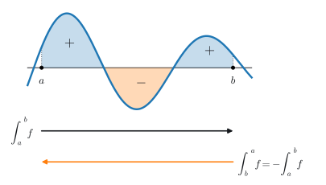
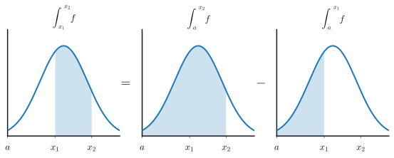
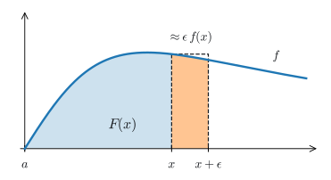
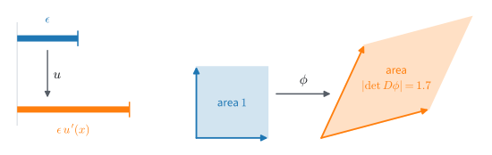
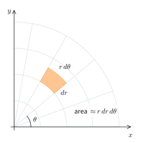
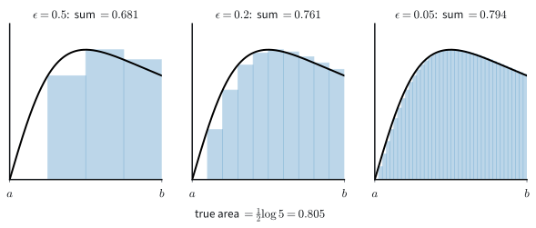
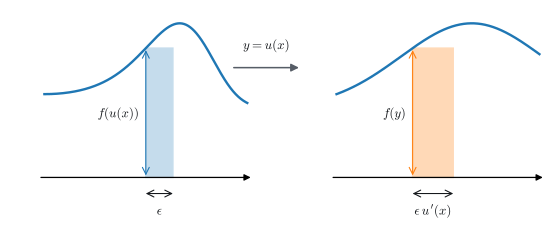
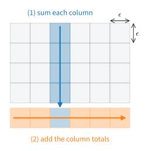

# Integral Calculus
:label:`sec_mdl-integral_calculus`

Earlier chapters used continuous random variables without asking how their
probabilities are computed. We described a normal distribution by its density
(:numref:`subsec_normal_distribution_and_squared_loss`), wrote an expected loss
as an average over that density, and treated both as given. In this section we
ask how to add up a quantity that is spread continuously over an interval.

The standard normal distribution, the familiar bell curve, shows why continuous
summation requires care. A standard normal random variable $Z$ has density
$p(z)=e^{-z^2/2}/\sqrt{2\pi}$. At $z=0$ the curve reaches height
$p(0)\approx 0.40$, yet the probability of landing on zero is $P(Z=0)=0$, and
the same is true for every other single point. Intervals, on the other hand, do
carry probability: $P(-1\le Z\le 1)\approx 0.68$. Geometrically, that number is
the area under $p$ between $-1$ and $1$, and $1/\sqrt{2\pi}$ is the constant
that makes the total area under the curve equal to $1$. Where does $\sqrt{2\pi}$
come from, and how do we compute $0.68$?

These questions reach well beyond the bell curve. Every probability and every
expected loss over a continuous variable is an area of this kind. Training a
model through random sampling, as variational autoencoders and policy-gradient
methods do, also requires differentiating such an area with respect to a model
parameter.

Our strategy is simple: cut the area into thin slices, add their areas, and let
the slices shrink to zero. The limit is the integral. The fundamental theorem
of calculus then replaces this infinite addition with the reverse of
differentiation, which settles most integrals in a single line. It does not
settle the bell curve, whose normalizing constant $\sqrt{2\pi}$ requires a
detour through two dimensions. Three results anchor the section: the
fundamental theorem :eqref:`eq_mdl-ftc`, the multivariable change-of-variables
formula :eqref:`eq_mdl-change_var_nd`, and the Gaussian integral
:eqref:`eq_mdl-gaussian-integral`. If you already have first-year calculus at
hand, you can skim through to :numref:`subsec_mdl-improper-integrals`.
Differentiating an integral with respect to a parameter builds on all of these
tools and has a section of its own in :numref:`sec_mdl-expectation-gradients`.
We leave out measure theory and the Lebesgue integral, pointing interested
readers to :numref:`sec_mdl-calculus-further-reading`.

```{.python .input #integral-imports}
#@tab mxnet
import math
import numpy as np
from mxnet import autograd, gluon, init, np as mnp, npx
from mxnet.gluon import nn
from d2l import mxnet as d2l
npx.set_np()
```

```{.python .input #integral-imports}
#@tab pytorch
import math
import numpy as np
import torch
from torch import nn
from torch.nn import functional as F
from d2l import torch as d2l
```

```{.python .input #integral-imports}
#@tab tensorflow
import math
import numpy as np
import tensorflow as tf
from d2l import tensorflow as d2l
```

```{.python .input #integral-imports}
#@tab jax
import math
import numpy as np
import jax
from jax import numpy as jnp
from flax import nnx
import optax
from d2l import jax as d2l
```

## The Definite Integral

### Riemann Sums

A probability density gives probability per unit length, so over a short
interval of width $\epsilon$ the probability is approximately density times
width. Over a longer interval, we cut it into thin slices, multiply height by
width on each slice, and add the results. Nothing in this idea is specific to
densities: the same recipe works for any function.

Let us start with a case we can work out by hand. Take $f(x)=x^2$ on $[0,1]$
and divide the interval into $N$ slices of equal width $\epsilon=1/N$. On the
$i$-th slice $[i/N,(i+1)/N]$, we approximate the area by a rectangle whose
height is the value of $f$ at the left endpoint, $(i/N)^2$. Adding all $N$
rectangles gives

$$
\sum_{i=0}^{N-1}\frac1N\Bigl(\frac iN\Bigr)^2
=\frac{1}{N^3}\sum_{i=0}^{N-1}i^2
=\frac{(N-1)N(2N-1)}{6N^3}
=\frac13-\frac1{2N}+\frac1{6N^2},
$$

where the middle step uses the classical identity
$\sum_{i=0}^{N-1}i^2=(N-1)N(2N-1)/6$. As $N$ grows, the rectangle sums converge
to $\tfrac13$, missing the limit by roughly $\tfrac1{2N}$, an error of first
order in the slice width $\epsilon$.

The helper function `left_sum` implements this **left-endpoint rule** for any
function $f$: divide $[a,b]$ into slices of width $\epsilon$ and evaluate $f$
at the left end of each slice, as shown in :numref:`fig_mdl-riemann`. We will
use `left_sum` for every grid sum in this section, starting with a quick check
on $x^2$.

```{.python .input #mdl-integral-calculus-riemann-sums-1}
def left_sum(f, a, b, eps):
    """Left-endpoint Riemann sum of f on [a, b] with slices of width eps."""
    x = a + eps * np.arange(round((b - a) / eps))   # left ends of the slices
    return float(np.sum(eps * f(x)))

for N in [10, 100, 1000]:
    print(f'N={N:<5} left sum={left_sum(lambda x: x**2, 0, 1, 1 / N):.6f}  '
          f'formula={1/3 - 1/(2*N) + 1/(6*N**2):.6f}')
```

The numerical sums match the closed-form formula to every printed digit.

**The definition.** Nothing in this construction requires equal slice widths or
left endpoints. More generally, a *partition* $P:a=x_0<x_1<\cdots<x_N=b$ cuts
$[a,b]$ into subintervals, a *tag* $\xi_i\in[x_{i-1},x_i]$ picks one sample
point inside each slice, and the *mesh* $\|P\|=\max_i(x_i-x_{i-1})$ measures
the width of the widest slice. A bounded function $f$ is **Riemann integrable**
on $[a,b]$ if there is a single number $I$ that every tagged sum approaches as
the mesh shrinks to zero, regardless of how the tags are chosen:

$$
\int_a^b f(x)\,dx = I = \lim_{\|P\|\to0}\sum_{i=1}^N f(\xi_i)(x_i-x_{i-1}).
$$
:eqlabel:`eq_mdl-riemann`

In short, the definite integral is the common limit of the slice sums as the
slices become arbitrarily thin. Our hand calculation above establishes
$\int_0^1x^2\,dx=\tfrac13$. Every continuous function on $[a,b]$ is Riemann
integrable, and so is every bounded function with finitely many jump
discontinuities :cite:`Rudin.1976`. Some pathological bounded functions, such
as the indicator of the rational numbers, fail to have a Riemann integral; the
Lebesgue integral (:numref:`sec_mdl-calculus-further-reading`) extends
integration to them while agreeing with the Riemann integral whenever the
latter exists.

Two elementary properties follow straight from the definition and will power
the proofs below. First, the integral is **monotone**: if $f\le g$ everywhere
on $[a,b]$, then every tagged sum of $f$ is no larger than the corresponding
tagged sum of $g$, and taking limits preserves the inequality, giving
$\int_a^b f\,dx\le\int_a^b g\,dx$. Second, it is **additive over
subintervals**: for any $a\le b\le c$,
$\int_a^c f\,dx=\int_a^b f\,dx+\int_b^c f\,dx$, because any partition that
includes the point $b$ splits cleanly into a partition of $[a,b]$ and a
partition of $[b,c]$.

**The running example.** Until we reach the Gaussian integral, we will carry
one concrete example through the section:

$$
\int_0^2\frac{x}{1+x^2}\,dx=\tfrac12\log5\approx 0.80472.
$$

We will see why its value is $\tfrac12\log5$ once we establish the evaluation
rule :eqref:`eq_mdl-ftc-eval`. :numref:`fig_mdl-riemann` illustrates
left-endpoint rectangles under this curve at three slice widths.

![Left-endpoint rectangles under $f(x)=x/(1+x^2)$ on $[0,2]$ for slice widths $\epsilon=0.5$, $0.2$, and $0.05$. Each slice takes the height of $f$ at its left endpoint, and the rectangle sums approach the area $\tfrac12\log 5$ as $\epsilon\to0$.](../img/mdl-cal-riemann.svg)
:label:`fig_mdl-riemann`

How quickly do the left sums converge to $\tfrac12\log5$? For $x^2$ on $[0,1]$
the error was $\tfrac1{2N}=\tfrac\epsilon2$. If first-order convergence is
typical, making the slices ten times thinner should reduce the error by a
factor of ten. Let us check by printing the error alongside $0.2\,\epsilon$.

```{.python .input #integral-riemann-converge}
f = lambda x: x / (1 + x**2)
truth = math.log(5) / 2
for eps in [1e-1, 1e-2, 1e-3, 1e-4]:
    s = left_sum(f, 0, 2, eps)
    print(f'eps={eps:.0e}  sum={s:.6f}  truth-sum={truth - s:.2e}  '
          f'0.2*eps={0.2 * eps:.0e}')
print(f'truth = (1/2) log 5 = {truth:.6f}')
```

Each time $\epsilon$ shrinks by a factor of ten, the error shrinks by ten as
well, and every sum sits below the true value. The constant $0.2$ happens to be
half of $f(2)-f(0)=0.4$. This is no coincidence, and we will derive the formula
behind it as soon as the fundamental theorem is in place.

### Signed Area

Rectangles below the horizontal axis have negative height $f(\xi_i)<0$ and
enter the Riemann sum with a minus sign. The integral therefore measures
*signed* area: regions where $f<0$ contribute negatively, as in
$\int_0^1(-1)\,dx=-1$. By convention, integrating from right to left also
negates the result, $\int_b^a f\,dx=-\int_a^b f\,dx$. This convention ensures
that additivity holds regardless of how $a$, $b$, and $c$ are ordered.
:numref:`fig_mdl-signed-area` illustrates both conventions on a single curve.


:label:`fig_mdl-signed-area`

## The Fundamental Theorem

### The Theorem

Adding slices gave $\tfrac13$ for $x^2$ only because $\sum i^2$ happens to have
a closed form. For our running example, the left sum is
$\sum_i\epsilon\cdot i\epsilon/(1+i^2\epsilon^2)$, and no algebraic identity
collapses it. We need a way to evaluate integrals without adding slices at all.

The breakthrough comes from treating the upper limit as a variable. Fix a base
point $a$ and define the **area-so-far function**

$$
F(x) = \int_a^x f(y)\,dy,
$$
:eqlabel:`eq_mdl-area-fn`

which records the signed area accumulated from $a$ out to $x$. This single
function encodes every definite integral of $f$: by additivity, the area over
any interval $[x_1,x_2]$ is simply the difference of two accumulated areas,

$$
\int_{x_1}^{x_2} f(x)\,dx = F(x_2) - F(x_1),
$$

as shown in :numref:`fig_mdl-area-subtract`. Finding $F$ therefore solves the
whole problem.


:label:`fig_mdl-area-subtract`

How does $F$ change when we nudge $x$ slightly to the right?
:numref:`fig_mdl-ftc-sliver` shows the accumulated area up to $x$ alongside the
thin strip of width $\epsilon$ added by moving to $x+\epsilon$. That strip is
nearly a rectangle of height $f(x)$, so $F(x+\epsilon)-F(x)\approx\epsilon f(x)$.
Dividing by $\epsilon$ suggests that $F'(x)=f(x)$.


:label:`fig_mdl-ftc-sliver`

**Theorem (Fundamental theorem of calculus).** *Let $f$ be Riemann integrable
on $[a,b]$, let $F(x)=\int_a^x f(y)\,dy$, and let $f$ be continuous at a point
$x\in(a,b)$. Then $F$ is differentiable at $x$ and*

$$
\frac{dF}{dx}(x) = f(x).
$$
:eqlabel:`eq_mdl-ftc`

*In words, the rate at which area accumulates equals the current height of the
curve.*

**Proof.** Nudge $x$ by $\epsilon>0$ and look at the added area. By
:eqref:`eq_mdl-area-fn` and additivity, the change is a single sliver,

$$
F(x+\epsilon) - F(x) = \int_x^{x+\epsilon} f(y)\,dy .
$$

Let $m_\epsilon = \inf_{[x,x+\epsilon]} f$ and
$M_\epsilon = \sup_{[x,x+\epsilon]} f$ be the tightest constant bounds on $f$
over this sliver; both are finite because an integrable function is bounded.
Since $m_\epsilon\le f\le M_\epsilon$ throughout $[x,x+\epsilon]$, monotonicity
of the integral traps the sliver's area between two rectangles of width
$\epsilon$:

$$
\epsilon\, m_\epsilon
\ \le\ F(x+\epsilon) - F(x)\ \le\
\epsilon\, M_\epsilon .
$$

Now divide through by $\epsilon$. Because $f$ is continuous at $x$, for any
$\delta>0$ the entire interval $[x,x+\epsilon]$ eventually lies inside the
region where $|f(y)-f(x)|<\delta$. Both $m_\epsilon$ and $M_\epsilon$ therefore
converge to $f(x)$ as $\epsilon \to 0$, and the squeeze forces
$\lim_{\epsilon\to 0}\frac{F(x+\epsilon)-F(x)}{\epsilon}=f(x)$. When
$\epsilon<0$, the sliver sits to the left of $x$, and the same bounds hold with
both sign flips canceling in the difference quotient. That limit is $F'(x)$.
$\blacksquare$

Notice that the proof used only monotonicity and additivity, the two properties
we read off the definition. The theorem turns the problem of finding an area
into the problem of finding an **antiderivative**, a function $G$ satisfying
$G'=f$, which we can often read straight off the derivative table in
:numref:`sec_mdl-derivative_table`. Any antiderivative yields the definite
integral via the **evaluation rule**: *if $f$ is continuous on $[a,b]$ and
$G'=f$ on all of $[a,b]$, then*

$$
\int_a^b f(x)\,dx = G(b) - G(a).
$$
:eqlabel:`eq_mdl-ftc-eval`

Why does any antiderivative work, not just $F$? Because $F$ and $G$ share the
same derivative $f$ on $(a,b)$, so their difference $G-F$ has derivative zero
and must be constant by the mean value theorem (:numref:`sec_mdl-mvt`). That
additive constant cancels out in $G(b)-G(a)=F(b)-F(a)=\int_a^b f\,dx$.

The requirement "on all of $[a,b]$" is essential. Since $(-1/x)'=x^{-2}$,
blindly applying the rule gives $\int_{-1}^1x^{-2}\,dx=[-1/x]_{-1}^1=-2$, a
negative answer for a strictly positive integrand. The rule does not apply here
because $G'=f$ breaks down at $x=0$, where neither function is defined; in fact
the integral diverges (:numref:`subsec_mdl-improper-integrals`).

Read backwards, every derivative formula becomes an integral: $(y^3)'=3y^2$
gives $\int_0^1y^2\,dy=\tfrac13$ without a single slice, and $(e^t)'=e^t$ gives
$\int_0^xe^t\,dt=e^x-1$. For our running example, try
$G(x)=\tfrac12\log(1+x^2)$. By the chain rule,
$G'(x)=\tfrac12\cdot\frac{2x}{1+x^2}=\frac{x}{1+x^2}$, so

$$
\int_0^2\frac{x}{1+x^2}\,dx=G(2)-G(0)=\tfrac12\log5-\tfrac12\log1=\tfrac12\log5,
$$

confirming the limit our Riemann sums were approaching.

**The error of the left rule.** The evaluation rule also explains where the
constant $0.2$ in the left-sum error came from. On the slice starting at $x_i$,
a first-order expansion gives $f(x)\approx f(x_i)+f'(x_i)(x-x_i)$. Integrating
over $[x_i,x_i+\epsilon]$ shows that the true area of the slice exceeds its
rectangle $\epsilon f(x_i)$ by roughly $\tfrac{\epsilon^2}2f'(x_i)$. Summing
these triangular excesses across all slices yields $\tfrac\epsilon2$ times a
left sum of $f'$, which approximates
$\tfrac\epsilon2\int_a^bf'\,dx=\tfrac\epsilon2(f(b)-f(a))$. To first order in
$\epsilon$,

$$
\text{left sum}-\int_a^b f(x)\,dx\approx\frac\epsilon2\bigl(f(a)-f(b)\bigr).
$$

For $x^2$ on $[0,1]$ this gives $-\tfrac\epsilon2=-\tfrac1{2N}$, matching the
leading error term we found by hand. For the running example, $f(0)=0$ and
$f(2)=0.4$ give $-0.2\,\epsilon$. This estimate is numerical analysis rather
than pure calculus, yet it accounts for the residual error in three more
experiments in this section and serves as the baseline against which random
sampling is judged in :numref:`subsec_mdl-monte-carlo`.

The fundamental theorem actually tells us more than $\int_0^2f=G(2)-G(0)$: the
area-so-far function $F(x)$ must equal $G(x)-G(0)$ at every $x$. Let us verify
this by computing $F$ as a cumulative left sum across $[0,2]$ and comparing it
with $G(x)-G(0)$ at every grid point. The two will not match to machine
precision, because the left sum on $[0,x]$ carries the bias
$\tfrac\epsilon2\bigl(f(0)-f(x)\bigr)$. That bias is largest where $f$ peaks,
at $x=1$ where $f(1)=\tfrac12$, so the maximum discrepancy across the interval
should be $\tfrac\epsilon4$.

```{.python .input #integral-ftc-check}
G = lambda x: np.log(1 + x**2) / 2             # antiderivative of f
for eps in [1e-2, 1e-3, 1e-4]:
    x = eps * np.arange(round(2 / eps))        # left ends of the slices of [0, 2]
    F = np.cumsum(eps * f(x))                  # F[k]: left sum on [0, x_k + eps]
    gap = np.abs(F - (G(x + eps) - G(0))).max()
    print(f'eps={eps:.0e}  max over x of |F(x) - (G(x) - G(0))| = {gap:.2e}')
```

At every slice width, the maximum discrepancy is $\tfrac\epsilon4$, just as
predicted. The cumulative sum tracks the antiderivative across the entire
interval, not only at the right endpoint $x=2$.

### Improper Integrals
:label:`subsec_mdl-improper-integrals`

The normal, exponential, and many other probability densities live on unbounded
domains, whereas :eqref:`eq_mdl-riemann` defines integrals only over a finite
interval $[a,b]$. We extend the definition the same way we built it, by taking
a limit. The **improper integral** over $[a,\infty)$ is

$$
\int_a^\infty f(x)\,dx = \lim_{b\to\infty}\int_a^b f(x)\,dx ,
$$
:eqlabel:`eq_mdl-improper`

the area accumulated out to $b$ in the limit of large $b$. If this limit exists
and is finite, the integral *converges*; otherwise it *diverges*. To integrate
over the entire real line, we split $\int_{-\infty}^\infty f\,dx$ at any
convenient point into two one-sided improper integrals, and *both* must
converge independently. A symmetric limit is not enough: $\int_{-b}^b x\,dx=0$
for every $b$, yet $\int_0^\infty x\,dx=\infty$, so $\int_{-\infty}^\infty
x\,dx$ does not exist.

The power law $x^{-s}$ (with exponent $s>0$) is the standard benchmark for
deciding whether a tail decays fast enough to enclose finite area. Applying the
evaluation rule on $[1,b]$ and taking $b\to\infty$ gives

$$
\int_1^b x^{-s}\,dx = \frac{b^{1-s}-1}{1-s}
\ \xrightarrow{\ b\to\infty\ }\
\begin{cases} \dfrac{1}{s-1}, & s>1\ \text{(converges)},\\[1ex] \infty, & s\le 1\ \text{(diverges)}.\end{cases}
$$

(At $s=1$ the expression reads $0/0$; the definite integral is $\log b$, which
is the limit of the formula as $s\to 1$ and diverges as $b\to\infty$.) Thus
$\int_1^\infty x^{-2}\,dx=1$ whereas $\int_1^\infty x^{-1}\,dx=\infty$: the
dividing line between finite and infinite area lies right at $s=1$.

Power laws are the canonical **heavy-tailed** distributions
(:numref:`sec_mdl-random_variables`, which also examines how heavy tails affect
averages). For a density with tail $p(x)\propto x^{-s}$, the normalizing
constant is finite only when $s>1$, and the mean, tested by applying the same
criterion to $x\cdot x^{-s}=x^{1-s}$, is finite only when $s>2$.

The same limiting device handles an integrand that blows up at an endpoint:
$\int_0^1 f\,dx=\lim_{a\to0^+}\int_a^1 f\,dx$. For the power law $x^{-s}$, the
condition reverses:

$$
\int_0^1x^{-s}\,dx=\lim_{a\to0^+}\frac{1-a^{1-s}}{1-s}=\frac1{1-s}\quad\text{for } s<1,
$$

while the integral diverges for $s\ge1$. At $s=\tfrac12$, for instance,
$x^{-1/2}$ shoots to infinity at $0$, yet the area under it is only $2$. Near
infinity, a power law must fall faster than $1/x$ to have finite area; near
zero, it must grow more slowly than $1/x$.

When we approximate an improper integral numerically, two distinct errors enter:
we cut off the domain at a finite $b$, and we sum slices of finite width
$\epsilon$. For $\int_0^\infty e^{-x}\,dx = 1$, we can separate the two. Below
we print the exact partial integral $\int_0^b e^{-x}\,dx = 1-e^{-b}$ (from the
antiderivative $-e^{-x}$) next to a left sum with $\epsilon = 10^{-3}$.

```{.python .input #integral-improper}
for b in [1, 2, 5, 10, 20]:
    left = left_sum(lambda x: np.exp(-x), 0, b, 1e-3)
    print(f'b={b:<3}  left sum={left:.6f}  exact 1-e^-b={1 - math.exp(-b):.6f}')
```

The exact partial integrals converge to $1$ rapidly: the *truncation error*
from stopping at $b$ is $e^{-b}$, already below the sixth decimal place by
$b=20$. The left sums, however, settle near $1.0005$ rather than $1$. That
residual is *discretization error*, our left-rule bias
$\tfrac{\epsilon}{2}\bigl(f(0)-f(b)\bigr)\to\tfrac{\epsilon}{2}=0.0005$. To
leading order the two errors simply add: pushing $b$ higher removes truncation
error, while shrinking $\epsilon$ removes discretization error.

### Integration by Parts
:label:`subsec_mdl-integration-by-parts`

Every differentiation rule, read through the evaluation rule, yields a
matching integration rule. The product rule becomes integration by parts.

For continuously differentiable functions $u$ and $v$ on $[a,b]$,

$$
\int_a^b u(x)\,v'(x)\,dx
= \Bigl[\,u(x)\,v(x)\,\Bigr]_a^b - \int_a^b u'(x)\,v(x)\,dx ,
$$
:eqlabel:`eq_mdl-parts`

where $[\,h(x)\,]_a^b$ is shorthand for $h(b)-h(a)$. The proof takes one line:
by the product rule, $uv$ is an antiderivative of $u'v + uv'$, so
:eqref:`eq_mdl-ftc-eval` gives
$\int_a^b (u'v + uv')\,dx = [\,u(x)v(x)\,]_a^b$, and subtracting
$\int_a^b u'v\,dx$ from both sides yields :eqref:`eq_mdl-parts`.

What this formula does is shift a derivative from one factor onto the other at
the cost of a boundary term. It pays off whenever the new integrand $u'v$ is
simpler than $uv'$. Choosing $u(x)=x$ and $v'(x)=e^{-x}$ (so $u'=1$ and
$v=-e^{-x}$), applying :eqref:`eq_mdl-parts` on $[0,b]$, and letting
$b\to\infty$ gives

$$
\int_0^\infty x\,e^{-x}\,dx
= \Bigl[\,-x\,e^{-x}\,\Bigr]_0^\infty + \int_0^\infty e^{-x}\,dx
= 0 + 1 = 1 .
$$

The boundary term vanishes because $x e^{-x}\to 0$ at both endpoints, leaving
the improper integral we just evaluated. This integral is the mean of the
exponential distribution (:numref:`sec_mdl-distributions`).

Because expectations are integrals of products, a recurring trick in
probability and machine learning is to shift a derivative off an intractable
factor and onto a tractable one. The bell curve shows this technique at its
cleanest. Consider the unnormalized bell weight $w(z)=e^{-z^2/2}$, which
satisfies $w'(z)=-z\,w(z)$. Let $g$ be continuously differentiable with
$g(z)w(z)\to0$ as $z\to\pm\infty$, and suppose the two integrals below
converge. Integrating by parts on $[-a,b]$ and then taking $a\to\infty$ and
$b\to\infty$ separately yields

$$
\int_{-\infty}^{\infty}g'(z)\,w(z)\,dz
=\Bigl[\,g(z)\,w(z)\,\Bigr]_{-\infty}^{\infty}-\int_{-\infty}^{\infty}g(z)\,w'(z)\,dz
=\int_{-\infty}^{\infty}z\,g(z)\,w(z)\,dz .
$$
:eqlabel:`eq_mdl-stein-1d`

Under the bell weight, multiplying by $z$ has the same effect as
differentiating $g$. Both hypotheses hold for every polynomial $g$. Taking
$g(z)=z$ gives $\int z^2 w\,dz=\int w\,dz$: the mean of $z^2$ under the bell
weight is $1$, regardless of what the normalizing constant $\int w\,dz$ turns
out to be (we will show it is $\sqrt{2\pi}$ in
:eqref:`eq_mdl-normal-normalizer`). Taking $g(z)=z^3$ gives
$\int z^4 w\,dz=3\int z^2 w\,dz=3\int w\,dz$, so the mean of $z^4$ is $3$. Once
$w$ is normalized into the standard normal density $p=w/\sqrt{2\pi}$, this
becomes $\mathbb{E}[g'(Z)]=\mathbb{E}[Z\,g(Z)]$, known as Stein's identity for
the standard normal. Shifting a derivative from an unknown factor onto a known
one is also the key step behind score matching
(:numref:`sec_mdl-score-matching-diffusion-flow`, :cite:`Hyvarinen.2005`). In
$\mathbb{R}^d$, the corresponding rule moves a divergence instead of a
one-dimensional derivative; :numref:`sec_mdl-dyn-vector-calculus` introduces
the divergence, the Laplacian, and that multivariable identity where they are
first needed.

### Substitution

Reading the chain rule backwards through the evaluation rule produces the
substitution rule. Suppose $u$ is continuously differentiable on $[a,b]$ and
$f$ is continuous on an interval containing $u([a,b])$, with antiderivative
$G$. By the chain rule, $(G\circ u)'(x)=f(u(x))\,u'(x)$, so

$$
\int_a^b f(u(x))\,u'(x)\,dx=\int_a^b (G\circ u)'(x)\,dx=G(u(b))-G(u(a))=\int_{u(a)}^{u(b)}f(y)\,dy .
$$

Read from right to left, this is the **change-of-variables formula**

$$
\int_{u(a)}^{u(b)} f(y)\,dy = \int_a^b f(u(x))\,\frac{du}{dx}\,dx .
$$
:eqlabel:`eq_mdl-change_var`

In words, an integral over $y$ can be rewritten as an integral over $x$
provided we multiply the integrand by the local stretch factor $du/dx$. Note
that $u$ does not even need to be monotone
(exercise :exref:`ex_mdl-integral-calculus-orientation`).

A single thin slice makes the stretch factor transparent. Partition $[a,b]$
into slices of width $\epsilon$. The map $u$ carries the slice at $x$ to a
slice of width approximately $\epsilon\,u'(x)$ at $y=u(x)$, where the curve has
height $f(y)=f(u(x))$. Its area is therefore $f(u(x))\,u'(x)\,\epsilon$, which
is the quantity the $x$-integral sums (:numref:`fig_mdl-rect-transform`).


:label:`fig_mdl-rect-transform`

In practice, substitution works by spotting the pattern $f(u(x))\,u'(x)$ inside
an integrand. In $\int_0^1 x\,e^{-x^2}\,dx$, set $u(x)=x^2$ so $u'(x)=2x$: the
integrand is $\tfrac12 e^{-u(x)}u'(x)$, and

$$
\int_0^1x\,e^{-x^2}\,dx=\frac12\int_0^1e^{-y}\,dy=\frac{1-e^{-1}}2\approx 0.316 .
$$

Here the factor $x$ supplied the $u'(x)$ that substitution needs. Remove that
$x$ and we are left with $\int e^{-x^2}\,dx$, which has no elementary
antiderivative and is the very integral behind the bell curve's normalizer
$1/\sqrt{2\pi}$. To evaluate it in :eqref:`eq_mdl-gaussian-integral`, we will
obtain the missing factor by moving to two dimensions and switching to polar
coordinates.

## Multiple Integrals

From this point on we quote two standard theorems without proof, both from
:cite:`Folland.1999`: Fubini's theorem and the multivariable change-of-variables
formula.

### Double Integrals and Fubini's Theorem

Because our route to $\int e^{-x^2}\,dx$ passes through two dimensions, we
first extend integration from intervals to regions of the plane. Consider the
two-dimensional bell surface $f(x,y)=e^{-x^2-y^2}$ over the square $[-2,2]^2$,
which encloses a volume above the base plane. We approximate that volume just
as we approximated areas: tile the base with $\epsilon\times\epsilon$ squares,
erect on each square a column of height $f$, and sum the column volumes
(:numref:`fig_mdl-bell-surface`). For a function $f$ on a rectangle
$R=[a,b]\times[c,d]$, the limit of these box sums as $\epsilon\to0$ is the
**double integral** $\iint_R f(x,y)\,dx\,dy$, the signed volume beneath the
surface.

![The bell surface $z=e^{-x^2-y^2}$ over the square $[-2,2]^2$. Tiling the base with $\epsilon\times\epsilon$ squares ($\epsilon=0.5$) and placing a box of height $f$ on each approximates the volume under the surface; the highlighted column of boxes at a fixed $x$ corresponds to one inner sum in Fubini's theorem.](../img/mdl-cal-bell-surface.svg)
:label:`fig_mdl-bell-surface`

How can we compute such a volume using our one-dimensional tools? Any finite
sum can be totaled in whatever order we like. Indexing the grid squares by $i$
along $x$ and $j$ along $y$, we can sum the boxes column by column
(:numref:`fig_mdl-sum-order`):

$$
\sum_{i,j}\epsilon^2 f(a+\epsilon i,c+\epsilon j)
=\sum_i \epsilon\Bigl(\sum_j \epsilon\, f(a+\epsilon i,c+\epsilon j)\Bigr).
$$

The inner sum is the left-endpoint approximation to
$\int_c^d f(a+\epsilon i,y)\,dy$, the cross-sectional area of the surface at
$x=a+\epsilon i$ (the highlighted column in :numref:`fig_mdl-bell-surface`),
and the outer sum integrates that slice area across $x$.


:label:`fig_mdl-sum-order`

Reordering a finite grid sum is elementary, but ensuring that the equality
survives the limit $\epsilon\to0$ requires a theorem and a condition.
**Fubini's theorem** states that if $f$ is **absolutely integrable** on $R$,
meaning $\iint_R|f(x,y)|\,dx\,dy<\infty$, then the double integral equals
either iterated integral:

$$
\iint_R f(x,y)\,dx\,dy
= \int_c^{d}\!\left(\int_a^{b} f(x,y)\,dx\right)dy
= \int_a^{b}\!\left(\int_c^{d} f(x,y)\,dy\right)dx .
$$
:eqlabel:`eq_mdl-fubini`

In geometric terms, a volume can be computed slice by slice in either direction.
When $f\ge0$, the same equality holds with no integrability check at all,
allowing all three sides to equal $+\infty$ (*Tonelli's theorem*).
Probability densities, squared losses, and other nonnegative integrands
therefore require no verification; for a signed integrand, however, we must
check $\iint|f|<\infty$ first. Fubini's theorem is at work whenever we
marginalize a variable out of a joint density or swap an expectation with
another integral.

The most common special case is a product integrand $f(x,y)=g(x)h(y)$. Because
$g(x)$ is constant with respect to $y$, it pulls straight out of the inner
integral, $\int_c^d g(x)h(y)\,dy=g(x)\int_c^d h(y)\,dy$, leaving

$$
\iint_R g(x)\,h(y)\,dx\,dy=\int_a^b g(x)\,dx\int_c^d h(y)\,dy .
$$
:eqlabel:`eq_mdl-fubini-product`

A product integrand integrates factor by factor. Crucially, the two-dimensional
bell factors in this way, $e^{-x^2-y^2}=e^{-x^2}e^{-y^2}$, and our evaluation
of the Gaussian integral below rests on this observation.

The absolute-integrability hypothesis is not a mere formality. Consider
$f(x,y)=(x^2-y^2)/(x^2+y^2)^2$ on $[0,1]^2$. A quick differentiation shows that
$\partial_y\bigl(y/(x^2+y^2)\bigr)=f(x,y)$, so the evaluation rule gives
$\int_0^1 f(x,y)\,dy=\frac1{1+x^2}$ for $x>0$, and integrating over $x$ yields
$\int_0^1\frac{dx}{1+x^2}=\arctan 1=\frac\pi4$. Yet $f(x,y)=-f(y,x)$, so
integrating in the reverse order gives $-\frac\pi4$. The two orders disagree
because $\iint|f|=\infty$: near the origin, $|f|$ grows like the inverse
square of the distance, and its total volume diverges.

When the domain $D$ is not a rectangle, $\int_D f(\mathbf x)\,d\mathbf x$ is
defined by *zero-extension*: set $f$ to $0$ outside $D$ and integrate over any
rectangle that contains $D$.

### Change of Variables in Many Dimensions

The one-dimensional stretch factor $du/dx$ generalizes naturally to higher
dimensions, and linear maps already show the form it must take. A linear map
scales every area or volume by the absolute value of its determinant
(:numref:`sec_mdl-linear-maps`), while the sign of the determinant merely
tracks orientation. For example, the map $\boldsymbol\phi(u,v)=(au,bv)$ with
$a,b>0$ has determinant $ab$ and stretches the unit disc (of area $\pi$) into
the ellipse $x^2/a^2+y^2/b^2\le1$, whose area is therefore $\pi ab$.

Locally, a smooth nonlinear map looks linear, with its Jacobian matrix serving
as the linear approximation; the volume scale factor simply varies from point
to point. Let $\Omega\subseteq\mathbb{R}^n$ be open and let
$\boldsymbol{\phi}:\Omega\to\mathbb{R}^n$ be a **$C^1$-diffeomorphism** onto
its image: $\boldsymbol{\phi}$ is continuously differentiable and injective,
and its Jacobian $\mathbf J_{\boldsymbol\phi}$ (the matrix of partial
derivatives from :numref:`sec_mdl-matrix-calculus`) satisfies
$\det\mathbf J_{\boldsymbol\phi}(\mathbf{x})\neq 0$ everywhere on $\Omega$.
Injectivity prevents the map from folding space onto itself, and a nonzero
determinant prevents it from flattening a region to a lower dimension. Under
these conditions, for any absolutely integrable $f$,

$$
\int_{\boldsymbol{\phi}(\Omega)} f(\mathbf{y})\,d\mathbf{y}
= \int_{\Omega} f(\boldsymbol{\phi}(\mathbf{x}))\,
  \bigl|\det \mathbf J_{\boldsymbol\phi}(\mathbf{x})\bigr|\,d\mathbf{x}.
$$
:eqlabel:`eq_mdl-change_var_nd`

An infinitesimal cube of volume $d\mathbf x$ at $\mathbf x$ maps to an
infinitesimal parallelepiped of volume
$|\det\mathbf J_{\boldsymbol\phi}(\mathbf x)|\,d\mathbf x$ at
$\mathbf y=\boldsymbol\phi(\mathbf x)$, and the Jacobian determinant adjusts
the integrand for that local distortion. :numref:`fig_mdl-cov-jacobian` places
the one- and two-dimensional pictures side by side.


:label:`fig_mdl-cov-jacobian`

Why does :eqref:`eq_mdl-change_var_nd` carry the absolute value
$|\det\mathbf J_{\boldsymbol\phi}|$ rather than $\det\mathbf J_{\boldsymbol\phi}$?
Because the left-hand side integrates over an unoriented set, not between
ordered endpoints. In one dimension, the order of the limits carries the sign:
if $u$ is decreasing, the limits in :eqref:`eq_mdl-change_var` run backwards
while $u'<0$, so the two minus signs cancel and we can equivalently integrate
over the image interval with $|u'|$. Regions in $\mathbb R^n$ have no natural
ordering, so only this unsigned form generalizes
(exercise :exref:`ex_mdl-integral-calculus-orientation`).

When $f$ is a probability density, :eqref:`eq_mdl-change_var_nd` tells us how
a density transforms under a smooth invertible map, which is how a normalizing
flow computes the density of its output (:eqref:`eq_mdl-cov_density` in
:numref:`sec_mdl-joint-distributions`).

### The Gaussian Integral

The normalizing constant $1/\sqrt{2\pi}$ of the bell curve comes from the
one-dimensional integral $\int_{-\infty}^\infty e^{-x^2}\,dx$. Here the
fundamental theorem cannot give us a closed form: an antiderivative certainly
exists because $e^{-x^2}$ is continuous, but it is a genuinely new function
that cannot be written in terms of elementary ones. Surprisingly, the integral
over the entire real line can still be evaluated in closed form by taking a
detour through two dimensions. The argument takes three steps and is the most
elegant calculation in the section. (Normalized, the antiderivative is the
**error function** $\operatorname{erf}(x)=\frac2{\sqrt\pi}\int_0^x
e^{-t^2}\,dt$, which tends to $1$ as $x\to\infty$ by the result we are about
to prove; standard libraries provide it as `math.erf`.)

**I. Square and factor.** On the square $[-b,b]^2$, the product rule
:eqref:`eq_mdl-fubini-product` gives
$\iint_{[-b,b]^2}e^{-x^2-y^2}\,dx\,dy=\bigl(\int_{-b}^b e^{-x^2}\,dx\bigr)^2$.
Letting $b\to\infty$ on both sides yields

$$
\left(\int_{-\infty}^{\infty} e^{-x^2}\,dx\right)^{\!2}
= \lim_{b\to\infty}\iint_{[-b,b]^2} e^{-x^2-y^2}\,dx\,dy
= \iint_{\mathbb R^2} e^{-x^2-y^2}\,dx\,dy .
$$
:eqlabel:`eq_mdl-gauss-square`

The square of our one-dimensional integral is simply the volume under the
two-dimensional bell, and that surface is rotationally symmetric around the
origin.

**II. Polar coordinates.** Rotational symmetry invites polar coordinates,
$\boldsymbol{\phi}(r,\theta)=(r\cos\theta, r\sin\theta)$, on the open set
$\Omega=(0,\infty)\times(0,2\pi)$, where the map is injective. Its Jacobian
determinant is

$$
\bigl|\det \mathbf J_{\boldsymbol\phi}\bigr|
= \left|\det\begin{bmatrix}\cos\theta & -r\sin\theta\\ \sin\theta & r\cos\theta\end{bmatrix}\right|
= r(\cos^2\theta + \sin^2\theta) = r .
$$

Geometrically, a polar cell with radial side $dr$ and arc length $r\,d\theta$
has area approximately $r\,dr\,d\theta$ (:numref:`fig_mdl-polar-cell`),
reflecting the fact that cells farther from the origin are wider. Crucially,
this factor $r$ supplies the missing factor $x$ from our substitution example
$\int_0^1 x\,e^{-x^2}\,dx$.


:label:`fig_mdl-polar-cell`

**III. Integrate.** Applying :eqref:`eq_mdl-change_var_nd` and using the
antiderivative $-\tfrac12 e^{-r^2}$ of $r e^{-r^2}$, we obtain

$$
\iint_{\mathbb{R}^2} e^{-x^2-y^2}\,dx\,dy
= \int_0^{2\pi}\!\!\int_0^\infty r\,e^{-r^2}\,dr\,d\theta
= 2\pi\cdot\frac12 = \pi .
$$

Taking the positive square root of :eqref:`eq_mdl-gauss-square` gives

$$
\int_{-\infty}^{\infty} e^{-x^2}\,dx = \sqrt{\pi} .
$$
:eqlabel:`eq_mdl-gaussian-integral`

Thus the total area under $e^{-x^2}$ is $\sqrt\pi\approx 1.7725$.

Three technical points make this argument completely rigorous. First, because
the integrand is nonnegative, integrals over expanding squares and over
expanding discs converge to the same limit: every disc fits inside some square
and every square inside some disc, so the shape of the growing region does not
matter. Second, the polar map omits the nonnegative ray $\theta=0$, which has
zero area and contributes nothing to the integral. Third, we apply the change
of variables on the bounded rectangles $(0,b)\times(0,2\pi)$, where the
integrand is bounded and continuous, and let $b\to\infty$ afterward.

The normalizing constant of the standard normal now follows from a single
substitution. Setting $z=\sqrt2\,x$ in :eqref:`eq_mdl-change_var` gives

$$
\int_{-\infty}^{\infty}e^{-z^2/2}\,dz=\sqrt2\int_{-\infty}^{\infty}e^{-x^2}\,dx=\sqrt{2\pi}.
$$
:eqlabel:`eq_mdl-normal-normalizer`

Dividing the bell $e^{-z^2/2}$ by $\sqrt{2\pi}\approx 2.5066$ scales its total
area to $1$, which is where the constant in the standard normal density comes
from.

Let us check step I numerically: do the expanding squares $[-b,b]^2$ really
exhaust the plane and converge to $\pi$? The code below computes the
two-dimensional grid sum over $[-b,b]^2$ at $\epsilon=0.01$ alongside the exact
square volume $\bigl(\int_{-b}^b e^{-x^2}\,dx\bigr)^2=\pi\operatorname{erf}(b)^2$
and the limiting value $\pi$.

```{.python .input #integral-gaussian}
eps = 0.01
for b in [1, 2, 3, 6]:
    g = -b + eps * np.arange(round(2 * b / eps))    # left ends of the slices
    x, y = np.meshgrid(g, g, indexing='ij')
    grid = np.sum(eps**2 * np.exp(-x**2 - y**2))
    print(f'b={b}  grid sum={grid:.6f}  pi*erf(b)^2={math.pi * math.erf(b)**2:.6f}'
          f'  pi={math.pi:.6f}')
```

The grid sums track $\pi\operatorname{erf}(b)^2$ closely and climb to $\pi$; by
$b=3$, the volume left outside the square is only about $10^{-4}$. Agreement to
four or more decimal places at $\epsilon=0.01$ has a simple explanation: for an
even integrand on a symmetric interval, the left rule's first-order bias
$\tfrac\epsilon2\bigl(f(-b)-f(b)\bigr)$ vanishes identically.

We can now compute the standard normal probability $P(-1\le Z\le1)\approx0.68$
as well. Substituting $z=\sqrt2\,t$ turns the area under
$p(z)=e^{-z^2/2}/\sqrt{2\pi}$ into an error function:

$$
P(-1\le Z\le1)=\frac{1}{\sqrt{2\pi}}\int_{-1}^1e^{-z^2/2}\,dz
=\frac{1}{\sqrt\pi}\int_{-1/\sqrt2}^{1/\sqrt2}e^{-t^2}\,dt
=\operatorname{erf}\bigl(1/\sqrt2\bigr)\approx 0.683 .
$$

Both questions we asked about the bell curve are now answered, and the apparent
paradox that $p(0)\approx 0.40$ while $P(Z=0)=0$ disappears: a density measures
probability per unit length, and a single point is an interval of length zero.

One question from the opening remains open. Training a model through random
sampling requires knowing how an area of this kind changes when a parameter of
the density moves, and for that we need to differentiate an integral.

## Summary

The definite integral is the limit of sums of thin slices, measuring signed
area under a curve. The fundamental theorem of calculus replaces that limit
with antidifferentiation: because the area-so-far function satisfies $F'=f$,
any antiderivative $G$ gives $\int_a^b f\,dx=G(b)-G(a)$. Integration by parts
and substitution are the product and chain rules read backwards. In multiple
dimensions, Fubini's theorem reduces volume integrals to iterated
one-dimensional integrals, and the change-of-variables stretch factor becomes
$|\det\mathbf J_{\boldsymbol\phi}|$, the local volume distortion; combined with
polar coordinates, this yields $\int_{-\infty}^\infty e^{-x^2}\,dx=\sqrt\pi$
and the standard normal normalizing constant $\sqrt{2\pi}$.

## Exercises

1. [code] **Midpoint versus left rule.** The function `left_sum` evaluates
   the left-endpoint rule. The midpoint rule instead evaluates $f$ at the
   center of each slice of width $\epsilon$. On $[a,b]$ with
   $n=(b-a)/\epsilon$ slices and $x_i=a+i\epsilon$, it returns
   $\epsilon\sum_{i=1}^n f\bigl(x_{i-1}+\tfrac{\epsilon}{2}\bigr)$.
    1. The text derives the error of the left rule on $[a,b]$,
       $\tfrac{\epsilon}{2}\bigl(f(a)-f(b)\bigr)$, from a first-order
       expansion of $f$ on each slice. The left sum of $x^2$ on
       $[0,1]$ has error $-\tfrac1{2N}+\tfrac1{6N^2}$; which term does the
       expansion predict? Use the estimate to predict the errors that the
       text's cell prints at $\epsilon=10^{-1},\dots,10^{-4}$ for
       $\int_0^2 \tfrac{x}{1+x^2}\,dx$. Do the sums lie above or below
       $\tfrac12\log 5$?
    1. Implement both rules for an integrand $f$ on $[a,b]$. Evaluate
       $\int_1^2 \tfrac{1}{x}\,dx$ with an antiderivative, and tabulate the
       error of both rules for $\epsilon\in\{10^{-1},10^{-2},10^{-3}\}$. By
       what factor does each error shrink when $\epsilon$ shrinks by a factor
       of ten?
    1. Expand $f$ to second order about the center of each slice and show
       that the integral minus the midpoint sum is approximately
       $\tfrac{\epsilon^2}{24}\bigl(f'(b)-f'(a)\bigr)$. Compare this
       prediction with your table for $\int_1^2 \tfrac{1}{x}\,dx$. For which
       integrands does the midpoint rule underestimate the integral?

   *Adapted from MIT 18.01SC,
   [Unit 3 exercises](https://ocw.mit.edu/courses/18-01sc-single-variable-calculus-fall-2010/eaabc6c74a11402341dbc120fffa5ea5_MIT18_01SC_pset3prb.pdf),
   Problems 3G-1 and 3G-5.*
   :exlabel:`ex_mdl-integral-calculus-midpoint-rule`

1. **Activations as accumulated areas.** Let $H$ be the unit step, with
   $H(t)=1$ for $t>0$ and $H(t)=0$ for $t\le 0$. Let
   $\phi(t)=e^{-t^2/2}/\sqrt{2\pi}$ be the standard Gaussian density and
   $\Phi(x)=\int_{-\infty}^x \phi(t)\,dt$ its distribution function.
    1. Show that $\int_{-\infty}^{x} H(t)\,dt=\mathrm{ReLU}(x)$. Which
       hypothesis of the fundamental theorem :eqref:`eq_mdl-ftc` fails at
       $x=0$? What are the one-sided derivatives of the integral there?
    1. Write $\Phi(x)=\Phi(0)+\int_0^x \phi(t)\,dt$ to conclude that
       $\Phi'=\phi$. Then substitute $t=\sqrt2\,s$ to show that
       $\Phi(x)=\tfrac12\bigl(1+\operatorname{erf}(x/\sqrt2)\bigr)$.
    1. The GELU activation of :numref:`sec_mlp` is $x\Phi(x)$. Derive its
       derivative, find the points where the derivative is largest and
       smallest, and evaluate it there with `math.erf`. In which interval
       does the slope of GELU lie, and how does that interval compare with
       the slopes $0$ and $1$ of ReLU?
   :exlabel:`ex_mdl-integral-calculus-activation-areas`

1. **Heavy tails.** The *Pareto density* with tail index $\alpha>0$ is
   $p(x)=\alpha x^{-\alpha-1}$ for $x\ge 1$ and $p(x)=0$ otherwise. The
   *Cauchy density* is $p(x)=\tfrac{1}{\pi(1+x^2)}$ on $\mathbb R$.
    1. Show that the Pareto density is normalized for every $\alpha>0$.
       For which $\alpha$ are $\mathbb{E}[X]$ and $\mathbb{E}[X^2]$ finite?
       Compute $\mathbb{E}[X]$ where it is finite.
    1. Show that the Cauchy density is normalized, using the antiderivative
       $\arctan x$ of $\tfrac{1}{1+x^2}$.
    1. Show that $\int_{-b}^{b} x\,p(x)\,dx=0$ for the Cauchy density and
       every $b>0$. Why does the Cauchy density nevertheless have no mean
       under the definition of $\int_{-\infty}^{\infty}$ that follows
       :eqref:`eq_mdl-improper`? How fast does $\int_0^b x\,p(x)\,dx$ grow
       with $b$?
   :exlabel:`ex_mdl-integral-calculus-heavy-tails`

1. **Gamma function by parts.** The *Gamma function* is
   $\Gamma(t)=\int_0^\infty u^{t-1}e^{-u}\,du$. For $t<1$ the integrand is
   unbounded at $u=0$, and the integral near $0$ is defined by a limit,
   $\int_0^1=\lim_{a\to 0^+}\int_a^1$, as in :numref:`subsec_mdl-improper-integrals`.
    1. For which $t$ does the integral converge at $u=0$? Compare the
       condition with the test for $\int_0^1x^{-s}\,dx$ in :numref:`subsec_mdl-improper-integrals`.
    1. Integrate by parts :eqref:`eq_mdl-parts` at a general $t>0$ to show
       that $\Gamma(t+1)=t\,\Gamma(t)$, and conclude that $\Gamma(n+1)=n!$
       for every integer $n\ge 0$. Where does the argument use $t>0$? Use
       the result to compute the variance of the exponential density
       $e^{-u}$ on $u\ge 0$, whose mean we computed in :numref:`subsec_mdl-integration-by-parts`.
    1. Substitute $u=x^2$ and use the Gaussian integral
       :eqref:`eq_mdl-gaussian-integral` to evaluate $\Gamma(\tfrac12)$.
    1. The product rule :eqref:`eq_mdl-fubini-product`, applied $d$ times,
       gives $\int_{\mathbb R^d}e^{-\|\mathbf x\|^2}\,d\mathbf x=\pi^{d/2}$. In
       polar form the same integral is
       $S_{d-1}\int_0^\infty r^{d-1}e^{-r^2}\,dr$, where $S_{d-1}$ is the
       surface area of the unit sphere in $\mathbb R^d$. Show that the radial
       integral is $\tfrac12\Gamma(d/2)$ and deduce
       $S_{d-1}=2\pi^{d/2}/\Gamma(d/2)$. Integrate $S_{d-1}r^{d-1}$ over
       $r\in[0,1]$ to show that the unit ball has volume
       $V_d=\pi^{d/2}/\Gamma(d/2+1)$. Evaluate $V_d$ for
       $d\in\{1,2,3,5,10,20\}$ and explain why $V_d\to0$. A midpoint grid with
       three points per axis on the cube $[-1,1]^{10}$ has $3^{10}$ points;
       what fraction of them lies inside the unit ball, and what does that say
       about grids in high dimensions?
   :exlabel:`ex_mdl-integral-calculus-gamma-function`

1. **Orientation in substitution.** The one-dimensional rule
   :eqref:`eq_mdl-change_var` integrates between oriented limits and
   carries the factor $\frac{du}{dx}$. The $n$-dimensional rule
   :eqref:`eq_mdl-change_var_nd` integrates over a set and carries
   $\bigl|\det \mathbf J_{\boldsymbol{\phi}}\bigr|$.
    1. Let $u$ be continuously differentiable and strictly monotone on
       $[a,b]$, either increasing or decreasing. Show that

       $$\int_{u([a,b])} f(y)\,dy=\int_a^b f(u(x))\,|u'(x)|\,dx,$$

       where the left side integrates over the interval $u([a,b])$ from its
       smaller to its larger endpoint. Check the decreasing case with
       $u(x)=e^{-x^2}$ and $f=1$ on $[0,1]$.
    1. Take $u(x)=x^2$ on $[-1,1]$ and $f(y)=y$. Evaluate both sides of
       :eqref:`eq_mdl-change_var`, and both sides of the absolute-value form
       of (a). Which of the two forms remains valid for this $u$, which is
       not injective? Explain the discrepancy in the other form.
   :exlabel:`ex_mdl-integral-calculus-orientation`

1. **Swapping the order.** Fubini's theorem :eqref:`eq_mdl-fubini`, together
   with zero-extension for regions that are not rectangles, lets us choose
   the order of integration.
    1. The inner integral of
       $\int_0^1\bigl(\int_y^1 e^{-x^2}\,dx\bigr)\,dy$ has no elementary
       antiderivative. Sketch the triangular region of integration, reverse
       the order, and evaluate the integral in closed form.
    1. Let $X\ge 0$ have density $p$. Write $x=\int_0^x dt$ inside
       $\mathbb{E}[X]=\int_0^\infty x\,p(x)\,dx$ and swap the two integrals to
       show that $\mathbb{E}[X]=\int_0^\infty P(X>t)\,dt$. Why is the swap
       valid even when $\mathbb{E}[X]=\infty$? Check the formula on the
       density $\lambda e^{-\lambda x}$ for $x\ge 0$.
   :exlabel:`ex_mdl-integral-calculus-order-of-integration`

1. **Gaussian normalizers and moments.** The text normalizes the standard
   normal and computes its moments with the Stein identity
   :eqref:`eq_mdl-stein-1d` for the bell weight. Let
   $p(x)=\tfrac{1}{\sqrt{2\pi\sigma^2}}\exp\bigl(-\tfrac{(x-\mu)^2}{2\sigma^2}\bigr)$
   with $\sigma>0$.
    1. Substitute $x=\mu+\sigma z$ and use
       :eqref:`eq_mdl-normal-normalizer` to show that $p$ is normalized.
       Which $\mu$ and $\sigma^2$ does the density
       $\tfrac{1}{\sqrt\pi}e^{-x^2}$ have?
    1. Let $X$ have density $p$, and let $g$ be continuously differentiable with
       $g(x)\,p(x)\to 0$ as $x\to\pm\infty$. Use
       $p'(x)=-\tfrac{x-\mu}{\sigma^2}\,p(x)$ and integration by parts to
       show that

       $$\mathbb{E}\bigl[(X-\mu)\,g(X)\bigr]=\sigma^2\,\mathbb{E}\bigl[g'(X)\bigr].$$

       Deduce that $\mathbb{E}[(X-\mu)^2]=\sigma^2$ and
       $\mathbb{E}[(X-\mu)^4]=3\sigma^4$.
    1. Let $\boldsymbol\Sigma=\mathbf L\mathbf L^\top$ be a $d\times d$
       covariance matrix with invertible $\mathbf L$. Use the change of
       variables $\mathbf x=\mathbf L\mathbf z$ in
       :eqref:`eq_mdl-change_var_nd` and the product rule
       :eqref:`eq_mdl-fubini-product` to show that

       $$\int_{\mathbb R^d}\exp\bigl(-\tfrac12\mathbf x^\top\boldsymbol\Sigma^{-1}\mathbf x\bigr)\,d\mathbf x=(2\pi)^{d/2}\,(\det\boldsymbol\Sigma)^{1/2}.$$
   :exlabel:`ex_mdl-integral-calculus-gaussian-normalizers`

:begin_tab:`mxnet`
[Discussions](https://d2l.discourse.group/t/414)
:end_tab:

:begin_tab:`pytorch`
[Discussions](https://d2l.discourse.group/t/1092)
:end_tab:


:begin_tab:`tensorflow`
[Discussions](https://d2l.discourse.group/t/1093)
:end_tab:

:begin_tab:`jax`
[Discussions](https://d2l.discourse.group/t/1093)
:end_tab:

<!-- slides -->

::: {.slide}
::: {.cover}
[Dive into Deep Learning · §23.4]{.kicker}

Integral Calculus<br>**slices · the fundamental theorem · change of variables · the Gaussian integral**
:::
:::

::: {.slide title="A Density of 0.40 at Zero, yet P(Z = 0) = 0"}
[The problem]{.kicker}

The standard normal has density $p(z)=e^{-z^2/2}/\sqrt{2\pi}$.

- $p(0)=0.40$, yet no single point has positive probability.
- Intervals do: $P(-1\le Z\le 1)\approx 0.68$, the **area** under $p$.
- The constant $1/\sqrt{2\pi}$ makes the total area $1$.
- Training through sampling needs the **derivative** of such an area.

::: {.d2l-note .warn}
Where does $1/\sqrt{2\pi}$ come from, and how is $0.68$ computed?
:::
:::

::: {.slide title="By the End of This Deck You Can"}
[Goals]{.kicker}

- evaluate an integral by an antiderivative or by a symmetry;
- predict the error of a grid sum from the slice width;
- change variables in one and in many dimensions, and integrate the bell curve.

**Running examples:** $Z\sim\mathcal N(0,1)$; $\int_0^2\frac{x}{1+x^2}dx$.

**The idea:** thin slices add up; undo a derivative to add them.
:::

::: {.slide title="Integration Turns Rates Back into Totals"}
[Where this fits]{.kicker}

::: {.cols .vc}
::: {.col}
| section | adds |
|---|---|
| Single Variable Calculus | derivative, Taylor, corners |
| Multivariable Calculus | gradient, Hessian, critical points |
| The Chain Rule on Computational Graphs | sum over paths, backward pass |
| Matrix Calculus | Jacobians, a layer's backward rule |
| Automatic Differentiation | forward and reverse mode |
| **Integral Calculus** | **areas, change of variables, the Gaussian integral** |
| Expectations and Their Gradients | score-function and pathwise estimators |
:::

::: {.col .narrow}
- **Uses:** derivatives, chain rule, determinants.
- **Skips:** measure theory, Stokes' theorem.
:::
:::
:::

::: {.slide title="Thin Slices Add Up: the Integral Is a Limit of Sums"}
::: {.cols .vc}
::: {.col}
$\int_0^1x^2\,dx$ with $N$ slices tagged at the left end:

$$\sum_{i=0}^{N-1}\tfrac1N\bigl(\tfrac iN\bigr)^2=\tfrac13-\tfrac1{2N}+\tfrac1{6N^2}$$

- $N=10$: $0.285$; $100$: $0.3284$; $1000$: $0.3328$
- limit $\tfrac13$, error $\approx\tfrac1{2N}$
:::

::: {.col .fig}

:::
:::
:::

::: {.slide title="The Left Rule's Error Falls Like ε"}
$\int_0^2\frac{x}{1+x^2}\,dx=\tfrac12\log5$, slices of width $\epsilon$:

@!integral-riemann-converge

::: {.d2l-note}
Error $\approx\tfrac\epsilon2\bigl(f(a)-f(b)\bigr)=-0.2\,\epsilon$: half the
slice width times the change of $f$ from end to end.
:::
:::

::: {.slide title="Area Grows at the Height of the Curve, so ∫f = G(b) − G(a)"}
::: {.cols .vc}
::: {.col}
- Area-so-far $F(x)=\int_a^xf$; a strip of width $\epsilon$ adds
  $\approx\epsilon f(x)$, so $F'=f$.
- Any $G$ with $G'=f$: $\int_a^bf=G(b)-G(a)$.
- $G=\tfrac12\log(1+x^2)$ gives $\tfrac12\log 5$.
:::

::: {.col .fig}

:::
:::

[Needs $G'=f$ on all of $[a,b]$: $\int_{-1}^1x^{-2}dx\ne[-1/x]_{-1}^1=-2$.]{.small}
:::

::: {.slide title="∫₁^∞ x^(−s) dx Is Finite Only for s > 1"}
$$\int_1^b x^{-s}dx=\frac{b^{1-s}-1}{1-s}\ \to\ \frac1{s-1}\ (s>1),\quad\infty\ (s\le1)$$

$\int_0^\infty e^{-x}dx=1$ by exact partials and by left sums, $\epsilon=10^{-3}$:

@!integral-improper

::: {.d2l-note}
Truncation error $e^{-b}$; discretization error $\tfrac\epsilon2$.
Each knob fixes one error only.
:::
:::

::: {.slide title="Integration by Parts Moves the Derivative to the Other Factor"}
$$\int_a^b u\,v'\,dx = \bigl[\,u\,v\,\bigr]_a^b - \int_a^b u'\,v\,dx$$

- $u=x$, $v'=e^{-x}$: $\int_0^\infty xe^{-x}dx=0+1=1$.
- Bell weight $w=e^{-z^2/2}$, $w'=-zw$:
  $\int g'\,w\,dz=\int z\,g\,w\,dz$.
- $g=z$: the bell-weighted mean of $z^2$ is $1$; $g=z^3$: of $z^4$, $3$.
:::

::: {.slide title="Check: Two Integrals"}
[Check]{.kicker}

1. Is $\int_1^\infty x^{-3/2}\,dx$ finite? If so, what is it?
2. What is $\int_0^1 x\,e^{-x^2}\,dx$?

::: {.fragment .fade-up}
::: {.d2l-note}
**Answers.** (1) $s=\tfrac32>1$: the value is $\frac1{s-1}=2$.
(2) Substitute $y=x^2$: $\tfrac12\int_0^1e^{-y}dy=\tfrac{1-e^{-1}}2=0.316$.
:::
:::
:::

::: {.slide title="Substitution Is the Chain Rule Reversed: Match the Slivers"}
$$\int_{u(a)}^{u(b)} f(y)\,dy = \int_a^b f(u(x))\,u'(x)\,dx$$



Without the factor $x$, $\int e^{-x^2}dx$ has no elementary antiderivative.
:::

::: {.slide title="A Grid Sum Totals in Any Order: Fubini"}
::: {.cols .vc}
::: {.col}
$$\iint_R f = \int_a^b\!\Bigl(\int_c^d f\,dy\Bigr)dx = \int_c^d\!\Bigl(\int_a^b f\,dx\Bigr)dy$$

- products split: $\iint g(x)h(y)=\int g\int h$
- $\frac{x^2-y^2}{(x^2+y^2)^2}$ on $[0,1]^2$: the orders give $\pm\frac\pi4$
:::

::: {.col .fig}

:::
:::

[Needs $\iint|f|<\infty$, or $f\ge0$ (Tonelli).]{.small}
:::

::: {.slide title="The Jacobian Determinant Is the Local Volume Factor"}
$$\int_{\boldsymbol\phi(\Omega)} f(\mathbf y)\,d\mathbf y = \int_{\Omega} f(\boldsymbol\phi(\mathbf x))\,\bigl|\det\mathbf J_{\boldsymbol\phi}(\mathbf x)\bigr|\,d\mathbf x$$


$(u,v)\mapsto(2u,v)$: $|\det|=2$, so the ellipse $\tfrac{x^2}4+y^2\le1$
has area $2\pi$.

[$\boldsymbol\phi$ one-to-one and continuously differentiable on the open set
$\Omega$, with $\det\mathbf J_{\boldsymbol\phi}\ne0$; $f$ absolutely integrable.]{.small}
:::

::: {.slide title="Polar Coordinates Turn ∫ e^(−x²) dx into √π"}
::: {.cols .vc}
::: {.col}
I. $\bigl(\int e^{-x^2}dx\bigr)^2=\iint e^{-x^2-y^2}dx\,dy$ (product rule)

II. $x=r\cos\theta$, $y=r\sin\theta$: $|\det\mathbf J_{\boldsymbol\phi}|=r$

III. $\int_0^{2\pi}\!\int_0^\infty re^{-r^2}dr\,d\theta=2\pi\cdot\tfrac12=\pi$

$$\boxed{\int e^{-x^2}dx=\sqrt\pi,\quad \int e^{-z^2/2}dz=\sqrt{2\pi}}$$
:::

::: {.col .fig}

:::
:::
:::

::: {.slide title="Squares Exhaust the Plane: the Volume Tends to π"}
Grid sum of $e^{-x^2-y^2}$ over $[-b,b]^2$ at $\epsilon=0.01$:

@!integral-gaussian

::: {.d2l-note}
The square's value is $\pi\operatorname{erf}(b)^2$; by $b=3$ the volume
outside the square is about $10^{-4}$.
:::
:::

::: {.slide title="Probabilities Are Areas Under the Density"}
$$p\ge0,\quad\int p=1,\qquad P(a\le X\le b)=\int_a^bp(x)\,dx,\qquad P(X=x)=0$$

::: {.d2l-note}
$P(|Z|\le1)=\operatorname{erf}(1/\sqrt2)=0.683$: the $68\%$ we set out to compute.
$\mathbb{E}[Z^2]=1$ by the Stein identity.
:::
:::

::: {.slide title="Integration Accumulates Slices"}
[Wrap-up]{.kicker}

- Slices: $0.285\to\tfrac13$; error $\approx\tfrac\epsilon2(f(a)-f(b))$.
- Fundamental theorem: $\int_0^2\frac{x}{1+x^2}dx=\tfrac12\log5=0.805$.
- Polar coordinates: $\sqrt\pi$, so the normal constant is $\sqrt{2\pi}$.
- Densities: $P(|Z|\le1)=0.683$.

::: {.d2l-note}
Next: how such an area changes when a parameter moves, the gradient of an
expectation.
:::
:::
