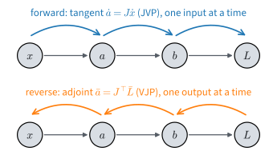
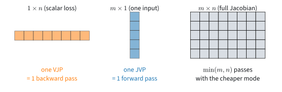
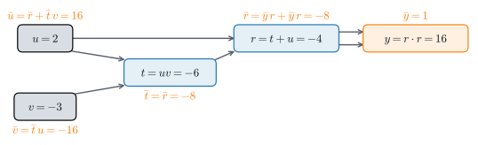
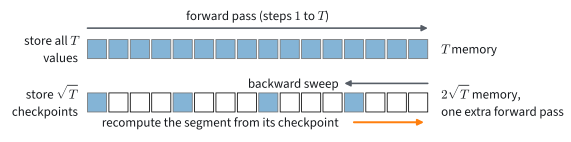

# Automatic Differentiation
:label:`sec_mdl-matrix-calculus-autodiff`

The previous sections extended derivatives from one variable to the gradient of
a scalar function of many variables. Neural network layers map vectors to
vectors and often have matrix-valued parameters, so their derivatives are
represented by *Jacobians*. This section develops matrix calculus and explains
the computational cost of automatic differentiation. Backpropagation is
reverse-mode automatic differentiation implemented through vector--Jacobian
products, while forward mode computes Jacobian--vector products. The dimensions
of a dense full Jacobian give the first cost comparison. Graph structure, repeated
products, sparsity, batching, and memory can alter that choice. We also derive
common matrix identities and implement both modes in compact Python examples.

We use the following imports throughout this section.

```{.python .input #matrix-calculus-autodiff-imports}
#@tab mxnet
from d2l import mxnet as d2l
from mxnet import autograd, npx
from mxnet import np as mnp
import numpy as np
npx.set_np()
```

```{.python .input #matrix-calculus-autodiff-imports}
#@tab pytorch
from d2l import torch as d2l
import numpy as np
import torch
```

```{.python .input #matrix-calculus-autodiff-imports}
#@tab tensorflow
from d2l import tensorflow as d2l
import numpy as np
import tensorflow as tf
```

```{.python .input #matrix-calculus-autodiff-imports}
#@tab jax
from d2l import jax as d2l
import numpy as np
import jax
from jax import numpy as jnp
```

## Forward-Mode AD and Dual Numbers
:label:`subsec_mdl-forward-mode`

Automatic differentiation evaluates a function *and* its derivative in one
sweep, to full numerical precision, by carrying
derivative information alongside every value. It is neither symbolic differentiation
(which manipulates formulas and can produce expressions that grow rapidly, as
the repeated terms in :numref:`sec_mdl-multivariable_calculus` showed) nor numerical differentiation
(finite differences, which trade off truncation against round-off error). It is
the chain rule, applied mechanically to the *program* that computes the
function :cite:`Baydin.Pearlmutter.Radul.ea.2018`. *Forward mode* is the simplest
incarnation, and its algebra is that of *dual numbers*.

### Dual Numbers: an Algebra That Carries Derivatives

Define a *dual number* $a+b\,\varepsilon$ by analogy with the complex numbers, but
with a new symbol $\varepsilon$ satisfying

$$
\varepsilon^2 = 0, \qquad \varepsilon\neq0.
$$
:eqlabel:`eq_mdl-dual-rule`

Think of $a$ as a value and $b$ as "the derivative riding along". The rule
$\varepsilon^2=0$ is the *exact* algebraic encoding of "discard second-order terms",
the very move we used to derive every differentiation rule in
:numref:`sec_mdl-single_variable_calculus`. Addition is componentwise, and
multiplication, dropping the $\varepsilon^2$ term, is

$$
(a+b\varepsilon)(c+d\varepsilon) = ac + (ad+bc)\,\varepsilon.
$$
:eqlabel:`eq_mdl-dual-mul`

The $\varepsilon$ coefficient $ad+bc$ is the *product rule*.

**Proposition (dual numbers compute derivatives).** *For $f$ expressed as a
composition of the primitives below (constants, the identity, sums, products, and
elementary functions such as $\sin$ and $\exp$), each differentiable at the point
where it is evaluated, evaluating that composition on the dual number
$x+1\cdot\varepsilon$ yields*

$$
f(x + \varepsilon) = f(x) + f'(x)\,\varepsilon.
$$
:eqlabel:`eq_mdl-dual-eval`

**Proof.** One point of order first: for an elementary primitive such as
$\sin$ or $\exp$, differentiable at the point where it is evaluated, we *define*
its action on a dual argument by

$$
f(a + b\varepsilon) := f(a) + f'(a)\,b\,\varepsilon,
$$

which is exactly what the class methods below implement, so
:eqref:`eq_mdl-dual-eval` for a single primitive holds *by definition*, not by a
Taylor expansion evaluated on a nilpotent argument. (The definition is not
arbitrary: for polynomials the algebra alone forces it, since $\varepsilon^2=0$
kills every higher-order term, and the elementary functions adopt the same rule.) The
substance of the proposition is that the property survives *assembly*. It holds
for constants and the identity ($x+\varepsilon$ itself), and it is closed under
the operations a program is built from. For a sum, $\varepsilon$-coefficients
add, matching $(f+g)'=f'+g'$. For a product, :eqref:`eq_mdl-dual-mul` gives
coefficient $f'(x)g(x)+f(x)g'(x)$, the product rule. For a composition,
substitute $g(x)+g'(x)\varepsilon$ into a primitive $f$: the definition above,
read with $a = g(x)$ and $b = g'(x)$, returns
$f(g(x))+f'(g(x))g'(x)\,\varepsilon$: the chain rule, and consistent with the
sum and product cases. Since $f$ is assembled from these primitives,
induction on its expression gives :eqref:`eq_mdl-dual-eval`. $\blacksquare$

The derivative is obtained in the same pass: run the ordinary computation in the dual-number
algebra, set the input's $\varepsilon$-part to $1$ (the "seed"), and the output's
$\varepsilon$-part is the derivative. No formula for $f'$ is ever written down. The
implementation is a few lines of operator overloading.

```{.python .input #matrix-calculus-autodiff-dual-numbers}
class Dual:
    """A dual number a + b*eps with eps^2 = 0; b carries the derivative."""
    def __init__(self, a, b=0.0):
        self.a, self.b = a, b                       # value, derivative
    def __add__(self, o):
        o = o if isinstance(o, Dual) else Dual(o)
        return Dual(self.a + o.a, self.b + o.b)
    __radd__ = __add__
    def __mul__(self, o):
        o = o if isinstance(o, Dual) else Dual(o)
        return Dual(self.a * o.a, self.a * o.b + self.b * o.a)   # product rule
    __rmul__ = __mul__
    def sin(self):
        return Dual(np.sin(self.a), np.cos(self.a) * self.b)     # chain rule
    def exp(self):
        e = np.exp(self.a)
        return Dual(e, e * self.b)
    def __repr__(self):
        return f'{self.a:.6f} + {self.b:.6f} eps'
```

To differentiate $f(x)=\sin(x^2)+e^x$ at a point, we evaluate it on
$x+1\cdot\varepsilon$ and read the two parts of the result. The value should match
$f$ and the $\varepsilon$-part should match $f'(x)=2x\cos(x^2)+e^x$.

```{.python .input #matrix-calculus-autodiff-dual-eval}
def f(x):
    return (x * x).sin() + x.exp()                  # sin(x^2) + e^x, in dual algebra

x0 = 1.3
out = f(Dual(x0, 1.0))                              # seed the derivative with 1
exact = 2 * x0 * np.cos(x0**2) + np.exp(x0)         # f'(x) by hand
print('dual result :', out)
print('value f(x)  :', np.sin(x0**2) + np.exp(x0))
print("derivative  : dual %.6f  vs  exact %.6f" % (out.b, exact))
```

Value and derivative emerge from a single evaluation. The same construction handles a
vector-valued $\mathbf f:\mathbb R^n\to\mathbb R^m$ once we let the dual part be a
*vector* tangent: seeding the inputs with a direction $\mathbf v$ and overloading the
arithmetic exactly as above propagates the **Jacobian--vector product**
$\mathbf J\mathbf v$ (a JVP) in the $\varepsilon$-slot, in a single forward pass and
*without ever forming $\mathbf J$*. Choosing the seed $\mathbf v=\mathbf e_j$ then
reads off the $j$-th *column* of the Jacobian, so $n$ such passes assemble the whole
matrix. Let us close the loop on the earlier $\mathbb R^2\to\mathbb R^2$ map
$\mathbf f(x,y)=(x^2y,\ \sin(x+y))$: we run it through the dual algebra with a
vector tangent, seed $\mathbf e_1$ then $\mathbf e_2$ to recover the two Jacobian
columns, and check against the analytic $\mathbf J(\mathbf x_0)$.

```{.python .input #matrix-calculus-autodiff-forward-jvp}
class VDual:
    """Dual number a + b*eps with a *vector* tangent b, so one pass gives J v."""
    def __init__(self, a, b=0.0):
        self.a, self.b = a, np.asarray(b, dtype=float)           # value, tangent
    def __add__(self, o):
        o = o if isinstance(o, VDual) else VDual(o)
        return VDual(self.a + o.a, self.b + o.b)
    __radd__ = __add__
    def __mul__(self, o):
        o = o if isinstance(o, VDual) else VDual(o)
        return VDual(self.a * o.a, self.a * o.b + self.b * o.a)   # product rule
    __rmul__ = __mul__
    def sin(self):
        return VDual(np.sin(self.a), np.cos(self.a) * self.b)     # chain rule

def f_dual(x, y):
    return [(x * x) * y, (x + y).sin()]            # [x^2 y, sin(x+y)] in dual algebra

x0 = np.array([1.0, 0.5])
cols = []
for seed in (np.array([1., 0.]), np.array([0., 1.])):            # e1, then e2
    x = VDual(x0[0], seed[0]); y = VDual(x0[1], seed[1])
    out = f_dual(x, y)                             # one forward pass per seed
    cols.append(np.array([out[0].b, out[1].b]))    # tangent = J @ seed = a column
J_fwd = np.column_stack(cols)                      # columns J e1, J e2 assemble J

x, y = x0                                          # analytic Jacobian, for the check
J_exact = np.array([[2 * x * y, x**2],
                    [np.cos(x + y), np.cos(x + y)]])
print('forward-mode J:\n', J_fwd.round(6))
print('JVP matches analytic Jacobian:', np.allclose(J_fwd, J_exact))
```

Each forward pass computes one column of $\mathbf J$ in its $\varepsilon$-slot
without materializing the full Jacobian. The reverse-mode tape below is verified
against a framework's autograd in the same way. Forward mode is efficient for
*tall* Jacobians (many outputs, few inputs, $m\gg n$) but requires too many passes
when $n$ is large, as in a deep network whose loss has one scalar output and
millions of inputs.
Reverse mode uses the alternative parenthesization.

## Reverse-Mode AD, the Tape, and Backprop
:label:`subsec_mdl-reverse-mode`

Recall the associativity observation from :eqref:`eq_mdl-jacobian-product`: the
chain of Jacobians may be multiplied in any order. Forward mode multiplies
*right-to-left*, building up $\mathbf J\mathbf v$ one input direction at a time.
*Reverse mode* multiplies *left-to-right*: it computes the **vector--Jacobian
product** $\mathbf u^\top\mathbf J$ (a VJP), one *output* direction at a time.

### Why Reverse Mode Is the Right Cost Model

The asymmetry is decisive for deep learning. Consider a scalar loss $L:\mathbb
R^n\to\mathbb R$ with $n$ parameters. Its Jacobian is a single row ($m=1$), so
seeding the reverse pass with $\mathbf u=1$ at the output computes the *entire*
gradient $\nabla L$ in **one** backward sweep. Forward mode, by contrast, would need
$n$ passes, one per parameter direction, to assemble the same row. The cost rule:

* **Reverse mode** costs one pass per *output*: cheap for *wide* Jacobians
  ($m\ll n$). A scalar loss is the extreme wide case, so its full gradient costs a
  small constant multiple of one forward evaluation (typically $2$--$4\times$ in
  practice; for arithmetic circuits, programs built from $+,-,\times,\div$, the
  Baur--Strassen theorem pins the multiple at no more than $5$
  :cite:`Baur.Strassen.1983`). This is one sweep regardless of how many input
  partial derivatives are requested; its absolute work still scales with the
  cost of the primal program, which usually grows with $n$.
* **Forward mode** costs one pass per *input*: cheap for *tall* Jacobians
  ($m\gg n$).

:numref:`fig_mdl-cal-jacobian-shapes` turns the rule into shapes: each pass computes
one linear combination of rows (reverse) or columns (forward). A
coordinate seed selects one literal row or column, so the cheap mode is the one
whose number of coordinate seeds matches the Jacobian's short side.


:label:`fig_mdl-cal-jacobian-shapes`

A network has millions of parameters and one loss, so reverse mode wins by a factor
of the parameter count: millions. We will count the passes with our own two
engines once both are built. The *cheap-gradient principle*
:cite:`Baur.Strassen.1983,Griewank.Walther.2008` names the phenomenon: a scalar's
gradient costs a small constant multiple of one function evaluation, regardless of
parameter count, and that is what makes training deep networks computationally
feasible. **This is backpropagation**
:cite:`Linnainmaa.1970,Speelpenning.1980,Rumelhart.Hinton.Williams.ea.1988`: the
algorithm of :numref:`sec_mdl-multivariable_calculus` is reverse-mode AD, and the
rule we followed there, "keep $\partial f$ in the numerator", is now rigorous.

### The Tape: Record Forward, Replay Backward

Reverse mode cannot be done by a value-carrying algebra like dual numbers, because
the multiplications run *opposite* to the program's execution: we need each
operation's local Jacobian *after* the forward pass has finished. So we *record*
the computation as it runs, and then walk the record backward. The record is
called the *Wengert list* or *tape*, after the forward-mode paper
:cite:`Wengert.1964` that introduced the list of elementary operations; running
it *backward* is the later, reverse-mode idea :cite:`Linnainmaa.1970`. The forward pass builds a directed acyclic graph of
elementary operations and stashes the values needed for each local derivative; the
backward pass seeds the output *adjoint* (the running $\partial L/\partial\cdot$) and
pushes it through each recorded operation's VJP, accumulating contributions where a
value feeds several consumers. :numref:`fig_mdl-cal-fwd-vs-rev` contrasts the two
sweeps.


:label:`fig_mdl-cal-fwd-vs-rev`

A tiny tape makes this concrete. We record each operation as a node holding its
value and a *backward* closure that, given the adjoint of the node's output,
increments the adjoints of its inputs by the appropriate VJP. Replaying the tape in
reverse and seeding the final adjoint with $1$ leaves $\partial L/\partial\cdot$ in
every input's adjoint slot.

```{.python .input #matrix-calculus-autodiff-tape}
class Var:
    """A scalar node on the autodiff tape; .grad accumulates the adjoint."""
    def __init__(self, value, parents=(), backward=lambda g: None):
        self.value = value
        self.grad = 0.0
        self._parents = parents                     # nodes this one depends on
        self._backward = backward                   # pushes adjoint to parents
    def __add__(self, o):
        o = o if isinstance(o, Var) else Var(o)
        out = Var(self.value + o.value, (self, o))
        def back(g):                                # d(a+b) = 1*g to each parent
            self.grad += g; o.grad += g
        out._backward = back
        return out
    __radd__ = __add__
    def __mul__(self, o):
        o = o if isinstance(o, Var) else Var(o)
        out = Var(self.value * o.value, (self, o))
        def back(g):                                # product rule, reversed
            self.grad += o.value * g; o.grad += self.value * g
        out._backward = back
        return out
    __rmul__ = __mul__

def backprop(node):
    """Topologically sort the tape and replay it backward from `node`."""
    order, seen = [], set()
    def visit(v):
        if v not in seen:
            seen.add(v)
            for p in v._parents:
                visit(p)
            order.append(v)
    visit(node)
    node.grad = 1.0                                 # seed the output adjoint
    for v in reversed(order):
        v._backward(v.grad)
```

We differentiate an expression with the same diamond-reuse structure that made
the backward sweep of :numref:`sec_mdl-multivariable_calculus` efficient, and
check the tape's gradients against the framework's autograd. Take $g(u,v)=r^2$ with the shared
intermediate $r=uv+u$ (in code, `r = u*v + u` followed by `y = r*r`). One forward
pass records the tape, one backward pass yields both partials. Its graph,
:numref:`fig_mdl-cal-tape-dag`, is not a chain but a *diamond*: $u$ feeds both the
product $uv$ and the sum $r$, and $r$ feeds *both* arguments of the final
multiplication. This reuse is exactly why the backward pass must visit nodes in
reverse topological order (each node before the nodes it depends on, so that its
adjoint is complete before it is pushed onward) and *accumulate* adjoints with
`+=` rather than
overwrite them: when the node $y=r\cdot r$ runs its backward step, it pushes the
contribution $\bar y\,r$ into `r.grad` *twice*, once per argument, so the adjoint
$\bar r = 2r\bar y$ arrives as a sum. A node's adjoint is the *sum* of the
contributions along every outgoing edge, the chain rule's "sum over paths" made
operational.


:label:`fig_mdl-cal-tape-dag`

```{.python .input #matrix-calculus-autodiff-tape-check}
#@tab pytorch
u, v = Var(2.0), Var(-3.0)
r = u * v + u                                       # shared intermediate
y = r * r                                           # r feeds both arguments
backprop(y)
ut = torch.tensor(2.0, requires_grad=True)
vt = torch.tensor(-3.0, requires_grad=True)
rt = ut * vt + ut
(rt * rt).backward()                                # framework autograd
print('our tape   : dy/du = %.4f  dy/dv = %.4f' % (u.grad, v.grad))
print('torch      : dy/du = %.4f  dy/dv = %.4f' % (ut.grad, vt.grad))
```

```{.python .input #matrix-calculus-autodiff-tape-check}
#@tab mxnet
u, v = Var(2.0), Var(-3.0)
r = u * v + u                                       # shared intermediate
y = r * r                                           # r feeds both arguments
backprop(y)
um, vm = mnp.array(2.0), mnp.array(-3.0)
um.attach_grad(); vm.attach_grad()
with autograd.record():                             # framework autograd
    rm = um * vm + um
    ym = rm * rm
ym.backward()
print('our tape   : dy/du = %.4f  dy/dv = %.4f' % (u.grad, v.grad))
print('mxnet      : dy/du = %.4f  dy/dv = %.4f' % (float(um.grad), float(vm.grad)))
```

```{.python .input #matrix-calculus-autodiff-tape-check}
#@tab tensorflow
u, v = Var(2.0), Var(-3.0)
r = u * v + u                                       # shared intermediate
y = r * r                                           # r feeds both arguments
backprop(y)
ut, vt = tf.Variable(2.0), tf.Variable(-3.0)
with tf.GradientTape() as tape:                     # framework autograd
    rt = ut * vt + ut
    yt = rt * rt
du, dv = tape.gradient(yt, [ut, vt])
print('our tape   : dy/du = %.4f  dy/dv = %.4f' % (u.grad, v.grad))
print('tensorflow : dy/du = %.4f  dy/dv = %.4f' % (float(du), float(dv)))
```

```{.python .input #matrix-calculus-autodiff-tape-check}
#@tab jax
u, v = Var(2.0), Var(-3.0)
r = u * v + u                                       # shared intermediate
y = r * r                                           # r feeds both arguments
backprop(y)
def g(u, v):
    r = u * v + u
    return r * r
du, dv = jax.grad(g, argnums=(0, 1))(2.0, -3.0)     # framework autograd
print('our tape   : dy/du = %.4f  dy/dv = %.4f' % (u.grad, v.grad))
print('jax        : dy/du = %.4f  dy/dv = %.4f' % (float(du), float(dv)))
```

Our thirty-line tape reproduces the framework's gradients exactly. The real systems
generalize it in three ways that do not change the principle: the nodes hold
*tensors* rather than scalars, so each `_backward` is a VJP (a matrix operation, e.g.
the $\mathbf x^\top$ in :eqref:`eq_mdl-lstsq-grad`) rather than a scalar multiply;
the primitive set is large (every differentiable op ships a VJP rule); and the graph
is built either eagerly (PyTorch's dynamic tape) or by tracing (JAX, TensorFlow).
The underlying procedure is the same: record the forward computation, seed the
output adjoint, and replay the graph backward while accumulating VJPs.

### The Cost Asymmetry, Counted
:label:`subsec_mdl-cost-asymmetry`

The two implementations allow a direct comparison of pass counts. Take a scalar function
of $n=200$ inputs, built from nothing but the additions and multiplications both engines
support. Forward mode must run one pass per input direction to assemble the gradient (a
$1\times n$ Jacobian, column by column); the tape runs *one* backward sweep.

```{.python .input #mdl-matrix-calculus-autodiff-the-cost-asymmetry-measured}
n = 200
def f(xs):                       # f: R^n -> R, from + and * alone
    total = 0.0
    for x in xs:
        total = total + x * x
    return total * total         # (sum of squares)^2

xs0 = [0.01 * (j + 1) for j in range(n)]
passes, grad_fwd = 0, []
for j in range(n):               # forward mode: one pass per input direction
    duals = [Dual(x, 1.0 if k == j else 0.0) for k, x in enumerate(xs0)]
    grad_fwd.append(f(duals).b)
    passes += 1

xs = [Var(x) for x in xs0]       # reverse mode: one recorded forward pass...
backprop(f(xs))                  # ...and one backward sweep for all n partials
grad_rev = [x.grad for x in xs]

gap = max(abs(a - b) for a, b in zip(grad_fwd, grad_rev))
print(f'forward mode : {passes} passes (one per input)')
print(f'reverse mode : 1 backward sweep for all {n} partials')
print(f'max |forward - reverse| over the gradient: {gap:.1e}')
```

The two gradients agree to machine precision, but the pass counts differ by a
factor of $n$: $200$ forward passes against one backward sweep, which is the
loop structure itself. Each forward-mode pass costs about one evaluation of $f$,
and the tape's recorded forward pass plus backward sweep costs a small constant
multiple of one, so the *work* ratio is $\Theta(n)$, i.e. proportional to $n$ up
to a constant factor. Nothing about the ratio is special to $200$: replace it by
the $10^8$ parameters of a modern network and this factor is the "factor of
millions" claimed above, which is why no framework computes training gradients
in forward mode.

### Jacobian Products Without Explicit Jacobians

The two engines above expose exactly two products, the forward-mode JVP
$\mathbf J\mathbf v$ and the reverse-mode VJP $\mathbf u^\top\mathbf J$, and every
quantity a training loop needs is built by *composing* those, never by materializing
$\mathbf J$. This is deliberate. Writing down a dense $m\times n$ Jacobian costs
$\min(m,n)$ passes (one per column via JVP, or one per row via VJP) plus $\Theta(mn)$
storage, while the thing you actually want (a gradient $\mathbf u^\top\mathbf J$, a
directional derivative $\mathbf J\mathbf v$, a sequence of these through a deep
composition) costs a single pass and never holds more than a vector. Autograd
systems therefore expose the JVP and the VJP as their primitives and treat the
full Jacobian as a rare, opt-in convenience. Even that convenience is built from
the same parts: a Jacobian, when one is truly needed, is assembled by batching
VJPs over the $m$ output directions (rows) or JVPs over the $n$ input directions
(columns), and a Hessian by the forward-over-reverse composition of the next
subsection, when $n$ is small enough to afford one. If you find
yourself assembling a Jacobian, you have almost certainly written down a matrix you
could have multiplied through.

### Hessian-Vector Products: One Order Up

The same approach applies one derivative order higher. Second-order optimizers
and curvature diagnostics do not need
the full Hessian $\mathbf H=\nabla^2 L$, an $n\times n$ object, hopeless to even
store for $n$ in the millions. Newton's method, the *conjugate-gradient* (CG)
method, and *Gauss--Newton* :cite:`Nocedal.Wright.2006` (see
:numref:`chap_mdl-optimization`) all need only
the **Hessian--vector product** $\mathbf H\mathbf v$: the action of curvature in a
single direction, e.g. one matrix-vector multiply inside a CG iteration. CG is an
iterative linear-system solver that touches its matrix only through matrix-vector
products, and Gauss--Newton approximates the Hessian by a product of
first-derivative Jacobians. Pearlmutter's
trick :cite:`Pearlmutter.1994` obtains that product *without forming
$\mathbf H$* by composing the two modes. Since $\mathbf H = \nabla^2 L$ is the Jacobian of the gradient map
$\nabla L$, the Hessian--vector product is a *directional derivative of the gradient*,

$$
\mathbf H\mathbf v
   = \mathbf J_{\nabla L}\,\mathbf v
   = \left.\frac{d}{ds}\right|_{s=0}\nabla L(\mathbf x + s\mathbf v),
$$
:eqlabel:`eq_mdl-hvp`

so we push the tangent $\mathbf v$ through the gradient computation in *forward over
reverse*: a forward-mode JVP applied to the reverse-mode gradient. The cost is a small
constant multiple of one gradient evaluation: curvature in one chosen direction
without $n$ separate gradient evaluations :cite:`Baydin.Pearlmutter.Radul.ea.2018`.
Its absolute work still scales with the computation of $L$ and therefore usually
with the problem size.
In terms of our toy engines, layering a `Dual` seed over the reverse-mode `Var`
tape is exactly this forward-over-reverse construction. It is
what makes Newton and conjugate-gradient methods
and the curvature analysis of :numref:`chap_mdl-dynamics` tractable at scale.

The recipe is short enough to show whole. For the quadratic
$L(\mathbf x)=\tfrac12\mathbf x^\top\mathbf A\mathbf x$ with symmetric
$\mathbf A$, the gradient is $\mathbf A\mathbf x$ and the Hessian is $\mathbf A$
itself, so the correct answer is known in advance:
$\mathbf H\mathbf v = \mathbf A\mathbf v$. No $2\times2$ matrix of second
derivatives is ever assembled below; only the gradient map appears, differentiated
once in the direction $\mathbf v$.

```{.python .input #mdl-matrix-calculus-autodiff-hessian-vector-products-one-order-up}
#@tab pytorch
# Hv for L(x) = x^T A x / 2, where H = A exactly
A = torch.tensor([[3.0, 1.0], [1.0, 2.0]])
L = lambda x: 0.5 * x @ A @ x
x, v = torch.tensor([1.0, -2.0]), torch.tensor([1.0, 0.5])
_, Hv = torch.func.jvp(torch.func.grad(L), (x,), (v,))  # forward over reverse
print('forward-over-reverse Hv:', Hv)
print('A v                    :', A @ v)
```

```{.python .input #mdl-matrix-calculus-autodiff-hessian-vector-products-one-order-up}
#@tab mxnet
# Hv for L(x) = x^T A x / 2, where H = A exactly. MXNet cannot tape its own
# backward pass, so we use eq_mdl-hvp directly: Hv is the directional
# derivative of the gradient map, here by a central difference
A = mnp.array([[3.0, 1.0], [1.0, 2.0]])
def grad_L(x):
    x = x.copy()
    x.attach_grad()
    with autograd.record():
        L = 0.5 * mnp.dot(x, mnp.dot(A, x))
    L.backward()
    return x.grad
x, v = mnp.array([1.0, -2.0]), mnp.array([1.0, 0.5])
h = 1e-4
Hv = (grad_L(x + h * v) - grad_L(x - h * v)) / (2 * h)
print('directional-derivative Hv:', Hv)
print('A v                      :', mnp.dot(A, v))
```

```{.python .input #mdl-matrix-calculus-autodiff-hessian-vector-products-one-order-up}
#@tab tensorflow
# Hv for L(x) = x^T A x / 2, where H = A exactly (tape over tape:
# reverse-over-reverse, TensorFlow's standard HVP construction)
A = tf.constant([[3.0, 1.0], [1.0, 2.0]])
x = tf.Variable([1.0, -2.0])
v = tf.constant([1.0, 0.5])
with tf.GradientTape() as outer:
    with tf.GradientTape() as inner:
        L = 0.5 * tf.tensordot(x, tf.linalg.matvec(A, x), 1)
    g = inner.gradient(L, x)
    gv = tf.tensordot(g, v, 1)                # <grad L, v>, then one more grad
Hv = outer.gradient(gv, x)
print('reverse-over-reverse Hv:', Hv.numpy())
print('A v                    :', tf.linalg.matvec(A, v).numpy())
```

```{.python .input #mdl-matrix-calculus-autodiff-hessian-vector-products-one-order-up}
#@tab jax
# Hv for L(x) = x^T A x / 2, where H = A exactly
A = jnp.array([[3.0, 1.0], [1.0, 2.0]])
L = lambda x: 0.5 * x @ A @ x
x, v = jnp.array([1.0, -2.0]), jnp.array([1.0, 0.5])
_, Hv = jax.jvp(jax.grad(L), (x,), (v,))      # forward over reverse
print('forward-over-reverse Hv:', Hv)
print('A v                    :', A @ v)
```

The printed product equals $\mathbf A\mathbf v$ to the digit.
Exercise :exref:`ex_mdl-matrix-calculus-autodiff-hessian-vector-product` builds
Hessian--vector products from the toy engines `Dual` and `Var` and contrasts forward-over-reverse
with the *double-backward* (reverse-over-reverse) alternative.

### Differentiating Through Equations
:label:`subsec_mdl-implicit-diff`

So far we have differentiated an *explicit* program recorded on a tape. Some
useful outputs in machine learning
are defined *implicitly*, as the solution of an equation: the fixed point a
solver converges to, the equilibrium of a physical model, the argmin of an inner
optimization. Suppose $\mathbf x^\star(\boldsymbol\theta)$ is defined by the
condition

$$
\mathbf g\bigl(\mathbf x^\star(\boldsymbol\theta),\,\boldsymbol\theta\bigr) = \mathbf 0,
$$

and we want $\partial\mathbf x^\star/\partial\boldsymbol\theta$, say to train
$\boldsymbol\theta$ by gradient descent through the solver. Taping the solver's
dozens of iterations works but is wasteful and fragile. The *implicit function
theorem* :cite:`Rudin.1976`, which we use without proof, says we never have to:
if $\mathbf g$ is continuously differentiable
and the Jacobian $\partial\mathbf g/\partial\mathbf x$ is invertible at the
solution, then $\mathbf x^\star(\boldsymbol\theta)$ is locally a differentiable
function of $\boldsymbol\theta$, and differentiating the identity
$\mathbf g(\mathbf x^\star(\boldsymbol\theta),\boldsymbol\theta)\equiv\mathbf 0$
by the chain rule :eqref:`eq_mdl-jacobian-chain` gives
$\frac{\partial\mathbf g}{\partial\mathbf x}\frac{\partial\mathbf x^\star}{\partial\boldsymbol\theta}
+\frac{\partial\mathbf g}{\partial\boldsymbol\theta}=\mathbf 0$, hence

$$
\frac{\partial\mathbf x^\star}{\partial\boldsymbol\theta}
   = -\Bigl(\frac{\partial\mathbf g}{\partial\mathbf x}\Bigr)^{\!-1}
     \frac{\partial\mathbf g}{\partial\boldsymbol\theta}.
$$
:eqlabel:`eq_mdl-implicit-grad`

Both Jacobians on the right are evaluated *at the solution only*: the derivative
of an implicitly defined output costs one linear solve with the matrix
$\partial\mathbf g/\partial\mathbf x$ per parameter, no matter how many
iterations the solver ran. The "never form the Jacobian" discipline applies
verbatim: a VJP $\mathbf u^\top\partial\mathbf x^\star/\partial\boldsymbol\theta$
needs only one linear solve against
$(\partial\mathbf g/\partial\mathbf x)^\top$, which is exactly the *adjoint
method* that :numref:`sec_mdl-neural-odes-cnf` uses to backpropagate through ODE
solvers. Deep equilibrium models :cite:`Bai.Kolter.Koltun.2019` make this the
whole network: a layer's output is the fixed point
$\mathbf x^\star=\mathbf f(\mathbf x^\star,\boldsymbol\theta)$, trained through
:eqref:`eq_mdl-implicit-grad` alone, and bilevel problems such as hyperparameter
optimization differentiate through an inner argmin the same way.
The next cell verifies :eqref:`eq_mdl-implicit-grad` on a $2\times2$ nonlinear
system, against a finite difference of the solver's output.

```{.python .input #mdl-matrix-calculus-autodiff-differentiating-through-equations}
# Implicit gradient dx*/dtheta = -(dg/dx)^{-1} dg/dtheta on a 2x2 system,
# checked against a finite difference of the solver output
def g(x, th):                        # g(x, theta) = 0 defines x*(theta)
    return np.array([x[0]**2 + th * x[1] - 2, x[0] * x[1] + th - 1])

def dg_dx(x, th):                    # Jacobian in x, evaluated at (x, th)
    return np.array([[2 * x[0], th], [x[1], x[0]]])

def solve(th):                       # Newton iteration, from a fixed start
    x = np.array([1.0, 1.0])
    for _ in range(20):
        x = x - np.linalg.solve(dg_dx(x, th), g(x, th))
    return x

th, h = 0.3, 1e-6
xs = solve(th)
dg_dth = np.array([xs[1], 1.0])      # dg/dtheta at the solution
implicit = -np.linalg.solve(dg_dx(xs, th), dg_dth)
fd = (solve(th + h) - solve(th - h)) / (2 * h)
print('implicit-function gradient:', implicit.round(8))
print('finite-difference check   :', fd.round(8))
```

The two vectors agree to the precision the finite difference allows. Note what
the implicit route never touched: the twenty Newton iterations inside `solve`.
Only the residual's two Jacobians at the converged point enter
:eqref:`eq_mdl-implicit-grad`: the equation, not the algorithm that solved it,
carries the derivative.

### The Memory Trade-off and Checkpointing

One cost is now visible. Reverse mode must *store the forward intermediates* (the
`value`s on the tape) until the backward pass consumes them, so its memory grows
*linearly* with the length $L$ of the computation, whereas forward mode keeps only
the current value and tangent. For a deep network this $O(L)$ activation memory is
often the binding constraint on batch size and depth. *Gradient checkpointing*
:cite:`Chen.Xu.Zhang.ea.2016` buys it back: store only $O(\sqrt L)$ of the
intermediates and *recompute* the rest on the fly during the backward pass, turning
$O(L)$ memory into $O(\sqrt L)$ at the cost of roughly one extra forward
pass; :numref:`fig_mdl-cal-checkpointing` draws the schedule. The
trade-off can be pushed much further: Griewank's *treeverse* algorithm
:cite:`Griewank.1992` checkpoints recursively to reach $O(\log L)$ memory, at the
price of $O(L\log L)$ recomputation, provably optimal among checkpointing
schedules with the given snapshot budget. Forward and reverse modes,
mixed modes, and checkpointing are treated in full in Griewank and Walther's
monograph *Evaluating Derivatives* :cite:`Griewank.Walther.2008` and in the survey
:cite:`Baydin.Pearlmutter.Radul.ea.2018`; the same reverse-mode tape returns as the
*adjoint method* for differentiating through ODE solvers in
:numref:`chap_mdl-dynamics`.


:label:`fig_mdl-cal-checkpointing`

## Summary

* **Forward-mode AD** carries a derivative via *dual numbers* ($\varepsilon^2=0$);
  one pass computes a Jacobian--vector product, a linear combination of columns
  (one literal column for a coordinate seed), so it is cheap for tall Jacobians.
* **Reverse-mode AD** records a *tape* and replays it backward, computing a
  vector--Jacobian product, a linear combination of rows (one literal row for a
  coordinate seed). Because a loss is scalar, **backpropagation is reverse-mode
  AD**: one backward sweep yields the gradient with respect to every parameter at
  a small constant multiple of one forward evaluation, at the price of storing
  the forward intermediates. The number of sweeps does not grow with $n$; the
  cost of each sweep still follows the cost of the primal computation.
* Automatic differentiation composes JVPs and VJPs without usually forming the
  full Jacobian; a dense $m\times n$ Jacobian costs $\min(m,n)$ passes and is
  almost always avoidable. One order up, the **Hessian--vector product**
  $\mathbf H\mathbf v$ comes from *forward-over-reverse* (Pearlmutter's trick) at
  the cost of one extra gradient: curvature without forming $\mathbf H$, which is
  what makes Newton/CG methods scale. The $O(L)$ activation memory of the tape can be traded down to
  $O(\sqrt L)$ by *gradient checkpointing* at roughly one extra forward pass.
* **Implicitly defined outputs** need no tape through the solver: if
  $\mathbf g(\mathbf x^\star,\boldsymbol\theta)=\mathbf 0$, the implicit function
  theorem gives $\partial\mathbf x^\star/\partial\boldsymbol\theta
  =-(\partial\mathbf g/\partial\mathbf x)^{-1}\partial\mathbf g/\partial\boldsymbol\theta$
  from the Jacobians at the solution alone: one linear solve per gradient, the
  seed of the adjoint method, deep equilibrium models, and bilevel optimization.

## Exercises

1. [code] **Dual and complex steps.** Take the map
   $\mathbf f(x,y)=(x^2y,\ \sin(x+y))$ at $\mathbf x_0=(1,0.5)$ and the
   first column $\mathbf J\mathbf e_1$ of its exact Jacobian. Problem
   :exref:`ex_mdl-multivariable-calculus-gradient-check`b of
   :numref:`sec_mdl-multivariable_calculus` models the error of a central
   difference with step $t$ as a truncation part of order $t^2$ plus a
   rounding part proportional to machine epsilon divided by $t$.
    1. Use this model to predict the best step and the smallest error of
       the central difference
       $(\mathbf f(\mathbf x_0+t\mathbf e_1)-\mathbf f(\mathbf x_0-t\mathbf e_1))/(2t)$
       in float64. Check the prediction for
       $t=10^{-1},10^{-2},\ldots,10^{-12}$. Compare the smallest error with
       the error of one pass of `VDual` seeded with $\mathbf e_1$. Why does
       no step size enter the `VDual` computation?
    1. Replacing $\varepsilon$ by the imaginary unit $i$ gives the
       complex-step estimate
       $\operatorname{Im}\mathbf f(\mathbf x_0+it\mathbf e_1)/t$
       :cite:`Squire.Trapp.1998`. Expand
       $\mathbf f(\mathbf x_0+it\mathbf e_1)$ to third order in $t$, and
       show that the error of this estimate is $O(t^2)$. Why does the
       estimate subtract no nearly equal numbers?
    1. Evaluate the complex-step estimate with NumPy's complex arithmetic
       for $t=10^{-1},10^{-2},\ldots,10^{-20}$, and compare its errors with
       those of (a). Evaluated on the dual input
       $\mathbf x_0+t\mathbf e_1\varepsilon$, $\mathbf f$ returns
       $t\,\mathbf J\mathbf e_1$ as the $\varepsilon$-part exactly. Which
       difference between $\varepsilon^2=0$ and $i^2=-1$ causes the
       $O(t^2)$ error of the complex step?

1. [code] **Compressed Jacobians.** A dense $m\times n$ Jacobian costs
   $\min(m,n)$ passes, and a sparse one can cost fewer. A JVP with the seed
   $\mathbf e_j+\mathbf e_k$ returns the sum of columns $j$ and $k$ of the
   Jacobian. If no row has nonzero entries in both columns, each nonzero
   entry of the sum belongs to exactly one of them.
    1. Show that one JVP recovers the whole Jacobian of an elementwise map
       $\boldsymbol\varphi:\mathbb R^n\to\mathbb R^n$. Which seed does it
       use? How many VJPs does reverse mode need for the same matrix?
    1. Let $f_i(\mathbf x)=x_{i-1}x_i+\sin(x_{i+1})$ for $i=1,\ldots,n$,
       where every term with an index outside $1,\ldots,n$ is dropped.
       Find three seeds from which all nonzero entries of
       $\mathbf J_{\mathbf f}$ can be read off. Implement $\mathbf f$ for
       `VDual` inputs with $n=10$, recover $\mathbf J_{\mathbf f}$ from the
       three JVPs, and compare it with the analytic Jacobian. Can the
       three JVPs share a single pass of `VDual`?
    1. How many seeds does a banded Jacobian need whose nonzero entries
       satisfy $|i-j|\le b$, and how does this number depend on $n$? Apply
       the answer to a one-dimensional convolution with kernel size $k$,
       viewed as a map from its input to its output.

1. [code] **Hyperparameter gradient.** Ridge regression with one penalty
   $\lambda_j>0$ per feature fits

   $$\mathbf w^\star(\boldsymbol\lambda)=\operatorname*{argmin}_{\mathbf w}\ \|\mathbf X\mathbf w-\mathbf y\|^2+\sum_{j=1}^d\lambda_jw_j^2$$

   on training data $(\mathbf X,\mathbf y)$, and its validation loss on
   data $(\mathbf X_{\text{v}},\mathbf y_{\text{v}})$ is
   $V(\boldsymbol\lambda)=\|\mathbf X_{\text{v}}\mathbf w^\star(\boldsymbol\lambda)-\mathbf y_{\text{v}}\|^2$.
    1. Show that $\mathbf w^\star$ solves
       $\mathbf g(\mathbf w,\boldsymbol\lambda)=(\mathbf X^\top\mathbf X+\operatorname{diag}(\boldsymbol\lambda))\,\mathbf w-\mathbf X^\top\mathbf y=\mathbf 0$,
       and use :eqref:`eq_mdl-implicit-grad` to derive
       $\partial\mathbf w^\star/\partial\boldsymbol\lambda$.
    1. Show that $\nabla_{\boldsymbol\lambda}V=-\mathbf a\odot\mathbf w^\star$,
       where $\mathbf a$ solves one linear system with the matrix
       $\mathbf X^\top\mathbf X+\operatorname{diag}(\boldsymbol\lambda)$,
       and give its right-hand side. How many linear solves does the
       forward route through $\partial\mathbf w^\star/\partial\boldsymbol\lambda$
       need for $d$ penalties, and how many does this adjoint route need?
    1. Implement $V$ and the adjoint gradient in NumPy for random data
       with $50$ training examples, $50$ validation examples, and $d=10$
       features. Check the gradient against central differences of $V$.

    *Adapted from Alan Edelman and Steven G. Johnson,
    [Matrix Calculus for Machine Learning and Beyond, problem set 2](https://ocw.mit.edu/courses/18-s096-matrix-calculus-for-machine-learning-and-beyond-january-iap-2023/mit18_s096iap23_pset2.pdf),
    MIT 18.S096, IAP 2023, Problem 1.*

1. [code] **Hessian--vector product.** ● The function
   $f(\mathbf x)=\bigl(\sum_j x_j^2\bigr)^2$ of
   :numref:`subsec_mdl-cost-asymmetry`, evaluated at the inputs `xs0` with
   $n=200$, is built from addition and multiplication alone, so both
   `Dual` and `Var` can evaluate it.
    1. Derive $\nabla f$ and the Hessian $\mathbf H$ of $f$, and write
       $\mathbf H\mathbf v$ in a form that never builds $\mathbf H$.
    1. Draw a random direction $\mathbf v$, wrap each input $x_j$ as
       `Var(Dual(x_j, v_j))`, and run `backprop`. Show that the value
       parts of the resulting adjoints form $\nabla f$ and that their
       $\varepsilon$-parts form $\mathbf H\mathbf v$, and compare both with
       (a). Which operations of the backward closures run in dual
       arithmetic, and why does this make the computation
       forward-over-reverse in the sense of :eqref:`eq_mdl-hvp`?
    1. Nest the tape in itself instead. Wrap each input as
       `Var(Var(x_j))` and run `backprop`; the adjoints are now `Var`
       objects. Form $\sum_j(\nabla f)_jv_j$ from them and run `backprop`
       on it to obtain $\mathbf H\mathbf v$ by reverse-over-reverse.
       Count the `Var` objects that each method creates, for example with
       a counter in `Var.__init__`, and compare both counts with that of
       one plain gradient. Which method records the backward pass, and
       what does that cost in memory?
   :exlabel:`ex_mdl-matrix-calculus-autodiff-hessian-vector-product`

1. [code] **Checkpointing on the tape.** ● Let
   $x_k=x_{k-1}-0.01\,x_{k-1}^2$ for $k=1,\ldots,L$ with $L=400$ and
   $x_0=1$, and differentiate $x_L$ with respect to $x_0$. `Var` has no
   subtraction, so record each step as `x + (-0.01) * x * x`.
    1. Record the chain on the tape with plain `backprop` and count the
       nodes that the tape holds when the backward sweep starts.
    1. `backprop` seeds the output adjoint with $1$. Generalize it to
       accept any seed. Show that recording a segment
       $x_i\mapsto x_j$ from a fresh leaf for $x_i$ and running the
       generalized `backprop` from $x_j$ with the seed
       $\partial x_L/\partial x_j$ returns $\partial x_L/\partial x_i$ in
       the adjoint of the leaf.
    1. Implement the schedule of :numref:`fig_mdl-cal-checkpointing` with
       segments of $s$ steps: a forward pass in plain floats that stores
       $x_0,x_s,x_{2s},\ldots$, followed by a backward pass that re-records
       one segment at a time, from the last to the first, and applies (b).
       Check that the result equals the gradient of (a).
    1. For $s\in\{1,5,10,20,100,400\}$, report the number of stored
       checkpoints, the largest tape, and the number of evaluations of the
       step $x\mapsto x-0.01x^2$, the first forward pass included. Which
       $s$ minimizes the sum of checkpoints and largest tape? Repeat the
       sweep for $L=100$ and $L=1600$ over the divisors $s\le800$ of $L$
       (a single segment of $1600$ steps exceeds Python's default
       recursion limit in `backprop`). How does the minimizing $s$ scale
       with $L$?

1. [extended] **Equilibrium layer.** ●● A deep equilibrium layer
   :cite:`Bai.Kolter.Koltun.2019` outputs the fixed point

   $$\mathbf z^\star=\tanh(\mathbf W\mathbf z^\star+\mathbf c),$$

   where $\mathbf c$ depends on the layer's input. Let the loss be
   $\ell=\tfrac12\|\mathbf z^\star-\mathbf y\|^2$, and write
   $\mathbf D=\operatorname{diag}\bigl(1-(z^\star_1)^2,\ldots,1-(z^\star_d)^2\bigr)$
   for the derivative of $\tanh$ at the fixed point.
    1. Show that the map $\mathbf z\mapsto\tanh(\mathbf W\mathbf z+\mathbf c)$
       is a contraction when $\|\mathbf W\|_2<1$, so that the fixed point
       exists and is unique, and that $\mathbf I-\mathbf D\mathbf W$ is
       then invertible. Use :eqref:`eq_mdl-implicit-grad` to derive
       $\nabla_{\mathbf W}\ell$, and show that it equals
       $(\mathbf D\mathbf a)(\mathbf z^\star)^\top$ for the adjoint
       $\mathbf a$ that solves
       $(\mathbf I-\mathbf D\mathbf W)^\top\mathbf a=\mathbf z^\star-\mathbf y$.
    1. Take $d=20$, a standard normal $\mathbf G\in\mathbb R^{d\times d}$,
       $\mathbf S=\mathbf G+\mathbf G^\top$, and
       $\mathbf W=\rho\,\mathbf S/\|\mathbf S\|_2$ for
       $\rho\in\{0.5,0.9,0.99\}$, and draw the entries of $\mathbf c$ and
       $\mathbf y$ independently from $\mathcal N(0,0.1^2)$. In NumPy,
       compute $\mathbf z^\star$ by fixed-point iteration and the gradient
       of (a) with one linear solve. Check a few of its entries against
       central differences of $\ell$.
    1. Unrolled differentiation runs $K$ iterations from
       $\mathbf z_0=\mathbf 0$ and backpropagates through all of them.
       Implement this backward sweep by hand, one VJP per iteration. Plot
       against $K$ the error of the unrolled gradient relative to the
       gradient of (b), together with the forward error
       $\|\mathbf z_K-\mathbf z^\star\|$. Compare the decay rate of both
       errors with the spectral radius of $\mathbf D\mathbf W$. How does
       the ratio of the two errors behave as $K$ grows, and why? How does
       the memory of each gradient scale with $K$?
    1. Replace the linear solve by $m$ steps of the iteration
       $\mathbf a\leftarrow(\mathbf z^\star-\mathbf y)+(\mathbf D\mathbf W)^\top\mathbf a$
       from $\mathbf a=\mathbf 0$, a truncated Neumann series that
       :citet:`Geng.Zhang.Bai.ea.2021` use as a *phantom gradient*. Show
       that this truncated adjoint gives the same gradient as
       backpropagation through $m$ iterations started at
       $\mathbf z^\star$. Plot the cosine between the truncated and the
       exact gradient against $m$ for each $\rho$. The gradient for $m=1$
       needs no linear solve and is the Jacobian-free backpropagation of
       :citet:`Fung.Heaton.Li.ea.2022`. Is it still a descent direction
       for $\ell$?

:begin_tab:`mxnet`
[Discussions](https://d2l.discourse.group/)
:end_tab:

:begin_tab:`pytorch`
[Discussions](https://d2l.discourse.group/)
:end_tab:

:begin_tab:`tensorflow`
[Discussions](https://d2l.discourse.group/)
:end_tab:

:begin_tab:`jax`
[Discussions](https://d2l.discourse.group/)
:end_tab:

[Discussions](https://d2l.discourse.group/t/36827)

<!-- slides -->

::: {.slide}
::: {.cover}
[Dive into Deep Learning · §23.3]{.kicker}

Derivative computation for neural networks<br>**forward mode · reverse mode · Jacobian products**.
:::
:::

::: {.slide}
::: {.divider}
[01]{.dnum}

[Forward mode and dual numbers]{.dtitle}

[carry the derivative alongside the value]{.dsub}
:::
:::

::: {.slide title="An algebra that carries derivatives"}
[Forward mode]{.kicker}

Adjoin a symbol $\varepsilon\neq0$ with $\varepsilon^2=0$, the exact encoding of *discard second-order terms*:

$$(a+b\varepsilon)(c+d\varepsilon)=ac+(ad+bc)\varepsilon.$$

. . .

The $\varepsilon$-coefficient $ad+bc$ **is** the product rule. So running a program on $x+1\cdot\varepsilon$ yields

$$f(x+\varepsilon)=f(x)+f'(x)\,\varepsilon.$$

The same pass computes the derivative: seed the input's $\varepsilon$-part with $1$ and read the output's $\varepsilon$-part.
:::

::: {.slide title="Dual Numbers in Python"}
[Forward mode]{.kicker}

A handful of overloaded operators *is* forward-mode AD: the $\varepsilon$-part returns $f'(x)=2x\cos(x^2)+e^x$ in one pass, no formula for $f'$ written. Differentiate $f(x)=\sin(x^2)+e^x$ at $x=1.3$:

@matrix-calculus-autodiff-dual-eval
:::

::: {.slide title="One pass per input: cheap when tall"}
[Forward mode]{.kicker}

::: {.cols .vc}
::: {.col}
With a *vector* tangent, one forward pass carries a **Jacobian–vector product** $\mathbf J\mathbf v$, a linear combination of columns, never forming $\mathbf J$. Seeding $\mathbf e_j$ reads off literal **column** $j$.

::: {.d2l-note}
Forward mode costs one pass per **input**. It is efficient for *tall* Jacobians ($m\gg n$) but inefficient for a scalar loss over millions of inputs.
:::
:::

::: {.col .fig .big}
{width=100%}
:::
:::
:::

::: {.slide}
::: {.divider}
[02]{.dnum}

[Reverse mode, the tape, and backprop]{.dtitle}

[record forward, replay backward]{.dsub}
:::
:::

::: {.slide title="Why reverse mode is the right cost model"}
[Reverse mode]{.kicker}

::: {.cols .vc}
::: {.col}
Reverse mode multiplies *left-to-right*, carrying a **vector–Jacobian product** $\mathbf u^\top\mathbf J$, one pass per **output**.

A scalar loss is a single-row Jacobian ($m=1$), so **one** backward sweep yields the *entire* gradient.

::: {.d2l-note .rule}
Gradient of a scalar in one reverse sweep at a small constant multiple of the primal cost: the cheap-gradient principle (Baur--Strassen).
:::
:::

::: {.col .fig .big}
{width=100%}
:::
:::
:::

::: {.slide title="One row or one column per pass"}
[Reverse mode]{.kicker}

The cost rule, drawn as shapes. A pass buys one **row** (reverse, a VJP) or one **column** (forward, a JVP); the cheap mode is the one whose unit matches your Jacobian's *short* side.

{width=88% fig-align="center"}

A scalar loss is one row: one VJP, one backward pass. The full $m\times n$ matrix costs $\min(m,n)$ passes either way, which is why it is never formed.
:::

::: {.slide title="The tape: a diamond, not a chain"}
[Reverse mode]{.kicker}

::: {.cols .vc}
::: {.col}
Record each op as a node with a *backward* closure; replay in reverse topological order, seeding the output adjoint with $1$.

For $r=uv+u$, $y=r^2$, the value $r$ feeds **both** arguments of $y$, so its adjoint arrives **twice**.

::: {.d2l-note}
A node's adjoint is the *sum* over its outgoing edges, the chain rule's "sum over paths", which is why the tape accumulates with `+=`, not `=`.
:::
:::

::: {.col .fig}
{width=100%}
:::
:::
:::

::: {.slide title="Thirty lines reproduce the backward pass"}
[Reverse mode]{.kicker}

One forward pass records the tape; one backward pass yields both partials, matching the framework's own autograd. Real engines use tensor nodes, VJP rules, and a larger primitive set, but follow the same procedure:

@matrix-calculus-autodiff-tape-check@pytorch
:::

::: {.slide title="Forward- and Reverse-Mode Cost"}
[Reverse mode]{.kicker}

The two engines make the pass-count difference measurable. Take a scalar function of $n = 200$ inputs: forward mode assembles the gradient one input direction per pass; the
tape runs *one* backward sweep.

@!mdl-matrix-calculus-autodiff-the-cost-asymmetry-measured

. . .

Identical gradients, a factor-$n$ gap in pass counts; per-pass costs match to a small constant, so the work ratio is $\Theta(n)$. Replace $200$ by the $10^8$ parameters of a modern network: that factor is why no framework trains in forward mode.
:::

::: {.slide title="Products Without Explicit Jacobians"}
[Reverse mode]{.kicker}

A dense $m\times n$ Jacobian costs $\min(m,n)$ passes and $\Theta(mn)$ storage; a JVP or
VJP costs one pass and stores only a vector.

::: {.d2l-note .warn}
Most derivative calculations require only the action of a Jacobian. Autograd exposes JVPs and VJPs so these actions can be **composed** without assembling the matrix.
:::

One order up, the **Hessian–vector product** $\mathbf H\mathbf v$ is the directional derivative of the gradient map: curvature in a direction without ever forming $\mathbf H$.
:::

::: {.slide title="Hessian--Vector Products"}
[Reverse mode]{.kicker}

Differentiate the gradient *once, in one direction*. For $L(\mathbf x) = \tfrac12\mathbf x^\top\mathbf A\mathbf x$ the Hessian is $\mathbf A$ itself, so the expected product is
known in advance, and no $2\times2$ matrix of second derivatives is ever assembled:

@mdl-matrix-calculus-autodiff-hessian-vector-products-one-order-up

. . .

Cost: a small constant multiple of *one gradient*, rather than $n$ gradients. The absolute cost still follows the primal computation. This is what makes Newton and conjugate-gradient methods, and curvature diagnostics, tractable at scale.
:::

::: {.slide title="Differentiating through an equation"}
[Reverse mode]{.kicker}

Some outputs are defined *implicitly*: $\mathbf x^\star(\boldsymbol\theta)$ solves $\mathbf g(\mathbf x^\star, \boldsymbol\theta) = \mathbf 0$ (a fixed point, an equilibrium, an inner argmin). No need to tape the solver.

::: {.d2l-note .rule}
**Implicit function theorem.** Differentiating the identity $\mathbf g(\mathbf x^\star(\boldsymbol\theta), \boldsymbol\theta) \equiv \mathbf 0$ gives
$\;\frac{\partial\mathbf x^\star}{\partial\boldsymbol\theta} = -\bigl(\frac{\partial\mathbf g}{\partial\mathbf x}\bigr)^{-1}\frac{\partial\mathbf g}{\partial\boldsymbol\theta}$, both Jacobians *at the solution only*.
:::

. . .

One linear solve per gradient, however many iterations the solver ran. Checked on a $2\times2$ Newton solve, against a finite difference of the solver's output:

@!mdl-matrix-calculus-autodiff-differentiating-through-equations

The derivative depends on the defining equation rather than the solver trajectory. This principle underlies the adjoint method, deep equilibrium models, and bilevel optimization.
:::

::: {.slide title="Tape Memory and Checkpointing"}
[Reverse mode]{.kicker}

Reverse mode must keep every forward intermediate alive until the backward sweep consumes it: $O(L)$ activation memory, often the binding constraint on batch size and depth.

{width=92% fig-align="center"}

**Checkpointing** stores only every $\sqrt{L}$-th activation and recomputes each segment when the sweep reaches it: $O(\sqrt{L})$ memory for roughly one extra forward pass.
:::

::: {.slide title="JVPs and VJPs compute derivative actions"}
[Wrap-up]{.kicker}

- **Forward mode** (dual numbers, JVP): one *column* per pass, cheap when tall.
- **Reverse mode** (the tape, VJP): one *row* per pass, cheap when wide. A loss is maximally wide, so **backprop is reverse-mode AD**, paid for in stored activations (checkpointing buys them back).
- **Compose, never assemble:** $\mathbf H\mathbf v$ by differentiating the gradient; implicit outputs by one linear solve.

::: {.d2l-note}
JVPs and VJPs provide the derivative actions used by gradients, Hessian--vector products, and implicit differentiation without assembling full Jacobians.
:::
:::
