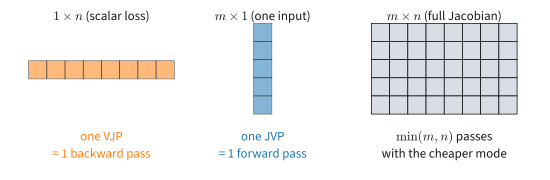
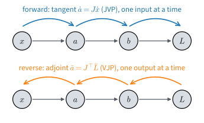
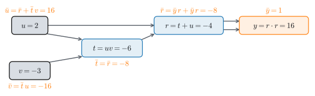
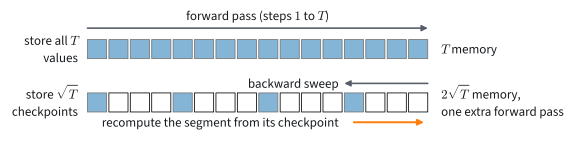

# Automatic Differentiation
:label:`sec_mdl-matrix-calculus-autodiff`

Throughout the Basics part of this book, every gradient came from a single call
to the framework's automatic differentiation engine. The previous section showed
what that call computes mathematically: the derivative of a network is a product
of Jacobians, one per layer, and the order in which we multiply those matrices
determines the cost. A real program, however, is not a neat list of matrices; it
is a sequence of additions, multiplications, and function calls. How does a
framework extract those factors from ordinary code, and how does it multiply
them in the cheap order?

How much the cheap order saves becomes unmistakable on a modern network. Consider a model
with $10^8$ parameters that outputs a single scalar loss $\ell$. Every training
step needs the derivative of $\ell$ with respect to all $10^8$ parameters. The
direct finite-difference approach nudges one parameter at a time, reruns the
network, and divides the change in $\ell$ by the nudge. That requires $10^8$
runs per step. At 10 ms per run, computing a single gradient would take $10^6$ s,
nearly twelve days, and the choice of step size would still introduce truncation
and rounding errors. Backpropagation returns all $10^8$ derivatives, exact up to
floating-point rounding, for roughly the cost of three forward runs, about
30 ms. This section explains where that factor of $10^8$ goes.

The core idea is surprisingly simple: a product of Jacobians can be evaluated
from either end. Starting from the input end, each pass propagates one input
direction forward, so $10^8$ inputs demand $10^8$ passes. Starting from the loss
end, each pass propagates one output direction backward, and a scalar loss has
only a single output.

In :numref:`sec_autograd`, we saw how to invoke both modes in a deep learning
framework. Here we open the hood. We will build forward mode and reverse mode
from scratch in a few dozen lines of Python, prove that they return true
derivatives, trace a backward pass by hand, and measure the cost of each mode.
We will then compose the two modes to compute second-order curvature along a
direction and to differentiate the solution of an equation without
differentiating through the solver itself. Two takeaways stand above the rest:
evaluating a program on *dual numbers* yields derivatives automatically (the
section's one proposition), and every sweep costs only a small multiple of one
program evaluation, with forward mode needing one sweep per input direction and
reverse mode one per output direction. Readers on a first pass may save
:numref:`subsec_mdl-composing-products` for a second reading.

Three small running examples will anchor the discussion: the chapter's
log-sum-exp $\ell(\mathbf x)=\log\sum_j e^{x_j}$, whose gradient is the softmax;
the plane map $\mathbf f(x,y)=(x+\sin y,\ y+x^2/2)$ from the previous section;
and the polynomial expression $y=(uv+u)^2$, which is small enough to trace
completely by hand.

We use the following imports throughout this section.

```{.python .input #matrix-calculus-autodiff-imports}
#@tab mxnet
from mxnet import autograd, npx
from mxnet import np as mnp
import numpy as np
npx.set_np()
```

```{.python .input #matrix-calculus-autodiff-imports}
#@tab pytorch
import numpy as np
import torch
```

```{.python .input #matrix-calculus-autodiff-imports}
#@tab tensorflow
import numpy as np
import tensorflow as tf
```

```{.python .input #matrix-calculus-autodiff-imports}
#@tab jax
import numpy as np
import jax
from jax import numpy as jnp
```

## Forward Mode and Dual Numbers
:label:`subsec_mdl-forward-mode`

### Dual Numbers

We want both the value of a program and its derivative from a single run, with
no step size to tune and no symbolic formula for $f'$ written down in advance.
The trick is a remarkably small extension of the real numbers. We adjoin a new
symbol $\varepsilon$ that is nonzero, yet whose square vanishes:

$$
\varepsilon^2 = 0, \qquad \varepsilon\neq0.
$$
:eqlabel:`eq_mdl-dual-rule`

With this single rule in place, we compute with expressions of the form
$a+b\varepsilon$, called *dual numbers*, using the ordinary rules of algebra.
Every differentiation rule in :numref:`sec_mdl-single_variable_calculus` works
by discarding second-order terms, and setting $\varepsilon^2=0$ builds that
discard directly into the arithmetic.

Let us see what happens when we apply this rule to $3+\varepsilon$. Squaring
and cubing it yields

$$
(3+\varepsilon)^2=9+6\varepsilon+\varepsilon^2=9+6\varepsilon,
\qquad
(3+\varepsilon)^3=(9+6\varepsilon)(3+\varepsilon)=27+27\varepsilon .
$$

Look at the coefficients of $\varepsilon$: $6$ and $27$ are the derivatives of
$x^2$ and $x^3$ at $x=3$. We did not invoke any differentiation rule; the
derivatives fell straight out of multiplication. The same holds for any product.
Multiplying two dual numbers and dropping the $\varepsilon^2$ term gives

$$
(a+b\varepsilon)(c+d\varepsilon) = ac + (ad+bc)\,\varepsilon.
$$
:eqlabel:`eq_mdl-dual-mul`

If $b$ and $d$ are the derivatives of two quantities whose values are $a$ and
$c$, then $ad+bc$ is the derivative of their product. Multiplication of dual
numbers simply is the product rule.

A skeptical reader may object that no number can be nonzero and still have a
zero square. No real number can, of course, but a matrix easily can. Take
$\varepsilon=\left(\begin{smallmatrix}0&1\\0&0\end{smallmatrix}\right)$. Then
$\varepsilon^2=\mathbf 0$, the dual number $a+b\varepsilon$ becomes the
$2\times2$ matrix
$\left(\begin{smallmatrix}a&b\\0&a\end{smallmatrix}\right)$, and ordinary
matrix multiplication
$\left(\begin{smallmatrix}a&b\\0&a\end{smallmatrix}\right)\left(\begin{smallmatrix}c&d\\0&c\end{smallmatrix}\right)=\left(\begin{smallmatrix}ac&ad+bc\\0&ac\end{smallmatrix}\right)$
reproduces :eqref:`eq_mdl-dual-mul`. Dual numbers are just as concrete as
$2\times2$ matrices, much as complex numbers are as concrete as rotations and
scalings of the plane.

Real programs also call elementary functions such as $\sin$, $\exp$, and $\log$.
For a function $\varphi$ given by its Taylor series around $a$, substituting
$a+b\varepsilon$ into the series kills every term from $(b\varepsilon)^2$
onward, leaving only the linear approximation:

$$
\varphi(a+b\varepsilon)=\varphi(a)+\varphi'(a)\,b\,\varepsilon .
$$

Thus $e^{a+b\varepsilon}=e^a+e^a b\,\varepsilon$ and
$\sin(a+b\varepsilon)=\sin a+(\cos a)\,b\,\varepsilon$ are forced by the
algebra itself. For a primitive that is merely differentiable at $a$ rather than
analytic, we adopt the formula above as the definition of its action on dual
numbers. In either case, the $\varepsilon$-part obeys the chain rule: the
incoming derivative $b$ of the argument is multiplied by the local derivative
$\varphi'(a)$.

**Proposition (dual numbers compute derivatives).** *Let $f$ be an expression
built from constants, the identity, sums, products, and primitives $\varphi$
(such as $\sin$, $\exp$, $\log$). Suppose each primitive is differentiable at
the argument it receives when $f$ is evaluated at $x$ (for $\log$, a positive
argument). Then evaluating the same expression on the dual number
$x+\varepsilon$ gives*

$$
f(x + \varepsilon) = f(x) + f'(x)\,\varepsilon.
$$
:eqlabel:`eq_mdl-dual-eval`

**Proof.** We proceed by structural induction on the expression. A constant $c$
is represented as $c+0\varepsilon$ and the identity as $x+1\varepsilon$, so
their $\varepsilon$-parts are their derivatives, $0$ and $1$. Now suppose two
subexpressions satisfy $g(x+\varepsilon)=g(x)+g'(x)\varepsilon$ and
$h(x+\varepsilon)=h(x)+h'(x)\varepsilon$. Their sum has $\varepsilon$-part
$g'+h'=(g+h)'$. By :eqref:`eq_mdl-dual-mul`, their product has
$\varepsilon$-part $g'h+gh'=(gh)'$. Finally, applying a primitive $\varphi$ to
$g$ produces, by the rule above with $a=g(x)$ and $b=g'(x)$, the
$\varepsilon$-part $\varphi'(g(x))\,g'(x)=(\varphi\circ g)'(x)$. Every way of
combining subexpressions preserves the property, so the full expression
satisfies :eqref:`eq_mdl-dual-eval`. $\blacksquare$

To differentiate a program, we therefore run it on $x+\varepsilon$ and read off
the $\varepsilon$-part of the output. Programs with loops and branches are
handled automatically as well: for any fixed input, the program executes a
single concrete sequence of elementary operations, which is an expression of
this exact form, and the dual-number run differentiates that execution path
(:numref:`subsec_autograd_control_flow` demonstrates this in the frameworks).
Note, however, that the result is the derivative of the executed path, which
equals $f'(x)$ only if all nearby inputs take the same branches. A program that
returns `x` if `x != 0` and `0.0` otherwise computes the identity, yet at $x=0$
it executes the constant branch, and the dual-number run reports slope $0$.
This is the failure we met with $\mathrm{ReLU}(x)-\mathrm{ReLU}(-x)$ in
:numref:`subsec_mdl-nonsmooth-training`.
The input's $\varepsilon$-part, here $1$, is called the *seed*. No symbolic
expression for $f'$ is ever constructed and no step size is chosen; the only
error is floating-point rounding.

### A Forward-Mode Engine

Operator overloading turns this algebra directly into code. The `Dual` class
below stores a value $a$ together with its derivative part $b$, which we call
the *tangent* and write as $\dot v$ for a quantity $v$. It implements
:eqref:`eq_mdl-dual-mul` for `*` and equips `sin`, `exp`, and `log` with the
primitive rule. A class counter `ops` tallies how many primitive operations have
executed, which we will use to measure cost in
:numref:`subsec_mdl-cost-asymmetry`.

```{.python .input #matrix-calculus-autodiff-dual-numbers}
class Dual:
    """A dual number a + b*eps with eps^2 = 0; b carries the derivative."""
    ops = 0                                         # primitive operations run
    def __init__(self, a, b=0.0):
        self.a, self.b = a, b                       # value, tangent
    def __add__(self, o):
        o = o if isinstance(o, Dual) else Dual(o)
        Dual.ops += 1
        return Dual(self.a + o.a, self.b + o.b)
    __radd__ = __add__
    def __mul__(self, o):
        o = o if isinstance(o, Dual) else Dual(o)
        Dual.ops += 1
        return Dual(self.a * o.a, self.a * o.b + self.b * o.a)   # product rule
    __rmul__ = __mul__
    def sin(self):
        Dual.ops += 1
        return Dual(np.sin(self.a), np.cos(self.a) * self.b)     # chain rule
    def exp(self):
        Dual.ops += 1
        return Dual(np.exp(self.a), np.exp(self.a) * self.b)
    def log(self):
        Dual.ops += 1
        return Dual(np.log(self.a), self.b / self.a)
    def __repr__(self):
        return f'{np.round(self.a, 6)} + {np.round(self.b, 6)} eps'
```

Let us test `Dual` on $f(x)=\sin(x^2)+e^x$ at $x=1.3$ by passing in
$1.3+\varepsilon$, and compare its $\varepsilon$-part against the hand-derived
derivative $f'(x)=2x\cos(x^2)+e^x$:

```{.python .input #matrix-calculus-autodiff-dual-eval}
def f(x):
    return (x * x).sin() + x.exp()                  # sin(x^2) + e^x, in dual algebra

x0 = 1.3
out = f(Dual(x0, 1.0))                              # seed the derivative with 1
exact = 2 * x0 * np.cos(x0**2) + np.exp(x0)         # f'(x) by hand
print('dual result :', out)
print('value f(x)  :', np.sin(x0**2) + np.exp(x0))
print("derivative  : dual %.6f  vs  exact %.6f" % (out.b, exact))
```

A single run returns both the function value $4.6622$ and the derivative
$3.360101$, matching the analytic formula to every printed digit.

A single-variable example, however, hides the main limitation of forward mode.
Consider log-sum-exp at the three-dimensional input $\mathbf x=(1,-0.5,2)$,
whose gradient is the softmax
$\partial\ell/\partial x_j=e^{x_j}/\sum_k e^{x_k}=p_j$. How many passes does
forward mode need to obtain this full gradient? Seeding input $j$ with $1$ and
all other inputs with $0$ yields the single partial derivative
$\partial\ell/\partial x_j$ in the output's $\varepsilon$-part, and nothing
else.

```{.python .input #mdl-matrix-calculus-autodiff-a-forward-mode-engine-1}
def lse_dual(xs):                                   # log-sum-exp, in dual algebra
    total = 0.0
    for x in xs:
        total = total + x.exp()
    return total.log()

x_lse = [1.0, -0.5, 2.0]
p = np.exp(x_lse) / np.exp(x_lse).sum()             # softmax, the known gradient
for j in range(3):                                  # one pass per input direction
    out = lse_dual([Dual(x, 1.0 if k == j else 0.0) for k, x in enumerate(x_lse)])
    print(f'seed e{j + 1}: value {out.a:.6f}, partial {out.b:.6f}, '
          f'softmax {p[j]:.6f}')
```

It takes three passes. Each pass recomputes the same value $2.371539$ and
recovers just one softmax entry: $0.253716$, $0.056612$, or $0.689672$. More
generally, a gradient over $n$ inputs requires $n$ passes. For the
$10^8$-parameter network from the opening, that puts us right back at $10^8$
runs of the program. Forward mode eliminates the finite-difference step size,
but not the number of runs.

### Vector Tangents and Jacobian Columns

Now consider a vector-valued map $\mathbf f:\mathbb R^n\to\mathbb R^m$ with
$m\times n$ Jacobian $\mathbf J$. What does a single forward pass compute?
Suppose we seed the inputs with an arbitrary direction $\mathbf v$, setting
input $j$ to $x_j+v_j\varepsilon$. Applying our proposition to the
one-dimensional slice $t\mapsto f_i(\mathbf x+t\mathbf v)$ shows that output $i$
emerges as $f_i(\mathbf x)+(\nabla f_i\cdot\mathbf v)\,\varepsilon$. Collecting
the $\varepsilon$-parts across all $m$ outputs therefore produces the vector
$\mathbf J\mathbf v$, known as the *Jacobian--vector product* (JVP). When
$\mathbf v$ is the $j$-th standard basis vector $\mathbf e_j$, the JVP picks out
column $j$ of $\mathbf J$. One forward pass carries one input direction through
the entire map.

Let us verify this on the plane map $\mathbf f(x,y)=(x+\sin y,\ y+x^2/2)$ at
$(0.5,0.5)$. Its Jacobian, whose row $i$ holds the partial derivatives of
output $i$, is

$$
\mathbf J=\begin{pmatrix}1&\cos y\\ x&1\end{pmatrix}
=\begin{pmatrix}1&0.877583\\0.5&1\end{pmatrix}.
$$

Two forward passes, seeded first with $\mathbf e_1$ and then with $\mathbf e_2$,
recover its two columns.

```{.python .input #matrix-calculus-autodiff-forward-jvp}
def plane_dual(x, y):
    return [x + y.sin(), y + 0.5 * (x * x)]         # (x + sin y, y + x^2/2)

z0 = (0.5, 0.5)
cols = []
for seed in ((1.0, 0.0), (0.0, 1.0)):               # e1, then e2
    out = plane_dual(Dual(z0[0], seed[0]), Dual(z0[1], seed[1]))
    cols.append([out[0].b, out[1].b])               # tangent = J @ seed, a column
J_fwd = np.array(cols).T                            # columns side by side
J_exact = np.array([[1.0, np.cos(0.5)], [0.5, 1.0]])
print('forward-mode J:\n', J_fwd.round(6))
print('matches the analytic Jacobian:', np.allclose(J_fwd, J_exact))
```

Notice that nothing in `Dual` forces the tangent to be a scalar. If we give $x$
the vector tangent $(1,0)$ and $y$ the vector tangent $(0,1)$, every operation
propagates both input directions simultaneously, and the tangent of output $i$
becomes row $i$ of $\mathbf J$. Can a single pass recover the entire matrix?

```{.python .input #mdl-matrix-calculus-autodiff-vector-tangents-and-jacobian-columns-1}
out = plane_dual(Dual(z0[0], np.array([1.0, 0.0])),     # identity seed:
                 Dual(z0[1], np.array([0.0, 1.0])))     # both directions at once
J_one = np.array([out[0].b, out[1].b])                  # row i = tangent of f_i
print('one-pass J:\n', J_one.round(6))
print('matches the analytic Jacobian:', np.allclose(J_one, J_exact))
```

It can, though the savings are illusory. Every tangent operation now acts on
arrays of length $n$, so that single pass performs roughly $n$ times as much
arithmetic as a scalar pass. Counting passes and counting arithmetic are not
the same thing, and we will measure arithmetic directly in
:numref:`subsec_mdl-cost-asymmetry`. For a scalar loss with $10^8$ inputs,
forward mode demands either $10^8$ scalar passes or one pass carrying tangents
of length $10^8$. Either way, its total work scales with $n$ runs of the
program.

## Reverse Mode and the Tape
:label:`subsec_mdl-reverse-mode`

### Two Orders of One Product

To eliminate the factor of $n$, we must multiply the chain of derivatives in
the opposite order. In :numref:`sec_mdl-matrix-calculus`, we saw that the
Jacobian of a $K$-step program $\mathbf f=\mathbf f_K\circ\cdots\circ\mathbf f_1$
is the product :eqref:`eq_mdl-jacobian-product` of the step Jacobians,

$$
\mathbf J = \mathbf J_K\,\mathbf J_{K-1}\cdots\mathbf J_1,
$$
:eqlabel:`eq_mdl-ad-jacobian-product`

and that the parenthesization of this product governs its cost: for three layers
of width $1000$ multiplied by a row vector on the left, associating from the
left takes $3\times10^6$ multiplications, whereas associating from the right
takes $2\times10^9$ (:numref:`fig_mdl-cal-jacobian-chain-order`). An automatic
differentiation engine never materializes these Jacobian matrices explicitly.
Instead, it propagates a seed vector through one step after another. Forward
mode multiplies a column direction $\mathbf v$ in from the right; reverse mode
multiplies a row vector $\mathbf u^\top$ in from the left:

$$
\mathbf J\mathbf v=\mathbf J_K\Bigl(\cdots\bigl(\mathbf J_2(\mathbf J_1\mathbf v)\bigr)\Bigr),
\qquad
\mathbf u^\top\mathbf J=\Bigl(\bigl((\mathbf u^\top\mathbf J_K)\mathbf J_{K-1}\bigr)\cdots\Bigr)\mathbf J_1.
$$
:eqlabel:`eq_mdl-ad-two-orders`

Because a seed vector is present from the start, every step is a matrix--vector
product and never a matrix--matrix product. On the left, an input direction
travels forward to produce the JVP $\mathbf J\mathbf v$. On the right, an output
direction travels backward to produce the *vector--Jacobian product* (VJP)
$\mathbf u^\top\mathbf J$, a linear combination of the rows of $\mathbf J$
weighted by $\mathbf u$. Setting $\mathbf u=\mathbf e_i$ extracts row $i$ of
$\mathbf J$.

From this symmetry comes the fundamental cost rule of automatic
differentiation. Forward mode requires one sweep per input direction, while
reverse mode requires one sweep per output direction, and each sweep costs only
a small constant multiple of evaluating the program once. For programs built
from $+,-,\times,\div$, Baur and Strassen proved that computing all partial
derivatives together takes at most a fixed multiple of the program's own
operation count, between three and five depending on which operations are
counted :cite:`Baur.Strassen.1983`. A scalar loss has a $1\times n$ Jacobian, a
single row, so one reverse sweep seeded with $1$ returns the entire gradient at
once. :numref:`fig_mdl-cal-jacobian-shapes` illustrates this rule in terms of
matrix shapes.


:label:`fig_mdl-cal-jacobian-shapes`

The two modes evaluate the exact same matrix product from opposite ends. Which
end wins depends solely on the shape of $\mathbf J$: the cheaper mode is the one
whose number of seeds matches the shorter side. A neural network loss, with one
scalar output and millions or billions of parameters, has the most lopsided
Jacobian imaginable.

### The Tape

Forward mode and reverse mode propagate fundamentally different quantities. In a
program taking input $x$ to output $y$, the tangent $\dot v$ of an intermediate
variable $v$ measures how fast $v$ changes when the input moves in the direction
$\dot x$. By contrast, the *adjoint* $\bar v$ introduced in
:numref:`sec_mdl-chain-rule-graphs` is the total derivative of the final output
$y$ with respect to $v$, summed over all paths from $v$ to $y$. A tangent
depends only on the steps *before* $v$, whereas an adjoint depends on the steps
*after* $v$. In $y=v^2$ with $v=3x$, for example, we have $\dot v=3\dot x$
coming from below and $\bar v=2v$ coming from above.

This asymmetry dictates how each mode executes
(:numref:`fig_mdl-cal-fwd-vs-rev`). Because tangents move in the same direction
as the values, forward mode finishes in a single pass alongside the program
itself; `Dual` never needs to remember past intermediates. Adjoints, however,
travel against the flow of execution: computing the adjoint of a node requires
the adjoints of every node that consumes it, and those exist only after the
program has reached its output. Reverse mode therefore runs in two phases. First
it executes the program forward while recording every elementary operation; then
it replays that record in reverse. The record is called the *tape*, or Wengert
list, after the list of elementary operations that :citet:`Wengert.1964`
introduced for forward mode; reversing the list yields reverse mode, introduced
by :citet:`Linnainmaa.1970`.


:label:`fig_mdl-cal-fwd-vs-rev`

We can build a working reverse-mode engine in about forty lines of Python. Each
node on the tape stores its forward value, its parent nodes, and a small
backward closure. Given the node's own adjoint $g$, that closure adds the
node's contribution to each parent's adjoint: for $c=a+b$ it adds $g$ to both
parents, while for $c=ab$ it adds $b\,g$ to $\bar a$ and $a\,g$ to $\bar b$.
The function `backprop` topologically sorts the graph so that every node appears
after its parents, seeds the output adjoint with $1$, and invokes the closures
in reverse order. Just like `Dual`, the class maintains an `ops` counter across
both forward and backward steps.

```{.python .input #matrix-calculus-autodiff-tape}
class Var:
    """A scalar node on the autodiff tape; .grad accumulates the adjoint."""
    ops = 0                                         # recorded ops + backward steps
    def __init__(self, value, parents=(), backward=lambda g: None):
        self.value = value
        self.grad = 0.0
        self._parents = parents                     # nodes this one depends on
        self._backward = backward                   # pushes adjoint to parents
    def __add__(self, o):
        o = o if isinstance(o, Var) else Var(o)
        Var.ops += 1
        out = Var(self.value + o.value, (self, o))
        def back(g):                                # d(a+b) = 1*g to each parent
            Var.ops += 1
            self.grad += g; o.grad += g
        out._backward = back
        return out
    __radd__ = __add__
    def __mul__(self, o):
        o = o if isinstance(o, Var) else Var(o)
        Var.ops += 1
        out = Var(self.value * o.value, (self, o))
        def back(g):                                # product rule, reversed
            Var.ops += 1
            self.grad += o.value * g; o.grad += self.value * g
        out._backward = back
        return out
    __rmul__ = __mul__

def backprop(node):
    """Topologically sort the tape and replay it backward from `node`."""
    order, seen = [], set()
    def visit(v):
        if v not in seen:
            seen.add(v)
            for p in v._parents:
                visit(p)
            order.append(v)
    visit(node)
    node.grad = 1.0                                 # seed the output adjoint
    for v in reversed(order):
        v._backward(v.grad)
```

Although `Var` implements only `+` and `*`, that is already enough for our
third running example, $y=(uv+u)^2$. Before running the code, let us trace the
entire backward sweep by hand at $u=2$, $v=-3$. The forward pass records three
elementary operations: $t=uv=-6$, then $r=t+u=-4$, and finally
$y=r\cdot r=16$. The backward sweep visits nodes in a reverse topological order
such as $y,r,t,u,v$, ensuring that every node is processed only after all nodes
that depend on it (`backprop` happens to visit $v$ before $u$, which is equally
valid). Each adjoint is the sum of contributions arriving along its outgoing
edges, where each contribution multiplies the consumer's adjoint by the local
derivative:

| node | outgoing edges and their contributions | adjoint |
|----|----|----|
| $y$ | none: the seed | $\bar y=1$ |
| $r$ | both arguments of $y=r\cdot r$: $\bar y\,r+\bar y\,r$ | $\bar r=-8$ |
| $t$ | $r=t+u$: $\bar r\cdot1$ | $\bar t=-8$ |
| $u$ | $r=t+u$ and $t=uv$: $\bar r\cdot1+\bar t\cdot v$ | $\bar u=-8+24=16$ |
| $v$ | $t=uv$: $\bar t\cdot u$ | $\bar v=-16$ |

Direct differentiation of $y=(uv+u)^2$ confirms both answers:
$\partial y/\partial u=2(uv+u)(v+1)=2(-4)(-2)=16$ and
$\partial y/\partial v=2(uv+u)\,u=2(-4)(2)=-16$. Notice how crucial
accumulation is at two places in the graph: $r$ feeds both arguments of the
final product, and $u$ feeds both $t$ and $r$ (:numref:`fig_mdl-cal-tape-dag`).
Overwriting instead of adding would leave $\bar r=-4$, and even with $\bar r$
fixed it would leave $\bar u$ as either $-8$ or $24$, depending on which
closure happened to run last. Because an adjoint sums over all outgoing edges
(the chain rule's sum over paths), every backward closure must accumulate with
`+=`.


:label:`fig_mdl-cal-tape-dag`

Recording the same expression with `Var` and running a single backward sweep
gives:

```{.python .input #mdl-matrix-calculus-autodiff-the-tape-1}
u, v = Var(2.0), Var(-3.0)
r = u * v + u                                       # t = uv, then r = t + u
y = r * r                                           # r feeds both arguments
backprop(y)
print('our tape  : dy/du = %.4f  dy/dv = %.4f' % (u.grad, v.grad))
```

These match $\bar u$ and $\bar v$ from our hand trace. A production deep
learning framework runs the exact same algorithm at tensor scale and produces
the same two derivatives:

```{.python .input #matrix-calculus-autodiff-tape-check}
#@tab pytorch
ut = torch.tensor(2.0, requires_grad=True)
vt = torch.tensor(-3.0, requires_grad=True)
rt = ut * vt + ut
(rt * rt).backward()                                # framework autograd
print('torch     : dy/du = %.4f  dy/dv = %.4f' % (ut.grad, vt.grad))
```

```{.python .input #matrix-calculus-autodiff-tape-check}
#@tab mxnet
um, vm = mnp.array(2.0), mnp.array(-3.0)
um.attach_grad(); vm.attach_grad()
with autograd.record():                             # framework autograd
    rm = um * vm + um
    ym = rm * rm
ym.backward()
print('mxnet     : dy/du = %.4f  dy/dv = %.4f' % (float(um.grad), float(vm.grad)))
```

```{.python .input #matrix-calculus-autodiff-tape-check}
#@tab tensorflow
ut, vt = tf.Variable(2.0), tf.Variable(-3.0)
with tf.GradientTape() as tape:                     # framework autograd
    rt = ut * vt + ut
    yt = rt * rt
du, dv = tape.gradient(yt, [ut, vt])
print('tensorflow: dy/du = %.4f  dy/dv = %.4f' % (float(du), float(dv)))
```

```{.python .input #matrix-calculus-autodiff-tape-check}
#@tab jax
def g(u, v):
    r = u * v + u
    return r * r
du, dv = jax.grad(g, argnums=(0, 1))(2.0, -3.0)     # framework autograd
print('jax       : dy/du = %.4f  dy/dv = %.4f' % (float(du), float(dv)))
```

A production framework differs from our toy `Var` engine in three practical
respects, none of which alters the underlying algorithm. First, its nodes hold
entire tensors rather than scalars, so each backward closure implements the VJP
of a whole tensor operation, such as :eqref:`eq_mdl-matmul-vjp` for matrix
multiplication. Second, its library of primitives is much larger, each paired
with a hand-tuned VJP rule. Third, frameworks construct the computation graph in
one of two ways. An *eager tape* records operations dynamically as the program
executes, just as `Var` does. A *tracer*, by contrast, runs the program once on
abstract placeholder inputs to capture its sequence of operations, builds the
linearized forward-mode rule for each step, and then transposes and reverses the
sequence. Both routes produce the exact same backward sweep. Applied to a neural
network, this reverse-mode sweep is what deep learning calls *backpropagation*
:cite:`Rumelhart.Hinton.Williams.ea.1988`.

:begin_tab:`pytorch`
PyTorch records eagerly: every operation on a tensor with
`requires_grad=True` appends a node to the graph, and `backward()` replays
those nodes in reverse.
:end_tab:

:begin_tab:`mxnet`
MXNet records eagerly inside `autograd.record()`, and `backward()` replays the
recorded graph in reverse.
:end_tab:

:begin_tab:`tensorflow`
TensorFlow records eagerly inside a `GradientTape` context, and `tape.gradient`
replays the tape in reverse.
:end_tab:

:begin_tab:`jax`
JAX is a tracer: `jax.grad` traces the function and returns a new Python
function that executes the transposed backward sweep.
:end_tab:

The frameworks also inherit the hypothesis of the dual-number proposition: each
primitive must be differentiable at the argument it receives. Masking is where
this hypothesis fails most often in practice. Suppose that we sum $\log x_i$
over the real entries of a padded vector, and that a `where` sets the padded
entries to zero. A `where` chooses between two values that have both been
computed, so $\log$ still runs on the padding, here $x_2=0$. The forward pass
is unharmed: the $-\infty$ is discarded and the loss is $\log 2\approx0.6931$.
On the backward sweep, however, `where` sends the adjoint $0$ into the
discarded branch, and the VJP of $\log$ multiplies it by the local derivative
$1/0=\infty$. In floating-point arithmetic $0\cdot\infty$ is not $0$ but NaN.

```{.python .input #mdl-matrix-calculus-autodiff-the-tape-2}
#@tab pytorch
x = torch.tensor([2.0, 0.0], requires_grad=True)    # x[1] is padding
mask = torch.tensor([True, False])
loss = torch.where(mask, torch.log(x), 0.0).sum()   # sum of log x, real entries
loss.backward()
print('one where   : loss = %.4f, grad =' % loss.item(), x.grad.numpy())
x.grad = None
safe = torch.where(mask, x, 1.0)                    # padding never reaches log
loss = torch.where(mask, torch.log(safe), 0.0).sum()
loss.backward()
print('double where: loss = %.4f, grad =' % loss.item(), x.grad.numpy())
```

```{.python .input #mdl-matrix-calculus-autodiff-the-tape-2}
#@tab mxnet
x = mnp.array([2.0, 0.0])                           # x[1] is padding
mask = mnp.array([True, False])
x.attach_grad()
with autograd.record():
    loss = mnp.where(mask, mnp.log(x), 0.0).sum()   # sum of log x, real entries
loss.backward()
print('one where   : loss = %.4f, grad =' % float(loss), x.grad)
with autograd.record():
    safe = mnp.where(mask, x, 1.0)                  # padding never reaches log
    loss = mnp.where(mask, mnp.log(safe), 0.0).sum()
loss.backward()
print('double where: loss = %.4f, grad =' % float(loss), x.grad)
```

```{.python .input #mdl-matrix-calculus-autodiff-the-tape-2}
#@tab tensorflow
x = tf.Variable([2.0, 0.0])                         # x[1] is padding
mask = tf.constant([True, False])
with tf.GradientTape(persistent=True) as tape:
    one = tf.reduce_sum(tf.where(mask, tf.math.log(x), 0.0))
    safe = tf.where(mask, x, 1.0)                   # padding never reaches log
    two = tf.reduce_sum(tf.where(mask, tf.math.log(safe), 0.0))
g1, g2 = tape.gradient(one, x), tape.gradient(two, x)
print('one where   : loss = %.4f, grad =' % float(one), g1.numpy())
print('double where: loss = %.4f, grad =' % float(two), g2.numpy())
```

```{.python .input #mdl-matrix-calculus-autodiff-the-tape-2}
#@tab jax
x = jnp.array([2.0, 0.0])                           # x[1] is padding
mask = jnp.array([True, False])
def one(x):                                         # sum of log x, real entries
    return jnp.where(mask, jnp.log(x), 0.0).sum()
def two(x):
    safe = jnp.where(mask, x, 1.0)                  # padding never reaches log
    return jnp.where(mask, jnp.log(safe), 0.0).sum()
print('one where   : loss = %.4f, grad =' % one(x), jax.grad(one)(x))
print('double where: loss = %.4f, grad =' % two(x), jax.grad(two)(x))
```

The first line reports the gradient $(0.5, \textrm{NaN})$, although the loss
does not depend on the padded entry at all and the true derivative there is
$0$. A single NaN is not a local blemish: every parameter upstream of $x_2$
receives it. The second line shows the standard remedy, the *double where*. An
inner `where` replaces the masked entries by a harmless value, here $1$, before
the primitive sees them, so that no infinite local derivative is ever formed
and the gradient is $(0.5, 0)$. Clamping the argument away from the edge of the
domain serves the same purpose. The same trap awaits $\sqrt{x}$ at $0$, and
with it a norm computed as $\sqrt{\sum_i x_i^2}$ at $\mathbf x=\mathbf 0$.

### Parameter Gradients
:label:`subsec_mdl-param-gradients`

So far, the Jacobian product :eqref:`eq_mdl-jacobian-product` has tracked
derivatives with respect to the network's input, whereas training needs
derivatives with respect to its weights. Fortunately, the weight gradients drop
out of the very same backward sweep via the layer VJP rule
(:numref:`subsec_mdl-layer-vjp`). For a linear layer
$\mathbf h_k=\mathbf W_k\mathbf h_{k-1}$ with weight matrix $\mathbf W_k$ of
shape $d_k\times d_{k-1}$, that rule reads

$$
\nabla_{\mathbf W_k}\ell=\bar{\mathbf h}_k\,\mathbf h_{k-1}^\top,
$$
:eqlabel:`eq_mdl-ad-param-grad`

the outer product of the adjoint arriving from above and the activation stored
from below. Intuitively, a weight matters in proportion to both how strongly its
output affects the loss and how large its input activation was. What matters for
our cost analysis is how much arithmetic this rule takes.

Forming the outer product $\bar{\mathbf h}_k\,\mathbf h_{k-1}^\top$ takes
$d_kd_{k-1}$ multiplications, the same count as the forward matrix--vector
product $\mathbf W_k\mathbf h_{k-1}$. Passing the adjoint down to the previous
layer, $\bar{\mathbf h}_{k-1}^\top=\bar{\mathbf h}_k^\top\mathbf W_k$, takes
another $d_kd_{k-1}$ multiplications. Measured in multiplications, the backward
sweep therefore costs roughly twice a forward pass, so a forward pass plus a
backward sweep costs about three forward passes, matching the 30 ms figure from
the opening. Forward mode, by contrast, would have to treat every individual
weight as its own input direction, requiring $d_kd_{k-1}$ passes for a single
layer alone. That is why no framework trains neural networks in forward mode.

### Cost of the Two Modes
:label:`subsec_mdl-cost-asymmetry`

Because we built both engines ourselves, we can measure their operation counts
directly instead of relying on asymptotic arguments. Take
$f(\mathbf x)=(\sum_j x_j^2)^2$ on $n=200$ inputs $x_j=0.01\,j$ for
$j=1,\ldots,200$. We choose a polynomial built solely from $+$ and $\times$ so
that `Var` can record it without adding `exp` and `log` closures (which would
mirror the methods of `Dual`). Its gradient is
$\nabla f=4\bigl(\sum_jx_j^2\bigr)\mathbf x$, and one plain evaluation runs
$2n+1=401$ primitive operations: $n$ squares, $n$ additions, and one final
square. Forward mode will clearly need $200$ passes of $401$ operations each.
Before reading the output below, pause and guess how many operations reverse
mode will take.

```{.python .input #mdl-matrix-calculus-autodiff-the-cost-asymmetry-measured}
n = 200
def f(xs):                       # f: R^n -> R, from + and * alone
    total = 0.0
    for x in xs:
        total = total + x * x
    return total * total         # (sum of squares)^2

xs0 = [0.01 * (j + 1) for j in range(n)]
Dual.ops = 0
grad_fwd = [f([Dual(x, 1.0 if k == j else 0.0) for k, x in enumerate(xs0)]).b
            for j in range(n)]   # forward mode: one pass per input direction
Var.ops = 0
xs = [Var(x) for x in xs0]       # reverse mode: one recorded pass...
backprop(f(xs))                  # ...and one backward sweep for all n partials
grad_rev = [x.grad for x in xs]

gap = max(abs(a - b) for a, b in zip(grad_fwd, grad_rev))
print(f'forward mode: {Dual.ops:,} operations ({n} passes of {2 * n + 1})')
print(f'reverse mode: {Var.ops:,} operations (one recorded pass, one sweep)')
print(f'ratio {Dual.ops / Var.ops:.1f}, largest gradient difference {gap:.1e}')
```

Forward mode executed $80{,}200=n(2n+1)$ operations, whereas reverse mode
executed only $802=2(2n+1)$: $401$ recorded during the forward pass and $401$
backward closures during the sweep. The ratio is $100=n/2$, and the two
gradients agree to every printed digit. For these engines, pass counts differ by
a factor of $n$ and operation counts by $n/2$; at $n=10^8$, that recovers the
factor from the opening up to the same small constant.

At first glance, the measured factor of two might seem to contradict the factor
of three we quoted earlier. It does not: `Var.ops` counts each backward closure
as a single operation, even though the closure for multiplication performs two
multiplications of its own. Counting scalar multiplications directly gives $402$
on the backward sweep against $201$ on the forward pass, so computing the value
and gradient together costs three times the value alone, just as it did for the
linear layer. Including the additions that accumulate adjoints brings the
backward sweep to $1204$ operations and the total factor to four, still well
within the Baur--Strassen bound.

Reverse mode trades memory for this speed. The tape must retain all $401$
recorded intermediate values until the backward sweep consumes them, whereas
forward mode, like the original program, holds only the current values alongside
their tangents.

### Gradient Checkpointing
:label:`subsec_mdl-checkpointing`

A computation of $T$ recorded steps keeps $T$ intermediate values alive in
memory until the backward sweep reaches them. In a deep neural network, those
values are the activations of every layer for every example in the batch, and
activation memory, rather than arithmetic, is often what caps the batch size or
depth.

The simplest remedy divides the tape into segments of $s$ steps. During the
forward pass, we save only every $s$-th value, the $T/s$ *checkpoints*, and
discard everything in between. When the backward sweep arrives at a segment, it
recomputes that segment's $s$ steps from its saved checkpoint onto a temporary
tape, sweeps that short tape backward, and immediately frees it. At any instant,
memory holds only the $T/s$ checkpoints plus one active segment of length $s$.
Choosing $s$ to balance these two terms minimizes peak memory:

$$
M(s)=\frac{T}{s}+s,
\qquad
\min_s M(s)=M(\sqrt T)=2\sqrt T.
$$
:eqlabel:`eq_mdl-ad-checkpoint-memory`

The minimum follows either from setting $M'(s)=1-T/s^2=0$ or directly from the
AM--GM inequality $T/s+s\ge2\sqrt T$. Peak memory now grows only as the square
root of the computation length rather than linearly. Because each step is
recomputed once, the extra compute is just one additional forward pass. For
$T=400$, segment lengths $s=1,5,10,20,100,400$ yield peak memory
$M=401,85,50,40,104,401$, with the minimum at $s=20=\sqrt{400}$. At $T=10^4$,
segments of length $s=100$ store just $200$ values instead of $10{,}000$
:cite:`Chen.Xu.Zhang.ea.2016`. :numref:`fig_mdl-cal-checkpointing` illustrates
this schedule.


:label:`fig_mdl-cal-checkpointing`

Importantly, checkpointing alters time and memory without changing the gradient
at all, provided the recomputation is deterministic: the recomputed
intermediates are then identical, so the resulting derivatives match plain
reverse mode bit for bit. Deep learning frameworks expose this trade-off at the
level of network blocks, storing only a checkpointed block's input and rerunning
the block during backpropagation. There the proviso needs care. A rerun block
draws a fresh dropout mask unless the state of the random number generator is
restored, batch normalization updates its running statistics a second time, and
nondeterministic GPU kernels need not reproduce the first run's bits. Applying the same idea
recursively inside each segment pushes memory all the way down to $O(\log T)$ at
the cost of $O(T\log T)$ recomputation.

## Composing Jacobian Products
:label:`subsec_mdl-composing-products`

Automatic differentiation offers both linear operators our toy engines just built: the
forward-mode JVP $\mathbf J\mathbf v$ and the reverse-mode VJP
$\mathbf u^\top\mathbf J$. Once both are available as composable primitives, we
can compute directional curvature, differentiate through numerical solvers, or
assemble full Jacobians when needed.

:begin_tab:`mxnet`
MXNet's autograd offers only the reverse-mode VJP, so the MXNet code below
works around the missing JVP.
:end_tab:

### Jacobian--Vector and Vector--Jacobian Products
:label:`subsec_mdl-jvp-vjp`

In :numref:`subsec_autograd_fwd_rev`, we met the framework APIs for both
products. Let us evaluate them on the plane map at $(0.5,0.5)$ with
$\mathbf v=\mathbf u=(1,2)$. Using the Jacobian we computed earlier with `Dual`,
we expect $\mathbf J\mathbf v=(1+2\cdot0.8776,\ 0.5+2)=(2.7552,\ 2.5)$ and
$\mathbf u^\top\mathbf J=(1+2\cdot0.5,\ 0.8776+2)=(2,\ 2.8776)$, and the
framework calls match these values directly.

```{.python .input #mdl-matrix-calculus-autodiff-jacobian-vector-and-vector-jacobian-products}
#@tab pytorch
def plane(z):                                       # (x + sin y, y + x^2/2)
    return torch.stack([z[0] + torch.sin(z[1]), z[1] + 0.5 * z[0]**2])

z0 = torch.tensor([0.5, 0.5])
v, u = torch.tensor([1.0, 2.0]), torch.tensor([1.0, 2.0])
_, Jv = torch.func.jvp(plane, (z0,), (v,))          # forward mode: J v
_, vjp_fn = torch.func.vjp(plane, z0)               # reverse mode: records once,
uJ, = vjp_fn(u)                                     # then u^T J per seed
J = torch.func.jacrev(plane)(z0)                    # one VJP per row
print('J v   =', Jv.numpy().round(4))
print('u^T J =', uJ.numpy().round(4))
print('J     =', J.numpy().astype(float).round(4).tolist())
```

```{.python .input #mdl-matrix-calculus-autodiff-jacobian-vector-and-vector-jacobian-products}
#@tab mxnet
def plane(z):                                       # (x + sin y, y + x^2/2)
    return mnp.stack([z[0] + mnp.sin(z[1]), z[1] + 0.5 * z[0]**2])

def vjp(u):                                         # one reverse sweep seeded with u
    z = mnp.array([0.5, 0.5])
    z.attach_grad()
    with autograd.record():
        y = plane(z)
    y.backward(u)
    return z.grad

v, u = mnp.array([1.0, 2.0]), mnp.array([1.0, 2.0])
uJ = vjp(u)                                         # reverse mode: u^T J
J = mnp.stack([vjp(mnp.array([1.0, 0.0])),          # one VJP per row
               vjp(mnp.array([0.0, 1.0]))])
Jv = mnp.dot(J, v)                                  # no forward mode: J v from J
print('J v   =', Jv.asnumpy().round(4))
print('u^T J =', uJ.asnumpy().round(4))
print('J     =', J.asnumpy().astype(float).round(4).tolist())
```

```{.python .input #mdl-matrix-calculus-autodiff-jacobian-vector-and-vector-jacobian-products}
#@tab tensorflow
def plane(z):                                       # (x + sin y, y + x^2/2)
    return tf.stack([z[0] + tf.sin(z[1]), z[1] + 0.5 * z[0]**2])

z0 = tf.constant([0.5, 0.5])
v, u = tf.constant([1.0, 2.0]), tf.constant([1.0, 2.0])
with tf.autodiff.ForwardAccumulator(z0, v) as acc:  # forward mode: J v
    y = plane(z0)
Jv = acc.jvp(y)
with tf.GradientTape(persistent=True) as tape:      # reverse mode: one tape
    tape.watch(z0)
    y = plane(z0)
uJ = tape.gradient(y, z0, output_gradients=u)       # u^T J
J = tape.jacobian(y, z0)                            # one VJP per row
print('J v   =', Jv.numpy().round(4))
print('u^T J =', uJ.numpy().round(4))
print('J     =', J.numpy().astype(float).round(4).tolist())
```

```{.python .input #mdl-matrix-calculus-autodiff-jacobian-vector-and-vector-jacobian-products}
#@tab jax
def plane(z):                                       # (x + sin y, y + x^2/2)
    return jnp.stack([z[0] + jnp.sin(z[1]), z[1] + 0.5 * z[0]**2])

z0 = jnp.array([0.5, 0.5])
v, u = jnp.array([1.0, 2.0]), jnp.array([1.0, 2.0])
_, Jv = jax.jvp(plane, (z0,), (v,))                 # forward mode: J v
_, vjp_fn = jax.vjp(plane, z0)                      # reverse mode: records once,
uJ, = vjp_fn(u)                                     # then u^T J per seed
J = jax.jacfwd(plane)(z0)                           # one JVP per column
print('J v   =', np.asarray(Jv).round(4))
print('u^T J =', np.asarray(uJ).round(4))
print('J     =', np.asarray(J, dtype=float).round(4).tolist())
```

:begin_tab:`mxnet`
MXNet's autograd supports reverse mode only. This tab builds $\mathbf J$ from
two VJPs, one per row, and then multiplies it by $\mathbf v$; on a $2\times2$
map that costs no more than two JVPs.
:end_tab:

Both a JVP and a VJP cost a single sweep and propagate only a vector of
derivative information, though the VJP must also hold the forward intermediates
on its tape. Assembling a dense $m\times n$ Jacobian takes $\min(m,n)$ sweeps in
the cheaper mode plus $mn$ numbers of storage. Materializing the full matrix is
the right choice when $n$ is small, as in this $2\times2$ example, or when an
algorithm needs its determinant, as in normalizing flows that transform
probability densities by $|\det\mathbf J|$.

### Hessian--Vector Products
:label:`subsec_mdl-hvp`

For a model with $n=10^6$ parameters, the Hessian has $10^{12}$ entries, which
would occupy 4 TB in float32. Yet second-order optimization methods rarely need
the matrix itself. Newton's method uses the Hessian only to solve
$\mathbf H\mathbf d=-\nabla\ell$ for the update step $\mathbf d$, and
Newton--CG (or truncated Newton) solves that linear system by conjugate
gradients, an iterative solver that accesses $\mathbf H$ solely through
matrix--vector products $\mathbf H\mathbf v$
:cite:`Nocedal.Wright.2006,Martens.2010`. Can we compute $\mathbf H\mathbf v$
without ever forming $\mathbf H$?

We can, by composing reverse mode and forward mode. Because the Hessian is the
Jacobian of the gradient map $\nabla\ell$, the product $\mathbf H\mathbf v$ is
simply a JVP of the gradient, measuring how fast the gradient changes along
$\mathbf v$:

$$
\mathbf H\mathbf v
   = \mathbf J_{\nabla \ell}\,\mathbf v
   = \left.\frac{d}{dt}\right|_{t=0}\nabla \ell(\mathbf x + t\mathbf v).
$$
:eqlabel:`eq_mdl-hvp`

A reverse sweep evaluates $\nabla\ell$, and a forward-mode pass through that
gradient computation, seeded with tangent $\mathbf v$, differentiates it along
$\mathbf v$. This composition is called *forward over reverse*
:cite:`Pearlmutter.1994`. Regardless of the dimension $n$, its cost is only a
small constant multiple of computing a single gradient.

Log-sum-exp gives us a clean test with a closed-form answer. Its gradient is the
softmax $\mathbf p$, so its Hessian is the softmax Jacobian
:eqref:`eq_mdl-softmax-jacobian` (equivalently, the covariance matrix of a
one-hot vector $\mathbf e_J$ with $J$ drawn from $\mathbf p$). Therefore,

$$
\mathbf H=\operatorname{diag}(\mathbf p)-\mathbf p\mathbf p^\top,
\qquad
\mathbf H\mathbf v=\mathbf p\odot\mathbf v-\mathbf p\,(\mathbf p^\top\mathbf v),
$$
:eqlabel:`eq_mdl-ad-lse-hessian`

where $\odot$ denotes entrywise multiplication. Evaluating the right-hand side
requires just $3n$ multiplications and never builds an $n\times n$ matrix. At
$\mathbf x=(1,-0.5,2)$ and $\mathbf v=(1,0.5,-1)$, we have
$\mathbf p=(0.2537,0.0566,0.6897)$ and $\mathbf p^\top\mathbf v=-0.4077$, which
gives

$$
\mathbf H\mathbf v=(0.3571,\ 0.0514,\ -0.4085).
$$

Notice that this is a genuine check, unlike testing on a quadratic
$\tfrac12\mathbf x^\top\mathbf A\mathbf x$. For a quadratic, the gradient at
$\mathbf v$ happens to equal $\mathbf H\mathbf v$, so a buggy implementation
could still pass; for log-sum-exp, $\mathbf H$ varies with $\mathbf x$, and the
gradient at $\mathbf v$, $\operatorname{softmax}(\mathbf v)=(0.574,0.348,0.078)$,
is nowhere near $\mathbf H\mathbf v$.

With both modes available, forward over reverse takes a single line
of code.

```{.python .input #mdl-matrix-calculus-autodiff-hessian-vector-products-one-order-up}
#@tab pytorch
x = torch.tensor([1.0, -0.5, 2.0])
v = torch.tensor([1.0, 0.5, -1.0])
lse = lambda x: torch.logsumexp(x, 0)
_, Hv = torch.func.jvp(torch.func.grad(lse), (x,), (v,))  # forward over reverse
p = torch.softmax(x, 0)
print('forward over reverse :', Hv.numpy().round(4))
print('p*v - p (p.v)        :', (p * v - p * (p @ v)).numpy().round(4))
```

```{.python .input #mdl-matrix-calculus-autodiff-hessian-vector-products-one-order-up}
#@tab mxnet
def grad_lse(x):                                    # reverse-mode gradient of lse
    x = x.copy()
    x.attach_grad()
    with autograd.record():
        ell = mnp.log(mnp.exp(x).sum())
    ell.backward()
    return x.grad

x = mnp.array([1.0, -0.5, 2.0], dtype=np.float64)
v = mnp.array([1.0, 0.5, -1.0], dtype=np.float64)
h = 1e-4                                            # directional derivative of
Hv = (grad_lse(x + h * v) - grad_lse(x - h * v)) / (2 * h)   # the gradient
p = mnp.exp(x) / mnp.exp(x).sum()
print('derivative of gradient:', Hv.asnumpy().round(4))
print('p*v - p (p.v)         :', (p * v - p * mnp.dot(p, v)).asnumpy().round(4))
```

```{.python .input #mdl-matrix-calculus-autodiff-hessian-vector-products-one-order-up}
#@tab tensorflow
x = tf.Variable([1.0, -0.5, 2.0])
v = tf.constant([1.0, 0.5, -1.0])
with tf.autodiff.ForwardAccumulator(x, v) as acc:   # forward over ...
    with tf.GradientTape() as tape:                 # ... reverse
        ell = tf.reduce_logsumexp(x)
    g = tape.gradient(ell, x)
Hv = acc.jvp(g)
p = tf.nn.softmax(x)
print('forward over reverse :', Hv.numpy().round(4))
print('p*v - p (p.v)        :', (p * v - p * tf.tensordot(p, v, 1)).numpy().round(4))
```

```{.python .input #mdl-matrix-calculus-autodiff-hessian-vector-products-one-order-up}
#@tab jax
x = jnp.array([1.0, -0.5, 2.0])
v = jnp.array([1.0, 0.5, -1.0])
_, Hv = jax.jvp(jax.grad(jax.nn.logsumexp), (x,), (v,))  # forward over reverse
p = jax.nn.softmax(x)
print('forward over reverse :', np.asarray(Hv).round(4))
print('p*v - p (p.v)        :', np.asarray(p * v - p * (p @ v)).round(4))
```

:begin_tab:`mxnet`
MXNet lacks forward mode, and its second-order autograd does not cover `exp`.
This tab therefore evaluates :eqref:`eq_mdl-hvp` directly as a central
difference of the reverse-mode gradient with step $h=10^{-4}$ in float64,
matching the analytic formula to roughly eight digits.
:end_tab:

The computed products match :eqref:`eq_mdl-ad-lse-hessian` to full printed
precision, without ever forming the $3\times3$ Hessian matrix. In
Exercise :exref:`ex_mdl-matrix-calculus-autodiff-hessian-vector-product`, you
will build the same product directly from our `Dual` and `Var` classes and
compare forward-over-reverse with reverse-over-reverse.

### Implicit Differentiation
:label:`subsec_mdl-implicit-diff`

Not every quantity of interest comes from an explicit formula. Many are defined
implicitly as the solution to an equation and computed by an iterative solver:
the fixed point of a recurrence, the equilibrium of a physical system, or the
minimizer of an inner optimization problem. Recording twenty Newton iterations
on a tape and backpropagating through all of them does work, but it stores
every intermediate iterate and differentiates the particular trajectory the
solver happened to follow. Can we obtain the derivative from the defining
equation alone?

Start with the simplest possible case: a single equation in one unknown,
$g(x,\theta)=x^2-\theta=0$, whose solution is $x^\star=\sqrt\theta$. Instead of
differentiating the closed form, differentiate the identity
$x^\star(\theta)^2-\theta\equiv0$ directly with respect to $\theta$. That gives
$2x^\star\,dx^\star/d\theta-1=0$, and solving for the derivative yields

$$
\frac{dx^\star}{d\theta}=\frac{1}{2x^\star}=\frac{1}{2\sqrt\theta},
$$

which is indeed the derivative of $\sqrt\theta$ (equal to $0.25$ at $\theta=4$).
Crucially, we never used an explicit formula for $x^\star$, only the equation
$g(x,\theta)=0$ and the value of the solution itself.

The general result is the *implicit function theorem* :cite:`Rudin.1976`, which
we state without proof. Let $\mathbf g(\mathbf x,\boldsymbol\theta)$ map
$\mathbb R^d\times\mathbb R^p$ to $\mathbb R^d$, suppose $\mathbf g$ is
continuously differentiable near a solution $(\mathbf x^\star,\boldsymbol\theta)$
of $\mathbf g=\mathbf 0$, and suppose the Jacobian
$\partial\mathbf g/\partial\mathbf x$ is invertible there. Then, in a
neighborhood of $\boldsymbol\theta$, the solution is a differentiable function
$\mathbf x^\star(\boldsymbol\theta)$. Applying the chain rule to the identity
$\mathbf g(\mathbf x^\star(\boldsymbol\theta),\boldsymbol\theta)\equiv\mathbf 0$
gives
$\frac{\partial\mathbf g}{\partial\mathbf x}\frac{\partial\mathbf x^\star}{\partial\boldsymbol\theta}
+\frac{\partial\mathbf g}{\partial\boldsymbol\theta}=\mathbf 0$, and therefore

$$
\frac{\partial\mathbf x^\star}{\partial\boldsymbol\theta}
   = -\Bigl(\frac{\partial\mathbf g}{\partial\mathbf x}\Bigr)^{\!-1}
     \frac{\partial\mathbf g}{\partial\boldsymbol\theta}.
$$
:eqlabel:`eq_mdl-implicit-grad`

Both Jacobians on the right are evaluated solely at the solution
$(\mathbf x^\star,\boldsymbol\theta)$. Computing the full derivative matrix
costs one linear solve with $\partial\mathbf g/\partial\mathbf x$ per parameter,
regardless of how many iterations the solver took. Even better, in VJP form it
takes just a single linear solve for all parameters combined:
$\mathbf u^\top\partial\mathbf x^\star/\partial\boldsymbol\theta
=-\mathbf a^\top\partial\mathbf g/\partial\boldsymbol\theta$, where the adjoint
vector $\mathbf a$ solves
$(\partial\mathbf g/\partial\mathbf x)^\top\mathbf a=\mathbf u$.

This same principle powers several major techniques in machine learning: the
adjoint method for differentiating through ODE solvers
(:numref:`sec_mdl-adjoint-method`), deep equilibrium models
:cite:`Bai.Kolter.Koltun.2019` that define an entire layer as a fixed point
$\mathbf z^\star=\mathbf f(\mathbf z^\star,\boldsymbol\theta)$ and train it
via :eqref:`eq_mdl-implicit-grad`, and gradient-based hyperparameter tuning
through an inner minimization.

Let us test :eqref:`eq_mdl-implicit-grad` on a nonlinear $2\times2$ system,
$g_1=x_1^2+\theta x_2-2=0$ and $g_2=x_1x_2+\theta-1=0$, solved with twenty
Newton steps, and check the implicit gradient against a central difference of
the solver's output.

```{.python .input #mdl-matrix-calculus-autodiff-differentiating-through-equations}
# Implicit gradient dx*/dtheta = -(dg/dx)^{-1} dg/dtheta on a 2x2 system,
# checked against a finite difference of the solver output
def g(x, th):                        # g(x, theta) = 0 defines x*(theta)
    return np.array([x[0]**2 + th * x[1] - 2, x[0] * x[1] + th - 1])

def dg_dx(x, th):                    # Jacobian in x, evaluated at (x, th)
    return np.array([[2 * x[0], th], [x[1], x[0]]])

def solve(th):                       # Newton iteration, from a fixed start
    x = np.array([1.0, 1.0])
    for _ in range(20):
        x = x - np.linalg.solve(dg_dx(x, th), g(x, th))
    return x

th, h = 0.3, 1e-6
xs = solve(th)
dg_dth = np.array([xs[1], 1.0])      # dg/dtheta at the solution
implicit = -np.linalg.solve(dg_dx(xs, th), dg_dth)
fd = (solve(th + h) - solve(th - h)) / (2 * h)
print('implicit-function gradient:', implicit.round(8))
print('finite-difference check   :', fd.round(8))
```

The two vectors agree to the full precision of the finite difference, and none
of the twenty Newton iterations ever appeared in the implicit formula. Because
the derivative depends only on $\mathbf g$ and the solution $\mathbf x^\star$,
any solver that converges to the same root produces the same gradient.

Like any theorem, the implicit function theorem has two clear boundaries, and
both are easy to observe in practice. First, $\partial\mathbf g/\partial\mathbf x$
must be invertible at the solution. In our scalar example $x^2=\theta$, at
$\theta=0$ we have $\partial g/\partial x=2x^\star=0$, so the formula divides by
zero, reflecting the vertical tangent of $\sqrt\theta$ at the origin. Second,
the formula assumes the solver has actually converged. To see what goes wrong
when it has not, let us run Newton's method on $x^2=4$ starting from $x=1$ and
stop early after $k=1,2,3$ steps, comparing the implicit formula $1/(2\tilde x_k)$
evaluated at the unconverged iterate $\tilde x_k$ with the derivative of the
$k$-step unrolled solver itself (estimated by a central difference in $\theta$).

```{.python .input #mdl-matrix-calculus-autodiff-implicit-differentiation-1}
def newton(theta, k, x=1.0):                        # k Newton steps on x^2 = theta
    for _ in range(k):
        x = x - (x * x - theta) / (2 * x)
    return x

theta, h = 4.0, 1e-6
for k in (1, 2, 3):
    x_k = newton(theta, k)
    unrolled = (newton(theta + h, k) - newton(theta - h, k)) / (2 * h)
    print(f'k={k}: x = {x_k:.5f}, formula {1 / (2 * x_k):.4f}, '
          f'unrolled {unrolled:.4f}, exact 0.25')
```

After one, two, and three steps, Newton's method reaches $2.5$, $2.05$, and
$2.00061$. Against the true derivative $0.25$, the implicit formula returns
$0.2000$, $0.2439$, and $0.2499$, while the unrolled derivative gives $0.5000$,
$0.2900$, and $0.2509$. Both are inaccurate before convergence: the implicit
formula inherits the solver's residual error, and the unrolled derivative, which
differentiates the truncated iteration path, is even further off here. The
remedy is straightforward: let the solver converge first.

One fundamental problem remains open. Automatic differentiation computes the
product $\mathbf J_K\cdots\mathbf J_1$ accurately up to floating-point rounding,
but it cannot alter the value of that product. Across many layers, a long
product of Jacobians can still shrink or explode geometrically
(:numref:`sec_mdl-matrix-calculus`), and an exact gradient of $10^{-20}$ is no
more useful for training than zero. Controlling vanishing and exploding
gradients requires careful initialization and architectural choices, which we
take up starting in :numref:`sec_numerical_stability`.

## Summary

The derivative of a program is the product of the Jacobians of its elementary
steps, and automatic differentiation evaluates that product against a seed
vector so that every step is a matrix--vector product rather than a
matrix--matrix product. Forward mode runs the program on dual numbers to compute
one Jacobian--vector product (one input direction) per pass; reverse mode
records a tape during the forward pass and replays it backward to compute one
vector--Jacobian product (one output direction) per pass. The shape of the
Jacobian determines which mode is cheaper. Because a scalar loss has a single
output, one reverse sweep yields all parameter gradients at roughly three times
the cost of evaluating the loss. On $(\sum_j x_j^2)^2$ with $n=200$ inputs,
reverse mode took $802$ operations against $80{,}200$ for forward mode. The
tape's memory grows linearly with the computation length $T$, and gradient
checkpointing lowers peak memory to $2\sqrt T$ for one extra forward pass.
Finally, composing forward mode over reverse mode computes Hessian--vector
products at a small constant multiple of one gradient evaluation, and the
implicit function theorem differentiates a solver's output with a single linear
solve at the converged solution.

## Exercises

1. [code] **Dual and complex steps.** Take
   $\mathbf f(x,y)=(x+\sin y,\ y+x^2/2)$ at $\mathbf x_0=(0.5,0.5)$ and the
   second column $\mathbf J\mathbf e_2=(\cos0.5,\ 1)$ of its Jacobian. The
   central difference
   $(\mathbf f(\mathbf x_0+t\mathbf e_2)-\mathbf f(\mathbf x_0-t\mathbf e_2))/(2t)$
   has an error of order $t^2$ from truncation plus an error of order $u/t$
   from rounding, where $u\approx10^{-16}$ is the float64 unit roundoff.
    1. Predict the best step and the smallest error, then check the prediction
       for $t=10^{-1},10^{-2},\ldots,10^{-12}$ (you should find about
       $2\times10^{-11}$ near $t=10^{-5}$). Compare with one pass of `Dual`
       seeded with $\mathbf e_2$. Why does no step size enter the dual
       computation?
    1. Repeat (a) for the first column $\mathbf J\mathbf e_1$, and explain why
       the central difference is exact there for every $t$, up to rounding.
       (Hint: $\mathbf f$ is a polynomial of degree two in $x$.)
    1. Replacing $\varepsilon$ by the imaginary unit $i$ gives the complex-step
       estimate $\operatorname{Im}\mathbf f(\mathbf x_0+it\mathbf e_2)/t$
       :cite:`Squire.Trapp.1998`, valid for an $\mathbf f$ that extends
       analytically to complex arguments, as this one does. Expand
       $\mathbf f(\mathbf x_0+it\mathbf e_2)$ to third order in $t$ and show that
       the error of the estimate is $O(t^2)$. Why does the estimate subtract no
       nearly equal numbers?
    1. Evaluate the complex-step estimate with NumPy's complex arithmetic for
       $t=10^{-1},10^{-2},\ldots,10^{-20}$ and compare its errors with those of
       (a). Which difference between $\varepsilon^2=0$ and $i^2=-1$ causes the
       $O(t^2)$ error of the complex step?

1. [code] **Hyperparameter gradient.** Ridge regression with one penalty
   $\lambda_j>0$ per feature fits

   $$\mathbf w^\star(\boldsymbol\lambda)=\operatorname*{argmin}_{\mathbf w}\ \|\mathbf X\mathbf w-\mathbf y\|^2+\sum_{j=1}^d\lambda_jw_j^2$$

   on training data $(\mathbf X,\mathbf y)$, and its validation loss on
   data $(\mathbf X_{\text{v}},\mathbf y_{\text{v}})$ is
   $V(\boldsymbol\lambda)=\|\mathbf X_{\text{v}}\mathbf w^\star(\boldsymbol\lambda)-\mathbf y_{\text{v}}\|^2$.
    1. Show that $\mathbf w^\star$ solves
       $\mathbf g(\mathbf w,\boldsymbol\lambda)=(\mathbf X^\top\mathbf X+\operatorname{diag}(\boldsymbol\lambda))\,\mathbf w-\mathbf X^\top\mathbf y=\mathbf 0$,
       and use :eqref:`eq_mdl-implicit-grad` to derive
       $\partial\mathbf w^\star/\partial\boldsymbol\lambda$.
    1. Show that $\nabla_{\boldsymbol\lambda}V=-\mathbf a\odot\mathbf w^\star$,
       where $\mathbf a$ solves one linear system with the matrix
       $\mathbf X^\top\mathbf X+\operatorname{diag}(\boldsymbol\lambda)$,
       and give its right-hand side. How many linear solves does the
       forward route through $\partial\mathbf w^\star/\partial\boldsymbol\lambda$
       need for $d$ penalties, and how many does this adjoint route need?
    1. Implement $V$ and the adjoint gradient in NumPy for random data
       with $50$ training examples, $50$ validation examples, and $d=10$
       features. Check the gradient against central differences of $V$.

    *Adapted from Alan Edelman and Steven G. Johnson,
    [Matrix Calculus for Machine Learning and Beyond, problem set 2](https://ocw.mit.edu/courses/18-s096-matrix-calculus-for-machine-learning-and-beyond-january-iap-2023/mit18_s096iap23_pset2.pdf),
    MIT 18.S096, IAP 2023, Problem 1.*

1. [code] **Hessian--vector product.** ● The function
   $f(\mathbf x)=\bigl(\sum_j x_j^2\bigr)^2$ of
   :numref:`subsec_mdl-cost-asymmetry`, evaluated at the inputs `xs0` with
   $n=200$, is built from addition and multiplication alone, so both
   `Dual` and `Var` can evaluate it.
    1. Derive $\nabla f$ and the Hessian $\mathbf H$ of $f$, and write
       $\mathbf H\mathbf v$ in a form that never builds $\mathbf H$.
    1. Draw a random direction $\mathbf v$, wrap each input $x_j$ as
       `Var(Dual(x_j, v_j))`, and run `backprop`. Show that the value
       parts of the resulting adjoints form $\nabla f$ and that their
       $\varepsilon$-parts form $\mathbf H\mathbf v$, and compare both with
       (a) and with the Hessian--vector product of :numref:`subsec_mdl-hvp`
       applied to the same $f$. Which operations of the backward closures run in dual
       arithmetic, and why does this make the computation
       forward over reverse in the sense of :eqref:`eq_mdl-hvp`?
    1. Nest the tape in itself instead. Wrap each input as
       `Var(Var(x_j))` and run `backprop`; the adjoints are now `Var`
       objects. Form $\sum_j(\nabla f)_jv_j$ from them and run `backprop`
       on it to obtain $\mathbf H\mathbf v$ by reverse over reverse.
       Count the `Var` objects that each method creates, for example with
       a counter in `Var.__init__`, and compare both counts with that of
       one plain gradient. Which method records the backward pass, and
       what does that cost in memory?
   :exlabel:`ex_mdl-matrix-calculus-autodiff-hessian-vector-product`

1. [code] **Checkpointing on the tape.** ● Let
   $x_k=x_{k-1}-0.01\,x_{k-1}^2$ for $k=1,\ldots,T$ with $T=400$ and
   $x_0=1$, and differentiate $x_T$ with respect to $x_0$. `Var` has no
   subtraction, so record each step as `x + (-0.01) * x * x`.
    1. Record the chain on the tape with plain `backprop` and count the
       nodes that the tape holds when the backward sweep starts.
    1. `backprop` seeds the output adjoint with $1$. Generalize it to
       accept any seed. Show that recording a segment
       $x_i\mapsto x_j$ from a fresh leaf for $x_i$ and running the
       generalized `backprop` from $x_j$ with the seed
       $\partial x_T/\partial x_j$ returns $\partial x_T/\partial x_i$ in
       the adjoint of the leaf.
    1. Implement the schedule of :numref:`fig_mdl-cal-checkpointing` with
       segments of $s$ steps: a forward pass in plain floats that stores
       $x_0,x_s,x_{2s},\ldots$, followed by a backward pass that re-records
       one segment at a time, from the last to the first, and applies (b).
       Check that the result equals the gradient of (a).
    1. For $s\in\{1,5,10,20,100,400\}$, report the number of stored
       checkpoints, the largest tape in steps, and the number of evaluations of the
       step $x\mapsto x-0.01x^2$, the first forward pass included. Confirm
       the memory $T/s+s$ of :eqref:`eq_mdl-ad-checkpoint-memory`, that is
       $401,85,50,40,104,401$, and its minimizer $s=\sqrt T=20$. Repeat the
       sweep for $T=100$ and $T=1600$ over the divisors $s\le800$ of $T$ (a
       single segment of $1600$ steps exceeds Python's default recursion
       limit in `backprop`). How does the minimizing $s$ scale with $T$, and
       how many step evaluations does the best schedule need?

1. [extended] **Equilibrium layer.** ●● A deep equilibrium layer
   :cite:`Bai.Kolter.Koltun.2019` outputs the fixed point

   $$\mathbf z^\star=\tanh(\mathbf W\mathbf z^\star+\mathbf c),$$

   where $\mathbf c$ depends on the layer's input. Let the loss be
   $\ell=\tfrac12\|\mathbf z^\star-\mathbf y\|^2$, and write
   $\mathbf D=\operatorname{diag}\bigl(1-(z^\star_1)^2,\ldots,1-(z^\star_d)^2\bigr)$
   for the derivative of $\tanh$ at the fixed point.
    1. Show that the map $\mathbf z\mapsto\tanh(\mathbf W\mathbf z+\mathbf c)$
       is a contraction when $\|\mathbf W\|_2<1$, so that the fixed point
       exists and is unique, and that $\mathbf I-\mathbf D\mathbf W$ is
       then invertible. Use :eqref:`eq_mdl-implicit-grad` to derive
       $\nabla_{\mathbf W}\ell$, and show that it equals
       $(\mathbf D\mathbf a)(\mathbf z^\star)^\top$ for the adjoint
       $\mathbf a$ that solves
       $(\mathbf I-\mathbf D\mathbf W)^\top\mathbf a=\mathbf z^\star-\mathbf y$.
    1. Take $d=20$, a standard normal $\mathbf G\in\mathbb R^{d\times d}$,
       $\mathbf S=\mathbf G+\mathbf G^\top$, and
       $\mathbf W=\rho\,\mathbf S/\|\mathbf S\|_2$ for
       $\rho\in\{0.5,0.9,0.99\}$, and draw the entries of $\mathbf c$ and
       $\mathbf y$ independently from $\mathcal N(0,0.1^2)$. In NumPy,
       compute $\mathbf z^\star$ by fixed-point iteration and the gradient
       of (a) with one linear solve. Check a few of its entries against
       central differences of $\ell$.
    1. Unrolled differentiation runs $K$ iterations from
       $\mathbf z_0=\mathbf 0$ and backpropagates through all of them.
       Implement this backward sweep by hand, one VJP per iteration. Plot
       against $K$ the error of the unrolled gradient relative to the
       gradient of (b), together with the forward error
       $\|\mathbf z_K-\mathbf z^\star\|$. Compare the decay rate of both
       errors with the spectral radius of $\mathbf D\mathbf W$. How does
       the ratio of the two errors behave as $K$ grows, and why? How does
       the memory of each gradient scale with $K$?
    1. Replace the linear solve by $m$ steps of the iteration
       $\mathbf a\leftarrow(\mathbf z^\star-\mathbf y)+(\mathbf D\mathbf W)^\top\mathbf a$
       from $\mathbf a=\mathbf 0$, a truncated Neumann series that
       :citet:`Geng.Zhang.Bai.ea.2021` use as a *phantom gradient*. Show
       that this truncated adjoint gives the same gradient as
       backpropagation through $m$ iterations started at
       $\mathbf z^\star$. Plot the cosine between the truncated and the
       exact gradient against $m$ for each $\rho$. The gradient for $m=1$
       needs no linear solve and is the Jacobian-free backpropagation of
       :citet:`Fung.Heaton.Li.ea.2022`. Is it still a descent direction
       for $\ell$?

1. [code] **Second derivatives in one forward pass.** Adjoin $\varepsilon$
   with $\varepsilon^3=0$ (but $\varepsilon^2\neq0$), and write
   $a+b\varepsilon+c\varepsilon^2$ as a triple $(a,b,c)$.
    1. Derive the product
       $(a,b,c)(a',b',c')=(aa',\ ab'+ba',\ ac'+bb'+ca')$, and show that for an
       analytic $\varphi$,
       $\varphi(a+b\varepsilon+c\varepsilon^2)=\varphi(a)+\varphi'(a)\,b\,\varepsilon+\bigl(\varphi'(a)\,c+\tfrac12\varphi''(a)\,b^2\bigr)\varepsilon^2$.
    1. Implement `Dual2` with `__add__`, `__mul__`, `sin`, and `exp`, and
       evaluate $f(x)=\sin(x^2)+e^x$ on $(1.3,1,0)$. Show that the result is
       $(f(1.3),\ f'(1.3),\ \tfrac12f''(1.3))$, and check
       $f''(1.3)\approx-3.2806$ against the hand formula
       $f''(x)=2\cos x^2-4x^2\sin x^2+e^x$.
    1. For $\ell:\mathbb R^n\to\mathbb R$ with inputs seeded by a direction
       $\mathbf v$, what does the $\varepsilon^2$-part return? (Answer:
       $\tfrac12\mathbf v^\top\mathbf H\mathbf v$, a number.) How many such
       passes give the vector $\mathbf H\mathbf v$ by polarization, against one
       forward-over-reverse pass?
    1. Write $\varepsilon$ as a $3\times3$ matrix with $\varepsilon^3=\mathbf 0$
       and verify the product of (a) by matrix multiplication.

[Discussions](https://d2l.discourse.group/t/36827)

<!-- slides -->

::: {.slide}
::: {.cover}
[Dive into Deep Learning · §34.5]{.kicker}

Automatic Differentiation<br>**dual numbers & forward mode · reverse mode & the tape · parameter gradients · checkpointing · HVPs · implicit differentiation**
:::
:::

::: {.slide title="12 Days vs. 30 Milliseconds: The 10⁸-Parameter Gap"}
[Motivation]{.kicker}

::: {.cols .vc}
::: {.col}
- **Finite Differences ($10^8$ Passes):** Nudging $10^8$ parameters one by one at 10 ms/pass takes ~11.6 days per step.
- **Reverse-Mode Autodiff (1 Sweep):** Returns all $10^8$ exact partial derivatives in ~3 forward-pass times (~30 ms).
- **Columns vs. Rows of $\mathbf{J} = \mathbf{J}_K \cdots \mathbf{J}_1$:** Forward mode propagates 1 input column per pass; reverse mode propagates 1 output row.
:::

::: {.col .fig .big}
@fig:ch34-calc-perturbation-vs-ad
:::
:::
:::

::: {.slide title="Dual Numbers: Truncating Taylor Series Algebraically"}
[Forward-Mode Algebra]{.kicker}

::: {.cols .vc}
::: {.col}
- **Dual Arithmetic ($a + b\varepsilon$ with $\varepsilon^2 = 0$):** $(a + b\varepsilon)(c + d\varepsilon) = ac + (ad + bc)\varepsilon$ encodes the product rule automatically.
- **Exact Powers at $x = 3$:** $(3 + \varepsilon)^2 = 9 + 6\varepsilon$ and $(3 + \varepsilon)^3 = 27 + 27\varepsilon$ with zero step-size error.
- **$2 \times 2$ Matrix Isomorphism:** $a + b\varepsilon \leftrightarrow \left(\begin{smallmatrix}a & b \\ 0 & a\end{smallmatrix}\right)$.
:::

::: {.col .fig .big}
@fig:ch34-calc-dual-number-algebra
:::
:::
:::

::: {.slide title="Proving Dual Evaluation Returns Exact Derivatives"}
[Structural Induction]{.kicker}

::: {.cols .vc}
::: {.col}
- **Overloaded Primitives:** Defining $\varphi(a + b\varepsilon) = \varphi(a) + \varphi'(a)b\varepsilon$ ensures $f(x + 1\varepsilon) = f(x) + f'(x)\varepsilon$ for any composed program.
- **Proof by Structural Induction:** Base cases ($c + 0\varepsilon$, $x + 1\varepsilon$) and inductive steps ($+$, $\times$, $\varphi \circ g$) preserve exact derivatives across loops and branches.
:::

::: {.col .fig .big}
@fig:ch34-calc-dual-induction
:::
:::
:::

::: {.slide title="Implementing Dual Numbers via Operator Overloading"}
[Forward-Mode Engine]{.kicker}

In Python, a 20-line `Dual(a, b)` class overloads `+`, `*`, `sin`, `exp`, and `log` to propagate the value `a` and tangent `b` ($\dot{v}$) side by side. Evaluating $f(x) = \sin(x^2) + e^x$ on `Dual(1.3, 1.0)` returns $f(1.3)$ and $f'(1.3) = 2x\cos(x^2) + e^x$ in one call:

@!matrix-calculus-autodiff-dual-eval

::: {.d2l-note}
Both the function value $4.662209$ and the derivative $3.360101$ match the analytical formula to full machine precision with zero step-size tuning.
:::
:::

::: {.slide title="Forward Mode on Log-Sum-Exp: One Pass per Input"}
[The O(n) Bottleneck]{.kicker}

::: {.cols .vc}
::: {.col}
- **One Partial Derivative per Run:** Seeding input $j$ with `Dual(x_j, 1.0)` extracts only $\partial\ell/\partial x_j = p_j$, requiring $n$ passes for $n$ inputs.

@!mdl-matrix-calculus-autodiff-a-forward-mode-engine-1
:::

::: {.col .fig}
@fig:ch34-calc-fwd-lse-passes
:::
:::
:::

::: {.slide title="Jacobian-Vector Products (JVPs) and Vector Tangents"}
[Columns vs. Arithmetic]{.kicker}

::: {.cols .vc}
::: {.col}
- **Directional JVP:** Seeding inputs with $\mathbf{x} + \mathbf{v}\varepsilon$ evaluates $\mathbf{f}(\mathbf{x}) + (\mathbf{J}\mathbf{v})\varepsilon$ in one pass.
- **Vector Tangent Illusion:** Passing length-$n$ array tangents $\mathbf{I}_n$ runs in one Python call but performs the same $O(n)$ vector arithmetic at every primitive op.

@!mdl-matrix-calculus-autodiff-vector-tangents-and-jacobian-columns-1
:::

::: {.col .fig}
@fig:ch34-calc-jvp-vector-tangent
:::
:::
:::

::: {.slide title="Two Association Orders: JVP (Right) vs. VJP (Left)"}
[Complexity Rule]{.kicker}

::: {.cols .vc}
::: {.col}
- **Never materialize intermediate Jacobians:** Autodiff engines multiply a seed vector through $\mathbf{J} = \mathbf{J}_K \mathbf{J}_{K-1} \cdots \mathbf{J}_1$ one step at a time, either forward ($\mathbf{J}\mathbf{v} = \mathbf{J}_K(\cdots(\mathbf{J}_1\mathbf{v}))$) or reverse:
  $$\mathbf{u}^\top\mathbf{J} = \bigl((\mathbf{u}^\top\mathbf{J}_K)\mathbf{J}_{K-1}\cdots\bigr)\mathbf{J}_1$$
- **Match the shorter dimension of $\mathbf{J} \in \mathbb{R}^{m \times n}$:**
  - **Forward mode:** $1$ sweep per input direction ($n$ sweeps for full $\mathbf{J}$; ideal when $n \ll m$).
  - **Reverse mode:** $1$ sweep per output direction ($m$ sweeps for full $\mathbf{J}$; for a scalar loss $m = 1$, **one sweep** gives the entire gradient!).
:::

::: {.col .fig}
{width=100%}
:::
:::
:::

::: {.slide title="Why Reverse Mode Needs a Tape (Wengert List)"}
[Execution Asymmetry]{.kicker}

::: {.cols .vc}
::: {.col}
- **Tangents ($\dot{v}$) vs. Adjoints ($\bar{v}$):**
  - Tangent $\dot{v} = \frac{\mathrm{d}v}{\mathrm{d}x}$ depends only on operations **before** $v$ and flows forward alongside values without storing history.
  - Adjoint $\bar{v} = \frac{\mathrm{d}\ell}{\mathrm{d}v}$ depends on every consumer **after** $v$ ($\bar{v} = \sum_c \bar{c}\frac{\partial c}{\partial v}$) and flows backward against execution.
- **Two-phase execution (Wengert, 1964; Linnainmaa, 1970):** Reverse mode must first run the program forward while recording every operation and intermediate value onto a **tape**, then replay that tape in reverse topological order from $\bar{\ell} = 1$.
:::

::: {.col .fig}
{width=100%}
:::
:::
:::

::: {.slide title="Anatomy of a 40-Line Reverse-Mode Tape Engine"}
[Reverse-Mode Engine]{.kicker}

::: {.cols .vc}
::: {.col}
- **1. DAG Node (`Var`):** Stores `.value`, `.grad` (initialized to `0.0`), `._parents`, and `._backward(g)`.
- **2. Local VJP Closures:** Addition adds `g` to both parents; multiplication multiplies `g` by the *other* parent's forward `.value`.
- **3. Post-Order Topological Sort:** Replaying `reversed(order)` from `node.grad = 1.0` ensures every child adjoint is accumulated before `v._backward(v.grad)` runs.
:::

::: {.col .fig .big}
@fig:ch34-calc-var-tape-anatomy
:::
:::
:::

::: {.slide title="Hand-Tracing a Diamond Tape: Why += Is Mandatory"}
[Multi-Consumer Nodes]{.kicker}

::: {.cols .vc}
::: {.col}
- **Forward tape of $y = (uv + u)^2$ at $(2, -3)$:** Records $t = uv = -6$, $r = t + u = -4$, and $y = r \cdot r = 16$.
- **Reverse sweep from $\bar{y} = 1$:**
  - Node $r$ feeds **both** factors of $y = r \cdot r$, so $\bar{r} = \bar{y}r + \bar{y}r = -4 + (-4) = -8$, and $\bar{t} = \bar{r}(1) = -8$.
  - Input $u$ feeds **both** $r = t+u$ and $t = uv$, so $\bar{u} = \bar{r}(1) + \bar{t}(v) = -8 + (-8)(-3) = 16$, while $\bar{v} = \bar{t}(u) = -16$.
- **Why `+=` is essential:** Overwriting with `=` at fan-out nodes $r$ and $u$ drops parallel paths!
:::

::: {.col .fig}
{width=100%}
:::
:::
:::

::: {.slide title="Toy Tape vs. Production Framework Autograd"}
[Code Verification]{.kicker}

Both our 40-line `Var` tape and production framework autograd (which scales `Var` to tensor VJPs) return $\partial y/\partial u = 16$ and $\partial y/\partial v = -16$:

@!mdl-matrix-calculus-autodiff-the-tape-1

@!matrix-calculus-autodiff-tape-check
:::

::: {.slide title="Why Parameter Gradients Cost ~3 Forward Passes"}
[Arithmetic Budget]{.kicker}

::: {.cols .vc}
::: {.col}
- **Three Matrix Products per Layer ($\mathbf{h}_k = \mathbf{W}_k\mathbf{h}_{k-1}$):**
  1. Forward pass: $\mathbf{h}_k = \mathbf{W}_k\mathbf{h}_{k-1}$ ($d_k d_{k-1}$ mults, saves $\mathbf{h}_{k-1}$).
  2. Weight gradient: $\nabla_{\mathbf{W}_k}\ell = \bar{\mathbf{h}}_k\mathbf{h}_{k-1}^\top$ ($d_k d_{k-1}$ mults).
  3. Adjoint pushdown: $\bar{\mathbf{h}}_{k-1} = \mathbf{W}_k^\top\bar{\mathbf{h}}_k$ ($d_k d_{k-1}$ mults).
- **Total Cost:** $3\times$ one forward pass (within the Baur–Strassen $3\text{--}5\times$ bound).
:::

::: {.col .fig .big}
@fig:ch34-calc-three-forward-budget
:::
:::
:::

::: {.slide title="Measuring the Operation Count Gap: 80,200 vs. 802"}
[Empirical Benchmark]{.kicker}

::: {.cols .vc}
::: {.col}
- **Benchmark $f(\mathbf{x}) = (\sum_{j=1}^{200} x_j^2)^2$ ($2n+1 = 401$ Ops):** Forward mode takes $200 \times 401 = 80{,}200$ ops; reverse mode takes $2 \times 401 = 802$ ops ($100\times$ speedup).

@!mdl-matrix-calculus-autodiff-the-cost-asymmetry-measured
:::

::: {.col .fig}
@fig:ch34-calc-ops-count-gap
:::
:::
:::

::: {.slide title="The Memory Bottleneck and Activation Checkpointing"}
[Memory-Compute Trade-off]{.kicker}

::: {.cols .vc}
::: {.col}
- **Why reverse mode is memory-bound:** A $T$-step computation stores all $T$ intermediate activations on the tape until the backward sweep consumes them.
- **Checkpointing every $s$-th step (Chen et al., 2016):** Save only $T/s$ checkpoints during the forward pass; during the backward sweep, recompute each length-$s$ segment from its checkpoint onto a local tape of size $s$.
- **Optimal segment length $s^\star = \sqrt{T}$:** Peak memory is
  $$M(s) = \frac{T}{s} + s \ge 2\sqrt{T}$$
  At $T = 400$ ($s^\star = 20$), peak memory drops $10\times$ ($401 \to 40$) for just **one extra forward pass**!
:::

::: {.col .fig}
{width=100%}
:::
:::
:::

::: {.slide title="Composable Primitives: JVP and VJP in Frameworks" only="pytorch,tensorflow,jax"}
[Framework APIs]{.kicker}

Modern frameworks expose both linear operators—forward-mode `jvp` ($\mathbf{J}\mathbf{v}$) and reverse-mode `vjp` ($\mathbf{u}^\top\mathbf{J}$)—as composable higher-order transformations. On $\mathbf{f}(x, y) = (x + \sin y,\ y + x^2/2)^\top$ at $(0.5, 0.5)^\top$ with $\mathbf{v} = \mathbf{u} = (1, 2)^\top$:

@!mdl-matrix-calculus-autodiff-jacobian-vector-and-vector-jacobian-products

::: {.d2l-note}
Both $\mathbf{J}\mathbf{v} = (2.7552, 2.5)^\top$ and $\mathbf{u}^\top\mathbf{J} = (2.0, 2.8776)$ require only a single sweep and never allocate an $m \times n$ matrix. Materialize the dense Jacobian $\mathbf{J}$ only when $\min(m, n)$ is small or when $\det \mathbf{J}$ is needed (e.g., normalizing flows).
:::
:::

::: {.slide title="Composable Primitives: JVP and VJP in Frameworks" only="mxnet"}
[Framework APIs]{.kicker}

Forward mode gives $\mathbf{J}\mathbf{v}$ and reverse mode gives $\mathbf{u}^\top\mathbf{J}$. On $\mathbf{f}(x, y) = (x + \sin y,\ y + x^2/2)^\top$ at $(0.5, 0.5)^\top$ with $\mathbf{v} = \mathbf{u} = (1, 2)^\top$:

@!mdl-matrix-calculus-autodiff-jacobian-vector-and-vector-jacobian-products

::: {.d2l-note}
MXNet's autograd supports reverse mode only. This tab builds $\mathbf{J}$ from two VJPs, one per row, and then multiplies it by $\mathbf{v}$; on a $2\times2$ map that costs no more than two JVPs. Materialize the dense Jacobian $\mathbf{J}$ only when $\min(m, n)$ is small or when $\det \mathbf{J}$ is needed (e.g., normalizing flows).
:::
:::

::: {.slide title="Hessian-Vector Products (HVPs) Without Forming H"}
[Second-Order Autodiff]{.kicker}

::: {.cols .vc}
::: {.col}
- **Avoiding the 4 TB Hessian ($n = 10^6$):** Second-order methods only need $\mathbf{H}\mathbf{v} = \mathbf{J}_{\nabla\ell}(\mathbf{x})\mathbf{v} = \left.\frac{d}{dt}\nabla\ell(\mathbf{x} + t\mathbf{v})\right|_{t=0}$.
- **Pearlmutter's Forward-Over-Reverse Trick:** Running one forward-mode JVP (seeded with tangent $\mathbf{v}$) through the reverse-mode gradient computes $\mathbf{H}\mathbf{v}$ in $O(n)$ time and memory without recording a second tape.
:::

::: {.col .fig .big}
@fig:ch34-calc-pearlmutter-hvp
:::
:::
:::

::: {.slide title="Verifying Forward-Over-Reverse HVP on Log-Sum-Exp" only="pytorch,tensorflow,jax"}
[Closed-Form Check]{.kicker}

For log-sum-exp $\ell(\mathbf{x}) = \log\sum_j e^{x_j}$, the gradient is $\mathbf{p} = \operatorname{softmax}(\mathbf{x})$ and the Hessian is $\mathbf{H} = \operatorname{diag}(\mathbf{p}) - \mathbf{p}\mathbf{p}^\top$, so $\mathbf{H}\mathbf{v} = \mathbf{p} \odot \mathbf{v} - \mathbf{p}(\mathbf{p}^\top\mathbf{v})$ in $3n$ scalar multiplications:

@!mdl-matrix-calculus-autodiff-hessian-vector-products-one-order-up

::: {.d2l-note}
At $\mathbf{x} = (1, -0.5, 2)^\top$ and $\mathbf{v} = (1, 0.5, -1)^\top$, forward-over-reverse returns $(0.3571, 0.0514, -0.4085)^\top$, matching $\mathbf{p}\odot\mathbf{v} - \mathbf{p}(\mathbf{p}^\top\mathbf{v})$ to every digit without building a $3 \times 3$ matrix.
:::
:::

::: {.slide title="Verifying the HVP on Log-Sum-Exp" only="mxnet"}
[Closed-Form Check]{.kicker}

For log-sum-exp $\ell(\mathbf{x}) = \log\sum_j e^{x_j}$, the gradient is $\mathbf{p} = \operatorname{softmax}(\mathbf{x})$ and the Hessian is $\mathbf{H} = \operatorname{diag}(\mathbf{p}) - \mathbf{p}\mathbf{p}^\top$, so $\mathbf{H}\mathbf{v} = \mathbf{p} \odot \mathbf{v} - \mathbf{p}(\mathbf{p}^\top\mathbf{v})$ in $3n$ scalar multiplications:

@!mdl-matrix-calculus-autodiff-hessian-vector-products-one-order-up

::: {.d2l-note}
MXNet lacks forward mode, and its second-order autograd does not cover `exp`. This tab therefore evaluates $\mathbf{H}\mathbf{v}$ as a central difference of the reverse-mode gradient with step $h=10^{-4}$ in float64: at $\mathbf{x} = (1, -0.5, 2)^\top$ and $\mathbf{v} = (1, 0.5, -1)^\top$ it returns $(0.3571, 0.0514, -0.4085)^\top$, matching $\mathbf{p}\odot\mathbf{v} - \mathbf{p}(\mathbf{p}^\top\mathbf{v})$ without building a $3 \times 3$ matrix.
:::
:::

::: {.slide title="Implicit Differentiation Through Iterative Solvers"}
[Implicit Function Theorem]{.kicker}

::: {.cols .vc}
::: {.col}
- **Equilibrium Layers ($\mathbf{g}(\mathbf{x}^\star, \boldsymbol{\theta}) = \mathbf{0}$):** Differentiating at the root gives $\frac{\partial\mathbf{x}^\star}{\partial\boldsymbol{\theta}} = -\bigl(\frac{\partial\mathbf{g}}{\partial\mathbf{x}}\bigr)^{-1}\frac{\partial\mathbf{g}}{\partial\boldsymbol{\theta}}$ with $O(1)$ memory (no unrolled solver tape).
- **One Adjoint Linear Solve:** Solve $\bigl(\frac{\partial\mathbf{g}}{\partial\mathbf{x}}\bigr)^\top\mathbf{a} = \mathbf{u}$ once for $\mathbf{a} \in \mathbb{R}^d$, then form $\mathbf{u}^\top\frac{\partial\mathbf{x}^\star}{\partial\boldsymbol{\theta}} = -\mathbf{a}^\top\frac{\partial\mathbf{g}}{\partial\boldsymbol{\theta}}$.
:::

::: {.col .fig .big}
@fig:ch34-calc-implicit-diff-solve
:::
:::
:::

::: {.slide title="Implicit Gradient vs. Unrolling 20 Newton Steps"}
[Solver-Independent Gradients]{.kicker}

On the nonlinear $2 \times 2$ system $g_1(x, \theta) = x_1^2 + \theta x_2 - 2 = 0$, $g_2(x, \theta) = x_1 x_2 + \theta - 1 = 0$ at $\theta = 0.3$, solving $-\bigl(\frac{\partial \mathbf{g}}{\partial \mathbf{x}}\bigr)^{-1}\frac{\partial \mathbf{g}}{\partial \theta}$ once at the converged root $\mathbf{x}^\star$ matches central differences of the 20-step Newton solver to 8 digits:

@!mdl-matrix-calculus-autodiff-differentiating-through-equations

::: {.d2l-note}
Memory cost is $O(1)$ in the number of solver steps $K$, and any solver (Newton, Anderson acceleration, fixed-point iteration) that reaches $\mathbf{x}^\star$ yields the exact same implicit gradient.
:::
:::

::: {.slide title="Two Failure Modes of Implicit Differentiation"}
[Boundary Conditions]{.kicker}

::: {.cols .vc}
::: {.col}
- **1. Singular Jacobian ($\partial g/\partial x = 0$):** At $\theta = 0$ on $x^2 - \theta = 0$, $1/(2x^\star)$ divides by zero.
- **2. Unconverged Solver ($\tilde{x}_k \not\to x^\star$):** At $k = 1$ on $\theta = 4$, both implicit ($0.20$) and unrolled ($0.50$) miss $0.25$ until $k \ge 3$.

@!mdl-matrix-calculus-autodiff-implicit-differentiation-1
:::

::: {.col .fig}
@fig:ch34-calc-implicit-failures
:::
:::
:::

::: {.slide title="What Autodiff Cannot Fix: Ill-Conditioned Products"}
[Architectural Outlook]{.kicker}

::: {.cols .vc}
::: {.col}
- **Exact Evaluation of a Vanishing Number:** If 50 layers each shrink activations by $0.5\times$, reverse-mode AD computes $0.5^{50} \approx 8.9 \times 10^{-16}$ rapidly and accurately, yet training stalls.
- **Architectural Remedies:** Keeping singular values of $\mathbf{J}_K \cdots \mathbf{J}_1$ near $1$ requires Xavier/He initialization, LayerNorm/BatchNorm, and residual skip connections.
:::

::: {.col .fig .big}
@fig:ch34-calc-autodiff-vs-conditioning
:::
:::
:::

::: {.slide title="Concept Check: Automatic Differentiation"}
[Review & Practice]{.kicker}

Test your grasp of forward vs. reverse mode, checkpointing, and implicit differentiation:

1. **Choosing the cheaper mode:** Suppose an encoder $\mathbf{f} : \mathbb{R}^{3} \to \mathbb{R}^{1000}$ maps 3 camera pose parameters to a 1000-pixel rendered column, and we need its full $1000 \times 3$ Jacobian $\mathbf{J}$. How many sweeps does forward mode need vs. reverse mode?
2. **Activation checkpointing budget:** A deep recurrent network unrolls for $T = 10{,}000$ time steps. How many intermediate states must plain reverse mode store, and what is the minimum peak memory $2\sqrt{T}$ achieved by optimal single-level checkpointing?
3. **Adjoint implicit solve:** In ridge regression $\mathbf{w}^\star(\boldsymbol{\lambda})$ with $d = 5000$ regularization penalties $\lambda_j$, computing $\partial\mathbf{w}^\star/\partial\boldsymbol{\lambda}$ directly requires $5000$ linear solves. How many linear solves does the VJP adjoint route require to compute the gradient of scalar validation loss $V(\mathbf{w}^\star(\boldsymbol{\lambda}))$ with respect to all $5000$ penalties?
:::

::: {.slide title="Concept Check: Automatic Differentiation (cont.)"}
[Review & Practice]{.kicker}

::: {.d2l-note}
**Answers:**

1. Here $n = 3 \ll m = 1000$: **forward mode needs only $3$ JVP sweeps** (one per input column $\mathbf{e}_1, \mathbf{e}_2, \mathbf{e}_3$ with zero tape memory), whereas reverse mode would require $1000$ VJP sweeps!
2. Plain reverse mode stores all $10{,}000$ states; checkpointing every $s^\star = \sqrt{10{,}000} = 100$ steps holds at most $T/s + s = 100 + 100 = 200$ states in memory (a **$50\times$ memory reduction** for one extra forward pass).
3. **Just $1$ linear solve:** solving $(\partial\mathbf{g}/\partial\mathbf{w})^\top \mathbf{a} = \nabla_{\mathbf{w}} V$ once for the adjoint vector $\mathbf{a} \in \mathbb{R}^{5000}$ yields all $5000$ hyperparameter derivatives via $-\mathbf{a}^\top(\partial\mathbf{g}/\partial\boldsymbol{\lambda})$.
:::
:::

::: {.slide title="Summary: Automatic Differentiation Modes & Costs"}
[Key Takeaways]{.kicker}

| Method / Technique | Mathematical Mechanism | Complexity & Memory Profile |
| :--- | :--- | :--- |
| **Forward Mode (JVP)** | Dual numbers $f(\mathbf{x}+\mathbf{v}\varepsilon) = f(\mathbf{x}) + (\mathbf{J}\mathbf{v})\varepsilon$ ($\varepsilon^2=0$) | $1$ pass per input seed ($n$ passes for $\mathbb{R}^n \to \mathbb{R}^m$); $O(1)$ extra memory |
| **Reverse Mode (VJP)** | Forward tape + reverse sweep $\bar{n} = \sum_c \bar{c}\frac{\partial c}{\partial n}$ | $1$ sweep per output seed ($1$ sweep for scalar loss, $\sim 3\times$ fwd FLOPs); $O(T)$ tape memory |
| **Layer Weight Gradient** | $\nabla_{\mathbf{W}_k}\ell = \bar{\mathbf{h}}_k \mathbf{h}_{k-1}^\top$, $\bar{\mathbf{h}}_{k-1} = \mathbf{W}_k^\top \bar{\mathbf{h}}_k$ | $2 d_k d_{k-1}$ backward mults vs. $1 d_k d_{k-1}$ forward mults |
| **Gradient Checkpointing** | Save every $s$-th step; recompute length-$s$ segments | Cuts tape memory from $T$ to $T/s + s = 2\sqrt{T}$ at $s = \sqrt{T}$ (+1 fwd pass) |
| **Forward-Over-Reverse HVP** | $\mathbf{H}\mathbf{v} = \mathbf{J}_{\nabla\ell}\mathbf{v} = \frac{d}{dt}\nabla\ell(\mathbf{x}+t\mathbf{v})\big|_{t=0}$ | Exact Hessian–vector product in $O(1)$ sweeps without $O(n^2)$ Hessian storage |
| **Implicit Differentiation** | $\mathbf{g}(\mathbf{x}^\star, \boldsymbol{\theta})=\mathbf{0}$ $\Rightarrow$ $(\frac{\partial\mathbf{g}}{\partial\mathbf{x}})^\top\mathbf{a} = \mathbf{u}$, $\nabla_{\boldsymbol{\theta}}\ell = -\mathbf{a}^\top\frac{\partial\mathbf{g}}{\partial\boldsymbol{\theta}}$ | Differentiates converged roots in $1$ linear solve & $O(1)$ memory |
:::

