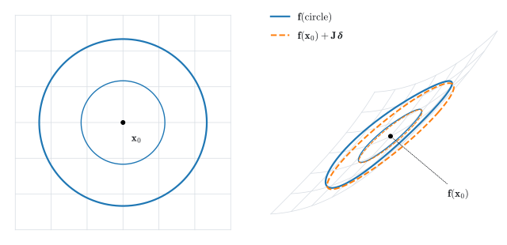
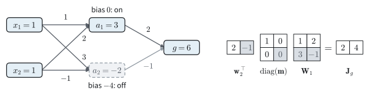
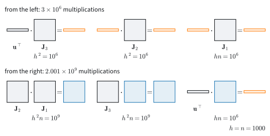

# Matrix Calculus
:label:`sec_mdl-matrix-calculus`

Take a network with two inputs, two ReLU hidden units and one output,

$$
g(\mathbf x)=\mathbf w_2^\top\boldsymbol\varphi(\mathbf W_1\mathbf x+\mathbf b),\qquad
\mathbf W_1=\begin{pmatrix}1&2\\3&-1\end{pmatrix},\quad
\mathbf b=\begin{pmatrix}0\\-4\end{pmatrix},\quad
\mathbf w_2=\begin{pmatrix}2\\-1\end{pmatrix},
$$

where $\boldsymbol\varphi$ applies $\max(0,\cdot)$ to each entry. At
$\mathbf x=(1,1)$ the pre-activations are $\mathbf W_1\mathbf x+\mathbf b=(3,-2)$,
so the second unit is off, the hidden vector is $(3,0)$, and the output is
$g=6$. A training step asks three questions about this number. Nudge the input
by $\boldsymbol\delta$: the output changes by $2\delta_1+4\delta_2$, a row of
two numbers, the transpose of the previous section's column gradient. Nudge the weight
matrix by $\Delta\mathbf W_1$: the output changes by
$2\,\Delta W_{11}+2\,\Delta W_{12}$ and not at all through the second row, so
the derivative with respect to a matrix is again a matrix,
$\left(\begin{smallmatrix}2&2\\0&0\end{smallmatrix}\right)$. And the hidden
layer $\mathbf x\mapsto\boldsymbol\varphi(\mathbf W_1\mathbf x+\mathbf b)$ maps
a vector to a vector. Neither a slope nor a gradient describes its derivative,
yet the output reaches $\mathbf W_1$ only through that layer.

Every training step needs the gradient of the loss with respect to every weight
matrix. A hand-derived gradient with a transposed square factor raises no
error; training goes wrong. Reference tables of matrix derivatives run to
hundreds of entries, and they do not protect against that mistake.

This section answers the three questions with one object and one rule. The
derivative of a vector-valued map is a matrix, the *Jacobian*, defined as the
map's best linear approximation. Composing maps multiplies Jacobians, so the
derivative of a network is a product of matrices, one per layer. The
derivatives a layer needs (linear and quadratic forms, least squares, matrix
products, softmax) all follow from one rule: write down the first-order change
of the function and read the gradient off as its coefficient. The same rule
produces the backward pass of each layer. We check every result against a
framework's automatic differentiation and end with $\mathbf p-\mathbf y$, the
gradient every classifier computes. The previous section wrote the gradient as
a column and the chain rule as a sum over paths; here both become matrix
products.

We use the following imports throughout this section.

```{.python .input #mdl-matrix-calculus-matrix-calculus}
#@tab mxnet
from mxnet import autograd, npx
from mxnet import np as mnp
import numpy as np
npx.set_np()
```

```{.python .input #mdl-matrix-calculus-matrix-calculus}
#@tab pytorch
import numpy as np
import torch
```

```{.python .input #mdl-matrix-calculus-matrix-calculus}
#@tab tensorflow
import numpy as np
import tensorflow as tf
```

```{.python .input #mdl-matrix-calculus-matrix-calculus}
#@tab jax
import numpy as np
import jax
from jax import numpy as jnp
```

## The Jacobian
:label:`subsec_mdl-jacobian`

A scalar function of many variables has a gradient. A layer of a network is a
function $\mathbf f:\mathbb R^n\to\mathbb R^m$ with many outputs, and this part
finds the object that plays the role of its derivative.

### The Best Linear Approximation

The loss of a network is one number, but it depends on the first layer through
every later layer, and each of those maps a vector to a vector. We start with
the smallest such map that is not linear, the one this section and the next
use throughout:

$$
\mathbf f(x,y)=\begin{pmatrix}x+\sin y\\ y+x^2/2\end{pmatrix},\qquad
\mathbf x_0=(0.5,\ 0.5).
$$

At $\mathbf x_0$ its value is $\mathbf f(\mathbf x_0)=(0.9794,\ 0.6250)$. Each
of the two outputs has two partial derivatives:
$\partial f_1/\partial x=1$, $\partial f_1/\partial y=\cos y=0.8776$,
$\partial f_2/\partial x=x=0.5$ and $\partial f_2/\partial y=1$. We arrange the
four numbers in a matrix with one row per output and one column per input,

$$
\mathbf J(\mathbf x_0)=\begin{pmatrix}1&\cos 0.5\\0.5&1\end{pmatrix}
=\begin{pmatrix}1&0.8776\\0.5&1\end{pmatrix}.
$$

Column $j$ says how both outputs move when input $j$ moves. The two columns
point in different directions and $\det\mathbf J=1-0.5\cdot0.8776=0.5612$, so
the matrix is invertible: near $\mathbf x_0$ the map does not fold the plane
onto a line. This matrix is the derivative of $\mathbf f$ at $\mathbf x_0$, in
the sense that
$\mathbf f(\mathbf x_0+\boldsymbol\delta)\approx\mathbf f(\mathbf x_0)+\mathbf J\boldsymbol\delta$
for small $\boldsymbol\delta$, and no other matrix does as well.

In one variable, the derivative is the slope of the best straight-line fit,
$f(x+\delta)\approx f(x)+f'(x)\,\delta$. The vector-valued generalization uses
the same local approximation. We say $\mathbf f$ is *differentiable* at
$\mathbf x$ if there is a matrix $\mathbf J\in\mathbb R^{m\times n}$ such that

$$
\mathbf f(\mathbf x+\boldsymbol\delta)
   = \mathbf f(\mathbf x) + \mathbf J\,\boldsymbol\delta + o(\|\boldsymbol\delta\|),
$$
:eqlabel:`eq_mdl-jacobian-linearization`

that is, the error of the linear model $\mathbf f(\mathbf x)+\mathbf J\boldsymbol\delta$
divided by $\|\boldsymbol\delta\|$ tends to zero as $\boldsymbol\delta\to\mathbf 0$.
That matrix, if it exists, is unique, is called the *Jacobian*
$\mathbf J_{\mathbf f}(\mathbf x)$, and its entries are the partial
derivatives:

$$
[\mathbf J_{\mathbf f}]_{ij} = \frac{\partial f_i}{\partial x_j}.
$$
:eqlabel:`eq_mdl-jacobian-entries`

To see why, feed :eqref:`eq_mdl-jacobian-linearization` the perturbation
$\boldsymbol\delta=t\,\mathbf e_j$ (a small step along axis $j$) and read off
component $i$: dividing by $t$ and letting $t\to0$ leaves
$\partial f_i/\partial x_j$ in the $(i,j)$ slot, whatever matrix we started
with. So row $i$ of $\mathbf J$ collects the partials of the $i$-th output, and
column $j$ records how all outputs respond to nudging input $j$. The partial
derivatives supply the entries of $\mathbf J$, but the linear approximation is
what defines it.

Partials alone do not guarantee a Jacobian. The function
$f(x,y)=2xy/(x^2+y^2)$ with $f(0,0)=0$, met in the previous section, vanishes on
both axes, so both partials at the origin are $0$. Yet $f=1$ everywhere on the
diagonal $x=y$, arbitrarily close to the origin. The only candidate matrix is
the zero row, and along the diagonal it misses $f$ by $1$, an error that does
not shrink with $\boldsymbol\delta$. So $f$ has no Jacobian at the origin. A
sufficient condition is continuity of the partials: if every partial $\partial f_i/\partial x_j$
exists near $\mathbf x$ and is continuous at $\mathbf x$, then $\mathbf f$ is
differentiable at $\mathbf x$ :cite:`Rudin.1976`.

:numref:`fig_mdl-cal-jacobian-ellipse` shows the definition at work: near
$\mathbf x_0$, the map acts like its Jacobian. A circle of radius $r$ around $\mathbf x_0$ maps
nearly onto the ellipse $\mathbf f(\mathbf x_0)+\mathbf J\boldsymbol\delta$,
$\|\boldsymbol\delta\|=r$, whose semi-axes are $r$ times the singular values of
$\mathbf J$ (a matrix maps the unit circle to an ellipse with these semi-axes,
:numref:`sec_mdl-svd-low-rank`). Here the singular values are $1.706$ and
$0.329$, so the circle of radius $0.35$ becomes an ellipse with semi-axes $0.60$
and $0.12$. The largest gap between the true image and the ellipse is $0.061$
at $r=0.35$ and $0.015$ at $r=0.175$: halving the radius cuts the gap
fourfold.

![A differentiable map is locally its Jacobian. Two circles of radius $0.35$ and $0.175$ around $\mathbf x_0=(0.5,0.5)$ (left) and their images under $\mathbf f(x,y)=(x+\sin y,\ y+x^2/2)$ (right, blue) against the ellipses $\mathbf f(\mathbf x_0)+\mathbf J(\mathbf x_0)\boldsymbol\delta$ (orange, dashed). The semi-axes of each ellipse are the radius times the singular values $1.71$ and $0.33$ of $\mathbf J$. Halving the radius cuts the largest gap between image and ellipse from $0.061$ to $0.015$, the $o(\|\boldsymbol\delta\|)$ remainder.](../img/mdl-cal-jacobian-ellipse.svg)
:label:`fig_mdl-cal-jacobian-ellipse`

Does the error of the linear model fall faster than $\|\boldsymbol\delta\|$
itself? We shrink one perturbation tenfold at a time and print the error
divided by $\|\boldsymbol\delta\|$.

```{.python .input #matrix-calculus-autodiff-jacobian-finite-diff}
def f(v):                                   # the running map, R^2 -> R^2
    x, y = v
    return np.array([x + np.sin(y), y + x**2 / 2])

def J(v):                                   # its Jacobian, entry by entry
    x, y = v
    return np.array([[1.0, np.cos(y)], [x, 1.0]])

x0 = np.array([0.5, 0.5])
for s in [1, 0.1, 0.01, 0.001]:
    delta = s * np.array([0.2, 0.1])
    err = np.linalg.norm(f(x0 + delta) - f(x0) - J(x0) @ delta)
    print(f'|delta| = {np.linalg.norm(delta):.1e}   '
          f'error / |delta| = {err / np.linalg.norm(delta):.1e}')
```

The ratio goes from $0.09$ to $0.009$, $0.0009$ and $0.00009$. It tends to
zero, which is the $o(\|\boldsymbol\delta\|)$ of the definition. It also falls
tenfold for every tenfold step, so the error itself falls a hundredfold: the
error is $O(\|\boldsymbol\delta\|^2)$. The definition promises only the first
property; the second holds because $\mathbf f$ has continuous second
derivatives.

### Gradients, Hessians, and the Shape of a Derivative

When $m=1$, a scalar field $f:\mathbb R^n\to\mathbb R$, the Jacobian is a single
row, $\partial f/\partial\mathbf x=[\partial f/\partial x_1,\ldots,\partial f/\partial x_n]$,
and :eqref:`eq_mdl-jacobian-linearization` is the first-order expansion
$f(\mathbf x+\boldsymbol\delta)\approx f(\mathbf x)+(\partial f/\partial\mathbf x)\,\boldsymbol\delta$
of the previous section. That section wrote the gradient as a column. The two
are transposes of each other,

$$
\nabla_{\mathbf x} f = \Bigl(\frac{\partial f}{\partial\mathbf x}\Bigr)^{\!\top},
$$
:eqlabel:`eq_mdl-grad-is-jacobian-transpose`

and this book uses both, each for one job. Jacobians of vector-valued maps are
$m\times n$, one row per output, so that the chain rule below composes without
transposes. Gradients of scalars are columns, $\nabla_{\mathbf x}f$, the vector
an optimizer subtracts from $\mathbf x$. For the network of the opening,
$\partial g/\partial\mathbf x=(2,\ 4)$ is a $1\times2$ Jacobian and
$\nabla_{\mathbf x}g=(2,4)^\top$ is the column.

A scalar function of a matrix $\mathbf W\in\mathbb R^{p\times q}$ needs one more
convention. Its gradient $\nabla_{\mathbf W}f$ is the $p\times q$ matrix with
entries $\partial f/\partial W_{ij}$, so it has the shape of $\mathbf W$. Then
the first-order expansion reads

$$
f(\mathbf W+\mathbf E)=f(\mathbf W)+\langle\nabla_{\mathbf W}f,\ \mathbf E\rangle+o(\|\mathbf E\|),
\qquad
\langle\mathbf A,\mathbf B\rangle=\operatorname{tr}(\mathbf A^\top\mathbf B)=\sum_{ij}A_{ij}B_{ij},
$$
:eqlabel:`eq_mdl-matrix-gradient`

where $\langle\cdot,\cdot\rangle$ multiplies two matrices of the same shape
entry by entry and adds the products, the dot product of the matrices read as
long vectors. The change of $f$ is the sum over all entries of "sensitivity
times nudge". In the opening, $\nabla_{\mathbf W_1}g$ is the $2\times2$ matrix
$\left(\begin{smallmatrix}2&2\\0&0\end{smallmatrix}\right)$, and
$\langle\nabla_{\mathbf W_1}g,\Delta\mathbf W_1\rangle=2\,\Delta W_{11}+2\,\Delta W_{12}$
is the change we found there. One rule checks every formula in this section: a
gradient has the shape of its variable. If a derived gradient does not, a
transpose is missing.

Differentiating once more brings in the Hessian. The gradient field
$\nabla f:\mathbb R^n\to\mathbb R^n$ is itself a vector-valued map, and its
Jacobian is the matrix of second partials, the Hessian $\mathbf H_f$, with
$[\mathbf H_f]_{ij}=\partial^2 f/\partial x_i\partial x_j$. The entry
$[\mathbf J_{\nabla f}]_{ij}=\partial^2 f/\partial x_j\partial x_i$ takes the
derivatives in the other order; the two agree, and $\mathbf H_f$ is symmetric,
when the mixed partials are continuous (the Clairaut–Schwarz theorem of the
previous section).

## The Chain Rule for Jacobians

A network is a composition of layers. The previous section's chain rule summed
over every path from an input to an output; for layers that are vector maps,
that sum is a matrix product.

### Composition as a Matrix Product

**Proposition (chain rule).** *If $\mathbf f:\mathbb R^n\to\mathbb R^p$ is
differentiable at $\mathbf x$ and $\mathbf g:\mathbb R^p\to\mathbb R^m$ is
differentiable at $\mathbf f(\mathbf x)$, then $\mathbf g\circ\mathbf f$ is
differentiable at $\mathbf x$ and*

$$
\mathbf J_{\mathbf g\circ\mathbf f}(\mathbf x)
   = \mathbf J_{\mathbf g}\!\bigl(\mathbf f(\mathbf x)\bigr)\,\mathbf J_{\mathbf f}(\mathbf x).
$$
:eqlabel:`eq_mdl-jacobian-chain`

**Proof.** Write $\mathbf y=\mathbf f(\mathbf x)$ and let $\mathbf A=\mathbf
J_{\mathbf f}(\mathbf x)$, $\mathbf B=\mathbf J_{\mathbf g}(\mathbf y)$. We
substitute the linear model for $\mathbf f$ into the linear model for
$\mathbf g$. By :eqref:`eq_mdl-jacobian-linearization`,
$\mathbf f(\mathbf x+\boldsymbol\delta)=\mathbf y+\mathbf A\boldsymbol\delta
+o(\|\boldsymbol\delta\|)$. Calling that displacement
$\boldsymbol\eta=\mathbf A\boldsymbol\delta+o(\|\boldsymbol\delta\|)$ and feeding it
to $\mathbf g$,

$$
\mathbf g\bigl(\mathbf f(\mathbf x+\boldsymbol\delta)\bigr)
   = \mathbf g(\mathbf y) + \mathbf B\,\boldsymbol\eta + o(\|\boldsymbol\eta\|)
   = \mathbf g(\mathbf y) + \mathbf B\mathbf A\,\boldsymbol\delta + o(\|\boldsymbol\delta\|).
$$

The second equality needs two facts. $\mathbf B$ applied to the
$o(\|\boldsymbol\delta\|)$ remainder is again $o(\|\boldsymbol\delta\|)$. And
$\|\boldsymbol\eta\|\le\|\mathbf A\|\,\|\boldsymbol\delta\|+o(\|\boldsymbol\delta\|)$
is bounded by a constant multiple of $\|\boldsymbol\delta\|$, so $\mathbf g$'s
own remainder $o(\|\boldsymbol\eta\|)$ is $o(\|\boldsymbol\delta\|)$ as well;
this is the one step that is not routine. The coefficient of
$\boldsymbol\delta$ is therefore a matrix with the property
:eqref:`eq_mdl-jacobian-linearization`, and by uniqueness it is the Jacobian of
the composite: $\mathbf J_{\mathbf g\circ\mathbf f}=\mathbf B\mathbf A$.
$\blacksquare$

One entry of the product recovers the chain rule of the previous section:
$[\mathbf B\mathbf A]_{ik}=\sum_j (\partial g_i/\partial y_j)(\partial f_j/\partial x_k)$
sums, over the intermediate variables $y_j$, the product of the derivatives
along each path from $x_k$ to $g_i$.

### The Jacobian of a Network

The network of the opening is a composition of three maps: the affine map
$\mathbf a=\mathbf W_1\mathbf x+\mathbf b$, the ReLU $\mathbf h=\boldsymbol\varphi(\mathbf a)$,
and the output $g=\mathbf w_2^\top\mathbf h$. The first map is its own linear
approximation, so its Jacobian is $\mathbf W_1$; the bias shifts the value and
not the slope. The ReLU acts on each entry separately, with slope $1$ where
$a_i>0$ and $0$ where $a_i<0$, so its Jacobian is the diagonal matrix
$\operatorname{diag}(\mathbf m)$ of the *mask* $\mathbf m$, the vector of these
slopes. The output map has Jacobian $\mathbf w_2^\top$. At $\mathbf x=(1,1)$,
where $\mathbf a=(3,-2)$ and $\mathbf m=(1,0)$, the chain rule multiplies the
three:

$$
\mathbf J_g(\mathbf x)=\mathbf w_2^\top\operatorname{diag}(\mathbf m)\,\mathbf W_1
=\begin{pmatrix}2&-1\end{pmatrix}\begin{pmatrix}1&0\\0&0\end{pmatrix}\begin{pmatrix}1&2\\3&-1\end{pmatrix}
=\begin{pmatrix}2&0\end{pmatrix}\begin{pmatrix}1&2\\3&-1\end{pmatrix}
=\begin{pmatrix}2&4\end{pmatrix}.
$$

The mask zeroes the second entry of $\mathbf w_2^\top$, so the second row of
$\mathbf W_1$ never reaches the output: the weights of an inactive unit play no
part in the derivative (:numref:`fig_mdl-cal-relu-net-jacobian`). The row $(2,4)$ is
the change $2\delta_1+4\delta_2$ of the opening. At another input the mask
changes and so does the Jacobian. At $\mathbf x=(2,-3)$ the pre-activations are
$(-4,5)$, the mask is $(0,1)$, and
$\mathbf J_g=(0,\ -1)\,\mathbf W_1=(-3,\ 1)$. Because ReLU is piecewise linear, a
finite difference along each axis reproduces these entries without error for
steps small enough to keep the mask fixed; the first exercise makes this precise.


:label:`fig_mdl-cal-relu-net-jacobian`

The same two kinds of factor make up every multilayer perceptron. A dense layer
$\mathbf x\mapsto\mathbf W\mathbf x$ has $\mathbf J=\mathbf W$. An elementwise
activation $\boldsymbol\varphi(\mathbf x)=(\varphi(x_1),\ldots,\varphi(x_n))$
couples no pair of coordinates, so all off-diagonal partials vanish and
$\mathbf J_{\boldsymbol\varphi}(\mathbf x)=\operatorname{diag}\bigl(\varphi'(x_1),\ldots,\varphi'(x_n)\bigr)$.
This requires $\varphi$ to be differentiable at every $x_i$. ReLU has no
derivative at $0$, and frameworks use a fixed value there by convention, as in
the single-variable section. A network of depth $K$ is a composition
$\mathbf f=\mathbf f_K\circ\cdots\circ\mathbf f_1$, and iterating
:eqref:`eq_mdl-jacobian-chain` turns its derivative into one product,

$$
\mathbf J = \mathbf J_K\,\mathbf J_{K-1}\cdots\mathbf J_1,
$$
:eqlabel:`eq_mdl-jacobian-product`

with each factor evaluated at the input of its layer. For the alternation of
dense layers and activations this is
$\mathbf J=\operatorname{diag}(\boldsymbol\varphi_K')\,\mathbf W_K\cdots
\operatorname{diag}(\boldsymbol\varphi_1')\,\mathbf W_1$: weight matrices
interleaved with diagonal factors. Multiplying a vector by a diagonal factor
scales each entry, which costs $O(n)$ operations instead of $O(n^2)$.

Does a framework's automatic differentiation agree with the product
$\mathbf w_2^\top\operatorname{diag}(\mathbf m)\mathbf W_1$? We define the
network as a function of the input and of its parameters, then compare the two.

```{.python .input #mdl-matrix-calculus-the-jacobian-of-a-network}
#@tab mxnet
W1, b = mnp.array([[1.0, 2.0], [3.0, -1.0]]), mnp.array([0.0, -4.0])
w2, x = mnp.array([2.0, -1.0]), mnp.array([1.0, 1.0])

def g(x, W1, b, w2):                         # the 2-2-1 ReLU network
    return mnp.dot(w2, npx.relu(mnp.dot(W1, x) + b))

m = (mnp.dot(W1, x) + b > 0).astype('float32')   # the ReLU mask
x.attach_grad()
with autograd.record():
    out = g(x, W1, b, w2)
out.backward()
print('by hand    :', mnp.dot(mnp.dot(w2, mnp.diag(m)), W1).asnumpy())
print('by autograd:', x.grad.asnumpy())
```

```{.python .input #mdl-matrix-calculus-the-jacobian-of-a-network}
#@tab pytorch
W1, b = torch.tensor([[1.0, 2.0], [3.0, -1.0]]), torch.tensor([0.0, -4.0])
w2, x = torch.tensor([2.0, -1.0]), torch.tensor([1.0, 1.0])

def g(x, W1, b, w2):                         # the 2-2-1 ReLU network
    return w2 @ torch.relu(W1 @ x + b)

m = (W1 @ x + b > 0).float()                 # the ReLU mask
print('by hand    :', (w2 @ torch.diag(m) @ W1).numpy())
print('by autograd:', torch.func.grad(g)(x, W1, b, w2).numpy())
```

```{.python .input #mdl-matrix-calculus-the-jacobian-of-a-network}
#@tab tensorflow
W1, b = tf.constant([[1.0, 2.0], [3.0, -1.0]]), tf.constant([0.0, -4.0])
w2, x = tf.constant([2.0, -1.0]), tf.constant([1.0, 1.0])

def g(x, W1, b, w2):                         # the 2-2-1 ReLU network
    return tf.tensordot(w2, tf.nn.relu(tf.linalg.matvec(W1, x) + b), 1)

m = tf.cast(tf.linalg.matvec(W1, x) + b > 0, tf.float32)   # the ReLU mask
with tf.GradientTape() as tape:
    tape.watch(x)
    out = g(x, W1, b, w2)
print('by hand    :', (w2[None, :] @ tf.linalg.diag(m) @ W1)[0].numpy())
print('by autograd:', tape.gradient(out, x).numpy())
```

```{.python .input #mdl-matrix-calculus-the-jacobian-of-a-network}
#@tab jax
W1, b = jnp.array([[1.0, 2.0], [3.0, -1.0]]), jnp.array([0.0, -4.0])
w2, x = jnp.array([2.0, -1.0]), jnp.array([1.0, 1.0])

def g(x, W1, b, w2):                         # the 2-2-1 ReLU network
    return w2 @ jax.nn.relu(W1 @ x + b)

m = (W1 @ x + b > 0).astype(jnp.float32)     # the ReLU mask
print('by hand    :', np.asarray(w2 @ jnp.diag(m) @ W1))
print('by autograd:', np.asarray(jax.grad(g)(x, W1, b, w2)))
```

Both lines print $(2,4)$. The product :eqref:`eq_mdl-jacobian-product` has a
limit that matters for training: it is the derivative with respect to the
*input*. The weight matrices $\mathbf W_k$ appear in it as factors, never as
variables, so it does not say how the output changes when a weight changes.
Those gradients need one more rule per layer, which
:numref:`subsec_mdl-layer-vjp` derives and applies to this same network.

### The Order of Multiplication

Matrix multiplication is associative, so the product
:eqref:`eq_mdl-jacobian-product` may be bracketed in any order and every order
gives the same matrix. The orders differ in cost by a factor that grows with
the width of the network. Training needs the gradient of a scalar loss $\ell$,
so the chain starts on the left with a row vector, the $1\times h$ Jacobian
$\mathbf u^\top=\partial\ell/\partial\mathbf h_K$ of the loss with respect to
the last layer's output $\mathbf h_K$. Multiplying from the left keeps every
intermediate result a row vector: $\mathbf u^\top\mathbf J_K$ is a row, that row
times $\mathbf J_{K-1}$ is a row, and so on, so every step multiplies a matrix
by a vector. Multiplying from the right instead multiplies matrix by matrix
until the row arrives at the end. The cheap order is the one in which every
step is a matrix–vector product. If a column vector $\mathbf v$ (one input
direction) sits on the right of the chain instead, multiplying from the right
is the cheap order.

A count makes the difference concrete. Take
$\mathbf u^\top\mathbf J_3\mathbf J_2\mathbf J_1$ with shapes $1\times h$,
$h\times h$, $h\times h$ and $h\times n$, and $h=n=1000$, where a $p\times q$
matrix times a $q\times r$ matrix costs $pqr$ multiplications. From the left
there are three matrix–vector products, $h^2+h^2+hn=3\times10^6$
multiplications. From the right, $\mathbf J_2\mathbf J_1$ and then
$\mathbf J_3(\mathbf J_2\mathbf J_1)$ cost $h^2n=10^9$ each, and the final
product with $\mathbf u^\top$ costs $hn=10^6$, in all $2.001\times10^9$. Three
million against two billion is a factor of about $670$, or $2h/3$
(:numref:`fig_mdl-cal-jacobian-chain-order`).


:label:`fig_mdl-cal-jacobian-chain-order`

The two orders correspond to two directions through the network. Multiplying
from the left carries the
sensitivity of the output backward through the layers, from the last to the
first, and yields the gradient of a scalar loss at the cost of one
matrix–vector product per layer. Multiplying from the right, with a seed column
$\mathbf v$, carries one input direction forward through the layers and yields
$\mathbf J\mathbf v$. Programs that evaluate these two orders automatically are
called reverse-mode and forward-mode automatic differentiation.

The count above uses factors of equal width. When the factors have different
shapes, neither end order need be cheapest. The best bracketing of a chain is
found by a dynamic program (see the exercises), while for a general computation
graph finding the cheapest order is NP-complete :cite:`Naumann.2008`.

The values of the factors matter as well as their shapes. When every factor is
the same matrix $\mathbf W$, as in a recurrent network that applies one weight
matrix at every step (ignoring the activations), the product is
$\mathbf W^K$. For a diagonalizable
$\mathbf W=\mathbf V\boldsymbol\Lambda\mathbf V^{-1}$,
$\mathbf W^K=\mathbf V\boldsymbol\Lambda^K\mathbf V^{-1}$ grows or shrinks like
$|\lambda_{\max}|^K$, where $\lambda_{\max}$ is the eigenvalue of largest
magnitude: $0.9^{50}\approx0.005$ and $1.1^{50}\approx117$. This is the
vanishing and exploding gradient of deep and recurrent networks, analyzed
further in :numref:`subsec_mdl-jacobian-products`.

## Derivatives with Respect to Vectors and Matrices
:label:`subsec_mdl-matrix-identities`

A layer needs the gradient of a scalar with respect to vectors and matrices:
its input, its weights, its bias. Tables of such derivatives are long, and a
wrong transpose copied from one raises no error when the matrices are square.
This part derives every gradient the section needs with one method, which
produces each result in the shape of its variable.

### The Differential Method
:label:`subsec_mdl-differential-method`

Write $d\mathbf x$ for a small change of the variable and $df$ for the part of
the resulting change of $f$ that is linear in $d\mathbf x$, the term
$\mathbf J\boldsymbol\delta$ of :eqref:`eq_mdl-jacobian-linearization` with
$\boldsymbol\delta$ renamed $d\mathbf x$. By
:eqref:`eq_mdl-jacobian-linearization` and :eqref:`eq_mdl-matrix-gradient`,
this linear part is an inner product with the gradient,

$$
df=\langle\nabla f,\ d\mathbf x\rangle,
$$
:eqlabel:`eq_mdl-differential-rule`

for a vector variable ($\langle\mathbf a,\mathbf b\rangle=\mathbf a^\top\mathbf b$)
and a matrix variable alike. The equation can be read two ways. Given the
gradient, it says how $f$ responds to a nudge. Given $f$, it is a recipe for
the gradient: compute $df$ by the ordinary rules of differentiation, rearrange
it into the form $\langle\mathbf M,\,d\mathbf x\rangle$, and read off
$\nabla f=\mathbf M$. The reading is unambiguous because a linear function of
$d\mathbf x$ can be written as $\langle\mathbf M,d\mathbf x\rangle$ for only one
$\mathbf M$: putting $d\mathbf x$ equal to the matrix with a single $1$ in
position $(i,j)$ gives $M_{ij}$.

Four rules compute $df$. The differential is linear. It obeys the product rule
$d(\mathbf A\mathbf B)=d\mathbf A\,\mathbf B+\mathbf A\,d\mathbf B$, since
$(\mathbf A+d\mathbf A)(\mathbf B+d\mathbf B)$ differs from
$\mathbf A\mathbf B+d\mathbf A\,\mathbf B+\mathbf A\,d\mathbf B$ by the
second-order term $d\mathbf A\,d\mathbf B$. It commutes with transposition,
$d(\mathbf A^\top)=(d\mathbf A)^\top$. And the *move rule* shifts a factor
next to $d\mathbf x$ to the other side of the inner product:

$$
\langle\mathbf A,\ \mathbf B\mathbf C\rangle
=\langle\mathbf B^\top\mathbf A,\ \mathbf C\rangle
=\langle\mathbf A\mathbf C^\top,\ \mathbf B\rangle,
$$

which follows from $\operatorname{tr}(\mathbf X\mathbf Y)=\operatorname{tr}(\mathbf Y\mathbf X)$:
$\operatorname{tr}(\mathbf A^\top\mathbf B\mathbf C)=\operatorname{tr}\bigl((\mathbf B^\top\mathbf A)^\top\mathbf C\bigr)
=\operatorname{tr}(\mathbf C\mathbf A^\top\mathbf B)=\operatorname{tr}\bigl((\mathbf A\mathbf C^\top)^\top\mathbf B\bigr)$.
A factor to the left of the variable moves across as its transpose on the left,
a factor to the right as its transpose on the right.

The two smallest cases take one line each. For the linear form,
$d(\mathbf a^\top\mathbf x)=\mathbf a^\top d\mathbf x=\langle\mathbf a,d\mathbf x\rangle$,
so $\nabla_{\mathbf x}\,\mathbf a^\top\mathbf x=\mathbf a$. For the quadratic
form, the product rule hits both copies of $\mathbf x$:

$$
d(\mathbf x^\top\mathbf A\mathbf x)
=d\mathbf x^\top\mathbf A\mathbf x+\mathbf x^\top\mathbf A\,d\mathbf x
=\mathbf x^\top\mathbf A^\top d\mathbf x+\mathbf x^\top\mathbf A\,d\mathbf x
=\bigl\langle(\mathbf A+\mathbf A^\top)\mathbf x,\ d\mathbf x\bigr\rangle.
$$

The step that is not routine is the second equality: $d\mathbf x^\top\mathbf A\mathbf x$
is a $1\times1$ matrix, so it equals its own transpose
$\mathbf x^\top\mathbf A^\top d\mathbf x$. Reading off the coefficient,
$\nabla_{\mathbf x}\,\mathbf x^\top\mathbf A\mathbf x=(\mathbf A+\mathbf A^\top)\mathbf x$,
which is $2\mathbf A\mathbf x$ when $\mathbf A$ is symmetric.

Indices give a second route that settles any doubt about a transpose, at the
cost of length. We use *Einstein summation*: an index that appears twice in a
product is summed over, so $x_iA_{ij}x_j$ means $\sum_{ij}x_iA_{ij}x_j$
(:numref:`sec_mdl-linear-maps`). We also use the Kronecker delta, $\delta_{ik}=1$
if $i=k$ and $0$ otherwise, which is $\partial x_i/\partial x_k$. The product
rule on $\partial/\partial x_k$ hits both $x$'s,

$$
\frac{\partial}{\partial x_k}\bigl(x_i A_{ij} x_j\bigr)
   = \delta_{ik}\,A_{ij}x_j + x_i A_{ij}\,\delta_{jk}
   = A_{kj}x_j + x_i A_{ik}
   = (A_{ki}+A_{ik})\,x_i .
$$

The last step renames the summation index $j$ to $i$ in the first term, which
is allowed because a summed index is a dummy. The bracket $A_{ki}+A_{ik}$ is the
$(k,i)$ entry of $\mathbf A+\mathbf A^\top$, so the $k$-th partial is the $k$-th
entry of $(\mathbf A+\mathbf A^\top)\mathbf x$, as before.

A quick check of any matrix identity is to make every matrix $1\times1$: the
identity must then reduce to the familiar scalar rule. The quadratic form passes,
since $\frac{d}{dx}(ax^2)=2ax=(a+a)x$. This *$1\times1$ check* catches wrong
shapes, but it cannot catch a wrong transpose, because a $1\times1$ matrix is
its own transpose. A counterexample shows the blind spot. Let
$\mathbf A=\left(\begin{smallmatrix}0&1\\0&0\end{smallmatrix}\right)$ and
$\mathbf x=(1,2)$. Then $\mathbf x^\top\mathbf A\mathbf x=x_1x_2$, whose
gradient $(x_2,x_1)=(2,1)$ equals $(\mathbf A+\mathbf A^\top)\mathbf x$. The
guess $2\mathbf A\mathbf x=(4,0)$, which the scalar rule $2ax$ suggests, passes
the $1\times1$ check and is wrong.

The method handles matrix variables with no extra effort. For the least-squares
loss $\ell=\|\mathbf W\mathbf x-\mathbf y\|^2$ with residual
$\mathbf r=\mathbf W\mathbf x-\mathbf y$, we have $d\mathbf r=d\mathbf W\,\mathbf x$
when $\mathbf W$ varies, and the move rule puts $\mathbf x$ on the other side:
$d\ell=2\mathbf r^\top d\mathbf r=\langle 2\mathbf r,\ d\mathbf W\,\mathbf x\rangle
=\langle2\mathbf r\mathbf x^\top,\ d\mathbf W\rangle$. Therefore

$$
\nabla_{\mathbf W}\|\mathbf W\mathbf x-\mathbf y\|^2 = 2\,(\mathbf W\mathbf x-\mathbf y)\,\mathbf x^\top,
$$
:eqlabel:`eq_mdl-lstsq-grad`

a rank-one outer product of the residual with the input, with the shape of
$\mathbf W$. When $\mathbf x$ varies instead, $d\mathbf r=\mathbf W\,d\mathbf x$
and $\nabla_{\mathbf x}\ell=2\mathbf W^\top\mathbf r$. In both cases the
gradient is twice the residual, multiplied by the transpose of the factor that
multiplies the variable. The $1\times1$ check gives $\frac{d}{dw}(wx-y)^2=2(wx-y)x$.

### Backward Rules of a Layer
:label:`subsec_mdl-layer-vjp`

Inside a network, a layer $\mathbf Y=\mathbf F(\mathbf X)$ is one step of a long
computation that ends in a scalar loss $\ell$. Its full Jacobian is too large
to form: a $1000\times1000$ weight matrix applied to a minibatch of $1000$
examples has $10^6$ outputs and $10^6$ weights, so the Jacobian of the outputs
with respect to the weights has $10^{12}$ entries. The layer needs less. It
turns the gradient of the loss with respect to its output into the gradients
with respect to its inputs and weights. We write
$\bar{\mathbf Y}=\nabla_{\mathbf Y}\ell$ for the gradient of the loss with
respect to $\mathbf Y$ and call it the *adjoint* of $\mathbf Y$; it has the
shape of $\mathbf Y$.

**Proposition (backward rule of a layer).** *Let $\mathbf Y=\mathbf F(\mathbf X)$
be differentiable at $\mathbf X$ and let $\ell$ be a differentiable scalar
function of $\mathbf Y$. Then the adjoint $\bar{\mathbf X}$ of the composite
$\ell(\mathbf F(\mathbf X))$ is the unique matrix with*

$$
\langle\bar{\mathbf X},\ d\mathbf X\rangle=\langle\bar{\mathbf Y},\ d\mathbf Y\rangle
\quad\textit{for every } d\mathbf X,
$$

*where $d\mathbf Y$ is the first-order change of $\mathbf F$ caused by
$d\mathbf X$.*

**Proof.** By the chain rule :eqref:`eq_mdl-jacobian-chain` (with matrices read
as long vectors), the linear part of the composite is the linear part of $\ell$
applied to the linear part of $\mathbf F$: $d\ell=\langle\bar{\mathbf Y},d\mathbf Y\rangle$.
Since $d\mathbf Y$ is linear in $d\mathbf X$, so is $d\ell$, and it can be
written as $\langle\mathbf M,d\mathbf X\rangle$ for a unique $\mathbf M$. By
:eqref:`eq_mdl-differential-rule`, $\mathbf M=\bar{\mathbf X}$. $\blacksquare$

In practice, applying the Proposition means applying the move rule. For a
vector layer
$d\mathbf y=\mathbf J\,d\mathbf x$, it gives
$\langle\bar{\mathbf y},\mathbf J\,d\mathbf x\rangle=\langle\mathbf J^\top\bar{\mathbf y},d\mathbf x\rangle$,
so $\bar{\mathbf x}=\mathbf J^\top\bar{\mathbf y}$, or
$\bar{\mathbf x}^\top=\bar{\mathbf y}^\top\mathbf J$: the row
$\partial\ell/\partial\mathbf y$ times the Jacobian, which is the left-to-right
order of the previous subsection applied to one factor. A row vector times a
Jacobian is called a *vector–Jacobian product*. The Proposition computes it
for matrix variables without ever writing the Jacobian down.

The most used derivative in deep learning is that of a matrix product. A
minibatch $\mathbf X\in\mathbb R^{n\times d}$ of $n$ examples passes through
the weights $\mathbf W\in\mathbb R^{d\times m}$ to give $\mathbf Y=\mathbf X\mathbf W$.
The product rule gives $d\mathbf Y=d\mathbf X\,\mathbf W+\mathbf X\,d\mathbf W$,
and the move rule splits the inner product into one term per variable,
$\langle\bar{\mathbf Y},d\mathbf X\,\mathbf W\rangle+\langle\bar{\mathbf Y},\mathbf X\,d\mathbf W\rangle
=\langle\bar{\mathbf Y}\mathbf W^\top,d\mathbf X\rangle+\langle\mathbf X^\top\bar{\mathbf Y},d\mathbf W\rangle$.
Reading off both coefficients,

$$
\bar{\mathbf X}=\bar{\mathbf Y}\,\mathbf W^\top,\qquad
\bar{\mathbf W}=\mathbf X^\top\bar{\mathbf Y}.
$$
:eqlabel:`eq_mdl-matmul-vjp`

The backward pass of a linear layer is two matrix products. Each has the size of
the forward product: the forward pass costs $ndm$ multiplications, the backward
pass $2ndm$. The shapes check: $\bar{\mathbf Y}\mathbf W^\top$ is
$(n\times m)(m\times d)=n\times d$ like $\mathbf X$, and
$\mathbf X^\top\bar{\mathbf Y}$ is $d\times m$ like $\mathbf W$. The $1\times1$
check gives $\bar x=\bar y\,w$ and $\bar w=x\,\bar y$ for $y=xw$. Collections
of such rules for other matrix operations (inverses, determinants,
decompositions) are derived the same way :cite:`Giles.2008b`. For a single
column $\mathbf y=\mathbf W\mathbf x$ the same computation gives
$\bar{\mathbf W}=\bar{\mathbf y}\,\mathbf x^\top$ and
$\bar{\mathbf x}=\mathbf W^\top\bar{\mathbf y}$, the pattern of
:eqref:`eq_mdl-lstsq-grad`.

Two more layers complete a
multilayer perceptron. An elementwise map $\mathbf Y=\boldsymbol\varphi(\mathbf X)$
has $d\mathbf Y=\varphi'(\mathbf X)\odot d\mathbf X$, where $\odot$ multiplies
entry by entry, so $\bar{\mathbf X}=\varphi'(\mathbf X)\odot\bar{\mathbf Y}$:
the diagonal Jacobian of the previous part, applied as a mask. A bias
$\mathbf y=\mathbf z+\mathbf b$ has $d\mathbf y=d\mathbf b$, so
$\bar{\mathbf b}=\bar{\mathbf y}$.

We can now derive the matrix of the opening. Run the network of
:numref:`fig_mdl-cal-relu-net-jacobian` backward from $\bar g=1$, one layer at a
time, at $\mathbf x=(1,1)$:

1. The output $g=\mathbf w_2^\top\mathbf h$ gives $\bar{\mathbf h}=\mathbf w_2=(2,-1)$
   and $\bar{\mathbf w}_2=\mathbf h=(3,0)$.
2. The ReLU gives $\bar{\mathbf a}=\mathbf m\odot\bar{\mathbf h}=(2,0)$, and the
   bias $\bar{\mathbf b}=\bar{\mathbf a}=(2,0)$.
3. The affine map $\mathbf a=\mathbf W_1\mathbf x+\mathbf b$ gives
   $\bar{\mathbf W}_1=\bar{\mathbf a}\,\mathbf x^\top=\left(\begin{smallmatrix}2&2\\0&0\end{smallmatrix}\right)$
   and $\bar{\mathbf x}=\mathbf W_1^\top\bar{\mathbf a}=(2,4)$.

The last line is the Jacobian row $(2,4)$ of the chain-rule part, transposed,
and $\bar{\mathbf W}_1$ is the matrix the opening found by nudging the weights.
Do the backward rules reproduce what automatic differentiation computes for the
parameters? We reuse `g` from above and differentiate with respect to
$\mathbf W_1$, $\mathbf b$ and $\mathbf w_2$.

```{.python .input #mdl-matrix-calculus-backward-rules-of-a-layer-1}
#@tab mxnet
for p in (W1, b, w2):
    p.attach_grad()
with autograd.record():
    out = g(x, W1, b, w2)
out.backward()
h = npx.relu(mnp.dot(W1, x) + b)
show = lambda t: (t.asnumpy() + 0.0).tolist()   # + 0.0 turns -0.0 into 0.0
print('dg/dW1 = (w2*m) x^T:', show(mnp.outer(w2 * m, x)),
      '  autograd:', show(W1.grad))
print('dg/db  = w2*m      :', show(w2 * m), '  autograd:', show(b.grad))
print('dg/dw2 = h         :', show(h), '  autograd:', show(w2.grad))
```

```{.python .input #mdl-matrix-calculus-backward-rules-of-a-layer-1}
#@tab pytorch
gW1, gb, gw2 = torch.func.grad(g, argnums=(1, 2, 3))(x, W1, b, w2)
h = torch.relu(W1 @ x + b)
show = lambda t: (t.numpy() + 0.0).tolist()     # + 0.0 turns -0.0 into 0.0
print('dg/dW1 = (w2*m) x^T:', show(torch.outer(w2 * m, x)),
      '  autograd:', show(gW1))
print('dg/db  = w2*m      :', show(w2 * m), '  autograd:', show(gb))
print('dg/dw2 = h         :', show(h), '  autograd:', show(gw2))
```

```{.python .input #mdl-matrix-calculus-backward-rules-of-a-layer-1}
#@tab tensorflow
W1, b, w2 = tf.Variable(W1), tf.Variable(b), tf.Variable(w2)
with tf.GradientTape() as tape:
    out = g(x, W1, b, w2)
gW1, gb, gw2 = tape.gradient(out, [W1, b, w2])
h = tf.nn.relu(tf.linalg.matvec(W1, x) + b)
show = lambda t: (np.asarray(t) + 0.0).tolist()  # + 0.0 turns -0.0 into 0.0
print('dg/dW1 = (w2*m) x^T:', show(tf.tensordot(w2 * m, x, axes=0)),
      '  autograd:', show(gW1))
print('dg/db  = w2*m      :', show(w2 * m), '  autograd:', show(gb))
print('dg/dw2 = h         :', show(h), '  autograd:', show(gw2))
```

```{.python .input #mdl-matrix-calculus-backward-rules-of-a-layer-1}
#@tab jax
gW1, gb, gw2 = jax.grad(g, argnums=(1, 2, 3))(x, W1, b, w2)
h = jax.nn.relu(W1 @ x + b)
show = lambda t: (np.asarray(t) + 0.0).tolist()  # + 0.0 turns -0.0 into 0.0
print('dg/dW1 = (w2*m) x^T:', show(jnp.outer(w2 * m, x)),
      '  autograd:', show(gW1))
print('dg/db  = w2*m      :', show(w2 * m), '  autograd:', show(gb))
print('dg/dw2 = h         :', show(h), '  autograd:', show(gw2))
```

Each hand formula matches the framework entry for entry. The inactive unit
shows up three times: a zero row in $\bar{\mathbf W}_1$, a zero in
$\bar{\mathbf b}$, and a zero in $\bar{\mathbf w}_2$, because its output
$h_2=0$ is what $w_{2,2}$ multiplies. A training step on this input leaves all four of the unit's
parameters unchanged.

The network's numbers are small integers. Do the rules also hold at a random
point? We compare the gradients of the linear form, the quadratic form and the
matrix product with a framework's automatic differentiation. For the matrix product we differentiate the scalar
$\langle\bar{\mathbf Y},\mathbf X\mathbf W\rangle$ for a random $\bar{\mathbf Y}$,
whose gradients are, by the Proposition, $\bar{\mathbf X}$ and $\bar{\mathbf W}$.

```{.python .input #mdl-matrix-calculus-autodiff-a-few-key-identities-derived-not-tabulated-1}
#@tab mxnet
a, A, x = (mnp.array(np.random.randn(*s)) for s in [(3,), (3, 3), (3,)])
X, W, Ybar = (mnp.array(np.random.randn(*s)) for s in [(3, 4), (4, 2), (3, 2)])
ok = lambda u, v: np.allclose(u.asnumpy(), v.asnumpy(), atol=1e-5)
x.attach_grad()
with autograd.record():
    lin = mnp.dot(a, x)
lin.backward()
print('grad a^T x   == a           :', ok(x.grad, a))
with autograd.record():
    quad = mnp.dot(x, mnp.dot(A, x))
quad.backward()
print('grad x^T A x == (A + A^T) x :', ok(x.grad, mnp.dot(A + A.T, x)))
X.attach_grad(); W.attach_grad()
with autograd.record():
    s = (Ybar * mnp.dot(X, W)).sum()
s.backward()
print('Xbar, Wbar   == matmul rule :',
      ok(X.grad, mnp.dot(Ybar, W.T)) and ok(W.grad, mnp.dot(X.T, Ybar)))
```

```{.python .input #mdl-matrix-calculus-autodiff-a-few-key-identities-derived-not-tabulated-1}
#@tab pytorch
a, A, x = (torch.tensor(np.random.randn(*s)) for s in [(3,), (3, 3), (3,)])
X, W, Ybar = (torch.tensor(np.random.randn(*s))
              for s in [(3, 4), (4, 2), (3, 2)])
ok = lambda u, v: torch.allclose(u, v, atol=1e-5)
grad = torch.func.grad
print('grad a^T x   == a           :', ok(grad(lambda x: a @ x)(x), a))
print('grad x^T A x == (A + A^T) x :',
      ok(grad(lambda x: x @ A @ x)(x), (A + A.T) @ x))
gX, gW = grad(lambda X, W: (Ybar * (X @ W)).sum(), argnums=(0, 1))(X, W)
print('Xbar, Wbar   == matmul rule :',
      ok(gX, Ybar @ W.T) and ok(gW, X.T @ Ybar))
```

```{.python .input #mdl-matrix-calculus-autodiff-a-few-key-identities-derived-not-tabulated-1}
#@tab tensorflow
a, A, x = (tf.constant(np.random.randn(*s)) for s in [(3,), (3, 3), (3,)])
X, W, Ybar = (tf.constant(np.random.randn(*s))
              for s in [(3, 4), (4, 2), (3, 2)])
ok = lambda u, v: np.allclose(u, v, atol=1e-5)
with tf.GradientTape(persistent=True) as tape:
    tape.watch([x, X, W])
    lin = tf.tensordot(a, x, 1)
    quad = tf.tensordot(x, tf.linalg.matvec(A, x), 1)
    s = tf.reduce_sum(Ybar * (X @ W))
gX, gW = tape.gradient(s, [X, W])
print('grad a^T x   == a           :', ok(tape.gradient(lin, x), a))
print('grad x^T A x == (A + A^T) x :',
      ok(tape.gradient(quad, x), tf.linalg.matvec(A + tf.transpose(A), x)))
print('Xbar, Wbar   == matmul rule :',
      ok(gX, Ybar @ tf.transpose(W)) and ok(gW, tf.transpose(X) @ Ybar))
```

```{.python .input #mdl-matrix-calculus-autodiff-a-few-key-identities-derived-not-tabulated-1}
#@tab jax
a, A, x = (jnp.array(np.random.randn(*s)) for s in [(3,), (3, 3), (3,)])
X, W, Ybar = (jnp.array(np.random.randn(*s))
              for s in [(3, 4), (4, 2), (3, 2)])
ok = lambda u, v: bool(jnp.allclose(u, v, atol=1e-5))
print('grad a^T x   == a           :', ok(jax.grad(lambda x: a @ x)(x), a))
print('grad x^T A x == (A + A^T) x :',
      ok(jax.grad(lambda x: x @ A @ x)(x), (A + A.T) @ x))
gX, gW = jax.grad(lambda X, W: (Ybar * (X @ W)).sum(), argnums=(0, 1))(X, W)
print('Xbar, Wbar   == matmul rule :',
      ok(gX, Ybar @ W.T) and ok(gW, X.T @ Ybar))
```

All three lines print `True`, for any random draw.

The matrix-product rule also handles a loss in which both factors of a product
are unknown. The factorization loss $\ell=\|\mathbf X-\mathbf U\mathbf V\|_F^2$,
with residual $\mathbf R=\mathbf X-\mathbf U\mathbf V$, has $\bar{\mathbf R}=2\mathbf R$
and $d\mathbf R=-d\mathbf U\,\mathbf V-\mathbf U\,d\mathbf V$, so the move rule
gives $\nabla_{\mathbf U}\ell=-2\mathbf R\mathbf V^\top$ and
$\nabla_{\mathbf V}\ell=-2\mathbf U^\top\mathbf R$. In every case the backward
rule multiplies the incoming adjoint by the transposes of whatever multiplied
the variable on the way forward. Every rule also uses forward values:
$\mathbf X$ and $\mathbf W$ for the matrix product, $\varphi'(\mathbf X)$ for
the activation. A backward pass must keep them from the forward pass, and that
memory is a cost the next section measures.

### Softmax and Cross-Entropy

The derivative a classifier evaluates most often is that of softmax followed by
the cross-entropy loss. Softmax turns a vector of scores $\mathbf z$, the
*logits*, into probabilities: with $S=\sum_k e^{z_k}$, $p_i=e^{z_i}/S$. Its
Jacobian follows from the quotient rule, using $\partial S/\partial z_j=e^{z_j}$
and $\partial e^{z_i}/\partial z_j=\delta_{ij}e^{z_i}$:

$$
\frac{\partial p_i}{\partial z_j}
=\frac{\delta_{ij}e^{z_i}S-e^{z_i}e^{z_j}}{S^2}
=p_i(\delta_{ij}-p_j),
\qquad
\mathbf J_{\operatorname{softmax}} = \operatorname{diag}(\mathbf p) - \mathbf p\mathbf p^\top.
$$
:eqlabel:`eq_mdl-softmax-jacobian`

Raising logit $i$ raises $p_i$ at rate $p_i(1-p_i)$ and lowers every other
$p_j$ at rate $p_ip_j$. Two checks against intuition confirm the formula.
First, $\mathbf J\mathbf 1=\mathbf p-\mathbf p(\mathbf p^\top\mathbf 1)=\mathbf 0$
because the probabilities sum to one. Adding the same constant to every logit
multiplies numerator and denominator by the same factor and leaves $\mathbf p$
unchanged, so the Jacobian must annihilate $\mathbf 1$; it is singular.

Second, $\mathbf J$ is symmetric, and it is the Hessian of the log-sum-exp function
$\operatorname{LSE}(\mathbf z)=\log\sum_k e^{z_k}$, the chapter's running
function, because $\partial\operatorname{LSE}/\partial z_i=e^{z_i}/S=p_i$: the
gradient of log-sum-exp is $\mathbf p$, and the Jacobian of $\mathbf p$ is the
Hessian. (The previous section found the $2\times2$ case
$\frac29\left(\begin{smallmatrix}1&-1\\-1&1\end{smallmatrix}\right)$ at
$(0,\log2)$, where $\mathbf p=(1/3,2/3)$.) For every $\mathbf z$ and
$\mathbf v$, $\mathbf v^\top\mathbf J\mathbf v=\sum_ip_iv_i^2-\bigl(\sum_ip_iv_i\bigr)^2$
is the variance of the entries of $\mathbf v$ under the weights $\mathbf p$, so
it is nonnegative: the Hessian is positive semidefinite everywhere and
log-sum-exp is convex. Along $\mathbf 1$ the curvature is zero, since
$\operatorname{LSE}(\mathbf z+t\mathbf 1)=\operatorname{LSE}(\mathbf z)+t$ is
linear in $t$. At $\mathbf z=(1,-0.5,2)$ the eigenvalues are $0$, $0.079$ and
$0.378$.

Now compose softmax with the cross-entropy loss $\ell=-\sum_i y_i\log p_i$
against a target distribution $\mathbf y$. The chain rule multiplies the row
$\partial\ell/\partial\mathbf p=(-y_i/p_i)_i$ by
:eqref:`eq_mdl-softmax-jacobian`, and the algebra collapses:

$$
\frac{\partial\ell}{\partial z_j}
   = -\sum_i \frac{y_i}{p_i}\,p_i(\delta_{ij}-p_j)
   = -y_j + p_j\sum_i y_i
   = p_j - y_j,
\qquad\text{that is,}\qquad
\nabla_{\mathbf z}\ell=\mathbf p-\mathbf y.
$$
:eqlabel:`eq_mdl-softmax-ce-grad`

The gradient with respect to the logits is the predicted probability minus the
target. The last step used only $\sum_iy_i=1$, so the result holds for any
probability vector $\mathbf y$, not only one-hot labels: label smoothing and
distillation targets give the same formula. For a target that does not sum to
one the gradient is $(\sum_iy_i)\,\mathbf p-\mathbf y$. At $\mathbf z=(1,-0.5,2)$,
$\mathbf p=(0.254,\ 0.057,\ 0.690)$. With the second class as the target, the
gradient is $(0.254,\ -0.943,\ 0.690)$. A gradient step lowers each wrong logit
in proportion to its probability and raises the true logit in proportion to
$1-p_2$.

Libraries fuse softmax and cross-entropy into one primitive, for a numerical
reason. Computing $\log p_i$ from an already-evaluated softmax takes the
logarithm of a value that may have underflowed to zero. The fused primitive
computes $\log p_i=z_i-\operatorname{LSE}(\mathbf z)$ directly, through a
stable log-sum-exp. Does :eqref:`eq_mdl-softmax-jacobian` match the framework's
Jacobian, is $\mathbf 1$ its null vector, is the gradient of log-sum-exp equal
to $\mathbf p$, and does the gradient of the fused loss equal
$\mathbf p-\mathbf y$?

```{.python .input #matrix-calculus-autodiff-softmax-jacobian}
#@tab mxnet
z, y = mnp.array([1.0, -0.5, 2.0]), mnp.array([0.0, 1.0, 0.0])  # target: class 1
z.attach_grad()
rows = []
for i in range(3):          # head gradient e_i: z.grad = J^T e_i = row i of J
    with autograd.record():
        p = npx.softmax(z)
    p.backward(mnp.eye(3)[i])
    rows.append(z.grad.asnumpy().copy())
p = p.asnumpy()
J, J_ad = np.diag(p) - np.outer(p, p), np.stack(rows)
with autograd.record():
    lse = mnp.log(mnp.exp(z).sum())
lse.backward()
print('softmax Jacobian matches autograd :', np.allclose(J, J_ad, atol=1e-6))
print('J @ 1 (shift invariance)          :', J.sum(1).round(4) + 0.0)
print('grad log-sum-exp equals p         :', np.allclose(z.grad.asnumpy(), p))
with autograd.record():
    loss = -(y * npx.log_softmax(z)).sum()
loss.backward()
print('d loss / d z :', z.grad.asnumpy().round(4))
print('p - y        :', (p - y.asnumpy()).round(4))
```

```{.python .input #matrix-calculus-autodiff-softmax-jacobian}
#@tab pytorch
z = torch.tensor([1.0, -0.5, 2.0])
y = torch.tensor([0.0, 1.0, 0.0])                 # target: class 1
p = torch.softmax(z, 0)
J = torch.diag(p) - torch.outer(p, p)             # the formula
J_ad = torch.func.jacrev(lambda z: torch.softmax(z, 0))(z)
grad_lse = torch.func.grad(lambda z: torch.logsumexp(z, 0))(z)
loss = lambda z: -(y * torch.log_softmax(z, 0)).sum()
print('softmax Jacobian matches autograd :', torch.allclose(J, J_ad, atol=1e-6))
print('J @ 1 (shift invariance)          :', (J @ torch.ones(3)).numpy().round(4) + 0.0)
print('grad log-sum-exp equals p         :', torch.allclose(grad_lse, p))
print('d loss / d z :', torch.func.grad(loss)(z).numpy().round(4))
print('p - y        :', (p - y).numpy().round(4))
```

```{.python .input #matrix-calculus-autodiff-softmax-jacobian}
#@tab tensorflow
z = tf.constant([1.0, -0.5, 2.0])
y = tf.constant([0.0, 1.0, 0.0])                  # target: class 1
with tf.GradientTape(persistent=True) as tape:
    tape.watch(z)
    p = tf.nn.softmax(z)
    lse = tf.reduce_logsumexp(z)
    loss = -tf.reduce_sum(y * tf.nn.log_softmax(z))
J = tf.linalg.diag(p) - tf.tensordot(p, p, axes=0)   # the formula
J_ad = tape.jacobian(p, z)
print('softmax Jacobian matches autograd :', np.allclose(J, J_ad, atol=1e-6))
print('J @ 1 (shift invariance)          :',
      tf.linalg.matvec(J, tf.ones(3)).numpy().round(4) + 0.0)
print('grad log-sum-exp equals p         :', np.allclose(tape.gradient(lse, z), p))
print('d loss / d z :', tape.gradient(loss, z).numpy().round(4))
print('p - y        :', (p - y).numpy().round(4))
```

```{.python .input #matrix-calculus-autodiff-softmax-jacobian}
#@tab jax
z = jnp.array([1.0, -0.5, 2.0])
y = jnp.array([0.0, 1.0, 0.0])                    # target: class 1
p = jax.nn.softmax(z)
J = jnp.diag(p) - jnp.outer(p, p)                 # the formula
J_ad = jax.jacobian(jax.nn.softmax)(z)
loss = lambda z: -(y * jax.nn.log_softmax(z)).sum()
print('softmax Jacobian matches autograd :', bool(jnp.allclose(J, J_ad, atol=1e-6)))
print('J @ 1 (shift invariance)          :', np.asarray(J @ jnp.ones(3)).round(4) + 0.0)
print('grad log-sum-exp equals p         :',
      bool(jnp.allclose(jax.grad(jax.nn.logsumexp)(z), p)))
print('d loss / d z :', np.asarray(jax.grad(loss)(z)).round(4))
print('p - y        :', np.asarray(p - y).round(4))
```

The formula matches, $\mathbf J\mathbf 1$ vanishes, and the gradient of the
fused loss is $\mathbf p-\mathbf y=(0.2537,-0.9434,0.6897)$. The third line
checks $\nabla\operatorname{LSE}=\mathbf p$ at this $\mathbf z$. The identity
holds for every $\mathbf z$, and the Hessian of log-sum-exp is by definition
the Jacobian of its gradient, so the softmax Jacobian is that Hessian.

We can now write the Jacobian of any layer as its best linear approximation,
multiply the Jacobians of a network, and choose the order of multiplication from
the shapes. We can derive the backward rule of a layer in one line from
$df=\langle\nabla f,d\mathbf x\rangle$ and check it against a framework. The
product $\mathbf J_K\cdots\mathbf J_1$ was multiplied by hand here, for a chain
of three factors. A program has to do it for a computation that is not a chain,
keep the forward values the backward rules need, and do it at a cost that stays
a small multiple of evaluating the network, however many parameters it has.
That program is automatic differentiation, the subject of
:numref:`sec_mdl-matrix-calculus-autodiff`.

## Summary

The Jacobian of a map $\mathbf f:\mathbb R^n\to\mathbb R^m$ is the $m\times n$
matrix of its best linear approximation, with entries
$[\mathbf J_{\mathbf f}]_{ij}=\partial f_i/\partial x_j$; the gradient (one
row, written as a column) and the Hessian (the Jacobian of the gradient) are its
special cases. A network's derivative with respect to its input is the product
of its layers' Jacobians, $\mathbf J_K\cdots\mathbf J_1$, and the order of
multiplication decides the cost: three million against two billion
multiplications for three layers of width $1000$. The rule
$df=\langle\nabla f,d\mathbf x\rangle$ derives every gradient a layer needs in
the shape of its variable, including the backward rule
$\bar{\mathbf X}=\bar{\mathbf Y}\mathbf W^\top$,
$\bar{\mathbf W}=\mathbf X^\top\bar{\mathbf Y}$ of a matrix product and the
collapse of softmax with cross-entropy to $\mathbf p-\mathbf y$. The next
section evaluates these products by program.

## Exercises

1. **Jacobian of a ReLU network.** Let
   $\mathbf g(\mathbf x)=\mathbf W_2\,\boldsymbol\varphi(\mathbf W_1\mathbf x+\mathbf b)$
   with $\mathbf W_1\in\mathbb R^{h\times n}$, $\mathbf b\in\mathbb R^h$,
   $\mathbf W_2\in\mathbb R^{m\times h}$, and the elementwise ReLU
   $\boldsymbol\varphi$. Assume that no entry of the pre-activation
   $\mathbf W_1\mathbf x+\mathbf b$ is zero. By
   :eqref:`eq_mdl-jacobian-chain`,
   $\mathbf J_{\mathbf g}(\mathbf x)=\mathbf W_2\mathbf M(\mathbf x)\mathbf W_1$,
   where the diagonal matrix $\mathbf M(\mathbf x)$ has the entry $1$ for
   each active hidden unit and $0$ for each inactive one.
    1. Show that
       $\mathbf g(\mathbf x+\boldsymbol\delta)=\mathbf g(\mathbf x)+\mathbf J_{\mathbf g}(\mathbf x)\,\boldsymbol\delta$
       holds exactly for every sufficiently small $\boldsymbol\delta$, so
       that the remainder in :eqref:`eq_mdl-jacobian-linearization`
       vanishes identically. For the 2-2-1 network of this section at
       $\mathbf x=(1,1)$, find the largest $r$ such that this holds for all
       $\boldsymbol\delta$ with $\|\boldsymbol\delta\|_\infty<r$. For $n=m=2$,
       how does the image of a small circle under $\mathbf g$ differ from the
       one in :numref:`fig_mdl-cal-jacobian-ellipse`?
    1. Let $k$ hidden units be active at $\mathbf x$. Show that
       $\operatorname{rank}\mathbf J_{\mathbf g}(\mathbf x)\le k$. For
       $n=m=2$ and $k=1$, what is the image of a small circle around
       $\mathbf x$?
    1. Describe the set of inputs at which some pre-activation is zero.
       What happens to $\mathbf J_{\mathbf g}$ when $\mathbf x$ crosses
       this set?

1. [code] **Area under the Jacobian.** The running map
   $\mathbf f(x,y)=(x+\sin y,\ y+x^2/2)$ carries the circle of radius $r$
   around $\mathbf x_0=(0.5,0.5)$ to the blue curves
   of :numref:`fig_mdl-cal-jacobian-ellipse`.
    1. Show that the ellipse $\mathbf f(\mathbf x_0)+\mathbf J\boldsymbol\delta$,
       $\|\boldsymbol\delta\|=r$, has semi-axes $r\sigma_1$ and $r\sigma_2$
       along the left singular vectors of $\mathbf J=\mathbf J_{\mathbf f}(\mathbf x_0)$,
       and area $\pi r^2|\det\mathbf J|$.
    1. Compute the area enclosed by the true image of the circle (shoelace
       formula on 2,000 points) for $r=0.35$ and $r=0.175$, and divide it by
       $\pi r^2|\det\mathbf J|$. Is the ratio above or below $1$, and how fast
       does it approach $1$ as $r$ shrinks? Explain both with the average of
       $|\det\mathbf J_{\mathbf f}|$ over the disk.
    1. At which points does the running map fail to be locally invertible?
       Solve $\det\mathbf J_{\mathbf f}(x,y)=0$.

1. [code] **Cheapest chain order.** ● By :eqref:`eq_mdl-jacobian-product`
   the Jacobian of a chain of $K$ maps is $\mathbf J_K\cdots\mathbf J_1$
   with $\mathbf J_k\in\mathbb R^{d_k\times d_{k-1}}$. Multiplying a
   $p\times q$ matrix by a $q\times r$ matrix costs $pqr$ multiplications.
    1. Give the costs of the forward order, which multiplies from the
       right, and of the reverse order, which multiplies from the left, as
       functions of $d_0,\ldots,d_K$. Evaluate both for
       $(d_0,\ldots,d_4)=(1000,10,1000,10,1000)$, a map whose layers
       alternate between wide and narrow, and compare with the section's
       count for $(1\times h)(h\times h)(h\times h)(h\times n)$.
    1. Write a dynamic program over the sub-chains
       $\mathbf J_j\cdots\mathbf J_i$ that finds the cheapest
       parenthesization, and run it on the dimensions of (a). Which order
       does it choose, and how much cheaper is it than the better of the
       two orders of (a)?
    1. For a scalar output, $d_K=1$, compare the optimum with the reverse
       order on a few thousand random dimension vectors, with $K$ between
       $2$ and $6$ and each of $d_0,\ldots,d_{K-1}$ drawn uniformly from
       $\{1,\ldots,10\}$. Characterize the vectors for which some other
       order is cheaper.

1. [code] **Backward rules of a matrix product.**
    1. For $\mathbf Y=\mathbf X\mathbf W$, derive
       :eqref:`eq_mdl-matmul-vjp` by the differential method, then derive it
       again by indices to confirm the transposes.
    1. Verify both rules with your framework's vector–Jacobian product
       (`torch.func.vjp`, `jax.vjp`, `tape.gradient(..., output_gradients=...)`
       in TensorFlow, `backward(head_grad)` in MXNet) on
       $\mathbf X\in\mathbb R^{3\times4}$, $\mathbf W\in\mathbb R^{4\times2}$
       and a random adjoint $\bar{\mathbf Y}$. Count the multiplications of the
       forward product and of the two backward products.
    1. For the factorization loss $\|\mathbf X-\mathbf U\mathbf V\|_F^2$ with
       $\mathbf R=\mathbf X-\mathbf U\mathbf V$, check
       $\nabla_{\mathbf U}=-2\mathbf R\mathbf V^\top$ and
       $\nabla_{\mathbf V}=-2\mathbf U^\top\mathbf R$ numerically. Then write
       the alternating least-squares step that sets one gradient to zero with
       the other factor fixed, and show that each step is one linear solve.

1. [code] **Gradient of softmax regression.** Softmax regression of
   :numref:`sec_softmax_scratch` computes the logits
   $\mathbf Z=\mathbf X\mathbf W+\mathbf 1\mathbf b^\top$ of a minibatch
   $\mathbf X\in\mathbb R^{n\times d}$, the row-wise softmax $\mathbf P$, and
   the loss $\ell=-\frac1n\sum_{ij}Y_{ij}\log P_{ij}$ with one-hot rows
   $\mathbf Y$.
    1. Using :eqref:`eq_mdl-softmax-ce-grad` row by row and the matrix-product
       rule :eqref:`eq_mdl-matmul-vjp`, derive $\bar{\mathbf Z}=(\mathbf P-\mathbf Y)/n$,
       $\nabla_{\mathbf W}\ell=\mathbf X^\top(\mathbf P-\mathbf Y)/n$ and
       $\nabla_{\mathbf b}\ell=(\mathbf P-\mathbf Y)^\top\mathbf 1/n$. *Hint:*
       $\mathbf 1\mathbf b^\top$ is a matrix product too.
    1. Check all three against your framework's automatic differentiation on
       a random $6\times4$ matrix $\mathbf X$, a random $4\times3$ matrix
       $\mathbf W$ and random one-hot rows $\mathbf Y$.
    1. Count the multiplications of the forward pass and of your gradient
       formulas, and state the ratio.

1. **Softmax vector–Jacobian product.** A backward pass never forms the
   softmax Jacobian :eqref:`eq_mdl-softmax-jacobian`. It maps the adjoint
   $\mathbf u=\bar{\mathbf p}$ of the probabilities to the adjoint
   $\bar{\mathbf z}=\mathbf J_{\operatorname{softmax}}^\top\mathbf u$ of the
   logits.
    1. Show that
       $\mathbf J_{\operatorname{softmax}}^\top\mathbf u=\mathbf p\odot\bigl(\mathbf u-(\mathbf p^\top\mathbf u)\,\mathbf 1\bigr)$,
       where $\odot$ is the elementwise product. For $n$ classes, count
       the operations of this formula and those of forming
       $\mathbf J_{\operatorname{softmax}}$ and multiplying it by
       $\mathbf u$.
    1. Self-attention applies softmax to each row of an $n\times n$ score
       matrix $\mathbf S$ and produces the weights $\mathbf P$. How many
       entries does the Jacobian of $\mathbf P$ with respect to
       $\mathbf S$ have, and how many of them can be nonzero? For
       $n=4096$ tokens in float32, compare the memory of the full
       Jacobian, of its nonzero entries, and of the adjoint of
       $\mathbf S$ that the formula of (a), applied row by row, returns.

1. [code] **The LayerNorm Jacobian.** Layer normalization
   :cite:`Ba.Kiros.Hinton.2016` maps $\mathbf x\in\mathbb R^n$ to
   $\hat{\mathbf x}=(\mathbf x-\mu\mathbf 1)/\sigma$ with
   $\mu=\frac1n\sum_ix_i$ and $\sigma^2=\frac1n\sum_i(x_i-\mu)^2>0$ (no
   learned scale and no $\epsilon$).
    1. Show by the differential method that
       $\mathbf J=\frac1\sigma\bigl(\mathbf I-\frac1n\mathbf 1\mathbf 1^\top-\frac1n\hat{\mathbf x}\hat{\mathbf x}^\top\bigr)$.
       *Hint:* $d\mu=\frac1n\mathbf 1^\top d\mathbf x$ and
       $d\sigma=\frac1n\hat{\mathbf x}^\top d\mathbf x$.
    1. Show that $\mathbf 1$ and $\hat{\mathbf x}$ are orthogonal and that
       $\|\hat{\mathbf x}\|^2=n$. Conclude that $\sigma\mathbf J$ is the
       orthogonal projection onto the complement of
       $\operatorname{span}\{\mathbf 1,\hat{\mathbf x}\}$ and that
       $\operatorname{rank}\mathbf J=n-2$ for $n\ge2$. Which two changes of
       the input can LayerNorm not see, and why?
    1. Check (a) and the two null vectors against your framework's Jacobian
       for a random $\mathbf x\in\mathbb R^5$, and print the eigenvalues of
       $\mathbf J$.

1. **Log-determinant gradient.** ● A normalizing flow
   :cite:`rezende2015variational` passes a random vector $\mathbf X$
   through invertible layers. For one layer $\mathbf Y=\mathbf g(\mathbf X)$,
   the log-density of $\mathbf Y$ at $\mathbf g(\mathbf x)$ is
   $\log p_{\mathbf X}(\mathbf x)-\log|\det\mathbf J_{\mathbf g}(\mathbf x)|$,
   by the change-of-variables formula for densities.
   For a linear layer $\mathbf x\mapsto\mathbf A\mathbf x$ the correction is
   $-\log|\det\mathbf A|$, so maximum-likelihood training differentiates
   $\log|\det\mathbf A|$ with respect to $\mathbf A$.
    1. Expand $\det(\mathbf I+t\mathbf M)$ to first order in $t$ and use
       $\det(\mathbf A+d\mathbf A)=\det\mathbf A\,\det(\mathbf I+\mathbf A^{-1}d\mathbf A)$
       to derive Jacobi's formula
       $d\det\mathbf A=\det\mathbf A\,\operatorname{tr}(\mathbf A^{-1}d\mathbf A)$
       for invertible $\mathbf A$. Conclude with
       :eqref:`eq_mdl-differential-rule` that
       $\nabla_{\mathbf A}\log|\det\mathbf A|=\mathbf A^{-\top}$. Why does the
       sign of $\det\mathbf A$ not matter?
    1. Check the identity on a random invertible $3\times3$ matrix by
       central differences of `np.linalg.slogdet`.
    1. How does the norm of the gradient behave as $\mathbf A$ approaches
       a singular matrix? What does this imply for a flow layer whose
       weight matrix is nearly singular?

1. [code] **Gradient through a linear solve.** Let
   $f(\mathbf A)=\mathbf c^\top\mathbf A^{-1}\mathbf b$ for invertible
   $\mathbf A\in\mathbb R^{n\times n}$ and fixed vectors $\mathbf b$,
   $\mathbf c$.
    1. Differentiate $\mathbf A\mathbf A^{-1}=\mathbf I$ to show
       $d(\mathbf A^{-1})=-\mathbf A^{-1}\,d\mathbf A\,\mathbf A^{-1}$.
    1. Show that $\nabla_{\mathbf A}f=-\mathbf v\mathbf u^\top$ with
       $\mathbf u=\mathbf A^{-1}\mathbf b$ and
       $\mathbf v=\mathbf A^{-\top}\mathbf c$, so the gradient costs two
       linear solves and no inverse. When does it reduce to
       $-\mathbf u\mathbf u^\top$?
    1. Check (b) for a random $3\times3$ matrix $\mathbf A$ (add $3\mathbf I$
       to keep it well conditioned) against your framework's gradient of
       $\mathbf c^\top$ times the solution of $\mathbf A\mathbf z=\mathbf b$,
       and against the directional derivative
       $\langle\nabla_{\mathbf A}f,\mathbf E\rangle$ computed by central
       differences for a random $\mathbf E$.
    1. For $n=10^4$ and a sparse $\mathbf A$ with $10^5$ nonzeros, compare
       the cost of (b) with that of forming $\mathbf A^{-1}$.

    *Adapted from Alan Edelman and Steven G. Johnson,
    [Matrix Calculus for Machine Learning and Beyond, problem set 2](https://ocw.mit.edu/courses/18-s096-matrix-calculus-for-machine-learning-and-beyond-january-iap-2023/mit18_s096iap23_pset2.pdf),
    MIT 18.S096, IAP 2023, Problem 1.*

1. **Gradient of the spectral norm.** ● Spectral normalization
   :cite:`Miyato.Kataoka.Koyama.ea.2018` divides each weight matrix
   $\mathbf W$ of a network by its largest singular value
   $\sigma_1(\mathbf W)$, so training differentiates $\sigma_1$.
    1. Let $\mathbf S$ be a real symmetric matrix with a simple eigenvalue
       $\lambda$ and unit eigenvector $\mathbf q$, and perturb it to
       $\mathbf S+t\mathbf E$ with $\mathbf E$ symmetric. Take as given that
       $\lambda(t)$ and $\mathbf q(t)$, defined by
       $(\mathbf S+t\mathbf E)\mathbf q=\lambda\mathbf q$ and
       $\mathbf q^\top\mathbf q=1$, are differentiable near $t=0$ (the
       implicit function theorem gives this because $\lambda$ is simple).
       Differentiate both equations at $t=0$ to show the Hellmann--Feynman
       theorem
       $\lambda'(0)=\mathbf q^\top\mathbf E\,\mathbf q$, and give
       $\nabla_{\mathbf S}\lambda$ for the inner product
       $\operatorname{tr}(\mathbf A^\top\mathbf B)$.
    1. Apply (a) to
       $\sigma_1(\mathbf W)^2=\lambda_{\max}(\mathbf W^\top\mathbf W)$ to
       show that $\nabla_{\mathbf W}\sigma_1=\mathbf u_1\mathbf v_1^\top$
       when $\sigma_1>0$ is simple, where $\mathbf u_1$ and $\mathbf v_1$
       are the top left and right singular vectors. Why is $\sigma_1>0$
       needed? Consider $\mathbf W=\mathbf w\in\mathbb R^{n\times1}$ near
       $\mathbf w=\mathbf 0$. Check the formula by central differences on
       a random $5\times3$ matrix in NumPy.
    1. Compute $\sigma_1(\mathbf I+t\operatorname{diag}(1,-1))$ for small
       $t$ of both signs. Is $\sigma_1$ differentiable at the $2\times2$
       identity, and which hypothesis of (a) fails there?

    *Adapted from Alan Edelman and Steven G. Johnson,
    [Matrix Calculus for Machine Learning and Beyond, problem set 2](https://ocw.mit.edu/courses/18-s096-matrix-calculus-for-machine-learning-and-beyond-january-iap-2023/mit18_s096iap23_pset2.pdf),
    MIT 18.S096, IAP 2023, Problem 3.*

:begin_tab:`mxnet`
[Discussions](https://d2l.discourse.group/)
:end_tab:

:begin_tab:`pytorch`
[Discussions](https://d2l.discourse.group/)
:end_tab:

:begin_tab:`tensorflow`
[Discussions](https://d2l.discourse.group/)
:end_tab:

:begin_tab:`jax`
[Discussions](https://d2l.discourse.group/)
:end_tab:

<!-- slides -->

::: {.slide}
::: {.cover}
[Dive into Deep Learning · §25.3]{.kicker}

Matrix Calculus<br>**Jacobians · the chain rule · the backward rule of a layer**
:::
:::

::: {.slide title="Eight Parameters, One Output, and a Matrix for a Derivative"}
[The problem]{.kicker}

$$g(\mathbf x)=\mathbf w_2^\top\boldsymbol\varphi(\mathbf W_1\mathbf x+\mathbf b),\quad
\mathbf W_1=\begin{pmatrix}1&2\\3&-1\end{pmatrix},\ \mathbf b=\begin{pmatrix}0\\-4\end{pmatrix},\ \mathbf w_2=\begin{pmatrix}2\\-1\end{pmatrix},\quad \boldsymbol\varphi=\text{ReLU}$$

- At $\mathbf x=(1,1)$: pre-activations $(3,-2)$, unit 2 off, hidden $(3,0)$, $g=6$.
- Nudge $\mathbf x$ by $\boldsymbol\delta$: $g$ moves by $2\delta_1+4\delta_2$, a row $(2,\ 4)$.
- Nudge $\mathbf W_1$: $g$ moves by $2\Delta W_{11}+2\Delta W_{12}$, a matrix $\left(\begin{smallmatrix}2&2\\0&0\end{smallmatrix}\right)$.
- The hidden layer maps $\mathbb R^2\to\mathbb R^2$. What is *its* derivative?

::: {.d2l-note .warn}
A transposed square factor in a hand-derived gradient raises no error; training goes wrong.
:::
:::

::: {.slide title="By the End of This Deck You Can"}
[Goals]{.kicker}

- write the Jacobian of a vector map as its best linear approximation;
- multiply Jacobians to differentiate a network;
- choose the order of multiplication from the shapes;
- derive a layer's gradients from one rule, $df=\langle\nabla f,d\mathbf x\rangle$;
- derive the classifier gradient $\mathbf p-\mathbf y$.

**Running examples:** the 2-2-1 network above, and the map
$\mathbf f(x,y)=(x+\sin y,\ y+x^2/2)$ at $\mathbf x_0=(0.5,0.5)$.
:::

::: {.slide title="Matrix Calculus Turns the Gradient Into Matrix Products"}
[Where this fits]{.kicker}

::: {.cols .vc}
::: {.col}
| section | adds |
|---|---|
| Single Variable Calculus | derivative, Taylor, corners |
| Multivariable Calculus | gradient, chain rule, Hessian |
| **Matrix Calculus** | **Jacobians, a layer's backward rule** |
| Automatic Differentiation | forward and reverse mode |
| Integral Calculus | areas, expectations, their gradients |
:::

::: {.col .narrow}
- **Uses:** gradients and Hessians; matrix products, transposes, the trace.
- **Skips:** how a program evaluates the products; Jacobians of matrix-valued maps written out as 4-index arrays.
:::
:::
:::

::: {.slide}
::: {.divider}
[01]{.dnum}

[The Jacobian]{.dtitle}

[the best linear approximation]{.dsub}
:::
:::

::: {.slide title="Up Close, a Smooth Map Is a Matrix"}
[The Jacobian]{.kicker}

$$\mathbf f(\mathbf x+\boldsymbol\delta)=\mathbf f(\mathbf x)+\mathbf J\boldsymbol\delta+o(\|\boldsymbol\delta\|),
\qquad [\mathbf J]_{ij}=\frac{\partial f_i}{\partial x_j}$$

{width=78%}

At $\mathbf x_0=(0.5,0.5)$: $\mathbf J=\left(\begin{smallmatrix}1&0.88\\0.5&1\end{smallmatrix}\right)$.
A circle of radius $0.35$ becomes an ellipse with semi-axes $0.60$ and $0.12$, the radius times the
singular values of $\mathbf J$. Halve the radius: the gap falls fourfold.
:::

::: {.slide title="Partials Can Exist Without a Jacobian"}
[The Jacobian]{.kicker}

- If $\mathbf J$ exists it is unique: put $\boldsymbol\delta=t\mathbf e_j$, divide by $t$, let $t\to0$; column $j$ is $\partial\mathbf f/\partial x_j$.
- $f(x,y)=\dfrac{2xy}{x^2+y^2}$, $f(0,0)=0$: zero on both axes, so both partials at $\mathbf 0$ are $0$.
- But $f=1$ on the diagonal $x=y$, arbitrarily close to $\mathbf 0$.
- The only candidate, the zero row, misses by $1$ however small $\boldsymbol\delta$ is.

::: {.d2l-note .rule}
Partials that are **continuous** near $\mathbf x$ guarantee a Jacobian.
:::
:::

::: {.slide title="Check: Shrink δ Tenfold; How Does error/‖δ‖ Change?"}
[Check]{.kicker}

Running map at $\mathbf x_0=(0.5,0.5)$, error $=\|\mathbf f(\mathbf x_0+\boldsymbol\delta)-\mathbf f(\mathbf x_0)-\mathbf J\boldsymbol\delta\|$.
The definition promises error$/\|\boldsymbol\delta\|\to0$. How fast?

::: {.fragment .fade-up}
@!matrix-calculus-autodiff-jacobian-finite-diff

::: {.d2l-note}
**Answer.** Tenfold per tenfold step: the error is $O(\|\boldsymbol\delta\|^2)$, because
$\mathbf f$ has continuous second derivatives.
:::
:::
:::

::: {.slide title="A Gradient Has the Shape of Its Variable"}
[The Jacobian]{.kicker}

- Scalar $f$ ($m=1$): the Jacobian is one row; the gradient is its transpose, $\nabla f=(\partial f/\partial\mathbf x)^\top$.
- Network: $\partial g/\partial\mathbf x=(2,\ 4)$ is $1\times2$; $\nabla_{\mathbf x}g=(2,4)^\top$.
- Matrix variable: $\nabla_{\mathbf W}f$ has entries $\partial f/\partial W_{ij}$, and
  $f(\mathbf W+\mathbf E)\approx f(\mathbf W)+\langle\nabla_{\mathbf W}f,\mathbf E\rangle$,
  with $\langle\mathbf A,\mathbf B\rangle=\sum_{ij}A_{ij}B_{ij}=\operatorname{tr}(\mathbf A^\top\mathbf B)$.
- Hessian: the Jacobian of $\nabla f$; symmetric when the mixed partials are continuous.

::: {.d2l-note .rule}
If a derived gradient does not have its variable's shape, a transpose is missing.
:::
:::

::: {.slide}
::: {.divider}
[02]{.dnum}

[The Chain Rule]{.dtitle}

[composition multiplies Jacobians]{.dsub}
:::
:::

::: {.slide title="Composition Multiplies Jacobians"}
[Chain rule]{.kicker}

::: {.d2l-note .rule}
$$\mathbf J_{\mathbf g\circ\mathbf f}(\mathbf x)=\mathbf J_{\mathbf g}\bigl(\mathbf f(\mathbf x)\bigr)\,\mathbf J_{\mathbf f}(\mathbf x)$$
:::

With $\mathbf A=\mathbf J_{\mathbf f}(\mathbf x)$, $\mathbf B=\mathbf J_{\mathbf g}(\mathbf y)$, $\mathbf y=\mathbf f(\mathbf x)$:

- **I.** $\mathbf f(\mathbf x+\boldsymbol\delta)=\mathbf y+\boldsymbol\eta$ with $\boldsymbol\eta=\mathbf A\boldsymbol\delta+o(\|\boldsymbol\delta\|)$.
- **II.** $\mathbf g(\mathbf y+\boldsymbol\eta)=\mathbf g(\mathbf y)+\mathbf B\boldsymbol\eta+o(\|\boldsymbol\eta\|)=\mathbf g(\mathbf y)+\mathbf B\mathbf A\boldsymbol\delta+o(\|\boldsymbol\delta\|)$, since $\|\boldsymbol\eta\|=O(\|\boldsymbol\delta\|)$.
- **III.** The linear approximation is unique, so $\mathbf J_{\mathbf g\circ\mathbf f}=\mathbf B\mathbf A$.

Depth $K$: $\mathbf J=\mathbf J_K\mathbf J_{K-1}\cdots\mathbf J_1$, one factor per layer.
:::

::: {.slide title="A ReLU Network's Jacobian Is Three Matrices"}
[Chain rule]{.kicker}

{width=82%}

Dense layer $\to\mathbf W$; elementwise $\boldsymbol\varphi\to\operatorname{diag}(\varphi')$, here the mask $\mathbf m=(1,0)$.

@!mdl-matrix-calculus-the-jacobian-of-a-network
:::

::: {.slide title="Check: At x = (2, −3), Which Unit Is Active, and What Is the Jacobian?"}
[Check]{.kicker}

Same network: $\mathbf W_1=\left(\begin{smallmatrix}1&2\\3&-1\end{smallmatrix}\right)$, $\mathbf b=(0,-4)$,
$\mathbf w_2=(2,-1)$, $\mathbf J_g=\mathbf w_2^\top\operatorname{diag}(\mathbf m)\mathbf W_1$.

::: {.fragment .fade-up}
::: {.d2l-note}
**Answer.** Pre-activations $\mathbf W_1\mathbf x+\mathbf b=(-4,\ 5)$, so only unit 2 is active,
$\mathbf m=(0,1)$, and $\mathbf J_g=(0,\ -1)\,\mathbf W_1=(-3,\ 1)$.
:::
:::
:::

::: {.slide title="From the Left Costs Three Million Multiplications, From the Right Two Billion"}
[Chain rule]{.kicker}

{width=80%}

A scalar loss puts a row $\mathbf u^\top$ on the left. Multiply from the left and every step is
**matrix times vector**: $3\times10^6$ against $2.001\times10^9$, a factor $\approx 2h/3\approx670$.
:::

::: {.slide title="Equal Factors Give W^K: 0.9^50 ≈ 0.005 but 1.1^50 ≈ 117"}
[Chain rule]{.kicker}

- A recurrent network applies one $\mathbf W$ at every step: ignoring activations, $\mathbf J=\mathbf W^K$.
- Diagonalizable $\mathbf W=\mathbf V\boldsymbol\Lambda\mathbf V^{-1}$: $\mathbf W^K=\mathbf V\boldsymbol\Lambda^K\mathbf V^{-1}$
  grows or shrinks like $|\lambda_{\max}|^K$.
- $K=50$: $0.9^{50}\approx0.005$ (vanishing), $1.1^{50}\approx117$ (exploding).

::: {.d2l-note .warn}
$\mathbf J_K\cdots\mathbf J_1$ is the derivative with respect to the **input**. The weights are factors, not
variables: their gradients need one more rule.
:::
:::

::: {.slide}
::: {.divider}
[03]{.dnum}

[Derivatives with Respect to Matrices]{.dtitle}

[one rule instead of a table]{.dsub}
:::
:::

::: {.slide title="One Rule Replaces the Table: df = ⟨∇f, dx⟩"}
[Derivatives]{.kicker}

Compute $df$ by the ordinary rules, write it as $\langle\mathbf M,d\mathbf x\rangle$, read off $\nabla f=\mathbf M$.

- Product rule $d(\mathbf A\mathbf B)=d\mathbf A\,\mathbf B+\mathbf A\,d\mathbf B$; transpose $d(\mathbf A^\top)=(d\mathbf A)^\top$.
- Move rule: $\langle\mathbf A,\mathbf B\mathbf C\rangle=\langle\mathbf B^\top\mathbf A,\mathbf C\rangle=\langle\mathbf A\mathbf C^\top,\mathbf B\rangle$.
- Linear: $d(\mathbf a^\top\mathbf x)=\langle\mathbf a,d\mathbf x\rangle$, so $\nabla=\mathbf a$.
- Quadratic: $d(\mathbf x^\top\mathbf A\mathbf x)=\mathbf x^\top\mathbf A^\top d\mathbf x+\mathbf x^\top\mathbf A\,d\mathbf x$, so $\nabla=(\mathbf A+\mathbf A^\top)\mathbf x$.
- Least squares, $\mathbf r=\mathbf W\mathbf x-\mathbf y$: $d\|\mathbf r\|^2=\langle2\mathbf r,d\mathbf W\,\mathbf x\rangle=\langle2\mathbf r\mathbf x^\top,d\mathbf W\rangle$.
:::

::: {.slide title="The 1×1 Check Catches Shapes, Not Transposes"}
[Derivatives]{.kicker}

- Make every matrix $1\times1$: a correct identity reduces to the scalar rule.
- $\frac{d}{dx}(ax^2)=2ax$ is passed by $(\mathbf A+\mathbf A^\top)\mathbf x$ **and** by the guess $2\mathbf A\mathbf x$.
- $\mathbf A=\left(\begin{smallmatrix}0&1\\0&0\end{smallmatrix}\right)$, $\mathbf x=(1,2)$: $\mathbf x^\top\mathbf A\mathbf x=x_1x_2$, gradient $(x_2,x_1)=(2,1)$.
- $(\mathbf A+\mathbf A^\top)\mathbf x=(2,1)$; the guess $2\mathbf A\mathbf x=(4,0)$ is wrong.

::: {.d2l-note .rule}
A $1\times1$ matrix is its own transpose, so the check cannot see a missing transpose.
:::
:::

::: {.slide title="A Layer's Backward Pass Is Two Matrix Products"}
[Derivatives]{.kicker}

Adjoint $\bar{\mathbf Y}=\nabla_{\mathbf Y}\ell$ (shape of $\mathbf Y$). Rule:
$\langle\bar{\mathbf X},d\mathbf X\rangle=\langle\bar{\mathbf Y},d\mathbf Y\rangle$ for every $d\mathbf X$.

- $\mathbf Y=\mathbf X\mathbf W$: $\langle\bar{\mathbf Y},d\mathbf X\,\mathbf W+\mathbf X\,d\mathbf W\rangle$ gives $\bar{\mathbf X}=\bar{\mathbf Y}\mathbf W^\top$, $\bar{\mathbf W}=\mathbf X^\top\bar{\mathbf Y}$.
- Elementwise: $\bar{\mathbf X}=\varphi'(\mathbf X)\odot\bar{\mathbf Y}$; bias: $\bar{\mathbf b}=\bar{\mathbf y}$.
- Cost for $\mathbf X\in\mathbb R^{n\times d}$, $\mathbf W\in\mathbb R^{d\times m}$: forward $ndm$, backward $2ndm$.

Autograd at a random point:

@!mdl-matrix-calculus-autodiff-a-few-key-identities-derived-not-tabulated-1
:::

::: {.slide title="Check: Fill In the Gradient of g With Respect to W₁"}
[Check]{.kicker}

Run the 2-2-1 network backward from $\bar g=1$ at $\mathbf x=(1,1)$, mask $\mathbf m=(1,0)$.

::: {.fragment .fade-up}
::: {.d2l-note}
**Answer.** $\bar{\mathbf h}=\mathbf w_2=(2,-1)$; mask: $\bar{\mathbf a}=(2,0)$;
$\bar{\mathbf W}_1=\bar{\mathbf a}\,\mathbf x^\top=\left(\begin{smallmatrix}2&2\\0&0\end{smallmatrix}\right)$,
$\bar{\mathbf b}=(2,0)$, $\bar{\mathbf w}_2=\mathbf h=(3,0)$.
:::

@!mdl-matrix-calculus-backward-rules-of-a-layer-1
:::
:::

::: {.slide title="Softmax's Jacobian Is diag(p) − ppᵀ, the Hessian of Log-Sum-Exp"}
[Derivatives]{.kicker}

$p_i=e^{z_i}/S$, $S=\sum_ke^{z_k}$; quotient rule:

$$\frac{\partial p_i}{\partial z_j}=\frac{\delta_{ij}e^{z_i}S-e^{z_i}e^{z_j}}{S^2}=p_i(\delta_{ij}-p_j),
\qquad\mathbf J=\operatorname{diag}(\mathbf p)-\mathbf p\mathbf p^\top$$

- $\mathbf J\mathbf 1=\mathbf p-\mathbf p(\mathbf p^\top\mathbf 1)=\mathbf 0$: adding a constant to all logits changes nothing.
- $\nabla\log\sum_ke^{z_k}=\mathbf p$, so $\mathbf J$ is the Hessian of log-sum-exp.
- $\mathbf v^\top\mathbf J\mathbf v=\sum_ip_iv_i^2-(\sum_ip_iv_i)^2\ge0$ (a variance): convex, zero curvature along $\mathbf 1$.
- At $\mathbf z=(1,-0.5,2)$: eigenvalues $0,\ 0.079,\ 0.378$.
:::

::: {.slide title="Softmax With Cross-Entropy Collapses to p − y"}
[Derivatives]{.kicker}

$$\frac{\partial\ell}{\partial z_j}=-\sum_i\frac{y_i}{p_i}\,p_i(\delta_{ij}-p_j)=-y_j+p_j\sum_iy_i=p_j-y_j$$

Holds for any target with $\sum_iy_i=1$ (label smoothing, distillation). $\mathbf z=(1,-0.5,2)$, target class 1:

@!matrix-calculus-autodiff-softmax-jacobian

A step lowers each wrong logit in proportion to its probability, and the true one rises in proportion to $1-p_2=0.943$.
:::

::: {.slide title="Jacobians Multiply; Gradients Come From One Rule"}
[Wrap-up]{.kicker}

- Jacobian = best linear map: $\mathbf J(\mathbf x_0)=\left(\begin{smallmatrix}1&0.88\\0.5&1\end{smallmatrix}\right)$ for the running map.
- Network: $\mathbf J_g=\mathbf w_2^\top\operatorname{diag}(\mathbf m)\mathbf W_1=(2,\ 4)$.
- Order: from the left $3\times10^6$, from the right $2\times10^9$ multiplications.
- Backward rules: $\bar{\mathbf X}=\bar{\mathbf Y}\mathbf W^\top$, $\bar{\mathbf W}=\mathbf X^\top\bar{\mathbf Y}$; $\nabla_{\mathbf W_1}g=\left(\begin{smallmatrix}2&2\\0&0\end{smallmatrix}\right)$.
- Softmax with cross-entropy: $\nabla_{\mathbf z}\ell=\mathbf p-\mathbf y$.

**Next:** programs that multiply these products for any computation, forward and backward.
:::
