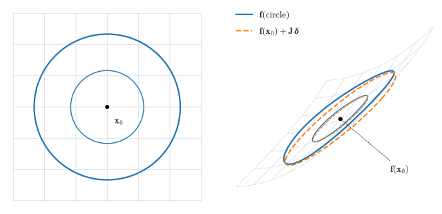

# Matrix Calculus
:label:`sec_mdl-matrix-calculus`

In the last two sections we treated a loss as a function of scalar variables.
In :numref:`sec_mdl-multivariable_calculus` we assembled its gradient as a
column of partial derivatives, and in :numref:`sec_mdl-chain-rule-graphs` we
computed that column by a backward pass through a graph with one number per
node. A neural network, however, is not written in scalars: each layer maps a
vector to a vector, and its weights form a matrix. What is the derivative of a
loss with respect to a vector or a matrix, and how do we compute it for a whole
layer at once?

A network small enough to work by hand shows what is needed. Consider a network
with two inputs, two ReLU hidden units, and one output,

$$
g(\mathbf x)=\mathbf w_2^\top\boldsymbol\varphi(\mathbf W_1\mathbf x+\mathbf b),\qquad
\mathbf W_1=\begin{pmatrix}1&2\\3&-1\end{pmatrix},\quad
\mathbf b=\begin{pmatrix}0\\-4\end{pmatrix},\quad
\mathbf w_2=\begin{pmatrix}2\\-1\end{pmatrix},
$$

where $\boldsymbol\varphi$ applies $\max(0,\cdot)$ to each entry. At
$\mathbf x=(1,1)$ the pre-activations are $\mathbf W_1\mathbf x+\mathbf b=(3,-2)$,
so the second hidden unit is off, the hidden vector is $(3,0)$, and the output
is $g=6$. A training step raises three questions about this output. First, if
the input moves by a small $\boldsymbol\delta$, the output changes by
$2\delta_1+4\delta_2$, a row of two numbers that is the transpose of the column
gradient. Second, if the weight matrix moves by $\Delta\mathbf W_1$, the output
changes by $2\,\Delta W_{11}+2\,\Delta W_{12}$ and not at all through the
second row, so the derivative with respect to a matrix is itself a matrix,
$\left(\begin{smallmatrix}2&2\\0&0\end{smallmatrix}\right)$. Third, the hidden
layer $\mathbf x\mapsto\boldsymbol\varphi(\mathbf W_1\mathbf x+\mathbf b)$ maps
a vector to a vector. Neither a scalar slope nor a gradient vector describes
its derivative, yet the output depends on $\mathbf W_1$ only through that layer.

Derivatives like these are surprisingly easy to get wrong by hand. If you drop
a transpose on a square weight matrix, the dimensions still match, no error is
raised, and training simply goes astray. Reference tables of matrix derivatives
run to hundreds of entries, yet looking up formulas does little to protect
against that kind of slip.

This section answers all three questions with a single object and a single
principle. The derivative of a vector-valued map is a matrix, the *Jacobian*,
defined as the map's best linear approximation. Composing maps multiplies their
Jacobians, so the derivative of a network becomes a product of matrices, one
per layer. Every gradient a layer needs (linear and quadratic forms, least
squares, matrix products, and softmax) then follows from one method: write down
the first-order change of the function and read off the gradient as its
coefficient. That same method produces the backward pass of each layer used in
:numref:`sec_backprop`, as well as $\mathbf p-\mathbf y$, the classifier
gradient of :numref:`subsec_softmax_and_derivatives`.

Three results are worth remembering: the product of Jacobians
:eqref:`eq_mdl-jacobian-product`, the rule that a gradient always has the shape
of its variable, and the backward rule :eqref:`eq_mdl-matmul-vjp` for a matrix
product. You can skip the proof of the chain rule on a first reading, but not
the differential method (:numref:`subsec_mdl-differential-method`), since
everything that follows relies on it.

We use the following imports throughout this section.

```{.python .input #mdl-matrix-calculus-matrix-calculus}
#@tab mxnet
from mxnet import autograd, npx
from mxnet import np as mnp
import numpy as np
npx.set_np()
```

```{.python .input #mdl-matrix-calculus-matrix-calculus}
#@tab pytorch
import numpy as np
import torch
```

```{.python .input #mdl-matrix-calculus-matrix-calculus}
#@tab tensorflow
import numpy as np
import tensorflow as tf
```

```{.python .input #mdl-matrix-calculus-matrix-calculus}
#@tab jax
import numpy as np
import jax
from jax import numpy as jnp
```

## The Jacobian
:label:`subsec_mdl-jacobian`

### The Best Linear Approximation

Near $\mathbf x=(1,1)$ the hidden layer of our network is affine, so its
linear approximation is exact there and leaves no error to study. Let us
therefore begin with a curved map that we will reuse as a running example here
and in the next section, returning to the network once the definition is in
place:

$$
\mathbf f(x,y)=\begin{pmatrix}x+\sin y\\ y+x^2/2\end{pmatrix},\qquad
\mathbf x_0=(0.5,\ 0.5).
$$

At $\mathbf x_0$, the map evaluates to $\mathbf f(\mathbf x_0)=(0.9794,\ 0.6250)$.
Each of the two outputs has two partial derivatives:
$\partial f_1/\partial x=1$, $\partial f_1/\partial y=\cos y=0.8776$,
$\partial f_2/\partial x=x=0.5$, and $\partial f_2/\partial y=1$. We arrange
these four numbers in a matrix with one row per output and one column per
input,

$$
\mathbf J(\mathbf x_0)=\begin{pmatrix}1&\cos 0.5\\0.5&1\end{pmatrix}
=\begin{pmatrix}1&0.8776\\0.5&1\end{pmatrix}.
$$

Column $j$ records how both outputs respond when input $j$ moves. This matrix
is the derivative of $\mathbf f$ at $\mathbf x_0$, in the sense that
$\mathbf f(\mathbf x_0+\boldsymbol\delta)\approx\mathbf f(\mathbf x_0)+\mathbf J\boldsymbol\delta$
for small $\boldsymbol\delta$, and no other matrix approximates $\mathbf f$ as
closely.

In one variable, the derivative is the slope of the best straight-line fit,
$f(x+\delta)\approx f(x)+f'(x)\,\delta$. The vector-valued generalization rests
on the same local approximation. We say that $\mathbf f:\mathbb R^n\to\mathbb R^m$
is *differentiable* at $\mathbf x$ if there is a matrix
$\mathbf J\in\mathbb R^{m\times n}$ such that

$$
\mathbf f(\mathbf x+\boldsymbol\delta)
   = \mathbf f(\mathbf x) + \mathbf J\,\boldsymbol\delta + o(\|\boldsymbol\delta\|),
$$
:eqlabel:`eq_mdl-jacobian-linearization`

meaning that the error of the linear model $\mathbf f(\mathbf x)+\mathbf J\boldsymbol\delta$
divided by $\|\boldsymbol\delta\|$ tends to zero as $\boldsymbol\delta\to\mathbf 0$.
Whenever such a matrix exists, it is unique. We call it the *Jacobian*
$\mathbf J_{\mathbf f}(\mathbf x)$, and its entries are simply the partial
derivatives:

$$
[\mathbf J_{\mathbf f}]_{ij} = \frac{\partial f_i}{\partial x_j}.
$$
:eqlabel:`eq_mdl-jacobian-entries`

To see why, substitute the perturbation $\boldsymbol\delta=t\,\mathbf e_j$ (a
small step along coordinate axis $j$) into :eqref:`eq_mdl-jacobian-linearization`
and look at component $i$. Dividing by $t$ and letting $t\to0$ leaves
$\partial f_i/\partial x_j$ in the $(i,j)$ slot, regardless of which matrix
$\mathbf J$ we started with. The partial derivatives therefore supply the
entries of $\mathbf J$, while the linear approximation is what defines it.

The existence of partial derivatives alone does not guarantee
differentiability. Consider the function $f(x,y)=2xy/(x^2+y^2)$ with
$f(0,0)=0$ from :numref:`subsec_mdl-gradient`: both partials are $0$ at the
origin, yet $f$ equals $1$ everywhere along the diagonal $x=y$. The only
candidate Jacobian is the zero row vector, whose approximation error along the
diagonal remains $1$ no matter how small $\boldsymbol\delta$ is, so $f$ has no
Jacobian at the origin. Continuity of the partial derivatives is sufficient to
rule out such behavior: if every partial $\partial f_i/\partial x_j$ exists in
a neighborhood of $\mathbf x$ and is continuous at $\mathbf x$, then $\mathbf f$
is differentiable at $\mathbf x$ :cite:`Rudin.1976`.

:numref:`fig_mdl-cal-jacobian-ellipse` illustrates the definition geometrically:
near $\mathbf x_0$, the map acts like its Jacobian. A circle of radius $r$
around $\mathbf x_0$ maps nearly onto the ellipse
$\mathbf f(\mathbf x_0)+\mathbf J\boldsymbol\delta$ ($\|\boldsymbol\delta\|=r$),
whose semi-axes are $r$ times the singular values of $\mathbf J$ (as shown in
:numref:`sec_mdl-svd-low-rank`, any matrix maps the unit circle to an ellipse
with these semi-axes). Here the singular values are $1.706$ and $0.329$, so the
circle of radius $0.35$ becomes an ellipse with semi-axes $0.60$ and $0.12$.
The largest gap between the true image and the ellipse is $0.061$ at $r=0.35$
and $0.015$ at $r=0.175$: halving the radius cuts the gap fourfold.

![A differentiable map is locally its Jacobian. Two circles of radius $0.35$ and $0.175$ around $\mathbf x_0=(0.5,0.5)$ (left) and their images under $\mathbf f(x,y)=(x+\sin y,\ y+x^2/2)$ (right, blue) against the ellipses $\mathbf f(\mathbf x_0)+\mathbf J(\mathbf x_0)\boldsymbol\delta$ (orange, dashed). The semi-axes of each ellipse are the radius times the singular values $1.71$ and $0.33$ of $\mathbf J$. Halving the radius cuts the largest gap between image and ellipse from $0.061$ to $0.015$, the $o(\|\boldsymbol\delta\|)$ remainder.](../img/mdl-cal-jacobian-ellipse.svg)
:label:`fig_mdl-cal-jacobian-ellipse`

The definition guarantees that the error of the linear model divided by
$\|\boldsymbol\delta\|$ tends to zero, but it does not say how fast. Let us
shrink a perturbation tenfold at a time and inspect that ratio.

```{.python .input #matrix-calculus-autodiff-jacobian-finite-diff}
def f(v):                                   # the running map, R^2 -> R^2
    x, y = v
    return np.array([x + np.sin(y), y + x**2 / 2])

def J(v):                                   # its Jacobian, entry by entry
    x, y = v
    return np.array([[1.0, np.cos(y)], [x, 1.0]])

x0 = np.array([0.5, 0.5])
for s in [1, 0.1, 0.01, 0.001]:
    delta = s * np.array([0.2, 0.1])
    err = np.linalg.norm(f(x0 + delta) - f(x0) - J(x0) @ delta)
    print(f'|delta| = {np.linalg.norm(delta):.1e}   '
          f'error / |delta| = {err / np.linalg.norm(delta):.1e}')
```

The ratio drops from $0.09$ to $0.009$, $0.0009$, and $0.00009$. It tends to
zero, confirming the $o(\|\boldsymbol\delta\|)$ remainder in the definition.
Notice that it also falls tenfold for every tenfold reduction in
$\|\boldsymbol\delta\|$, which means the error itself falls a hundredfold and
is $O(\|\boldsymbol\delta\|^2)$. The definition promises only the first
property; the faster quadratic decay holds because $\mathbf f$ has continuous
second derivatives.

### Gradients, Hessians, and the Shape of a Derivative

Both the gradient and the Hessian from :numref:`sec_mdl-multivariable_calculus`
are special cases of the Jacobian. Viewing them this way settles a shape
question that arises in every hand derivation: whether a derivative is a row or
a column, and how a derivative with respect to a matrix should be arranged.

For a scalar-valued function $f:\mathbb R^n\to\mathbb R$ ($m=1$), the Jacobian
is a single row, $\partial f/\partial\mathbf x=[\partial f/\partial x_1,\ldots,\partial f/\partial x_n]$,
and :eqref:`eq_mdl-jacobian-linearization` becomes the first-order expansion
$f(\mathbf x+\boldsymbol\delta)\approx f(\mathbf x)+(\partial f/\partial\mathbf x)\,\boldsymbol\delta$.
In :numref:`sec_mdl-multivariable_calculus` we wrote the gradient as a column
vector. The two are simply transposes of each other,

$$
\nabla_{\mathbf x} f = \Bigl(\frac{\partial f}{\partial\mathbf x}\Bigr)^{\!\top},
$$
:eqlabel:`eq_mdl-grad-is-jacobian-transpose`

and we use both in this book, each for its own purpose. Jacobians of
vector-valued maps are $m\times n$, with one row per output, so that the chain
rule below composes cleanly without transposes. Gradients of scalars are column
vectors, $\nabla_{\mathbf x}f$, matching the shape of $\mathbf x$ so an
optimizer can subtract them directly. For our opening network,
$\partial g/\partial\mathbf x=(2,\ 4)$ is a $1\times2$ Jacobian, while
$\nabla_{\mathbf x}g=(2,4)^\top$ is the column gradient.

A scalar function of a matrix $\mathbf W\in\mathbb R^{p\times q}$ needs one
more convention. We define its gradient $\nabla_{\mathbf W}f$ as the
$p\times q$ matrix with entries $\partial f/\partial W_{ij}$, matching the
shape of $\mathbf W$. The first-order expansion then reads

$$
f(\mathbf W+\mathbf E)=f(\mathbf W)+\langle\nabla_{\mathbf W}f,\ \mathbf E\rangle+o(\|\mathbf E\|),
\qquad
\langle\mathbf A,\mathbf B\rangle=\operatorname{tr}(\mathbf A^\top\mathbf B)=\sum_{ij}A_{ij}B_{ij},
$$
:eqlabel:`eq_mdl-matrix-gradient`

where the inner product $\langle\cdot,\cdot\rangle$ multiplies two matrices of
the same shape entry by entry and sums the products, just like the ordinary dot
product of the matrices flattened into vectors. In words, the first-order
change in $f$ is the sum over all entries of "sensitivity times nudge". In our
opening example, $\nabla_{\mathbf W_1}g$ is the $2\times2$ matrix
$\left(\begin{smallmatrix}2&2\\0&0\end{smallmatrix}\right)$, and
$\langle\nabla_{\mathbf W_1}g,\Delta\mathbf W_1\rangle=2\,\Delta W_{11}+2\,\Delta W_{12}$
recovers the change we found earlier. This gives a single sanity check for
every formula in the section: a gradient always has the shape of its variable.
If a derived gradient does not, a transpose is missing.

Differentiating once more brings in the Hessian. The gradient field
$\nabla f:\mathbb R^n\to\mathbb R^n$ is itself a vector-valued map, and its
Jacobian is the matrix of second partials, the Hessian $\mathbf H_f$, whose
entries are $[\mathbf H_f]_{ij}=\partial^2 f/\partial x_i\partial x_j$. Strictly
speaking, $[\mathbf J_{\nabla f}]_{ij}=\partial^2 f/\partial x_j\partial x_i$
takes the two derivatives in the opposite order, but the two agree—and
$\mathbf H_f$ is symmetric—whenever the mixed partials are continuous (the
Clairaut–Schwarz theorem of :numref:`sec_mdl-multivariable_calculus`).

## The Chain Rule for Jacobians

A neural network is a composition of layers. On a graph of scalars, the chain
rule summed the product of derivatives over every path from an input to an
output (:eqref:`eq_mdl-chain-rule-paths`). When the layers are vector-valued
maps, that sum over paths becomes a matrix product.

### Composition as a Matrix Product

**Proposition (chain rule).** *If $\mathbf f:\mathbb R^n\to\mathbb R^p$ is
differentiable at $\mathbf x$ and $\mathbf g:\mathbb R^p\to\mathbb R^m$ is
differentiable at $\mathbf f(\mathbf x)$, then $\mathbf g\circ\mathbf f$ is
differentiable at $\mathbf x$ and*

$$
\mathbf J_{\mathbf g\circ\mathbf f}(\mathbf x)
   = \mathbf J_{\mathbf g}\!\bigl(\mathbf f(\mathbf x)\bigr)\,\mathbf J_{\mathbf f}(\mathbf x).
$$
:eqlabel:`eq_mdl-jacobian-chain`

**Proof.** Write $\mathbf y=\mathbf f(\mathbf x)$, $\mathbf A=\mathbf
J_{\mathbf f}(\mathbf x)$, and $\mathbf B=\mathbf J_{\mathbf g}(\mathbf y)$.
The idea is simply to substitute the linear model for $\mathbf f$ into the
linear model for $\mathbf g$. By :eqref:`eq_mdl-jacobian-linearization`,
$\mathbf f(\mathbf x+\boldsymbol\delta)=\mathbf y+\mathbf A\boldsymbol\delta
+o(\|\boldsymbol\delta\|)$. Calling that displacement
$\boldsymbol\eta=\mathbf A\boldsymbol\delta+o(\|\boldsymbol\delta\|)$ and
passing it to $\mathbf g$ gives

$$
\mathbf g\bigl(\mathbf f(\mathbf x+\boldsymbol\delta)\bigr)
   = \mathbf g(\mathbf y) + \mathbf B\,\boldsymbol\eta + o(\|\boldsymbol\eta\|)
   = \mathbf g(\mathbf y) + \mathbf B\mathbf A\,\boldsymbol\delta + o(\|\boldsymbol\delta\|).
$$

The second equality relies on two facts. First, multiplying an
$o(\|\boldsymbol\delta\|)$ remainder by the fixed matrix $\mathbf B$ leaves it
$o(\|\boldsymbol\delta\|)$. Second, because
$\|\boldsymbol\eta\|\le\|\mathbf A\|\,\|\boldsymbol\delta\|+o(\|\boldsymbol\delta\|)$
is bounded by a constant multiple of $\|\boldsymbol\delta\|$, the remainder
$o(\|\boldsymbol\eta\|)$ from $\mathbf g$ is also $o(\|\boldsymbol\delta\|)$;
this is the one step that is not purely algebraic. The coefficient of
$\boldsymbol\delta$ is therefore a matrix satisfying
:eqref:`eq_mdl-jacobian-linearization`, and by uniqueness it is the Jacobian of
the composite: $\mathbf J_{\mathbf g\circ\mathbf f}=\mathbf B\mathbf A$.
$\blacksquare$

Looking at a single entry of the product recovers the scalar sum over paths:
$[\mathbf B\mathbf A]_{ik}=\sum_j (\partial g_i/\partial y_j)(\partial f_j/\partial x_k)$
sums, over all intermediate variables $y_j$, the product of derivatives along
each path from $x_k$ to $g_i$.

### The Jacobian of a Network

Returning to our opening network, we can view it as a composition of three
maps: the affine transformation $\mathbf a=\mathbf W_1\mathbf x+\mathbf b$, the
ReLU activation $\mathbf h=\boldsymbol\varphi(\mathbf a)$, and the linear
output $g=\mathbf w_2^\top\mathbf h$. The first map is already affine, so its
Jacobian is $\mathbf W_1$; the bias shifts the value without changing the
slope. The ReLU acts on each entry independently, with slope $1$ where $a_i>0$
and $0$ where $a_i<0$, so its Jacobian is the diagonal matrix
$\operatorname{diag}(\mathbf m)$ formed from the *mask* $\mathbf m$ of these
slopes. Finally, the output map has Jacobian $\mathbf w_2^\top$. At
$\mathbf x=(1,1)$, where $\mathbf a=(3,-2)$ and $\mathbf m=(1,0)$, the chain
rule multiplies the three factors:

$$
\mathbf J_g(\mathbf x)=\mathbf w_2^\top\operatorname{diag}(\mathbf m)\,\mathbf W_1
=\begin{pmatrix}2&-1\end{pmatrix}\begin{pmatrix}1&0\\0&0\end{pmatrix}\begin{pmatrix}1&2\\3&-1\end{pmatrix}
=\begin{pmatrix}2&0\end{pmatrix}\begin{pmatrix}1&2\\3&-1\end{pmatrix}
=\begin{pmatrix}2&4\end{pmatrix}.
$$

The mask zeroes out the second entry of $\mathbf w_2^\top$, so the second row
of $\mathbf W_1$ never reaches the output: the weights of an inactive unit
contribute nothing to the derivative (:numref:`fig_mdl-cal-relu-net-jacobian`).
The resulting row $(2,4)$ matches the change $2\delta_1+4\delta_2$ from the
opening. At a different input, the mask changes and so does the Jacobian. For
instance, at $\mathbf x=(2,-3)$ the pre-activations are $(-4,5)$, the mask
flips to $(0,1)$, and $\mathbf J_g=(0,\ -1)\,\mathbf W_1=(-3,\ 1)$. Because
ReLU is piecewise linear, a finite difference along each axis reproduces these
entries exactly for any step small enough to keep the mask fixed (exercise
:exref:`ex_mdl-matrix-calculus-relu-jacobian`).


:label:`fig_mdl-cal-relu-net-jacobian`

Every multilayer perceptron is built from the same two kinds of factors. A
dense layer $\mathbf x\mapsto\mathbf W\mathbf x$ has Jacobian $\mathbf W$. An
elementwise activation $\boldsymbol\varphi(\mathbf x)=(\varphi(x_1),\ldots,\varphi(x_n))$
does not couple distinct coordinates, so its Jacobian is diagonal:
$\mathbf J_{\boldsymbol\varphi}(\mathbf x)=\operatorname{diag}\bigl(\varphi'(x_1),\ldots,\varphi'(x_n)\bigr)$.
This assumes that $\varphi$ is differentiable at every $x_i$; ReLU has no
derivative at $0$, where frameworks supply a fixed value by convention
(:numref:`sec_mdl-tangent-fails`). A network of depth $K$ is a composition
$\mathbf f=\mathbf f_K\circ\cdots\circ\mathbf f_1$, and iterating
:eqref:`eq_mdl-jacobian-chain` turns its derivative into a single product,

$$
\mathbf J = \mathbf J_K\,\mathbf J_{K-1}\cdots\mathbf J_1,
$$
:eqlabel:`eq_mdl-jacobian-product`

with each factor evaluated at the input of its own layer. For alternating dense
layers and activations, this becomes
$\mathbf J=\operatorname{diag}(\boldsymbol\varphi_K')\,\mathbf W_K\cdots
\operatorname{diag}(\boldsymbol\varphi_1')\,\mathbf W_1$: weight matrices
interleaved with diagonal matrices. Because multiplying a vector by a diagonal
matrix simply scales each entry, each activation factor costs $O(n)$
operations rather than $O(n^2)$.

Let us now define the 2-2-1 network in code, which we will reuse later in the
section, and compare the product $\mathbf w_2^\top\operatorname{diag}(\mathbf m)\mathbf W_1$
against the gradient returned by automatic differentiation.

```{.python .input #mdl-matrix-calculus-the-jacobian-of-a-network}
#@tab mxnet
W1, b = mnp.array([[1.0, 2.0], [3.0, -1.0]]), mnp.array([0.0, -4.0])
w2, x = mnp.array([2.0, -1.0]), mnp.array([1.0, 1.0])

def g(x, W1, b, w2):                         # the 2-2-1 ReLU network
    return mnp.dot(w2, npx.relu(mnp.dot(W1, x) + b))

m = (mnp.dot(W1, x) + b > 0).astype('float32')   # the ReLU mask
x.attach_grad()
with autograd.record():
    out = g(x, W1, b, w2)
out.backward()
print('by hand    :', mnp.dot(mnp.dot(w2, mnp.diag(m)), W1).asnumpy())
print('by autograd:', x.grad.asnumpy())
```

```{.python .input #mdl-matrix-calculus-the-jacobian-of-a-network}
#@tab pytorch
W1, b = torch.tensor([[1.0, 2.0], [3.0, -1.0]]), torch.tensor([0.0, -4.0])
w2, x = torch.tensor([2.0, -1.0]), torch.tensor([1.0, 1.0])

def g(x, W1, b, w2):                         # the 2-2-1 ReLU network
    return w2 @ torch.relu(W1 @ x + b)

m = (W1 @ x + b > 0).float()                 # the ReLU mask
print('by hand    :', (w2 @ torch.diag(m) @ W1).numpy())
print('by autograd:', torch.func.grad(g)(x, W1, b, w2).numpy())
```

```{.python .input #mdl-matrix-calculus-the-jacobian-of-a-network}
#@tab tensorflow
W1, b = tf.constant([[1.0, 2.0], [3.0, -1.0]]), tf.constant([0.0, -4.0])
w2, x = tf.constant([2.0, -1.0]), tf.constant([1.0, 1.0])

def g(x, W1, b, w2):                         # the 2-2-1 ReLU network
    return tf.tensordot(w2, tf.nn.relu(tf.linalg.matvec(W1, x) + b), 1)

m = tf.cast(tf.linalg.matvec(W1, x) + b > 0, tf.float32)   # the ReLU mask
with tf.GradientTape() as tape:
    tape.watch(x)
    out = g(x, W1, b, w2)
print('by hand    :', (w2[None, :] @ tf.linalg.diag(m) @ W1)[0].numpy())
print('by autograd:', tape.gradient(out, x).numpy())
```

```{.python .input #mdl-matrix-calculus-the-jacobian-of-a-network}
#@tab jax
W1, b = jnp.array([[1.0, 2.0], [3.0, -1.0]]), jnp.array([0.0, -4.0])
w2, x = jnp.array([2.0, -1.0]), jnp.array([1.0, 1.0])

def g(x, W1, b, w2):                         # the 2-2-1 ReLU network
    return w2 @ jax.nn.relu(W1 @ x + b)

m = (W1 @ x + b > 0).astype(jnp.float32)     # the ReLU mask
print('by hand    :', np.asarray(w2 @ jnp.diag(m) @ W1))
print('by autograd:', np.asarray(jax.grad(g)(x, W1, b, w2)))
```

Both lines print $(2,4)$, as expected.

The product :eqref:`eq_mdl-jacobian-product` also tells us how large or small a
derivative can grow through a deep network. When every factor is the same
matrix $\mathbf W$—as in a recurrent network applying one weight matrix at
every step, ignoring the activations—the product simplifies to $\mathbf W^K$.
For a diagonalizable matrix $\mathbf W=\mathbf V\boldsymbol\Lambda\mathbf V^{-1}$
we have $\mathbf W^K=\mathbf V\boldsymbol\Lambda^K\mathbf V^{-1}$, so for large
$K$ its norm grows or shrinks like $|\lambda_{\max}|^K$, where $\lambda_{\max}$
is the eigenvalue of largest magnitude: $0.9^{50}\approx0.005$, whereas
$1.1^{50}\approx117$. This exponential scaling is the vanishing and exploding
gradient problem of deep and recurrent networks
(:numref:`sec_numerical_stability`, :numref:`sec_bptt`). Keep in mind that
$|\lambda_{\max}|^K$ describes only the long-run rate. When the eigenvectors in
$\mathbf V$ are far from orthogonal, the product can grow for many steps before
eventually decaying (:numref:`subsec_mdl-transient-growth`), and a product of
distinct factors is governed by singular values rather than eigenvalues
(:numref:`subsec_mdl-jacobian-products`).

Notice, however, an important limitation of :eqref:`eq_mdl-jacobian-product`
for training: it gives the derivative with respect to the *input*. The weight
matrices $\mathbf W_k$ appear in it as fixed factors rather than variables, so
it does not yet tell us how the output changes when a weight changes. Computing
weight gradients requires one more rule per layer, which
:numref:`subsec_mdl-layer-vjp` derives and applies to this same network.

### The Order of Multiplication

Because matrix multiplication is associative, we may bracket the product
:eqref:`eq_mdl-jacobian-product` in any order and obtain the exact same matrix.
Yet different bracketings differ enormously in cost, by a factor that grows
with the width of the network. In training we want the gradient of a scalar
loss $\ell$, so the chain starts on the left with a row vector: the $1\times h$
Jacobian $\mathbf u^\top=\partial\ell/\partial\mathbf h_K$ of the loss with
respect to the last layer's output $\mathbf h_K$. Multiplying from the left
keeps every intermediate result a row vector, so every step is a matrix–vector
product. Multiplying from the right instead forms expensive matrix–matrix
products all the way across until the row vector finally arrives at the end.
The cheap order is the one that keeps every step a matrix–vector product.

A quick operation count makes the gap concrete. Consider
$\mathbf u^\top\mathbf J_3\mathbf J_2\mathbf J_1$ with shapes $1\times h$,
$h\times h$, $h\times h$, and $h\times n$, taking $h=n=1000$ and recalling that
multiplying a $p\times q$ matrix by a $q\times r$ matrix costs $pqr$
multiplications. From the left, we perform three matrix–vector products for a
total of $h^2+h^2+hn=3\times10^6$ multiplications. From the right, forming
$\mathbf J_2\mathbf J_1$ and then $\mathbf J_3(\mathbf J_2\mathbf J_1)$ costs
$h^2n=10^9$ multiplications each, and the final product with $\mathbf u^\top$
adds $hn=10^6$, totaling $2.001\times10^9$. Three million against two billion
is a factor of about $670$, or $2h/3$
(:numref:`fig_mdl-cal-jacobian-chain-order`).


:label:`fig_mdl-cal-jacobian-chain-order`

These two orders correspond to two directions through the network. Multiplying
from the left propagates the sensitivity of the output backward through the
layers, at the cost of one matrix–vector product per layer. Multiplying from
the right is the cheap order when a column vector $\mathbf v$ stands at the
right end of the chain: it propagates a single input direction forward and
yields $\mathbf J\mathbf v$. Algorithms that automate these two orders are
called reverse-mode and forward-mode automatic differentiation
(:numref:`sec_mdl-matrix-calculus-autodiff`).

The count above assumed layers of equal width. When the factors have varying
shapes, neither end-to-end order need be optimal. For a chain, the cheapest
parenthesization can be found by dynamic programming (exercise
:exref:`ex_mdl-matrix-calculus-chain-order`); for a general computation graph,
the problem is NP-complete :cite:`Naumann.2008`.

## Derivatives with Respect to Vectors and Matrices
:label:`subsec_mdl-matrix-identities`

Training a layer requires the gradient of a scalar loss with respect to vectors
and matrices alike: its input, its weights, and its bias. In this section we
derive every gradient we need with a single method, one that automatically
returns each result in the shape of its variable.

### The Differential Method
:label:`subsec_mdl-differential-method`

Write $d\mathbf x$ for a small perturbation of the variable and $df$ for the
part of the resulting change in $f$ that is linear in $d\mathbf x$—simply the
term $\mathbf J\boldsymbol\delta$ of :eqref:`eq_mdl-jacobian-linearization`
with $\boldsymbol\delta$ renamed $d\mathbf x$. By
:eqref:`eq_mdl-jacobian-linearization` and :eqref:`eq_mdl-matrix-gradient`,
this linear part is an inner product with the gradient,

$$
df=\langle\nabla f,\ d\mathbf x\rangle,
$$
:eqlabel:`eq_mdl-differential-rule`

for both vector variables ($\langle\mathbf a,\mathbf b\rangle=\mathbf a^\top\mathbf b$)
and matrix variables. We can read :eqref:`eq_mdl-differential-rule` in two
ways. Given the gradient, it tells us how $f$ responds to a nudge. Given $f$,
it gives a direct recipe for the gradient: compute $df$ using the ordinary
rules of differentiation, rearrange it into the form
$\langle\mathbf M,\,d\mathbf x\rangle$, and read off $\nabla f=\mathbf M$.
This reading is unambiguous because a linear function of $d\mathbf x$ can be
written as $\langle\mathbf M,d\mathbf x\rangle$ for only one $\mathbf M$:
setting $d\mathbf x$ to the matrix with a single $1$ in position $(i,j)$ and
zeros elsewhere isolates $M_{ij}$.

Four familiar rules suffice to compute $df$. First, the differential is linear.
Second, it obeys the product rule
$d(\mathbf A\mathbf B)=d\mathbf A\,\mathbf B+\mathbf A\,d\mathbf B$, because
expanding $(\mathbf A+d\mathbf A)(\mathbf B+d\mathbf B)$ differs from
$\mathbf A\mathbf B+d\mathbf A\,\mathbf B+\mathbf A\,d\mathbf B$ only by the
second-order term $d\mathbf A\,d\mathbf B$. Third, it commutes with
transposition, $d(\mathbf A^\top)=(d\mathbf A)^\top$. Fourth, a scalar function
applied entry by entry obeys the scalar chain rule in every entry,
$d\varphi(\mathbf X)=\varphi'(\mathbf X)\odot d\mathbf X$, where $\odot$
denotes elementwise multiplication.

To rearrange $df$ into the form $\langle\mathbf M,d\mathbf x\rangle$, we need
just one more tool. The *move rule* shifts a factor standing next to
$d\mathbf x$ across to the other side of the inner product:

$$
\langle\mathbf A,\ \mathbf B\mathbf C\rangle
=\langle\mathbf B^\top\mathbf A,\ \mathbf C\rangle
=\langle\mathbf A\mathbf C^\top,\ \mathbf B\rangle,
$$

which follows directly from the cyclic property of the trace,
$\operatorname{tr}(\mathbf X\mathbf Y)=\operatorname{tr}(\mathbf Y\mathbf X)$:
$\operatorname{tr}(\mathbf A^\top\mathbf B\mathbf C)=\operatorname{tr}\bigl((\mathbf B^\top\mathbf A)^\top\mathbf C\bigr)
=\operatorname{tr}(\mathbf C\mathbf A^\top\mathbf B)=\operatorname{tr}\bigl((\mathbf A\mathbf C^\top)^\top\mathbf B\bigr)$.
In words, a factor to the left of the variable moves across as its transpose on
the left, while a factor to the right moves across as its transpose on the
right. An elementwise factor moves across unchanged,
$\langle\mathbf A,\mathbf B\odot\mathbf C\rangle=\langle\mathbf A\odot\mathbf B,\mathbf C\rangle$,
since both sides equal $\sum_{ij}A_{ij}B_{ij}C_{ij}$.

The two simplest cases take one line each. For a linear form,
$d(\mathbf a^\top\mathbf x)=\mathbf a^\top d\mathbf x=\langle\mathbf a,d\mathbf x\rangle$,
so $\nabla_{\mathbf x}\,\mathbf a^\top\mathbf x=\mathbf a$. For a quadratic
form, the product rule hits both copies of $\mathbf x$:

$$
\begin{aligned}
d(\mathbf x^\top\mathbf A\mathbf x)
&=d\mathbf x^\top\mathbf A\mathbf x+\mathbf x^\top\mathbf A\,d\mathbf x
=\mathbf x^\top\mathbf A^\top d\mathbf x+\mathbf x^\top\mathbf A\,d\mathbf x \\
&=\bigl\langle(\mathbf A+\mathbf A^\top)\mathbf x,\ d\mathbf x\bigr\rangle.
\end{aligned}
$$

In the second equality we transposed a $1\times1$ matrix:
$d\mathbf x^\top\mathbf A\mathbf x$ is a scalar, so it equals its own
transpose $\mathbf x^\top\mathbf A^\top d\mathbf x$. Reading off the
coefficient yields
$\nabla_{\mathbf x}\,\mathbf x^\top\mathbf A\mathbf x=(\mathbf A+\mathbf A^\top)\mathbf x$,
which simplifies to $2\mathbf A\mathbf x$ whenever $\mathbf A$ is symmetric.

Writing out indices offers a second route. Entry by entry, the same derivative
is
$\partial\bigl(\sum_{ij}x_iA_{ij}x_j\bigr)/\partial x_k=\sum_jA_{kj}x_j+\sum_ix_iA_{ik}$,
recovering the $k$-th entry of $(\mathbf A+\mathbf A^\top)\mathbf x$. Index
derivations are longer, but they leave no doubt about transposes;
:numref:`sec_backprop` uses them to derive the matrix-product rule.

A fast sanity check on any matrix identity is to set every matrix to
$1\times1$, in which case the formula must reduce to the familiar scalar rule.
Our quadratic-form gradient passes, since $\frac{d}{dx}(ax^2)=2ax=(a+a)x$.
This *$1\times1$ check* reliably catches a wrong coefficient or a missing term,
but it is blind to transposes and factor order because $1\times1$ matrices
commute and equal their own transposes. The shape rule catches most transpose
errors, though unfortunately not when the factor is square—the exact pitfall we
warned about at the start of the section. For square factors, only a numerical
check will catch the mistake. Take
$\mathbf A=\left(\begin{smallmatrix}0&1\\0&0\end{smallmatrix}\right)$ and
$\mathbf x=(1,2)$. Then $\mathbf x^\top\mathbf A\mathbf x=x_1x_2$, whose true
gradient $(x_2,x_1)=(2,1)$ equals $(\mathbf A+\mathbf A^\top)\mathbf x$. The
naive guess $2\mathbf A\mathbf x=(4,0)$, suggested by the scalar rule $2ax$,
passes the $1\times1$ check, has the right shape, and is still wrong.

The differential method handles matrix variables with no extra effort. For the
least-squares loss $\ell=\|\mathbf W\mathbf x-\mathbf y\|^2$ with residual
$\mathbf r=\mathbf W\mathbf x-\mathbf y$, varying $\mathbf W$ gives
$d\mathbf r=d\mathbf W\,\mathbf x$, and the move rule shifts $\mathbf x$ to the
other side:
$d\ell=2\mathbf r^\top d\mathbf r=\langle 2\mathbf r,\ d\mathbf W\,\mathbf x\rangle
=\langle2\mathbf r\mathbf x^\top,\ d\mathbf W\rangle$. Therefore,

$$
\nabla_{\mathbf W}\|\mathbf W\mathbf x-\mathbf y\|^2 = 2\,(\mathbf W\mathbf x-\mathbf y)\,\mathbf x^\top,
$$
:eqlabel:`eq_mdl-lstsq-grad`

a rank-one outer product of the residual with the input, automatically in the
shape of $\mathbf W$. When $\mathbf x$ varies instead,
$d\mathbf r=\mathbf W\,d\mathbf x$ and
$\nabla_{\mathbf x}\ell=2\mathbf W^\top\mathbf r$. In both cases, the gradient
is twice the residual multiplied by the transpose of whichever factor
multiplies the variable.

### Backward Rules of a Layer
:label:`subsec_mdl-layer-vjp`

Inside a network, a layer $\mathbf Y=\mathbf F(\mathbf X)$ is one step in a
long computation ending in a scalar loss $\ell$. Forming its full Jacobian is
out of the question: a $1000\times1000$ weight matrix applied to a minibatch of
$1000$ examples produces $10^6$ outputs from $10^6$ weights, so the Jacobian of
outputs with respect to weights would have $10^{12}$ entries. Fortunately,
backpropagation needs far less. All a layer must do is turn the gradient of the
loss with respect to its output into the gradients with respect to its inputs
and weights. Following :numref:`subsec_mdl-backpropagation`, we write
$\bar{\mathbf Y}=\nabla_{\mathbf Y}\ell$ for the adjoint of $\mathbf Y$—now a
matrix of the same shape as $\mathbf Y$ holding the total derivative of the
loss with respect to each entry of $\mathbf Y$.

**Proposition (backward rule of a layer).** *Let $\mathbf Y=\mathbf F(\mathbf X)$
be differentiable at $\mathbf X$ and let $\ell$ be a differentiable scalar
function of $\mathbf Y$. Then the adjoint $\bar{\mathbf X}$ of the composite
$\ell(\mathbf F(\mathbf X))$ is the unique matrix satisfying*

$$
\langle\bar{\mathbf X},\ d\mathbf X\rangle=\langle\bar{\mathbf Y},\ d\mathbf Y\rangle
\quad\textit{for every } d\mathbf X,
$$

*where $d\mathbf Y$ is the first-order change of $\mathbf F$ caused by
$d\mathbf X$.*

**Proof.** By the chain rule :eqref:`eq_mdl-jacobian-chain` (viewing matrices
as flattened vectors), the linear part of the composite is the linear part of
$\ell$ applied to the linear part of $\mathbf F$:
$d\ell=\langle\bar{\mathbf Y},d\mathbf Y\rangle$. Because $d\mathbf Y$ is
linear in $d\mathbf X$, so is $d\ell$, which means it can be written as
$\langle\mathbf M,d\mathbf X\rangle$ for a unique matrix $\mathbf M$. By
:eqref:`eq_mdl-differential-rule`, $\mathbf M=\bar{\mathbf X}$. $\blacksquare$

In practice, applying this proposition comes down to applying the move rule.
For a vector layer with $d\mathbf y=\mathbf J\,d\mathbf x$, it gives
$\langle\bar{\mathbf y},\mathbf J\,d\mathbf x\rangle=\langle\mathbf J^\top\bar{\mathbf y},d\mathbf x\rangle$,
so $\bar{\mathbf x}=\mathbf J^\top\bar{\mathbf y}$: the backward rule of a
layer is simply the transpose of its linearization. The transpose of a linear
map is also called its adjoint, which is where the name comes from. Written as
$\bar{\mathbf x}^\top=\bar{\mathbf y}^\top\mathbf J$, this is just one step of
the left-to-right order in :eqref:`eq_mdl-jacobian-product`. A row vector times
a Jacobian is called a *vector–Jacobian product*. The proposition lets us
compute it for matrix variables without ever forming the Jacobian.

The single most frequent derivative in deep learning is that of a matrix
product. Depending on whether we process a minibatch or a single vector, the
weights stand on the right or the left of the data, so let us derive both
layouts together. A minibatch $\mathbf X\in\mathbb R^{n\times d}$ with one
example per row (the convention throughout the main text) multiplies the weight
matrix $\mathbf W\in\mathbb R^{d\times q}$ to produce
$\mathbf Y=\mathbf X\mathbf W$. The product rule gives
$d\mathbf Y=d\mathbf X\,\mathbf W+\mathbf X\,d\mathbf W$, and the move rule
splits the inner product into one term per variable:
$\langle\bar{\mathbf Y},d\mathbf X\,\mathbf W\rangle+\langle\bar{\mathbf Y},\mathbf X\,d\mathbf W\rangle
=\langle\bar{\mathbf Y}\mathbf W^\top,d\mathbf X\rangle+\langle\mathbf X^\top\bar{\mathbf Y},d\mathbf W\rangle$.
Reading off both coefficients gives

$$
\bar{\mathbf X}=\bar{\mathbf Y}\,\mathbf W^\top,\qquad
\bar{\mathbf W}=\mathbf X^\top\bar{\mathbf Y}.
$$
:eqlabel:`eq_mdl-matmul-vjp`

For a single example written as a column vector, $\mathbf y=\mathbf W\mathbf x$,
the exact same calculation yields

$$
\bar{\mathbf W}=\bar{\mathbf y}\,\mathbf x^\top,\qquad
\bar{\mathbf x}=\mathbf W^\top\bar{\mathbf y},
$$

matching the pattern of :eqref:`eq_mdl-lstsq-grad`: the weight gradient is the
outer product of the output adjoint with the input. The two layouts are simply
transposes of each other. If $\mathbf x_i^\top$ and $\bar{\mathbf y}_i^\top$
are the rows of $\mathbf X$ and $\bar{\mathbf Y}$, the minibatch formula
$\mathbf X^\top\bar{\mathbf Y}=\sum_i\mathbf x_i\bar{\mathbf y}_i^\top$ sums
one such outer product per example.

The backward pass of a linear layer therefore consists of two matrix products,
each the same size as the forward product: the forward pass costs $ndq$
multiplications and the backward pass costs $2ndq$. Checking shapes confirms
both transposes: $\bar{\mathbf Y}\mathbf W^\top$ is $n\times d$ like
$\mathbf X$, and $\mathbf X^\top\bar{\mathbf Y}$ is $d\times q$ like
$\mathbf W$. Backward rules for more elaborate matrix operations (inverses,
determinants, and decompositions) follow from the very same method
:cite:`Giles.2008b`.

Two more layers complete a multilayer perceptron. An elementwise activation
$\mathbf Y=\boldsymbol\varphi(\mathbf X)$ has
$d\mathbf Y=\varphi'(\mathbf X)\odot d\mathbf X$, so moving $\varphi'(\mathbf X)$
across the inner product gives
$\bar{\mathbf X}=\varphi'(\mathbf X)\odot\bar{\mathbf Y}$—the diagonal Jacobian
from earlier, applied directly as a mask. A bias addition
$\mathbf y=\mathbf z+\mathbf b$ has $d\mathbf y=d\mathbf b$, so
$\bar{\mathbf b}=\bar{\mathbf y}$. For a minibatch, the bias is broadcast
across rows via $\mathbf Z=\mathbf X\mathbf W+\mathbf 1\mathbf b^\top$, which
is just another matrix product and gives
$\bar{\mathbf b}=\bar{\mathbf Z}^\top\mathbf 1$, summing the adjoint over all
examples. These three local rules are the building blocks from which
:numref:`sec_backprop` assembles the full backward pass of a multilayer
perceptron.

They also let us derive the weight-gradient matrix from the opening. Running
the network of :numref:`fig_mdl-cal-relu-net-jacobian` backward from
$\bar g=1$, one layer at a time, at $\mathbf x=(1,1)$:

1. The output $g=\mathbf w_2^\top\mathbf h$ gives $\bar{\mathbf h}=\mathbf w_2=(2,-1)$
   and $\bar{\mathbf w}_2=\mathbf h=(3,0)$.
2. The ReLU gives $\bar{\mathbf a}=\mathbf m\odot\bar{\mathbf h}=(2,0)$, and the
   bias gives $\bar{\mathbf b}=\bar{\mathbf a}=(2,0)$.
3. The affine map $\mathbf a=\mathbf W_1\mathbf x+\mathbf b$ gives
   $\bar{\mathbf W}_1=\bar{\mathbf a}\,\mathbf x^\top=\left(\begin{smallmatrix}2&2\\0&0\end{smallmatrix}\right)$
   and $\bar{\mathbf x}=\mathbf W_1^\top\bar{\mathbf a}=(2,4)$.

Notice that $\bar{\mathbf x}$ is the transpose of the Jacobian row $(2,4)$ we
found earlier, and $\bar{\mathbf W}_1$ is the matrix we obtained in the opening
by nudging the weights. Differentiating `g` with respect to $\mathbf W_1$,
$\mathbf b$, and $\mathbf w_2$ in code confirms all three arrays.

```{.python .input #mdl-matrix-calculus-backward-rules-of-a-layer-1}
#@tab mxnet
for p in (W1, b, w2):
    p.attach_grad()
with autograd.record():
    out = g(x, W1, b, w2)
out.backward()
h = npx.relu(mnp.dot(W1, x) + b)
show = lambda t: (t.asnumpy() + 0.0).tolist()   # + 0.0 turns -0.0 into 0.0
print('dg/dW1 = (w2*m) x^T:', show(mnp.outer(w2 * m, x)),
      '  autograd:', show(W1.grad))
print('dg/db  = w2*m      :', show(w2 * m), '  autograd:', show(b.grad))
print('dg/dw2 = h         :', show(h), '  autograd:', show(w2.grad))
```

```{.python .input #mdl-matrix-calculus-backward-rules-of-a-layer-1}
#@tab pytorch
gW1, gb, gw2 = torch.func.grad(g, argnums=(1, 2, 3))(x, W1, b, w2)
h = torch.relu(W1 @ x + b)
show = lambda t: (t.numpy() + 0.0).tolist()     # + 0.0 turns -0.0 into 0.0
print('dg/dW1 = (w2*m) x^T:', show(torch.outer(w2 * m, x)),
      '  autograd:', show(gW1))
print('dg/db  = w2*m      :', show(w2 * m), '  autograd:', show(gb))
print('dg/dw2 = h         :', show(h), '  autograd:', show(gw2))
```

```{.python .input #mdl-matrix-calculus-backward-rules-of-a-layer-1}
#@tab tensorflow
W1, b, w2 = tf.Variable(W1), tf.Variable(b), tf.Variable(w2)
with tf.GradientTape() as tape:
    out = g(x, W1, b, w2)
gW1, gb, gw2 = tape.gradient(out, [W1, b, w2])
h = tf.nn.relu(tf.linalg.matvec(W1, x) + b)
show = lambda t: (np.asarray(t) + 0.0).tolist()  # + 0.0 turns -0.0 into 0.0
print('dg/dW1 = (w2*m) x^T:', show(tf.tensordot(w2 * m, x, axes=0)),
      '  autograd:', show(gW1))
print('dg/db  = w2*m      :', show(w2 * m), '  autograd:', show(gb))
print('dg/dw2 = h         :', show(h), '  autograd:', show(gw2))
```

```{.python .input #mdl-matrix-calculus-backward-rules-of-a-layer-1}
#@tab jax
gW1, gb, gw2 = jax.grad(g, argnums=(1, 2, 3))(x, W1, b, w2)
h = jax.nn.relu(W1 @ x + b)
show = lambda t: (np.asarray(t) + 0.0).tolist()  # + 0.0 turns -0.0 into 0.0
print('dg/dW1 = (w2*m) x^T:', show(jnp.outer(w2 * m, x)),
      '  autograd:', show(gW1))
print('dg/db  = w2*m      :', show(w2 * m), '  autograd:', show(gb))
print('dg/dw2 = h         :', show(h), '  autograd:', show(gw2))
```

It is worth noting where the zeros land. The inactive hidden unit leaves three
zeros behind: a zero row in $\bar{\mathbf W}_1$, a zero in $\bar{\mathbf b}$,
and a zero in $\bar{\mathbf w}_2$ (because its output $h_2=0$ is what $w_{2,2}$
multiplies). A training step on this input leaves all four of that unit's
parameters untouched.

We still owe the numerical test that catches a misplaced transpose on a square
factor. A test that cannot fail proves nothing, so we design this one to expose
the mistake: every factor below is a random square (and hence nonsymmetric)
matrix, and we print each correct rule beside a plausible wrong guess of the
same shape. We test both the quadratic form and the matrix product. For the
product, we differentiate the scalar $\langle\bar{\mathbf Y},\mathbf X\mathbf W\rangle$
for a random $\bar{\mathbf Y}$; by our backward-rule proposition, its gradients
with respect to $\mathbf X$ and $\mathbf W$ are precisely $\bar{\mathbf X}$ and
$\bar{\mathbf W}$.

```{.python .input #mdl-matrix-calculus-autodiff-a-few-key-identities-derived-not-tabulated-1}
#@tab mxnet
A, x = mnp.array(np.random.randn(3, 3)), mnp.array(np.random.randn(3))
X, W, Ybar = (mnp.array(np.random.randn(3, 3)) for _ in range(3))  # square
ok = lambda u, v: np.allclose(u.asnumpy(), v.asnumpy(), atol=1e-5)
x.attach_grad()
with autograd.record():
    quad = mnp.dot(x, mnp.dot(A, x))
quad.backward()
X.attach_grad(); W.attach_grad()
with autograd.record():
    s = (Ybar * mnp.dot(X, W)).sum()
s.backward()
gx, gX, gW = x.grad, X.grad, W.grad
print('grad x^T A x: (A + A^T) x', ok(gx, mnp.dot(A + A.T, x)),
      '| wrong guess 2 A x       ', ok(gx, 2 * mnp.dot(A, x)))
print('Xbar        : Ybar W^T   ', ok(gX, mnp.dot(Ybar, W.T)),
      '| wrong guess Ybar W      ', ok(gX, mnp.dot(Ybar, W)))
print('Wbar        : X^T Ybar   ', ok(gW, mnp.dot(X.T, Ybar)),
      '| wrong guess (X^T Ybar)^T', ok(gW, mnp.dot(X.T, Ybar).T))
```

```{.python .input #mdl-matrix-calculus-autodiff-a-few-key-identities-derived-not-tabulated-1}
#@tab pytorch
A, x = torch.tensor(np.random.randn(3, 3)), torch.tensor(np.random.randn(3))
X, W, Ybar = (torch.tensor(np.random.randn(3, 3)) for _ in range(3))  # square
ok = lambda u, v: torch.allclose(u, v, atol=1e-5)
grad = torch.func.grad
gx = grad(lambda x: x @ A @ x)(x)
gX, gW = grad(lambda X, W: (Ybar * (X @ W)).sum(), argnums=(0, 1))(X, W)
print('grad x^T A x: (A + A^T) x', ok(gx, (A + A.T) @ x),
      '| wrong guess 2 A x       ', ok(gx, 2 * A @ x))
print('Xbar        : Ybar W^T   ', ok(gX, Ybar @ W.T),
      '| wrong guess Ybar W      ', ok(gX, Ybar @ W))
print('Wbar        : X^T Ybar   ', ok(gW, X.T @ Ybar),
      '| wrong guess (X^T Ybar)^T', ok(gW, (X.T @ Ybar).T))
```

```{.python .input #mdl-matrix-calculus-autodiff-a-few-key-identities-derived-not-tabulated-1}
#@tab tensorflow
A, x = tf.constant(np.random.randn(3, 3)), tf.constant(np.random.randn(3))
X, W, Ybar = (tf.constant(np.random.randn(3, 3)) for _ in range(3))  # square
ok = lambda u, v: np.allclose(u, v, atol=1e-5)
T = tf.transpose
with tf.GradientTape(persistent=True) as tape:
    tape.watch([x, X, W])
    quad = tf.tensordot(x, tf.linalg.matvec(A, x), 1)
    s = tf.reduce_sum(Ybar * (X @ W))
gx, (gX, gW) = tape.gradient(quad, x), tape.gradient(s, [X, W])
print('grad x^T A x: (A + A^T) x', ok(gx, tf.linalg.matvec(A + T(A), x)),
      '| wrong guess 2 A x       ', ok(gx, 2 * tf.linalg.matvec(A, x)))
print('Xbar        : Ybar W^T   ', ok(gX, Ybar @ T(W)),
      '| wrong guess Ybar W      ', ok(gX, Ybar @ W))
print('Wbar        : X^T Ybar   ', ok(gW, T(X) @ Ybar),
      '| wrong guess (X^T Ybar)^T', ok(gW, T(T(X) @ Ybar)))
```

```{.python .input #mdl-matrix-calculus-autodiff-a-few-key-identities-derived-not-tabulated-1}
#@tab jax
A, x = jnp.array(np.random.randn(3, 3)), jnp.array(np.random.randn(3))
X, W, Ybar = (jnp.array(np.random.randn(3, 3)) for _ in range(3))  # square
ok = lambda u, v: bool(jnp.allclose(u, v, atol=1e-5))
gx = jax.grad(lambda x: x @ A @ x)(x)
gX, gW = jax.grad(lambda X, W: (Ybar * (X @ W)).sum(), argnums=(0, 1))(X, W)
print('grad x^T A x: (A + A^T) x', ok(gx, (A + A.T) @ x),
      '| wrong guess 2 A x       ', ok(gx, 2 * A @ x))
print('Xbar        : Ybar W^T   ', ok(gX, Ybar @ W.T),
      '| wrong guess Ybar W      ', ok(gX, Ybar @ W))
print('Wbar        : X^T Ybar   ', ok(gW, X.T @ Ybar),
      '| wrong guess (X^T Ybar)^T', ok(gW, (X.T @ Ybar).T))
```

The derived rules print `True` and the wrong guesses print `False`. Here the
design of the test matters even more than its outcome. With rectangular
factors, say $\mathbf X$ of shape $3\times4$ and $\mathbf W$ of shape
$4\times2$, the two wrong guesses for the product would not even execute: a
misplaced transpose would trigger a shape error before any number is compared,
which is the shape rule doing its job. Likewise, with a symmetric $\mathbf A$,
the wrong guess $2\mathbf A\mathbf x$ would have matched the true gradient and
slipped past the test. The treacherous case is a square, nonsymmetric factor,
so that is what a numerical check must draw.

The matrix-product rule handles losses in which both factors of a product are
unknown just as easily, such as the matrix-factorization loss
$\|\mathbf X-\mathbf U\mathbf V\|_F^2$ in exercise
:exref:`ex_mdl-matrix-calculus-matmul-rules`. In every case, the backward rule
multiplies the incoming adjoint by the transposes of whatever multiplied the
variable on the forward pass. Notice also which forward values each rule
requires: $\mathbf X$ and $\mathbf W$ for the matrix product,
$\varphi'(\mathbf X)$ for the activation, and nothing at all for the bias. A
backward pass must retain those intermediate values from the forward pass, a
memory cost that :numref:`sec_mdl-matrix-calculus-autodiff` measures directly.

### Softmax and Cross-Entropy

The derivative a classifier evaluates most often is that of softmax composed
with cross-entropy loss. Softmax converts a vector of scores $\mathbf z$, the
*logits*, into a probability vector: setting $S=\sum_k e^{z_k}$, we have
$p_i=e^{z_i}/S$. The same quotient rule that gave :eqref:`eq_mdl-lse-hessian`
for two logits yields the softmax Jacobian for any number of classes. Writing
$\delta_{ij}=1$ if $i=j$ and $0$ otherwise,

$$
\frac{\partial p_i}{\partial z_j}
=\frac{\delta_{ij}e^{z_i}S-e^{z_i}e^{z_j}}{S^2}
=p_i(\delta_{ij}-p_j),
\qquad
\mathbf J_{\operatorname{softmax}} = \operatorname{diag}(\mathbf p) - \mathbf p\mathbf p^\top.
$$
:eqlabel:`eq_mdl-softmax-jacobian`

In words, increasing logit $i$ raises $p_i$ at rate $p_i(1-p_i)$ and lowers
every other probability $p_j$ at rate $p_ip_j$. As a quick check,
$\mathbf J\mathbf 1=\mathbf p-\mathbf p(\mathbf p^\top\mathbf 1)=\mathbf 0$
because the probabilities sum to one. This must hold, since adding the same
constant to every logit leaves $\mathbf p$ unchanged; consequently, the
softmax Jacobian is always singular.

Notice that $\mathbf J_{\operatorname{softmax}}$ is also symmetric, a property
an arbitrary Jacobian need not have. The reason is that it is actually a
Hessian: softmax is the gradient of the log-sum-exp function
$\operatorname{LSE}(\mathbf z)=\log\sum_k e^{z_k}$, our chapter's running
example, because $\partial\operatorname{LSE}/\partial z_i=e^{z_i}/S=p_i$, and
the Jacobian of a gradient is its Hessian. What :eqref:`eq_mdl-softmax-jacobian`
adds to :eqref:`eq_mdl-lse-hessian` is a clean statistical reading of the
matrix. It is the covariance matrix of a one-hot vector drawn with
probabilities $\mathbf p$, so for every $\mathbf z$ and every vector
$\mathbf v$ the quadratic form
$\mathbf v^\top\mathbf J\mathbf v=\sum_ip_iv_i^2-\bigl(\sum_ip_iv_i\bigr)^2$
is the variance of the entries of $\mathbf v$ under the distribution
$\mathbf p$. Because a variance is never negative, this Hessian is positive
semidefinite everywhere, proving that log-sum-exp is convex. A constant vector
$\mathbf v$ has zero variance, recovering the null vector $\mathbf 1$ once
again.

Now compose softmax with the cross-entropy loss $\ell=-\sum_i y_i\log p_i$
against a target distribution $\mathbf y$. The chain rule multiplies the row
$\partial\ell/\partial\mathbf p=(-y_i/p_i)_i$ by
:eqref:`eq_mdl-softmax-jacobian`, and the algebra collapses dramatically:

$$
\frac{\partial\ell}{\partial z_j}
   = -\sum_i \frac{y_i}{p_i}\,p_i(\delta_{ij}-p_j)
   = -y_j + p_j\sum_i y_i
   = p_j - y_j,
\qquad\text{that is,}\qquad
\nabla_{\mathbf z}\ell=\mathbf p-\mathbf y.
$$
:eqlabel:`eq_mdl-softmax-ce-grad`

The gradient with respect to the logits is simply predicted probability minus
target, the formula written as $\hat{\mathbf y}-\mathbf y$ in
:numref:`subsec_softmax_and_derivatives`. Because the final step used only
$\sum_iy_i=1$, the result holds for any probability vector $\mathbf y$, not
just one-hot labels—so label smoothing and distillation targets obey the exact
same formula. For a target that does not sum to one, the gradient is instead
$(\sum_iy_i)\,\mathbf p-\mathbf y$. At $\mathbf z=(1,-0.5,2)$, for example, we
have $\mathbf p=(0.254,\ 0.057,\ 0.690)$; with the second class as the target,
the gradient is $(0.254,\ -0.943,\ 0.690)$.

In practice, libraries fuse softmax and cross-entropy into a single primitive
for numerical stability (:numref:`subsec_softmax-implementation-revisited`,
:numref:`subsec_mdl-stable-softmax`). Below, we compute the softmax Jacobian at
$\mathbf z$ by automatic differentiation and print its eigenvalues, which our
variance argument predicts must be nonnegative with one zero. We then
differentiate the fused loss for both the one-hot target above and the two-hot
target $\mathbf y=(1,1,0)$, whose entries do not sum to one.

```{.python .input #matrix-calculus-autodiff-softmax-jacobian}
#@tab mxnet
z = mnp.array([1.0, -0.5, 2.0])
z.attach_grad()
rows = []
for i in range(3):          # head gradient e_i: z.grad = J^T e_i = row i of J
    with autograd.record():
        p = npx.softmax(z)
    p.backward(mnp.eye(3)[i])
    rows.append(z.grad.asnumpy().copy())
J, p = np.stack(rows), p.asnumpy()               # the Jacobian, by autograd
print('eigenvalues of J:', np.linalg.eigvalsh(J).round(3) + 0.0)
for y in [mnp.array([0.0, 1.0, 0.0]), mnp.array([1.0, 1.0, 0.0])]:
    with autograd.record():
        loss = -(y * npx.log_softmax(z)).sum()
    loss.backward()
    print(f'y = {y.asnumpy()}: d loss / d z = {z.grad.asnumpy().round(4)}, '
          f'p - y = {(p - y.asnumpy()).round(4)}')
```

```{.python .input #matrix-calculus-autodiff-softmax-jacobian}
#@tab pytorch
z = torch.tensor([1.0, -0.5, 2.0])
p = torch.softmax(z, 0)
J = torch.func.jacrev(lambda z: torch.softmax(z, 0))(z)   # the Jacobian, by autograd
print('eigenvalues of J:', torch.linalg.eigvalsh(J).numpy().round(3) + 0.0)
loss = lambda z, y: -(y * torch.log_softmax(z, 0)).sum()
for y in [torch.tensor([0.0, 1.0, 0.0]), torch.tensor([1.0, 1.0, 0.0])]:
    print(f'y = {y.numpy()}: d loss / d z = {torch.func.grad(loss)(z, y).numpy().round(4)}, '
          f'p - y = {(p - y).numpy().round(4)}')
```

```{.python .input #matrix-calculus-autodiff-softmax-jacobian}
#@tab tensorflow
z = tf.constant([1.0, -0.5, 2.0])
with tf.GradientTape() as tape:
    tape.watch(z)
    p = tf.nn.softmax(z)
J = tape.jacobian(p, z)                           # the Jacobian, by autograd
print('eigenvalues of J:', np.linalg.eigvalsh(J.numpy()).round(3) + 0.0)
for y in [tf.constant([0.0, 1.0, 0.0]), tf.constant([1.0, 1.0, 0.0])]:
    with tf.GradientTape() as tape:
        tape.watch(z)
        loss = -tf.reduce_sum(y * tf.nn.log_softmax(z))
    print(f'y = {y.numpy()}: d loss / d z = {tape.gradient(loss, z).numpy().round(4)}, '
          f'p - y = {(p - y).numpy().round(4)}')
```

```{.python .input #matrix-calculus-autodiff-softmax-jacobian}
#@tab jax
z = jnp.array([1.0, -0.5, 2.0])
p = jax.nn.softmax(z)
J = jax.jacobian(jax.nn.softmax)(z)               # the Jacobian, by autograd
print('eigenvalues of J:', np.linalg.eigvalsh(np.asarray(J)).round(3) + 0.0)
loss = lambda z, y: -(y * jax.nn.log_softmax(z)).sum()
for y in [jnp.array([0.0, 1.0, 0.0]), jnp.array([1.0, 1.0, 0.0])]:
    print(f'y = {np.asarray(y)}: d loss / d z = {np.asarray(jax.grad(loss)(z, y)).round(4)}, '
          f'p - y = {np.asarray(p - y).round(4)}')
```

The eigenvalues are $0$, $0.079$, and $0.378$: one zero, corresponding to the
direction $\mathbf 1$, and two positive values. For the one-hot target, the
gradient of the fused loss is
$\mathbf p-\mathbf y=(0.2537,-0.9434,0.6897)$, matching our hand calculation.
For the two-hot target, however, it returns $(-0.4926,-0.8868,1.3793)$, which
is $2\mathbf p-\mathbf y$ rather than the $\mathbf p-\mathbf y$ printed beside
it. "Prediction minus target" is a property of targets that sum to one, not of
the loss alone.

Here we multiplied $\mathbf J_K\cdots\mathbf J_1$ by hand for a simple
three-layer chain. In practice, a program must handle arbitrary computation
graphs that branch and merge, retain the forward values that each backward rule
needs, and compute all gradients at a cost that stays a small constant multiple
of evaluating the network, no matter how many parameters it has. That program
is automatic differentiation, the subject of
:numref:`sec_mdl-matrix-calculus-autodiff`.

## Summary

The Jacobian of a map $\mathbf f:\mathbb R^n\to\mathbb R^m$ is the $m\times n$
matrix of its best linear approximation, with entries
$[\mathbf J_{\mathbf f}]_{ij}=\partial f_i/\partial x_j$; both the gradient
(a single row, written as a column) and the Hessian (the Jacobian of the
gradient) are special cases of it. A network's derivative with respect to its
input is the product of its layers' Jacobians, $\mathbf J_K\cdots\mathbf J_1$,
and the order of multiplication governs the cost: three million versus two
billion multiplications for three layers of width $1000$. The differential rule
$df=\langle\nabla f,d\mathbf x\rangle$ derives every gradient a layer needs
automatically in the shape of its variable, including the matrix-product
backward rules $\bar{\mathbf X}=\bar{\mathbf Y}\mathbf W^\top$ and
$\bar{\mathbf W}=\mathbf X^\top\bar{\mathbf Y}$, as well as the collapse of
softmax with cross-entropy to $\mathbf p-\mathbf y$. While the shape rule and
the $1\times1$ check catch most slips in a hand derivation, a misplaced
transpose on a square factor escapes both and requires a numerical test on a
nonsymmetric matrix.

## Exercises

1. **Jacobian of a ReLU network.** Let
   $\mathbf g(\mathbf x)=\mathbf W_2\,\boldsymbol\varphi(\mathbf W_1\mathbf x+\mathbf b)$
   with $\mathbf W_1\in\mathbb R^{h\times n}$, $\mathbf b\in\mathbb R^h$,
   $\mathbf W_2\in\mathbb R^{m\times h}$, and the elementwise ReLU
   $\boldsymbol\varphi$. Assume that no entry of the pre-activation
   $\mathbf W_1\mathbf x+\mathbf b$ is zero. By
   :eqref:`eq_mdl-jacobian-chain`,
   $\mathbf J_{\mathbf g}(\mathbf x)=\mathbf W_2\mathbf M(\mathbf x)\mathbf W_1$,
   where the diagonal matrix $\mathbf M(\mathbf x)$ has the entry $1$ for
   each active hidden unit and $0$ for each inactive one.
    1. Show that
       $\mathbf g(\mathbf x+\boldsymbol\delta)=\mathbf g(\mathbf x)+\mathbf J_{\mathbf g}(\mathbf x)\,\boldsymbol\delta$
       holds exactly for every sufficiently small $\boldsymbol\delta$, so
       that the remainder in :eqref:`eq_mdl-jacobian-linearization`
       vanishes identically. For the 2-2-1 network of this section at
       $\mathbf x=(1,1)$, find the largest $r$ such that this holds for all
       $\boldsymbol\delta$ with $\|\boldsymbol\delta\|_\infty<r$. For $n=m=2$,
       how does the image of a small circle under $\mathbf g$ differ from the
       one in :numref:`fig_mdl-cal-jacobian-ellipse`?
    1. Let $k$ hidden units be active at $\mathbf x$. Show that
       $\operatorname{rank}\mathbf J_{\mathbf g}(\mathbf x)\le k$. For
       $n=m=2$ and $k=1$, what is the image of a small circle around
       $\mathbf x$?
    1. Describe the set of inputs at which some pre-activation is zero.
       What happens to $\mathbf J_{\mathbf g}$ when $\mathbf x$ crosses
       this set?
   :exlabel:`ex_mdl-matrix-calculus-relu-jacobian`

1. [code] **Cheapest chain order.** ● By :eqref:`eq_mdl-jacobian-product`
   the Jacobian of a chain of $K$ maps is $\mathbf J_K\cdots\mathbf J_1$
   with $\mathbf J_k\in\mathbb R^{d_k\times d_{k-1}}$. Multiplying a
   $p\times q$ matrix by a $q\times r$ matrix costs $pqr$ multiplications.
    1. Give the costs of the forward order, which multiplies from the
       right, and of the reverse order, which multiplies from the left, as
       functions of $d_0,\ldots,d_K$. Evaluate both for
       $(d_0,\ldots,d_4)=(1000,10,1000,10,1000)$, a map whose layers
       alternate between wide and narrow, and compare with the section's
       count for $(1\times h)(h\times h)(h\times h)(h\times n)$.
    1. Write a dynamic program over the sub-chains
       $\mathbf J_j\cdots\mathbf J_i$ that finds the cheapest
       parenthesization, and run it on the dimensions of (a). Which order
       does it choose, and how much cheaper is it than the better of the
       two orders of (a)?
    1. For a scalar output, $d_K=1$, compare the optimum with the reverse
       order on a few thousand random dimension vectors, with $K$ between
       $2$ and $6$ and each of $d_0,\ldots,d_{K-1}$ drawn uniformly from
       $\{1,\ldots,10\}$. Characterize the vectors for which some other
       order is cheaper.
   :exlabel:`ex_mdl-matrix-calculus-chain-order`

:begin_tab:`mxnet`
3. [code] **Backward rules of a matrix product.**
    1. For $\mathbf Y=\mathbf X\mathbf W$, derive
       :eqref:`eq_mdl-matmul-vjp` by the differential method, then derive it
       again by indices to confirm the transposes.
    1. Verify both rules with the vector–Jacobian product
       `backward(head_grad)` on
       $\mathbf X\in\mathbb R^{3\times4}$, $\mathbf W\in\mathbb R^{4\times2}$
       and a random adjoint $\bar{\mathbf Y}$. Count the multiplications of the
       forward product and of the two backward products.
    1. For the factorization loss $\|\mathbf X-\mathbf U\mathbf V\|_F^2$ with
       $\mathbf R=\mathbf X-\mathbf U\mathbf V$, check
       $\nabla_{\mathbf U}=-2\mathbf R\mathbf V^\top$ and
       $\nabla_{\mathbf V}=-2\mathbf U^\top\mathbf R$ numerically. Then write
       the alternating least-squares step that sets one gradient to zero with
       the other factor fixed, and show that each step is one linear solve.
   :exlabel:`ex_mdl-matrix-calculus-matmul-rules`
:end_tab:

:begin_tab:`pytorch`
3. [code] **Backward rules of a matrix product.**
    1. For $\mathbf Y=\mathbf X\mathbf W$, derive
       :eqref:`eq_mdl-matmul-vjp` by the differential method, then derive it
       again by indices to confirm the transposes.
    1. Verify both rules with the vector–Jacobian product
       `torch.func.vjp` on
       $\mathbf X\in\mathbb R^{3\times4}$, $\mathbf W\in\mathbb R^{4\times2}$
       and a random adjoint $\bar{\mathbf Y}$. Count the multiplications of the
       forward product and of the two backward products.
    1. For the factorization loss $\|\mathbf X-\mathbf U\mathbf V\|_F^2$ with
       $\mathbf R=\mathbf X-\mathbf U\mathbf V$, check
       $\nabla_{\mathbf U}=-2\mathbf R\mathbf V^\top$ and
       $\nabla_{\mathbf V}=-2\mathbf U^\top\mathbf R$ numerically. Then write
       the alternating least-squares step that sets one gradient to zero with
       the other factor fixed, and show that each step is one linear solve.
   :exlabel:`ex_mdl-matrix-calculus-matmul-rules`
:end_tab:

:begin_tab:`tensorflow`
3. [code] **Backward rules of a matrix product.**
    1. For $\mathbf Y=\mathbf X\mathbf W$, derive
       :eqref:`eq_mdl-matmul-vjp` by the differential method, then derive it
       again by indices to confirm the transposes.
    1. Verify both rules with the vector–Jacobian product
       `tape.gradient(..., output_gradients=...)` on
       $\mathbf X\in\mathbb R^{3\times4}$, $\mathbf W\in\mathbb R^{4\times2}$
       and a random adjoint $\bar{\mathbf Y}$. Count the multiplications of the
       forward product and of the two backward products.
    1. For the factorization loss $\|\mathbf X-\mathbf U\mathbf V\|_F^2$ with
       $\mathbf R=\mathbf X-\mathbf U\mathbf V$, check
       $\nabla_{\mathbf U}=-2\mathbf R\mathbf V^\top$ and
       $\nabla_{\mathbf V}=-2\mathbf U^\top\mathbf R$ numerically. Then write
       the alternating least-squares step that sets one gradient to zero with
       the other factor fixed, and show that each step is one linear solve.
   :exlabel:`ex_mdl-matrix-calculus-matmul-rules`
:end_tab:

:begin_tab:`jax`
3. [code] **Backward rules of a matrix product.**
    1. For $\mathbf Y=\mathbf X\mathbf W$, derive
       :eqref:`eq_mdl-matmul-vjp` by the differential method, then derive it
       again by indices to confirm the transposes.
    1. Verify both rules with the vector–Jacobian product
       `jax.vjp` on
       $\mathbf X\in\mathbb R^{3\times4}$, $\mathbf W\in\mathbb R^{4\times2}$
       and a random adjoint $\bar{\mathbf Y}$. Count the multiplications of the
       forward product and of the two backward products.
    1. For the factorization loss $\|\mathbf X-\mathbf U\mathbf V\|_F^2$ with
       $\mathbf R=\mathbf X-\mathbf U\mathbf V$, check
       $\nabla_{\mathbf U}=-2\mathbf R\mathbf V^\top$ and
       $\nabla_{\mathbf V}=-2\mathbf U^\top\mathbf R$ numerically. Then write
       the alternating least-squares step that sets one gradient to zero with
       the other factor fixed, and show that each step is one linear solve.
   :exlabel:`ex_mdl-matrix-calculus-matmul-rules`
:end_tab:

4. **Softmax vector–Jacobian product.** A backward pass never forms the
   softmax Jacobian :eqref:`eq_mdl-softmax-jacobian`. It maps the adjoint
   $\mathbf u=\bar{\mathbf p}$ of the probabilities to the adjoint
   $\bar{\mathbf z}=\mathbf J_{\operatorname{softmax}}^\top\mathbf u$ of the
   logits.
    1. Show that
       $\mathbf J_{\operatorname{softmax}}^\top\mathbf u=\mathbf p\odot\bigl(\mathbf u-(\mathbf p^\top\mathbf u)\,\mathbf 1\bigr)$,
       where $\odot$ is the elementwise product. For $n$ classes, count
       the operations of this formula and those of forming
       $\mathbf J_{\operatorname{softmax}}$ and multiplying it by
       $\mathbf u$.
    1. Self-attention applies softmax to each row of an $n\times n$ score
       matrix $\mathbf S$ and produces the weights $\mathbf P$. How many
       entries does the Jacobian of $\mathbf P$ with respect to
       $\mathbf S$ have, and how many of them can be nonzero? For
       $n=4096$ tokens in float32, compare the memory of the full
       Jacobian, of its nonzero entries, and of the adjoint of
       $\mathbf S$ that the formula of (a), applied row by row, returns.

1. [code] **The LayerNorm Jacobian.** Layer normalization
   :cite:`Ba.Kiros.Hinton.2016` maps $\mathbf x\in\mathbb R^n$ to
   $\hat{\mathbf x}=(\mathbf x-\mu\mathbf 1)/\sigma$ with
   $\mu=\frac1n\sum_ix_i$ and $\sigma^2=\frac1n\sum_i(x_i-\mu)^2>0$ (no
   learned scale and no $\epsilon$).
    1. Show by the differential method that
       $\mathbf J=\frac1\sigma\bigl(\mathbf I-\frac1n\mathbf 1\mathbf 1^\top-\frac1n\hat{\mathbf x}\hat{\mathbf x}^\top\bigr)$.
       *Hint:* $d\mu=\frac1n\mathbf 1^\top d\mathbf x$ and
       $d\sigma=\frac1n\hat{\mathbf x}^\top d\mathbf x$.
    1. Show that $\mathbf 1$ and $\hat{\mathbf x}$ are orthogonal and that
       $\|\hat{\mathbf x}\|^2=n$. Conclude that $\sigma\mathbf J$ is the
       orthogonal projection onto the complement of
       $\operatorname{span}\{\mathbf 1,\hat{\mathbf x}\}$ and that
       $\operatorname{rank}\mathbf J=n-2$ for $n\ge2$. Which two changes of
       the input can LayerNorm not see, and why?
    1. Check (a) and the two null vectors against the Jacobian computed by
       automatic differentiation for a random $\mathbf x\in\mathbb R^5$, and print the eigenvalues of
       $\mathbf J$.

1. **Log-determinant gradient.** ● A normalizing flow
   :cite:`rezende2015variational` passes a random vector $\mathbf X$
   through invertible layers. For one layer $\mathbf Y=\mathbf g(\mathbf X)$,
   the log-density of $\mathbf Y$ at $\mathbf g(\mathbf x)$ is
   $\log p_{\mathbf X}(\mathbf x)-\log|\det\mathbf J_{\mathbf g}(\mathbf x)|$,
   by the change-of-variables formula for densities.
   For a linear layer $\mathbf x\mapsto\mathbf A\mathbf x$ the correction is
   $-\log|\det\mathbf A|$, so maximum-likelihood training differentiates
   $\log|\det\mathbf A|$ with respect to $\mathbf A$.
    1. Expand $\det(\mathbf I+t\mathbf M)$ to first order in $t$ and use
       $\det(\mathbf A+d\mathbf A)=\det\mathbf A\,\det(\mathbf I+\mathbf A^{-1}d\mathbf A)$
       to derive Jacobi's formula
       $d\det\mathbf A=\det\mathbf A\,\operatorname{tr}(\mathbf A^{-1}d\mathbf A)$
       for invertible $\mathbf A$. Conclude with
       :eqref:`eq_mdl-differential-rule` that
       $\nabla_{\mathbf A}\log|\det\mathbf A|=\mathbf A^{-\top}$. Why does the
       sign of $\det\mathbf A$ not matter?
    1. Check the identity on a random invertible $3\times3$ matrix by
       central differences of `np.linalg.slogdet`.
    1. How does the norm of the gradient behave as $\mathbf A$ approaches
       a singular matrix? What does this imply for a flow layer whose
       weight matrix is nearly singular?

1. **Gradient of the spectral norm.** ● Spectral normalization
   :cite:`Miyato.Kataoka.Koyama.ea.2018` divides each weight matrix
   $\mathbf W$ of a network by its largest singular value
   $\sigma_1(\mathbf W)$, so training differentiates $\sigma_1$.
    1. Let $\mathbf S$ be a real symmetric matrix with a simple eigenvalue
       $\lambda$ and unit eigenvector $\mathbf q$, and perturb it to
       $\mathbf S+t\mathbf E$ with $\mathbf E$ symmetric. Take as given that
       $\lambda(t)$ and $\mathbf q(t)$, defined by
       $(\mathbf S+t\mathbf E)\mathbf q=\lambda\mathbf q$ and
       $\mathbf q^\top\mathbf q=1$, are differentiable near $t=0$ (the
       implicit function theorem gives this because $\lambda$ is simple).
       Differentiate both equations at $t=0$ to show the Hellmann--Feynman
       theorem
       $\lambda'(0)=\mathbf q^\top\mathbf E\,\mathbf q$, and give
       $\nabla_{\mathbf S}\lambda$ for the inner product
       $\operatorname{tr}(\mathbf A^\top\mathbf B)$.
    1. Apply (a) to
       $\sigma_1(\mathbf W)^2=\lambda_{\max}(\mathbf W^\top\mathbf W)$ to
       show that $\nabla_{\mathbf W}\sigma_1=\mathbf u_1\mathbf v_1^\top$
       when $\sigma_1>0$ is simple, where $\mathbf u_1$ and $\mathbf v_1$
       are the top left and right singular vectors. Why is $\sigma_1>0$
       needed? Consider $\mathbf W=\mathbf w\in\mathbb R^{n\times1}$ near
       $\mathbf w=\mathbf 0$. Check the formula by central differences on
       a random $5\times3$ matrix in NumPy.
    1. Compute $\sigma_1(\mathbf I+t\operatorname{diag}(1,-1))$ for small
       $t$ of both signs. Is $\sigma_1$ differentiable at the $2\times2$
       identity, and which hypothesis of (a) fails there?

    *Adapted from Alan Edelman and Steven G. Johnson,
    [Matrix Calculus for Machine Learning and Beyond, problem set 2](https://ocw.mit.edu/courses/18-s096-matrix-calculus-for-machine-learning-and-beyond-january-iap-2023/mit18_s096iap23_pset2.pdf),
    MIT 18.S096, IAP 2023, Problem 3.*

:begin_tab:`mxnet`
:end_tab:

:begin_tab:`pytorch`
:end_tab:

:begin_tab:`tensorflow`
:end_tab:

:begin_tab:`jax`
:end_tab:

[Discussions](https://d2l.discourse.group/t/36857)

<!-- slides -->

::: {.slide}
::: {.cover}
[Dive into Deep Learning · §34.4]{.kicker}

Matrix Calculus<br>**the Jacobian · chain rule & multiplication order · differential method · layer backward rules (VJPs) · softmax & cross-entropy**
:::
:::

::: {.slide title="From Scalar Nodes to Vector and Matrix Layers"}
[Motivation]{.kicker}

::: {.cols .vc}
::: {.col}
- **2-2-1 ReLU Network at $\mathbf{x} = (1, 1)^\top$:** $g(\mathbf{x}) = \mathbf{w}_2^\top\boldsymbol{\varphi}(\mathbf{W}_1\mathbf{x} + \mathbf{b})$ gives $\mathbf{a} = (3, -2)^\top$, $\mathbf{h} = (3, 0)^\top$, and $g = 6$.
- **Three Distinct Derivative Shapes:** Input Jacobian $\partial g/\partial\mathbf{x} \in \mathbb{R}^{1 \times 2}$, weight gradient $\nabla_{\mathbf{W}_1}g \in \mathbb{R}^{2 \times 2}$, and hidden-layer Jacobian $\partial\mathbf{h}/\partial\mathbf{x} \in \mathbb{R}^{2 \times 2}$.
- **Transpose Bug Hazard:** A missing transpose on a square weight matrix raises no shape error; the differential method prevents it.
:::

::: {.col .fig .big}
@fig:ch34-calc-three-deriv-shapes
:::
:::
:::

::: {.slide title="The Jacobian: Best Linear Map for Vector Functions"}
[Definition & Entries]{.kicker}

::: {.cols .vc}
::: {.col}
- **First-Order Vector Linearization:** $\mathbf{f}(\mathbf{x} + \boldsymbol{\delta}) = \mathbf{f}(\mathbf{x}) + \mathbf{J}_{\mathbf{f}}(\mathbf{x})\boldsymbol{\delta} + o(\|\boldsymbol{\delta}\|)$, where $[\mathbf{J}_{\mathbf{f}}(\mathbf{x})]_{ij} = \frac{\partial f_i}{\partial x_j}(\mathbf{x}) \in \mathbb{R}^{m \times n}$.
- **Row & Column Views:** Row $i$ is $\nabla f_i(\mathbf{x})^\top$; column $j$ is $\partial\mathbf{f}/\partial x_j$.
- **Curved Map $(x+\sin y, y+x^2/2)^\top$ at $(0.5, 0.5)^\top$:** $\mathbf{J}_{\mathbf{f}} = \left(\begin{smallmatrix}1 & \cos 0.5 \\ 0.5 & 1\end{smallmatrix}\right)$.
:::

::: {.col .fig .big}
@fig:ch34-calc-jacobian-grid
:::
:::
:::

::: {.slide title="Geometry of the Jacobian: Circles Map to Ellipses"}
[Singular Value Distortion]{.kicker}

::: {.cols .vc}
::: {.col}
- **Local affine distortion:** Near $\mathbf{x}_0 = (0.5, 0.5)^\top$, $\mathbf{f}(\mathbf{x}_0 + \boldsymbol{\delta})$ acts like the linear transformation $\mathbf{f}(\mathbf{x}_0) + \mathbf{J}(\mathbf{x}_0)\boldsymbol{\delta}$.
- **Singular values govern semi-axes:** Any matrix maps a circle of radius $r$ to an ellipse whose semi-axes are $r\sigma_1$ and $r\sigma_2$, where $\sigma_1 \approx 1.706$ and $\sigma_2 \approx 0.329$ are the singular values of $\mathbf{J}(\mathbf{x}_0)$.
- **Quadratic convergence of the gap:** At radius $r = 0.35$, the true image (blue) deviates from the Jacobian ellipse (orange dashed) by at most $0.061$; halving the radius to $r = 0.175$ cuts the gap fourfold to $0.015$.
:::

::: {.col .fig}
{width=100%}
:::
:::
:::

::: {.slide title="Verifying Quadratic Remainder Decay of the Jacobian"}
[Empirical Check]{.kicker}

Shrinking the step $\boldsymbol{\delta}$ tenfold at a time confirms that the relative linear approximation error $\|\mathbf{f}(\mathbf{x}_0 + \boldsymbol{\delta}) - \mathbf{f}(\mathbf{x}_0) - \mathbf{J}(\mathbf{x}_0)\boldsymbol{\delta}\| / \|\boldsymbol{\delta}\|$ vanishes linearly with $\|\boldsymbol{\delta}\|$:

@!matrix-calculus-autodiff-jacobian-finite-diff

::: {.d2l-note .rule}
**Sufficient condition for a Jacobian:** Just as in §34.2, existence of partial derivatives alone is not enough ($2xy/(x^2+y^2)$ at $\mathbf{0}$ has none); if all partials $\partial f_i / \partial x_j$ are **continuous** near $\mathbf{x}$, $\mathbf{f}$ is differentiable at $\mathbf{x}$ and smooth ($C^2$) maps have $O(\|\boldsymbol{\delta}\|^2)$ error.
:::
:::

::: {.slide title="Numerator vs. Denominator Layout and Shape Rules"}
[Shape Conventions]{.kicker}

::: {.cols .vc}
::: {.col}
- **Jacobian $\mathbf{J}_{\mathbf{f}} \in \mathbb{R}^{m \times n}$ (Numerator Layout):** Composes directly via $\mathbf{J}_{\mathbf{g}}\mathbf{J}_{\mathbf{f}}$ without transposes.
- **Gradient $\nabla_{\mathbf{X}} f$ (Golden Shape Invariant):** Always matches the exact shape of $\mathbf{X}$ (column $\mathbb{R}^{n \times 1}$ or matrix $\mathbb{R}^{p \times q}$) via $df = \langle \nabla_{\mathbf{X}} f, d\mathbf{X}\rangle$.
- **Hessian $\mathbf{H}_f = \mathbf{J}_{\nabla f} \in \mathbb{R}^{n \times n}$:** Jacobian of the gradient map.
:::

::: {.col .fig .big}
@fig:ch34-calc-shape-conventions
:::
:::
:::

::: {.slide title="The Chain Rule for Jacobians: Matrix Multiplication"}
[Composition of Maps]{.kicker}

::: {.cols .vc}
::: {.col}
- **Matrix Chain Rule:** If $\mathbf{f} : \mathbb{R}^n \to \mathbb{R}^p$ and $\mathbf{g} : \mathbb{R}^p \to \mathbb{R}^m$ are differentiable, then $\mathbf{J}_{\mathbf{g} \circ \mathbf{f}}(\mathbf{x}) = \mathbf{J}_{\mathbf{g}}(\mathbf{f}(\mathbf{x}))\,\mathbf{J}_{\mathbf{f}}(\mathbf{x})$.
- **Three-Line Proof:** $\boldsymbol{\eta} = \mathbf{A}\boldsymbol{\delta} + o(\|\boldsymbol{\delta}\|) \implies \mathbf{g}(\mathbf{y}+\boldsymbol{\eta}) = \mathbf{g}(\mathbf{y}) + \mathbf{B}\mathbf{A}\boldsymbol{\delta} + o(\|\boldsymbol{\delta}\|)$.
- **Path-Sum Link:** $[\mathbf{B}\mathbf{A}]_{ik} = \sum_{j=1}^p \frac{\partial g_i}{\partial y_j}\frac{\partial f_j}{\partial x_k}$.
:::

::: {.col .fig .big}
@fig:ch34-calc-jacobian-chain-proof
:::
:::
:::

::: {.slide title="Jacobian of a Multilayer Perceptron"}
[Layer Factors]{.kicker}

::: {.cols .vc}
::: {.col}
- **Three composed layers in our 2-2-1 $\mathrm{ReLU}$ network:**
  1. Affine layer $\mathbf{a} = \mathbf{W}_1\mathbf{x} + \mathbf{b}$ has Jacobian $\mathbf{J}_1 = \mathbf{W}_1$.
  2. Elementwise $\mathrm{ReLU}$ $\mathbf{h} = \boldsymbol{\varphi}(\mathbf{a})$ decouples coordinates, so its Jacobian is diagonal: $\mathbf{J}_2 = \operatorname{diag}(\mathbf{m})$ with indicator mask $m_i = \mathbf{1}(a_i > 0)$.
  3. Output layer $g = \mathbf{w}_2^\top \mathbf{h}$ has $1 \times 2$ row Jacobian $\mathbf{J}_3 = \mathbf{w}_2^\top$.
- **At $\mathbf{x} = (1, 1)^\top$ ($\mathbf{a} = (3, -2)^\top$, $\mathbf{m} = (1, 0)^\top$):** The product gives $(2, 4)$:
  $$\mathbf{J}_g(\mathbf{x}) = \mathbf{w}_2^\top \operatorname{diag}(\mathbf{m})\,\mathbf{W}_1$$
:::

::: {.col .fig}
{width=100%}
:::
:::
:::

::: {.slide title="Checking the 2-2-1 Network Jacobian in Code"}
[Autograd Verification]{.kicker}

For a $K$-layer network $\mathbf{f} = \mathbf{f}_K \circ \cdots \circ \mathbf{f}_1$, iterating the chain rule yields $\mathbf{J} = \mathbf{J}_K \mathbf{J}_{K-1} \cdots \mathbf{J}_1$, interleaving weight matrices $\mathbf{W}_k$ with $O(n)$ diagonal activation masks $\operatorname{diag}(\boldsymbol{\varphi}_k')$:

@mdl-matrix-calculus-the-jacobian-of-a-network
:::

::: {.slide title="Deep Jacobian Products: Vanishing & Exploding Norms"}
[Spectral Scaling]{.kicker}

::: {.cols .vc}
::: {.col}
- **Exponential Depth Scaling ($\mathbf{J} = \mathbf{J}_K \cdots \mathbf{J}_1$):** For repeated $\mathbf{W} = \mathbf{V}\boldsymbol{\Lambda}\mathbf{V}^{-1}$, $\mathbf{W}^K = \mathbf{V}\boldsymbol{\Lambda}^K\mathbf{V}^{-1}$ scales as $|\lambda_{\max}|^K$.
- **At Depth $K = 50$:** $|\lambda_{\max}| = 0.9 \implies 0.9^{50} \approx 0.005$ (vanishing); $|\lambda_{\max}| = 1.1 \implies 1.1^{50} \approx 117$ (exploding).
- **Input vs. Weight Gradients:** $\mathbf{J}_K \cdots \mathbf{J}_1$ gives $\partial g/\partial\mathbf{x}$; training needs $\nabla_{\mathbf{W}_k}\ell$.
:::

::: {.col .fig .big}
@fig:ch34-calc-deep-jacobian-norms
:::
:::
:::

::: {.slide title="Associativity and the 670× Cost Gap"}
[Multiplication Order]{.kicker}

::: {.cols .vc}
::: {.col}
- **Same product, different parenthesizations:** To differentiate a scalar loss $\ell$, we multiply a $1 \times h$ row vector $\mathbf{u}^\top = \partial\ell/\partial\mathbf{h}_3$ into $\mathbf{J}_3\mathbf{J}_2\mathbf{J}_1$ (with $h = n = 1000$).
- **Left-to-right (Reverse Mode / VJP):** $(((\mathbf{u}^\top \mathbf{J}_3)\mathbf{J}_2)\mathbf{J}_1)$ keeps every intermediate a $1 \times h$ row vector: three matrix–vector products costing $h^2 + h^2 + hn = 3 \times 10^6$ multiplications.
- **Right-to-left (Matrix–Matrix trap):** Forming $\mathbf{J}_2\mathbf{J}_1$ and $\mathbf{J}_3(\mathbf{J}_2\mathbf{J}_1)$ first costs $2h^2n + hn = 2.001 \times 10^9$ multiplications—a **$667\times$ ($2h/3$) slowdown**!
:::

::: {.col .fig}
{width=100%}
:::
:::
:::

::: {.slide title="The Differential Method: One Rule Replaces Tables"}
[First-Order Differentials]{.kicker}

::: {.cols .vc}
::: {.col}
- **Step 1 — Expand $df$:** Apply linearity, matrix product rule $d(\mathbf{A}\mathbf{B}) = (d\mathbf{A})\mathbf{B} + \mathbf{A}(d\mathbf{B})$, transpose $d(\mathbf{A}^\top) = (d\mathbf{A})^\top$, and elementwise $d\varphi(\mathbf{X}) = \varphi'(\mathbf{X})\odot d\mathbf{X}$.
- **Step 2 — Match Canonical Inner Product:** Rearrange into $df = \langle \mathbf{M}, d\mathbf{X}\rangle = \operatorname{tr}(\mathbf{M}^\top d\mathbf{X})$ and read off $\nabla_{\mathbf{X}} f = \mathbf{M}$.
:::

::: {.col .fig .big}
@fig:ch34-calc-differential-recipe
:::
:::
:::

::: {.slide title="The Trace Move Rule for Isolating dX"}
[Adjoint Algebra]{.kicker}

::: {.cols .vc}
::: {.col}
- **Cyclic Trace Identity ($\operatorname{tr}(\mathbf{U}\mathbf{V}) = \operatorname{tr}(\mathbf{V}\mathbf{U})$):**
  - Left multiplier: $\langle \mathbf{A}, \mathbf{B}\mathbf{C}\rangle = \langle \mathbf{B}^\top\mathbf{A}, \mathbf{C}\rangle$.
  - Right multiplier: $\langle \mathbf{A}, \mathbf{B}\mathbf{C}\rangle = \langle \mathbf{A}\mathbf{C}^\top, \mathbf{B}\rangle$.
  - Hadamard mask: $\langle \mathbf{A}, \mathbf{B} \odot \mathbf{C}\rangle = \langle \mathbf{A} \odot \mathbf{B}, \mathbf{C}\rangle$.
:::

::: {.col .fig .big}
@fig:ch34-calc-trace-move-rule
:::
:::
:::

::: {.slide title="Deriving Linear, Quadratic, and Least-Squares Gradients"}
[Worked Derivations]{.kicker}

::: {.cols .vc}
::: {.col}
- **1. Linear Form $\mathbf{a}^\top\mathbf{x}$:** $df = \langle \mathbf{a}, d\mathbf{x}\rangle \implies \nabla_{\mathbf{x}}(\mathbf{a}^\top\mathbf{x}) = \mathbf{a}$.
- **2. Quadratic Form $\mathbf{x}^\top\mathbf{A}\mathbf{x}$:** $df = \langle (\mathbf{A} + \mathbf{A}^\top)\mathbf{x}, d\mathbf{x}\rangle \implies \nabla_{\mathbf{x}}(\mathbf{x}^\top\mathbf{A}\mathbf{x}) = (\mathbf{A} + \mathbf{A}^\top)\mathbf{x}$ ($= 2\mathbf{A}\mathbf{x}$ only if $\mathbf{A} = \mathbf{A}^\top$).
- **3. Least Squares $\|\mathbf{W}\mathbf{x} - \mathbf{y}\|_2^2$:** $d\ell = \langle 2\mathbf{r}\mathbf{x}^\top, d\mathbf{W}\rangle \implies \nabla_{\mathbf{W}}\ell = 2(\mathbf{W}\mathbf{x} - \mathbf{y})\mathbf{x}^\top$.
:::

::: {.col .fig .big}
@fig:ch34-calc-worked-matrix-grads
:::
:::
:::

::: {.slide title="Sanity Checks: Shape, 1×1 Scalar, and Nonsymmetric Test"}
[Debugging Matrix Gradients]{.kicker}

::: {.cols .vc}
::: {.col}
- **1. Shape Check:** Catches missing transposes on rectangular matrices ($p \neq q$), but misses square matrices ($p = q$).
- **2. $1 \times 1$ Scalar Check:** Catches missing factors of $2$ and signs, but misses all transposes.
- **3. Nonsymmetric Numerical Test:** Comparing against autograd on a random nonsymmetric square matrix catches *every* bug.
:::

::: {.col .fig .big}
@fig:ch34-calc-three-sanity-checks
:::
:::
:::

::: {.slide title="The General Backward Rule (VJP) of a Layer"}
[Layer Adjoints]{.kicker}

::: {.cols .vc}
::: {.col}
- **No $10^{12}$-Entry Tensor Jacobians:** A layer $\mathbf{Y} = \mathbf{F}(\mathbf{X})$ maps the upstream adjoint $\bar{\mathbf{Y}} = \nabla_{\mathbf{Y}}\ell$ directly to $\bar{\mathbf{X}} = \nabla_{\mathbf{X}}\ell$.
- **Adjoint Duality Identity:** $\bar{\mathbf{X}}$ is the unique matrix satisfying $\langle \bar{\mathbf{X}}, d\mathbf{X}\rangle = \langle \bar{\mathbf{Y}}, d\mathbf{Y}\rangle$ for all $d\mathbf{X}$.
- **Vector VJP:** When $d\mathbf{y} = \mathbf{J}\,d\mathbf{x}$, $\bar{\mathbf{x}} = \mathbf{J}^\top\bar{\mathbf{y}}$.
:::

::: {.col .fig .big}
@fig:ch34-calc-layer-vjp-duality
:::
:::
:::

::: {.slide title="Backward Rules for Batched Matrix Multiplication"}
[Core MLP Primitives]{.kicker}

::: {.cols .vc}
::: {.col}
- **Batched Matmul ($\mathbf{Y} = \mathbf{X}\mathbf{W}$):** $\langle \bar{\mathbf{Y}}, (d\mathbf{X})\mathbf{W} + \mathbf{X}(d\mathbf{W})\rangle$ immediately gives $\bar{\mathbf{X}} = \bar{\mathbf{Y}}\mathbf{W}^\top$ and $\bar{\mathbf{W}} = \mathbf{X}^\top\bar{\mathbf{Y}}$.
- **Elementwise & Bias Rules:** $\mathbf{Y} = \boldsymbol{\varphi}(\mathbf{X}) \implies \bar{\mathbf{X}} = \varphi'(\mathbf{X}) \odot \bar{\mathbf{Y}}$; $\mathbf{Z} = \mathbf{Y} + \mathbf{1}\mathbf{b}^\top \implies \bar{\mathbf{b}} = \bar{\mathbf{Z}}^\top\mathbf{1}$.
:::

::: {.col .fig .big}
@fig:ch34-calc-batched-matmul-vjp
:::
:::
:::

::: {.slide title="Catching Square-Matrix Transpose Bugs in Code"}
[Numerical Verification]{.kicker}

We can test the matrix-product backward rules directly by differentiating the scalar probe $s = \langle \bar{\mathbf{Y}}, \mathbf{X}\mathbf{W}\rangle$ on random **square nonsymmetric** $3 \times 3$ matrices alongside plausible transpose errors of the same shape:

@!mdl-matrix-calculus-autodiff-a-few-key-identities-derived-not-tabulated-1

::: {.d2l-note}
Every derived rule prints `True`, while every plausible wrong guess (`2 A x`, `Ybar W`, and `(X^T Ybar)^T`) prints `False`. Always test custom backward rules on nonsymmetric matrices!
:::
:::

::: {.slide title="Hand-Tracing All Weight Gradients of the 2-2-1 Network"}
[Complete Layer Sweep]{.kicker}

Applying our three local VJP rules backward from $\bar{g} = 1$ at $\mathbf{x} = (1, 1)^\top$ (where $\mathbf{a} = (3, -2)^\top$, mask $\mathbf{m} = (1, 0)^\top$, $\mathbf{h} = (3, 0)^\top$) yields every parameter gradient of the 2-2-1 network:

1. **Output layer $g = \mathbf{w}_2^\top\mathbf{h}$:** $\bar{\mathbf{h}} = \bar{g}\mathbf{w}_2 = (2, -1)^\top$ and $\bar{\mathbf{w}}_2 = \bar{g}\mathbf{h} = (3, 0)^\top$.
2. **$\mathrm{ReLU}$ & bias $\mathbf{h} = \boldsymbol{\varphi}(\mathbf{a})$, $\mathbf{a} = \mathbf{W}_1\mathbf{x} + \mathbf{b}$:** $\bar{\mathbf{a}} = \mathbf{m} \odot \bar{\mathbf{h}} = (2, 0)^\top$ and $\bar{\mathbf{b}} = \bar{\mathbf{a}} = (2, 0)^\top$.
3. **First linear layer:** $\bar{\mathbf{W}}_1 = \bar{\mathbf{a}}\mathbf{x}^\top$ $= \begin{pmatrix} 2 & 2 \\ 0 & 0 \end{pmatrix}$ and $\bar{\mathbf{x}} = \mathbf{W}_1^\top\bar{\mathbf{a}} = (2, 4)^\top$.

@!mdl-matrix-calculus-backward-rules-of-a-layer-1
:::

::: {.slide title="The Softmax Jacobian and Log-Sum-Exp Convexity"}
[Classifier Derivatives]{.kicker}

::: {.cols .vc}
::: {.col}
- **Softmax Jacobian:** Differentiating $p_i = e^{z_i}/\sum_k e^{z_k}$ gives $\mathbf{J}_{\operatorname{softmax}}(\mathbf{z}) = \operatorname{diag}(\mathbf{p}) - \mathbf{p}\mathbf{p}^\top$, with null vector $\mathbf{1}$ from shift invariance.
- **Statistical Proof of LSE Convexity:** Since $\mathbf{p} = \nabla\operatorname{LSE}(\mathbf{z})$, $\mathbf{v}^\top\mathbf{H}_{\operatorname{LSE}}\mathbf{v} = \operatorname{Var}_{I \sim \mathbf{p}}(v_I) \ge 0$ everywhere.
:::

::: {.col .fig .big}
@fig:ch34-calc-softmax-jacobian-var
:::
:::
:::

::: {.slide title="Softmax + Cross-Entropy Collapses to p − y"}
[Logit Gradient]{.kicker}

::: {.cols .vc}
::: {.col}
- **Clean Cancellation of $1/p_i$:** Multiplying $\frac{\partial\ell}{\partial p_i} = -\frac{y_i}{p_i}$ into $\mathbf{J}_{\operatorname{softmax}} = \operatorname{diag}(\mathbf{p}) - \mathbf{p}\mathbf{p}^\top$ cancels $p_i$ in the denominator.
- **Logit Gradient Formula:** $\nabla_{\mathbf{z}}\ell = \bigl(\sum_{i=1}^C y_i\bigr)\mathbf{p} - \mathbf{y}$, which collapses to $\mathbf{p} - \mathbf{y}$ whenever $\sum_{i=1}^C y_i = 1$.
:::

::: {.col .fig .big}
@fig:ch34-calc-softmax-ce-cancel
:::
:::
:::

::: {.slide title="Verifying Softmax Spectrum and Two-Hot Target Pitfall"}
[Code Verification]{.kicker}

At logits $\mathbf{z} = (1, -0.5, 2)^\top$, the softmax Jacobian has one zero eigenvalue (along $\mathbf{1}$) and two positive eigenvalues, while an unnormalized two-hot target $\mathbf{y} = (1, 1, 0)^\top$ ($\sum_i y_i = 2$) has gradient $2\mathbf{p} - \mathbf{y}$ rather than $\mathbf{p} - \mathbf{y}$:

@!matrix-calculus-autodiff-softmax-jacobian
:::

::: {.slide title="Concept Check: Matrix Calculus"}
[Review & Practice]{.kicker}

Use the differential method, trace move rule, and Jacobian chain rule to answer these three questions:

1. **Matrix factorization gradient:** For loss $\ell(\mathbf{U}, \mathbf{V}) = \tfrac{1}{2}\|\mathbf{U}\mathbf{V} - \mathbf{X}\|_F^2$ with residual $\mathbf{R} = \mathbf{U}\mathbf{V} - \mathbf{X} \in \mathbb{R}^{m \times n}$, $\mathbf{U} \in \mathbb{R}^{m \times r}$, and $\mathbf{V} \in \mathbb{R}^{r \times n}$, use $d\ell = \langle \mathbf{R}, (d\mathbf{U})\mathbf{V} + \mathbf{U}(d\mathbf{V})\rangle$ to find $\nabla_{\mathbf{U}}\ell$ and $\nabla_{\mathbf{V}}\ell$.
2. **Softmax VJP complexity:** In self-attention over $C$ classes/tokens, forming $\mathbf{J}_{\operatorname{softmax}} \in \mathbb{R}^{C \times C}$ and multiplying by $\mathbf{u}$ takes $O(C^2)$ operations. How fast can $\mathbf{J}_{\operatorname{softmax}}^\top\mathbf{u} = (\operatorname{diag}(\mathbf{p}) - \mathbf{p}\mathbf{p}^\top)\mathbf{u}$ be evaluated without forming $\mathbf{J}$?
3. **Dead ReLU parameters:** In our 2-2-1 $\mathrm{ReLU}$ network at $\mathbf{x} = (1, 1)^\top$, hidden unit 2 had pre-activation $a_2 = -2 < 0$. Which parameters of unit 2 received a nonzero gradient on this example?

::: {.d2l-note .fragment .fade-up}
**Answers:**

1. Applying the trace move rule gives $d\ell = \langle \mathbf{R}\mathbf{V}^\top, d\mathbf{U}\rangle + \langle \mathbf{U}^\top\mathbf{R}, d\mathbf{V}\rangle$, so $\nabla_{\mathbf{U}}\ell = \mathbf{R}\mathbf{V}^\top \in \mathbb{R}^{m \times r}$ and $\nabla_{\mathbf{V}}\ell = \mathbf{U}^\top\mathbf{R} \in \mathbb{R}^{r \times n}$ (both matching their variable shapes!).
2. Rewriting $(\operatorname{diag}(\mathbf{p}) - \mathbf{p}\mathbf{p}^\top)\mathbf{u}$ $= \mathbf{p} \odot \bigl(\mathbf{u} - (\mathbf{p}^\top\mathbf{u})\mathbf{1}\bigr)$ requires only one dot product $\mathbf{p}^\top\mathbf{u}$, one broadcast subtraction, and one elementwise multiply: **$O(C)$ time and memory** instead of $O(C^2)$!
3. **None of them:** row 2 of $\bar{\mathbf{W}}_1$ is $(0, 0)$, $\bar{b}_2 = 0$ (because $m_2 = 0$), and $\bar{w}_{2,2} = h_2 = 0$. If a $\mathrm{ReLU}$ unit is negative across the entire training set, gradient descent never updates its weights ("dead $\mathrm{ReLU}$").
:::
:::

::: {.slide title="Summary: Matrix Calculus & Layer Backward Rules"}
[Key Takeaways]{.kicker}

| Operation / Concept | Forward Formula | Jacobian / Backward VJP Rule |
| :--- | :--- | :--- |
| **Vector Map Linearization** | $\mathbf{y} = \mathbf{f}(\mathbf{x}) : \mathbb{R}^n \to \mathbb{R}^m$ | $\mathbf{f}(\mathbf{x}+\boldsymbol{\delta}) \approx \mathbf{f}(\mathbf{x}) + \mathbf{J}_{\mathbf{f}}\boldsymbol{\delta}$, $[\mathbf{J}_{\mathbf{f}}]_{ij} = \frac{\partial f_i}{\partial x_j}$ |
| **Chain Rule & VJP Order** | $\mathbf{f} = \mathbf{f}_K \circ \cdots \circ \mathbf{f}_1$ | $\mathbf{u}^\top\mathbf{J} = ((\mathbf{u}^\top\mathbf{J}_K)\cdots)\mathbf{J}_1$ ($O(Kh^2)$ vs. $O(Kh^3)$ right-to-left) |
| **Differential & Move Rule** | $df = \langle \nabla_{\mathbf{X}}f, d\mathbf{X}\rangle = \operatorname{tr}((\nabla_{\mathbf{X}}f)^\top d\mathbf{X})$ | $\langle \mathbf{A}, \mathbf{B}\mathbf{C}\rangle = \langle \mathbf{B}^\top\mathbf{A}, \mathbf{C}\rangle$ $= \langle \mathbf{A}\mathbf{C}^\top, \mathbf{B}\rangle$ |
| **Quadratic Form** | $f(\mathbf{x}) = \mathbf{x}^\top\mathbf{A}\mathbf{x}$ | $\nabla_{\mathbf{x}} f = (\mathbf{A} + \mathbf{A}^\top)\mathbf{x}$ ($= 2\mathbf{A}\mathbf{x}$ iff $\mathbf{A} = \mathbf{A}^\top$) |
| **Batched Linear Layer** | $\mathbf{Y} = \mathbf{X}\mathbf{W} + \mathbf{1}\mathbf{b}^\top$ | $\bar{\mathbf{X}} = \bar{\mathbf{Y}}\mathbf{W}^\top$, $\bar{\mathbf{W}} = \mathbf{X}^\top\bar{\mathbf{Y}}$, $\bar{\mathbf{b}} = \bar{\mathbf{Y}}^\top\mathbf{1}$ |
| **Elementwise Activation** | $\mathbf{Y} = \boldsymbol{\varphi}(\mathbf{X})$ | $\bar{\mathbf{X}} = \varphi'(\mathbf{X}) \odot \bar{\mathbf{Y}}$ (diagonal mask in $O(n)$ ops) |
| **Softmax & Cross-Entropy** | $\mathbf{p} = \operatorname{softmax}(\mathbf{z})$, $\ell = -\mathbf{y}^\top\log\mathbf{p}$ | $\mathbf{J}_{\operatorname{softmax}} = \operatorname{diag}(\mathbf{p}) - \mathbf{p}\mathbf{p}^\top$; $\nabla_{\mathbf{z}}\ell = \mathbf{p} - \mathbf{y}$ (when $\sum_i y_i = 1$) |
:::

