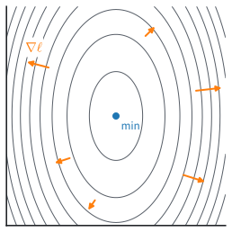
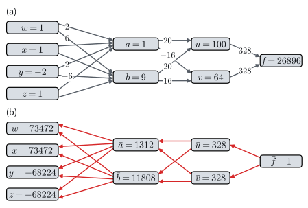
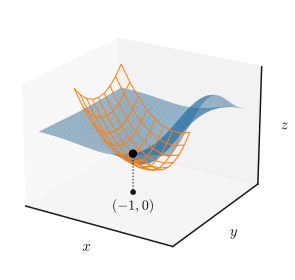
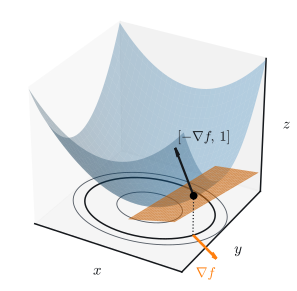
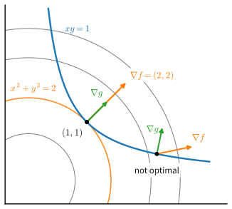
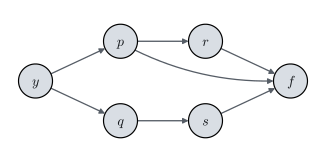
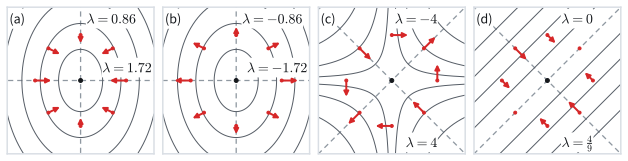

# Multivariable Calculus
:label:`sec_mdl-multivariable_calculus`

A network with a million weights $w_1, \ldots, w_N$, $N = 10^6$, has a loss
$\ell(\mathbf{w})$ that depends on all of them. Each training step moves every
weight a little at once, so it needs to know how $\ell$ responds to a joint
change. The obvious probe nudges one weight, evaluates the loss again, and
repeats: $1{,}000{,}001$ evaluations of the loss per step. That is far more
than a training step can spend. Even then we would know a million separate
slopes, but not what happens when all the weights move together. This section
shows that one vector of
slopes, the *gradient*, answers the question for every joint move at once, to
first order. The same vector points in the direction of fastest increase.
Running the chain rule backward through the computation produces the whole
vector at a small constant multiple of the cost of one evaluation of the loss.
A symmetric table of second derivatives, the *Hessian*, describes how the
surface bends and tells a minimum from a saddle.

:numref:`sec_calculus` stated the rules of differentiation and used the
gradient. Here we prove when the linear model holds, why the backward order is
cheap, and how second derivatives classify a critical point, as
:numref:`sec_mdl-single_variable_calculus` did for functions of one variable. Our running example is the two-variable log-sum-exp
$f(x, y) = \log(e^x + e^y)$ at the point $(0, \log 2)$. Its gradient will turn
out to be the softmax.

## Partial Derivatives and the Gradient

### Partial Derivatives

Freeze every weight except $w_1$. The loss becomes a function of the single
variable $w_1$, and its slope is the ordinary derivative of
:numref:`sec_mdl-single_variable_calculus`. This slope is the *partial
derivative* of $\ell$ with respect to $w_1$: the rate of change of $\ell$ when
$w_1$ moves and all other weights stay fixed. With $\mathbf{e}_1$ the first
standard basis vector, it is the limit

$$
\frac{\partial \ell}{\partial w_1}(\mathbf{w}) = \lim_{h \to 0} \frac{\ell(\mathbf{w} + h\mathbf{e}_1) - \ell(\mathbf{w})}{h},
$$

in which only the first coordinate moves. As in one variable, the partial
derivative predicts the effect of a small change $\epsilon_1$ of $w_1$ alone,

$$\ell(w_1+\epsilon_1, w_2, \ldots, w_N) \approx \ell(w_1, w_2, \ldots, w_N) + \epsilon_1 \frac{\partial \ell}{\partial w_1}(w_1, w_2, \ldots, w_N).$$
:eqlabel:`eq_mdl-part_der`

The change in the loss is the step times the partial derivative. Geometrically,
a partial derivative is the slope of a *slice*: the curve we get by cutting the
graph of $\ell$ with the plane in which only $w_1$ varies.

For the running example, holding $y$ fixed and differentiating
$f(x, y) = \log(e^x + e^y)$ in $x$ gives $\partial f/\partial x = e^x/(e^x+e^y)$,
and by symmetry $\partial f/\partial y = e^y/(e^x+e^y)$. At $(0, \log 2)$ we have
$e^x = 1$ and $e^y = 2$, so $f = \log 3 \approx 1.0986$,
$\partial f/\partial x = \tfrac13$, and $\partial f/\partial y = \tfrac23$.

### Differentiability and the Gradient
:label:`subsec_mdl-gradient`

The partial derivatives give one slope per coordinate. They do not by
themselves say what happens when all coordinates move at once, say when we
step from $(0, \log 2)$ by $\boldsymbol{\epsilon} = (0.01, -0.03)$. It is
natural to guess that the two changes add, $\tfrac13 \cdot 0.01 + \tfrac23
\cdot (-0.03)$, but this guess is a claim about $f$, and it needs a hypothesis.

The hypothesis is that, near $\mathbf{w}$, $\ell$ is a linear function up to an
error smaller than the step. We call $\ell$ *differentiable* at $\mathbf{w}$ if
there is a linear map $\Lambda$ with

$$
\ell(\mathbf{w} + \boldsymbol{\epsilon}) = \ell(\mathbf{w}) + \Lambda(\boldsymbol{\epsilon}) + o(\|\boldsymbol{\epsilon}\|),
$$
:eqlabel:`eq_mdl-differentiable`

where $o(\|\boldsymbol{\epsilon}\|)$ stands for any error that, divided by
$\|\boldsymbol{\epsilon}\|$, tends to zero as $\boldsymbol{\epsilon} \to
\mathbf{0}$. The definition says that the change of $\ell$ is a linear function
of the step, up to an error that vanishes faster than the step itself.

If such a $\Lambda$ exists, it is determined by the partial derivatives.
Setting $\boldsymbol{\epsilon} = h\mathbf{e}_i$ in
:eqref:`eq_mdl-differentiable`, dividing by $h$, and letting $h \to 0$
identifies $\Lambda(\mathbf{e}_i) = \partial\ell/\partial w_i$. Linearity then
fixes $\Lambda$ on every step,

$$
\Lambda(\boldsymbol{\epsilon}) = \Lambda\Bigl(\sum_{i=1}^N \epsilon_i \mathbf{e}_i\Bigr) = \sum_{i=1}^N \epsilon_i \frac{\partial \ell}{\partial w_i} = \boldsymbol{\epsilon} \cdot \nabla_{\mathbf{w}} \ell,
\qquad
\nabla_{\mathbf{w}} \ell = \left[\frac{\partial \ell}{\partial w_1}, \ldots, \frac{\partial \ell}{\partial w_N}\right]^\top.
$$

The column vector $\nabla_{\mathbf{w}}\ell$ of partial derivatives is the
*gradient* of $\ell$. Substituting it into the definition gives the
multivariable linear approximation

$$\ell(\mathbf{w} + \boldsymbol{\epsilon}) = \ell(\mathbf{w}) + \boldsymbol{\epsilon}\cdot \nabla_{\mathbf{w}} \ell(\mathbf{w}) + o(\|\boldsymbol{\epsilon}\|).$$
:eqlabel:`eq_mdl-nabla_use`

The first-order change is a dot product of the step with the gradient. This is
the shape of the one-variable $f(x+\epsilon) \approx f(x) + \epsilon f'(x)$,
with the slope replaced by a vector and the product by a dot product. The
gradient is the unique vector whose dot product with a step gives the
first-order change in $\ell$. We treat it as a column vector throughout.

At $(0, \log 2)$ the running example has $\nabla f = [\tfrac13, \tfrac23]^\top$,
and :eqref:`eq_mdl-nabla_use` predicts $f(0.01, \log 2 - 0.03) \approx \log 3 +
\tfrac13 \cdot 0.01 - \tfrac23 \cdot 0.03 \approx 1.081946$. At every point the
two entries of the gradient are positive and sum to one, because the gradient
of log-sum-exp is the softmax $\mathbf{p} = \operatorname{softmax}(x, y)$, with
entries $e^x/(e^x+e^y)$ and $e^y/(e^x+e^y)$.

Having all partial derivatives does not make a function differentiable. Take
$f(x, y) = 2xy/(x^2+y^2)$ with $f(0, 0) = 0$. On both axes $f$ is zero, so both
partials at the origin are $0$, and the only candidate linear model is the
constant $0$. Yet $f = 1$ everywhere on the diagonal $x = y \neq 0$, however
close to the origin, so no linear model holds there. This $f$ is not even
continuous at the origin, and Exercise
:exref:`ex_mdl-multivariable-calculus-no-gradient` gives a continuous function
with the same defect.

Differentiability therefore needs more than the existence of partial
derivatives. A convenient sufficient condition for differentiability at
$\mathbf{w}$ is that the partial derivatives exist near $\mathbf{w}$ and are
continuous at $\mathbf{w}$ :cite:`Rudin.1976`. The partials of log-sum-exp are continuous
everywhere, so it is differentiable everywhere.

Does the linear model predict a small step of the running example, and how
does its error shrink as the step shrinks? The next cell evaluates both sides
of :eqref:`eq_mdl-nabla_use` for $\boldsymbol{\epsilon} = (0.01, -0.03)$ and for
steps ten and a hundred times smaller. The code is plain NumPy, the same in
every framework.

```{.python .input #multivariable-calculus-imports}
#@tab mxnet
from mxnet import autograd, np as mnp, npx
import numpy as np
npx.set_np()
```

```{.python .input #multivariable-calculus-imports}
#@tab pytorch
import numpy as np
import torch
```

```{.python .input #multivariable-calculus-imports}
#@tab tensorflow
import numpy as np
import tensorflow as tf
```

```{.python .input #multivariable-calculus-imports}
#@tab jax
import numpy as np
import jax
from jax import numpy as jnp
```

```{.python .input #multivariable-calculus-higher-dimensional-differentiation}
def lse(xy):  # f(x, y) = log(e^x + e^y), computed stably
    return np.logaddexp(xy[0], xy[1])

def grad_lse(xy):  # its gradient, the softmax of (x, y)
    return np.exp(xy - lse(xy))

xy0 = np.array([0.0, np.log(2)])
print('gradient:', grad_lse(xy0))
for scale in [1, 0.1, 0.01]:
    eps = scale * np.array([0.01, -0.03])
    linear = lse(xy0) + eps @ grad_lse(xy0)
    true = lse(xy0 + eps)
    print(f'|eps| {np.linalg.norm(eps):.1e}: linear {linear:.8f}, '
          f'true {true:.8f}, gap {true - linear:.3e}')
```

At $\|\boldsymbol{\epsilon}\| \approx 0.03$ the linear model is off by
$1.79 \times 10^{-4}$, in the fourth decimal of $f$. Each tenfold smaller step
makes the gap a hundredfold smaller, so the error is of second order in the
step, which is more than the $o(\|\boldsymbol{\epsilon}\|)$ that the definition
promises. We compute this second-order error from the Hessian later in this
section.

A hand-derived gradient is routinely checked against automatic
differentiation. Does each framework's autograd return
$[\tfrac13, \tfrac23]^\top$ at $(0, \log 2)$?

```{.python .input #mdl-multivariable-calculus-directional-derivatives-1}
#@tab mxnet
xy = mnp.array([0.0, np.log(2)])
xy.attach_grad()
with autograd.record():
    m = xy.max()  # shift by the max before exponentiating, as logsumexp does
    out = m + mnp.log(mnp.exp(xy - m).sum())
out.backward()
print(f'autograd gradient: {xy.grad}')
```

```{.python .input #mdl-multivariable-calculus-directional-derivatives-1}
#@tab pytorch
xy = torch.tensor([0.0, np.log(2)], requires_grad=True)
torch.logsumexp(xy, 0).backward()
print(f'autograd gradient: {xy.grad}')
```

```{.python .input #mdl-multivariable-calculus-directional-derivatives-1}
#@tab tensorflow
xy = tf.Variable([0.0, np.log(2)])
with tf.GradientTape() as t:
    out = tf.reduce_logsumexp(xy)
print(f'autograd gradient: {t.gradient(out, xy).numpy()}')
```

```{.python .input #mdl-multivariable-calculus-directional-derivatives-1}
#@tab jax
grad = jax.grad(jax.scipy.special.logsumexp)(jnp.array([0.0, np.log(2)]))
print(f'autograd gradient: {grad}')
```

Up to rounding, every autograd returns the hand-computed
$[\tfrac13, \tfrac23]^\top$.

### Directional Derivatives

The gradient also gives the slope along any direction, not only along the
axes. Put $\boldsymbol{\epsilon} = h\mathbf{u}$ with a unit vector $\mathbf{u}$
into :eqref:`eq_mdl-nabla_use`, divide by $h$, and let $h \to 0$. The error
term disappears, and we get

$$
\lim_{h \to 0} \frac{\ell(\mathbf{w} + h\mathbf{u}) - \ell(\mathbf{w})}{h} = \mathbf{u} \cdot \nabla_{\mathbf{w}} \ell(\mathbf{w}).
$$
:eqlabel:`eq_mdl-directional-derivative`

The left side is the *directional derivative* of $\ell$ along $\mathbf{u}$, and
the right side says that it is the projection of the gradient onto
$\mathbf{u}$. One vector stores the slope in every direction.

Three directions of the running example at $(0, \log 2)$ show the range.
Along the diagonal $\mathbf{u} = (1, 1)/\sqrt{2}$ the slope is
$(\tfrac13 + \tfrac23)/\sqrt{2} = 1/\sqrt{2} \approx 0.707$, and it is the same at
*every* point: $f(x+t, y+t) = \log\bigl(e^t(e^x+e^y)\bigr) = f(x, y) + t$, so
moving a distance $\sqrt{2}\,t$ along the diagonal raises $f$ by $t$. Along
$\mathbf{u} = -(1, 2)/\sqrt{5}$, against the gradient, the slope is
$-(\tfrac13 + \tfrac43)/\sqrt{5} = -\sqrt{5}/3 \approx -0.745$. Along
$\mathbf{u} = (2, -1)/\sqrt{5}$ it is $(\tfrac23 - \tfrac23)/\sqrt{5} = 0$, so
to first order $f$ does not change in this direction. The next subsections
show that the second is the direction of steepest descent and that the third
is tangent to the level curve of $f$.

## The Geometry of Gradients

### Steepest Descent
:label:`subsec_mdl-steepest-descent`

Gradient descent, introduced in :numref:`sec_linear_regression`, is the
following recipe:

1. Start from some initial parameters $\mathbf{w}$.
2. Find the unit direction $\mathbf{v}$ along which $\ell$ decreases most rapidly.
3. Take a small step that way: $\mathbf{w} \leftarrow \mathbf{w} + \eta\mathbf{v}$.
4. Repeat.

Step 2 is a question about directional derivatives. For a unit vector
$\mathbf{v}$ and a small step $h > 0$, :eqref:`eq_mdl-nabla_use` and the
geometric form of the dot product, $\mathbf{a}\cdot\mathbf{b} =
\|\mathbf{a}\|\|\mathbf{b}\|\cos\theta$, give

$$
\ell(\mathbf{w} + h\mathbf{v}) - \ell(\mathbf{w}) = h\,\mathbf{v}\cdot \nabla_{\mathbf{w}} \ell(\mathbf{w}) + o(h) = h\,\|\nabla_{\mathbf{w}} \ell(\mathbf{w})\|\cos\theta + o(h),
$$

where $\theta$ is the angle between $\mathbf{v}$ and the gradient. The direction
enters only through $\cos\theta$, so the best direction makes $\cos\theta$ as
small as possible.

**Proposition (steepest ascent and descent).** *At any point where
$\nabla \ell \neq \mathbf{0}$, among all unit vectors $\mathbf{v}$ the
directional derivative $\mathbf{v}\cdot\nabla \ell$ is largest for
$\mathbf{v} = \nabla\ell/\|\nabla\ell\|$ and smallest for
$\mathbf{v} = -\nabla\ell/\|\nabla\ell\|$. Thus $+\nabla \ell$ is the direction
of steepest ascent and $-\nabla \ell$ the direction of steepest descent.*

**Proof.** The Cauchy–Schwarz inequality
(:numref:`sec_mdl-geometry-linear-algebraic-ops`) states that
$|\mathbf{v}\cdot\mathbf{g}| \le \|\mathbf{v}\|\|\mathbf{g}\|$, with equality
only when $\mathbf{v}$ and $\mathbf{g}$ are collinear. For a unit vector
$\mathbf{v}$ and $\mathbf{g} = \nabla \ell$ it reads

$$
-\|\nabla \ell\| \;\le\; \mathbf{v}\cdot\nabla \ell \;\le\; \|\nabla \ell\|.
$$

Each bound is attained only by a unit vector collinear with $\nabla \ell$: the
upper bound by $\mathbf{v} = \nabla \ell/\|\nabla \ell\|$ and the lower bound by
$\mathbf{v} = -\nabla \ell/\|\nabla \ell\|$. $\blacksquare$

In the $\cos\theta$ form this is $\theta = 0$ against $\theta = \pi$. In the
running example the steepest descent direction at $(0, \log 2)$ is
$-(1, 2)/\sqrt{5}$, with slope $-\|\nabla f\| = -\sqrt{5}/3 \approx -0.745$, the
most negative of the three slopes computed above. Steepest descent steps along
$-\nabla_{\mathbf{w}} \ell$, and the recipe becomes the gradient-descent update

$$
\mathbf{w} \leftarrow \mathbf{w} - \eta\,\nabla_{\mathbf{w}} \ell(\mathbf{w}).
$$

The learning rate $\eta > 0$ absorbs the length of the gradient into the step.

"Unit" in the proposition means Euclidean length. If instead each coordinate
may move by at most one, the steepest unit step is
$-\operatorname{sign}(\nabla \ell)$, coordinate by coordinate; at $(0, \log 2)$
that is $(-1, -1)$, with slope $-(\tfrac13 + \tfrac23) = -1$.
Exercise :exref:`ex_mdl-gradient-based-optimization-steepest-other-norms`
develops steepest descent in other norms. Practical optimizers also build their steps from gradients without
always stepping along the current $-\nabla \ell$. Momentum averages gradients
over time, and RMSProp and Adam rescale the coordinates
(:numref:`chap_optimization`).

### Gradients and Level Sets

The gradient also has a geometric meaning that does not refer to a step. A
*level set* of $\ell$ is the set of points where $\ell$ takes a fixed value
$c$. Moving along a level set does not change $\ell$, so the slope along such a
direction should vanish.

**Proposition (gradients are normal to level sets).** *Let $\ell$ be
differentiable at $\mathbf{x}$. Then $\nabla \ell(\mathbf{x})$ is orthogonal to
every direction tangent at $\mathbf{x}$ to the level set
$\{\mathbf{x}' : \ell(\mathbf{x}') = c\}$ through $\mathbf{x}$.*

**Proof.** A direction $\mathbf{v}$ is *tangent* to the level set at
$\mathbf{x}$ if $\mathbf{v} = \boldsymbol{\gamma}'(0)$ for some differentiable
curve $\boldsymbol{\gamma}(t)$ lying in the level set with
$\boldsymbol{\gamma}(0) = \mathbf{x}$. Along such a curve
$\ell(\boldsymbol{\gamma}(t)) = c$ for all $t$, so the derivative of
$t \mapsto \ell(\boldsymbol{\gamma}(t))$ at $t = 0$ vanishes. To first order
$\boldsymbol{\gamma}(t) = \mathbf{x} + t\mathbf{v} + o(t)$, so by
:eqref:`eq_mdl-nabla_use` that derivative is $\mathbf{v}\cdot\nabla \ell(\mathbf{x})$.
Hence $\mathbf{v}\cdot\nabla \ell(\mathbf{x}) = 0$. $\blacksquare$

The level set of the running example through $(0, \log 2)$ is the curve
$e^x + e^y = 3$. Differentiating along it, $e^x\,dx + e^y\,dy = 0$, so its
tangent direction is $(e^y, -e^x) = (2, -1)$, and indeed
$(2, -1)\cdot(\tfrac13, \tfrac23) = 0$. This is the direction of zero slope
found above.

On a contour map the gradient crosses each contour at a right angle and points
toward larger values. If neighboring contours differ in value by $\Delta c$
and lie a distance $d$ apart, the slope across them is about $\Delta c/d$, so
the gradient is longest where the contours are packed most tightly
(:numref:`fig_mdl-cal-gradient-field`). Gradient descent moves the other way,
across the contours toward smaller values.


:label:`fig_mdl-cal-gradient-field`

### Tangent Planes

Reading :eqref:`eq_mdl-nabla_use` without the error term as an equation for a
height $z$ gives the *tangent plane* to the graph of $f$ at $\mathbf{x}_0$,

$$
z = f(\mathbf{x}_0) + \nabla f(\mathbf{x}_0)\cdot(\mathbf{x}-\mathbf{x}_0),
$$
:eqlabel:`eq_mdl-tangent_plane`

the plane through $(\mathbf{x}_0, f(\mathbf{x}_0))$ with the same slopes as $f$
in every direction. For the running example it is
$z = \log 3 + \tfrac13 x + \tfrac23 (y - \log 2)$. Rewritten as
$\nabla f(\mathbf{x}_0)\cdot(\mathbf{x}-\mathbf{x}_0) - \bigl(z - f(\mathbf{x}_0)\bigr) = 0$,
the equation says that the vector $[\nabla f(\mathbf{x}_0), -1]^\top$ is normal
to the plane in $(\mathbf{x}, z)$-space. Dropping its last coordinate leaves
$\nabla f(\mathbf{x}_0)$, the normal to the level curve in the base plane
(:numref:`fig_mdl-tangent-plane`).

![A surface $z = f(\mathbf{x})$ (blue) with its tangent plane at a point (orange). The vector $[-\nabla f, 1]$, the negative of $[\nabla f, -1]$, is normal to the plane (black arrow). Dropping the height coordinate leaves a multiple of $\nabla f$, which on the base plane (orange arrow) is normal to the level curve through the point (black).](../img/mdl-cal-tangent-plane.svg)
:label:`fig_mdl-tangent-plane`

### Critical Points

In deep learning we minimize losses numerically, because they are too complex
to minimize in closed form. The geometry above still gives a necessary
condition that every minimum must satisfy. For small problems this condition
is enough to find the minimum by hand. Throughout, $f$ is defined on all of
$\mathbb{R}^n$ and differentiable at the point $\mathbf{x}_0$ in question.

Suppose $\nabla f(\mathbf{x}_0) \neq \mathbf{0}$ and step against it, by
$\boldsymbol{\epsilon} = -\eta\nabla f(\mathbf{x}_0)$ with $\eta > 0$. By
:eqref:`eq_mdl-nabla_use` the change is
$-\eta\|\nabla f(\mathbf{x}_0)\|^2 + o(\eta)$, which is negative for every
sufficiently small $\eta$. So $\mathbf{x}_0$ is not a local minimum, and by the
same argument with $+\eta$ it is not a local maximum either. Hence
**at a local minimum or maximum, $\nabla f(\mathbf{x}_0) = \mathbf{0}$.** Points
where the gradient vanishes are *critical points*. The condition is necessary,
not sufficient.

Take $\psi(x, y) = x e^{-x^2-y^2}$, a positive hill for $x > 0$ and a negative
pit for $x < 0$. Its partial derivatives are

$$
\frac{\partial \psi}{\partial x} = (1 - 2x^2)\,e^{-x^2-y^2}, \qquad
\frac{\partial \psi}{\partial y} = -2xy\,e^{-x^2-y^2}.
$$

Both vanish only if $y = 0$ (the second forces $x = 0$ or $y = 0$, and $x = 0$
makes the first equal to $e^{-y^2} \neq 0$) and $x = \pm 1/\sqrt{2}$. The two
critical points have values $\psi(\mp 1/\sqrt{2}, 0) = \mp e^{-1/2}/\sqrt{2}
\approx \mp 0.4289$. To conclude which is the global minimum we also need to
know that a global minimum *exists*. Outside the disc of radius $R = 2$,
$|\psi| \le R e^{-R^2} < 0.04$, while inside it $\psi(-1/\sqrt{2}, 0) = -0.43$.
A continuous function attains its minimum on the closed disc, and this minimum
is below $-0.04$, so it lies in the interior and is a global minimum of $\psi$,
hence a critical point. Of the two candidates, $(-1/\sqrt{2}, 0)$ has the
smaller value: it is the global minimum, and by the same argument
$(+1/\sqrt{2}, 0)$ is the global maximum. Without the existence step the
argument fails: $x^3$ has a single critical point and no minimum at all.

Does the gradient vanish at the two hand-derived points, and not at a point
nearby?

```{.python .input #multivariable-calculus-a-note-on-mathematical-optimization}
def psi(x, y):
    return x * np.exp(-x**2 - y**2)

def grad_psi(x, y):
    e = np.exp(-x**2 - y**2)
    return np.array([(1 - 2 * x**2) * e, -2 * x * y * e])

for x0 in [-1 / np.sqrt(2), 1 / np.sqrt(2), 0.3]:
    print(f'psi({x0:+.4f}, 0) = {psi(x0, 0.0):+.4f}, '
          f'|grad psi| = {np.linalg.norm(grad_psi(x0, 0.0)):.1e}')
```

At $(\pm 1/\sqrt{2}, 0)$ the gradient is zero up to rounding, and at
$(0.3, 0)$ it is not. The first-order test cannot tell the minimum from the
maximum, because both have zero gradient. The second-derivative test later in
this section separates them.

### Constrained Optimization and Lagrange Multipliers
:label:`subsec_mdl-lagrange`

Many problems restrict the parameters to a surface: weights normalized to unit
length, probabilities that sum to one, the point on a curve closest to the
origin. We then minimize $f(\mathbf{x})$ subject to $g(\mathbf{x}) = c$. The
first-order test no longer applies, because at the best point $\nabla f$ need
not vanish. It only has to give no first-order decrease along moves that stay
on the surface.

At a feasible point the admissible moves are the directions $\mathbf{v}$
tangent to the surface $\{g = c\}$. At a constrained local minimizer
$\mathbf{x}^\star$ no admissible move lowers $f$ to first order, so
$\mathbf{v}\cdot\nabla f(\mathbf{x}^\star) \ge 0$ for every tangent
$\mathbf{v}$. Since $-\mathbf{v}$ is tangent too, equality holds, and
$\nabla f(\mathbf{x}^\star)$ is orthogonal to every tangent direction. By the
level-set proposition, so is $\nabla g(\mathbf{x}^\star)$.

**Proposition (Lagrange condition).** *Let $\mathbf{x}^\star$ be a local
minimizer of $f$ on $\{\mathbf{x} : g(\mathbf{x}) = c\}$. Assume that $f$ is
differentiable at $\mathbf{x}^\star$, that $g$ is continuously differentiable
near $\mathbf{x}^\star$, and that $\nabla g(\mathbf{x}^\star) \neq \mathbf{0}$.
Then there is a scalar $\mu$, the Lagrange multiplier, with*

$$
\nabla f(\mathbf{x}^\star) = \mu\,\nabla g(\mathbf{x}^\star).
$$
:eqlabel:`eq_mdl-lagrange-condition`

**Proof.** The proof uses one fact about the constraint set. Under the last two
hypotheses, $\{g = c\}$ is a smooth surface near $\mathbf{x}^\star$, and every
$\mathbf{v}$ with $\nabla g(\mathbf{x}^\star)\cdot\mathbf{v} = 0$ is the velocity
$\boldsymbol{\gamma}'(0)$ of a differentiable curve $\boldsymbol{\gamma}$ in
$\{g = c\}$ with $\boldsymbol{\gamma}(0) = \mathbf{x}^\star$ :cite:`Rudin.1976`.
Along such a curve, $t \mapsto f(\boldsymbol{\gamma}(t))$ has a local minimum at
$t = 0$, so its derivative there vanishes. As in the level-set proof, that
derivative is $\mathbf{v}\cdot\nabla f(\mathbf{x}^\star)$. Hence
$\nabla f(\mathbf{x}^\star)$ is orthogonal to the hyperplane of all
$\mathbf{v}$ orthogonal to $\nabla g(\mathbf{x}^\star)$. The vectors orthogonal
to that hyperplane are the multiples of $\nabla g(\mathbf{x}^\star)$, so
$\nabla f(\mathbf{x}^\star) = \mu\nabla g(\mathbf{x}^\star)$. $\blacksquare$

At the solution the gradients of $f$ and $g$ are parallel, so the level set of
$f$ through $\mathbf{x}^\star$ is tangent to the constraint surface. Together
with $g(\mathbf{x}) = c$, the $n$ equations of the condition give $n + 1$
equations for the $n + 1$ unknowns $\mathbf{x}$ and $\mu$.

As a worked example, find the points of the hyperbola $xy = 1$ closest to the
origin: minimize $f = x^2 + y^2$ subject to $g = xy = 1$. The gradients are
$\nabla f = (2x, 2y)$ and $\nabla g = (y, x)$, and $\nabla g \neq \mathbf{0}$ on
the hyperbola. The condition reads $2x = \mu y$ and $2y = \mu x$. Substituting
the second into the first gives $4x = \mu^2 x$, so $x(4 - \mu^2) = 0$, and
$x = 0$ is impossible on $xy = 1$. The multiplier $\mu = -2$ forces $y = -x$
and $xy = -x^2 = 1$, which has no solution. So $\mu = 2$, $x = y$, and the
candidates are $(1, 1)$ and $(-1, -1)$, both with $f = 2$. A minimum exists: on
the branch $x > 0$, $f = x^2 + 1/x^2$ grows without bound as $x \to 0$ or
$x \to \infty$. Hence $(1, 1)$ is the closest point on that branch, and
$(-1, -1)$ on the other. At $(1, 1)$ the circle $x^2 + y^2 = 2$ and the
hyperbola both have slope $-1$, and $\nabla f = (2, 2) = 2\,\nabla g$
(:numref:`fig_mdl-lagrange-tangency`).


:label:`fig_mdl-lagrange-tangency`

Without the hypothesis $\nabla g(\mathbf{x}^\star) \neq \mathbf{0}$ a
multiplier need not exist (Exercise :exref:`ex_mdl-multivariable-calculus-rayleigh`
gives an example).
:numref:`sec_mdl-constrained-optimization-duality` builds the KKT conditions
on this condition, and :numref:`sec_mdl-lagrangian-duality` the dual problem.

## The Multivariable Chain Rule

A network is a long composition of simple functions, so computing gradients
means differentiating compositions. Consider four inputs $w, x, y, z$ that
flow through intermediate quantities to a scalar output:

$$
\begin{aligned}
f(u, v) & = (u+v)^{2}, \\
u(a, b) & = (a+b)^{2}, \qquad v(a, b) = (a-b)^{2}, \\
a(w, x, y, z) & = (w+x+y+z)^{2}, \qquad b(w, x, y, z) = (w+x-y-z)^2.
\end{aligned}
$$
:eqlabel:`eq_mdl-multi_func_def`

The dependencies form a graph (:numref:`fig_mdl-chain-1`): each node is a
value, and each edge a direct functional dependence. Substituting everything
into one formula for $f$ produces a long expression with repeated pieces, and
differentiating it in $w$ and then in $x$ repeats much of the same work. The
chain rule organizes this shared work.


:label:`fig_mdl-chain-1`

### The Chain Rule as a Sum over Paths

Take the simplest composite step, $f(u(a,b), v(a,b))$, and perturb $a$ by a
small $\epsilon$. Each intermediate moves by its partial derivative,
$u \to u + \epsilon\frac{\partial u}{\partial a}$ and
$v \to v + \epsilon\frac{\partial v}{\partial a}$. Feeding these moves into the
first-order expansion :eqref:`eq_mdl-nabla_use` of $f$ gives

$$
f\!\left(u + \epsilon\tfrac{\partial u}{\partial a},\, v + \epsilon\tfrac{\partial v}{\partial a}\right)
\approx f(u, v) + \epsilon\left[\frac{\partial f}{\partial u}\frac{\partial u}{\partial a} + \frac{\partial f}{\partial v}\frac{\partial v}{\partial a}\right].
$$

Reading off the coefficient of $\epsilon$ gives the multivariable chain rule,

$$
\frac{\partial f}{\partial a} = \frac{\partial f}{\partial u}\frac{\partial u}{\partial a} + \frac{\partial f}{\partial v}\frac{\partial v}{\partial a}.
$$

There are two *paths* by which $a$ influences $f$, $a \to u \to f$ and
$a \to v \to f$. Each path contributes the product of the derivatives along
its edges, and the total is the sum over the paths.

The step that fed two simultaneous moves into one linear expansion needs $f$
to be *differentiable*, not merely to have partial derivatives. For
$f = 2xy/(x^2+y^2)$ along the line $x = y = t$, the rule would predict
$\tfrac{d}{dt}f(t, t) = 0$ at $t = 0$ from the two zero partials, yet
$f(t, t) = 1$ for $t \neq 0$ and $f(0, 0) = 0$, so $f(t, t)$ jumps at $t = 0$ and
has no derivative there.

The rule extends to any graph. Call the *edge derivative* of a node with
respect to one of its parents the partial derivative of the node's function
with respect to that parent, holding its other parents fixed. Then for an
output $f$ and an input $x$,

$$
\frac{\partial f}{\partial x} = \sum_{\text{directed paths } x \to \cdots \to f} \;\; \prod_{\text{edges on the path}} (\text{edge derivative}).
$$
:eqlabel:`eq_mdl-chain-rule-paths`

The derivative of the output with respect to an input sums, over every route
from the input to the output, the product of the edge derivatives along the
route.

A graph in which one node feeds the output both directly and through a later
node shows why edge derivatives must be kept apart from totals. Consider

$$
\begin{aligned}
p(x, y) & = x + y, \qquad q(x, y) = x - y, \\
r(p) & = p^2, \qquad s(q) = q^2, \\
f(r, p, s) & = r + p + s.
\end{aligned}
$$
:eqlabel:`eq_mdl-multi_func_def_2`

The output $f$ depends on $r$, on $s$, and also directly on $p$, a skip edge
(:numref:`fig_mdl-chain-2`). The input $y$ reaches $f$ by three paths,
$y \to p \to r \to f$, $y \to p \to f$, and $y \to q \to s \to f$. The edge
derivatives are $\partial f/\partial r = \partial f/\partial p =
\partial f/\partial s = 1$, $\partial r/\partial p = 2p$, $\partial s/\partial q
= 2q$, $\partial p/\partial y = 1$, and $\partial q/\partial y = -1$, so

$$
\frac{\partial f}{\partial y} = \underbrace{1 \cdot 2p \cdot 1}_{y \to p \to r \to f} + \underbrace{1 \cdot 1}_{y \to p \to f} + \underbrace{1 \cdot 2q \cdot (-1)}_{y \to q \to s \to f} = 2p + 1 - 2q = 1 + 4y.
$$

Each path contributes one term, and the three terms add up to $1 + 4y$, which
direct substitution $f = (x+y)^2 + (x+y) + (x-y)^2$ confirms. At
$(x, y) = (1, 2)$, $p = 3$ and $q = -1$, and the paths contribute
$6 + 1 + 2 = 9 = 1 + 4 \cdot 2$. The *edge* derivative $\partial f/\partial p$ is
$1$, but the *total* sensitivity of $f$ to $p$, through the skip edge and
through $r$, is $2p + 1 = 7$. The two differ because of the skip edge.


:label:`fig_mdl-chain-2`

The sum over paths is how gradients flow through a network. Architectural
choices that open or close paths, such as the gates of an LSTM
(:numref:`sec_lstm`) or the skip connections of a residual block
(:numref:`sec_resnet`), shape learning by controlling which paths carry
gradient.

### Backpropagation

Return to :eqref:`eq_mdl-multi_func_def` at $(w, x, y, z) = (1, 1, -2, 1)$. A
*forward pass* evaluates the nodes in order: $a = 1^2 = 1$, $b = 3^2 = 9$,
$u = 10^2 = 100$, $v = (-8)^2 = 64$, and $f = 164^2 = 26896$. The edge
derivatives at these values are

$$
\begin{aligned}
\frac{\partial f}{\partial u} = \frac{\partial f}{\partial v} &= 2(u+v) = 328, \\
\frac{\partial u}{\partial a} = \frac{\partial u}{\partial b} &= 2(a+b) = 20, \qquad
\frac{\partial v}{\partial a} = 2(a-b) = -16, \qquad \frac{\partial v}{\partial b} = -2(a-b) = 16, \\
\frac{\partial a}{\partial w} = \frac{\partial a}{\partial x} = \frac{\partial a}{\partial y} = \frac{\partial a}{\partial z} &= 2(w+x+y+z) = 2, \\
\frac{\partial b}{\partial w} = \frac{\partial b}{\partial x} = 2(w+x-y-z) &= 6, \qquad \frac{\partial b}{\partial y} = \frac{\partial b}{\partial z} = -6.
\end{aligned}
$$

Every edge derivative is a number we can compute locally, from the values of a
node and its parents.

The four paths from $w$ to $f$ go through $a$ or $b$ and then through $u$ or
$v$. Pushing $w$ forward through the graph collects them as

$$
\begin{aligned}
\frac{\partial f}{\partial w} &= \frac{\partial f}{\partial u}\Bigl(\frac{\partial u}{\partial a}\frac{\partial a}{\partial w} + \frac{\partial u}{\partial b}\frac{\partial b}{\partial w}\Bigr) + \frac{\partial f}{\partial v}\Bigl(\frac{\partial v}{\partial a}\frac{\partial a}{\partial w} + \frac{\partial v}{\partial b}\frac{\partial b}{\partial w}\Bigr) \\
&= 328\,(20\cdot 2 + 20 \cdot 6) + 328\,(-16 \cdot 2 + 16 \cdot 6) = 328 \cdot 224 = 73472.
\end{aligned}
$$

The bracketed sums are $\partial u/\partial w = 160$ and
$\partial v/\partial w = 64$, the sensitivities of the intermediates to $w$.
Carrying the dependence on one input forward through the graph in this way is
called *forward mode*. The next cell carries out this computation.

```{.python .input #multivariable-calculus-the-backpropagation-algorithm-1}
w, x, y, z = 1, 1, -2, 1
# Forward pass: node values
a, b = (w + x + y + z)**2, (w + x - y - z)**2
u, v = (a + b)**2, (a - b)**2
f = (u + v)**2
print('a, b, u, v, f =', a, b, u, v, f)

# Edge derivatives
df_du, df_dv = 2*(u + v), 2*(u + v)
du_da, du_db, dv_da, dv_db = 2*(a + b), 2*(a + b), 2*(a - b), -2*(a - b)
da_dw, db_dw = 2*(w + x + y + z), 2*(w + x - y - z)

# Forward mode: push the dependence on w through the graph
du_dw, dv_dw = du_da*da_dw + du_db*db_dw, dv_da*da_dw + dv_db*db_dw
df_dw = df_du*du_dw + df_dv*dv_dw
print('df/dw =', df_dw)
```

Forward mode returns $\partial f/\partial w = 73472$, but nothing in
it can be reused for $x$, $y$, or $z$: $\partial u/\partial w$ and
$\partial v/\partial w$ are specific to $w$. Training needs the derivative of
one loss with respect to every parameter. Repeating this computation for each
parameter costs one pass per parameter, the same scaling as probing one weight
at a time in the opening.

The remedy is to keep the output fixed instead of the input. For every node
$a$ define its *adjoint*

$$
\bar{a} = \frac{\partial f}{\partial a}, \qquad
\bar{a} = \sum_{\text{children } c \text{ of } a} \bar{c}\,\frac{\partial c}{\partial a}, \qquad \bar{f} = 1,
$$
:eqlabel:`eq_mdl-adjoint`

the total derivative of the output with respect to that node. The recursion on
the right is the chain rule :eqref:`eq_mdl-chain-rule-paths` grouped by the
first edge out of $a$. Every path from $a$ to $f$ leaves through one of $a$'s
children $c$, and the paths from $c$ onward sum to $\bar{c}$. Starting from
$\bar f = 1$ and visiting the nodes from the output backward, each adjoint is
ready when it is needed. For our graph:

* $\bar{u} = \bar{v} = 328$;
* $\bar{a} = \bar{u}\cdot 20 + \bar{v}\cdot(-16) = 1312$ and
  $\bar{b} = \bar{u}\cdot 20 + \bar{v}\cdot 16 = 11808$;
* $\bar{w} = \bar{x} = \bar{a}\cdot 2 + \bar{b}\cdot 6 = 73472$ and
  $\bar{y} = \bar{z} = \bar{a}\cdot 2 - \bar{b}\cdot 6 = -68224$.

One *backward pass* gives all four partial derivatives
(:numref:`fig_mdl-cal-backward-sweep`). The next cell computes the adjoints
from the edge derivatives of the forward pass.


:label:`fig_mdl-cal-backward-sweep`

```{.python .input #multivariable-calculus-the-backpropagation-algorithm-2}
da_dy, db_dy = 2*(w + x + y + z), -2*(w + x - y - z)  # also for x, z
# Backward pass: adjoints from the output toward the inputs
u_bar, v_bar = df_du, df_dv
a_bar = u_bar*du_da + v_bar*dv_da
b_bar = u_bar*du_db + v_bar*dv_db
print(f'adjoints: u {u_bar}, v {v_bar}, a {a_bar}, b {b_bar}')
w_bar = a_bar*da_dw + b_bar*db_dw  # x enters a, b like w
y_bar = a_bar*da_dy + b_bar*db_dy  # z enters a, b like y
print('gradient:', {'w': w_bar, 'x': w_bar, 'y': y_bar, 'z': y_bar})
```

The derivatives with respect to $w$ and $x$ agree, and so do those with
respect to $y$ and $z$, because $f$ depends on its inputs only through $w + x$
and $y + z$. The two pairs differ in sign and size because $y$ and $z$ enter
$b = (w+x-y-z)^2$ with a minus sign.

Counting multiplications shows the saving. Forward mode needs six per input
(two each for $\partial u/\partial w$, $\partial v/\partial w$, and
$\partial f/\partial w$), 24 for four inputs. The backward pass needs four for
$\bar a$ and $\bar b$ and then two per input, 12 in all. With $N$ inputs that
feed a shared graph, forward mode costs $N$ passes through the graph and
backward mode costs one. For the network of the opening, one backward pass
replaces a million and one evaluations of the loss.

Computing derivatives from the output back toward the inputs is
*backpropagation* :cite:`Rumelhart.Hinton.Williams.ea.1988`. The forward pass
evaluates the function and records the node values and edge derivatives; the
backward pass accumulates the adjoints. Each framework's autograd runs the same
two passes. Does it return the same four numbers?

```{.python .input #multivariable-calculus-the-backpropagation-algorithm-3}
#@tab mxnet
wxyz = mnp.array([1., 1., -2., 1.])
wxyz.attach_grad()
with autograd.record():
    w, x, y, z = wxyz[0], wxyz[1], wxyz[2], wxyz[3]
    a, b = (w + x + y + z)**2, (w + x - y - z)**2
    u, v = (a + b)**2, (a - b)**2
    f = (u + v)**2
f.backward()  # one backward pass
print(wxyz.grad)
```

```{.python .input #multivariable-calculus-the-backpropagation-algorithm-3}
#@tab pytorch
wxyz = torch.tensor([1., 1., -2., 1.], requires_grad=True)
w, x, y, z = wxyz
a, b = (w + x + y + z)**2, (w + x - y - z)**2
u, v = (a + b)**2, (a - b)**2
f = (u + v)**2
f.backward()  # one backward pass
print(wxyz.grad)
```

```{.python .input #multivariable-calculus-the-backpropagation-algorithm-3}
#@tab tensorflow
wxyz = tf.Variable([1., 1., -2., 1.])
with tf.GradientTape() as t:
    w, x, y, z = tf.unstack(wxyz)
    a, b = (w + x + y + z)**2, (w + x - y - z)**2
    u, v = (a + b)**2, (a - b)**2
    f = (u + v)**2
print(t.gradient(f, wxyz).numpy())  # one backward pass
```

```{.python .input #multivariable-calculus-the-backpropagation-algorithm-3}
#@tab jax
def f_graph(wxyz):
    w, x, y, z = wxyz
    a, b = (w + x + y + z)**2, (w + x - y - z)**2
    u, v = (a + b)**2, (a - b)**2
    return (u + v)**2

print(jax.grad(f_graph)(jnp.array([1., 1., -2., 1.])))  # one backward pass
```

The library returns $(73472, 73472, -68224, -68224)$, the adjoints of our hand
computation. All the numbers involved are integers below $2^{24}$, so single
precision represents them without rounding.

## The Hessian

### Symmetry of the Hessian

The linear model is first order. Whether a critical point is a minimum, a
maximum, or neither depends on how the surface bends, and the bending is
measured by second derivatives. A function of $n$ variables has $n^2$ second
partial derivatives

$$
\frac{\partial^2 f}{\partial x_i \partial x_j} = \frac{\partial}{\partial x_i}\left(\frac{\partial f}{\partial x_j}\right),
$$

collected into the *Hessian* matrix

$$\mathbf{H}_f(\mathbf{x}) = \begin{bmatrix} \frac{\partial^2 f}{\partial x_1 \partial x_1} & \cdots & \frac{\partial^2 f}{\partial x_1 \partial x_n} \\ \vdots & \ddots & \vdots \\ \frac{\partial^2 f}{\partial x_n \partial x_1} & \cdots & \frac{\partial^2 f}{\partial x_n \partial x_n} \\ \end{bmatrix}.$$
:eqlabel:`eq_mdl-hess_def`

Entry $(i, j)$ is the rate at which the $j$-th slope changes as $x_i$ moves.
The Hessian is also written $\nabla^2 f$; when the function and the point are
clear we abbreviate it to $\mathbf{H}$.

For log-sum-exp, differentiate the softmax entries
$p_i = e^{x_i}/(e^{x_1}+e^{x_2})$ once more (here $(x_1, x_2) = (x, y)$). The
quotient rule gives $\partial p_i/\partial x_j = p_i\delta_{ij} - p_ip_j$,
where $\delta_{ij}$ is $1$ for $i = j$ and $0$ otherwise, so

$$
\mathbf{H}_f = \operatorname{diag}(\mathbf{p}) - \mathbf{p}\mathbf{p}^\top,
\qquad
\mathbf{H}_f(0, \log 2) = \begin{bmatrix} \tfrac13 - \tfrac19 & -\tfrac29 \\ -\tfrac29 & \tfrac23 - \tfrac49 \end{bmatrix} = \frac{2}{9}\begin{bmatrix} 1 & -1 \\ -1 & 1 \end{bmatrix}.
$$
:eqlabel:`eq_mdl-lse-hessian`

The matrix has eigenvalue $0$ along $(1, 1)$ and $\tfrac49$ along $(1, -1)$.
The zero eigenvalue is the diagonal direction along which
$f(x+t, y+t) = f(x, y) + t$ is linear and does not bend at all. This positive
semidefinite, singular Hessian returns in the second-derivative test.

The $n^2$ entries are not independent: for twice continuously differentiable
$f$ the Hessian is symmetric, a result known as the Clairaut–Schwarz theorem
:cite:`Rudin.1976`.

**Proposition (symmetry of the Hessian; Clairaut–Schwarz).** *Suppose the first
partial derivatives of $f$ and the mixed partials
$\frac{\partial^2 f}{\partial x_i \partial x_j}$ and
$\frac{\partial^2 f}{\partial x_j \partial x_i}$ exist near $\mathbf{x}$ and that
the mixed partials are continuous at $\mathbf{x}$. Then*

$$
\frac{\partial^2 f}{\partial x_i \partial x_j}(\mathbf{x}) = \frac{\partial^2 f}{\partial x_j \partial x_i}(\mathbf{x}).
$$

*If this holds for all $i, j$, then $\mathbf{H}_f = \mathbf{H}_f^\top$.*

**Proof.** Both mixed partials are limits of the *same* quantity, the
symmetric second difference

$$
\Delta_h = \frac{f(\mathbf{x}+h\mathbf{e}_i+h\mathbf{e}_j) - f(\mathbf{x}+h\mathbf{e}_i) - f(\mathbf{x}+h\mathbf{e}_j) + f(\mathbf{x})}{h^2},
$$
:eqlabel:`eq_mdl-second-difference`

which is symmetric in $i$ and $j$ by inspection. Write
$\varphi(t) = f(\mathbf{x}+t\mathbf{e}_i+h\mathbf{e}_j) - f(\mathbf{x}+t\mathbf{e}_i)$,
so that $\Delta_h = \bigl(\varphi(h)-\varphi(0)\bigr)/h^2$. The mean value
theorem, applied first along $x_i$ to $\varphi$ and then along $x_j$ to the
difference of first partials it produces, gives
$\Delta_h = \frac{\partial^2 f}{\partial x_j \partial x_i}(\boldsymbol{\xi}_h)$
at some point $\boldsymbol{\xi}_h$ of the square with corners $\mathbf{x}$ and
$\mathbf{x} + h\mathbf{e}_i + h\mathbf{e}_j$, within distance $\sqrt{2}\,h$ of
$\mathbf{x}$. Swapping the roles of $i$ and $j$ leaves $\Delta_h$ unchanged and
gives $\Delta_h = \frac{\partial^2 f}{\partial x_i \partial x_j}(\boldsymbol{\xi}'_h)$
at another point of the same square. Let $h \to 0$: by continuity at
$\mathbf{x}$ the two expressions converge to the two mixed partials at
$\mathbf{x}$, and since they are equal for every $h$, so are the limits.
$\blacksquare$

Exercise :exref:`ex_mdl-multivariable-calculus-mixed-partials` shows the hypothesis at work: a function whose mixed partials exist
everywhere but are not continuous at the origin, where they differ. Symmetry
lets the spectral theorem and the definiteness criteria of
:numref:`sec_mdl-eigendecompositions` apply to the Hessian, which is what the
second-derivative test uses.

### The Second-Order Taylor Approximation

The gradient gives the best linear model of $f$; the Hessian gives the best
*quadratic* model. To see how the coefficients enter, read them off an exact
quadratic. Let $f(x_1, x_2) = a + b_1x_1 + b_2x_2 + c_{11}x_1^{2} + c_{12}x_1x_2 + c_{22}x_2^{2}$.
Evaluating the value, gradient, and Hessian :eqref:`eq_mdl-hess_def` at the
origin gives

$$
f(0,0) = a, \qquad
\nabla f (0,0) = \begin{bmatrix}b_1 \\ b_2\end{bmatrix}, \qquad
\mathbf{H}_f (0,0) = \begin{bmatrix}2 c_{11} & c_{12} \\ c_{12} & 2c_{22}\end{bmatrix},
$$

and these recover the polynomial: $f(\mathbf{x}) = f(\mathbf{0}) + \nabla
f(\mathbf{0}) \cdot \mathbf{x} + \tfrac12\mathbf{x}^\top \mathbf{H}_f(\mathbf{0})\,
\mathbf{x}$. The factor $\tfrac12$ undoes the $2$ that differentiating a square
produces.

For a general $f$ the same assembly is no longer exact, and restricting $f$ to
a line shows how close it comes. Let $f$ be twice continuously differentiable
near the segment from $\mathbf{x}_0$ to $\mathbf{x}$, fix the displacement
$\boldsymbol{\delta} = \mathbf{x} - \mathbf{x}_0$, and let
$\varphi(t) = f(\mathbf{x}_0 + t\boldsymbol{\delta})$, a function of the single
variable $t$. The chain rule gives
$\varphi'(t) = \sum_i \frac{\partial f}{\partial x_i}(\mathbf{x}_0 + t\boldsymbol{\delta})\,\delta_i$,
and applying it again to each term gives
$\varphi''(t) = \sum_{i,j} \delta_j\frac{\partial^2 f}{\partial x_j\partial x_i}(\mathbf{x}_0 + t\boldsymbol{\delta})\,\delta_i = \boldsymbol{\delta}^\top \mathbf{H}_f(\mathbf{x}_0 + t\boldsymbol{\delta})\,\boldsymbol{\delta}$.

In one variable, the Lagrange form of Taylor's theorem
(:numref:`sec_mdl-single_variable_calculus`) states: if $\varphi'$ is
continuous on $[0, 1]$ and $\varphi''$ exists on $(0, 1)$, then
$\varphi(1) = \varphi(0) + \varphi'(0) + \tfrac12\varphi''(\tau)$ for some
$\tau \in (0, 1)$. Translated back to $f$,

$$
f(\mathbf{x}) = f(\mathbf{x}_0) + \nabla f(\mathbf{x}_0)\cdot\boldsymbol{\delta} + \tfrac{1}{2}\boldsymbol{\delta}^\top \mathbf{H}_f(\boldsymbol{\xi})\,\boldsymbol{\delta}, \qquad \boldsymbol{\xi} = \mathbf{x}_0 + \tau\boldsymbol{\delta}.
$$

This identity is exact, with the Hessian evaluated at an intermediate point
$\boldsymbol{\xi}$ of the segment instead of at $\mathbf{x}_0$. Since the second
partials are continuous, moving the evaluation point back to $\mathbf{x}_0$
changes the quadratic term by at most
$\tfrac12\|\mathbf{H}_f(\boldsymbol{\xi}) - \mathbf{H}_f(\mathbf{x}_0)\|\,\|\boldsymbol{\delta}\|^2 = o(\|\boldsymbol{\delta}\|^2)$,
which gives the *second-order Taylor approximation*

$$
f(\mathbf{x}) = f(\mathbf{x}_0) + \nabla f (\mathbf{x}_0) \cdot (\mathbf{x}-\mathbf{x}_0) + \frac{1}{2}(\mathbf{x}-\mathbf{x}_0)^\top \mathbf{H}_f (\mathbf{x}_0) (\mathbf{x}-\mathbf{x}_0) + o(\|\mathbf{x}-\mathbf{x}_0\|^2).
$$
:eqlabel:`eq_mdl-second_taylor`

The quadratic model is wrong only by an amount that vanishes faster than the
squared step, and it is the only quadratic with this property. When $f$ has
three continuous derivatives, the error is of third order in the step.

Along a single direction, a step $t\mathbf{v}$ makes the quadratic term
$\tfrac{t^2}{2}\mathbf{v}^\top\mathbf{H}\mathbf{v}$, and
$\mathbf{v}^\top\mathbf{H}\mathbf{v} = \tfrac{d^2}{dt^2}f(\mathbf{x}_0 +
t\mathbf{v})\big|_{t=0}$ is the *second directional derivative*, the curvature
of the slice of $f$ along $\mathbf{v}$.

The Hessian now accounts for the gap that the first code cell printed. For the
step $\boldsymbol{\epsilon} = (0.01, -0.03)$, the Hessian
:eqref:`eq_mdl-lse-hessian` predicts a gap between the true value and the
linear model of
$\tfrac12\boldsymbol{\epsilon}^\top\mathbf{H}\boldsymbol{\epsilon} =
\tfrac19(\epsilon_1 - \epsilon_2)^2 = \tfrac19 (0.04)^2 \approx 1.78 \times
10^{-4}$. Does that match the gap the first cell printed?

```{.python .input #mdl-multivariable-calculus-the-second-order-taylor-approximation-1}
p = grad_lse(xy0)                # the softmax at (0, log 2)
H = np.diag(p) - np.outer(p, p)  # Hessian of log-sum-exp
print('9 H =', (9 * H).round(6).tolist())
print('eigenvalues:', np.linalg.eigvalsh(H).round(6) + 0.0)  # no '-0.'
for scale in [1, 0.1]:
    eps = scale * np.array([0.01, -0.03])
    print(f'|eps| {np.linalg.norm(eps):.1e}: '
          f'predicted gap {0.5 * eps @ H @ eps:.4e}')
```

The printed $9\mathbf{H}$ confirms
$\mathbf{H} = \tfrac29\left(\begin{smallmatrix} 1 & -1 \\ -1 & 1 \end{smallmatrix}\right)$,
with eigenvalues $0$ and $\tfrac49$. The predicted gaps,
$1.7778 \times 10^{-4}$ and $1.7778 \times 10^{-6}$, match the measured
$1.786 \times 10^{-4}$ and $1.779 \times 10^{-6}$ to two or three digits. The
remainder of about $10^{-6}$ in the first gap is the third-order term, and for
the tenfold smaller step it falls about a thousandfold, below the printed
digits.

A second example has a curved, not a flat, direction. For $\psi(x, y) =
xe^{-x^2-y^2}$ at $\mathbf{x}_0 = (-1, 0)$, the formulas for the partial
derivatives above give $\psi = -e^{-1}$ and $\nabla \psi = (-e^{-1}, 0)$, and
differentiating once more gives $\mathbf{H}_\psi = 2e^{-1}\mathbf{I}$. The
quadratic model :eqref:`eq_mdl-second_taylor` is therefore
$q(x, y) = e^{-1}\bigl(-1 - (x+1) + (x+1)^2 + y^2\bigr)$.
:numref:`fig_mdl-taylor-quadratic` draws the surface against this quadratic:
near $(-1, 0)$ they are nearly indistinguishable, and farther out they
separate.


:label:`fig_mdl-taylor-quadratic`

How fast does the gap grow as we step away from $(-1, 0)$? The next cell
evaluates $\psi$ and $q$ at steps of $d$ in each coordinate.

```{.python .input #multivariable-calculus-hessians}
def quad(x, y):  # second-order Taylor model of psi at (-1, 0)
    return np.exp(-1) * (-1 - (x + 1) + (x + 1)**2 + y**2)

for d in [0.0, 0.05, 0.1, 0.3]:  # step d in each coordinate from (-1, 0)
    x, y = -1 + d, d
    print(f'step {d:.2f}: psi = {psi(x, y):.6f}, quadratic = {quad(x, y):.6f}, '
          f'gap = {abs(psi(x, y) - quad(x, y)):.6f}')
```

The gap vanishes at the base point, and doubling the step from $0.05$ to $0.1$
multiplies it by about eight ($0.000119$ to $0.000921$): it is of third order,
as promised for a function with three continuous derivatives. Repeatedly
fitting this quadratic and jumping to *its* minimum is Newton's method, which
:numref:`subsec_mdl-newton` introduced in one variable and
:numref:`subsec_gd-newton` develops as an optimizer.

### The Second-Derivative Test
:label:`subsec_mdl-second-derivative-test`

At a critical point $\mathbf{x}_0$ the gradient term of
:eqref:`eq_mdl-second_taylor` vanishes, and near $\mathbf{x}_0$ the function is
its quadratic term up to $o(\|\mathbf{x} - \mathbf{x}_0\|^2)$. Whether $f$ rises
or falls as we leave $\mathbf{x}_0$ is then decided by the sign of
$\mathbf{v}^\top\mathbf{H}\mathbf{v}$ in each direction $\mathbf{v}$, as long
as this sign is not zero. The eigenvalues of $\mathbf{H}$ organize these signs.
A symmetric $\mathbf{H}$ has orthonormal eigenvectors $\mathbf{q}_i$ with real
eigenvalues $\lambda_i$, and in the eigenvector basis its quadratic form is a
weighted sum of squares (the spectral theorem,
:numref:`sec_mdl-eigendecompositions`):

$$
\mathbf{v}^\top \mathbf{H}\mathbf{v} = \sum_{i=1}^n \lambda_i \,(\mathbf{q}_i^\top \mathbf{v})^2.
$$
:eqlabel:`eq_mdl-quadform-eig`

The curvature along $\mathbf{v}$ is a sum of squares weighted by the
eigenvalues. If every $\lambda_i > 0$, it is positive in every direction, and
at least $\lambda_{\min}\|\mathbf{v}\|^2$. If the eigenvalues have both signs,
it is positive along some directions and negative along others.

**Proposition (second-order conditions).** *Let $f$ be twice continuously
differentiable near a critical point $\mathbf{x}_0$, and let
$\mathbf{H} = \mathbf{H}_f(\mathbf{x}_0)$.*

1. *If $\mathbf{x}_0$ is a local minimum, then $\mathbf{H} \succeq 0$ (all
   eigenvalues $\ge 0$).*
2. *If $\mathbf{H} \succ 0$ (all eigenvalues $> 0$), then $\mathbf{x}_0$ is a
   strict local minimum.*
3. *If $\mathbf{H}$ has eigenvalues of both signs, then $\mathbf{x}_0$ is
   neither a local minimum nor a local maximum: it is a saddle point.*

*The statements for maxima follow by applying these to $-f$.*

**Proof.** (1) Suppose $\mathbf{v}^\top\mathbf{H}\mathbf{v} < 0$ for some
$\mathbf{v}$. The slice $\varphi(t) = f(\mathbf{x}_0 + t\mathbf{v})$ has
$\varphi'(0) = \nabla f(\mathbf{x}_0)\cdot\mathbf{v} = 0$ and
$\varphi''(0) = \mathbf{v}^\top\mathbf{H}\mathbf{v} < 0$, so by the
one-variable test it has a strict local maximum at $t = 0$, and $f$ takes
smaller values than $f(\mathbf{x}_0)$ arbitrarily close to $\mathbf{x}_0$. This
contradicts the minimum.

(2) This is the step that needs care, because the error term must be
controlled in all directions at once. By the exact form above with
$\nabla f(\mathbf{x}_0) = \mathbf{0}$,
$f(\mathbf{x}_0 + \boldsymbol{\delta}) - f(\mathbf{x}_0) = \tfrac12
\boldsymbol{\delta}^\top\mathbf{H}_f(\boldsymbol{\xi})\boldsymbol{\delta}$ with
$\boldsymbol{\xi}$ on the segment. Split
$\mathbf{H}_f(\boldsymbol{\xi}) = \mathbf{H} + \bigl(\mathbf{H}_f(\boldsymbol{\xi}) - \mathbf{H}\bigr)$.
By :eqref:`eq_mdl-quadform-eig`,
$\boldsymbol{\delta}^\top\mathbf{H}\boldsymbol{\delta} \ge \lambda_{\min}\|\boldsymbol{\delta}\|^2$,
and by continuity of the second partials
$\|\mathbf{H}_f(\boldsymbol{\xi}) - \mathbf{H}\| \le \tfrac12\lambda_{\min}$ for
all sufficiently small $\boldsymbol{\delta}$. Hence
$f(\mathbf{x}_0 + \boldsymbol{\delta}) - f(\mathbf{x}_0) \ge
\tfrac12\bigl(\lambda_{\min} - \tfrac12\lambda_{\min}\bigr)\|\boldsymbol{\delta}\|^2
= \tfrac14\lambda_{\min}\|\boldsymbol{\delta}\|^2 > 0$ for small
$\boldsymbol{\delta} \neq \mathbf{0}$.

(3) Along an eigenvector with $\lambda > 0$ the slice $\varphi$ has
$\varphi'(0) = 0$ and $\varphi''(0) = \lambda > 0$, a strict local minimum, so
$f$ takes larger values than $f(\mathbf{x}_0)$ arbitrarily close to
$\mathbf{x}_0$. Along an eigenvector with $\lambda < 0$ it takes smaller values.
$\blacksquare$

The proposition gives four cases at a critical point:

* $\mathbf{H} \succ 0$: a strict local **minimum**.
* $\mathbf{H} \prec 0$ (all eigenvalues negative): a strict local **maximum**.
* Eigenvalues of both signs: a **saddle**, whatever its zero eigenvalues;
  $\operatorname{diag}(2, -2, 0)$ is a saddle.
* Singular and semidefinite ($\mathbf{H} \succeq 0$ or $\mathbf{H} \preceq 0$
  with a zero eigenvalue): **inconclusive**. Along the zero eigenvector the
  quadratic model is flat, and higher-order terms decide.

The inconclusive case does occur. The functions $x^2 + y^4$, $x^2$, and
$x^2 - y^4$ all have Hessian $\operatorname{diag}(2, 0)$ at the origin. The
first has a strict minimum there, the second a minimum that is not strict, and
the third a saddle (Exercise :exref:`ex_mdl-multivariable-calculus-flat` goes
further).
:numref:`fig_mdl-cal-second-derivative-test` shows the four cases on the
quadratic models of this section's examples.

![Contours of the quadratic model $\tfrac12\mathbf{v}^\top\mathbf{H}\mathbf{v}$ (gray), its eigenvector directions with their eigenvalues (dashed), and descent arrows $-\mathbf{H}\mathbf{v}$ (red). (a) $\mathbf{H}\succ 0$: a minimum, every descent arrow points in. (b) $\mathbf{H}\prec 0$: a maximum. (c) Indefinite: a saddle; descent flows in along one eigenvector and out along the other. (d) Singular and semidefinite: the quadratic model is flat along the zero eigenvector, and second order is inconclusive.](../img/mdl-cal-second-derivative-test.svg)
:label:`fig_mdl-cal-second-derivative-test`

Panel (a) is the Hessian of $\psi$ at $(-1/\sqrt{2}, 0)$, which the formulas
for its partial derivatives give as
$e^{-1/2}\operatorname{diag}(2\sqrt{2}, \sqrt{2})$; panel (b) is the Hessian at
$(+1/\sqrt{2}, 0)$, its negative. Panel (c) is the origin of
$x^4 + y^4 - 4xy$, with Hessian
$\left(\begin{smallmatrix} 0 & -4 \\ -4 & 0 \end{smallmatrix}\right)$, and panel
(d) is the log-sum-exp Hessian :eqref:`eq_mdl-lse-hessian`, used here only as a
matrix: log-sum-exp itself has no critical point, since its gradient, the
softmax, never vanishes.

Does a program classify these points correctly? The next cell assembles each Hessian from
second differences, takes its eigenvalues, and reads their signs. The centered
mixed difference `fxy` is the second difference
:eqref:`eq_mdl-second-difference` with step $2h$ based at $(x-h, y-h)$. A
tolerance decides when an eigenvalue counts as zero, since finite differences
never return an exact zero.

```{.python .input #mdl-multivariable-calculus-the-second-derivative-test}
def hessian(f, x, y, h=1e-4):  # 2x2 Hessian from second differences
    fxx = (f(x + h, y) - 2 * f(x, y) + f(x - h, y)) / h**2
    fyy = (f(x, y + h) - 2 * f(x, y) + f(x, y - h)) / h**2
    fxy = (f(x + h, y + h) - f(x + h, y - h)
           - f(x - h, y + h) + f(x - h, y - h)) / (4 * h**2)
    return np.array([[fxx, fxy], [fxy, fyy]])

def classify(lo, hi, tol=1e-6):  # from the smallest, largest eigenvalue
    if lo > tol:
        return 'minimum'
    if hi < -tol:
        return 'maximum'
    if lo < -tol < tol < hi:
        return 'saddle'
    return 'inconclusive'

quartic = lambda x, y: x**4 + y**4 - 4 * x * y
trough = lambda x, y: x**2 + y**4
for fn, x0 in [(psi, -1 / np.sqrt(2)), (psi, 1 / np.sqrt(2)),
               (quartic, 0.0), (trough, 0.0)]:
    lo, hi = np.linalg.eigvalsh(hessian(fn, x0, 0.0))
    print(f'({x0:+.4f}, 0): eigenvalues {lo:+.3f}, {hi:+.3f} '
          f'-> {classify(lo, hi)}')
```

At $(-1/\sqrt{2}, 0)$ both eigenvalues are positive, $0.858$ and $1.716$
($\sqrt{2}e^{-1/2}$ and $2\sqrt{2}e^{-1/2}$): a strict local minimum, the global
minimum found earlier. At $(+1/\sqrt{2}, 0)$ they are the negatives, a maximum.
The origin of $x^4 + y^4 - 4xy$ has eigenvalues $\pm 4$, a saddle whose
directions of rise and fall, $(1, -1)$ and $(1, 1)$, are not the coordinate
axes. The origin of $x^2 + y^4$ has eigenvalues $0$ and $2$: the finite
difference returns $2h^2 = 2 \times 10^{-8}$ for the flat direction, below the
tolerance, and the test is inconclusive, although the origin is a strict
minimum. Exercise :exref:`ex_mdl-multivariable-calculus-classify` classifies a
saddle by hand.

### Saddles in High Dimension

A local minimum needs all $n$ eigenvalues of the Hessian to be nonnegative,
and a nondegenerate one needs all of them positive. If the signs at a random
critical point behaved like independent coin flips, all would be positive with
probability $2^{-n}$, which is tiny for large $n$. This heuristic
*overestimates* the chance of a minimum. Consider Gaussian random symmetric
matrices whose diagonal entries have twice the variance of the off-diagonal
ones, the Gaussian orthogonal ensemble. For them the exact probability at
$n = 2$ is $(1 - 1/\sqrt{2})/2 \approx 0.146$ rather than $0.25$ (Exercise
:exref:`ex_mdl-multivariable-calculus-random-hessians`). For large $n$ it
decays like $\exp\bigl(-\tfrac{\ln 3}{4}n^2\bigr)$ :cite:`Dean.Majumdar.2006`,
because eigenvalues repel one another and rarely all sit on one side of zero.

For random landscapes this holds at typical, high values of the function. At
low values the Hessian at a critical point is shifted toward positive
eigenvalues, and minima dominate :cite:`Bray.Dean.2007`. Neural networks show
the same pattern: among the critical points that Newton's method finds on the
loss of small networks, those of high loss are saddles
:cite:`Dauphin.Pascanu.Gulcehre.ea.2014`. An optimizer that stalls at high
loss is therefore more likely to be near a saddle than near a bad local
minimum.

We can now linearize a function of many variables, bound the error with its
Hessian, and find the direction of steepest descent. We can also compute every
partial derivative of a computation in one backward pass and classify a
critical point from the signs of the Hessian's eigenvalues. The functions here all had a
scalar output. A layer of a network maps vectors to vectors, so its derivative
is a matrix of partial derivatives. Backpropagation multiplies such matrices,
and the order of the products sets the cost.
:numref:`sec_mdl-matrix-calculus` develops this calculus.

## Summary

The gradient is the unique vector whose dot product with a small step gives the
first-order change of a differentiable function, so it gives the slope in
every direction at once. Its negative is the direction of steepest descent,
and it is normal to the level sets. On a constraint surface, the same geometry
gives the Lagrange condition $\nabla f = \mu\nabla g$. The chain rule sums
products of edge derivatives over paths. Backpropagation runs it from the
output backward, with adjoints, and gives all partial derivatives in one pass
at the cost of a few evaluations of the function. The symmetric Hessian
supplies the quadratic model. At a critical point the signs of its eigenvalues
tell a minimum, a maximum, and a saddle apart, and a singular semidefinite
Hessian is inconclusive.

## Exercises

1. **Directional derivatives without a gradient.** Let
   $f(x, y) = x^2 y / (x^2 + y^2)$ for $(x, y) \neq (0, 0)$ and
   $f(0, 0) = 0$.
    1. Show that $f$ is continuous at the origin.
    1. Compute the two partial derivatives of $f$ at the origin and the
       directional derivative there along every unit vector
       $\mathbf{u} = [\cos\theta, \sin\theta]^\top$.
    1. Show that no vector $\mathbf{g}$ gives these directional derivatives
       as $\mathbf{u}\cdot\mathbf{g}$, so that $f$ is not differentiable at
       the origin. Which hypothesis of the sufficient condition for
       differentiability in :numref:`subsec_mdl-gradient` fails? What does
       this function show that the counterexample $2xy/(x^2+y^2)$ there does
       not?
   :exlabel:`ex_mdl-multivariable-calculus-no-gradient`

1. **Gradients of an elongated bowl.** Let $f(x, y) = x^2 + \kappa y^2$ with
   $\kappa \ge 1$. Its minimizer is the origin, and $\kappa$ measures how much
   more strongly $f$ curves along $y$ than along $x$.
    1. Find a direction tangent to the level curve of $f$ through $(1, 1)$,
       check that it is orthogonal to $\nabla f(1, 1)$, and compute the angle
       between $-\nabla f(1, 1)$ and the direction $-[1, 1]^\top$ from
       $(1, 1)$ to the minimizer. At which points $(x, y) \neq (0, 0)$ does
       the negative gradient point at the minimizer?
    1. Find the smallest value of the cosine of this angle over all points
       $(x, y) \neq (0, 0)$, and the points where it is attained. (Hint: set
       $\rho = y/x$ and minimize over $\rho$.) Evaluate it for $\kappa = 10$.
       What does the result imply for a gradient-descent step on such a loss
       as $\kappa$ grows?

1. [code] **Backward pass for two tanh units.** A network with one input
   $x$, two hidden units, and one output computes, for a target $t$,

   $$h_i = \tanh(w_i x + b_i) \quad (i = 1, 2), \qquad f = v_1 h_1 + v_2 h_2, \qquad \ell = \tfrac12 (f - t)^2.$$

    1. Draw the dependency graph of $\ell$. In plain Python, write a forward
       pass that stores every intermediate value and a backward pass that
       returns the partial derivatives of $\ell$ with respect to all six
       parameters $w_1, b_1, w_2, b_2, v_1, v_2$. Check them against
       automatic differentiation at $x = 1.5$, $t = 0.5$, and
       $(w_1, b_1, w_2, b_2, v_1, v_2) = (0.5, 0, -1, 0.2, 1, -0.5)$.
       Which intermediate derivative does every one of the six partials
       reuse?
    1. Set $w_1 = 5$ and $x = 2$, keeping the other values. Compute
       $\partial \ell / \partial w_1$ with the plain-Python backward pass
       and explain its size from the product of edge derivatives along its
       path. Compare it with the value that automatic differentiation returns
       in single precision, and explain the difference. What does this imply
       for training a unit whose pre-activation is large?
    1. Set $w_1 = w_2$, $b_1 = b_2$, and $v_1 = v_2$. Show from the backward
       pass that both units receive identical gradients, so that gradient
       descent keeps them identical at every step. What does this imply for
       the initialization of hidden units?

1. **Classifying critical points.** Let $f(x, y) = x^3 - 3x + y^2$. Show that
   the critical points are $(\pm 1, 0)$. Determine whether each is a minimum,
   a maximum, or a saddle by examining $f$ along the lines $y = 0$ and
   $x = \pm 1$, and confirm the classification with the eigenvalues of the
   Hessian.
   :exlabel:`ex_mdl-multivariable-calculus-classify`

1. **Flat directions.**
    1. Give three functions of $(x, y)$ that have a critical point at the
       origin with Hessian $\operatorname{diag}(2, 0)$ there: one with a
       strict local minimum, one with a local minimum that is not strict, and
       one without a local minimum.
    1. The function $f(x, y) = (x - y^2)(x - 2y^2)$ also has Hessian
       $\operatorname{diag}(2, 0)$ at the origin. Show that its restriction
       to every line through the origin has a strict local minimum there.
       Sketch the region of the plane where $f < 0$, and show that the origin
       is nevertheless not a local minimum of $f$. What does this imply for
       testing a critical point by probing the loss along a few directions?
    1. The *monkey saddle* $f(x, y) = x^3 - 3xy^2$ has a critical point at
       the origin. Compute its Hessian there, write $f$ in polar coordinates,
       and find the directions along which $f$ decreases. How does
       $\|\nabla f\|$ scale with the distance to the origin, compared with the
       saddle $x^2 - y^2$? What does this imply for gradient descent started
       near each of the two saddles?
   :exlabel:`ex_mdl-multivariable-calculus-flat`

1. **Paths through a residual stack.** ● In a one-dimensional model of the
   residual networks of :numref:`sec_resnet`, scalar blocks compute
   $x_{l+1} = x_l + g_l(x_l)$ for $l = 0, \ldots, m-1$ with differentiable
   functions $g_l$.
    1. Use the chain rule to write $\partial x_m / \partial x_0$ as a product
       of $m$ factors.
    1. Expand the product and match each term to a directed path from $x_0$
       to $x_m$ in the dependency graph. How many paths are there, and how
       many of them pass through exactly $k$ of the functions $g_l$? Compare
       the number of paths with the number of multiplications that a
       backward pass needs to compute $\partial x_m / \partial x_0$.
    1. For a trained network of $m = 54$ residual blocks,
       :citet:`Veit.Wilber.Belongie.2016` found that almost all of the
       gradient flows along the paths through $5$ to $17$ blocks. What
       fraction of all paths are these? Now assume that
       $g_l'(x_l) = c > 0$ for every block. Which value of $c$ makes the
       paths through about $11$ blocks contribute the most to
       $\partial x_m / \partial x_0$, and what share of the derivative do the
       paths through $5$ to $17$ blocks then carry?

1. [code] **Gradient checks in single precision.** ● A gradient check
   compares a backward pass with the central difference
   $\bigl(f(w + h, x, y, z) - f(w - h, x, y, z)\bigr) / (2h)$. Let $f$ be the
   function of :eqref:`eq_mdl-multi_func_def`, whose exact partial derivative
   at $(w, x, y, z) = (1, 1, -2, 1)$ is
   $\partial f / \partial w = 73472$.
    1. Implement $f$ in NumPy and compute the central difference at this point
       for $h = 10^{-1}, 10^{-2}, \ldots, 10^{-12}$, once in `float64` and
       once in `float32`. Plot the relative error against $h$ on log-log axes
       for both precisions, and read off the best $h$ and the smallest
       relative error of each.
    1. The error of the central difference is a truncation part of order
       $h^2$ plus a rounding part of order
       $\varepsilon_{\textrm{mach}} |f| / h$, where the machine epsilon
       $\varepsilon_{\textrm{mach}}$ is about $2.2 \times 10^{-16}$ for
       `float64` and $1.2 \times 10^{-7}$ for `float32`. By which factors
       should the best $h$ and the smallest relative error change from
       `float64` to `float32`? Compare the predicted factors with the plot.
    1. Which tolerance on the relative error can a `float32` gradient check
       use without rejecting a correct backward pass? Why are gradient
       checks run in double precision?
    1. Why does the `float32` estimate become exactly zero for the smallest
       values of $h$?
   :exlabel:`ex_mdl-multivariable-calculus-gradient-check`

1. **Mixed partials that disagree.** ● Second-order methods treat the Hessian
   as a symmetric matrix. Let $f(x, y) = xy(x^2 - y^2)/(x^2 + y^2)$ for
   $(x, y) \neq (0, 0)$ and $f(0, 0) = 0$.
    1. Compute $\frac{\partial f}{\partial x}(0, y)$ and
       $\frac{\partial f}{\partial y}(x, 0)$, and from them the two mixed
       partials at the origin in the notation of :eqref:`eq_mdl-hess_def`.
    1. Evaluate the symmetric second difference
       :eqref:`eq_mdl-second-difference` at the origin for this $f$. Which
       step of the proof of the Clairaut–Schwarz theorem fails?
    1. What does the function `hessian` of this section return as the
       off-diagonal entry at the origin? What does a symmetric
       finite-difference formula miss here?
   :exlabel:`ex_mdl-multivariable-calculus-mixed-partials`

1. [code] **Random Hessians.** ● A local minimum requires all $n$ eigenvalues
   of the Hessian to be nonnegative, and a nondegenerate one requires them all
   positive; the section's coin-flip heuristic puts the latter at $2^{-n}$.
   Test this heuristic on random symmetric matrices
   $\mathbf{A} = (\mathbf{G} + \mathbf{G}^\top)/\sqrt{2}$, where the
   $n \times n$ matrix $\mathbf{G}$ has independent standard normal entries.
    1. For $n = 2$, show that $s = (a_{11} + a_{22})/2$,
       $d = (a_{11} - a_{22})/2$, and $a_{12}$ are independent standard normal
       variables, and that $\mathbf{A} \succ 0$ exactly when
       $s > \sqrt{d^2 + a_{12}^2}$. Use the rotational symmetry of the
       standard normal distribution in three dimensions to compute
       $P(\mathbf{A} \succ 0)$ exactly, and compare it with $2^{-2}$.
    1. Estimate $P(\mathbf{A} \succ 0)$ by Monte Carlo for
       $n = 1, \ldots, 6$, with $10^6$ draws for $n \le 5$ and $10^7$ draws,
       generated in batches, for $n = 6$. Plot $\log P$ against $n$ together
       with $\log 2^{-n}$, and fit a quadratic in $n$ to your estimates.
       :citet:`Dean.Majumdar.2006` prove that
       $\log P \approx -\tfrac{\ln 3}{4} n^2$ for large $n$. Compare this
       coefficient with the quadratic coefficient of your fit. Does the
       heuristic over- or underestimate the probability of a minimum, and
       which property of the eigenvalues does it ignore?
    1. For large $n$ the smallest eigenvalue of $\mathbf{A}$ lies close to
       $-2\sqrt{n}$. For $n = 5, 10, 20$, find the shift $\beta$ at which half
       of the matrices $\mathbf{A} + \beta\mathbf{I}$ are positive definite,
       and compare it with $2\sqrt{n}$. In the random landscapes of
       :citet:`Bray.Dean.2007`, the Hessian at a critical point behaves like
       such a shifted matrix, with a shift that grows as the value of the
       random function at the critical point decreases. What does your result
       suggest about critical points of low loss?
   :exlabel:`ex_mdl-multivariable-calculus-random-hessians`

1. [extended] **Saddles of a linear network.** ●● Let $\mathbf{A}$ be a
   symmetric $n \times n$ matrix with eigenvalues
   $\lambda_1 > \lambda_2 > \cdots > \lambda_n > 0$ and orthonormal
   eigenvectors $\mathbf{q}_1, \ldots, \mathbf{q}_n$. A linear network with
   one hidden unit, input weights $\mathbf{v}$, and output weights
   $\mathbf{u}$ maps $\mathbf{x}$ to $\mathbf{u}\mathbf{v}^\top\mathbf{x}$.
   Trained on whitened inputs ($\mathbb{E}[\mathbf{x}\mathbf{x}^\top] = \mathbf{I}$)
   with targets $\mathbf{A}\mathbf{x}$, half its expected squared error is

   $$\ell(\mathbf{u}, \mathbf{v}) = \tfrac12 \|\mathbf{A} - \mathbf{u}\mathbf{v}^\top\|_F^2.$$

   :citet:`Baldi.Hornik.1989` showed that the local minima of such linear
   networks are global. This problem derives the complete set of critical
   points and compares it with the relation between loss and index that
   :citet:`Dauphin.Pascanu.Gulcehre.ea.2014` measured for nonlinear
   networks; the *index* of a critical point is the fraction of negative
   eigenvalues of its Hessian.
    1. Compute $\nabla_{\mathbf{u}} \ell$ and $\nabla_{\mathbf{v}} \ell$. Show
       that the critical points are the origin and the points
       $\mathbf{u} = \alpha\mathbf{q}_i$,
       $\mathbf{v} = (\lambda_i / \alpha)\mathbf{q}_i$ with $\alpha \neq 0$,
       and compute $\ell$ at each of them.
    1. Compute the eigenvalues of the $2n \times 2n$ Hessian at the balanced
       point $\mathbf{u} = \mathbf{v} = \sqrt{\lambda_i}\,\mathbf{q}_i$ and at
       the origin. (In the eigenvector basis, the Hessian splits into
       $2 \times 2$ blocks, one for each pair of coordinates along
       $\mathbf{q}_j$ in $\mathbf{u}$ and in $\mathbf{v}$.) How many
       eigenvalues are negative at each critical point? Explain the zero
       eigenvalue by a symmetry of $\ell$, and conclude that every local
       minimum is global.
    1. Take $n = 4$, $(\lambda_1, \ldots, \lambda_4) = (4, 3, 2, 1)$, and a
       random orthonormal basis of eigenvectors. Run Newton's method from
       many random starting points of different scales, and record the loss
       and the index of every critical point it reaches. The Hessian is
       singular at every critical point other than the origin, so compute
       each Newton step by least squares. Plot the loss against the index,
       as in Figure 1 of :citet:`Dauphin.Pascanu.Gulcehre.ea.2014`. How often
       does Newton's method end at each kind of critical point, and where
       does gradient descent from small random initializations end?
    1. Replace $\mathbf{u}\mathbf{v}^\top$ by $\mathbf{U}\mathbf{V}^\top$ with
       two hidden units, so that $\mathbf{U}$ and $\mathbf{V}$ are
       $4 \times 2$ matrices. Predict the loss values of the critical points
       from the rank-one analysis, and confirm them with Newton's method.
       How many zero eigenvalues does the Hessian have at the critical
       points, and which symmetry explains them? Is the index a monotone
       function of the loss?

1. **Lagrange multipliers and the Rayleigh quotient.** Let $\mathbf{A}$ be a
   symmetric $n \times n$ matrix. Maximize $f(\mathbf{x}) =
   \mathbf{x}^\top\mathbf{A}\mathbf{x}$ subject to $g(\mathbf{x}) =
   \|\mathbf{x}\|^2 = 1$.
    1. Write the Lagrange condition and show that it reads
       $\mathbf{A}\mathbf{x} = \mu\mathbf{x}$: every constrained critical point
       is a unit eigenvector, and its multiplier is the eigenvalue.
    1. Show that $f(\mathbf{x}) = \mu$ at every constrained critical point.
       Why does a constrained maximum exist? Conclude that the maximum is
       $\lambda_{\max}(\mathbf{A})$ and the minimum $\lambda_{\min}(\mathbf{A})$.
    1. For $\mathbf{A} = \left(\begin{smallmatrix} 2 & 1 \\ 1 & 2 \end{smallmatrix}\right)$
       find the maximizers and minimizers and their values, and check at a
       maximizer that the level set of $f$ through it is tangent to the unit
       circle.
    1. Which hypothesis of the Lagrange proposition does
       $g(\mathbf{x}) = \|\mathbf{x}\|^2$ satisfy at every point of the unit
       sphere? Now minimize the linear function $\mathbf{c}^\top\mathbf{x}$,
       $\mathbf{c} \neq \mathbf{0}$, subject to $\|\mathbf{x}\|^2 = 0$. What is
       the minimizer, and why does no multiplier $\mu$ satisfy
       $\nabla f = \mu\nabla g$ there?
   :exlabel:`ex_mdl-multivariable-calculus-rayleigh`


:begin_tab:`mxnet`
[Discussions](https://d2l.discourse.group/t/413)
:end_tab:

:begin_tab:`pytorch`
[Discussions](https://d2l.discourse.group/t/1090)
:end_tab:


:begin_tab:`tensorflow`
[Discussions](https://d2l.discourse.group/t/1091)
:end_tab:

:begin_tab:`jax`
[Discussions](https://d2l.discourse.group/t/1091)
:end_tab:

<!-- slides -->

::: {.slide}
::: {.cover}
[Dive into Deep Learning · §25.2]{.kicker}

Multivariable Calculus<br>
**the gradient · its geometry · the chain rule · the Hessian**
:::
:::

::: {.slide title="A Million Weights, One Loss, One Step"}
[The problem]{.kicker}

A network with $N = 10^6$ weights has one loss $\ell(\mathbf{w})$. Each step
moves all weights at once.

- Probing one weight at a time: $1{,}000{,}001$ loss evaluations per step.
- Even then: a million separate slopes, not the effect of a joint move.

::: {.d2l-note .warn}
One vector answers the joint question to first order, and one backward
pass computes it at a few times the cost of one evaluation.
:::
:::

::: {.slide title="By the End of This Deck You Can"}
[Goals]{.kicker}

- linearize $f$ near a point and bound the error;
- find the direction of steepest descent;
- compute every partial derivative in one backward pass;
- classify a critical point from the signs of eigenvalues.

**Running example:** $f(x, y) = \log(e^x + e^y)$ at $(0, \log 2)$.

**The idea:** one vector, one backward pass, one symmetric matrix.
:::

::: {.slide title="Many Variables Extend the One-Variable Toolkit"}
[Where this fits]{.kicker}

::: {.cols .vc}
::: {.col}
| section | adds |
|---|---|
| Single Variable Calculus | derivative, Taylor, corners |
| **Multivariable Calculus** | **gradient, chain rule, Hessian** |
| Matrix Calculus | Jacobians, a layer's backward rule |
| Automatic Differentiation | forward and reverse mode |
| Integral Calculus | areas, expectations, their gradients |
:::

::: {.col .narrow}
- **Uses:** one-variable derivatives, dot products, eigenvalues.
- **Scope:** scalar outputs, Euclidean norm.
:::
:::
:::

::: {.slide title="A Partial Derivative Freezes All but One Coordinate"}
$$\frac{\partial f}{\partial x}(x, y) = \lim_{h\to 0}\frac{f(x+h, y) - f(x, y)}{h}$$

For $f = \log(e^x + e^y)$:

- $\partial f/\partial x = e^x/(e^x+e^y)$, $\partial f/\partial y = e^y/(e^x+e^y)$.
- At $(0, \log 2)$: $f = \log 3 \approx 1.0986$, slopes $\tfrac13$ and $\tfrac23$.

::: {.d2l-note}
The gradient $\nabla f = (\tfrac13, \tfrac23)$ is the softmax $\mathbf{p}$ of
$(x, y)$: positive entries that sum to 1.
:::
:::

::: {.slide title="Differentiability Means a Linear Model with Small Error"}
$$\ell(\mathbf{w} + \boldsymbol{\epsilon}) = \ell(\mathbf{w}) + \Lambda(\boldsymbol{\epsilon}) + o(\|\boldsymbol{\epsilon}\|), \quad \Lambda \text{ linear}$$

- Step $h\mathbf{e}_i$: $\Lambda(\mathbf{e}_i) = \partial\ell/\partial w_i$.
- Linearity: $\Lambda(\boldsymbol{\epsilon}) = \sum_i \epsilon_i\,\partial\ell/\partial w_i = \boldsymbol{\epsilon}\cdot\nabla\ell$.

::: {.d2l-note .warn}
Partials alone are not enough: $2xy/(x^2+y^2)$ has both partials $0$ at the
origin, yet equals $1$ on the diagonal $x = y \neq 0$.
:::
:::

::: {.slide title="The Linear Model Predicts the Step to Within 0.0002"}
Step $\boldsymbol{\epsilon} = (0.01, -0.03)$ from $(0, \log 2)$, then 10× and 100× smaller:

@!multivariable-calculus-higher-dimensional-differentiation

- The gap falls 100× per 10× smaller step: the error is second order.

@!mdl-multivariable-calculus-directional-derivatives-1
:::

::: {.slide title="One Vector Stores the Slope in Every Direction"}
$$\lim_{h\to 0}\frac{f(\mathbf{x} + h\mathbf{u}) - f(\mathbf{x})}{h} = \mathbf{u}\cdot\nabla f(\mathbf{x}), \qquad \|\mathbf{u}\| = 1$$

At $(0, \log 2)$, $\nabla f = (\tfrac13, \tfrac23)$:

| direction $\mathbf{u}$ | slope |
|---|---|
| $(1, 1)/\sqrt2$ | $1/\sqrt2 \approx 0.707$, everywhere: $f(x+t, y+t) = f + t$ |
| $-(1, 2)/\sqrt5$ | $-\sqrt5/3 \approx -0.745$ |
| $(2, -1)/\sqrt5$ | $0$ |
:::

::: {.slide title="The Negative Gradient Is the Steepest Descent Direction"}
::: {.cols .vc}
::: {.col}
For a unit $\mathbf{v}$ at angle $\theta$ to $\nabla\ell$:

$$\mathbf{v}\cdot\nabla\ell = \|\nabla\ell\|\cos\theta \in [-\|\nabla\ell\|, \|\nabla\ell\|]$$

Cauchy–Schwarz: the bounds hold only for $\mathbf{v}$ collinear with $\nabla\ell$.

::: {.d2l-note}
$\mathbf{w} \leftarrow \mathbf{w} - \eta\nabla\ell$. Here: $-(1,2)/\sqrt5$,
slope $-0.745$.
:::
:::

::: {.col .fig}

:::
:::
:::

::: {.slide title="The Gradient Is Normal to the Level Set"}
::: {.cols .vc}
::: {.col}
- On a curve $\boldsymbol\gamma(t)$ in $\{f = c\}$: $\tfrac{d}{dt}f(\boldsymbol\gamma(t)) = \boldsymbol\gamma'(0)\cdot\nabla f = 0$.
- Level set $e^x + e^y = 3$: tangent $(2, -1)$, and $(2, -1)\cdot(\tfrac13, \tfrac23) = 0$.
- The tangent plane $z = f(\mathbf{x}_0) + \nabla f\cdot(\mathbf{x} - \mathbf{x}_0)$ has normal $[\nabla f, -1]$.
:::

::: {.col .fig .big}

:::
:::
:::

::: {.slide title="Check: Two Slopes at (0, log 2)"}
[Check]{.kicker}

$\nabla f(0, \log 2) = (\tfrac13, \tfrac23)$. What is the slope of $f$ along
$(1, 1)/\sqrt2$, and along $(2, -1)/\sqrt5$? Why?

::: {.fragment .fade-up}
::: {.d2l-note}
**Answer.** $1/\sqrt2$: $f(x+t, y+t) = f(x, y) + t$, linear along the
diagonal. $0$: $(2, -1)$ is tangent to the level set $e^x + e^y = 3$.
:::
:::
:::

::: {.slide title="A Minimum Has Zero Gradient, but Zero Gradient Is Not Enough"}
- If $\nabla f(\mathbf{x}_0) \neq \mathbf{0}$, the step $-\eta\nabla f$ changes $f$ by $-\eta\|\nabla f\|^2 + o(\eta) < 0$.
- $\psi(x, y) = xe^{-x^2-y^2}$: critical points $(\pm 1/\sqrt2, 0)$, values $\mp 0.43$.
- $|\psi| < 0.04$ outside radius 2, so a minimum exists: $(-1/\sqrt2, 0)$.

@!multivariable-calculus-a-note-on-mathematical-optimization

::: {.d2l-note}
First order cannot tell the minimum from the maximum.
:::
:::

::: {.slide title="On a Constraint the Two Gradients Are Parallel"}
::: {.cols .vc}
::: {.col}
- Tangent moves $\pm\mathbf{v}$ cannot lower $f$: $\mathbf{v}\cdot\nabla f = 0$.
- So $\nabla f = \mu\nabla g$, $\mu$ the Lagrange multiplier.
- $\min x^2 + y^2$ on $xy = 1$: $(1, 1)$, value $2$, $\mu = 2$.

[Assumes $\nabla g(\mathbf{x}^\star) \neq \mathbf{0}$.]{.small}
:::

::: {.col .fig}

:::
:::
:::

::: {.slide title="The Chain Rule Sums Products over Paths"}
::: {.cols .vc}
::: {.col}
$p = x + y$, $q = x - y$, $r = p^2$, $s = q^2$, $f = r + p + s$.

- Three paths from $y$: $2p\cdot 1 + 1 + 2q\cdot(-1) = 1 + 4y$.
- Edge derivative $\partial f/\partial p = 1$; total sensitivity to $p$: $2p + 1$.

::: {.d2l-note}
Requires $f$ to be differentiable, not only to have partials.
:::
:::

::: {.col .fig .big}

:::
:::
:::

::: {.slide title="A Forward Pass Yields One Partial Derivative"}
$f = (u+v)^2$, $u = (a+b)^2$, $v = (a-b)^2$, $a = (w+x+y+z)^2$, $b = (w+x-y-z)^2$
at $(1, 1, -2, 1)$:

@!multivariable-calculus-the-backpropagation-algorithm-1

- $328\,(20\cdot 2 + 20\cdot 6) + 328\,(-16\cdot 2 + 16\cdot 6) = 73472$.
- 6 multiplications per input; nothing is reused for $x, y, z$.
:::

::: {.slide title="One Backward Pass Gives All Four Partials"}
::: {.cols .vc}
::: {.col}
Adjoint $\bar a = \partial f/\partial a = \sum_{\text{children } c}\bar c\,\partial c/\partial a$, from $\bar f = 1$.

- $\bar u = \bar v = 328$; $\bar a = 1312$, $\bar b = 11808$.
- 12 multiplications instead of 24.
- $N$ inputs: one backward pass instead of $N$.
:::

::: {.col .fig .big}

:::
:::
:::

::: {.slide title="Check: Input Gradients from Two Adjoints"}
[Check]{.kicker}

With $\bar a = 1312$, $\bar b = 11808$, $\partial a/\partial(\cdot) = 2$,
and $\partial b/\partial w = 6$, $\partial b/\partial y = -6$: what are
$\partial f/\partial w$ and $\partial f/\partial y$?

::: {.fragment .fade-up}
::: {.d2l-note}
**Answer.** $1312\cdot 2 + 11808\cdot 6 = 73472$ and
$1312\cdot 2 - 11808\cdot 6 = -68224$. The sign flips because $y$ enters
$b = (w+x-y-z)^2$ with a minus.
:::
:::
:::

::: {.slide title="Autograd Runs the Same Backward Pass"}
@multivariable-calculus-the-backpropagation-algorithm-3

- The forward pass records values and edge derivatives; the backward pass accumulates adjoints.
- This is backpropagation.
:::

::: {.slide title="The Hessian Collects the Second Derivatives and Is Symmetric"}
$\mathbf{H}_{ij} = \partial^2 f/\partial x_i\partial x_j$: how the $j$-th slope changes as $x_i$ moves.

- Clairaut–Schwarz: mixed partials continuous $\Rightarrow$ $\mathbf{H} = \mathbf{H}^\top$.
- Log-sum-exp: $\mathbf{H} = \operatorname{diag}(\mathbf{p}) - \mathbf{p}\mathbf{p}^\top$.
- At $(0, \log 2)$: $\mathbf{H} = \tfrac29\left(\begin{smallmatrix}1 & -1\\ -1 & 1\end{smallmatrix}\right)$.
- Eigenvalues $0$ along $(1, 1)$ (where $f$ is linear) and $\tfrac49$ along $(1, -1)$.
:::

::: {.slide title="The Hessian Gives the Best Quadratic Model"}
::: {.cols .vc}
::: {.col}
Restrict to the line $\mathbf{x}_0 + t\boldsymbol\delta$, apply one-variable Taylor:

$$f(\mathbf{x}_0 + \boldsymbol\delta) = f + \nabla f\cdot\boldsymbol\delta + \tfrac12\boldsymbol\delta^\top\mathbf{H}(\boldsymbol\xi)\boldsymbol\delta$$

- $\boldsymbol\xi$ on the segment; error $o(\|\boldsymbol\delta\|^2)$ with $\mathbf{H}(\mathbf{x}_0)$.
- $\psi$ at $(-1, 0)$: gap $0.000119 \to 0.000921$ per doubled step (third order).
:::

::: {.col .fig}

:::
:::
:::

::: {.slide title="Check: Predict the First Gap from the Hessian"}
[Check]{.kicker}

The linear model missed $f(0.01, \log 2 - 0.03)$ by $1.79 \times 10^{-4}$.
With $\mathbf{H} = \tfrac29\left(\begin{smallmatrix}1 & -1\\ -1 & 1\end{smallmatrix}\right)$,
what does $\tfrac12\boldsymbol\epsilon^\top\mathbf{H}\boldsymbol\epsilon$ predict?

::: {.fragment .fade-up}
::: {.d2l-note}
**Answer.** $\tfrac19(\epsilon_1 - \epsilon_2)^2 = \tfrac19(0.04)^2 \approx
1.78 \times 10^{-4}$. The last $10^{-6}$ is third order.
:::
:::
:::

::: {.slide title="Eigenvalue Signs Classify a Nondegenerate Critical Point"}
$\mathbf{v}^\top\mathbf{H}\mathbf{v} = \sum_i \lambda_i(\mathbf{q}_i^\top\mathbf{v})^2$,
with eigenpairs $(\lambda_i, \mathbf{q}_i)$ of $\mathbf{H}$.



$\succ 0$ minimum · $\prec 0$ maximum · mixed signs saddle · singular semidefinite inconclusive.
:::

::: {.slide title="The Test Runs as a Program"}
Second differences → $2\times2$ Hessian → eigenvalues → signs:

@!mdl-multivariable-calculus-the-second-derivative-test

- $x^4 + y^4 - 4xy$: a saddle along $(1, 1)$ and $(1, -1)$, not the axes.
- $x^2 + y^4$: a strict minimum that the test cannot see.
:::

::: {.slide title="In High Dimension Saddles Outnumber Minima"}
- Coin-flip heuristic: all $n$ eigenvalues positive with probability $2^{-n}$.
- It overestimates: $0.146$ instead of $0.25$ at $n = 2$; $\exp(-\tfrac{\ln 3}{4}n^2)$ for large $n$.
- Eigenvalues repel, so they rarely all sit on one side of zero.
- At high loss most critical points are saddles; at low loss, minima dominate.

[Dean & Majumdar 2006; Bray & Dean 2007; Dauphin et al. 2014]{.small}
:::

::: {.slide title="Recap: One Vector, One Backward Pass, One Symmetric Matrix"}
[Wrap-up]{.kicker}

- Gradient of log-sum-exp at $(0, \log 2)$: $(\tfrac13, \tfrac23)$, the softmax.
- Steepest descent along $-(1, 2)/\sqrt5$, slope $-0.745$.
- Adjoints give $73472$ and $-68224$ in one backward pass.
- $\tfrac12\boldsymbol\epsilon^\top\mathbf{H}\boldsymbol\epsilon$ predicts the gap $1.78 \times 10^{-4}$.
- Eigenvalue signs classify a nondegenerate critical point.

::: {.d2l-note}
Optimizers build their steps from this Taylor model: gradient methods from the
gradient, rescaled or averaged, and Newton's method also from the Hessian.
Next: layers map vectors to vectors, so their derivative is a matrix.
:::
:::
