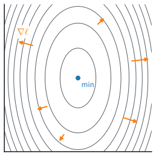
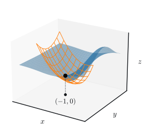
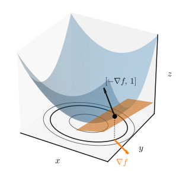
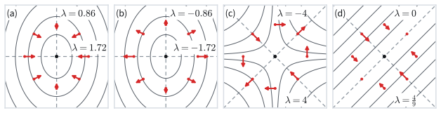
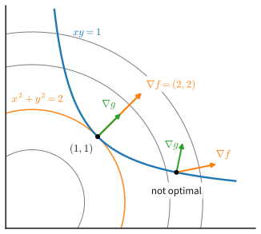

# Multivariable Calculus
:label:`sec_mdl-multivariable_calculus`

In the previous section, we studied a loss as a function of a single weight
while holding every other weight fixed. Real training never works that way.
Every step of gradient descent nudges all the weights at once, so we need to
know how the loss responds to a joint move, and which joint move drives it
down fastest. Having a million separate slopes, one per weight, does not by
itself answer either question.

Yet under one modest hypothesis, those slopes answer both. When the loss is
differentiable, the vector of slopes, called the *gradient*, predicts the
effect of every small joint move at once to first order and points in the
direction of steepest increase. To go further and tell a local minimum from a
saddle, we need a symmetric table of second derivatives, the *Hessian*, which
measures how the surface bends. This section develops what these two objects
tell us about a function of many variables. How a program actually computes a
gradient for a large network is a separate problem, which
:numref:`sec_mdl-chain-rule-graphs` takes up next.

:numref:`sec_calculus` already stated the differentiation rules and put the
gradient to work. Here we supply the foundations, much as
:numref:`sec_mdl-single_variable_calculus` did for one variable: we prove when
the linear approximation holds and how second derivatives classify critical
points. Two results carry the entire section: the multivariable linear model
and the second-derivative test. The short subsection on tangent planes and the
closing material on Lagrange multipliers can safely be skipped on a first
reading. Throughout, we will test each idea on a running example: the
two-variable log-sum-exp function $f(x, y) = \log(e^x + e^y)$ evaluated at
$(0, \log 2)$. Its gradient will turn out to be the familiar softmax.

## Partial Derivatives and the Gradient

### Partial Derivatives

If we freeze every weight except $w_1$, the loss becomes a function of a
single variable. Its ordinary derivative is the *partial derivative*
$\partial\ell/\partial w_1$ from :numref:`sec_calculus`: geometrically, it is
the slope of the one-dimensional slice of the graph of $\ell$ obtained by
varying only $w_1$. Just as in single-variable calculus, this slope predicts
the effect of a small change $\epsilon_1$ in $w_1$ alone,

$$\ell(w_1+\epsilon_1, w_2, \ldots, w_N) \approx \ell(w_1, w_2, \ldots, w_N) + \epsilon_1 \frac{\partial \ell}{\partial w_1}(w_1, w_2, \ldots, w_N).$$
:eqlabel:`eq_mdl-part_der`

Let us compute the partial derivatives of our running example
$f(x, y) = \log(e^x + e^y)$. Holding $y$ fixed and differentiating with
respect to $x$ gives $\partial f/\partial x = e^x/(e^x+e^y)$, and by symmetry
$\partial f/\partial y = e^y/(e^x+e^y)$. At the point $(0, \log 2)$, we have
$e^x = 1$ and $e^y = 2$, so $f(0, \log 2) = \log 3 \approx 1.0986$,
$\partial f/\partial x = \tfrac13$, and $\partial f/\partial y = \tfrac23$.
In other words, nudging $y$ alone raises $f$ twice as fast as nudging $x$
alone.

### Differentiability and the Gradient
:label:`subsec_mdl-gradient`

Partial derivatives tell us the slope along each coordinate axis, one at a
time. They do not automatically tell us what happens when all coordinates move
together, for instance when we step from $(0, \log 2)$ by
$\boldsymbol{\epsilon} = (0.01, -0.03)$. It is tempting to guess that the two
coordinate-wise changes simply add, giving
$\tfrac13 \cdot 0.01 + \tfrac23 \cdot (-0.03)$. That guess is actually a strong
claim about how $f$ behaves near the point, and it requires a hypothesis.

The hypothesis is that near $\mathbf{w}$, the function $\ell$ looks linear up
to an error that vanishes faster than the step size. Formally, we say that
$\ell$ is *differentiable* at $\mathbf{w}$ if there exists a linear map
$\Lambda$ such that

$$
\ell(\mathbf{w} + \boldsymbol{\epsilon}) = \ell(\mathbf{w}) + \Lambda(\boldsymbol{\epsilon}) + o(\|\boldsymbol{\epsilon}\|),
$$
:eqlabel:`eq_mdl-differentiable`

where $o(\|\boldsymbol{\epsilon}\|)$ denotes any remainder that, when divided
by $\|\boldsymbol{\epsilon}\|$, tends to zero as
$\boldsymbol{\epsilon} \to \mathbf{0}$.

Whenever such a linear map $\Lambda$ exists, the partial derivatives determine
it completely. Setting $\boldsymbol{\epsilon} = h\mathbf{e}_i$ in
:eqref:`eq_mdl-differentiable`, dividing both sides by $h$, and letting
$h \to 0$ forces $\Lambda(\mathbf{e}_i) = \partial\ell/\partial w_i$. Because
$\Lambda$ is linear, its action on any joint step $\boldsymbol{\epsilon}$ is
then fixed:

$$
\Lambda(\boldsymbol{\epsilon}) = \Lambda\Bigl(\sum_{i=1}^N \epsilon_i \mathbf{e}_i\Bigr) = \sum_{i=1}^N \epsilon_i \frac{\partial \ell}{\partial w_i} = \boldsymbol{\epsilon} \cdot \nabla_{\mathbf{w}} \ell,
\qquad
\nabla_{\mathbf{w}} \ell = \left[\frac{\partial \ell}{\partial w_1}, \ldots, \frac{\partial \ell}{\partial w_N}\right]^\top.
$$

We call this column vector $\nabla_{\mathbf{w}}\ell$ of partial derivatives
the *gradient* of $\ell$. Substituting it back into
:eqref:`eq_mdl-differentiable` gives the multivariable linear approximation

$$\ell(\mathbf{w} + \boldsymbol{\epsilon}) = \ell(\mathbf{w}) + \boldsymbol{\epsilon}\cdot \nabla_{\mathbf{w}} \ell(\mathbf{w}) + o(\|\boldsymbol{\epsilon}\|).$$
:eqlabel:`eq_mdl-nabla_use`

Compare this with the one-variable approximation
$f(x+\epsilon) \approx f(x) + \epsilon f'(x)$: the shape is identical, with
the scalar slope replaced by a vector and ordinary multiplication replaced by
a dot product. The gradient is the unique vector whose dot product with a step
gives the first-order change in $\ell$. Of all the ways to think about a
gradient, this is the one to remember. Throughout this book, we treat the
gradient as a column vector.

Returning to our running example at $(0, \log 2)$, we have
$\nabla f = [\tfrac13, \tfrac23]^\top$. Plugging
$\boldsymbol{\epsilon} = (0.01, -0.03)$ into :eqref:`eq_mdl-nabla_use`
predicts
$f(0.01, \log 2 - 0.03) \approx \log 3 + \tfrac13 \cdot 0.01 - \tfrac23 \cdot 0.03 \approx 1.081946$.
Notice that at *every* point $(x, y)$, the two entries of $\nabla f$ are
positive and sum to one: the gradient of log-sum-exp is the softmax
$\mathbf{p} = \operatorname{softmax}(x, y)$, with entries
$e^x/(e^x+e^y)$ and $e^y/(e^x+e^y)$.

It is worth pausing to see why differentiability asks for more than the mere
existence of partial derivatives. Consider $f(x, y) = 2xy/(x^2+y^2)$ with
$f(0, 0) = 0$. Along both coordinate axes $f$ is identically zero, so both
partial derivatives at the origin are $0$, leaving the constant function $0$
as the only possible linear model. Yet along the diagonal $x = y \neq 0$, we
have $f(x, x) = 1$ no matter how close we get to the origin, so no linear
approximation can hold there. Here $f$ is not even continuous at the origin,
and Exercise :exref:`ex_mdl-multivariable-calculus-no-gradient` shows that
even a continuous function can have all partial derivatives and still fail to
be differentiable.

Fortunately, we rarely have to check :eqref:`eq_mdl-differentiable` directly.
A convenient sufficient condition is that all partial derivatives exist in a
neighborhood of $\mathbf{w}$ and are continuous at $\mathbf{w}$
:cite:`Rudin.1976`. Since the partial derivatives of log-sum-exp are
continuous everywhere, it is differentiable everywhere.

The definition of differentiability promises only that the approximation error
is $o(\|\boldsymbol{\epsilon}\|)$, meaning it shrinks faster than
$\|\boldsymbol{\epsilon}\|$. How much faster is it in practice? Before
running the next cell, guess by what factor the error of the linear model
shrinks when we cut the step $\boldsymbol{\epsilon} = (0.01, -0.03)$ by a
factor of ten. The experiment below uses plain NumPy to check.

```{.python .input #multivariable-calculus-imports}
#@tab mxnet
from mxnet import autograd, np as mnp, npx
import numpy as np
npx.set_np()
```

```{.python .input #multivariable-calculus-imports}
#@tab pytorch
import numpy as np
import torch
```

```{.python .input #multivariable-calculus-imports}
#@tab tensorflow
import numpy as np
import tensorflow as tf
```

```{.python .input #multivariable-calculus-imports}
#@tab jax
import numpy as np
import jax
from jax import numpy as jnp
```

```{.python .input #multivariable-calculus-higher-dimensional-differentiation}
def lse(xy):  # f(x, y) = log(e^x + e^y), computed stably
    return np.logaddexp(xy[0], xy[1])

def grad_lse(xy):  # its gradient, the softmax of (x, y)
    return np.exp(xy - lse(xy))

xy0 = np.array([0.0, np.log(2)])
print('gradient:', grad_lse(xy0))
for scale in [1, 0.1, 0.01]:
    eps = scale * np.array([0.01, -0.03])
    linear = lse(xy0) + eps @ grad_lse(xy0)
    true = lse(xy0 + eps)
    print(f'|eps| {np.linalg.norm(eps):.1e}: linear {linear:.8f}, '
          f'true {true:.8f}, gap {true - linear:.3e}')
```

At $\|\boldsymbol{\epsilon}\| \approx 0.03$, the linear model misses the true
value by $1.79 \times 10^{-4}$ (only in the fourth decimal place), and each
tenfold reduction in the step shrinks the gap by a factor of a hundred. That
means the error is second order in the step, which is considerably tighter
than differentiability alone guarantees. Soon, the Hessian will let us predict
this gap accurately (:numref:`subsec_mdl-second-order-taylor`).

### Directional Derivatives

So far we have used the gradient to predict small steps. It also gives the
exact instantaneous slope along any direction, not just along the coordinate
axes. Take any unit vector $\mathbf{u}$, substitute
$\boldsymbol{\epsilon} = h\mathbf{u}$ into :eqref:`eq_mdl-nabla_use`, divide
by $h$, and let $h \to 0$. The $o(\|h\mathbf{u}\|)$ remainder vanishes,
leaving

$$
\lim_{h \to 0} \frac{\ell(\mathbf{w} + h\mathbf{u}) - \ell(\mathbf{w})}{h} = \mathbf{u} \cdot \nabla_{\mathbf{w}} \ell(\mathbf{w}).
$$
:eqlabel:`eq_mdl-directional-derivative`

The limit on the left is the *directional derivative* of $\ell$ along
$\mathbf{u}$; the right side says it is simply the projection of the gradient
onto $\mathbf{u}$. A single vector therefore encodes the slope in every
possible direction at once.

Three directions for our running example at $(0, \log 2)$ illustrate the full
range of behavior. Along the diagonal $\mathbf{u} = (1, 1)/\sqrt{2}$, the
slope is $(\tfrac13 + \tfrac23)/\sqrt{2} = 1/\sqrt{2} \approx 0.707$. In
fact, this slope is the same at *every* point, because
$f(x+t, y+t) = \log\bigl(e^t(e^x+e^y)\bigr) = f(x, y) + t$: moving a distance
$\sqrt{2}\,t$ along the diagonal always raises $f$ by $t$. Pointing directly
against the gradient, along $\mathbf{u} = -(1, 2)/\sqrt{5}$, gives the slope
$-(\tfrac13 + \tfrac43)/\sqrt{5} = -\sqrt{5}/3 \approx -0.745$. Finally,
along $\mathbf{u} = (2, -1)/\sqrt{5}$, the slope is
$(\tfrac23 - \tfrac23)/\sqrt{5} = 0$, so to first order $f$ does not change
at all in that direction.

## The Geometry of Gradients

### Steepest Descent
:label:`subsec_mdl-steepest-descent`

Gradient descent (:numref:`sec_linear_regression`) nudges the parameters a
short distance in the direction along which the loss drops fastest. By
:eqref:`eq_mdl-directional-derivative`, we are looking for the unit vector
$\mathbf{v}$ whose projection $\mathbf{v}\cdot\nabla\ell$ is as negative as
possible. :numref:`sec_calculus` identified this direction from the cosine of
the angle between $\mathbf{v}$ and the gradient; the Cauchy–Schwarz inequality
gives an even cleaner proof and confirms that the direction is unique.

**Proposition (steepest ascent and descent).** *At any point where
$\nabla \ell \neq \mathbf{0}$, among all unit vectors $\mathbf{v}$, the
directional derivative $\mathbf{v}\cdot\nabla \ell$ is maximized by
$\mathbf{v} = \nabla\ell/\|\nabla\ell\|$ and minimized by
$\mathbf{v} = -\nabla\ell/\|\nabla\ell\|$. Thus $+\nabla \ell$ is the
direction of steepest ascent and $-\nabla \ell$ is the direction of steepest
descent.*

**Proof.** The Cauchy–Schwarz inequality
(:numref:`sec_mdl-geometry-linear-algebraic-ops`) states that
$|\mathbf{v}\cdot\mathbf{g}| \le \|\mathbf{v}\|\|\mathbf{g}\|$, with equality
if and only if $\mathbf{v}$ and $\mathbf{g}$ are collinear. For a unit vector
$\mathbf{v}$ and $\mathbf{g} = \nabla \ell$, this reads

$$
-\|\nabla \ell\| \;\le\; \mathbf{v}\cdot\nabla \ell \;\le\; \|\nabla \ell\|.
$$

Each bound is attained uniquely by a unit vector collinear with $\nabla \ell$:
the upper bound by $\mathbf{v} = \nabla \ell/\|\nabla \ell\|$ and the lower
bound by $\mathbf{v} = -\nabla \ell/\|\nabla \ell\|$. $\blacksquare$

In our running example at $(0, \log 2)$, the steepest descent direction is
$-(1, 2)/\sqrt{5}$, with slope $-\|\nabla f\| = -\sqrt{5}/3 \approx -0.745$,
the most negative of the three slopes we computed a moment ago. Taking a step
along $-\nabla_{\mathbf{w}} \ell$ gives the familiar gradient-descent update

$$
\mathbf{w} \leftarrow \mathbf{w} - \eta\,\nabla_{\mathbf{w}} \ell(\mathbf{w}).
$$

Notice that the update does not normalize the gradient. Its step length is
$\eta\|\nabla\ell\|$, which naturally shrinks as the gradient gets smaller
near a minimum.

It is easy to overlook that "unit" in the proposition means unit *Euclidean*
length, and that this is a modeling choice rather than a law of nature. If we
instead constrain each coordinate of the step to have magnitude at most one,
the steepest descent step becomes $-\operatorname{sign}(\nabla \ell)$ applied
coordinate by coordinate. At $(0, \log 2)$, that step is $(-1, -1)$, with
slope $-(\tfrac13 + \tfrac23) = -1$. Adaptive optimizers like Adam, which
divide each coordinate of the update by a running estimate of its scale
(:numref:`chap_optimization`), behave much more like this sign step than like
Euclidean steepest descent. Exercise
:exref:`ex_mdl-gradient-based-optimization-steepest-other-norms` explores
steepest descent under other norms.

### Gradients and Level Sets

We can also read the gradient directly off a contour map, without talking
about steps at all. A *level set* of $\ell$ is the collection of all points
where $\ell$ takes a fixed value $c$. Because moving along a level set keeps
$\ell$ constant, the directional derivative along any tangent direction should
vanish.

**Proposition (gradients are normal to level sets).** *Let $\ell$ be
differentiable at $\mathbf{x}$. Then $\nabla \ell(\mathbf{x})$ is orthogonal
to every direction tangent at $\mathbf{x}$ to the level set
$\{\mathbf{x}' : \ell(\mathbf{x}') = c\}$ passing through $\mathbf{x}$.*

**Proof.** A vector $\mathbf{v}$ is *tangent* to the level set at $\mathbf{x}$
if $\mathbf{v} = \boldsymbol{\gamma}'(0)$ for some differentiable curve
$\boldsymbol{\gamma}(t)$ lying inside the level set with
$\boldsymbol{\gamma}(0) = \mathbf{x}$. Along such a curve,
$\ell(\boldsymbol{\gamma}(t)) = c$ for all $t$, so the derivative of
$t \mapsto \ell(\boldsymbol{\gamma}(t))$ at $t = 0$ must be zero. To first
order, $\boldsymbol{\gamma}(t) = \mathbf{x} + t\mathbf{v} + o(t)$, so
:eqref:`eq_mdl-nabla_use` tells us that this derivative equals
$\mathbf{v}\cdot\nabla \ell(\mathbf{x})$. Hence
$\mathbf{v}\cdot\nabla \ell(\mathbf{x}) = 0$. $\blacksquare$

Let us check this on our running example. The level set of $f$ passing through
$(0, \log 2)$ is the curve $e^x + e^y = 3$. Differentiating along it gives
$e^x\,dx + e^y\,dy = 0$, so the tangent direction at $(0, \log 2)$ is
$(e^y, -e^x) = (2, -1)$. Taking the dot product with the gradient confirms
$(2, -1)\cdot(\tfrac13, \tfrac23) = 0$, the direction of zero slope we found
earlier.

On a contour map, the gradient therefore crosses every contour at a right
angle and points toward higher values. Moreover, if neighboring contours
differ by $\Delta c$ and sit a distance $d$ apart, the slope across them is
roughly $\Delta c/d$, so the gradient is longest wherever the contours are
packed most tightly (:numref:`fig_mdl-cal-gradient-field`).


:label:`fig_mdl-cal-gradient-field`

### Tangent Planes

If we drop the error term from the linear approximation
:eqref:`eq_mdl-nabla_use` and write the predicted height as $z$, we obtain the
*tangent plane* to the graph of $f$ at $\mathbf{x}_0$,

$$
z = f(\mathbf{x}_0) + \nabla f(\mathbf{x}_0)\cdot(\mathbf{x}-\mathbf{x}_0).
$$
:eqlabel:`eq_mdl-tangent_plane`

For our running example at $(0, \log 2)$, this plane is
$z = \log 3 + \tfrac13 x + \tfrac23 (y - \log 2)$. Rewriting
:eqref:`eq_mdl-tangent_plane` as
$\nabla f(\mathbf{x}_0)\cdot(\mathbf{x}-\mathbf{x}_0) - (z - f(\mathbf{x}_0)) = 0$
shows immediately that the vector $[\nabla f(\mathbf{x}_0), -1]^\top$ is
normal to the tangent plane in $(\mathbf{x}, z)$-space. Dropping its height
coordinate leaves $\nabla f(\mathbf{x}_0)$, which is the normal to the level
curve in the base plane (:numref:`fig_mdl-tangent-plane`).

![A surface $z = f(\mathbf{x})$ (blue) with its tangent plane at a point (orange). The vector $[-\nabla f, 1]$, the negative of $[\nabla f, -1]$, is normal to the plane (black arrow). Dropping the height coordinate leaves a multiple of $\nabla f$, which on the base plane (orange arrow) is normal to the level curve through the point (black).](../img/mdl-cal-tangent-plane.svg)
:label:`fig_mdl-tangent-plane`

### Critical Points

Deep learning losses are far too complicated to minimize in closed form, yet
the linear model still gives a necessary condition that every minimum must
obey, and gradient descent comes to rest right where this condition holds.
Throughout this discussion, suppose $f$ is defined on all of $\mathbb{R}^n$
and differentiable at $\mathbf{x}_0$.

If $\nabla f(\mathbf{x}_0) \neq \mathbf{0}$, we can step against it by setting
$\boldsymbol{\epsilon} = -\eta\nabla f(\mathbf{x}_0)$ with $\eta > 0$. By
:eqref:`eq_mdl-nabla_use`, the resulting change in $f$ is
$-\eta\|\nabla f(\mathbf{x}_0)\|^2 + o(\eta)$, which is strictly negative for
every sufficiently small $\eta$. Thus $\mathbf{x}_0$ cannot be a local
minimum; repeating the argument with $+\eta$ shows it cannot be a local
maximum either. Therefore, **at any local minimum or maximum,
$\nabla f(\mathbf{x}_0) = \mathbf{0}$.** Points where the gradient vanishes
are called *critical points*. This first-order condition is necessary, not
sufficient, and the next example shows what else we need to be sure we have
found a global extremum.

Consider $\psi(x, y) = x e^{-x^2-y^2}$, a surface with a positive hill for
$x > 0$ and a matching negative pit for $x < 0$. Its partial derivatives are

$$
\frac{\partial \psi}{\partial x} = (1 - 2x^2)\,e^{-x^2-y^2}, \qquad
\frac{\partial \psi}{\partial y} = -2xy\,e^{-x^2-y^2}.
$$

Setting the second partial to zero forces either $x = 0$ or $y = 0$. Since
$x = 0$ makes the first partial equal to $e^{-y^2} \neq 0$, we must have
$y = 0$, and then $1 - 2x^2 = 0$ gives $x = \pm 1/\sqrt{2}$. The two critical
points have values
$\psi(\mp 1/\sqrt{2}, 0) = \mp e^{-1/2}/\sqrt{2} \approx \mp 0.4289$.

To conclude that $(-1/\sqrt{2}, 0)$ is the *global* minimum, however, we also
need to know that a global minimum exists at all. Outside the disc of radius
$R = 2$, the exponential decay forces $|\psi| \le R e^{-R^2} < 0.04$, whereas
inside the disc $\psi(-1/\sqrt{2}, 0) \approx -0.43$. Because $\psi$ is
continuous, it attains its minimum on the closed disc; since that minimum is
below $-0.04$, it cannot lie on the boundary and must be a global minimum of
$\psi$ on all of $\mathbb{R}^2$, hence a critical point. Comparing our two
candidates identifies $(-1/\sqrt{2}, 0)$ as the global minimum, and the same
argument identifies $(+1/\sqrt{2}, 0)$ as the global maximum. Skip the
existence check and the logic breaks down: $x^3$ has a single critical point
yet no minimum anywhere.

Notice also what first-order information cannot do: both the minimum and the
maximum have zero gradient, so the gradient alone cannot tell them apart. For
that, we turn to second derivatives (:numref:`subsec_mdl-second-derivative-test`).

## The Hessian

### Symmetry of the Hessian
:label:`subsec_mdl-hessian-symmetry`

The linear model captures only first-order behavior. Whether a critical point
is a minimum, a maximum, or neither depends on how the surface curves away
from its tangent plane, and curvature is measured by second derivatives. A
function of $n$ variables has $n^2$ second partial derivatives,

$$
\frac{\partial^2 f}{\partial x_i \partial x_j} = \frac{\partial}{\partial x_i}\left(\frac{\partial f}{\partial x_j}\right),
$$

which we collect into the *Hessian* matrix

$$\mathbf{H}_f(\mathbf{x}) = \begin{bmatrix} \frac{\partial^2 f}{\partial x_1 \partial x_1} & \cdots & \frac{\partial^2 f}{\partial x_1 \partial x_n} \\ \vdots & \ddots & \vdots \\ \frac{\partial^2 f}{\partial x_n \partial x_1} & \cdots & \frac{\partial^2 f}{\partial x_n \partial x_n} \\ \end{bmatrix}.$$
:eqlabel:`eq_mdl-hess_def`

Entry $(i, j)$ measures how fast the $j$-th slope changes as we move along
coordinate $x_i$. The Hessian is also written $\nabla^2 f$, and when the
function and point are clear from context we simply write $\mathbf{H}$.

For log-sum-exp, let us write $(x_1, x_2) = (x, y)$ and differentiate the
softmax entries $p_i = e^{x_i}/(e^{x_1}+e^{x_2})$ once more. Applying the
quotient rule gives $\partial p_i/\partial x_j = p_i\delta_{ij} - p_ip_j$,
where $\delta_{ij}$ is $1$ when $i = j$ and $0$ otherwise. In matrix form,

$$
\mathbf{H}_f = \operatorname{diag}(\mathbf{p}) - \mathbf{p}\mathbf{p}^\top,
\qquad
\mathbf{H}_f(0, \log 2) = \begin{bmatrix} \tfrac13 - \tfrac19 & -\tfrac29 \\ -\tfrac29 & \tfrac23 - \tfrac49 \end{bmatrix} = \frac{2}{9}\begin{bmatrix} 1 & -1 \\ -1 & 1 \end{bmatrix}.
$$
:eqlabel:`eq_mdl-lse-hessian`

This $2 \times 2$ matrix has eigenvalue $0$ along $(1, 1)$ and eigenvalue
$\tfrac49$ along $(1, -1)$. The zero eigenvalue matches what we already saw:
along the diagonal $(1, 1)$, $f(x+t, y+t) = f(x, y) + t$ is completely linear
and has no curvature at all. We will meet this positive semidefinite, singular
Hessian again in the second-derivative test.

The $n^2$ entries of a Hessian are not independent. Whenever $f$ is twice
continuously differentiable, the order of differentiation does not matter and
the Hessian is symmetric, a classical result known as the Clairaut–Schwarz
theorem :cite:`Rudin.1976`. That symmetry is crucial: it guarantees real
eigenvalues and orthogonal eigenvectors via the spectral theorem
(:numref:`sec_mdl-eigendecompositions`), which makes the second-derivative
test possible.

**Proposition (symmetry of the Hessian; Clairaut–Schwarz).** *Suppose the first
partial derivatives of $f$ and the mixed partials
$\frac{\partial^2 f}{\partial x_i \partial x_j}$ and
$\frac{\partial^2 f}{\partial x_j \partial x_i}$ exist near $\mathbf{x}$, and
suppose the mixed partials are continuous at $\mathbf{x}$. Then*

$$
\frac{\partial^2 f}{\partial x_i \partial x_j}(\mathbf{x}) = \frac{\partial^2 f}{\partial x_j \partial x_i}(\mathbf{x}).
$$

*When this holds for all $i, j$, the Hessian is symmetric:
$\mathbf{H}_f = \mathbf{H}_f^\top$.*

**Proof.** The idea is to realize both mixed partials as limits of the *same*
quantity, the symmetric second difference

$$
\Delta_h = \frac{f(\mathbf{x}+h\mathbf{e}_i+h\mathbf{e}_j) - f(\mathbf{x}+h\mathbf{e}_i) - f(\mathbf{x}+h\mathbf{e}_j) + f(\mathbf{x})}{h^2},
$$
:eqlabel:`eq_mdl-second-difference`

which is visibly unchanged if we swap $i$ and $j$. Our task is to express
$\Delta_h$ as a mixed partial evaluated at a nearby point. Define the
one-variable function
$\varphi(t) = f(\mathbf{x}+t\mathbf{e}_i+h\mathbf{e}_j) - f(\mathbf{x}+t\mathbf{e}_i)$,
so that $h^2\Delta_h = \varphi(h)-\varphi(0)$. Applying the mean value theorem
:eqref:`eq_mdl-mvt` twice, first to $\varphi$ and then along $x_j$ to the
difference of first partials inside $\varphi'$, gives numbers $\tau$ and
$\sigma$ between $0$ and $h$ such that

$$
\varphi(h)-\varphi(0) = h\,\varphi'(\tau)
= h\Bigl[\frac{\partial f}{\partial x_i}(\mathbf{x}+\tau\mathbf{e}_i+h\mathbf{e}_j) - \frac{\partial f}{\partial x_i}(\mathbf{x}+\tau\mathbf{e}_i)\Bigr]
= h^2\,\frac{\partial^2 f}{\partial x_j \partial x_i}(\mathbf{x}+\tau\mathbf{e}_i+\sigma\mathbf{e}_j).
$$

Thus
$\Delta_h = \frac{\partial^2 f}{\partial x_j \partial x_i}(\boldsymbol{\xi}_h)$
at a point $\boldsymbol{\xi}_h$ inside the square with corners $\mathbf{x}$
and $\mathbf{x} + h\mathbf{e}_i + h\mathbf{e}_j$, at distance at most
$\sqrt{2}\,|h|$ from $\mathbf{x}$. Swapping the roles of $i$ and $j$ leaves
$\Delta_h$ unchanged and yields
$\Delta_h = \frac{\partial^2 f}{\partial x_i \partial x_j}(\boldsymbol{\xi}'_h)$
at another point of the same square. Letting $h \to 0$, continuity of the
mixed partials at $\mathbf{x}$ sends the two expressions to the two mixed
partials at $\mathbf{x}$. Because they agree for every $h$, their limits must
agree as well. $\blacksquare$

The continuity hypothesis is genuinely needed: Exercise
:exref:`ex_mdl-multivariable-calculus-mixed-partials` constructs a function
whose mixed partials exist everywhere yet fail to be continuous at the
origin, where they disagree.

### The Second-Order Taylor Approximation
:label:`subsec_mdl-second-order-taylor`

Just as the gradient supplies the best linear approximation to $f$, the
Hessian supplies the best *quadratic* approximation. To see where the
coefficients come from, it helps to read them off an exact quadratic first.
Take
$f(x_1, x_2) = a + b_1x_1 + b_2x_2 + c_{11}x_1^{2} + c_{12}x_1x_2 + c_{22}x_2^{2}$.
Evaluating its value, gradient, and Hessian :eqref:`eq_mdl-hess_def` at the
origin gives

$$
f(0,0) = a, \qquad
\nabla f (0,0) = \begin{bmatrix}b_1 \\ b_2\end{bmatrix}, \qquad
\mathbf{H}_f (0,0) = \begin{bmatrix}2 c_{11} & c_{12} \\ c_{12} & 2c_{22}\end{bmatrix},
$$

and assembling these pieces recovers the polynomial exactly:
$f(\mathbf{x}) = f(\mathbf{0}) + \nabla f(\mathbf{0}) \cdot \mathbf{x} + \tfrac12\mathbf{x}^\top \mathbf{H}_f(\mathbf{0})\, \mathbf{x}$.
The factor of $\tfrac12$ simply cancels the factor of $2$ produced when we
differentiate a square.

For a general function $f$, this quadratic is no longer exact, but restricting
$f$ to a line segment shows how accurate it is. Suppose $f$ is twice
continuously differentiable near the segment connecting $\mathbf{x}_0$ to
$\mathbf{x}$. Write the displacement as
$\boldsymbol{\delta} = \mathbf{x} - \mathbf{x}_0$, and consider the
single-variable slice $\varphi(t) = f(\mathbf{x}_0 + t\boldsymbol{\delta})$.
By the linear model :eqref:`eq_mdl-nabla_use`, its first derivative is
$\varphi'(t) = \sum_i \frac{\partial f}{\partial x_i}(\mathbf{x}_0 + t\boldsymbol{\delta})\,\delta_i$.
Because each partial derivative in this sum is itself differentiable, applying
the same step once more gives the second derivative:
$\varphi''(t) = \sum_{i,j} \delta_j\frac{\partial^2 f}{\partial x_j\partial x_i}(\mathbf{x}_0 + t\boldsymbol{\delta})\,\delta_i = \boldsymbol{\delta}^\top \mathbf{H}_f(\mathbf{x}_0 + t\boldsymbol{\delta})\,\boldsymbol{\delta}$.

Now apply the one-variable Taylor theorem with Lagrange remainder
:eqref:`eq_mdl-lagrange` of degree one to $\varphi$ between $0$ and $1$: there
is some $\tau \in (0, 1)$ such that
$\varphi(1) = \varphi(0) + \varphi'(0) + \tfrac12\varphi''(\tau)$. Translating
back to $f$ gives

$$
f(\mathbf{x}) = f(\mathbf{x}_0) + \nabla f(\mathbf{x}_0)\cdot\boldsymbol{\delta} + \tfrac{1}{2}\boldsymbol{\delta}^\top \mathbf{H}_f(\boldsymbol{\xi})\,\boldsymbol{\delta}, \qquad \boldsymbol{\xi} = \mathbf{x}_0 + \tau\boldsymbol{\delta}.
$$

This identity is exact, at the cost of evaluating the Hessian at an unknown
intermediate point $\boldsymbol{\xi}$ on the segment rather than at
$\mathbf{x}_0$. Because the second partials are continuous, replacing
$\mathbf{H}_f(\boldsymbol{\xi})$ by $\mathbf{H}_f(\mathbf{x}_0)$ changes the
quadratic term by at most
$\tfrac12\|\mathbf{H}_f(\boldsymbol{\xi}) - \mathbf{H}_f(\mathbf{x}_0)\|\,\|\boldsymbol{\delta}\|^2 = o(\|\boldsymbol{\delta}\|^2)$.
That yields the *second-order Taylor approximation*:

$$
f(\mathbf{x}) = f(\mathbf{x}_0) + \nabla f (\mathbf{x}_0) \cdot (\mathbf{x}-\mathbf{x}_0) + \frac{1}{2}(\mathbf{x}-\mathbf{x}_0)^\top \mathbf{H}_f (\mathbf{x}_0) (\mathbf{x}-\mathbf{x}_0) + o(\|\mathbf{x}-\mathbf{x}_0\|^2).
$$
:eqlabel:`eq_mdl-second_taylor`

This quadratic model misses $f$ only by an error that vanishes faster than the
squared step size, and it is the unique quadratic with that property. Whenever
$f$ has three continuous derivatives, the error is of third order in the step.

Along any single direction $\mathbf{v}$, a step $t\mathbf{v}$ produces a
quadratic term of $\tfrac{t^2}{2}\mathbf{v}^\top\mathbf{H}\mathbf{v}$. The
number
$\mathbf{v}^\top\mathbf{H}\mathbf{v} = \tfrac{d^2}{dt^2}f(\mathbf{x}_0 + t\mathbf{v})\big|_{t=0}$
is the *second directional derivative*: it measures the curvature of the slice
of $f$ along $\mathbf{v}$.

We can now explain the gap left by the linear model in our first code cell.
For the step $\boldsymbol{\epsilon} = (0.01, -0.03)$ from $(0, \log 2)$, the
Hessian :eqref:`eq_mdl-lse-hessian` predicts a second-order correction of
$\tfrac12\boldsymbol{\epsilon}^\top\mathbf{H}\boldsymbol{\epsilon} = \tfrac19(\epsilon_1 - \epsilon_2)^2 = \tfrac19 (0.04)^2 \approx 1.78 \times 10^{-4}$,
which closely matches the measured gap of $1.786 \times 10^{-4}$. Let us
verify both the eigenvalues of $\mathbf{H}$ and the predicted gaps in code.

```{.python .input #mdl-multivariable-calculus-the-second-order-taylor-approximation-1}
p = grad_lse(xy0)                # the softmax at (0, log 2)
H = np.diag(p) - np.outer(p, p)  # Hessian of log-sum-exp
print('9 H =', (9 * H).round(6).tolist())
print('eigenvalues:', np.linalg.eigvalsh(H).round(6) + 0.0)  # no '-0.'
for scale in [1, 0.1]:
    eps = scale * np.array([0.01, -0.03])
    print(f'|eps| {np.linalg.norm(eps):.1e}: '
          f'predicted gap {0.5 * eps @ H @ eps:.4e}')
```

Both the matrix and its eigenvalues, $0$ and $\tfrac49$, match
:eqref:`eq_mdl-lse-hessian`. The predicted gaps of $1.7778 \times 10^{-4}$
and $1.7778 \times 10^{-6}$ agree with the measured $1.786 \times 10^{-4}$
and $1.779 \times 10^{-6}$ to two or three significant digits. The tiny
leftover of about $10^{-6}$ in the first gap comes from the third-order term,
and when the step shrinks by a factor of ten, that leftover drops by roughly a
thousandfold, disappearing below the printed digits.

In the log-sum-exp example, one direction was completely flat. Let us look at
a function that bends in both directions: $\psi(x, y) = xe^{-x^2-y^2}$ at the
base point $\mathbf{x}_0 = (-1, 0)$. From the partial derivatives we computed
earlier, $\psi(-1, 0) = -e^{-1}$ and $\nabla \psi(-1, 0) = (-e^{-1}, 0)$, and
differentiating once more gives $\mathbf{H}_\psi(-1, 0) = 2e^{-1}\mathbf{I}$.
Substituting these into :eqref:`eq_mdl-second_taylor` yields the quadratic
model $q(x, y) = e^{-1}\bigl(-1 - (x+1) + (x+1)^2 + y^2\bigr)$. As
:numref:`fig_mdl-taylor-quadratic` shows, the surface and its quadratic
approximation are nearly indistinguishable near $(-1, 0)$ before pulling apart
farther away.


:label:`fig_mdl-taylor-quadratic`

If the error of this quadratic model is indeed third order, doubling the step
size should multiply the gap by about eight. The next cell evaluates $\psi$
and $q$ at steps of $d$ in each coordinate from $(-1, 0)$ to check.

```{.python .input #multivariable-calculus-hessians}
def psi(x, y):
    return x * np.exp(-x**2 - y**2)

def quad(x, y):  # second-order Taylor model of psi at (-1, 0)
    return np.exp(-1) * (-1 - (x + 1) + (x + 1)**2 + y**2)

for d in [0.0, 0.05, 0.1, 0.3]:  # step d in each coordinate from (-1, 0)
    x, y = -1 + d, d
    print(f'step {d:.2f}: psi = {psi(x, y):.6f}, quadratic = {quad(x, y):.6f}, '
          f'gap = {abs(psi(x, y) - quad(x, y)):.6f}')
```

As expected, the gap vanishes at the base point, and doubling the step from
$0.05$ to $0.1$ multiplies it by just under eight (from $0.000119$ to
$0.000921$), matching a third-order remainder. Fitting this local quadratic
and jumping directly to *its* minimum at each step is Newton's method, which
:numref:`subsec_mdl-newton` introduced in one variable and
:numref:`subsec_gd-newton` develops as a multivariable optimizer.

### The Second-Derivative Test
:label:`subsec_mdl-second-derivative-test`

At a critical point $\mathbf{x}_0$, the linear term in
:eqref:`eq_mdl-second_taylor` disappears. Near $\mathbf{x}_0$, the function
therefore behaves like its quadratic term up to an error of
$o(\|\mathbf{x} - \mathbf{x}_0\|^2)$, so whether $f$ rises or falls as we
move away in a direction $\mathbf{v}$ is governed by the sign of
$\mathbf{v}^\top\mathbf{H}\mathbf{v}$, provided that curvature is nonzero.

The eigenvalues of $\mathbf{H}$ organize these signs cleanly. Because
$\mathbf{H}$ is symmetric, the spectral theorem
(:numref:`sec_mdl-eigendecompositions`) guarantees an orthonormal basis of
eigenvectors $\mathbf{q}_i$ with real eigenvalues $\lambda_i$. Expanded in
this basis, the quadratic form becomes a simple weighted sum of squares:

$$
\mathbf{v}^\top \mathbf{H}\mathbf{v} = \sum_{i=1}^n \lambda_i \,(\mathbf{q}_i^\top \mathbf{v})^2.
$$
:eqlabel:`eq_mdl-quadform-eig`

From this formula we can read the local geometry at a glance. If every
$\lambda_i > 0$, the curvature is strictly positive in every direction and is
at least $\lambda_{\min}\|\mathbf{v}\|^2$. If the eigenvalues have mixed
signs, the surface bends upward along some eigenvectors and downward along
others.

**Proposition (second-order conditions).** *Let $f$ be twice continuously
differentiable near a critical point $\mathbf{x}_0$, and write
$\mathbf{H} = \mathbf{H}_f(\mathbf{x}_0)$.*

1. *If $\mathbf{x}_0$ is a local minimum, then $\mathbf{H} \succeq 0$ (all
   eigenvalues are $\ge 0$).*
2. *If $\mathbf{H} \succ 0$ (all eigenvalues are $> 0$), then $\mathbf{x}_0$
   is a strict local minimum.*
3. *If $\mathbf{H}$ has eigenvalues of both signs, then $\mathbf{x}_0$ is
   neither a local minimum nor a local maximum, regardless of any zero
   eigenvalues: it is a saddle point.*

*The corresponding statements for maxima follow by applying the proposition to
$-f$. When $\mathbf{H}$ is singular and semidefinite, neither case 2 nor case
3 applies, and the second-derivative test is inconclusive.*

**Proof.** (1) Suppose instead that $\mathbf{v}^\top\mathbf{H}\mathbf{v} < 0$
for some direction $\mathbf{v}$. The one-variable slice
$\varphi(t) = f(\mathbf{x}_0 + t\mathbf{v})$ has
$\varphi'(0) = \nabla f(\mathbf{x}_0)\cdot\mathbf{v} = 0$ and
$\varphi''(0) = \mathbf{v}^\top\mathbf{H}\mathbf{v} < 0$. By the
single-variable second-derivative test, $\varphi$ has a strict local maximum
at $t = 0$, so $f$ takes values strictly below $f(\mathbf{x}_0)$ arbitrarily
close to $\mathbf{x}_0$, contradicting the assumption that $\mathbf{x}_0$ is a
local minimum.

(2) This is the step that requires care, because we must control the remainder
uniformly in all directions at once. Using the exact Taylor identity with
$\nabla f(\mathbf{x}_0) = \mathbf{0}$, we have
$f(\mathbf{x}_0 + \boldsymbol{\delta}) - f(\mathbf{x}_0) = \tfrac12 \boldsymbol{\delta}^\top\mathbf{H}_f(\boldsymbol{\xi})\boldsymbol{\delta}$
for some $\boldsymbol{\xi}$ on the segment from $\mathbf{x}_0$ to
$\mathbf{x}_0 + \boldsymbol{\delta}$. Split the Hessian as
$\mathbf{H}_f(\boldsymbol{\xi}) = \mathbf{H} + \bigl(\mathbf{H}_f(\boldsymbol{\xi}) - \mathbf{H}\bigr)$.
By :eqref:`eq_mdl-quadform-eig`, the leading term satisfies
$\boldsymbol{\delta}^\top\mathbf{H}\boldsymbol{\delta} \ge \lambda_{\min}\|\boldsymbol{\delta}\|^2$.
By continuity of the second partials,
$\|\mathbf{H}_f(\boldsymbol{\xi}) - \mathbf{H}\| \le \tfrac12\lambda_{\min}$
for all sufficiently small $\boldsymbol{\delta}$. Combining the two bounds
gives
$f(\mathbf{x}_0 + \boldsymbol{\delta}) - f(\mathbf{x}_0) \ge \tfrac12\bigl(\lambda_{\min} - \tfrac12\lambda_{\min}\bigr)\|\boldsymbol{\delta}\|^2 = \tfrac14\lambda_{\min}\|\boldsymbol{\delta}\|^2 > 0$
for every sufficiently small $\boldsymbol{\delta} \neq \mathbf{0}$.

(3) Along an eigenvector with $\lambda > 0$, the slice $\varphi$ satisfies
$\varphi'(0) = 0$ and $\varphi''(0) = \lambda > 0$, so $f$ takes strictly
larger values than $f(\mathbf{x}_0)$ arbitrarily close to $\mathbf{x}_0$. Along
an eigenvector with $\lambda < 0$, it takes strictly smaller values.
$\blacksquare$

Of the three statements, the second is the one to remember, and the only one
whose proof takes real work. Notice also that the inconclusive case is not
just a theoretical footnote: along a zero eigenvector the quadratic model is
completely flat, leaving higher-order terms in charge. For example,
$x^2 + y^4$ and $x^2 - y^4$ share the same Hessian
$\operatorname{diag}(2, 0)$ at the origin, yet the first has a strict minimum
there while the second has a saddle (Exercise
:exref:`ex_mdl-multivariable-calculus-flat` pushes this phenomenon even
further). :numref:`fig_mdl-cal-second-derivative-test` illustrates all four
cases on the quadratic models from our running examples.

![Contours of the quadratic model $\tfrac12\mathbf{v}^\top\mathbf{H}\mathbf{v}$ (gray), its eigenvector directions with their eigenvalues (dashed), and descent arrows $-\mathbf{H}\mathbf{v}$ (red). (a) $\mathbf{H}\succ 0$: a minimum, every descent arrow points in. (b) $\mathbf{H}\prec 0$: a maximum. (c) Indefinite: a saddle; descent flows in along one eigenvector and out along the other. (d) Singular and semidefinite: the quadratic model is flat along the zero eigenvector, and second order is inconclusive.](../img/mdl-cal-second-derivative-test.svg)
:label:`fig_mdl-cal-second-derivative-test`

In :numref:`fig_mdl-cal-second-derivative-test`, panel (a) shows the Hessian
of $\psi$ at $(-1/\sqrt{2}, 0)$, which equals
$e^{-1/2}\operatorname{diag}(2\sqrt{2}, \sqrt{2})$, while panel (b) shows its
negative at $(+1/\sqrt{2}, 0)$. Panel (c) shows the origin of
$x^4 + y^4 - 4xy$, whose Hessian is
$\left(\begin{smallmatrix} 0 & -4 \\ -4 & 0 \end{smallmatrix}\right)$. Panel
(d) reuses the log-sum-exp Hessian :eqref:`eq_mdl-lse-hessian` purely as an
example matrix: log-sum-exp itself has no critical point, because its
gradient, the softmax, never vanishes.

What happens when we implement the second-derivative test numerically and run
it on a flat direction? A Hessian built from finite differences almost never
produces an exact zero eigenvalue, so we must choose a tolerance below which
an eigenvalue is treated as zero. In the next cell, the centered mixed
difference `fxy` is the second difference :eqref:`eq_mdl-second-difference`
with step $2h$ anchored at $(x-h, y-h)$.

```{.python .input #mdl-multivariable-calculus-the-second-derivative-test}
def hessian(f, x, y, h=1e-4):  # 2x2 Hessian from second differences
    fxx = (f(x + h, y) - 2 * f(x, y) + f(x - h, y)) / h**2
    fyy = (f(x, y + h) - 2 * f(x, y) + f(x, y - h)) / h**2
    fxy = (f(x + h, y + h) - f(x + h, y - h)
           - f(x - h, y + h) + f(x - h, y - h)) / (4 * h**2)
    return np.array([[fxx, fxy], [fxy, fyy]])

def classify(lo, hi, tol=1e-6):  # from the smallest, largest eigenvalue
    if lo > tol:
        return 'minimum'
    if hi < -tol:
        return 'maximum'
    if lo < -tol < tol < hi:
        return 'saddle'
    return 'inconclusive'

quartic = lambda x, y: x**4 + y**4 - 4 * x * y
trough = lambda x, y: x**2 + y**4
for fn, x0 in [(psi, -1 / np.sqrt(2)), (psi, 1 / np.sqrt(2)),
               (quartic, 0.0), (trough, 0.0)]:
    lo, hi = np.linalg.eigvalsh(hessian(fn, x0, 0.0))
    print(f'({x0:+.4f}, 0): eigenvalues {lo:+.3f}, {hi:+.3f} '
          f'-> {classify(lo, hi)}')
```

At $(-1/\sqrt{2}, 0)$, the eigenvalues come out to $0.858$ and $1.716$
(matching $\sqrt{2}e^{-1/2}$ and $2\sqrt{2}e^{-1/2}$), confirming the global
minimum we found earlier. At $(+1/\sqrt{2}, 0)$, both flip sign, confirming a
maximum. At the origin of $x^4 + y^4 - 4xy$, the eigenvalues are $\pm 4$, giving a
saddle whose directions of rise and fall, $(1, -1)$ and $(1, 1)$, are rotated
away from the coordinate axes. The fourth point is the instructive one. At the
origin of $x^2 + y^4$, finite differences return $2h^2 = 2 \times 10^{-8}$
along the flat direction; because this sits below our tolerance, the program
rightly reports "inconclusive" even though the origin is a strict minimum.
Second-order information simply cannot see the quartic rise, and only the
tolerance prevents the numerical test from claiming otherwise. Exercise
:exref:`ex_mdl-multivariable-calculus-classify` walks through classifying a
saddle by hand.

### Saddles in High Dimension

In $n$ dimensions, a local minimum requires all $n$ eigenvalues of the Hessian
to be nonnegative, and a nondegenerate minimum requires all $n$ to be strictly
positive. If the eigenvalue signs at a random critical point behaved like
independent coin flips, all $n$ would land positive with probability $2^{-n}$,
already vanishingly small when $n$ is large.

Surprisingly, this coin-flip heuristic actually *overestimates* the chance of
finding a minimum. Consider random symmetric matrices from the Gaussian
orthogonal ensemble, whose diagonal entries have twice the variance of the
off-diagonal entries. Even at $n = 2$, the exact probability that both
eigenvalues are positive is $(1 - 1/\sqrt{2})/2 \approx 0.146$ rather than
$0.25$ (Exercise :exref:`ex_mdl-multivariable-calculus-random-hessians`). For
large $n$, the probability decays far faster than exponentially, like
$\exp\bigl(-\tfrac{\ln 3}{4}n^2\bigr)$ :cite:`Dean.Majumdar.2006`, because the
eigenvalues of a random symmetric matrix repel one another and almost never
crowd onto one side of zero.

In random high-dimensional landscapes, then, critical points at typical (high)
function values are overwhelmingly saddles. Only at low function values does
the Hessian shift toward positive eigenvalues so that minima begin to
dominate :cite:`Bray.Dean.2007`. Neural networks exhibit the same behavior:
when Newton's method locates critical points on the loss surfaces of small
networks, the high-loss critical points are saddles
:cite:`Dauphin.Pascanu.Gulcehre.ea.2014`. Practically, when an optimizer
stalls at high loss, it is far more likely to be lingering near a saddle than
trapped in a poor local minimum.

## Constrained Optimization and Lagrange Multipliers
:label:`subsec_mdl-lagrange`

Until now, our variables were free to move in any direction. Many machine
learning problems instead restrict the parameters to a surface: weights
normalized to unit length, probabilities constrained to sum to one, or the
closest point on a curve to the origin. In all of these, we want to minimize
$f(\mathbf{x})$ subject to a constraint $g(\mathbf{x}) = c$. The unconstrained
condition $\nabla f = \mathbf{0}$ no longer holds, because at the best
feasible point $\nabla f$ need not vanish; it only has to produce no
first-order decrease along moves that stay on the constraint surface. Remarkably,
what replaces $\nabla f = \mathbf{0}$ follows directly from the geometry of
level sets, without any second derivatives at all.

Suppose $f$ and $g$ are differentiable. At a feasible point, the admissible
infinitesimal moves are the directions $\mathbf{v}$ tangent to the constraint
surface $\{g = c\}$. At a constrained local minimizer $\mathbf{x}^\star$, no
admissible move can decrease $f$ to first order, so
$\mathbf{v}\cdot\nabla f(\mathbf{x}^\star) \ge 0$ for every tangent direction
$\mathbf{v}$. Because $-\mathbf{v}$ is tangent as well, we must have equality:
$\nabla f(\mathbf{x}^\star)$ is orthogonal to every tangent direction. By our
level-set proposition, $\nabla g(\mathbf{x}^\star)$ is also orthogonal to
every tangent direction, which forces the two gradients to align.

**Proposition (Lagrange condition).** *Let $\mathbf{x}^\star$ be a local
minimizer of $f$ on $\{\mathbf{x} : g(\mathbf{x}) = c\}$. Assume that $f$ is
differentiable at $\mathbf{x}^\star$, that $g$ is continuously differentiable
near $\mathbf{x}^\star$, and that $\nabla g(\mathbf{x}^\star) \neq \mathbf{0}$.
Then there exists a scalar $\mu$, called the Lagrange multiplier, such that*

$$
\nabla f(\mathbf{x}^\star) = \mu\,\nabla g(\mathbf{x}^\star).
$$
:eqlabel:`eq_mdl-lagrange-condition`

**Proof.** The proof relies on one geometric fact about the constraint set.
Under the last two hypotheses, $\{g = c\}$ is a smooth surface near
$\mathbf{x}^\star$, and every vector $\mathbf{v}$ satisfying
$\nabla g(\mathbf{x}^\star)\cdot\mathbf{v} = 0$ is the velocity
$\boldsymbol{\gamma}'(0)$ of a differentiable curve $\boldsymbol{\gamma}$
lying in $\{g = c\}$ with $\boldsymbol{\gamma}(0) = \mathbf{x}^\star$
:cite:`Rudin.1976`. Along such a curve, the one-variable function
$t \mapsto f(\boldsymbol{\gamma}(t))$ has a local minimum at $t = 0$, so its
derivative there must vanish. Just as in the level-set proof, that derivative
equals $\mathbf{v}\cdot\nabla f(\mathbf{x}^\star)$. Consequently,
$\nabla f(\mathbf{x}^\star)$ is orthogonal to the entire hyperplane of vectors
$\mathbf{v}$ orthogonal to $\nabla g(\mathbf{x}^\star)$. The only vectors
orthogonal to that hyperplane are scalar multiples of
$\nabla g(\mathbf{x}^\star)$, so
$\nabla f(\mathbf{x}^\star) = \mu\nabla g(\mathbf{x}^\star)$. $\blacksquare$

Geometrically, at a constrained optimum the gradients of $f$ and $g$ are
parallel, meaning the level set of $f$ through $\mathbf{x}^\star$ is tangent
to the constraint surface. Algebraically, pairing the $n$ equations of
:eqref:`eq_mdl-lagrange-condition` with the constraint $g(\mathbf{x}) = c$
gives $n + 1$ equations in the $n + 1$ unknowns $\mathbf{x}$ and $\mu$.

As a concrete example, let us find the points on the hyperbola $xy = 1$
closest to the origin: we want to minimize $f(x, y) = x^2 + y^2$ subject to
$g(x, y) = xy = 1$. The gradients are $\nabla f = (2x, 2y)$ and
$\nabla g = (y, x)$, and $\nabla g \neq \mathbf{0}$ everywhere on the
hyperbola. The Lagrange condition gives $2x = \mu y$ and $2y = \mu x$.
Substituting the second equation into the first yields $4x = \mu^2 x$, or
$x(4 - \mu^2) = 0$. Since $x = 0$ is impossible on $xy = 1$, we must have
$\mu = \pm 2$. Choosing $\mu = -2$ forces $y = -x$ and hence $xy = -x^2 = 1$,
which has no real solution. That leaves $\mu = 2$ and $x = y$, giving the two
candidates $(1, 1)$ and $(-1, -1)$, both with $f = 2$. Because
$f = x^2 + 1/x^2$ grows without bound as $x \to 0$ or $|x| \to \infty$ on
each branch, a global minimum must exist, so these two points are indeed the
closest ones. At $(1, 1)$, the circle $x^2 + y^2 = 2$ kisses the hyperbola
tangently, and $\nabla f = (2, 2) = 2\,\nabla g$
(:numref:`fig_mdl-lagrange-tangency`).


:label:`fig_mdl-lagrange-tangency`

The hyperbola makes the geometry easy to draw, but the same tool brings us
straight back to our running example. Consider maximizing
$\mathbf{z}\cdot\mathbf{p} - \sum_i p_i\log p_i$ over probability vectors
$\mathbf{p}$ subject to $\sum_i p_i = 1$. Writing out the Lagrange condition
gives $z_i - \log p_i - 1 = \mu$ for each coordinate $i$, which implies
$p_i \propto e^{z_i}$. The optimal distribution is therefore the softmax, and
the maximum value attained is the log-sum-exp :eqref:`eq_mdl-opt-lse-entropy`.

The regularity hypothesis $\nabla g(\mathbf{x}^\star) \neq \mathbf{0}$ cannot
be dropped: without it, a Lagrange multiplier need not exist at all (Exercise
:exref:`ex_mdl-multivariable-calculus-rayleigh` gives a clean counterexample).
Later, :numref:`sec_mdl-constrained-optimization-duality` extends this
condition to inequality constraints through the KKT conditions, and
:numref:`sec_mdl-lagrangian-duality` develops the dual problem.

Every result in this section took the gradient as already known. For a
two-variable formula on a blackboard, computing it by hand is effortless. For
a neural network with a million weights, obtaining the gradient efficiently is
the hard part.

## Summary

A differentiable function changes, to first order, by the dot product of the
step with its gradient; merely having partial derivatives does not guarantee
this. Geometrically, the negative gradient points in the direction of
steepest descent, and the gradient stands normal to every level set. One
order higher, the symmetric Hessian defines the local quadratic approximation:
at a critical point, the signs of its eigenvalues distinguish minima, maxima,
and saddles, while a singular semidefinite Hessian leaves the test
inconclusive. When the variables are restricted to a constraint surface
$g(\mathbf{x}) = c$, the geometry of level sets replaces
$\nabla f = \mathbf{0}$ with the Lagrange condition $\nabla f = \mu\nabla g$.

## Exercises

1. **Directional derivatives without a gradient.** Let
   $f(x, y) = x^2 y / (x^2 + y^2)$ for $(x, y) \neq (0, 0)$ and
   $f(0, 0) = 0$.
    1. Show that $f$ is continuous at the origin.
    1. Compute the two partial derivatives of $f$ at the origin and the
       directional derivative there along every unit vector
       $\mathbf{u} = [\cos\theta, \sin\theta]^\top$.
    1. Show that no vector $\mathbf{g}$ gives these directional derivatives
       as $\mathbf{u}\cdot\mathbf{g}$, so that $f$ is not differentiable at
       the origin. Which hypothesis of the sufficient condition for
       differentiability in :numref:`subsec_mdl-gradient` fails? What does
       this function show that the counterexample $2xy/(x^2+y^2)$ there does
       not?
   :exlabel:`ex_mdl-multivariable-calculus-no-gradient`

1. **Gradients of an elongated bowl.** Let $f(x, y) = x^2 + \kappa y^2$ with
   $\kappa \ge 1$. Its minimizer is the origin, and $\kappa$ measures how much
   more strongly $f$ curves along $y$ than along $x$.
    1. Find a direction tangent to the level curve of $f$ through $(1, 1)$,
       check that it is orthogonal to $\nabla f(1, 1)$, and compute the angle
       between $-\nabla f(1, 1)$ and the direction $-[1, 1]^\top$ from
       $(1, 1)$ to the minimizer. At which points $(x, y) \neq (0, 0)$ does
       the negative gradient point at the minimizer?
    1. Find the smallest value of the cosine of this angle over all points
       $(x, y) \neq (0, 0)$, and the points where it is attained. (Hint: set
       $\rho = y/x$ and minimize over $\rho$.) Evaluate it for $\kappa = 10$.
       What does the result imply for a gradient-descent step on such a loss
       as $\kappa$ grows?

1. **Classifying critical points.** Let $f(x, y) = x^3 - 3x + y^2$. Show that
   the critical points are $(\pm 1, 0)$. Determine whether each is a minimum,
   a maximum, or a saddle by examining $f$ along the lines $y = 0$ and
   $x = \pm 1$, and confirm the classification with the eigenvalues of the
   Hessian.
   :exlabel:`ex_mdl-multivariable-calculus-classify`

1. **Flat directions.**
    1. Give three functions of $(x, y)$ that have a critical point at the
       origin with Hessian $\operatorname{diag}(2, 0)$ there: one with a
       strict local minimum, one with a local minimum that is not strict, and
       one without a local minimum.
    1. The function $f(x, y) = (x - y^2)(x - 2y^2)$ also has Hessian
       $\operatorname{diag}(2, 0)$ at the origin. Show that its restriction
       to every line through the origin has a strict local minimum there.
       Sketch the region of the plane where $f < 0$, and show that the origin
       is nevertheless not a local minimum of $f$. What does this imply for
       testing a critical point by probing the loss along a few directions?
    1. The *monkey saddle* $f(x, y) = x^3 - 3xy^2$ has a critical point at
       the origin. Compute its Hessian there, write $f$ in polar coordinates,
       and find the directions along which $f$ decreases. How does
       $\|\nabla f\|$ scale with the distance to the origin, compared with the
       saddle $x^2 - y^2$? What does this imply for gradient descent started
       near each of the two saddles?
   :exlabel:`ex_mdl-multivariable-calculus-flat`

1. **Mixed partials that disagree.** ● Second-order methods treat the Hessian
   as a symmetric matrix. Let $f(x, y) = xy(x^2 - y^2)/(x^2 + y^2)$ for
   $(x, y) \neq (0, 0)$ and $f(0, 0) = 0$.
    1. Compute $\frac{\partial f}{\partial x}(0, y)$ and
       $\frac{\partial f}{\partial y}(x, 0)$, and from them the two mixed
       partials at the origin in the notation of :eqref:`eq_mdl-hess_def`.
    1. Evaluate the symmetric second difference
       :eqref:`eq_mdl-second-difference` at the origin for this $f$. Which
       step of the proof of the Clairaut–Schwarz theorem fails?
    1. What does the function `hessian` of this section return as the
       off-diagonal entry at the origin? What does a symmetric
       finite-difference formula miss here?
   :exlabel:`ex_mdl-multivariable-calculus-mixed-partials`

1. [code] **Random Hessians.** ● A local minimum requires all $n$ eigenvalues
   of the Hessian to be nonnegative, and a nondegenerate one requires them all
   positive; the section's coin-flip heuristic puts the latter at $2^{-n}$.
   Test this heuristic on random symmetric matrices
   $\mathbf{A} = (\mathbf{G} + \mathbf{G}^\top)/\sqrt{2}$, where the
   $n \times n$ matrix $\mathbf{G}$ has independent standard normal entries.
    1. For $n = 2$, show that $s = (a_{11} + a_{22})/2$,
       $d = (a_{11} - a_{22})/2$, and $a_{12}$ are independent standard normal
       variables, and that $\mathbf{A} \succ 0$ exactly when
       $s > \sqrt{d^2 + a_{12}^2}$. Use the rotational symmetry of the
       standard normal distribution in three dimensions to compute
       $P(\mathbf{A} \succ 0)$ exactly, and compare it with $2^{-2}$.
    1. Estimate $P(\mathbf{A} \succ 0)$ by Monte Carlo for
       $n = 1, \ldots, 6$, with $10^6$ draws for $n \le 5$ and $10^7$ draws,
       generated in batches, for $n = 6$. Plot $\log P$ against $n$ together
       with $\log 2^{-n}$, and fit a quadratic in $n$ to your estimates.
       :citet:`Dean.Majumdar.2006` prove that
       $\log P \approx -\tfrac{\ln 3}{4} n^2$ for large $n$. Compare this
       coefficient with the quadratic coefficient of your fit. Does the
       heuristic over- or underestimate the probability of a minimum, and
       which property of the eigenvalues does it ignore?
    1. For large $n$ the smallest eigenvalue of $\mathbf{A}$ lies close to
       $-2\sqrt{n}$. For $n = 5, 10, 20$, find the shift $\beta$ at which half
       of the matrices $\mathbf{A} + \beta\mathbf{I}$ are positive definite,
       and compare it with $2\sqrt{n}$. In the random landscapes of
       :citet:`Bray.Dean.2007`, the Hessian at a critical point behaves like
       such a shifted matrix, with a shift that grows as the value of the
       random function at the critical point decreases. What does your result
       suggest about critical points of low loss?
   :exlabel:`ex_mdl-multivariable-calculus-random-hessians`

1. [extended] **Saddles of a linear network.** ●● Let $\mathbf{A}$ be a
   symmetric $n \times n$ matrix with eigenvalues
   $\lambda_1 > \lambda_2 > \cdots > \lambda_n > 0$ and orthonormal
   eigenvectors $\mathbf{q}_1, \ldots, \mathbf{q}_n$. A linear network with
   one hidden unit, input weights $\mathbf{v}$, and output weights
   $\mathbf{u}$ maps $\mathbf{x}$ to $\mathbf{u}\mathbf{v}^\top\mathbf{x}$.
   Trained on whitened inputs ($\mathbb{E}[\mathbf{x}\mathbf{x}^\top] = \mathbf{I}$)
   with targets $\mathbf{A}\mathbf{x}$, half its expected squared error is

   $$\ell(\mathbf{u}, \mathbf{v}) = \tfrac12 \|\mathbf{A} - \mathbf{u}\mathbf{v}^\top\|_F^2.$$

   :citet:`Baldi.Hornik.1989` showed that the local minima of such linear
   networks are global. This problem derives the complete set of critical
   points and compares it with the relation between loss and index that
   :citet:`Dauphin.Pascanu.Gulcehre.ea.2014` measured for nonlinear
   networks; the *index* of a critical point is the fraction of negative
   eigenvalues of its Hessian.
    1. Compute $\nabla_{\mathbf{u}} \ell$ and $\nabla_{\mathbf{v}} \ell$. Show
       that the critical points are the origin and the points
       $\mathbf{u} = \alpha\mathbf{q}_i$,
       $\mathbf{v} = (\lambda_i / \alpha)\mathbf{q}_i$ with $\alpha \neq 0$,
       and compute $\ell$ at each of them.
    1. Compute the eigenvalues of the $2n \times 2n$ Hessian at the balanced
       point $\mathbf{u} = \mathbf{v} = \sqrt{\lambda_i}\,\mathbf{q}_i$ and at
       the origin. (In the eigenvector basis, the Hessian splits into
       $2 \times 2$ blocks, one for each pair of coordinates along
       $\mathbf{q}_j$ in $\mathbf{u}$ and in $\mathbf{v}$.) How many
       eigenvalues are negative at each critical point? Explain the zero
       eigenvalue by a symmetry of $\ell$, and conclude that every local
       minimum is global.
    1. Take $n = 4$, $(\lambda_1, \ldots, \lambda_4) = (4, 3, 2, 1)$, and a
       random orthonormal basis of eigenvectors. Run Newton's method from
       many random starting points of different scales, and record the loss
       and the index of every critical point it reaches. The Hessian is
       singular at every critical point other than the origin, so compute
       each Newton step by least squares. Plot the loss against the index,
       as in Figure 1 of :citet:`Dauphin.Pascanu.Gulcehre.ea.2014`. How often
       does Newton's method end at each kind of critical point, and where
       does gradient descent from small random initializations end?
    1. Replace $\mathbf{u}\mathbf{v}^\top$ by $\mathbf{U}\mathbf{V}^\top$ with
       two hidden units, so that $\mathbf{U}$ and $\mathbf{V}$ are
       $4 \times 2$ matrices. Predict the loss values of the critical points
       from the rank-one analysis, and confirm them with Newton's method.
       How many zero eigenvalues does the Hessian have at the critical
       points, and which symmetry explains them? Is the index a monotone
       function of the loss?

1. **Lagrange multipliers and the Rayleigh quotient.** Let $\mathbf{A}$ be a
   symmetric $n \times n$ matrix. Maximize $f(\mathbf{x}) =
   \mathbf{x}^\top\mathbf{A}\mathbf{x}$ subject to $g(\mathbf{x}) =
   \|\mathbf{x}\|^2 = 1$.
    1. Write the Lagrange condition and show that it reads
       $\mathbf{A}\mathbf{x} = \mu\mathbf{x}$: every constrained critical point
       is a unit eigenvector, and its multiplier is the eigenvalue.
    1. Show that $f(\mathbf{x}) = \mu$ at every constrained critical point.
       Why does a constrained maximum exist? Conclude that the maximum is
       $\lambda_{\max}(\mathbf{A})$ and the minimum $\lambda_{\min}(\mathbf{A})$.
    1. For $\mathbf{A} = \left(\begin{smallmatrix} 2 & 1 \\ 1 & 2 \end{smallmatrix}\right)$
       find the maximizers and minimizers and their values, and check at a
       maximizer that the level set of $f$ through it is tangent to the unit
       circle.
    1. Which hypothesis of the Lagrange proposition does
       $g(\mathbf{x}) = \|\mathbf{x}\|^2$ satisfy at every point of the unit
       sphere? Now minimize the linear function $\mathbf{c}^\top\mathbf{x}$,
       $\mathbf{c} \neq \mathbf{0}$, subject to $\|\mathbf{x}\|^2 = 0$. What is
       the minimizer, and why does no multiplier $\mu$ satisfy
       $\nabla f = \mu\nabla g$ there?
   :exlabel:`ex_mdl-multivariable-calculus-rayleigh`

:begin_tab:`mxnet`
[Discussions](https://d2l.discourse.group/t/413)
:end_tab:

:begin_tab:`pytorch`
[Discussions](https://d2l.discourse.group/t/1090)
:end_tab:


:begin_tab:`tensorflow`
[Discussions](https://d2l.discourse.group/t/1091)
:end_tab:

:begin_tab:`jax`
[Discussions](https://d2l.discourse.group/t/1091)
:end_tab:

<!-- slides -->

::: {.slide}
::: {.cover}
[Dive into Deep Learning · §25.2]{.kicker}

Multivariable Calculus<br>
**the gradient · its geometry · the Hessian · critical points**
:::
:::

::: {.slide title="A Million Weights, One Loss, One Step"}
[The problem]{.kicker}

A network with $N = 10^6$ weights has one loss $\ell(\mathbf{w})$. Each step
of gradient descent moves all weights at once.

- One slope per weight says what happens when that weight moves alone.
- A million separate slopes do not obviously say what a joint move does.
- Nor do they say which joint move lowers the loss fastest.

::: {.d2l-note .warn}
If the loss is differentiable, one vector answers both questions to first
order, and one symmetric matrix describes the bending.
:::
:::

::: {.slide title="By the End of This Deck You Can"}
[Goals]{.kicker}

- linearize $f$ near a point and predict the error from the Hessian;
- find the direction of steepest descent;
- classify a critical point from the signs of eigenvalues;
- write the first-order condition on a constraint surface.

**Running example:** $f(x, y) = \log(e^x + e^y)$ at $(0, \log 2)$.

**The idea:** one vector for the slope, one symmetric matrix for the bending.
:::

::: {.slide title="Many Variables Extend the One-Variable Toolkit"}
[Where this fits]{.kicker}

::: {.cols .vc}
::: {.col}
| section | adds |
|---|---|
| Single Variable Calculus | derivative, Taylor, corners |
| **Multivariable Calculus** | **gradient, Hessian, critical points** |
| The Chain Rule on Computational Graphs | sum over paths, backward pass |
| Matrix Calculus | Jacobians, a layer's backward rule |
| Automatic Differentiation | forward and reverse mode |
| Integral Calculus | areas, change of variables, the Gaussian integral |
| Expectations and Their Gradients | score-function and pathwise estimators |
:::

::: {.col .narrow}
- **Uses:** one-variable derivatives, dot products, eigenvalues.
- **Scope:** scalar outputs, Euclidean norm.
:::
:::
:::

::: {.slide title="A Partial Derivative Freezes All but One Coordinate"}
$$\frac{\partial f}{\partial x}(x, y) = \lim_{h\to 0}\frac{f(x+h, y) - f(x, y)}{h}$$

For $f = \log(e^x + e^y)$:

- $\partial f/\partial x = e^x/(e^x+e^y)$, $\partial f/\partial y = e^y/(e^x+e^y)$.
- At $(0, \log 2)$: $f = \log 3 \approx 1.0986$, slopes $\tfrac13$ and $\tfrac23$.

::: {.d2l-note}
The gradient $\nabla f = (\tfrac13, \tfrac23)$ is the softmax $\mathbf{p}$ of
$(x, y)$: positive entries that sum to 1.
:::
:::

::: {.slide title="Differentiability Means a Linear Model with Small Error"}
$$\ell(\mathbf{w} + \boldsymbol{\epsilon}) = \ell(\mathbf{w}) + \Lambda(\boldsymbol{\epsilon}) + o(\|\boldsymbol{\epsilon}\|), \quad \Lambda \text{ linear}$$

- Step $h\mathbf{e}_i$: $\Lambda(\mathbf{e}_i) = \partial\ell/\partial w_i$.
- Linearity: $\Lambda(\boldsymbol{\epsilon}) = \sum_i \epsilon_i\,\partial\ell/\partial w_i = \boldsymbol{\epsilon}\cdot\nabla\ell$.

::: {.d2l-note .warn}
Partials alone are not enough: $2xy/(x^2+y^2)$ has both partials $0$ at the
origin, yet equals $1$ on the diagonal $x = y \neq 0$.
:::
:::

::: {.slide title="The Linear Model Predicts the Step to Within 0.0002"}
Step $\boldsymbol{\epsilon} = (0.01, -0.03)$ from $(0, \log 2)$, then 10× and 100× smaller:

@!multivariable-calculus-higher-dimensional-differentiation

- The gap falls 100× per 10× smaller step: the error is second order.
:::

::: {.slide title="One Vector Stores the Slope in Every Direction"}
$$\lim_{h\to 0}\frac{f(\mathbf{x} + h\mathbf{u}) - f(\mathbf{x})}{h} = \mathbf{u}\cdot\nabla f(\mathbf{x}), \qquad \|\mathbf{u}\| = 1$$

At $(0, \log 2)$, $\nabla f = (\tfrac13, \tfrac23)$:

| direction $\mathbf{u}$ | slope |
|---|---|
| $(1, 1)/\sqrt2$ | $1/\sqrt2 \approx 0.707$, everywhere: $f(x+t, y+t) = f + t$ |
| $-(1, 2)/\sqrt5$ | $-\sqrt5/3 \approx -0.745$ |
| $(2, -1)/\sqrt5$ | $0$ |
:::

::: {.slide title="The Negative Gradient Is the Steepest Descent Direction"}
::: {.cols .vc}
::: {.col}
For a unit $\mathbf{v}$, by Cauchy–Schwarz:

$$-\|\nabla\ell\| \le \mathbf{v}\cdot\nabla\ell \le \|\nabla\ell\|$$

Each bound is attained only by $\mathbf{v} = \pm\nabla\ell/\|\nabla\ell\|$.

::: {.d2l-note}
$\mathbf{w} \leftarrow \mathbf{w} - \eta\nabla\ell$. Here: $-(1,2)/\sqrt5$,
slope $-0.745$.
:::
:::

::: {.col .fig}

:::
:::
:::

::: {.slide title="The Gradient Is Normal to the Level Set"}
::: {.cols .vc}
::: {.col}
- On a curve $\boldsymbol\gamma(t)$ in $\{f = c\}$: $\tfrac{d}{dt}f(\boldsymbol\gamma(t)) = \boldsymbol\gamma'(0)\cdot\nabla f = 0$.
- Level set $e^x + e^y = 3$: tangent $(2, -1)$, and $(2, -1)\cdot(\tfrac13, \tfrac23) = 0$.
- The tangent plane $z = f(\mathbf{x}_0) + \nabla f\cdot(\mathbf{x} - \mathbf{x}_0)$ has normal $[\nabla f, -1]$.
:::

::: {.col .fig .big}

:::
:::
:::

::: {.slide title="Check: Two Slopes at (0, log 2)"}
[Check]{.kicker}

$\nabla f(0, \log 2) = (\tfrac13, \tfrac23)$. What is the slope of $f$ along
$(1, 1)/\sqrt2$, and along $(2, -1)/\sqrt5$? Why?

::: {.fragment .fade-up}
::: {.d2l-note}
**Answer.** $1/\sqrt2$: $f(x+t, y+t) = f(x, y) + t$, linear along the
diagonal. $0$: $(2, -1)$ is tangent to the level set $e^x + e^y = 3$.
:::
:::
:::

::: {.slide title="A Minimum Has Zero Gradient, but Zero Gradient Is Not Enough"}
- If $\nabla f(\mathbf{x}_0) \neq \mathbf{0}$, the step $-\eta\nabla f$ changes $f$ by $-\eta\|\nabla f\|^2 + o(\eta) < 0$.
- $\psi(x, y) = xe^{-x^2-y^2}$: critical points $(\pm 1/\sqrt2, 0)$, values $\mp 0.43$.
- $|\psi| < 0.04$ outside radius 2, so a minimum exists: $(-1/\sqrt2, 0)$.

::: {.d2l-note}
First order cannot tell the minimum from the maximum.
:::
:::

::: {.slide title="The Hessian Collects the Second Derivatives and Is Symmetric"}
$\mathbf{H}_{ij} = \partial^2 f/\partial x_i\partial x_j$: how the $j$-th slope changes as $x_i$ moves.

- Clairaut–Schwarz: mixed partials continuous $\Rightarrow$ $\mathbf{H} = \mathbf{H}^\top$.
- Log-sum-exp: $\mathbf{H} = \operatorname{diag}(\mathbf{p}) - \mathbf{p}\mathbf{p}^\top$.
- At $(0, \log 2)$: $\mathbf{H} = \tfrac29\left(\begin{smallmatrix}1 & -1\\ -1 & 1\end{smallmatrix}\right)$.
- Eigenvalues $0$ along $(1, 1)$ (where $f$ is linear) and $\tfrac49$ along $(1, -1)$.
:::

::: {.slide title="The Hessian Gives the Best Quadratic Model"}
::: {.cols .vc}
::: {.col}
Restrict to the line $\mathbf{x}_0 + t\boldsymbol\delta$, apply one-variable Taylor:

$$f(\mathbf{x}_0 + \boldsymbol\delta) = f + \nabla f\cdot\boldsymbol\delta + \tfrac12\boldsymbol\delta^\top\mathbf{H}(\boldsymbol\xi)\boldsymbol\delta$$

- $\boldsymbol\xi$ on the segment; error $o(\|\boldsymbol\delta\|^2)$ with $\mathbf{H}(\mathbf{x}_0)$.
- $\psi$ at $(-1, 0)$: gap $0.000119 \to 0.000921$ per doubled step (third order).
:::

::: {.col .fig}

:::
:::
:::

::: {.slide title="Check: Predict the First Gap from the Hessian"}
[Check]{.kicker}

The linear model missed $f(0.01, \log 2 - 0.03)$ by $1.79 \times 10^{-4}$.
With $\mathbf{H} = \tfrac29\left(\begin{smallmatrix}1 & -1\\ -1 & 1\end{smallmatrix}\right)$,
what does $\tfrac12\boldsymbol\epsilon^\top\mathbf{H}\boldsymbol\epsilon$ predict?

::: {.fragment .fade-up}
::: {.d2l-note}
**Answer.** $\tfrac19(\epsilon_1 - \epsilon_2)^2 = \tfrac19(0.04)^2 \approx
1.78 \times 10^{-4}$. The last $10^{-6}$ is third order.
:::
:::
:::

::: {.slide title="Eigenvalue Signs Classify a Nondegenerate Critical Point"}
$\mathbf{v}^\top\mathbf{H}\mathbf{v} = \sum_i \lambda_i(\mathbf{q}_i^\top\mathbf{v})^2$,
with eigenpairs $(\lambda_i, \mathbf{q}_i)$ of $\mathbf{H}$.



$\succ 0$ minimum · $\prec 0$ maximum · mixed signs saddle · singular semidefinite inconclusive.
:::

::: {.slide title="The Test Runs as a Program"}
Second differences → $2\times2$ Hessian → eigenvalues → signs:

@!mdl-multivariable-calculus-the-second-derivative-test

- $x^4 + y^4 - 4xy$: a saddle along $(1, 1)$ and $(1, -1)$, not the axes.
- $x^2 + y^4$: a strict minimum that the test cannot see.
:::

::: {.slide title="In High Dimension Saddles Outnumber Minima"}
- Coin-flip heuristic: all $n$ eigenvalues positive with probability $2^{-n}$.
- It overestimates: $0.146$ instead of $0.25$ at $n = 2$; $\exp(-\tfrac{\ln 3}{4}n^2)$ for large $n$.
- Eigenvalues repel, so they rarely all sit on one side of zero.
- At high loss most critical points are saddles; at low loss, minima dominate.

[Dean & Majumdar 2006; Bray & Dean 2007; Dauphin et al. 2014]{.small}
:::

::: {.slide title="On a Constraint the Two Gradients Are Parallel"}
::: {.cols .vc}
::: {.col}
- Tangent moves $\pm\mathbf{v}$ cannot lower $f$: $\mathbf{v}\cdot\nabla f = 0$.
- So $\nabla f = \mu\nabla g$, $\mu$ the Lagrange multiplier.
- $\min x^2 + y^2$ on $xy = 1$: $(1, 1)$, value $2$, $\mu = 2$.

[Assumes $\nabla g(\mathbf{x}^\star) \neq \mathbf{0}$.]{.small}
:::

::: {.col .fig}

:::
:::
:::

::: {.slide title="Recap: One Vector, One Symmetric Matrix"}
[Wrap-up]{.kicker}

- Gradient of log-sum-exp at $(0, \log 2)$: $(\tfrac13, \tfrac23)$, the softmax.
- Steepest descent along $-(1, 2)/\sqrt5$, slope $-0.745$.
- $\tfrac12\boldsymbol\epsilon^\top\mathbf{H}\boldsymbol\epsilon$ predicts the gap $1.78 \times 10^{-4}$.
- Eigenvalue signs classify a nondegenerate critical point.
- On a constraint $g = c$: $\nabla f = \mu\nabla g$.

::: {.d2l-note}
Optimizers build their steps from this Taylor model: gradient methods from the
gradient, rescaled or averaged, and Newton's method also from the Hessian.
Next: how one backward pass computes every slope of a graph.
:::
:::
