# Single Variable Calculus
:label:`sec_mdl-single_variable_calculus`

Every model in the Basics part was trained by gradient descent. At each step,
the optimizer evaluates the loss and its slope at the current weights, nudges
the weights a little downhill, and repeats. Because it never inspects the loss
anywhere else, every step rests on a local prediction: the slope at the current
point is assumed to describe the loss a short distance away. How accurate is
that prediction, and how large a step can it safely support?

A single weight already shows what the answer looks like. Consider one training
example, one scalar weight $w$, and the logistic loss
$\ell(w)=\log(1+e^{-w})$. At $w=0$, the loss is $0.693147$ and its slope is
$-\tfrac12$. If we move the weight to $w=0.1$, a straight line through $w=0$
with that slope predicts a loss of $0.693147-0.05=0.643147$. The actual loss is
$0.644397$, so the linear prediction is off by only $0.00125$. Remarkably, that
small gap has a simple structure: to the digits shown, it equals
$\tfrac12\cdot\tfrac14\cdot0.1^2$, where the factor $\tfrac14$ measures how
sharply the graph of $\ell$ bends at $w=0$. The slope makes the prediction, and
the bend tells us how quickly that prediction drifts off as the step grows. We
will derive both constants shortly, once we have the rules of differentiation
in hand.

This section develops the local straight-line model from the first derivative
and extends it, using the second derivative, to a parabola that also captures
the bend. Three results anchor the development: the Mean Value Theorem, which
connects slopes at points to changes over intervals; the Lagrange remainder,
which bounds the error of both the line and the parabola; and the descent
lemma, which turns a bound on curvature into a guaranteed safe step size for
gradient descent. We also meet Newton's method and the corner of
$\mathrm{ReLU}$, where no tangent line exists yet backpropagation must still
return a number. Here we study all of these ideas in one variable; their
multivariable optimization theory belongs to :numref:`chap_mdl-optimization`.

Earlier, :numref:`sec_calculus` introduced the derivative, listed the rules of
differentiation, and used automatic differentiation as a practical tool. Here
we review those rules briefly and focus on the proofs, geometric intuition, and
error bounds. If you are already comfortable with the differentiation rules,
you can jump straight to :numref:`sec_mdl-mvt`. One variable is the natural
starting point because every multivariable loss contains it: holding all
weights of $\ell(w_1,\ldots,w_n)$ fixed except $w_i$ yields a one-dimensional
slice, and single-variable calculus is the study of such slices.

Our running example throughout this section is the *softplus* function,
$s(x)=\log(1+e^{x})$. It is the one-variable slice $\log(e^0+e^x)$ of the
log-sum-exp function used across this chapter, and the logistic loss above is
simply $\ell(w)=s(-w)$.

```{.python .input #single-variable-calculus-imports}
#@tab mxnet
import math
import numpy as np
from mxnet import autograd, gluon, init, np as mnp, npx
from mxnet.gluon import nn
from d2l import mxnet as d2l
npx.set_np()
```

```{.python .input #single-variable-calculus-imports}
#@tab pytorch
import math
import numpy as np
import torch
from torch import nn
from torch.nn import functional as F
from d2l import torch as d2l
```

```{.python .input #single-variable-calculus-imports}
#@tab tensorflow
import math
import numpy as np
import tensorflow as tf
from d2l import tensorflow as d2l
```

```{.python .input #single-variable-calculus-imports}
#@tab jax
import math
import numpy as np
import jax
from jax import numpy as jnp
from flax import nnx
import optax
from d2l import jax as d2l
```

## The Derivative

### The Difference Quotient

Zoom in far enough on the graph of a smooth function $f$ near a point $x$, and
the curve becomes indistinguishable from a straight line
(:numref:`fig_mdl-zoom-sequence`). The slope of that line is the derivative.

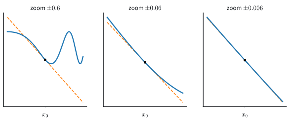
:label:`fig_mdl-zoom-sequence`

To capture that slope algebraically, we follow :numref:`sec_calculus` and start
with the *secant* line through $(x, f(x))$ and $(x+\epsilon, f(x+\epsilon))$.
Its slope is the *difference quotient* $\bigl(f(x+\epsilon)-f(x)\bigr)/\epsilon$.
As $\epsilon$ shrinks toward zero, the secant rotates toward the tangent line
(:numref:`fig_mdl-secant-to-tangent`).

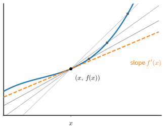
:label:`fig_mdl-secant-to-tangent`

How small must $\epsilon$ be before the secant slope is a trustworthy stand-in
for the tangent slope? Unfortunately, there is no universal threshold: it
depends entirely on the function. Consider the polynomial
$f(x) = x^2 + 1701(x-4)^3$, whose true slope at $x=4$ is $8$, and observe how
slowly the secant slope settles as $\epsilon$ shrinks.

```{.python .input #single-variable-calculus-differential-calculus-4}
def f(x):
    return x**2 + 1701*(x-4)**3

# Slope of the secant through x=4, for shrinking epsilon
for epsilon in [0.1, 0.001, 0.0001, 0.00001]:
    print(f'epsilon = {epsilon:.5f} -> {(f(4+epsilon) - f(4)) / epsilon:.5f}')
```

At $\epsilon=0.1$, the secant slope is $25.11$, more than three times the true
limit, and the printed values only settle near $8$ once $\epsilon$ reaches
$0.001$. Expanding $f(4+\epsilon)-f(4)=8\epsilon+\epsilon^2+1701\epsilon^3$
shows why: the difference quotient equals $8+\epsilon+1701\epsilon^2$, so the
cubic term adds $17$ at $\epsilon=0.1$ but only $1.7\times10^{-7}$ at
$\epsilon=10^{-5}$. The large coefficient delays the approach to the limit
without changing it. Automatic differentiation sidesteps this problem
altogether: it never chooses an $\epsilon$, instead applying the rules of
differentiation directly (:numref:`sec_mdl-matrix-calculus-autodiff`).

### The Derivative and the Linear Approximation

The **derivative** of $f$ at $x$ is the limit of the secant slopes,

$$
f'(x) = \frac{df}{dx}(x) = \lim_{\epsilon \rightarrow 0}\frac{f(x+\epsilon) - f(x)}{\epsilon},
$$
:eqlabel:`eq_mdl-der_def`

whenever this limit exists, in which case we say $f$ is *differentiable* at
$x$. For the cubic above, $f'(4)=8$. We write $f'$ or $\frac{df}{dx}$, and
$\frac{d}{dx}[\ldots]$ when differentiating a bulky expression. The limit can
also fail to exist, as it does for $|x|$ at $0$; we return to such corners in
:numref:`sec_mdl-tangent-fails`.

It is instructive to rearrange this definition. Let
$r(\epsilon)=f(x+\epsilon)-f(x)-\epsilon f'(x)$ denote the error of the
straight-line prediction; the limit :eqref:`eq_mdl-der_def` says that
$r(\epsilon)/\epsilon\to0$. Writing $o(\epsilon)$ for any quantity
$r(\epsilon)$ satisfying $r(\epsilon)/\epsilon\to0$ as $\epsilon\to0$, we
obtain the **linear approximation**

$$
f(x+\epsilon) = f(x) + \epsilon f'(x) + o(\epsilon).
$$
:eqlabel:`eq_mdl-small_change`

In plain words, a small step $\epsilon$ changes the output by $\epsilon f'(x)$,
up to an error that vanishes faster than $\epsilon$. The converse holds too: if
$f(x+\epsilon)=f(x)+a\epsilon+o(\epsilon)$ for some constant $a$, then dividing
by $\epsilon$ and letting $\epsilon\to0$ proves that $f$ is differentiable at
$x$ with $f'(x)=a$. The expansion :eqref:`eq_mdl-small_change` and the limit
:eqref:`eq_mdl-der_def` therefore carry the same information, and our proofs of
the sum and chain rules will lean on this equivalence.

Plotted as a function of $x+\epsilon$, the line $f(x)+\epsilon f'(x)$ is the
*tangent* to the graph at $x$, the limit of the rotating secants. This is the
line that predicted the logistic loss at $w=0.1$, and the gap of $0.00125$ was
its $o(\epsilon)$ remainder. By itself, $o(\epsilon)$ promises very little: an
error of order $o(\epsilon)$ could shrink only slightly faster than $\epsilon$.
Here, however, the gap shrank as $\epsilon^2$, and as we will see in
:numref:`subsec_mdl-taylor-series`, quadratic error decay is the rule for every
twice differentiable function.

## Computing Derivatives
:label:`sec_mdl-derivative_table`

In practice, nobody computes derivatives by taking limits. Instead, as in
:numref:`sec_calculus`, we combine a short table of elementary derivatives with
rules for sums, products, and compositions. Here we prove each rule directly
from the linear approximation. Among the table entries, we derive the
exponential, the logarithm, and the power rule; we take the sine and cosine
entries, along with the existence of a base whose exponential has slope $1$ at
$0$, as known from a first calculus course.

### A Table of Common Derivatives

The following formulas hold wherever the right-hand sides are defined: the
power rule for every real $n$ when $x>0$ and for integer $n$ wherever $x^n$
is defined, and the logarithm for $x>0$.

* **Derivative of constants.** $\frac{d}{dx}c = 0$.
* **Derivative of linear functions.** $\frac{d}{dx}(ax) = a$.
* **Power rule.** $\frac{d}{dx}x^n = nx^{n-1}$.
* **Derivative of exponentials.** $\frac{d}{dx}e^x = e^x$.
* **Derivative of the logarithm.** $\frac{d}{dx}\log(x) = \frac{1}{x}$.
* **Derivative of sine.** $\frac{d}{dx}\sin(x) = \cos(x)$.
* **Derivative of cosine.** $\frac{d}{dx}\cos(x) = -\sin(x)$.

The exponential entry rests on a one-line observation that also reveals what
makes the base $e$ special. For any $a>0$, the difference quotient of $a^x$
factors cleanly as

$$
\frac{a^{x+\epsilon}-a^x}{\epsilon} = a^x\,\frac{a^\epsilon-1}{\epsilon},
$$

where the second factor is simply the difference quotient at $0$. Thus, if
$a^x$ is differentiable at $0$ with slope $c_a$, then $\frac{d}{dx}a^x=c_a\,a^x$
for every $x$: the slope of an exponential is always proportional to its
height, with a single proportionality constant per base. Numerically, at
$\epsilon=10^{-6}$ we find $(2^\epsilon-1)/\epsilon=0.69315$ for base $2$ and
$(10^\epsilon-1)/\epsilon=2.30259$ for base $10$. The number $e$ is defined as
the unique base whose constant is $1$, which immediately yields
$\frac{d}{dx}e^x=e^x$. Once we have the derivative of the logarithm, the chain
rule will identify $c_a$ for every other base.

### Rules for Combining Derivatives

A loss function builds on the table above using sums, products, quotients, and
compositions. Let $g$ and $h$ be differentiable at $x$ (for the chain rule,
assume $h$ is differentiable at $x$ and $g$ is differentiable at $h(x)$). Then:

* **Sum rule.** $\frac{d}{dx}\bigl(g(x) + h(x)\bigr) = g'(x) + h'(x)$.
* **Product rule.** $\frac{d}{dx}\bigl(g(x)\, h(x)\bigr) = g(x)h'(x) + g'(x)h(x)$.
* **Quotient rule.** $\frac{d}{dx}\frac{g(x)}{h(x)} = \frac{g'(x)h(x) - g(x)h'(x)}{h(x)^2}$, where $h(x)\neq 0$.
* **Chain rule.** $\frac{d}{dx}g(h(x)) = g'(h(x))\, h'(x)$.

The sum and product rules are routine; only the chain rule requires real care,
because the naive argument divides by $h(x+\epsilon)-h(x)$, which can vanish
even when $\epsilon\neq 0$. The proofs all rely on one basic fact: **a function
differentiable at $x$ is continuous at $x$**, because
$g(x+\epsilon)-g(x)=\epsilon\cdot\frac{g(x+\epsilon)-g(x)}{\epsilon}$ tends to
$0\cdot g'(x)=0$ as $\epsilon\to 0$.

**Sum rule.** Adding the linear approximations for $g$ and $h$ gives

$$
g(x+\epsilon) + h(x+\epsilon) = g(x) + h(x) + \epsilon\bigl(g'(x) + h'(x)\bigr) + o(\epsilon),
$$

since the sum of two quantities that vanish faster than $\epsilon$ also
vanishes faster than $\epsilon$. By the converse of the linear approximation,
the coefficient of $\epsilon$ is the derivative: first-order changes simply
add. $\blacksquare$

**Product rule.** Adding and subtracting $g(x+\epsilon)h(x)$ in the numerator
splits the difference quotient of the product into two quotients we already
know:

$$
\frac{g(x+\epsilon)h(x+\epsilon)-g(x)h(x)}{\epsilon}
= g(x+\epsilon)\,\frac{h(x+\epsilon)-h(x)}{\epsilon} + h(x)\,\frac{g(x+\epsilon)-g(x)}{\epsilon}.
$$

As $\epsilon\to0$, continuity gives $g(x+\epsilon)\to g(x)$, so the right-hand
side converges to $g(x)h'(x)+h(x)g'(x)$. $\blacksquare$

**Chain rule.** Rather than dividing by $h(x+\epsilon)-h(x)$, we feed the
change of the inner function directly into the linear approximation of the
outer function. Because $g$ is differentiable at $h(x)$, the error ratio
$\rho(t)=\frac{g(h(x)+t)-g(h(x))}{t}-g'(h(x))$ for $t\neq0$, extended by
$\rho(0)=0$, tends to $0$ as $t\to0$. For every $t$, including $t=0$, we can
therefore write

$$
g(h(x)+t) = g(h(x)) + \bigl(g'(h(x)) + \rho(t)\bigr)\,t.
$$

Now set $t=h(x+\epsilon)-h(x)=\epsilon h'(x)+o(\epsilon)$. By continuity of
$h$, $t\to0$ as $\epsilon\to0$, so $\rho(t)\to0$ as well. Substituting this $t$
yields

$$
\begin{aligned}
g(h(x+\epsilon)) - g(h(x))
&= \bigl(g'(h(x)) + \rho(t)\bigr)\bigl(\epsilon h'(x) + o(\epsilon)\bigr) \\
&= \epsilon\, g'(h(x))\, h'(x) + o(\epsilon),
\end{aligned}
$$

because every term other than $g'(h(x))\,\epsilon h'(x)$ contains a factor
that vanishes faster than $\epsilon$. Applying the converse of the linear
approximation finishes the proof. $\blacksquare$

Rates multiply along a composition. Applied layer by layer to a neural
network, the chain rule produces a product of local slopes, and evaluating
that product efficiently is precisely what backpropagation does. The quotient
rule follows immediately by applying the product and chain rules to
$g\cdot h^{-1}$.

### Inverse Functions

The chain rule also differentiates a function that undoes another. A function
$g$ satisfying $g(f(x))=x$ for all $x$ near a point is an *inverse* of $f$
there. Suppose such a $g$ exists and is differentiable at $f(x)$; by the
inverse function theorem :cite:`Rudin.1976`, which we use without proof, both
hold whenever $f'$ is continuous and nonzero near $x$. Differentiating both
sides of $g(f(x))=x$ with the chain rule gives

$$
g'(f(x))\,f'(x) = 1, \qquad\text{so}\qquad g'(y) = \frac{1}{f'(g(y))} \quad\text{at } y = f(x).
$$

In other words, the slope of the inverse is the reciprocal of the slope of $f$,
evaluated at the matching point. Geometrically, the graph of $g$ is the graph
of $f$ reflected across the diagonal, and reflecting a line across the diagonal
turns rise over run upside down.

Since the logarithm undoes $e^x$, this rule gives
$\log'(y)=1/e^{\log y}=1/y$, the fifth entry in our table. Notice that the
condition $f'(x)\neq0$ is strictly necessary. For $f(x)=x^3$ we have
$f'(0)=0$, so the formula breaks down at $y=0$; indeed, its inverse $x^{1/3}$
is not differentiable at $0$, because the difference quotient
$\epsilon^{1/3}/\epsilon=\epsilon^{-2/3}$ grows without bound and the graph has
a vertical tangent there.

With the logarithm in hand, the chain rule settles the remaining two entries
of the table. Writing $a^x=e^{x\log a}$ gives $\frac{d}{dx}a^x=(\log a)\,a^x$,
identifying the constant $c_a=\log a$; indeed, $\log 2=0.69315$ and
$\log 10=2.30259$ are the constants we measured numerically above. Similarly,
writing $x^n=e^{n\log x}$ for $x>0$ yields
$\frac{d}{dx}x^n=e^{n\log x}\cdot\frac{n}{x}=nx^{n-1}$ for every real $n$.

### The Softplus, the Sigmoid, and the Logit

We can now apply these rules to our running function, $s(x)=\log(1+e^x)$. Using
the chain rule with outer function $\log$ and inner function $1+e^x$ gives

$$
s'(x) = \frac{e^x}{1+e^x} = \frac{1}{1+e^{-x}} = \sigma(x),
$$

so the derivative of the softplus is the *sigmoid* $\sigma$. Applying the chain
rule a second time to $\sigma(x)=(1+e^{-x})^{-1}$, with outer function $u^{-1}$
and inner function $1+e^{-x}$ of slope $-e^{-x}$, yields

$$
\sigma'(x) = \frac{e^{-x}}{(1+e^{-x})^2} = \sigma(x)\bigl(1-\sigma(x)\bigr),
$$

since $1-\sigma(x)=e^{-x}/(1+e^{-x})$. Because a product $p(1-p)$ is maximized
at $p=\tfrac12$, the sigmoid is steepest at the origin, where
$\sigma(0)=\tfrac12$ and $\sigma'(0)=\tfrac14$. The inverse of $\sigma$ is the
*logit* function $\mathrm{logit}(p)=\log\frac{p}{1-p}$, and the inverse-function
rule immediately gives
$\mathrm{logit}'(p)=1/\sigma'(\mathrm{logit}\,p)=\frac{1}{p(1-p)}$. At
$p=\tfrac12$, this equals $4=1/\tfrac14$, matching the reciprocal of the
sigmoid's slope.

We can now verify the two constants from the opening logistic-loss example.
Since $\ell(w)=s(-w)$, the chain rule gives $\ell'(w)=-\sigma(-w)$, so
$\ell'(0)=-\tfrac12$. Differentiating once more gives
$\ell''(w)=\sigma(-w)\bigl(1-\sigma(-w)\bigr)$ and thus $\ell''(0)=\tfrac14$,
the curvature at the origin. Let us check numerically whether the gap between
$\ell(\epsilon)$ and its linear approximation $\ell(0)-\tfrac12\epsilon$
indeed shrinks like $\epsilon^2$ with leading constant
$\tfrac12\ell''(0)=\tfrac18$.

```{.python .input #mdl-single-variable-calculus-the-softplus-the-sigmoid-and-the-logit-1}
# The logistic loss l(w) = log(1 + e^{-w}) near w = 0, where l'(0) = -1/2
def ell(w):
    return np.log(1 + np.exp(-w))

for eps in [0.1, 0.01, 0.001]:
    line = ell(0) - 0.5 * eps          # the linear approximation
    gap = ell(eps) - line
    print(f'eps = {eps:<5}: l = {ell(eps):.6f}, line = {line:.6f}, '
          f'gap = {gap:.2e}, gap / eps^2 = {gap / eps**2:.4f}')
```

Sure enough, the gap drops a hundredfold every time we cut $\epsilon$ by a
factor of ten, and $\text{gap}/\epsilon^2$ settles to
$0.125=\tfrac12\ell''(0)$. The error of the linear approximation is indeed of
second order, with a leading constant governed by the curvature. Notice also
that the first line prints $0.1249$ rather than $0.1250$: the gap is not quite
$\epsilon^2/8$, and :numref:`subsec_mdl-taylor-series` will identify the
higher-order term responsible for that small difference.

So far, every calculation has lived in an infinitesimal neighborhood of a
single point. Asking what the slope tells us about a function across an entire
interval is a different kind of question.

## The Mean Value Theorem
:label:`sec_mdl-mvt`

In optimization, we routinely act on two intuitions: a positive slope means the
function is climbing, and a point where the slope vanishes is a candidate
minimum. Gradient descent relies on both. Yet each claim infers the behavior of
$f$ over an interval from its derivative at individual points, and neither is
built into the definition of the derivative. We prove the second claim first,
as it is the simpler one.

**Lemma (Fermat).** *If $f$ attains a local maximum or a local minimum at an
interior point $\xi$ of an interval and is differentiable at $\xi$, then
$f'(\xi)=0$.*

**Proof.** At a local maximum, $f(\xi + \epsilon) - f(\xi) \le 0$ for all
sufficiently small $\epsilon$ of either sign. The difference quotient is
therefore $\le 0$ for $\epsilon > 0$ and $\ge 0$ for $\epsilon < 0$. Because
$f$ is differentiable at $\xi$, both one-sided limits must equal $f'(\xi)$, and
the only number that is simultaneously $\le 0$ and $\ge 0$ is zero. A local
minimum follows by the same argument with inequalities reversed. $\blacksquare$

The first intuition requires a deeper tool: the Mean Value Theorem. Every error
bound in the remainder of this section is obtained by applying this theorem to
a well-chosen auxiliary function. Geometrically (:numref:`fig_mdl-mvt`), it
states that the chord joining the endpoints of the graph over $[a,b]$ is
parallel to the tangent line at some interior point.

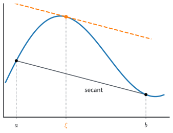
:label:`fig_mdl-mvt`

On a simple example like $f(x)=x^2$ over $[0,2]$, the chord has slope
$(4-0)/2=2$, and the tangent slope $f'(\xi)=2\xi$ matches it at the midpoint
$\xi=1$. Notice, however, that the theorem truly requires differentiability at
every interior point. The absolute value $|x|$ on $[-1,1]$ satisfies
$f(-1)=f(1)$, so its chord is horizontal, yet no interior point has slope $0$:
the slope is $-1$ on the left, $+1$ on the right, and undefined at $0$.

**Proposition (Mean Value Theorem).** *If $f$ is continuous on $[a,b]$ and
differentiable on $(a,b)$, then there exists a point $\xi \in (a,b)$ such that*

$$
f'(\xi) = \frac{f(b) - f(a)}{b - a}.
$$
:eqlabel:`eq_mdl-mvt`

**Proof.** Consider first the flat case $f(a) = f(b)$, known as Rolle's
theorem. We invoke one foundational result from real analysis, the **extreme
value theorem**: a continuous function on a closed interval attains both a
maximum and a minimum :cite:`Rudin.1976`. If both extrema occur at the
endpoints, then $f$ is constant and $f' \equiv 0$ everywhere inside. Otherwise,
at least one extremum occurs at an interior point $\xi$, where $f'(\xi)=0$ by
Fermat's lemma.

For the general case, we subtract the chord to flatten the endpoints. Define
the tilted function $\tilde f(x) = f(x) - \frac{f(b)-f(a)}{b-a}(x - a)$. Since
$\tilde f(a) = \tilde f(b) = f(a)$, Rolle's theorem provides an interior point
$\xi$ with $\tilde f'(\xi) = 0$, which rearranges directly to
:eqref:`eq_mdl-mvt`. $\blacksquare$

In words, the average rate of change over an interval is always realized as an
instantaneous rate of change at some point inside it. Two consequences will
appear repeatedly throughout the chapter:

1. *If $f'>0$ on an interval, then $f$ is strictly increasing there.* For any
   $x_1<x_2$ in the interval, :eqref:`eq_mdl-mvt` gives
   $f(x_2)-f(x_1)=f'(\xi)(x_2-x_1)>0$ for some $\xi$ between them. By the same
   token, $f'<0$ implies $f$ is strictly decreasing, and $f'=0$ implies $f$ is
   constant.
2. *If $f'<0$ on $(x_0-\delta,x_0)$ and $f'>0$ on $(x_0,x_0+\delta)$ for some
   $\delta>0$, and $f$ is continuous at $x_0$, then $x_0$ is a strict local
   minimum.* Applying the first consequence on each side shows that $f$ falls
   into $x_0$ from the left and rises out of it to the right.

Returning to our running function, $s'=\sigma>0$ everywhere, so the softplus is
strictly increasing on all of $\mathbb R$.

## Gradient Descent in One Variable

### The Gradient-Descent Step

The linear approximation predicts how $f$ responds to any small step
$\epsilon$: $f(x+\epsilon)\approx f(x)+\epsilon f'(x)$. To decrease $f$, we
should choose $\epsilon$ with the sign opposite to the slope. Setting
$\epsilon=-\eta f'(x)$ for a positive *step size* $\eta>0$, the linear model
predicts the change

$$
f\bigl(x-\eta f'(x)\bigr) - f(x) \approx -\eta\, f'(x)^2,
$$

which is strictly negative whenever $f'(x)\neq0$. Regardless of whether the
slope is positive or negative, stepping opposite to it lowers the linear model
by an amount proportional to the squared slope (:numref:`fig_mdl-gd-step`).

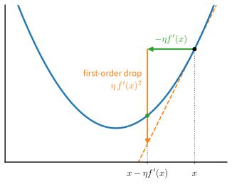
:label:`fig_mdl-gd-step`

Iterating this update gives one-dimensional **gradient descent**:

$$
x_{t+1} = x_t - \eta\, f'(x_t).
$$
:eqlabel:`eq_mdl-gd-loop`

Each step moves against the local slope, and the iteration comes to rest at a
*stationary point*, where $f'(x_t)=0$. In a neural network, every coordinate of
the weight update $w_i\leftarrow w_i-\eta\,\partial\ell/\partial w_i$ takes
this form, with all coordinates updated simultaneously. On our logistic loss
starting at $w=0$, the slope is $\ell'(0)=-\tfrac12$, so a step of size $\eta$
moves the weight by $\epsilon=\eta/2$ and predicts a loss drop of $\eta/4$.

Notice a glaring limitation of the linear model: its predicted change
$-\eta f'(x)^2$ is negative for every $\eta > 0$, no matter how huge. In
reality, too large a step can overshoot the minimum and land higher than where
it began. The tangent line cannot warn us of this danger because it knows
nothing about how the curve bends. The simplest bowl, $f(x)=x^2$, already
reveals where the linear prediction breaks down.

### The Quadratic Case

For $f(x)=x^2$, the slope is $f'(x)=2x$, so the gradient-descent update
simplifies to

$$
x_{t+1} = x_t - \eta\,(2x_t) = (1 - 2\eta)\, x_t.
$$

Every step multiplies the current iterate by the same factor $1-2\eta$, giving
the closed form $x_t=(1-2\eta)^t x_0$. The iterates therefore converge to the
minimum $x = 0$ if and only if $|1 - 2\eta| < 1$, which is $0 < \eta < 1$.
Within this convergent range, a small $\eta$ creeps monotonically toward $0$,
$\eta = \tfrac12$ lands on the minimum in a single step, and
$\tfrac12 < \eta < 1$ overshoots and oscillates inward. Right at the boundary
$\eta = 1$, the iterates bounce forever between $+x_0$ and $-x_0$, and for
$\eta > 1$ they blow up.

Let us run ten steps from $x_0=1$ across five step sizes, one from each regime,
to see these trajectories side by side.

```{.python .input #single-variable-calculus-gradient-descent}
# Gradient descent on f(x) = x^2 from x0 = 1, for several step sizes
def gd(eta, steps=10, x0=1.0):
    xs = [x0]
    for _ in range(steps):
        xs.append(xs[-1] - eta * (2 * xs[-1]))  # x <- x - eta * f'(x)
    return xs

etas = [0.05, 0.5, 0.9, 1.0, 1.1]
trajectories = [gd(eta) for eta in etas]
for eta, xs in zip(etas, trajectories):
    print(f'eta = {eta:.2f} -> x_10 = {xs[-1]:+.5f}')
d2l.plot(list(range(11)), trajectories, 'step t', 'x_t', ylim=[-2.5, 2.5],
         legend=[f'eta = {eta}' for eta in etas],
         fmts=('-', 'm--', 'g-.', 'r:', 'c-'))
```

The printed values match the closed-form powers $(1-2\eta)^{10}$: the cautious
step $\eta=0.05$ has only crawled down to $0.349$, $\eta=0.9$ has zig-zagged
down to $0.107$, $\eta=1$ is right back at $1$, and $\eta=1.1$ has already
diverged to $6.19$. Notice that the stability threshold $\eta=1$ equals
$2/f''$, because $f''\equiv2$ for $x^2$. As we will see in
:numref:`subsec_mdl-descent-lemma`, this is no coincidence: any bound $L$ on
the curvature gives the safe step-size threshold $2/L$ for every smooth
function.

## Curvature and Taylor Series

How far can we trust the linear approximation, and how large a step size is
safe? Both questions depend on how fast the slope itself changes.

### The Second Derivative

Because $f'$ is itself a function of $x$, we can differentiate it again. The
result is the *second derivative*,
$f''=\frac{d^2f}{dx^2}=\frac{d}{dx}\bigl(\frac{df}{dx}\bigr)$, which measures
the rate of change of the slope. Repeating this process $n$ times yields the
$n$-th derivative,

$$
f^{(n)}(x) = \frac{d^{n}f}{dx^{n}} = \left(\frac{d}{dx}\right)^{n} f.
$$

Geometrically, $f''>0$ means the slope is increasing, so the graph curves
upward like a bowl; $f''<0$ means the slope is decreasing, so the graph curves
downward like a dome. At a stationary point, this sign tells a local minimum
apart from a local maximum.

**Proposition (second-derivative test).** *Let $f'(x_0)=0$ and suppose
$f''(x_0)$ exists. If $f''(x_0)>0$, then $x_0$ is a strict local minimum; if
$f''(x_0)<0$, it is a strict local maximum.*

**Proof.** Because $f'(x_0)=0$, the definition of $f''(x_0)$ simplifies to
$f''(x_0)=\lim_{\epsilon\to0}f'(x_0+\epsilon)/\epsilon$. If this limit is
positive, then the quotient $f'(x_0+\epsilon)/\epsilon$ must be positive for
all sufficiently small $\epsilon\neq0$. Hence $f'(x_0+\epsilon)$ shares the
sign of $\epsilon$: negative just to the left of $x_0$ and positive just to
the right. By the second consequence of the Mean Value Theorem, $x_0$ is a
strict local minimum. The case $f''(x_0)<0$ follows identically with all signs
reversed. $\blacksquare$

Notice where the real work happened in that proof: turning a local sign
pattern of $f'$ into a minimum over an interval requires the Mean Value
Theorem. Note also that the test certifies only a neighborhood of $x_0$, not
the entire domain. When we move to many variables, the signs of the
eigenvalues of the matrix of second derivatives will play this same role.

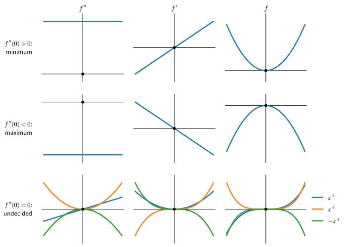
:label:`fig_mdl-second-derivative-test`

When $f''(x_0)=0$ at a stationary point, the test is silent
(:numref:`fig_mdl-second-derivative-test`, bottom row): $x^3$, $x^4$, and
$-x^4$ all satisfy $f'(0)=f''(0)=0$, yet $0$ is an inflection point for the
first, a minimum for the second, and a maximum for the third; higher-order
derivatives decide such flat stationary points.

### The Taylor Polynomial
:label:`subsec_mdl-taylor-series`

The tangent line matches the value and the slope of $f$ at a base point $x_0$.
To capture the bend as well, we can fit a parabola. A general quadratic
$q(x)=ax^2+bx+c$ has derivatives

$$
q'(x) = 2ax + b, \qquad q''(x) = 2a,
$$

so its curvature is the constant $2a$. Matching the curvature of $f$ at $x_0$
fixes $a=f''(x_0)/2$, and matching the value and slope fixes $b$ and $c$. For
$f(x) = \sin(x)$, where $\sin'=\cos$ and $\sin''=-\sin$, the best-fitting
parabola at $x_0$ is

$$
q(x) = \sin(x_0) + \cos(x_0)\,(x - x_0) - \tfrac{1}{2}\sin(x_0)\,(x-x_0)^2.
$$

Because this parabola follows the bend of the sine curve, it stays accurate
over a noticeably wider interval than the tangent line
(:numref:`fig_mdl-best-parabola`, drawn at a base point where $\sin x_0\neq0$
so the parabola has nonzero curvature).

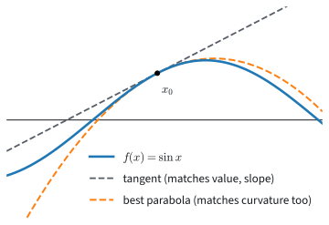
:label:`fig_mdl-best-parabola`

For our running function at $x_0=0$, the values $s(0)=\log2$,
$s'(0)=\tfrac12$, and $s''(0)=\tfrac14$ produce the best parabola
$\log2+\tfrac{x}{2}+\tfrac{x^2}{8}$. Its quadratic coefficient $\tfrac18$ is
the exact constant to which $\text{gap}/\epsilon^2$ converged for the logistic
loss $\ell(w)=s(-w)$.

The same idea extends to any degree $n$. The degree-$n$ **Taylor polynomial**
of $f$ at $x_0$ is

$$
P_n(x) = \sum_{i = 0}^{n} \frac{f^{(i)}(x_0)}{i!}(x-x_0)^{i},
$$

which is the unique polynomial of degree at most $n$ whose value and first $n$
derivatives agree with those of $f$ at $x_0$. The factorials appear because
differentiating $(x-x_0)^i$ exactly $i$ times at $x_0$ produces $i!$, while
every other term vanishes. In this notation, $P_1$ is the tangent line and
$P_2$ is the best parabola. For $e^x$ at $x_0=0$, where every derivative
equals $1$, we obtain $P_n(x)=\sum_{i=0}^n x^i/i!$, and each new term lets the
polynomial hug the exponential curve a little farther from the origin. To know
just how far we can trust $P_n$, and how rapidly its error grows beyond that
range, we need an explicit formula for the remainder.

### The Lagrange Remainder

The Mean Value Theorem yields an exact formula for the error of $P_n$,
expressed in terms of a single unknown interior point. This is the centerpiece
of the section: both the descent lemma and Newton's quadratic convergence rate
fall out of its $n=1$ case.

**Proposition (Lagrange remainder).** *If $f$ is $(n+1)$-times differentiable
on an open interval containing $x_0$ and $x$, with $x\neq x_0$, then*

$$
f(x) = P_n(x) + R_n(x), \qquad R_n(x) = \frac{f^{(n+1)}(\xi)}{(n+1)!}\,(x - x_0)^{n+1},
$$
:eqlabel:`eq_mdl-lagrange`

*for some $\xi$ strictly between $x_0$ and $x$. Note that the case $n = 0$
recovers the Mean Value Theorem, $f(x) = f(x_0) + f'(\xi)(x - x_0)$.*

**Proof.** The one clever step is choosing the right auxiliary function;
everything after that is straightforward differentiation. Fix $x$ and treat
the base point $t$ as the variable: for $t$ between $x_0$ and $x$, define

$$
G(t) = f(x) - \sum_{k=0}^{n} \frac{f^{(k)}(t)}{k!}\,(x-t)^k - M\,\frac{(x-t)^{n+1}}{(n+1)!},
$$

which is the error at $x$ of the Taylor polynomial centered at $t$, minus a
term of the form we expect that error to take. Choose the constant $M$ so that
$G(x_0)=0$. The proof now finishes in three steps.

First, $G$ vanishes at both endpoints. Our choice of $M$ ensures $G(x_0)=0$,
while $G(x)=0$ because every positive power of $(x-t)$ vanishes at $t=x$ and
the $k=0$ term leaves $f(x)-f(x)=0$. Rolle's theorem therefore guarantees a
point $\xi$ strictly between $x_0$ and $x$ where $G'(\xi)=0$.

Second, differentiate $G(t)$ with respect to $t$. By the product rule, each
summand with $k\geq1$ contributes

$$
-\frac{f^{(k+1)}(t)}{k!}(x-t)^k + \frac{f^{(k)}(t)}{(k-1)!}(x-t)^{k-1}
$$

to $G'(t)$, while the $k=0$ term contributes $-f'(t)$. Adjacent terms cancel
in pairs (the sum telescopes), leaving only the highest-order derivative and the
derivative of the $M$ term:

$$
G'(t) = -\frac{f^{(n+1)}(t)}{n!}\,(x-t)^n + M\,\frac{(x-t)^n}{n!}.
$$

Third, evaluate at $t=\xi$. Because $\xi$ lies strictly between $x_0$ and $x$,
we have $(x-\xi)^n\neq0$, so $G'(\xi)=0$ forces $M=f^{(n+1)}(\xi)$. Plugging
this back into $G(x_0)=0$ yields :eqref:`eq_mdl-lagrange`. $\blacksquare$

The remainder looks just like the next term of the Taylor polynomial, except
that the $(n+1)$-st derivative is evaluated at an unknown interior point $\xi$
rather than at $x_0$. Whenever $f^{(n+1)}$ stays bounded near $x_0$, the error
therefore scales as $|x-x_0|^{n+1}$: each additional matched derivative raises
the order of accuracy by one.

Let us test this on our running function. For the softplus,
$s'''=\sigma(1-\sigma)(1-2\sigma)$ vanishes at $0$ and $s''''(0)=-\tfrac18$,
giving the fourth-degree polynomial

$$
P_4(x) = \log 2 + \frac{x}{2} + \frac{x^2}{8} - \frac{x^4}{192}.
$$

At $x=0.5$, this evaluates to $0.974072$ against the true value
$s(0.5)=0.974077$, an error of only $5\times10^{-6}$. In fact, the error is
even smaller than an $x^5$ estimate would suggest, because
$s(x)-\tfrac{x}{2}=\log\bigl(2\cosh\tfrac{x}{2}\bigr)$ is an even function, so
all higher odd terms vanish and the next nonzero term is sixth order. That
quartic term also explains why our earlier script printed $0.1249$ instead of
$0.1250$ at $\epsilon=0.1$: we were seeing
$\tfrac18-\tfrac{\epsilon^2}{192}=0.12495$.

We can check the $h^{n+1}$ scaling directly in code. If the worst-case error of
$P_n$ on the window $|x|\le h$ behaves like $h^{n+1}$, then halving $h$ should
divide the maximum error by $2^{n+1}$: by $4$ for the tangent line, $8$ for the
parabola, and $16$ for the cubic. Let us verify this prediction on $e^x$ at
$x_0=0$.

```{.python .input #single-variable-calculus-taylor-error-rate}
# Max error of P_n for e^x on |x| <= h. Lagrange predicts error ~ h^(n+1),
# so halving h should divide it by 2^(n+1)
def taylor_error(n, h, m=1000):
    x = h * np.arange(-m, m + 1) / m
    P = sum(x**k / math.factorial(k) for k in range(n + 1))
    return np.max(np.abs(np.exp(x) - P))

hs = [0.4, 0.2, 0.1, 0.05]
errs = [[taylor_error(n, h) for h in hs] for n in (1, 2, 3)]
for n, e in zip((1, 2, 3), errs):
    ratios = ' '.join(f'{a / b:.1f}' for a, b in zip(e, e[1:]))
    print(f'n = {n}: ratios between successive windows {ratios}, '
          f'predicted {2**(n + 1)}')
d2l.plot(hs, errs, 'window h', 'max error', xscale='log', yscale='log',
         legend=['n = 1', 'n = 2', 'n = 3'])
```

The measured ratios indeed sit near $4$, $8$, and $16$, and on the log–log
plot the three error curves appear as straight lines with slopes $2$, $3$, and
$4$, matching $n+1$. The ratios slightly exceed the theoretical values on the
wider windows because the factor $e^{\xi}$ in the remainder is larger there.

The Lagrange remainder also answers when the infinite Taylor series reproduces
the function itself. For $e^x$, every derivative equals $e^x$, so
:eqref:`eq_mdl-lagrange` around $x_0=0$ gives

$$
\bigl|e^x - P_n(x)\bigr| = \frac{e^{\xi}\,|x|^{n+1}}{(n+1)!} \le \frac{e^{|x|}\,|x|^{n+1}}{(n+1)!}.
$$

For any fixed $x$, the right-hand side vanishes as $n\to\infty$ because
factorials eventually outgrow powers. Hence

$$
e^{x} = \sum_{n = 0}^\infty \frac{x^{n}}{n!} = 1 + x + \frac{x^2}{2} + \frac{x^3}{6} + \cdots
$$

on all of $\mathbb R$. Be careful, though: having infinitely many derivatives
does not guarantee that a function equals its Taylor series. For
$f(x) = e^{-1/x^2}$ (extended by $f(0) = 0$), every single derivative vanishes
at $0$, so its Taylor series at the origin is identically zero and agrees with
$f$ only at $x=0$ (:numref:`fig_mdl-smooth-not-analytic`). Luckily, nothing we
do later depends on infinite series: we work exclusively with finite Taylor
polynomials $P_n$, whose error :eqref:`eq_mdl-lagrange` bounds directly.

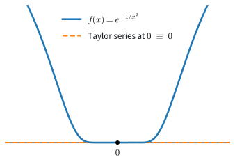
:label:`fig_mdl-smooth-not-analytic`

### The Descent Lemma
:label:`subsec_mdl-descent-lemma`

Does a bound on curvature guarantee that gradient descent lowers any smooth
function, just as it did for $x^2$? The Lagrange remainder with $n=1$ answers
yes. Among all results in this section, this is the one optimization theory
uses most.

**Proposition (descent lemma).** *Let $f$ be twice differentiable on an open
interval $I$ containing $x$ and $x-\eta f'(x)$, with $|f''|\le L$ on $I$. Then*

$$
f\bigl(x - \eta\, f'(x)\bigr) \;\le\; f(x) - \eta\Bigl(1 - \frac{L\eta}{2}\Bigr)f'(x)^2.
$$
:eqlabel:`eq_mdl-descent`

*In particular, $f$ strictly decreases whenever $0 < \eta < 2/L$ and
$f'(x) \neq 0$, and the guaranteed decrease is maximized at $\eta = 1/L$,
where it equals $f'(x)^2/(2L)$.*

**Proof.** For any step $u$, the Lagrange remainder with $n=1$ gives
$f(x+u)=f(x)+f'(x)u+\tfrac12f''(\xi)u^2\le f(x)+f'(x)u+\tfrac L2u^2$. Setting
$u=-\eta f'(x)$ turns the right-hand side into
$f(x)-\eta(1-L\eta/2)f'(x)^2$. The factor $1-L\eta/2$ is positive whenever
$\eta<2/L$, and the quadratic $\eta(1-L\eta/2)$ attains its maximum at
$\eta=1/L$. $\blacksquare$

Geometrically, the lemma replaces the unknown local curvature $f''(\xi)$ with
its worst-case bound $L$. The resulting quadratic
$f(x)+f'(x)u+\tfrac L2u^2$ acts as an upper-bounding parabola that touches $f$
at $x$ and stays above it throughout $I$. The step $\eta=1/L$ simply jumps to
the exact minimizer of this ceiling parabola (:numref:`fig_mdl-descent-lemma`).
This bound is the workhorse of smooth optimization :cite:`Nesterov.2018`. In
fact, it does not even require a second derivative: it holds whenever $f'$ is
*$L$-Lipschitz*, meaning that slopes at any two points differ by at most $L$
times their distance, $|f'(u)-f'(v)|\le L|u-v|$. That is the form used in
multivariable optimization (:numref:`sec_mdl-gradient-based-optimization`), and exercise
:exref:`ex_mdl-single-variable-calculus-logistic-smoothness` proves it in one
variable.


:label:`fig_mdl-descent-lemma`

Let us check the lemma on two familiar functions. For $x^2$, we have $L=2$, so
$2/L=1$ recovers the exact stability threshold we found from the closed form.
For the logistic loss,
$\ell''(w)=\sigma(-w)\bigl(1-\sigma(-w)\bigr)\le\tfrac14$ with equality at
$w=0$, so $L=\tfrac14$ and every step size $\eta<8$ is guaranteed to decrease
$\ell$ from any starting weight. Starting from $w=0$ with $\eta=1$ moves to
$w_1=0.5$: the bound guarantees a loss at most
$0.693147-(1-\tfrac18)\cdot\tfrac14=0.4744$, and the actual value is
$\ell(0.5)=0.4741$. The bound is nearly tight here because the curvature stays
close to its maximum $L$ over that short step. With the larger step
$\eta=4=1/L$, the bound promises $0.1931$ while the actual loss drops all the
way to $\ell(2)=0.1269$: away from the origin, the curvature flattens out, so
the curve descends even further than the worst-case ceiling predicts.

### Newton's Method
:label:`subsec_mdl-newton`

The descent lemma builds its quadratic model using the global worst-case
curvature $L$. If instead we use the actual local curvature $f''(x_t)$ at the
current iterate, we obtain a step that minimizes any quadratic function in a
single leap. The local model at $x_t$ is the second-order Taylor polynomial
$P_2$,

$$
q(x) = f(x_t) + f'(x_t)\,(x - x_t) + \tfrac{1}{2}f''(x_t)\,(x - x_t)^2.
$$

Whenever $f''(x_t)>0$, this parabola opens upward and has a unique minimizer.
Setting $q'(x) = f'(x_t) + f''(x_t)(x - x_t) = 0$ and solving for $x$ yields
the update of **Newton's method**:

$$
x_{t+1} = x_t - \frac{f'(x_t)}{f''(x_t)}.
$$
:eqlabel:`eq_mdl-newton`

This is a gradient step with an adaptive local step size $1/f''(x_t)$, and on
any upward-opening parabola it lands on the exact minimizer in one step.
:numref:`fig_mdl-newton-step` illustrates one step on $f(x)=x^4/4-x$, whose
minimizer is $x^\star=1$. At $x_t=2$, we have $f(2)=2$, $f'(2)=7$, and
$f''(2)=12$, so the parabola's minimizer lies at $x_{t+1}=2-7/12=1.4167$.

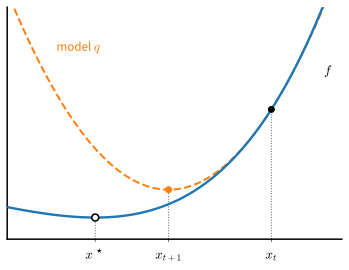
:label:`fig_mdl-newton-step`

Let us see how quickly Newton's method converges on $x^4/4-x$ from $x_0=2$, and
also test what happens on a second function,
$x\arctan x-\tfrac12\log(1+x^2)$, starting from $x_0=1.4$ and $x_0=1.3$. We
will analyze that second example right after inspecting the numbers.

```{.python .input #mdl-single-variable-calculus-newton-s-method}
# Newton on f(x) = x^4/4 - x: solve f'(x) = x^3 - 1 = 0, root x* = 1
x = 2.0
for t in range(6):
    print(f't = {t}: x = {x:.12f}, error = {abs(x - 1):.1e}')
    x = x - (x**3 - 1) / (3 * x**2)  # x - f'(x) / f''(x)

# Newton on the convex f(x) = x arctan(x) - log(1 + x^2)/2,
# with f' = arctan(x) and f'' = 1/(1 + x^2)
for x0 in [1.4, 1.3]:
    x, xs = x0, []
    for t in range(6):
        x = x - math.atan(x) * (1 + x**2)
        xs.append(x)
    print(f'from x0 = {x0}:', ', '.join(f'{v:.2f}' for v in xs))
```

On $x^4/4-x$, the errors plummet through $1.0$, $0.42$, $0.11$,
$1.1\times10^{-2}$, $1.1\times10^{-4}$, and $1.2\times10^{-8}$: once close to
the minimum, each step squares the previous error and roughly doubles the
number of correct digits. By contrast, gradient descent on $x^2$ shrank the
error by a constant factor $|1-2\eta|$ per step, gaining only a fixed number
of digits at each iteration.

The Lagrange remainder explains why the error squares. Let $x^\star$ be a
stationary point and let $e_t=x_t-x^\star$ denote the error at step $t$.
Applying :eqref:`eq_mdl-lagrange` with $n=1$ to $f'$ around the base point
$x_t$ and evaluating at $x^\star$ gives
$0=f'(x_t)-f''(x_t)\,e_t+\tfrac12f'''(\xi_t)\,e_t^2$. Dividing through by
$f''(x_t)\neq0$ and substituting Newton's update :eqref:`eq_mdl-newton` leaves

$$
e_{t+1} = \frac{f'''(\xi_t)}{2f''(x_t)}\,e_t^2
$$
:eqlabel:`eq_mdl-newton-error`

for some $\xi_t$ between $x_t$ and $x^\star$, provided $f$ is three times
differentiable. For $x^4/4-x$, the prefactor converges to
$f'''(1)/(2f''(1))=6/(2\cdot3)=1$, and the printed errors indeed yield
$e_{t+1}/e_t^2\approx0.42$, $0.64$, $0.87$, and $0.99$. The general
multivariable theorem, giving quadratic convergence from any starting point
close enough to a minimizer with positive curvature, appears in
:numref:`sec_mdl-curvature-methods`.

That qualification "close enough" is essential, even for a strictly convex
function. Consider $f(x)=x\arctan x-\tfrac12\log(1+x^2)$, which has
$f'(x)=\arctan x$ and $f''(x)=1/(1+x^2)>0$, so it is strictly convex with a
unique global minimum at $0$. Starting from $x_0=1.4$, the second loop above
prints $-1.41, 1.45, -1.55, 1.85, -2.89, 8.71$: Newton's method diverges
wildly. Starting slightly closer at $x_0=1.3$, it converges smoothly ($-1.16$,
$0.86$, $-0.37$, $0.03$, …), with the threshold between convergence and
divergence sitting near $x_0\approx1.39$.

The local parabola explains what went wrong. Far from the origin, the curvature
$1/(1+x^2)$ becomes tiny, so the approximating parabola $q$ is nearly flat and
places its minimizer far past $x^\star$. The standard fix is to scale back the
step by a factor chosen to ensure $f$ actually decreases, a technique called
*damping*. We develop damped Newton steps, and examine the cost of computing
them in high dimensions, in :numref:`subsec_mdl-why-not-newton`.

## Nondifferentiable Points
:label:`sec_mdl-tangent-fails`

Every $\mathrm{ReLU}$ network is full of corners: $\mathrm{ReLU}(x)=\max(0,x)$
has no derivative at $0$. Yet backpropagation still returns a number there.
Which number does it pick, and in what sense is that number a valid slope?

### One-Sided Derivatives

The difference quotient :eqref:`eq_mdl-der_def` exposes the problem
immediately. For $f(x) = |x|$ at $x = 0$,

$$
\frac{|0+\epsilon| - |0|}{\epsilon} = \frac{|\epsilon|}{\epsilon} =
\begin{cases} +1 & \epsilon > 0, \\ -1 & \epsilon < 0. \end{cases}
$$

The quotient is constant on either side of $0$, but the two constants disagree.
Approaching from the right, the graph rises with slope $+1$; approaching from
the left, it falls with slope $-1$. These limits are the **one-sided
derivatives**, $f'_+(0) = +1$ and $f'_-(0) = -1$, and an ordinary derivative
exists only when the two match. The same calculation for $\mathrm{ReLU}$ at $0$
gives $f'_-(0) = 0$ on the flat left side and $f'_+(0) = 1$ on the right. No
tangent slope exists at these corners, yet an automatic differentiation engine
must still return a number. Let us check what automatic differentiation actually returns.

```{.python .input #single-variable-calculus-one-sided}
#@tab mxnet
# What autograd returns at the corner, where no derivative exists
for name, fn in [('d|x|/dx', mnp.abs), ("ReLU'", npx.relu)]:
    x = mnp.array(0.0)
    x.attach_grad()
    with autograd.record():
        y = fn(x)
    y.backward()
    print(f"{name} at 0: autograd returns {float(x.grad):.1f}")
```

```{.python .input #single-variable-calculus-one-sided}
#@tab pytorch
# What autograd returns at the corner, where no derivative exists
for name, fn in [('d|x|/dx', torch.abs), ("ReLU'", torch.relu)]:
    x = torch.tensor(0.0, requires_grad=True)
    fn(x).backward()
    print(f"{name} at 0: autograd returns {x.grad.item():.1f}")
```

```{.python .input #single-variable-calculus-one-sided}
#@tab tensorflow
# What autograd returns at the corner, where no derivative exists
for name, fn in [('d|x|/dx', tf.abs), ("ReLU'", tf.nn.relu)]:
    x = tf.Variable(0.0)
    with tf.GradientTape() as t:
        y = fn(x)
    print(f"{name} at 0: autograd returns {t.gradient(y, x).numpy():.1f}")
```

```{.python .input #single-variable-calculus-one-sided}
#@tab jax
# What autograd returns at the corner, where no derivative exists
for name, fn in [('d|x|/dx', jnp.abs), ("ReLU'", jax.nn.relu)]:
    print(f"{name} at 0: autograd returns {jax.grad(fn)(0.0):.1f}")
```

For $\mathrm{ReLU}'(0)$, autograd returns $0$, the left-hand slope. For
$\frac{d}{dx}|x|$ at $0$, it returns a fixed value chosen by convention.

:begin_tab:`mxnet, pytorch, tensorflow`
Here it returns $0$, following the convention $\operatorname{sign}(0)=0$.
:end_tab:

:begin_tab:`jax`
JAX returns $1$, the right-hand slope.
:end_tab:

### Subgradients and Optimality

Although a corner has no single tangent line, it has an entire family of lines
that touch the graph at the corner without ever rising above it. For a *convex*
function, one whose chords all lie on or above its graph
(:numref:`sec_mdl-convexity`), these supporting lines step into the role of the
tangent. A number $g$ is called a **subgradient** of a convex function $f$ at
$x$ if

$$
f(y) \ge f(x) + g\,(y - x) \quad \textrm{for all } y,
$$
:eqlabel:`eq_mdl-subgrad`

meaning that the line through $(x, f(x))$ with slope $g$ lies everywhere on or
below the graph of $f$. The set of all subgradients at $x$ is the
**subdifferential** $\partial f(x)$ :cite:`Rockafellar.1970`. At any point
where $f$ is differentiable, $\partial f(x)$ contains only the single number
$f'(x)$. At a corner, it expands into the closed interval between the one-sided
derivatives, corresponding to the fan of supporting lines in
:numref:`fig_mdl-relu-corner`:

$$
\partial |x|(0) = [-1, 1], \qquad \partial\, \mathrm{ReLU}(0) = [0, 1].
$$

Every value returned by autograd above lies inside the corresponding interval.


:label:`fig_mdl-relu-corner`

Our running function shows intuitively where this interval comes from. The
sharpened softplus $\mathrm{softplus}_\beta(x)=\tfrac1\beta s(\beta x)$
converges to $\mathrm{ReLU}(x)$ as $\beta\to\infty$, and its derivative is
$\sigma(\beta x)$ (:numref:`fig_mdl-softplus-relu`). At $x=\pm0.1$, the slopes
are $0.40$ and $0.60$ when $\beta=4$, and sharpen to $0.17$ and $0.83$ when
$\beta=16$. The subdifferential $[0,1]$ is precisely the set of slopes that
these smooth approximations approach as $\beta\to\infty$ and $x\to0$ together.

![Smoothing the corner. Left: $\mathrm{softplus}_\beta(x)=\frac1\beta\log(1+e^{\beta x})$ approaches $\mathrm{ReLU}$ as $\beta$ grows. Right: its slope $\sigma(\beta x)$ steepens into the step from $0$ to $1$; near $x=0$ the slopes of the smooth neighbors fill the interval $[0,1]$, the subdifferential of $\mathrm{ReLU}$ at the corner.](../img/mdl-cal-softplus-relu.svg)
:label:`fig_mdl-softplus-relu`

Subgradients also yield a clean optimality test. Setting $g=0$ in
:eqref:`eq_mdl-subgrad` gives $f(y)\ge f(x)$ for all $y$, so a point $x$ is a
global minimizer of a convex function $f$ if and only if

$$
0 \in \partial f(x).
$$
:eqlabel:`eq_mdl-subopt`

Both directions of the equivalence are immediate from that one line. For $|x|$,
the membership $0 \in [-1,1]$ certifies the origin as the global minimum even
though no derivative exists there. Without convexity, by contrast, $f'(x)=0$ is
only necessary (Fermat's lemma): $x^3$ satisfies $f'(0)=0$ yet has no minimum
at all.

We extend subgradients to many variables in :numref:`sec_mdl-convexity`, but
one caution belongs right here: unlike a true gradient step, a subgradient step
is not guaranteed to descend. Right at the minimum of $|x|$, the number
$g = \tfrac12$ is a valid subgradient, yet stepping to $x=-\eta/2$ actually
increases $|x|$. Subgradient methods therefore converge by gradually shrinking
their step sizes rather than by guaranteeing progress on every step
:cite:`Nesterov.2018`.

### Kinks in a Network
:label:`subsec_mdl-nonsmooth-training`

Each kink in a neural network originates in a simple convex building block such
as $|x|$, $\mathrm{ReLU}$, or the hinge loss. At the kink, autograd picks one
fixed element from that block's subdifferential (for example,
$\mathrm{ReLU}'(0)=0$) and propagates it through the surrounding composition
using the chain rule. Unfortunately, chaining valid subgradients of individual
pieces can produce a number that is not a subgradient of the composite function
at all. The simplest counterexample is the identity function written in a
roundabout way:

$$
\varphi(x) = \mathrm{ReLU}(x) - \mathrm{ReLU}(-x) = x \quad \textrm{for all } x.
$$

Because $\varphi(x)=x$ everywhere, its only true slope at $0$ is $1$. Yet
applying the chain rule mechanically gives
$\varphi'(x) = \mathrm{ReLU}'(x) + \mathrm{ReLU}'(-x)$, which equals $1$
everywhere except at $x=0$, where the convention $\mathrm{ReLU}'(0)=0$ yields
$0 + 0 = 0$. Let us verify that automatic differentiation indeed does this.

```{.python .input #mdl-single-variable-calculus-why-sgd-shrugs}
#@tab mxnet
# phi(x) = relu(x) - relu(-x) is the identity, so the true slope at 0 is 1
x = mnp.array(0.0)
x.attach_grad()
with autograd.record():
    phi = npx.relu(x) - npx.relu(-x)
phi.backward()
print(f"autograd: phi'(0) = {float(x.grad):.1f}  (true slope: 1.0)")
```

```{.python .input #mdl-single-variable-calculus-why-sgd-shrugs}
#@tab pytorch
# phi(x) = relu(x) - relu(-x) is the identity, so the true slope at 0 is 1
x = torch.tensor(0.0, requires_grad=True)
phi = torch.relu(x) - torch.relu(-x)
phi.backward()
print(f"autograd: phi'(0) = {x.grad.item():.1f}  (true slope: 1.0)")
```

```{.python .input #mdl-single-variable-calculus-why-sgd-shrugs}
#@tab tensorflow
# phi(x) = relu(x) - relu(-x) is the identity, so the true slope at 0 is 1
x = tf.Variable(0.0)
with tf.GradientTape() as t:
    phi = tf.nn.relu(x) - tf.nn.relu(-x)
print(f"autograd: phi'(0) = {t.gradient(phi, x).numpy():.1f}  (true slope: 1.0)")
```

```{.python .input #mdl-single-variable-calculus-why-sgd-shrugs}
#@tab jax
# phi(x) = relu(x) - relu(-x) is the identity, so the true slope at 0 is 1
def phi(x):
    return jax.nn.relu(x) - jax.nn.relu(-x)

print(f"autograd: phi'(0) = {jax.grad(phi)(0.0):.1f}  (true slope: 1.0)")
```

As predicted, autograd reports slope $0$ for the identity function.

Triggering such an error requires a pre-activation to land on $0$ exactly. In
exact real arithmetic, when data and initial weights are drawn from continuous
distributions, this occurs with probability zero at any fixed step. In finite
floating-point arithmetic, however, exact zeros do occur.
:citet:`Bertoin.Bolte.Gerchinovitz.ea.2021` measured how often on a small fully
connected network. We quote the figures of the authors' 2023 erratum (the
revised arXiv version of the paper), which repairs a bug in the published
experiments and reverses some of their conclusions. Backpropagation with $\mathrm{ReLU}'(0)=0$ and with
$\mathrm{ReLU}'(0)=1$ produced different gradients on at least one minibatch
for every initialization in 16-bit precision, for a little under half of all
initializations in 32-bit precision, and for none in 64-bit precision.

Whether those discrepancies affect training is a separate question, and the
answer is reassuring: practically not at all. In 32-bit arithmetic, only a few
minibatches in a million are affected, and even on those the two gradients
differ by a relative amount of only about $10^{-3}$. In the corrected experiments, any
choice of $\mathrm{ReLU}'(0)$ in $[0,1]$ yields virtually identical training
loss and test accuracy; training degrades only for extreme choices such as
$\mathrm{ReLU}'(0)=10^4$, and batch normalization and Adam tame even those. The
convention is therefore a real source of minor numerical differences between
runs, yet a harmless one. Exercise
:exref:`ex_mdl-single-variable-calculus-chained-subgradients`
examines this behavior on a small scale.

Everything in this section concerned a single scalar weight. A neural network
has millions of weights moving together: which joint direction lowers the loss,
and what curvature means in many dimensions, are the subjects of
:numref:`sec_mdl-multivariable_calculus`.

## Summary

The derivative $f'(x)$ is the slope of the linear approximation
$f(x+\epsilon)=f(x)+\epsilon f'(x)+o(\epsilon)$. Proved from this
approximation, the sum, product, and chain rules let us differentiate any
composition built from a short table of elementary functions, such as
$s'=\sigma$ for the softplus. To go from slopes at single points to guarantees
over intervals, we rely on the Mean Value Theorem and its higher-order
extension, the Lagrange remainder, which bounds the error of the degree-$n$
Taylor polynomial by a multiple of $|x-x_0|^{n+1}$ whenever $f^{(n+1)}$ is
bounded.

Applied at order $n=1$, the Lagrange remainder gives the descent lemma: if
$|f''|\le L$ on the step interval and $f'(x)\neq0$, every gradient step with
$0<\eta<2/L$ strictly lowers $f$. Replacing the global bound $L$ with the local
curvature $f''(x_t)$ gives Newton's step $-f'/f''$, which squares the error
near a minimizer with $f''>0$ but can diverge far from it, even on a strictly
convex function. Finally, at nondifferentiable corners of a convex function,
the subdifferential $\partial f(x)$ replaces the derivative and
$0\in\partial f(x)$ characterizes global minima; autograd selects one element
per kink, and although chaining those choices can fail to produce a true
subgradient in floating point, the effect on training is negligible.

## Exercises

1. **Smoothness of the logistic loss.** The descent lemma
   :eqref:`eq_mdl-descent` requires a bound $L$ on the curvature.
    1. Use the Mean Value Theorem :eqref:`eq_mdl-mvt` to show that if
       $|f''| \le L$ on an interval, then $f'$ is $L$-Lipschitz there.
       Conversely, show from the definition :eqref:`eq_mdl-der_def` that a
       twice differentiable $f$ with an $L$-Lipschitz $f'$ satisfies
       $|f''| \le L$.
    1. Logistic regression with one weight $w$, inputs $a_i \in \mathbb{R}$,
       and labels $y_i \in \{-1, 1\}$ minimizes

       $$\ell(w) = \frac{1}{n}\sum_{i=1}^{n} \log\bigl(1 + e^{-y_i a_i w}\bigr).$$

       Express $\ell''$ in terms of $\sigma$. Find the smallest $L$ for which
       $\ell'$ is $L$-Lipschitz on all of $\mathbb{R}$, and the step sizes for
       which :eqref:`eq_mdl-descent` guarantees a decrease from every
       starting point.
    1. Prove the descent lemma when $f$ is only differentiable and $f'$ is
       $L$-Lipschitz on the interval of the step. For $u=-\eta f'(x)$ let
       $\psi(t)=f(x+tu)-f(x)-tf'(x)u-\tfrac L2t^2u^2$. Show that $\psi(0)=0$
       and $\psi'(t)=u\,\bigl(f'(x+tu)-f'(x)\bigr)-Ltu^2\le0$ for
       $t\in[0,1]$, and conclude $\psi(1)\le0$ from the Mean Value Theorem.
       This is the form of the lemma that optimization uses for functions of
       many variables.
   :exlabel:`ex_mdl-single-variable-calculus-logistic-smoothness`
1. **Entropy extremes.** The binary entropy of a coin that shows heads with
   probability $p$ is

   $$H(p) = -p\log p - (1-p)\log(1-p), \qquad 0 < p < 1.$$

    1. Find the minimum of $f(x) = x\log x$ on $x \ge 0$, where $f(0) = 0$ is
       the limiting value. Why does the minimum not lie at the boundary
       $x = 0$?
    1. Show that $H'(p) = -\log\frac{p}{1-p}$, the negative logit of $p$.
       Locate the stationary point of $H$ and classify it with the
       second-derivative test.
    1. Find the limit of $H'(p)$ as $p \to 0$. Then parameterize the coin by
       its logit $z$, so that $p = \sigma(z)$, and compute
       $\frac{d}{dz}H(\sigma(z))$. In which of the two parameterizations is
       the slope of $H$ Lipschitz on the whole domain, so that
       :eqref:`eq_mdl-descent` certifies one step size of gradient descent on
       $-H$ for every starting point?
1. **Newton at degenerate minima.** For $p > 1$, the function
   $f_p(x) = |x|^p/p$ is convex with its unique minimum at $x = 0$.
    1. Show that $f_p$ is differentiable everywhere, including at $0$, with
       $f_p'(x) = \operatorname{sign}(x)\,|x|^{p-1}$, and compute $f_p''(x)$
       for $x \neq 0$. For which $p$ does $f_p''(0)$ exist, and what is its
       value?
    1. Show that Newton's method :eqref:`eq_mdl-newton` maps every
       $x_t \neq 0$ to $x_{t+1} = \frac{p-2}{p-1}\,x_t$. For which $p$ does
       the iteration converge? How fast does it converge for $p = 4$?
    1. Which hypothesis of the local convergence statement in
       :numref:`subsec_mdl-newton` fails for $p = 4/3$, and which fails for
       $p = 4$?
    1. For $p = 4/3$, the damped update
       $x_{t+1} = x_t - \alpha f_p'(x_t)/f_p''(x_t)$ shortens the Newton step
       by a factor $\alpha > 0$. For which $\alpha$ does it converge from
       every $x_0$, and at what rate?

    *Adapted from MIT 18.01SC,
    [Session 33 problems](https://ocw.mit.edu/courses/18-01sc-single-variable-calculus-fall-2010/resources/mit18_01scf10_ex33prb/),
    "Cube Root of x".*
   :exlabel:`ex_mdl-single-variable-calculus-newton-degenerate`
1. [code] **Minimizers at kinks.** A support vector machine with one weight
   $x$, weight decay $\lambda > 0$, and a single training example whose label
   times input equals $1$ minimizes

   $$F(x) = \max(0, 1 - x) + \frac{\lambda}{2}x^2.$$

    1. Compute the subdifferential of the hinge loss $\max(0, 1-x)$ at every
       $x$ from :eqref:`eq_mdl-subgrad`.
    1. Take as given that adding a differentiable convex function $q$ to a
       convex function $h$ adds $q'$ to every subgradient,
       $\partial(q + h)(x) = q'(x) + \partial h(x)$. Use the optimality
       condition :eqref:`eq_mdl-subopt` to find the minimizer of $F$ for
       every $\lambda > 0$. For which $\lambda$ does it sit at the kink?
    1. Take $\lambda = 1/2$ and run the subgradient method
       $x_{t+1} = x_t - \eta_t g_t$ from $x_0 = 0$ for $10^4$ steps, where
       $g_t$ is the value that autograd returns for $F'(x_t)$ when the hinge
       is written as $\mathrm{ReLU}(1-x)$. Compare the constant steps
       $\eta_t = 0.1$ and $\eta_t = 0.01$ with the decaying steps
       $\eta_t = 0.5/\sqrt{t+1}$. How does the final distance to the
       minimizer depend on the schedule?
    1. The kink $\{x = 1\}$ is a single point, which a draw from a density
       hits with probability zero. What do (b) and (c) imply for the argument
       in :numref:`subsec_mdl-nonsmooth-training` that training rarely meets
       a kink?
1. [code] **Chained subgradients.** Autograd returns
   $\mathrm{ReLU}'(0) = 0$ and chains this value through every expression, as
   in :numref:`subsec_mdl-nonsmooth-training`.
    1. Let $f_1$ and $f_2$ be convex, $g_1 \in \partial f_1(x)$,
       $g_2 \in \partial f_2(x)$, and $c_1, c_2 \ge 0$. Show from
       :eqref:`eq_mdl-subgrad` that
       $c_1 g_1 + c_2 g_2 \in \partial (c_1 f_1 + c_2 f_2)(x)$. Why does this
       argument not cover $\mathrm{ReLU}(x) - \mathrm{ReLU}(-x)$?
    1. Show that for every real $c$,

       $$k_c(x) = \mathrm{ReLU}(x) + \mathrm{ReLU}(-x) + c\,\bigl(x - \mathrm{ReLU}(x) + \mathrm{ReLU}(-x)\bigr) = |x|.$$

       Predict the value that autograd returns for $k_c'(0)$, and check the
       prediction for $c = 0$, $1$, and $5$. For which $c$ is the returned
       value a subgradient of $|x|$ at $0$?
    1. Run gradient descent with the derivative from autograd on
       $\varphi(x) = \mathrm{ReLU}(x) - \mathrm{ReLU}(-x)$ for $10$ steps from
       $x_0 = 0.5$, once with $\eta = 0.125$ and once with $\eta = 0.1$.
       What happens in each run? Why do the two step sizes behave
       differently? What does the difference imply for the probability-zero
       argument of :numref:`subsec_mdl-nonsmooth-training` in
       floating-point arithmetic?
   :exlabel:`ex_mdl-single-variable-calculus-chained-subgradients`
1. **Quartic descent.** ● The minimum of $f(x) = x^4/4$ is flat, since
   $f''(0) = 0$. Gradient descent :eqref:`eq_mdl-gd-loop` on $f$ reads
   $x_{t+1} = x_t - \eta x_t^3$.
    1. Using problem
       :exref:`ex_mdl-single-variable-calculus-logistic-smoothness`a, find
       the smallest $L$ for which $f'$ is $L$-Lipschitz on $[-R, R]$. Which
       starting points $x_0$ does the descent lemma :eqref:`eq_mdl-descent`
       cover for a given $\eta$? Why does no fixed $\eta$ cover all of them?
    1. Show that the iterates converge to $0$ if $\eta x_0^2 < 2$ and
       diverge if $\eta x_0^2 > 2$. What happens at $\eta x_0^2 = 2$? Compare
       this threshold with the starting points covered in (a).
    1. Show that $1/x_{t+1}^2 = 1/x_t^2 + 2\eta + O(x_t^2)$, and conclude that
       $x_t^2 \approx 1/(x_0^{-2} + 2\eta t)$. Check the prediction for
       $\eta = 0.1$ and $x_0 = 1$ at $t = 10$, $100$, and $1000$. How does
       this rate compare with gradient descent on $x^2$, and with Newton's
       method on $x^4/4$ in problem
       :exref:`ex_mdl-single-variable-calculus-newton-degenerate`b?
   :exlabel:`ex_mdl-single-variable-calculus-quartic-descent`
1. [code] **Central differences.** ● The forward difference
   $D_+f(x)=\frac{f(x+\epsilon)-f(x)}{\epsilon}$ and the central difference
   $D_0f(x)=\frac{f(x+\epsilon)-f(x-\epsilon)}{2\epsilon}$ both approximate
   $f'(x)$.
    1. Use the Lagrange remainder :eqref:`eq_mdl-lagrange` to show
       $D_+f(x)-f'(x)=\tfrac12f''(\xi)\,\epsilon$ and
       $D_0f(x)-f'(x)=\tfrac16f'''(\xi')\,\epsilon^2$ for some $\xi$, $\xi'$
       near $x$, where $f$ is three times continuously differentiable (the
       continuity of $f'''$ merges two remainder points into one). Expand
       $f(x\pm\epsilon)$ to the needed order and subtract.
    1. For $f(x)=x^2+1701(x-4)^3$ at $x=4$, show that the two errors are
       $\epsilon+1701\epsilon^2$ and $1701\epsilon^2$. At $\epsilon=0.1$ they
       are $17.11$ and $17.01$, nearly equal. The central difference raises the
       order of the error, which helps only once $\epsilon$ is small. At which $\epsilon$ is the central error a
       hundred times smaller than the forward one?

   In floating point, rounding puts a floor under $\epsilon$. The
   gradient-check exercise of :numref:`sec_mdl-chain-rule-graphs`
   balances it against the truncation error of (a).
   :exlabel:`ex_mdl-single-variable-calculus-central-differences`
1. [code] **Gradient descent past $2/L$.** ●● On $f(x) = x^2$, every step
   size $\eta > 2/L$ diverges. On other functions, gradient descent past this
   threshold can settle into an oscillation instead :cite:`Chen.Bruna.2023`,
   a one-dimensional version of the edge of stability
   :cite:`Cohen.Kaur.Li.ea.2021`. Let $x^\star$ be a local minimizer of a
   four times continuously differentiable $f$ with $f''(x^\star) > 0$, and
   write $T(x) = x - \eta f'(x)$ for one step of :eqref:`eq_mdl-gd-loop`.
    1. Use :eqref:`eq_mdl-mvt` to show that iterates that start close enough
       to $x^\star$ converge to it if $\eta < 2/f''(x^\star)$. Show that if
       $\eta > 2/f''(x^\star)$, every iterate in some neighborhood of
       $x^\star$, other than $x^\star$ itself, is followed by one farther
       from $x^\star$.
    1. A period-2 orbit is a pair $a \neq b$ with $T(a) = b$ and $T(b) = a$.
       Show that for every period-2 orbit there is a point $\xi$ strictly
       between $a$ and $b$ with $f''(\xi) = 2/\eta$.
    1. Let $\eta = (1 + \delta)\,2/f''(x^\star)$ with a small $\delta > 0$.
       Expand $T(T(x))$ around $x^\star$ to third order, and show that a
       period-2 orbit near $x^\star$ exists and attracts nearby iterates if

       $$3 f'''(x^\star)^2 - f''(x^\star)\, f''''(x^\star) > 0.$$

       Derive the half-width $|a - b|/2$ of the orbit to leading order in
       $\delta$.
    1. Run gradient descent on the double well
       $f(x) = \tfrac14 (x^2 - 1)^2$ from $x_0 = 0.5$ for $5000$ steps for
       each step size $\eta \in [0.9, 1.5]$, and plot the last $100$
       iterates against $\eta$. Compare the half-width of the orbit near
       $\eta = 1$ with (c). Compare the range of $\eta$ with a stable
       period-2 orbit with the range $1 < \eta < \sqrt{4.5} - 1$ in which
       :citet:`Chen.Bruna.2023` prove convergence to the orbit from almost
       every $0 < x_0 < 1$.
    1. Predict from (c) what gradient descent with $\eta = 2.02$ does on
       $\log\cosh x$ and on $x^2/2 + x^4/4$, both of which have
       $x^\star = 0$ and $f''(x^\star) = 1$. Confirm the predictions by
       running both from $x_0 = 0.01$ for $500$ steps.


:begin_tab:`mxnet`
[Discussions](https://d2l.discourse.group/t/412)
:end_tab:

:begin_tab:`pytorch`
[Discussions](https://d2l.discourse.group/t/1088)
:end_tab:


:begin_tab:`tensorflow`
[Discussions](https://d2l.discourse.group/t/1089)
:end_tab:

:begin_tab:`jax`
[Discussions](https://d2l.discourse.group/t/1089)
:end_tab:

<!-- slides -->

::: {.slide}
::: {.cover}
[Dive into Deep Learning · §34.1]{.kicker}

Single-Variable Calculus<br>**linear approximation · differentiation rules · Mean Value Theorem · Taylor remainder · descent lemma · Newton's method · subgradients**
:::
:::

::: {.slide title="Local Slope Prediction and Curvature Drift"}
[Motivation]{.kicker}

::: {.cols .vc}
::: {.col}
- **1D Logistic Loss Benchmark:** $\ell(w) = \log(1 + e^{-w}) = s(-w)$ at $w = 0$ has $\ell(0) = \log 2 \approx 0.693147$ and slope $\ell'(0) = -\tfrac{1}{2}$.
- **First-Order Prediction:** Stepping to $w = 0.1$ along the tangent line predicts $0.693147 - 0.05 = 0.643147$.
- **Second-Order Curvature Gap:** True loss $\ell(0.1) \approx 0.644397$ differs by $0.001250 = \tfrac{1}{2}\ell''(0)(0.1)^2$ ($\ell''(0) = 1/4$).
:::

::: {.col .fig .big}
@fig:ch34-calc-logistic-curvature-gap
:::
:::
:::

::: {.slide title="Zooming In: Smooth Curves Flatten onto Tangents"}
[Geometric Intuition]{.kicker}

::: {.cols .vc}
::: {.col}
- **Local linearity:** When we magnify the graph of a smooth function $f(x)$ around a base point $x_0$, the curve flattens until it is visually indistinguishable from a straight line.
- **Shrink the viewing window:** For $f(x) = \sin(x^x)$ near $x_0 = 2$, shrinking the half-width tenfold from $0.6$ to $0.06$ and then $0.006$ causes the curved graph (solid) to collapse onto its tangent line (dashed).
- **The core optimization question:** The derivative is the slope of this limiting line, while the second derivative measures how rapidly the curve bends away from it as the window widens.
:::

::: {.col .fig}
{width=100%}
:::
:::
:::

::: {.slide title="From Secant Difference Quotients to Tangents"}
[The Derivative]{.kicker}

::: {.cols .vc}
::: {.col}
- **Secant slope (difference quotient):** The straight line joining $(x, f(x))$ and $(x+\epsilon, f(x+\epsilon))$ has slope:
  $$\frac{f(x+\epsilon) - f(x)}{\epsilon}$$
- **Passing to the limit:** As $\epsilon \to 0$, the secant line rotates into the tangent line, and its limiting slope defines the **derivative** $f'(x) = \frac{df}{dx}(x)$.
- **When the limit exists:** We say $f$ is *differentiable* at $x$; if left and right secant limits disagree (as for $|x|$ at $x = 0$), no tangent line exists.
:::

::: {.col .fig}
{width=100%}
:::
:::
:::

::: {.slide title="Why Finite-Difference Step Sizes Are Fragile"}
[Numerical Pitfalls]{.kicker}

How small must $\epsilon$ be before a finite difference $(f(x+\epsilon)-f(x))/\epsilon$ accurately estimates $f'(x)$? There is no universal threshold because higher-order terms can dominate at moderate step sizes:

::: {.cols .vc}
::: {.col}
- **A high-curvature polynomial:** Take $f(x) = x^2 + 1701(x-4)^3$ at $x = 4$, where the true derivative is $f'(4) = 2(4) = 8$.
- **Exact difference quotient:** Expanding $f(4+\epsilon) - f(4) = 8\epsilon + \epsilon^2 + 1701\epsilon^3$ yields the secant slope $8 + \epsilon + 1701\epsilon^2$.
- **Delayed convergence:** At $\epsilon = 0.1$, the cubic term adds $17.01$, yielding $25.11$ (over $3\times$ the true slope). Automatic differentiation avoids choosing $\epsilon$ entirely by propagating exact derivative rules.
:::

::: {.col .fig}
@!single-variable-calculus-differential-calculus-4
:::
:::
:::

::: {.slide title="Linear Approximation and Little-o Remainder"}
[First-Order Model]{.kicker}

::: {.cols .vc}
::: {.col}
- **Linear Approximation Equivalence:** $f$ is differentiable at $x$ with derivative $f'(x)$ iff $f(x + \epsilon) = f(x) + \epsilon f'(x) + o(\epsilon)$, where $\lim_{\epsilon \to 0} r(\epsilon)/\epsilon = 0$.
- **Proof:** Dividing $r(\epsilon) = f(x+\epsilon) - f(x) - \epsilon a$ by $\epsilon$ shows $r(\epsilon)/\epsilon \to 0 \iff (f(x+\epsilon)-f(x))/\epsilon \to a = f'(x)$.
- **Continuity:** $f(x+\epsilon) - f(x) = \epsilon f'(x) + o(\epsilon) \to 0$.
:::

::: {.col .fig .big}
@fig:ch34-calc-little-o-linear
:::
:::
:::

::: {.slide title="Elementary Derivatives and Why Base e Is Special"}
[Differentiation Rules]{.kicker}

::: {.cols .vc}
::: {.col}
- **Closed-Form Primitives:** Autodiff decomposes every loss into constants, powers ($nx^{n-1}$), exponentials ($e^x$), logarithms ($1/x$), and trig functions.
- **Why Base $e$ Is Unique:** Factoring $(a^{x+\epsilon}-a^x)/\epsilon = a^x(a^\epsilon-1)/\epsilon \to (\log a)a^x$ shows $e$ is the unique base with unit slope at $x = 0$.
:::

::: {.col .fig .big}
@fig:ch34-calc-elementary-rules
:::
:::
:::

::: {.slide title="Proving Sum, Product, and Chain Rules Locally"}
[Algebra of Derivatives]{.kicker}

::: {.cols .vc}
::: {.col}
- **Sum Rule $(g+h)' = g' + h'$:** Adding linear models combines two $o(\epsilon)$ remainders into $o(\epsilon)$.
- **Product Rule $(gh)' = gh' + g'h$:** Multiplying linear models makes the corner term $\epsilon^2 g'h' = o(\epsilon)$ vanish.
- **Chain Rule $(g \circ h)'(x) = g'(h(x))h'(x)$:** Composition multiplies local slopes: $\Delta g \approx g'(h(x))\Delta h \approx \epsilon g'(h(x))h'(x)$.
:::

::: {.col .fig .big}
@fig:ch34-calc-sum-product-chain
:::
:::
:::

::: {.slide title="Inverse Functions, Softplus, Sigmoid, and Logit"}
[Running Example]{.kicker}

::: {.cols .vc}
::: {.col}
- **Softplus $\to$ Sigmoid:** Differentiating $s(x) = \log(1 + e^x)$ gives $s'(x) = \frac{e^x}{1+e^x} = \frac{1}{1+e^{-x}} = \sigma(x)$.
- **Sigmoid Curvature:** $\sigma'(x) = \sigma(x)(1 - \sigma(x)) \le \tfrac{1}{4}$ (peaking at $x = 0$).
- **Logit Inverse ($\sigma^{-1}(p) = \log\frac{p}{1-p}$):** By $g'(y) = 1/f'(g(y))$, $\mathrm{logit}'(p) = \frac{1}{p(1-p)}$ ($= 4$ at $p = 1/2$).
:::

::: {.col .fig .big}
@fig:ch34-calc-softplus-sigmoid-logit
:::
:::
:::

::: {.slide title="Numerical Verification of Quadratic Error Decay"}
[Empirical Check]{.kicker}

For the logistic loss $\ell(w) = s(-w) = \log(1+e^{-w})$, the chain rule gives $\ell'(0) = -\sigma(0) = -\tfrac{1}{2}$ and curvature $\ell''(0) = \sigma(0)(1-\sigma(0)) = \tfrac{1}{4}$. Shrinking $\epsilon$ tenfold shrinks the linear-model gap a hundredfold:

@!mdl-single-variable-calculus-the-softplus-the-sigmoid-and-the-logit-1

::: {.d2l-note}
The ratio $\text{gap}/\epsilon^2$ converges to $\tfrac{1}{2}\ell''(0) = \tfrac{1}{8} = 0.1250$. The slight discrepancy $0.1249$ at $\epsilon = 0.1$ comes from the fourth-order Taylor term $-\epsilon^4/192$.
:::
:::

::: {.slide title="Fermat's Lemma and the Mean Value Theorem"}
[From Points to Intervals]{.kicker}

To infer function behavior across an entire interval $[a, b]$ from pointwise derivatives, calculus relies on Fermat's lemma and the Mean Value Theorem (MVT):

::: {.cols .vc}
::: {.col}
- **Fermat's lemma:** If $f$ attains an interior local extremum at $\xi$ and is differentiable there, left and right difference quotients have opposite signs, forcing $f'(\xi) = 0$.
- **Mean Value Theorem:** If $f$ is continuous on $[a,b]$ and differentiable on $(a,b)$, subtracting the secant chord and applying Rolle's theorem yields an interior $\xi \in (a,b)$ where the tangent is parallel to the chord:
  $$f'(\xi) = \frac{f(b) - f(a)}{b - a}$$
- **Differentiability everywhere inside is essential:** On $[-1,1]$, $|x|$ has a horizontal chord ($|-1|=|1|$), yet no point has slope $0$.
:::

::: {.col .fig}
{width=100%}
:::
:::
:::

::: {.slide title="Consequences of MVT and 1D Gradient Descent"}
[First-Order Optimization]{.kicker}

::: {.cols .vc}
::: {.col}
- **Interval guarantees from MVT:** Since $f(x_2) - f(x_1) = f'(\xi)(x_2 - x_1)$, $f' > 0$ on an interval implies $f$ is strictly increasing, $f' < 0$ implies strictly decreasing, and a sign change of $f'$ from $-$ to $+$ across $x_0$ certifies a strict local minimum.
- **1D gradient descent update:** Stepping opposite the slope by $\epsilon = -\eta f'(x_t)$ with learning rate $\eta > 0$ gives:
  $$x_{t+1} = x_t - \eta\, f'(x_t)$$
- **First-order drop vs. overshoot:** The linear model predicts $f(x - \eta f'(x)) - f(x) \approx -\eta f'(x)^2 < 0$, but because a line ignores curvature, too large an $\eta$ overshoots the valley.
:::

::: {.col .fig}
{width=100%}
:::
:::
:::

::: {.slide title="Five Step-Size Regimes on a Quadratic Bowl"}
[Stability Threshold]{.kicker}

::: {.cols .vc}
::: {.col}
On $f(x) = x^2$, where $f'(x) = 2x$ and curvature is $f''(x) \equiv 2$, gradient descent obeys the exact recurrence $x_{t+1} = (1 - 2\eta)x_t = (1 - 2\eta)^{t+1}x_0$, converging if and only if $|1 - 2\eta| < 1$ ($0 < \eta < 1 = 2/f''$):

- **$0 < \eta < \tfrac{1}{2}$ (Cautious monotone):** At $\eta = 0.05$, iterates creep down one side of the bowl ($x_{10} = 0.349$).
- **$\eta = \tfrac{1}{2} = 1/f''$ (Exact one-step):** Lands at $x_1 = 0$ immediately.
- **$\tfrac{1}{2} < \eta < 1$ (Damped oscillation):** At $\eta = 0.9$, iterates jump across the valley and decay ($x_{10} = 0.107$).
- **$\eta = 1 = 2/f''$ vs. $\eta > 1$:** At $\eta = 1$, iterates bounce forever between $\pm x_0$; at $\eta = 1.1$, they explode ($x_{10} = +6.19$).
:::

::: {.col .fig}
@!single-variable-calculus-gradient-descent
:::
:::
:::

::: {.slide title="Curvature and the Second-Derivative Test"}
[Second-Order Geometry]{.kicker}

::: {.cols .vc}
::: {.col}
- **Second derivative $f'' = \frac{d^2 f}{dx^2}$:** Measures the rate of change of the slope $f'$.
- **Strict local minimum ($f'(x_0)=0, f''(x_0)>0$):** Since $\lim_{\epsilon \to 0} f'(x_0+\epsilon)/\epsilon > 0$, the slope $f'$ is negative just left of $x_0$ and positive just right; by MVT, $f$ falls into $x_0$ and rises out of it (top row: bowl).
- **Strict local maximum ($f'(x_0)=0, f''(x_0)<0$):** Slope $f'$ goes from $+$ to $-$ (middle row: dome).
- **Inconclusive flat case ($f''(x_0)=0$):** At $x_0 = 0$, $x^3$ (inflection), $x^4$ (minimum), and $-x^4$ (maximum) all have $f'(0) = f''(0) = 0$ (bottom row).
:::

::: {.col .fig}
{width=100%}
:::
:::
:::

::: {.slide title="Higher-Order Local Models: Taylor Polynomials"}
[Taylor Expansion]{.kicker}

::: {.cols .vc}
::: {.col}
- **Matching $n$ derivatives at $x_0$:** The unique degree-$n$ polynomial whose value and first $n$ derivatives match $f$ at $x_0$ is the **Taylor polynomial**:
  $$P_n(x) = \sum_{i=0}^{n} \frac{f^{(i)}(x_0)}{i!}(x - x_0)^i$$
- **Tangent line ($P_1$) vs. best parabola ($P_2$):** For $\sin x$, $P_2(x) = \sin x_0 + \cos x_0(x-x_0) - \tfrac{1}{2}\sin x_0(x-x_0)^2$ hugs the bend over a much wider window than $P_1$.
- **Softplus at $x_0 = 0$:** Since $s'''(0) = 0$ and $s^{(4)}(0) = -\tfrac{1}{8}$, $P_4(x) = \log 2 + \tfrac{x}{2} + \tfrac{x^2}{8} - \tfrac{x^4}{192}$, matching $s(0.5)$ to $5 \times 10^{-6}$.
:::

::: {.col .fig}
{width=100%}
:::
:::
:::

::: {.slide title="Lagrange Remainder: Exact Error via Rolle's Theorem"}
[Error Bounds]{.kicker}

::: {.cols .vc}
::: {.col}
- **Exact Lagrange Remainder:** For $(n+1)$-times differentiable $f$, $f(x) = P_n(x) + \frac{f^{(n+1)}(\xi)}{(n+1)!}(x - x_0)^{n+1}$ for some $\xi$ strictly between $x_0$ and $x$.
- **Telescoping Proof:** Varying the base point $t$ in $G(t)$ and applying Rolle's theorem ($G'(\xi) = 0$) cancels adjacent terms by the product rule.
- **Core Special Cases:** $n = 0$ is MVT; $n = 1$ gives $f(x_0) + f'(x_0)u + \tfrac{1}{2}f''(\xi)u^2$.
:::

::: {.col .fig .big}
@fig:ch34-calc-lagrange-remainder
:::
:::
:::

::: {.slide title="Verifying Taylor Remainder Scaling on Log-Log Axes"}
[Order of Accuracy]{.kicker}

When $|f^{(n+1)}|$ is bounded near $x_0$, the worst-case error of $P_n$ on $|x - x_0| \le h$ scales as $O(h^{n+1})$, so halving the window $h$ divides the error by $2^{n+1}$ ($4$ for $P_1$, $8$ for $P_2$, and $16$ for $P_3$):

::: {.cols .vc}
::: {.col}
- **Testing $e^x$ around $x_0 = 0$:** Here $P_n(x) = \sum_{k=0}^n x^k/k!$ and $|e^x - P_n(x)| = \frac{e^\xi |x|^{n+1}}{(n+1)!}$.
- **Successive halving ratios:** Across windows $h \in \{0.4, 0.2, 0.1, 0.05\}$, consecutive error ratios approach $2^{n+1} = 4, 8, 16$.
- **Log-log slopes:** On log-log axes, $\log(\text{error}) \approx (n+1)\log h + c$ plots as straight lines of slopes $2$, $3$, and $4$.

@!single-variable-calculus-taylor-error-rate[out=1]
:::

::: {.col .narrow}
@!single-variable-calculus-taylor-error-rate[out=2]
:::
:::
:::

::: {.slide title="Analytic vs. Smooth Functions: When Series Fail"}
[Analyticity Pitfall]{.kicker}

::: {.cols .vc}
::: {.col}
- **When the infinite series converges to $f$:** For $e^x$, $|R_n(x)| \le \frac{e^{|x|}|x|^{n+1}}{(n+1)!}$ $\to$ $0$ as $n \to \infty$ for every $x \in \mathbb{R}$ because factorials outgrow powers, proving $e^x = \sum_{n=0}^\infty x^n/n!$.
- **Smooth ($C^\infty$) does not imply analytic:** The flat-valley function $f(x) = e^{-1/x^2}$ (with $f(0) = 0$) is infinitely differentiable everywhere, yet $f^{(n)}(0) = 0$ for every $n \ge 0$.
- **Why optimization uses finite $P_n$:** Its Taylor series at $0$ is identically $0$, matching $f$ only at $x = 0$. All optimization proofs therefore use finite $P_1$ or $P_2$ with the exact Lagrange remainder $R_n$.
:::

::: {.col .fig}
{width=100%}
:::
:::
:::

::: {.slide title="The Descent Lemma and Safe Step Sizes"}
[Optimization Guarantee]{.kicker}

Applying the $n = 1$ Lagrange remainder converts a bound $L$ on curvature ($|f''| \le L$, or $L$-Lipschitz gradient $|f'(u)-f'(v)| \le L|u-v|$) into a guaranteed safe step size for gradient descent:

::: {.cols .vc}
::: {.col}
- **Quadratic upper ceiling:** Since $f''(\xi) \le L$, any step $u$ obeys $f(x+u) \le f(x) + f'(x)u + \tfrac{L}{2}u^2$.
- **Substituting $u = -\eta f'(x)$:**
  $$f\bigl(x - \eta f'(x)\bigr) \le f(x) - \eta\Bigl(1 - \frac{L\eta}{2}\Bigr)f'(x)^2$$
- **Safe range & optimal step:** The loss strictly decreases whenever $0 < \eta < 2/L$ and $f'(x) \ne 0$. The guaranteed decrease is maximized at $\eta = 1/L$ (the vertex of the ceiling parabola), yielding a drop of at least $f'(x)^2/(2L)$.
- **Logistic loss check:** Since $\ell''(w) \le \tfrac{1}{4} = L$, every $\eta < 8$ is globally safe and $\eta = 1/L = 4$ is optimal.
:::

::: {.col .fig}
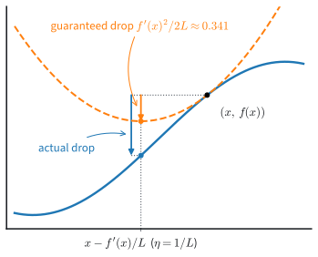{width=100%}
:::
:::
:::

::: {.slide title="Newton's Method: Jumping to the Parabola Minimum"}
[Second-Order Optimization]{.kicker}

::: {.cols .vc}
::: {.col}
- **Using local curvature $f''(x_t)$ instead of global $L$:** Fit the local Taylor parabola $q(x) = f(x_t) + f'(x_t)(x-x_t) + \tfrac{1}{2}f''(x_t)(x-x_t)^2$.
- **Minimizing $q(x)$ when $f''(x_t) > 0$:** Setting $q'(x) = f'(x_t) + f''(x_t)(x-x_t) = 0$ yields **Newton's update**:
  $$x_{t+1} = x_t - \frac{f'(x_t)}{f''(x_t)}$$
- **Quadratic convergence near $x^\star$:** Expanding $0 = f'(x^\star)$ around $x_t$ to first order with Lagrange remainder gives the error recurrence $e_{t+1} = \frac{f'''(\xi_t)}{2f''(x_t)}e_t^2$, squaring the error each step.
:::

::: {.col .fig}
{width=100%}
:::
:::
:::

::: {.slide title="Newton's Quadratic Convergence vs. Far-Out Divergence"}
[Basin of Attraction]{.kicker}

Near a minimizer with $f''(x^\star) > 0$, Newton's method doubles the number of correct digits per step—but far from $x^\star$, small local curvature makes the parabola nearly flat and flings iterates past the basin of attraction:

@!mdl-single-variable-calculus-newton-s-method

::: {.d2l-note .warn}
On the strictly convex function $f(x) = x\arctan x - \tfrac{1}{2}\log(1+x^2)$, where $f'(x)=\arctan x$ and $f''(x)=1/(1+x^2)$, Newton converges from $x_0 = 1.3$ but diverges wildly from $x_0 = 1.4$ ($|x_0| \gtrsim 1.39$) unless the step is **damped**.
:::
:::

::: {.slide title="Nondifferentiable Corners and Subdifferentials"}
[Nonsmooth Calculus]{.kicker}

::: {.cols .vc}
::: {.col}
- **Disagreeing one-sided slopes:** At $x = 0$, $|x|$ has $f'_-(0) = -1$ and $f'_+(0) = +1$, while $\mathrm{ReLU}(x) = \max(0, x)$ has $f'_-(0) = 0$ and $f'_+(0) = +1$.
- **Convex subgradients:** A slope $g$ is a **subgradient** of a convex function $f$ at $x$ if its line supports the graph from below for all $y$:
  $$f(y) \ge f(x) + g\,(y - x)$$
- **The subdifferential $\partial f(x)$:** At a corner, supporting slopes form the interval $[f'_-(x), f'_+(x)]$, so $\partial |x|(0) = [-1, 1]$ and $\partial\,\mathrm{ReLU}(0) = [0, 1]$.
- **Convex optimality:** A point $x^\star$ is a global minimum of convex $f$ if and only if $0 \in \partial f(x^\star)$.
:::

::: {.col .fig}
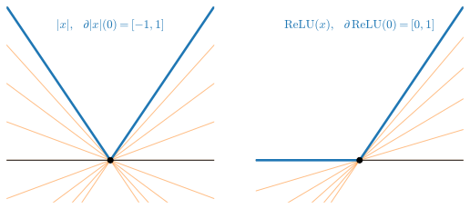{width=100%}
:::
:::
:::

::: {.slide title="Smoothing ReLU Explains the Subdifferential Interval"}
[Limiting Slopes]{.kicker}

::: {.cols .vc}
::: {.col}
- **Sharpened softplus approximation:** The smooth function $\mathrm{softplus}_\beta(x) = \frac{1}{\beta}\log(1 + e^{\beta x})$ converges uniformly to $\mathrm{ReLU}(x)$ as $\beta \to \infty$.
- **Slopes fill $[0, 1]$ near the kink:** Its derivative is $\sigma(\beta x)$, which transitions smoothly from $0$ to $1$ across a window of width $O(1/\beta)$ around the origin.
- **Framework convention at $x = 0$:** At the exact corner $x = 0$, frameworks return one fixed value from $\partial f(0)$ by convention:

@!single-variable-calculus-one-sided
:::

::: {.col .fig}
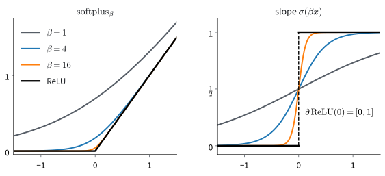{width=100%}
:::
:::
:::

::: {.slide title="Chained Subgradient Quirks in Floating Point"}
[Autodiff at Kinks]{.kicker}

Chaining fixed subgradient conventions across a composite graph can produce a number that is not a valid subgradient of the composite function:

- **The identity function written with two kinks:** For $\varphi(x) = \mathrm{ReLU}(x) - \mathrm{ReLU}(-x) = x$, the true derivative is $1$ everywhere, yet at $x = 0$ mechanical chaining with $\mathrm{ReLU}'(0) = 0$ returns $0 + 0 = 0$:

@!mdl-single-variable-calculus-why-sgd-shrugs

::: {.d2l-note}
**Why SGD training is unaffected (Bertoin et al., 2021, as corrected in their 2023 erratum):** Triggering this mismatch requires a pre-activation to land on $0.0$ exactly. In 32-bit `float32` arithmetic, changing $\mathrm{ReLU}'(0)$ within $[0, 1]$ alters gradients on only a few minibatches per million by $\sim 10^{-3}$, producing identical training and test accuracy.
:::
:::

::: {.slide title="Concept Check: Single-Variable Calculus"}
[Review & Practice]{.kicker}

Work out these three questions using the Taylor remainder, descent lemma, and subdifferential definition:

1. **Taylor error scaling:** For a smooth function with bounded fourth derivative, by what factor does the worst-case error of the cubic Taylor polynomial $P_3(x)$ on $|x - x_0| \le h$ shrink when $h$ is cut by a factor of $3$?
2. **Safe learning rate:** Suppose a loss $\ell(w)$ satisfies $|\ell''(w)| \le L = 10$ everywhere. Which step sizes $\eta$ are guaranteed by the descent lemma to decrease $\ell$, and which $\eta$ maximizes the guaranteed one-step drop?
3. **Subgradient optimality:** For $F(x) = |x| + \frac{1}{2}(x - 1)^2$, use $\partial F(0) = \partial|x|(0) + (0 - 1)$ to check whether $x = 0$ is the global minimizer.

::: {.d2l-note .fragment .fade-up}
**Answers:**

1. By the Lagrange remainder, $|R_3(x)| \le \frac{\max|f^{(4)}|}{4!}h^4$, so dividing $h$ by $3$ shrinks the error bound by $3^4 = 81$.
2. Every step size $0 < \eta < 2/L = 0.2$ is guaranteed to decrease $\ell$, and $\eta^\star = 1/L = 0.1$ maximizes the guaranteed decrease $\ell'(w)^2 / (2L) = \ell'(w)^2 / 20$.
3. At $x = 0$, $\partial F(0) = [-1, 1] - 1 = [-2, 0]$. Since $0 \in [-2, 0]$, the optimality condition $0 \in \partial F(0)$ holds and $x = 0$ is the unique global minimizer.
:::
:::

::: {.slide title="Summary: Single-Variable Calculus Toolkit"}
[Key Takeaways]{.kicker}

| Concept / Theorem | Mathematical Formulation | Deep Learning & Optimization Role |
| :--- | :--- | :--- |
| **Linear Approximation** | $f(x+\epsilon) = f(x) + \epsilon f'(x) + o(\epsilon)$ | Local slope model; proves sum, product, and chain rules |
| **Softplus & Sigmoid** | $s(x)=\log(1+e^x)$, $s'=\sigma$, $s''=\sigma(1-\sigma) \le \tfrac{1}{4}$ | Smooth counterpart of $\mathrm{ReLU}$; binary logistic loss curvature |
| **Mean Value Theorem** | $f'(\xi) = \frac{f(b)-f(a)}{b-a}$ for some $\xi \in (a,b)$ | Connects pointwise derivatives to interval monotonicity |
| **Taylor & Lagrange $R_n$** | $f(x) = \sum_{i=0}^n \frac{f^{(i)}(x_0)}{i!}(x-x_0)^i + \frac{f^{(n+1)}(\xi)}{(n+1)!}(x-x_0)^{n+1}$ | Quantifies $O(h^{n+1})$ truncation error of degree-$n$ local models |
| **Descent Lemma** | $f(x-\eta f'(x)) \le f(x) - \eta(1 - \frac{L\eta}{2})f'(x)^2$ | Certifies safe learning rates $0 < \eta < 2/L$ and optimal $\eta = 1/L$ |
| **Newton's Method** | $x_{t+1} = x_t - f'(x_t)/f''(x_t)$, $e_{t+1} \approx \frac{f'''(x^\star)}{2f''(x^\star)}e_t^2$ | Minimizes local parabola $P_2$; quadratic local convergence |
| **Subdifferential** | $\partial f(x) = \{g : f(y) \ge f(x) + g(y-x)\ \forall y\}$ | Handles $\mathrm{ReLU}$ & $\|x\|$ kinks; global minimum iff $0 \in \partial f(x)$ |
:::

