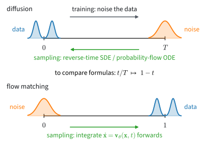
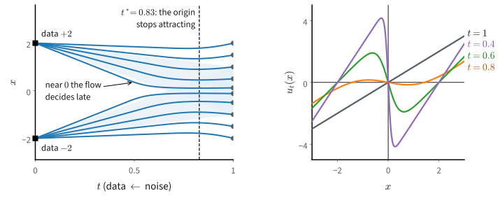
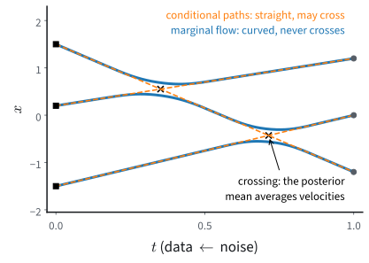
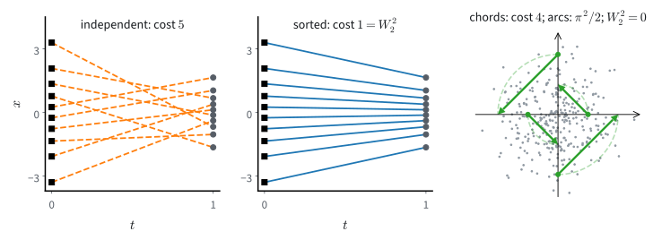

# Flow Matching and Optimal Transport
:label:`sec_mdl-flow-matching-transport`

The samplers of the previous section call the score once per step, a
thousand times for the reverse chain and a few dozen for its deterministic
strides. They need so many steps because the paths from noise to data curve,
and a solver can follow a curved path only in short pieces. Nobody designed
those paths. They came with the noising process. Could we choose the path
from noise to data ourselves, and choose one along which a solver can take
long steps?

Picture two data points at $-2$ and $+2$ and a cloud of Gaussian noise that
must end on them. If every particle moved in a straight line at constant
speed toward its own point, one Euler step of length one would carry it there
exactly. But a velocity field is one function of position and time.
Particles bound for different points pass through the same place, and the
field there can point only one way.

Flow matching :cite:`Lipman.Chen.BenHamu.ea.2022` and rectified flow
:cite:`Liu.Gong.Liu.2022` do choose: they prescribe the path and learn only
the velocity that moves mass along it. Which paths are cheapest is a much
older question, the problem of *optimal transport*. Gaspard Monge asked it
in 1781 about moving a pile of earth into a hole, and under squared distance
the cheapest motion turns out to be the one we just wished for, every
particle on a straight line at constant speed
:cite:`Benamou.Brenier.2000`.

One regression trains the velocity of any path assembled from simple pieces,
because that velocity is an average over particles and least squares learns
averages (:numref:`sec_mdl-flow-matching`). Straight pieces still give a
curved flow. Re-pairing noise with data straightens it
(:numref:`sec_mdl-rectified-flow`), and optimal transport says what the
re-pairing aims at (:numref:`sec_mdl-ot-connection`). Two parts can wait
for a second reading: the conversions between score, noise and velocity
that follow the definition of the Gaussian path in
:numref:`sec_mdl-score-velocity-dictionary`, and the solver comparison of
:numref:`sec_mdl-sampling-learned-dynamics`.

::: {.callout-important title="One clock"}
Time runs as in the previous section, from the data at $t = 0$ to the noise,
now at $t = 1$. This holds for scores and velocities alike: training noises
the data forward in time, and every sampler integrates from $t = 1$ down to
$t = 0$.

The flow-matching papers cited in this section, and their code, run time the
other way, from noise at $0$ to data at $1$
(:numref:`fig_mdl-dyn-time-conventions`). To compare a formula with theirs,
substitute $1 - t$ for their $t$, read their noise $\mathbf{x}_0$ as our
$\boldsymbol{\epsilon}$ and their data $\mathbf{x}_1$ as our
$\mathbf{x}_0$, and flip the sign of every velocity.
:::


:label:`fig_mdl-dyn-time-conventions`

The data are $\mathbf{x}_0 \sim p_0$, and $p_t$ is a path of densities from
$p_0$ to the noise $p_1 = \mathcal{N}(\mathbf{0}, \mathbf{I})$. A sample
from the noise end has two names: $\boldsymbol{\epsilon}$ when it is
Gaussian noise, as in the previous section, and $\mathbf{x}_1$ in statements
about pairings, which hold for any two endpoint laws.

```{.python .input #mdl-flow-matching-transport-flow-matching-and-optimal-transport}
#@tab mxnet
import math
import numpy as np
from mxnet import autograd, gluon, init, np as mnp, npx
from mxnet.gluon import nn
from d2l import mxnet as d2l
npx.set_np()
```

```{.python .input #mdl-flow-matching-transport-flow-matching-and-optimal-transport}
#@tab pytorch
import math
import numpy as np
import torch
from torch import nn
from torch.nn import functional as F
from d2l import torch as d2l
```

```{.python .input #mdl-flow-matching-transport-flow-matching-and-optimal-transport}
#@tab tensorflow
import math
import numpy as np
import tensorflow as tf
from d2l import tensorflow as d2l
```

```{.python .input #mdl-flow-matching-transport-flow-matching-and-optimal-transport}
#@tab jax
import math
import numpy as np
import jax
from jax import numpy as jnp
from flax import nnx
import optax
from d2l import jax as d2l
```

```{.python .input #mdl-flow-matching-transport-flow-matching-and-optimal-transport-1}
#@tab mxnet
from mxnet import lr_scheduler
```

## Flow Matching
:label:`sec_mdl-flow-matching`

### Probability Paths and Velocity Fields

Diffusion got its path from a noising process and then had to learn the
score to run that process backward. Here the path is ours to choose. A
**probability path** is a family of densities $(p_t)_{t \in [0, 1]}$ with
$p_0$ the data and $p_1$ the noise. A velocity field $\mathbf{u}_t$
*realizes* the path if the pair satisfies the continuity equation of
:numref:`sec_mdl-continuity-equation`, which says that a density moved by a
velocity field changes by the net inflow of mass,

$$
\partial_t p_t + \nabla \cdot (p_t\, \mathbf{u}_t) = 0 .
$$

Then, for a Lipschitz field, integrating
$\dot{\mathbf{x}} = \mathbf{u}_t(\mathbf{x})$ from a sample of $p_1$ at
$t = 1$ down to $t = 0$ yields a sample of $p_t$ at every time, and of the
data at $t = 0$. Note the direction. The field points the way the noising
goes, from data toward noise, and a sampler steps against it. If a network
$\mathbf{u}_{\boldsymbol{\theta}}(\mathbf{x}, t)$ approximates
$\mathbf{u}_t$, generation is an ODE solve from noise. Such a model is a
continuous normalizing flow (:numref:`sec_mdl-continuous-normalizing-flows`)
run backward in time: its flow map from $t = 1$ to $t = 0$ is the
generator. Flow matching trains it without solving the ODE even once. The
natural objective is the **flow-matching loss**

$$
\mathcal{L}_{\mathrm{FM}}(\boldsymbol{\theta})
= \mathbb{E}_{t \sim \mathcal{U}[0,1],\ \mathbf{x} \sim p_t}
\left[\, \left\| \mathbf{u}_{\boldsymbol{\theta}}(\mathbf{x}, t) - \mathbf{u}_t(\mathbf{x}) \right\|^2 \right].
$$
:eqlabel:`eq_mdl-fm-loss`

It is the mean squared error of the network against the true velocity,
averaged over time and over the cloud. As it stands it is of no use, because
it regresses on a field we cannot evaluate: $\mathbf{u}_t$ depends on the
whole data distribution.

We therefore build the path out of pieces we can write down. Let a
conditioning variable $\mathbf{z}$, drawn from a law $q$, be a data point,
or a pair of a noise point and a data point. For each value of $\mathbf{z}$,
pick a small moving blob $p_t(\mathbf{x} \mid \mathbf{z})$ that sits on the
data point at $t = 0$ and ends in the noise at $t = 1$: spread over all of
it if $\mathbf{z}$ is a data point, on its own noise point if $\mathbf{z}$
is a pair. Each blob comes with a velocity
$\mathbf{u}_t(\mathbf{x} \mid \mathbf{z})$ that we know in closed form. The
path is the mixture of the blobs,
$p_t(\mathbf{x}) = \int p_t(\mathbf{x} \mid \mathbf{z})\, q(\mathbf{z})\, d\mathbf{z}$,
and we write $\mathbf{x}_t$ for a particle of it: draw $\mathbf{z}$ from
$q$, then a point of its blob at time $t$. Which velocity moves the mixture?
Everything in this section rests on the answer.

**Proposition (the marginal velocity is a posterior mean).** *Suppose that
for each $\mathbf{z}$ the density $p_t(\cdot \mid \mathbf{z})$ is positive and
continuously differentiable in $(\mathbf{x}, t)$, that it satisfies the
continuity equation
$\partial_t p_t(\mathbf{x} \mid \mathbf{z}) = -\nabla \cdot \left( p_t(\mathbf{x} \mid \mathbf{z})\, \mathbf{u}_t(\mathbf{x} \mid \mathbf{z}) \right)$
with a continuously differentiable velocity, and that the integrals below may
be differentiated under the integral sign. Define on $\{p_t > 0\}$ the*
**marginal velocity**

$$
\mathbf{u}_t(\mathbf{x})
= \mathbb{E}\left[ \mathbf{u}_t(\mathbf{x} \mid \mathbf{z}) \mid \mathbf{x}_t = \mathbf{x} \right]
= \int \mathbf{u}_t(\mathbf{x} \mid \mathbf{z})\,
\frac{p_t(\mathbf{x} \mid \mathbf{z})\, q(\mathbf{z})}{p_t(\mathbf{x})}\, d\mathbf{z}.
$$
:eqlabel:`eq_mdl-marginal-velocity`

*Then $(p_t, \mathbf{u}_t)$ satisfies the continuity equation.*

The velocity of the cloud at $\mathbf{x}$ is the average of the velocities of
the blobs that could have put a particle at $\mathbf{x}$, each weighted by how
likely it is to have done so.

**Proof.** Differentiate the mixture under the integral sign, substitute the
conditional continuity equation, and pull the divergence out of the integral:

$$
\begin{aligned}
\partial_t p_t(\mathbf{x})
&= \int \partial_t p_t(\mathbf{x} \mid \mathbf{z})\, q(\mathbf{z})\, d\mathbf{z} \\
&= -\nabla \cdot \int p_t(\mathbf{x} \mid \mathbf{z})\, \mathbf{u}_t(\mathbf{x} \mid \mathbf{z})\, q(\mathbf{z})\, d\mathbf{z}
= -\nabla \cdot \left( p_t(\mathbf{x})\, \mathbf{u}_t(\mathbf{x}) \right).
\end{aligned}
$$

The last step multiplies and divides by $p_t(\mathbf{x})$ and recognizes
:eqref:`eq_mdl-marginal-velocity`. $\blacksquare$

Where only one blob passes, the marginal velocity is that blob's velocity.
Where several pass, it is their average, and this averaging is what will bend
the flow.

### The Conditional Flow Matching Theorem

The target of :eqref:`eq_mdl-fm-loss` is the posterior mean
:eqref:`eq_mdl-marginal-velocity` of a quantity we can compute for every
sample. By the regression lemma :eqref:`eq_mdl-regression-lemma`, least
squares against a per-sample target fits its conditional mean. We may
therefore regress on the per-sample quantity, which is what the
**conditional flow matching** (CFM) loss does:

$$
\mathcal{L}_{\mathrm{CFM}}(\boldsymbol{\theta})
= \mathbb{E}_{t,\ \mathbf{z} \sim q,\ \mathbf{x} \sim p_t(\cdot \mid \mathbf{z})}
\left[\, \left\| \mathbf{u}_{\boldsymbol{\theta}}(\mathbf{x}, t) - \mathbf{u}_t(\mathbf{x} \mid \mathbf{z}) \right\|^2 \right].
$$
:eqlabel:`eq_mdl-cfm-loss`

It needs only a sample of $(t, \mathbf{z}, \mathbf{x})$ and the closed-form
conditional velocity.

**Theorem (CFM trains the marginal field).** *Let $\mathbf{u}_t$ be the
marginal velocity :eqref:`eq_mdl-marginal-velocity` and suppose that
$\mathbb{E}\|\mathbf{u}_t(\mathbf{x} \mid \mathbf{z})\|^2 < \infty$. Then*

$$
\mathcal{L}_{\mathrm{CFM}}(\boldsymbol{\theta})
= \mathcal{L}_{\mathrm{FM}}(\boldsymbol{\theta}) + C
$$

*with $C$ independent of $\boldsymbol{\theta}$. In particular the two
objectives have the same gradients and the same minimizers*
:cite:`Lipman.Chen.BenHamu.ea.2022,Tong.Fatras.Malkin.ea.2023`.

**Proof.** Apply the regression lemma with $X = (\mathbf{x}, t)$, where
$\mathbf{x} \sim p_t(\cdot \mid \mathbf{z})$, and
$Y = \mathbf{u}_t(\mathbf{x} \mid \mathbf{z})$, which is square-integrable by
hypothesis. The law of $X$ is $t \sim \mathcal{U}[0,1]$ and
$\mathbf{x} \sim p_t$, and the conditional mean of $Y$ given $X$ is the
marginal velocity, by its definition :eqref:`eq_mdl-marginal-velocity`. The
lemma splits $\mathcal{L}_{\mathrm{CFM}}$ into
$\mathbb{E}\| \mathbf{u}_{\boldsymbol{\theta}}(X) - \mathbf{u}_t(\mathbf{x}) \|^2 = \mathcal{L}_{\mathrm{FM}}$
and $C = \mathbb{E}\| Y - \mathbf{u}_t(\mathbf{x}) \|^2$, which does not
involve $\boldsymbol{\theta}$. $\blacksquare$

The proof is one line because the lemma does the work, and the theorem needs
no hypothesis on the path beyond a square-integrable target. It says only
that the regression has the right minimizer. That this minimizer carries
$p_1$ to $p_0$, when integrated from $t = 1$ to $t = 0$, is what the
proposition before it guarantees. The constant $C$ is the conditional
variance of the target. It measures how much the per-sample velocities
through a point disagree, so the CFM loss of a perfect field equals $C$, not
zero. We call $C$ the *floor* of the loss. Denoising score matching has the
same structure, with the score of the noising kernel as the per-sample
quantity and the marginal score as its posterior mean.

No solver appears in this loss, and no trajectory is integrated during
training. The model of :numref:`sec_mdl-neural-odes` that was trained
through ten Euler steps hit its targets with ten steps and missed them when
it was integrated more finely: it had fitted a program of ten steps. What
this regression fits is a field, and the number of steps is chosen
afterwards.

### Score, Noise, and Velocity
:label:`sec_mdl-score-velocity-dictionary`

The marginal-velocity proposition asks for blobs with known velocities, and
so far we have named none. The first family is one we already own. The
Gaussian paths of the previous section are probability paths of this kind,
and on them the velocity is not a new object. Suppose a network has been
trained to predict the noise, as diffusion models are. Do we need a second
training run to obtain a velocity? We do not. The score, the noise, the
clean point and the velocity are affine functions of one posterior mean, and
a network that has learned the noise has learned the other three.

Condition on a data point, $\mathbf{z} = \mathbf{x}_0$, and take the path

$$
\mathbf{x}_t = \alpha_t\, \mathbf{x}_0 + \sigma_t\, \boldsymbol{\epsilon},
\qquad \boldsymbol{\epsilon} \sim \mathcal{N}(\mathbf{0}, \mathbf{I}),
$$
:eqlabel:`eq_mdl-gaussian-path`

with smooth coefficients $(\alpha_t, \sigma_t)$, $(\alpha_0, \sigma_0) = (1, 0)$
and $(\alpha_1, \sigma_1) = (0, 1)$. The blob around $\alpha_t \mathbf{x}_0$
has width $\sigma_t$: at $t = 0$ it is the data point, at $t = 1$ the noise.
This is the noising kernel of the previous section, with the noise end
placed at $t = 1$.

Let us start with the smallest case, Gaussian data
$x_0 \sim \mathcal{N}(0, s_0^2)$ in one dimension on the cosine path
$\alpha_t = \cos\frac{\pi t}{2}$, $\sigma_t = \sin\frac{\pi t}{2}$. The
marginal is $\mathcal{N}(0, s_t^2)$ with
$s_t^2 = \alpha_t^2 s_0^2 + \sigma_t^2$, the score is $-x/s_t^2$, and the
velocity is $u_t(x) = (\dot{s}_t/s_t)\, x$: a Gaussian cloud only stretches
or shrinks (Exercise :exref:`ex_mdl-flow-matching-transport-kinetic-energy`).
With $s_0 = 2$ at $t = \tfrac12$ we get $s_t^2 = 2.5$, and a particle at $x$
has velocity $-0.94\, x$. The field points inward because noising shrinks
this cloud, from width $2$ at $t = 0$ to width $1$ at $t = 1$. A sampler
runs against it and stretches the cloud back to width $2$. With $s_0 = 1$
every $p_t$ is the standard Gaussian and the cloud never moves:
$u \equiv 0$.

**Proposition (score–velocity identity).** *For the Gaussian path
:eqref:`eq_mdl-gaussian-path`, at any $t$ with $\alpha_t, \sigma_t > 0$ and on
$\{p_t > 0\}$, the marginal velocity is an affine function of the marginal
score:*

$$
\mathbf{u}_t(\mathbf{x})
= \frac{\dot{\alpha}_t}{\alpha_t}\, \mathbf{x}
- \left( \sigma_t \dot{\sigma}_t - \sigma_t^2\, \frac{\dot{\alpha}_t}{\alpha_t} \right)
\nabla \log p_t(\mathbf{x}).
$$
:eqlabel:`eq_mdl-score-velocity`

The velocity is a multiple of the position plus a multiple of the score, and
the schedule alone fixes both multiples. The data enter only through the
score. The bracket in front of the score equals
$\sigma_t^2\, \frac{d}{dt} \log(\sigma_t/\alpha_t)$, which is positive
whenever the ratio of noise to signal is growing, as it is on every path we
use. The identity can then be solved for the score, and each field
determines the other.

**Proof.** We show that both sides are affine in one posterior mean,
$\hat{\mathbf{x}}_0 = \mathbb{E}[\mathbf{x}_0 \mid \mathbf{x}_t = \mathbf{x}]$.
Differentiating the path gives the conditional velocity
$\dot{\mathbf{x}}_t = \dot{\alpha}_t \mathbf{x}_0 + \dot{\sigma}_t \boldsymbol{\epsilon}$,
and $\boldsymbol{\epsilon} = (\mathbf{x} - \alpha_t \mathbf{x}_0)/\sigma_t$.
Taking the posterior mean as in :eqref:`eq_mdl-marginal-velocity`,

$$
\mathbf{u}_t(\mathbf{x})
= \frac{\dot{\sigma}_t}{\sigma_t}\, \mathbf{x}
+ \left( \dot{\alpha}_t - \alpha_t\, \frac{\dot{\sigma}_t}{\sigma_t} \right) \hat{\mathbf{x}}_0.
$$

The marginal score is the posterior mean of the scores of the kernels, which
is Tweedie's formula of the previous section. The kernel
$\mathcal{N}(\alpha_t \mathbf{x}_0, \sigma_t^2 \mathbf{I})$ has score
$(\alpha_t \mathbf{x}_0 - \mathbf{x})/\sigma_t^2$, so

$$
\begin{aligned}
\nabla \log p_t(\mathbf{x})
&= \mathbb{E}\left[ \frac{\alpha_t \mathbf{x}_0 - \mathbf{x}}{\sigma_t^2} \,\middle|\, \mathbf{x}_t = \mathbf{x} \right]
= \frac{\alpha_t \hat{\mathbf{x}}_0 - \mathbf{x}}{\sigma_t^2}, \\
\hat{\mathbf{x}}_0 &= \frac{\mathbf{x} + \sigma_t^2\, \nabla \log p_t(\mathbf{x})}{\alpha_t}.
\end{aligned}
$$

Substituting this $\hat{\mathbf{x}}_0$ into the velocity and collecting the
$\mathbf{x}$ and $\nabla \log p_t$ terms gives :eqref:`eq_mdl-score-velocity`.
$\blacksquare$

Two special cases are worth writing out. On a variance-preserving path,
$\alpha_t^2 + \sigma_t^2 = 1$, so
$\sigma_t \dot{\sigma}_t = -\alpha_t \dot{\alpha}_t$ and the coefficient of
the score collapses to $\dot{\alpha}_t/\alpha_t$:
$\mathbf{u}_t(\mathbf{x}) = \frac{\dot{\alpha}_t}{\alpha_t}\big(\mathbf{x} + \nabla \log p_t(\mathbf{x})\big)$.
For the variance-preserving SDE of the previous section,
$\alpha_t = \exp\big(-\tfrac12 \int_0^t \beta(s)\, ds\big)$, so
$\dot{\alpha}_t/\alpha_t = -\tfrac12 \beta(t)$ and the velocity is
$-\tfrac12 \beta(t) \big(\mathbf{x} + \nabla \log p_t(\mathbf{x})\big)$.
This is the probability-flow velocity
$\mathbf{f} - \tfrac12 g^2 \nabla \log p_t$ of
:eqref:`eq_mdl-dyn-pf-velocity` with $\mathbf{f} = -\tfrac12 \beta\, \mathbf{x}$
and $g^2 = \beta$. On this path the flow-matching velocity and the
probability-flow ODE are the same field on the same clock. The cosine path
of the Gaussian example is variance-preserving too, so we can check the
form on it: $\nabla \log p_t = -x/s_t^2$ gives
$\frac{\dot\alpha_t}{\alpha_t}(1 - 1/s_t^2)\, x = \alpha_t \dot{\alpha}_t (s_0^2 - 1)\, x / s_t^2$,
the stretching rate $\dot{s}_t/s_t$ found above.

On the straight path $\alpha_t = 1 - t$, $\sigma_t = t$, which the rest of
the section uses, the identity reads
$\mathbf{u}_t(\mathbf{x}) = -\big(\mathbf{x} + t\, \nabla \log p_t(\mathbf{x})\big)/(1 - t)$.

The same posterior mean underlies the targets that networks are trained on in
practice (:numref:`tab_mdl-score-noise-velocity`).

:Network targets on a Gaussian path. Each row gives the quantity a network predicts, the posterior mean it estimates, and its conversion from the score. The name $\mathbf{v}$-prediction comes from the literature; on the cosine path its target $\alpha_t\boldsymbol\epsilon - \sigma_t\mathbf{x}_0$ is $2/\pi$ times the velocity target.
:label:`tab_mdl-score-noise-velocity`

| Network predicts | Posterior mean | From the score $\mathbf{s} = \nabla \log p_t$ |
| :-- | :-- | :-- |
| score $\mathbf{s}_{\boldsymbol{\theta}}$ | $\nabla \log p_t(\mathbf{x})$ | $\mathbf{s}$ |
| noise $\hat{\boldsymbol{\epsilon}}$ | $\mathbb{E}[\boldsymbol{\epsilon} \mid \mathbf{x}_t = \mathbf{x}]$ | $-\sigma_t\, \mathbf{s}$ |
| clean point $\hat{\mathbf{x}}_0$ | $\mathbb{E}[\mathbf{x}_0 \mid \mathbf{x}_t = \mathbf{x}]$ | $(\mathbf{x} + \sigma_t^2\, \mathbf{s})/\alpha_t$ |
| velocity $\mathbf{u}_{\boldsymbol{\theta}}$ | $\mathbb{E}[\dot{\mathbf{x}}_t \mid \mathbf{x}_t = \mathbf{x}]$ | the identity :eqref:`eq_mdl-score-velocity` |
| $\mathbf{v}$-prediction $\hat{\mathbf{v}}$ | $\mathbb{E}[\alpha_t \boldsymbol{\epsilon} - \sigma_t \mathbf{x}_0 \mid \mathbf{x}_t = \mathbf{x}]$ | $-\tfrac{\sigma_t}{\alpha_t}\, \mathbf{x} - \sigma_t\, \tfrac{\alpha_t^2 + \sigma_t^2}{\alpha_t}\, \mathbf{s}$ |

Each row is a $t$-dependent affine function of the same posterior mean, so a
network trained on any row defines all of them. Which row is easiest to learn
is a separate question, about the variance of the training targets at the two
ends of the path (Exercise
:exref:`ex_mdl-flow-matching-transport-target-conditioning`). A noise
predictor is therefore also a velocity field: the samplers of this section
apply to it after the conversion of
:numref:`tab_mdl-score-noise-velocity`.

### Example: Two Points in One Dimension
:label:`subsec_mdl-fm-two-point`

Before choosing among paths we work one case to the end. For the two-point
data set of the opening every object so far has a closed form, and the
closed form shows the failure that :numref:`sec_mdl-rectified-flow`
repairs. The data are $x_0 = \pm a$ with probability $\tfrac12$ each, with
$a = 2$: the two modes of the chapter's running mixture with their width
removed. The noise is $\epsilon \sim \mathcal{N}(0, 1)$, drawn
independently of $x_0$. We take the Gaussian path with $\alpha_t = 1 - t$
and $\sigma_t = t$, which joins each data point to its noise point by a
straight line at constant speed: $x_t = (1 - t)\, x_0 + t\, \epsilon$, with
velocity $\dot{x}_t = \epsilon - x_0$.

Take the data point as the conditioning variable, $\mathbf{z} = x_0$. Given
$x_0$, the position $x_t$ is $\mathcal{N}((1 - t)\, x_0, t^2)$, a positive
density for $t > 0$, so the marginal-velocity proposition applies.
Eliminating
$\epsilon = (x - (1 - t)\, x_0)/t$ expresses the velocity as a function of
the current position, $u_t(x \mid x_0) = (x - x_0)/t$. Run backward in time,
the particle heads for its data point at the speed that arrives exactly at
$t = 0$.

To average this velocity we need the posterior of $x_0$ at a point $x$. The
posterior odds of $+a$ against $-a$ at $x$ are the ratio of the two Gaussian
densities. In the exponent the terms $x^2$ and $(1 - t)^2 a^2$ cancel and
only the cross term survives, so the odds are
$\exp\big(2 (1 - t)\, a x / t^2\big)$ and the posterior mean is
$\mathbb{E}[x_0 \mid x_t = x] = a \tanh\big((1 - t)\, a x / t^2\big)$. The
marginal velocity is therefore

$$
u_t(x) = \frac{x - a \tanh\!\big(\frac{(1 - t)\, a x}{t^2}\big)}{t}.
$$
:eqlabel:`eq_mdl-two-point-velocity`

Run backward in time, the cloud at $x$ heads for the average of the two
targets, weighted by how plausible each is from $x$, at the speed that
arrives on time. At $(t, x) = (0.5, 0.5)$ the velocity is $-2.86$; at
$(0.7, -1)$ it is $0.97$.
Three properties can be read off :eqref:`eq_mdl-two-point-velocity`, and
:numref:`fig_mdl-dyn-two-point-flow` draws the first two.

* **At $t = 1$ the field is $u_1(x) = x$.** The noise sample carries no
  information about its target, so the posterior mean is the data mean $0$.
  One Euler step from $t = 1$ to $t = 0$, $x \mapsto x - u_1(x)$, sends
  *every* sample to $0$. This holds for any data under independent pairing:
  $\mathbf{u}_1(\mathbf{x}) = \mathbb{E}[\boldsymbol{\epsilon} - \mathbf{x}_0 \mid \boldsymbol{\epsilon} = \mathbf{x}] = \mathbf{x} - \mathbb{E}[\mathbf{x}_0]$,
  so one step of the exact field lands on the data mean.
* **The origin first attracts, then repels.** As $t$ falls, a sampler moves
  against $u_t$, so a positive slope at the origin pulls particles toward
  it and a negative slope pushes them away. The slope is
  $\partial_x u_t(0) = \big(1 - (1 - t)\, a^2/t^2\big)/t$: $+0.56$ at
  $t = 0.9$, zero at $t^* = 2\sqrt{2} - 2 \approx 0.83$ (the root of
  $(1 - t)\, a^2 = t^2$), $-0.31$ at $t = 0.8$ and $-14$ at $t = 0.5$.
  Particles near $0$ drift toward $0$ until $t$ falls to $t^*$ and leave for
  a mode only later, so the flow chooses a mode late. Far from the origin the
  $\tanh$ saturates and $u_t \approx (x \mp a)/t$, the conditional velocity
  itself.
* **The floor is collected near the noise.** The target $\epsilon - x_0$ has
  mean square $a^2 + 1 = 5$. Of this,
  $C = \mathbb{E}_t \mathbb{E}_x \textrm{Var}(x_0 \mid x_t)/t^2 \approx 2.0$
  is floor, with
  $\textrm{Var}(x_0 \mid x_t = x) = a^2 \operatorname{sech}^2\big((1 - t)\, a x/t^2\big)$,
  and the remaining $3.0$ is the mean square of the marginal velocity.
  Nearly all of $C$ comes from $t > 0.5$, where the two blobs overlap and a
  position does not tell which point its particle is bound for. Below
  $t = 0.4$ it does, and only about a thousandth of the floor is collected
  there, although the conditional velocity $(x - x_0)/t$ grows without bound
  (Exercise :exref:`ex_mdl-flow-matching-transport-late-decisions`).

![Two data points at $\pm 2$ and standard Gaussian noise with independent pairing; sampling runs from the noise at $t=1$ (right) to the data at $t=0$ (left). (a) Trajectories of the exact marginal flow over the one-standard-deviation bands of the two conditional blobs: until $t$ falls to $t^*=0.83$ every trajectory moves toward $0$, and those that start near $0$ leave for a mode only below $t\approx 0.6$. (b) The velocity $u_t(x)$ is $x$ at $t=1$, its slope at the origin turns negative and steep as $t$ falls, and it tends to $(x\mp 2)/t$ away from the origin.](../img/mdl-dyn-two-point-flow.svg)
:label:`fig_mdl-dyn-two-point-flow`

The cell takes the slope at the origin by a finite difference at the three
times of the second property. It then puts the first property to the test,
and asks what more steps would do. It integrates the exact field from
$t = 1$ to $t = 0$ with $1$, $2$, $4$ and $8$ equal Euler steps, starting
from the whole noise law, and prints how much of the mass lands within $0.1$
of a data point, together with the mean of $|x|$ at the end. The noise law is
a fine grid of starting points weighted by the Gaussian density, so nothing
in the output is random.

```{.python .input #mdl-flow-matching-transport-example-two-points-in-one-dimension}
a = 2.0                                       # data at -a and +a, noise N(0, 1)
def u_two_point(x, t):                        # closed form of the marginal velocity
    return (x - a * np.tanh((1 - t) * a * x / t**2)) / t

ts = np.array([0.9, 0.8, 0.5])
print('slope at the origin at t = 0.9, 0.8, 0.5:',
      ((u_two_point(1e-6, ts) - u_two_point(-1e-6, ts)) / 2e-6).round(2),
      '   t* =', round(2 * np.sqrt(2) - 2, 4))
x1 = np.linspace(-6, 6, 4001)                 # the noise law N(0, 1), as a weighted grid
w = np.exp(-x1**2 / 2) / np.exp(-x1**2 / 2).sum()
for K in (1, 2, 4, 8):                        # K equal Euler steps from t = 1 to t = 0
    x, ts = x1, np.linspace(1, 0, K + 1)
    for t, t_next in zip(ts[:-1], ts[1:]):
        x = x - (t - t_next) * u_two_point(x, t)
    print(f'{K} Euler step(s): mass within 0.1 of +-a {w @ (abs(abs(x) - a) < 0.1):.3f}, '
          f'mean |x| {w @ abs(x):.2f}')
```

The slopes are those of the formula. After one Euler step no mass at all
lies near a data point, and the mean of $|x|$ is $0$: every sample sits on
the data mean. So the wish of the opening fails at its first test. Every
conditional path is straight, yet the marginal flow is curved, and the one
long step we hoped to take collapses every sample onto the mean.

More steps repair the damage quickly. Two bring a little over a third of the
mass to a data point, four all but about one percent of it, and eight
practically all. So few suffice because the last step of any grid lands on
the posterior mean $a \tanh(\cdot)$, which is $\pm a$ wherever the earlier
steps have moved a particle far enough from the origin (Exercise
:exref:`ex_mdl-flow-matching-transport-late-decisions`). But steps are what
we set out to save. How to pair noise with data so that the flow comes out
straight, and one step is enough, is the subject of
:numref:`sec_mdl-rectified-flow`.

## Rectified Flow
:label:`sec_mdl-rectified-flow`

### Straight Paths and Their Crossings

The two-point example used straight conditional paths. In $d$ dimensions the
same construction pairs a data sample $\mathbf{x}_0$ with a noise sample
$\boldsymbol{\epsilon}$, drawn independently, and joins them by a straight
line traversed at constant speed:

$$
\mathbf{x}_t = (1 - t)\, \mathbf{x}_0 + t\, \boldsymbol{\epsilon},
\qquad
\mathbf{u}_t(\mathbf{x}_t \mid \mathbf{z}) = \dot{\mathbf{x}}_t = \boldsymbol{\epsilon} - \mathbf{x}_0,
\qquad \mathbf{z} = (\mathbf{x}_0, \boldsymbol{\epsilon}).
$$
:eqlabel:`eq_mdl-rf-path`

The conditional velocity does not depend on $t$, and the CFM loss
:eqref:`eq_mdl-cfm-loss` becomes the **rectified flow** objective
:cite:`Liu.Gong.Liu.2022,Lipman.Chen.BenHamu.ea.2022`

$$
\begin{aligned}
\mathcal{L}_{\mathrm{RF}}(\boldsymbol{\theta})
&= \mathbb{E}_{t,\ \mathbf{x}_0 \sim p_0,\ \boldsymbol{\epsilon} \sim p_1} \\
&\quad \left[\, \left\| \mathbf{u}_{\boldsymbol{\theta}}\big( (1 - t) \mathbf{x}_0 + t \boldsymbol{\epsilon},\ t \big)
- (\boldsymbol{\epsilon} - \mathbf{x}_0) \right\|^2 \right].
\end{aligned}
$$
:eqlabel:`eq_mdl-rf-loss`

Training draws data and noise, interpolates between them, and regresses on
the difference. That is the whole algorithm. Its name looks ahead:
*rectified* means straightened, and straight is what the flow becomes once
the pairing has been repaired. The flow of independent pairs, as we just
saw, is not.

One technical point has to be settled. With Gaussian noise we could
condition on $\mathbf{x}_0$ alone, as in the two-point example, and the
marginal-velocity proposition would apply. Conditioning on the pair is what
lets us change the pairing later, but given the pair, a point sliding along
a line has no density, so the proposition does not apply as stated. Its
conclusion still holds, by the same computation applied to the expectation
$\mathbb{E}\,\varphi(\mathbf{x}_t)$ of a smooth test function $\varphi$
(Exercise :exref:`ex_mdl-flow-matching-transport-reflow-fixed-points`).

Why does the flow bend? Two segments that cross at $(\mathbf{x}, t)$ feed
the posterior mean :eqref:`eq_mdl-marginal-velocity` two different
directions (:numref:`fig_mdl-dyn-fm-paths`). A function has one value at
each point, so the field averages them. An ODE whose field is Lipschitz in
$\mathbf{x}$ has exactly one trajectory through each point
(:numref:`sec_mdl-ode-existence-uniqueness`), so two trajectories of the
learned flow can never meet. Where the segments cross, the trajectories bend
away from each other instead.


:label:`fig_mdl-dyn-fm-paths`

The goal is a field whose trajectories are straight lines traversed at
constant speed. Such a field is constant along each trajectory, so one Euler
step of any length is exact. The independent pairing is far from this limit.
The loss is minimized by the right field and the pieces are as straight as
pieces can be, so the one thing left to change is which noise point is
joined to which data point.

### Example: Two Moons

The two points had a formula, and the formula said that one step fails. How
many steps does a trained network need, on data that have no formula? We
take the two moons, two interleaved crescents in the plane, train a small
network on them, and count. To count we need a score for samples, and we use
the **squared energy distance** :cite:`Szekely.Rizzo.2013` between laws $P$
and $Q$ with finite first moments,

$$
\mathcal{E}^2(P, Q) = 2\, \mathbb{E}\|X - Y\| - \mathbb{E}\|X - X'\| - \mathbb{E}\|Y - Y'\|,
$$

where $X, X' \sim P$ and $Y, Y' \sim Q$ are independent. It compares the
mean distance between a point of $P$ and a point of $Q$ with the mean
distances within each law. Székely and Rizzo call this expression itself
the energy distance; we call it squared because its square root is the
metric. It is a squared MMD (:numref:`sec_mdl-ipm-mmd`), and it is zero only
if $P = Q$. We estimate it from two samples by the unbiased U-statistic, and
every score quoted below is this squared distance.

The cell builds the data, standardized to zero mean and unit variance per
coordinate, a held-out sample of $2{,}048$ points, and one noise array
`z_eval` that every later comparison reuses. It then scores two references
against the held-out sample: a fresh sample of the data, and a point mass at
the data mean, which is what one Euler step of the exact field produces.

```{.python .input #score-matching-diffusion-flow-two-moons}
def two_moons(n, rng, noise=0.07):
    t = rng.uniform(0.0, np.pi, n)
    m = rng.integers(0, 2, n)                      # which moon
    X = np.stack([np.cos(t) * (1 - 2 * m) + m,
                  np.sin(t) * (1 - 2 * m) + 0.5 * m], axis=1)
    return X + noise * rng.standard_normal((n, 2))

rng = np.random.default_rng()
raw = two_moons(8192, rng)
mu, sd = raw.mean(0), raw.std(0)
moons = (raw - mu) / sd                            # standardized training data
held_out = (two_moons(2048, rng) - mu) / sd
z_eval = rng.standard_normal((2048, 2))            # noise for every comparison

def energy_distance(a, b):                         # squared energy distance, U-statistic
    d = lambda u, v: np.linalg.norm(u[:, None, :] - v[None, :, :], axis=-1)
    n, m = len(a), len(b)
    return (2 * d(a, b).mean() - d(a, a).sum() / (n * (n - 1))
            - d(b, b).sum() / (m * (m - 1)))

print(f'fresh data sample vs held-out: {energy_distance(moons[:2048], held_out):+.4f}')
print(f'point mass at the data mean vs held-out: '
      f'{energy_distance(np.zeros((2048, 2)), held_out):.3f}')
```

Two samples of the same law score within a few thousandths of zero, which
is the resolution of the metric at this sample size. The point mass scores
about $0.9$.

The model is a small tanh network that takes $(\mathbf{x}, t)$ and returns a
velocity; `field` evaluates it. The function `train_rf` takes a sampler of
pairs, so that we can change the pairing later. It returns the network
together with its loss averaged over the last $500$ batches, because single
batches scatter, and over the two coordinates, so the printed value is
$\mathcal{L}_{\mathrm{RF}}/2$.

```{.python .input #score-matching-diffusion-flow-cfm-train}
#@tab mxnet
def make_net():                         # init.Xavier() is Glorot uniform; biases 0
    net = gluon.nn.HybridSequential()
    net.add(gluon.nn.Dense(64, activation='tanh'),
            gluon.nn.Dense(64, activation='tanh'), gluon.nn.Dense(2))
    net.initialize(init.Xavier())
    net.hybridize()
    return net

def field(net, x, t):                   # the time enters centered, as 2t - 1
    return net(mnp.concatenate([x, 2 * t - 1], axis=1))

def train_rf(sample_pairs, steps=4000, tail=500):
    """Regress v(x_t, t) on eps - x0 (papers: -(x1 - x0) at time 1 - t).
    Return the net and the mean tail loss."""
    net = make_net()
    lr = lr_scheduler.CosineScheduler(steps, base_lr=3e-3)   # 3e-3 -> 0
    trainer = gluon.Trainer(net.collect_params(), 'adam',
                            {'learning_rate': 3e-3, 'lr_scheduler': lr})
    tail_sum = 0
    for step in range(steps):
        x0, eps = sample_pairs(256)                # data, noise
        t = mnp.random.uniform(0, 1, (256, 1))
        xt = (1 - t) * x0 + t * eps                # a point on each segment
        with autograd.record():
            loss = ((field(net, xt, t) - (eps - x0))**2).mean()
        loss.backward()
        trainer.step(1)
        if step >= steps - tail:
            tail_sum = tail_sum + loss             # stays on the device
    return net, float(tail_sum) / tail
```

```{.python .input #score-matching-diffusion-flow-cfm-train}
#@tab pytorch
def make_net():                         # 3 -> 64 -> 64 -> 2, Glorot weights, zero biases
    net = nn.Sequential(nn.Linear(3, 64), nn.Tanh(), nn.Linear(64, 64), nn.Tanh(),
                        nn.Linear(64, 2))
    for layer in net[::2]:
        nn.init.xavier_uniform_(layer.weight)
        nn.init.zeros_(layer.bias)
    return net

def field(net, x, t):                   # the time enters centered, as 2t - 1
    return net(torch.cat([x, 2 * t - 1], 1))

def train_rf(sample_pairs, steps=4000, tail=500):
    """Regress v(x_t, t) on eps - x0 (papers: -(x1 - x0) at time 1 - t).
    Return the net and the mean tail loss."""
    net = make_net()
    opt = torch.optim.Adam(net.parameters(), lr=3e-3)
    sched = torch.optim.lr_scheduler.CosineAnnealingLR(opt, steps)   # 3e-3 -> 0
    tail_sum = torch.zeros(())
    for step in range(steps):
        x0, eps = sample_pairs(256)                # data, noise
        t = torch.rand(256, 1)
        xt = (1 - t) * x0 + t * eps                # a point on each segment
        loss = ((field(net, xt, t) - (eps - x0))**2).mean()
        opt.zero_grad()
        loss.backward()
        opt.step()
        sched.step()
        if step >= steps - tail:
            tail_sum += loss.detach()              # stays on the device
    return net, (tail_sum / tail).item()
```

```{.python .input #score-matching-diffusion-flow-cfm-train}
#@tab tensorflow
def make_net():                         # Dense: Glorot-uniform weights, zero biases
    net = tf.keras.Sequential([tf.keras.layers.Dense(64, 'tanh'),
                               tf.keras.layers.Dense(64, 'tanh'),
                               tf.keras.layers.Dense(2)])
    net.build((None, 3))
    return net

def field(net, x, t):                   # the time enters centered, as 2t - 1
    return net(tf.concat([x, 2 * t - 1], 1))

def train_rf(sample_pairs, steps=4000, tail=500):
    """Regress v(x_t, t) on eps - x0 (papers: -(x1 - x0) at time 1 - t).
    Return the net and the mean tail loss."""
    net = make_net()
    lr = tf.keras.optimizers.schedules.CosineDecay(3e-3, steps)   # 3e-3 -> 0
    opt = tf.keras.optimizers.Adam(lr)

    @tf.function
    def train_step():
        x0, eps = sample_pairs(256)                # data, noise
        t = tf.random.uniform((256, 1))
        xt = (1 - t) * x0 + t * eps                # a point on each segment
        with tf.GradientTape() as tape:
            loss = tf.reduce_mean((field(net, xt, t) - (eps - x0))**2)
        grads = tape.gradient(loss, net.trainable_variables)
        opt.apply_gradients(zip(grads, net.trainable_variables))
        return loss

    tail_sum = tf.zeros(())
    for step in range(steps):
        loss = train_step()
        if step >= steps - tail:
            tail_sum += loss                       # stays on the device
    return net, float(tail_sum) / tail
```

```{.python .input #score-matching-diffusion-flow-cfm-train}
#@tab jax
def make_params(key, sizes=(3, 64, 64, 2)):    # Glorot-uniform weights, zero biases
    glorot = jax.nn.initializers.glorot_uniform()
    keys = jax.random.split(key, len(sizes) - 1)
    return [(glorot(k, (i, o)), jnp.zeros(o))
            for k, i, o in zip(keys, sizes[:-1], sizes[1:])]

def mlp(params, x):
    for W, b in params[:-1]:
        x = jnp.tanh(x @ W + b)
    W, b = params[-1]
    return x @ W + b

def field(params, x, t):                # the time enters centered, as 2t - 1
    return mlp(params, jnp.concatenate([x, 2 * t - 1], 1))

def train_rf(sample_pairs, steps=4000, tail=500):
    """Regress v(x_t, t) on eps - x0 (papers: -(x1 - x0) at time 1 - t).
    Return the parameters and the mean tail loss; sample_pairs(key, n) draws
    n (data, noise) pairs."""
    opt = optax.adam(optax.cosine_decay_schedule(3e-3, steps))   # 3e-3 -> 0
    def loss_fn(params, key):
        k_pairs, k_t = jax.random.split(key)
        x0, eps = sample_pairs(k_pairs, 256)       # data, noise
        t = jax.random.uniform(k_t, (256, 1))
        xt = (1 - t) * x0 + t * eps                # a point on each segment
        return ((field(params, xt, t) - (eps - x0))**2).mean()
    def step(carry, key):
        params, state = carry
        loss, grads = jax.value_and_grad(loss_fn)(params, key)
        updates, state = opt.update(grads, state)
        return (optax.apply_updates(params, updates), state), loss
    k_init, k_steps = jax.random.split(jax.random.key(int(rng.integers(2**31))))
    params = make_params(k_init)
    (params, _), losses = jax.lax.scan(step, (params, opt.init(params)),
                                       jax.random.split(k_steps, steps))
    return params, float(losses[-tail:].mean())
```

The first run pairs noise and data independently. By the CFM theorem its
loss cannot reach zero, and where it stops measures how much the segments
cross. The floor $C$ is the conditional variance of
$\boldsymbol{\epsilon} - \mathbf{x}_0$ given $\mathbf{x}_t$, averaged over
$t$. Can we know it before we train? For a finite data set we can, without
any network. Given $\mathbf{x}_t$, the posterior of $\mathbf{x}_0$ puts on
each training point $\mathbf{x}_0'$ a weight proportional to
$\exp\big(-\|\mathbf{x}_t - (1 - t)\, \mathbf{x}_0'\|^2 / 2t^2\big)$. The
target is $\boldsymbol{\epsilon} - \mathbf{x}_0 = (\mathbf{x}_t - \mathbf{x}_0)/t$,
so its conditional variance is the posterior variance of $\mathbf{x}_0$
divided by $t^2$. The function `pairing_floor` averages this quantity over
$4{,}000$ draws of $(t, \mathbf{x}_0, \boldsymbol{\epsilon})$ and halves it,
because `train_rf` reports its loss per coordinate.

```{.python .input #mdl-flow-matching-transport-example-two-moons-2}
def pairing_floor(data, rng, m=4000, chunk=500):
    """Floor C of independent pairing, per coordinate: E Var(eps - x0 | x_t) / 2."""
    t = rng.uniform(0, 1, (m, 1))
    xt = (1 - t) * data[rng.integers(0, len(data), m)] + t * rng.standard_normal((m, 2))
    var = []
    for i in range(0, m, chunk):              # posterior of x0 over all training points
        ti, xi = t[i:i + chunk], xt[i:i + chunk]
        d2 = ((xi**2).sum(1, keepdims=True) - 2 * (1 - ti) * xi @ data.T
              + (1 - ti)**2 * (data**2).sum(1))           # |x_t - (1 - t) x0'|^2
        logw = -d2 / (2 * ti**2)
        r = np.exp(logw - logw.max(1, keepdims=True))
        r /= r.sum(1, keepdims=True)
        v = r @ (data**2).sum(1) - ((r @ data)**2).sum(1)  # Var(x0 | x_t), summed
        var.append(v / ti[:, 0]**2)           # eps - x0 = (x_t - x0) / t
    return np.concatenate(var).mean() / 2

print(f'floor of the independent pairing, per coordinate: {pairing_floor(moons, rng):.2f}')
```

The floor is about $1.37$ per coordinate, and the estimate moves in the
second decimal from one draw to the next. A perfect network would stop there.
Ours has two hidden layers and $4{,}000$ steps to get close.

```{.python .input #mdl-flow-matching-transport-example-two-moons-1}
#@tab mxnet
data = mnp.array(moons)
def independent_pairs(n):                       # random data rows, fresh noise
    return data[mnp.random.randint(0, len(data), (n,))], mnp.random.normal(0, 1, (n, 2))

net, plateau = train_rf(independent_pairs)
print(f'CFM loss, mean of the last 500 batches: {plateau:.2f}')
```

```{.python .input #mdl-flow-matching-transport-example-two-moons-1}
#@tab pytorch
data = torch.tensor(moons, dtype=torch.float32)
def independent_pairs(n):                       # random data rows, fresh noise
    return data[torch.randint(0, len(data), (n,))], torch.randn(n, 2)

net, plateau = train_rf(independent_pairs)
print(f'CFM loss, mean of the last 500 batches: {plateau:.2f}')
```

```{.python .input #mdl-flow-matching-transport-example-two-moons-1}
#@tab tensorflow
data = tf.constant(moons, tf.float32)
def independent_pairs(n):                       # random data rows, fresh noise
    return (tf.gather(data, tf.random.uniform((n,), 0, len(moons), tf.int32)),
            tf.random.normal((n, 2)))

net, plateau = train_rf(independent_pairs)
print(f'CFM loss, mean of the last 500 batches: {plateau:.2f}')
```

```{.python .input #mdl-flow-matching-transport-example-two-moons-1}
#@tab jax
data = jnp.asarray(moons, dtype=jnp.float32)
def independent_pairs(key, n):                  # random data rows, fresh noise
    k_rows, k_noise = jax.random.split(key)
    return (data[jax.random.randint(k_rows, (n,), 0, len(data))],
            jax.random.normal(k_noise, (n, 2)))

net, plateau = train_rf(independent_pairs)
print(f'CFM loss, mean of the last 500 batches: {plateau:.2f}')
```

The loss settles at about $1.4$ per coordinate, a few hundredths above the
floor. A loss of $1.4$ therefore does not mean a poor fit. Almost all of it
is the disagreement of crossing segments, which no network can remove. By
the CFM theorem only the excess over the floor is error of the field.

Those few hundredths are not as small as they look, though. The target has
mean square $2$ per coordinate, one each from the noise and the standardized
data, and $1.37$ of it is floor. The field itself therefore has a mean
square of only about $0.6$, and its error is of the order of a tenth of
that. We shall meet this error again in the samples.

Sampling integrates $\dot{\mathbf{x}} = \mathbf{u}_{\boldsymbol{\theta}}(\mathbf{x}, t)$
from $t = 1$ down to $0$ with Euler's method
(:numref:`sec_mdl-euler-runge-kutta`): $K$ steps of length $1/K$, each of
which subtracts $\mathbf{u}_{\boldsymbol{\theta}}(\mathbf{x}, t)/K$ at
$t = 1, 1 - 1/K, \ldots, 1/K$. The function `euler_path` returns the whole
trajectory, of shape `(steps + 1, n, 2)`; its last row is the sample.

```{.python .input #score-matching-diffusion-flow-cfm-sample}
#@tab mxnet
def euler_path(net, z, steps):
    q = mnp.array(z, dtype='float32')
    path = [q]
    for k in range(steps):                     # t = 1, 1 - 1/steps, ..., 1/steps
        t = mnp.full((len(z), 1), 1 - k / steps)
        q = q - field(net, q, t) / steps
        path.append(q)
    return mnp.stack(path).asnumpy()
```

```{.python .input #score-matching-diffusion-flow-cfm-sample}
#@tab pytorch
@torch.inference_mode()
def euler_path(net, z, steps):
    q = torch.tensor(z, dtype=torch.float32)
    path = [q]
    for k in range(steps):                     # t = 1, 1 - 1/steps, ..., 1/steps
        t = torch.full((len(z), 1), 1 - k / steps)
        q = q - field(net, q, t) / steps
        path.append(q)
    return torch.stack(path).numpy()
```

```{.python .input #score-matching-diffusion-flow-cfm-sample}
#@tab tensorflow
def euler_path(net, z, steps):
    q = tf.constant(z, tf.float32)
    path = [q]
    for k in range(steps):                     # t = 1, 1 - 1/steps, ..., 1/steps
        t = tf.fill((len(z), 1), 1 - k / steps)
        q = q - field(net, q, t) / steps
        path.append(q)
    return tf.stack(path).numpy()
```

```{.python .input #score-matching-diffusion-flow-cfm-sample}
#@tab jax
def euler_path(params, z, steps):
    def step(q, t):
        q = q - field(params, q, jnp.full((len(z), 1), t)) / steps
        return q, q
    q1 = jnp.asarray(z, dtype=jnp.float32)                # noise at t = 1
    _, path = jax.lax.scan(step, q1, 1 - jnp.arange(steps) / steps)
    return np.concatenate([np.asarray(q1)[None], np.asarray(path)])
```

One step of the exact field would give the point mass that scored $0.9$. For
the trained field, the cell integrates the noise array `z_eval` with
$K = 1, 2, 4, \ldots, 64$ steps and plots the squared energy distance to the
held-out data on log–log axes.

```{.python .input #score-matching-diffusion-flow-steps-quality}
steps_list = [1, 2, 4, 8, 16, 32, 64]
eds = [energy_distance(euler_path(net, z_eval, K)[-1], held_out) for K in steps_list]
print('  '.join(f'{K}: {e:.3f}' for K, e in zip(steps_list, eds)))
d2l.plot(steps_list, eds, 'Euler steps', 'squared energy distance',
         xscale='log', yscale='log')
```

One step scores about $0.7$, the same order as the point mass at the mean
($0.9$): the network has learned, imperfectly, the collapse that the exact
field performs at $t = 1$. Two steps score about $0.16$, four about $0.04$,
eight $0.01$ to $0.02$, and from sixteen steps on the score levels off,
usually at a few thousandths and never much above $0.01$. The decline is
Euler's discretization error. The level that remains is the error of the
trained field; it varies with the training run and is often as small as the
metric can resolve with $2{,}048$ points. More steps help, as they should
for a field fitted without a solver; the field trained through ten Euler
steps in :numref:`sec_mdl-neural-odes` got worse when its steps were
refined.

A score is one number, and it is worth looking at what it summarizes. The
next cell draws the samples of $1$, $2$, $8$ and $32$ steps, and beside them
the held-out data.

```{.python .input #score-matching-diffusion-flow-cfm-panels}
panels = [(f'{K} Euler step(s)', euler_path(net, z_eval, K)[-1]) for K in (1, 2, 8, 32)]
fig, axes = d2l.plt.subplots(1, 5, figsize=(12, 2.6), sharex=True, sharey=True)
for ax, (title, s) in zip(axes, panels + [('held-out data', held_out)]):
    d2l.plot(s[:, 0], s[:, 1], title, fmts=('.',),
             xlim=(-2.5, 2.5), ylim=(-2.5, 2.5), axes=ax)
```

One step gives a blob around the mean and two a slanted band. Eight steps
spread the cloud over the region of the two moons, and to the eye thirty-two
add little to eight, although the score still tells them apart. Now set
either beside the data in the last panel. The data are two thin crescents.
The samples are thick and smeared, and their two crescents run into each
other. More steps do not sharpen them, so the blur belongs to the field and
not to the solver: it is what the few hundredths between the loss and its
floor look like.

The score hardly registers this blur. It compares mean distances between
points, so it reports where the mass lies long before it reports how sharp
the edges are, and a score at the resolution of the metric does not certify
samples as sharp as the data. What more steps do remove is the solver's
error, and by the score that takes sixteen to thirty-two network calls per
sample. This is the cost of the curvature that the independent pairing
builds into the flow.

### Reflow
:label:`subsec_mdl-reflow`

The independent pairing is what bends the flow, and the trained model
supplies a better one. Run its ODE from fresh noise and pair each noise
point $\boldsymbol{\epsilon}$ with the endpoint
$\hat{\mathbf{x}}_0(\boldsymbol{\epsilon})$ at which it arrives.
Trajectories of one flow never cross, so these pairs cross far less than
independent ones. Retraining the same architecture on the new pairs is
called **reflow** :cite:`Liu.Gong.Liu.2022`.

Does re-pairing do any harm? It could spoil the endpoint laws, or pair
points that lie farther apart than before. It does neither. How far a
pairing moves its points is measured by its *transport cost*
$\mathbb{E}\, c(\mathbf{x}_1 - \mathbf{x}_0)$, the mean over the pairs of a
convex function $c$ of the displacement, such as its squared length. In the
statement capitals denote random paths: $\mathbf{X}_t$ is the straight
segment of a pair, and $\mathbf{Z}_t$ the trajectory of the flow that starts
from the same noise point.

**Proposition (reflow keeps the marginals and lowers the transport cost).**
*Let the pair $(\mathbf{X}_0, \mathbf{X}_1)$ of a data point and a noise point have finite second moments, let $\mathbf{X}_t = (1 - t) \mathbf{X}_0 + t \mathbf{X}_1$,
let $\mathbf{u}_t$ be the marginal velocity of this straight path, and let
$\mathbf{Z}_t$ solve $\dot{\mathbf{Z}}_t = \mathbf{u}_t(\mathbf{Z}_t)$ backward in time from the noise end,
$\mathbf{Z}_1 = \mathbf{X}_1$. Assume that
$\mathbf{X}_t$ has a positive density for every $t > 0$ and that $\mathbf{u}_t$ is
continuously differentiable and Lipschitz in $\mathbf{x}$ with a constant
independent of $t$, so that this flow exists. Then
(i) $\mathbf{Z}_t$ has the law of $\mathbf{X}_t$ for every $t$, in particular $\mathbf{Z}_0 \sim p_0$;
(ii) for every convex function $c$,*

$$
\mathbb{E}\, c(\mathbf{Z}_1 - \mathbf{Z}_0) \;\le\; \mathbb{E}\, c(\mathbf{X}_1 - \mathbf{X}_0).
$$
:eqlabel:`eq_mdl-reflow-cost`

**Proof.** (i) The law of $\mathbf{X}_t$ satisfies the continuity equation with
$\mathbf{u}_t$, by the marginal-velocity proposition with
$\mathbf{z} = (\mathbf{X}_0, \mathbf{X}_1)$ in the weak form that covers point masses
(Exercise :exref:`ex_mdl-flow-matching-transport-reflow-fixed-points`). The law of
$\mathbf{Z}_t$ satisfies it too, because $\mathbf{Z}_t$ moves with the field $\mathbf{u}_t$.
Both equal $p_1$ at $t = 1$, and two solutions of the continuity equation
with such a field that agree at one time agree at every time. This
uniqueness is the one step we do not prove in full:
:numref:`sec_mdl-probability-flow-ode` gave the argument for smooth positive
densities, where along each trajectory both log-densities change at the rate
$-\nabla \cdot \mathbf{u}_t$, and we use it here without redoing it in the
weak form. (ii) Write the displacement as a time integral and apply Jensen's
inequality twice:

$$
\begin{aligned}
\mathbb{E}\, c(\mathbf{Z}_1 - \mathbf{Z}_0)
&= \mathbb{E}\, c\Big(\int_0^1 \mathbf{u}_t(\mathbf{Z}_t)\, dt\Big)
\le \int_0^1 \mathbb{E}\, c\big(\mathbf{u}_t(\mathbf{Z}_t)\big)\, dt \\
&= \int_0^1 \mathbb{E}\, c\big(\mathbb{E}[\mathbf{X}_1 - \mathbf{X}_0 \mid \mathbf{X}_t]\big)\, dt
\le \mathbb{E}\, c(\mathbf{X}_1 - \mathbf{X}_0).
\end{aligned}
$$

The first inequality is Jensen's inequality for the time average. The
equality uses (i) to replace $\mathbf{Z}_t$ by $\mathbf{X}_t$ and then the definition of the
marginal velocity. The last inequality is the conditional Jensen inequality.
$\blacksquare$

With $c = \|\cdot\|^2$ the last step loses exactly the conditional variance,
so the cost falls at least by the floor of the old pairing:
$\mathbb{E}\|\mathbf{Z}_1 - \mathbf{Z}_0\|^2 \le \mathbb{E}\|\mathbf{X}_1 - \mathbf{X}_0\|^2 - C$.
The floor $C$, a nuisance in training, is the saving that one round of
reflow guarantees. Where no segments cross, the floor is zero and re-pairing
has nothing to gain.

The hypotheses are stronger than our examples allow. For the two points, and
for any finite training set paired independently with Gaussian noise, the
marginal field is Lipschitz on $[\delta, 1]$ for each $\delta > 0$ but not
up to $t = 0$: the slope $-14$ of the two-point field at $t = 0.5$ grows
without bound as $t \to 0$. The proof then covers the flow down to time
$\delta$ only: it gives (i) for $t \ge \delta$, and (ii) in the form
$\mathbb{E}\, c\big((\mathbf{Z}_1 - \mathbf{Z}_\delta)/(1 - \delta)\big) \le \mathbb{E}\, c(\mathbf{X}_1 - \mathbf{X}_0)$.
The limit $\delta \to 0$ we do not prove, and in this sense the examples
that follow go beyond the proposition.

For the two points the conclusion can be verified directly. A flow in one
dimension preserves order, so one round pairs each noise point $\epsilon$
with $a \operatorname{sign}(\epsilon)$ (Exercise
:exref:`ex_mdl-flow-matching-transport-reflow-two-points`). This pairing
costs $a^2 - 2a\sqrt{2/\pi} + 1 = 1.81$ against $a^2 + 1 = 5$ for the
independent one, and its segments never cross, so the second round has
$C = 0$ and its field is integrated exactly by one Euler step.

For the two moons, the cell draws $8{,}192$ fresh noise points, integrates
the trained model for $32$ steps to obtain their endpoints, and trains a new
network with `train_rf` on these fixed pairs.

```{.python .input #mdl-score-matching-diffusion-flow-one-reflow-round-measured}
#@tab mxnet
eps_pairs = rng.standard_normal((8192, 2))            # noise endpoints, kept
x0_pairs = euler_path(net, eps_pairs, 32)[-1]         # the model's own endpoints
X0, Eps = mnp.array(x0_pairs), mnp.array(eps_pairs)
def model_pairs(n):                                   # the same pairs, never re-paired
    i = mnp.random.randint(0, len(x0_pairs), (n,))
    return X0[i], Eps[i]

net2, plateau2 = train_rf(model_pairs)
print(f'reflow loss, mean of the last 500 batches: {plateau2:.4f}')
```

```{.python .input #mdl-score-matching-diffusion-flow-one-reflow-round-measured}
#@tab pytorch
eps_pairs = rng.standard_normal((8192, 2))            # noise endpoints, kept
x0_pairs = euler_path(net, eps_pairs, 32)[-1]         # the model's own endpoints
X0, Eps = (torch.tensor(p, dtype=torch.float32) for p in (x0_pairs, eps_pairs))
def model_pairs(n):                                   # the same pairs, never re-paired
    i = torch.randint(0, len(X0), (n,))
    return X0[i], Eps[i]

net2, plateau2 = train_rf(model_pairs)
print(f'reflow loss, mean of the last 500 batches: {plateau2:.4f}')
```

```{.python .input #mdl-score-matching-diffusion-flow-one-reflow-round-measured}
#@tab tensorflow
eps_pairs = rng.standard_normal((8192, 2))            # noise endpoints, kept
x0_pairs = euler_path(net, eps_pairs, 32)[-1]         # the model's own endpoints
X0, Eps = (tf.constant(p, tf.float32) for p in (x0_pairs, eps_pairs))
def model_pairs(n):                                   # the same pairs, never re-paired
    i = tf.random.uniform((n,), 0, len(x0_pairs), tf.int32)
    return tf.gather(X0, i), tf.gather(Eps, i)

net2, plateau2 = train_rf(model_pairs)
print(f'reflow loss, mean of the last 500 batches: {plateau2:.4f}')
```

```{.python .input #mdl-score-matching-diffusion-flow-one-reflow-round-measured}
#@tab jax
eps_pairs = rng.standard_normal((8192, 2))            # noise endpoints, kept
x0_pairs = euler_path(net, eps_pairs, 32)[-1]         # the model's own endpoints
X0, Eps = jnp.asarray(x0_pairs, jnp.float32), jnp.asarray(eps_pairs, jnp.float32)
def model_pairs(key, n):                              # the same pairs, never re-paired
    i = jax.random.randint(key, (n,), 0, len(X0))
    return X0[i], Eps[i]

net2, plateau2 = train_rf(model_pairs)
print(f'reflow loss, mean of the last 500 batches: {plateau2:.4f}')
```

The reflow loss settles at a few thousandths or less, where the first loss
stopped at $1.4$, so the new segments almost never cross. A field without
crossings is nearly constant along its trajectories, and then a few Euler
steps should do. The next cell samples from both models with $1$, $2$ and
$32$ steps from the same noise array.

It also prints the mean squared length of the old and the new pairs, the
cost that the proposition bounds. The old pairs cost $4$: noise and
standardized data each have unit variance in each of two coordinates, and
for independent draws the variances add. The floor of the independent
pairing, summed over the two coordinates, is twice the value printed above,
about $2.75$. For the exact marginal flow the proposition therefore promises
new pairs that cost at most about $1.25$.

```{.python .input #mdl-flow-matching-transport-reflow-1}
for K in (1, 2, 32):
    e1 = energy_distance(euler_path(net, z_eval, K)[-1], held_out)
    e2 = energy_distance(euler_path(net2, z_eval, K)[-1], held_out)
    print(f'{K:2d} Euler step(s): squared energy distance  original {e1:.3f}'
          f'  reflowed {e2:.3f}')
x0_indep = moons[rng.integers(0, len(moons), len(eps_pairs))]
print(f'mean squared pair length: independent {np.mean(np.sum((eps_pairs - x0_indep)**2, 1)):.2f}'
      f', reflowed {np.mean(np.sum((eps_pairs - x0_pairs)**2, 1)):.2f}')
```

One Euler step of the reflowed model scores the same as thirty-two steps of
the original: a few thousandths or less, where the original's single step
scored about $0.7$. It could not have done better. The reflowed network was
trained to reproduce the original's $32$-step endpoints, so it inherits the
first model's error along with its samples.

The mean squared length of the pairs drops from $4$ to about $0.3$, far
below the $1.25$ that the bound guarantees. The slack is in the first step of
the proof: Jensen's inequality for the time average is far from tight on the
curved trajectories of the first flow.

Straightness can be measured as well, by the mean distance of each $32$-step
trajectory from the chord joining its two ends.

```{.python .input #mdl-flow-matching-transport-reflow-2}
def chord_gap(P):                                     # P: (steps + 1, n, 2) trajectory
    chord = P[0] + (P[-1] - P[0]) * np.linspace(0, 1, len(P))[:, None, None]
    return np.linalg.norm(P - chord, axis=-1).mean()

print(f'mean distance from the chord: original {chord_gap(euler_path(net, z_eval, 32)):.3f}'
      f', reflowed {chord_gap(euler_path(net2, z_eval, 32)):.3f}')
```

The original trajectories wander about a quarter of a unit from their
chords. They set out toward the mean, where a single Euler step left them,
and turn out to the moons only later. The reflowed ones stay about a
hundredth from theirs, which is why one step suffices. Reflow straightens a
flow, but it does not make it optimal. In more than one dimension a flow can
be straight and crossing-free and still move mass farther than it must.

## Optimal Transport and Straightness
:label:`sec_mdl-ot-connection`

### Couplings and the Wasserstein Distance

Reflow lowered the transport cost. How low can it go, and is the flow of the
cheapest pairing straight? We restate the vocabulary of
:numref:`sec_mdl-optimal-transport`. A
**coupling** $\pi$ of $p_0$ and $p_1$ is a joint law of pairs with these
marginals, a plan that says how much mass travels from each source point to
each target point. The **2-Wasserstein distance** is the cost of the
cheapest plan under squared distance,

$$
W_2^2(p_0, p_1) = \min_{\pi \in \Pi(p_0, p_1)}\ \mathbb{E}_{(\mathbf{x}_0, \mathbf{x}_1) \sim \pi}
\left[\, \| \mathbf{x}_1 - \mathbf{x}_0 \|^2 \right],
$$
:eqlabel:`eq_mdl-w2`

where $\Pi(p_0, p_1)$ is the set of couplings. So $W_2^2$ is the least mean
squared displacement that turns one law into the other.

What does the cheapest plan look like? When one of the two laws has a
density and both have finite second moments, it is unique and it does not
split mass: it is a map from the law with the density. For us that law is
the noise $p_1$, and the map from noise to data is the gradient of a convex
function, the *Brenier map*. This is Brenier's theorem
:cite:`Brenier.1991`, which we cite without proof. The data need no density:
the two points have none, and neither has a finite training set such as our
$8{,}192$ moons. On a line the theorem is easy to picture. The derivative of
a convex function of one variable never decreases, so the optimal map keeps
the points in order.

The smallest case is a Gaussian in one dimension, with data
$\mathcal{N}(m, s^2)$, $s > 0$, and noise $\mathcal{N}(0, 1)$. The sorted
pairing sends each quantile to the same quantile, $x_0 = m + s\epsilon$, and
costs $\mathbb{E}(m + s\epsilon - \epsilon)^2 = m^2 + (s - 1)^2$. The
independent pairing costs $\mathbb{E}(\epsilon - x_0)^2 = m^2 + 1 + s^2$. In
one dimension the sorted pairing is optimal for every convex cost: if two
pairs cross, swapping their targets does not increase the cost
(Exercise :exref:`ex_mdl-divergences-distances-eqref-eq-mdl-w1`d of
:numref:`sec_mdl-test-functions-transport`). Hence

$$
W_2^2\big(\mathcal{N}(0, 1), \mathcal{N}(m, s^2)\big) = m^2 + (s - 1)^2 .
$$
:eqlabel:`eq_mdl-w2-gaussian-1d`

The distance separates the cost of shifting the mean from the cost of
stretching the width. Between $\mathcal{N}(0, 4)$ and $\mathcal{N}(0, 1)$ it
is $1$, against $5$ for independent pairs (panels (a) and (b) of
:numref:`fig_mdl-dyn-couplings-energy`): the independent pairing spends four
fifths of its cost moving mass past other mass.

This explains where the trajectories of :numref:`fig_mdl-dyn-fm-paths` end.
In one dimension the trajectories of a flow cannot cross, so a flow preserves
order, and the order-preserving pairing is the optimal one. On a line, one
round of reflow therefore reaches optimal transport
(Exercise :exref:`ex_mdl-flow-matching-transport-reflow-two-points`).

In two dimensions, freedom from crossings is not enough. Rotate a standard
Gaussian cloud about the origin by a quarter turn in unit time, with the
field that assigns to the point $(\xi_1, \xi_2)$ the velocity
$\tfrac{\pi}{2}\, (-\xi_2, \xi_1)$. No two
trajectories cross, and the cloud ends where it started, so
$W_2^2(p_0, p_1) = 0$. Yet every particle moves, at speed
$\tfrac{\pi}{2}\|\mathbf{x}\|$. It is a carousel: everyone travels, and the
crowd as a whole goes nowhere (panel (c) of
:numref:`fig_mdl-dyn-couplings-energy`).

Straightening the arcs does not cure this. Pair each $\mathbf{x}_0$ with its
quarter turn $\mathbf{R}\mathbf{x}_0$ and join the two by a segment. The
segments $\big((1 - t)\mathbf{I} + t\mathbf{R}\big)\mathbf{x}_0$ never cross,
because that matrix is invertible for every $t$, and each is traversed at
constant speed. So $C = 0$ and reflow leaves the pairing unchanged, yet it
costs $\mathbb{E}\|\mathbf{R}\mathbf{x}_0 - \mathbf{x}_0\|^2 = 4$ against
$W_2^2 = 0$. On a line, crossings are the only way to waste motion. In the
plane a pairing can be straight, crossing-free and still wrong. Brenier's
theorem says what this one lacks. An optimal map is the gradient of a convex
function, and a quarter turn is not the gradient of anything: the derivative
of a gradient is a symmetric matrix, and $\mathbf{R}$ is not symmetric.

![Three ways to move a Gaussian. (a) Independent pairing of data $\mathcal{N}(0,4)$ at $t=0$ with noise $\mathcal{N}(0,1)$ at $t=1$, drawn for ten equally spaced quantile levels ($0.05, 0.15, \ldots, 0.95$): segments cross, and the mean squared displacement is $5$. (b) The sorted pairing $x_0=2\epsilon$ never crosses and costs $1$, the squared Wasserstein distance. (c) A standard Gaussian cloud in the plane, turned by a quarter. The arcs of the rotation (dashed) have kinetic energy $\pi^2/2$. The chords that pair each point with its quarter turn (arrows) are straight, never cross and cost $4$. The cloud ends where it started, so $W_2^2=0$: in two dimensions a straight, crossing-free pairing need not be optimal.](../img/mdl-dyn-couplings-energy.svg)
:label:`fig_mdl-dyn-couplings-energy`

A pairing records only where each particle ends. How should the motion in
between be charged? Consider one particle that travels from $\mathbf{x}_1$
to $\mathbf{x}_0$ in unit time along some path $\mathbf{x}_t$. By Jensen's
inequality for the time average,

$$
\int_0^1 \|\dot{\mathbf{x}}_t\|^2\, dt
\;\ge\; \Big\| \int_0^1 \dot{\mathbf{x}}_t\, dt \Big\|^2
= \|\mathbf{x}_1 - \mathbf{x}_0\|^2,
$$

with equality only if the velocity is constant. The integral of the squared
speed is smallest on the straight line at constant speed, and it charges for
every detour and every change of pace. Its mean over the particles is the
**kinetic energy** of a flow,
$\int_0^1 \mathbb{E}\|\mathbf{u}_t(\mathbf{x}_t)\|^2\, dt$. The carousel has
kinetic energy $(\pi/2)^2\, \mathbb{E}\|\mathbf{x}\|^2 = \pi^2/2 \approx 4.9$,
all of it wasted.

Kinetic energy also ranks flows with the same endpoints. Take three flows
between data $\mathcal{N}(0, 4)$ and noise $\mathcal{N}(0, 1)$: the straight
flow of the sorted pairing, the marginal flow of straight segments under the
independent pairing, and the cosine path of
:numref:`sec_mdl-score-velocity-dictionary`. Which is cheapest, and does a
flow assembled from straight segments beat one that is not? All three have
Gaussian marginals $\mathcal{N}(0, s_t^2)$, so their velocity is
$(\dot{s}_t/s_t)\, x$ and the kinetic energy is $\int_0^1 \dot{s}_t^2\, dt$
(Exercise :exref:`ex_mdl-flow-matching-transport-kinetic-energy`). The cell
first checks the two pairing costs, $5$ and $1$, by sorting samples.

```{.python .input #mdl-flow-matching-transport-couplings-and-the-wasserstein-distance}
n = 200_000
x0, eps = 2 * rng.standard_normal(n), rng.standard_normal(n)
print(f'data N(0,4), noise N(0,1): independent pairing {np.mean((eps - x0)**2):.2f}, '
      f'sorted pairing {np.mean((np.sort(eps) - np.sort(x0))**2):.3f}')

def kinetic_energy(s, t):                    # marginals N(0, s_t^2): u_t(x) = (s'/s) x
    return np.sum(np.diff(s)**2 / np.diff(t))  # the integral of (ds/dt)^2

t = np.linspace(0, 1, 100_001)
for name, s in [('sorted, straight', 2 - t),
                ('independent, straight', np.sqrt(4 * (1 - t)**2 + t**2)),
                ('cosine path', np.sqrt(1 + 3 * np.cos(np.pi * t / 2)**2))]:
    print(f'{name:22s} kinetic energy {kinetic_energy(s, t):.3f}')
```

The sorted straight flow is cheapest, and its kinetic energy is $W_2^2 = 1$.
The surprise is the order of the other two. The straight segments of the
independent pairing produce a marginal flow that costs $1.86$, more than the
cosine path's $1.23$. Its variance $s_t^2 = 4(1 - t)^2 + t^2$ first shrinks,
as $t$ falls from $1$ to $0.8$, and then grows, so its particles move inward
and back out. Straight conditional segments under the wrong pairing do not
make a straight flow.

### The Benamou–Brenier Theorem

The cheapest of the three flows cost exactly $W_2^2$, the cost of the
cheapest pairing. This is no accident of Gaussians. The cheapest flow
between two laws always costs what the cheapest pairing costs, and it is the
flow that carries each pair of that pairing along its segment at constant
speed. This is the deepest fact of the section. It connects the static
problem :eqref:`eq_mdl-w2`, which pairs endpoints, to the objects that flow
matching trains, which are flows.

**Theorem (Benamou–Brenier).** *Let $p_0$ and $p_1$ have finite second
moments, and let one of them, here the noise $p_1$, have a density. Call a
pair $(p_t, \mathbf{u}_t)$ admissible if $\mathbf{u}_t$ is continuously differentiable and Lipschitz in
$\mathbf{x}$ with a constant independent of $t$, and the pair satisfies the
continuity equation with the endpoints $p_0$ and $p_1$.
(i) Every admissible pair has kinetic energy at least $W_2^2(p_0, p_1)$.
(ii) Join the pairs of an optimal coupling by straight segments. If the
marginal velocity of this path is admissible, its kinetic energy is
$W_2^2(p_0, p_1)$, so that, with the minimum over admissible
pairs,* :cite:`Benamou.Brenier.2000`

$$
W_2^2(p_0, p_1)
= \min_{(p_t, \mathbf{u}_t)}\ \int_0^1 \int \| \mathbf{u}_t(\mathbf{x}) \|^2\, p_t(\mathbf{x})\, d\mathbf{x}\, dt .
$$
:eqlabel:`eq_mdl-benamou-brenier`

The condition in (ii) is met, for example, when the Brenier map is a smooth
diffeomorphism whose derivative and inverse derivative are bounded. Without
it the equality still holds, with the minimum taken over weak solutions of
the continuity equation with square-integrable velocity. We do not prove
this general form, and our examples need it: the optimal field for the two
points has slope $1/t$ and is not admissible.

**Proof.** We bound the least kinetic energy by $W_2^2$ from below and from
above. Step II is the lower bound (i), and step III gives (ii).

I. *Every flow defines a coupling.* Let $\mathbf{Z}_t$ solve
$\dot{\mathbf{Z}}_t = \mathbf{u}_t(\mathbf{Z}_t)$ backward in time from
$\mathbf{Z}_1 \sim p_1$.
By the uniqueness fact used in the reflow proposition, $\mathbf{Z}_t \sim p_t$
for every $t$, so $(\mathbf{Z}_0, \mathbf{Z}_1)$ is a coupling of $p_0$ and
$p_1$.

II. *Lower bound.* The cost of this coupling is at least $W_2^2$, and
Jensen's inequality for the time average bounds it by the kinetic energy:

$$
\begin{aligned}
W_2^2(p_0, p_1)
&\le \mathbb{E} \left\| \mathbf{Z}_1 - \mathbf{Z}_0 \right\|^2
= \mathbb{E} \left\| \int_0^1 \mathbf{u}_t(\mathbf{Z}_t)\, dt \right\|^2 \\
&\le \int_0^1 \mathbb{E} \left\| \mathbf{u}_t(\mathbf{Z}_t) \right\|^2 dt
= \int_0^1\!\! \int \|\mathbf{u}_t\|^2\, p_t\, d\mathbf{x}\, dt .
\end{aligned}
$$

III. *Upper bound.* Take an optimal coupling $\pi^\star$ and its straight
interpolation $\mathbf{X}_t = (1 - t)\mathbf{X}_0 + t\mathbf{X}_1$, with
marginal velocity
$\mathbf{u}_t(\mathbf{x}) = \mathbb{E}[\mathbf{X}_1 - \mathbf{X}_0 \mid \mathbf{X}_t = \mathbf{x}]$.
By the marginal-velocity proposition in its weak form this pair satisfies
the continuity equation with the right endpoints, and by the conditional
Jensen inequality its kinetic energy is

$$
\int_0^1 \mathbb{E}\big\|\mathbb{E}[\mathbf{X}_1 - \mathbf{X}_0 \mid \mathbf{X}_t]\big\|^2\, dt
\le \mathbb{E}\|\mathbf{X}_1 - \mathbf{X}_0\|^2 = W_2^2(p_0, p_1).
$$

The two bounds meet. $\blacksquare$

What does the theorem say about the model? Train rectified flow on an
optimal pairing and the wish of the opening is granted: the floor is zero,
the exact field is constant along each trajectory, and one Euler step of
length one integrates it without error. Both properties are cases of
equality in the proof, whose two inequalities we met in the reflow
proposition. When the flow of an optimal coupling is admissible it attains
the lower bound, so the inequality in III is an equality for it and the
conditional variance is zero: the segments of an optimal coupling do not
cross. Jensen's inequality in II is tight only if each particle moves at
constant velocity, so every minimizer moves its particles along straight
lines at constant speed. The converse fails, as the quarter turn showed. A
flow can be straight, free of crossings and exact in one step without being
cheapest; it attains $W_2^2$ only if its pairing is optimal as well
(Exercise :exref:`ex_mdl-flow-matching-transport-reflow-fixed-points`).

An optimal coupling is the target, then, and practice has two approximations
to it. Reflow re-pairs by the model. A *minibatch optimal-transport* pairing
:cite:`Tong.Fatras.Malkin.ea.2023,Pooladian.BenHamu.DomingoEnrich.ea.2023`
needs no trained model: before each training step it re-pairs the batch of
$256$ noise and data points by the assignment of least total squared
distance. Exercise :exref:`ex_mdl-flow-matching-transport-minibatch-ot`
trains the two moons with this pairing and measures what it does to the loss
plateau, to the one-step score and to the length of the pairs. Neither
method finds the optimal coupling of the two laws. A batch plan depends on
the batch. Reflow stops at any pairing without crossings, optimal or not, as
the quarter turn showed, and it inherits the errors of the first model
besides.

## Sampling with a Learned Field
:label:`sec_mdl-sampling-learned-dynamics`

Straightening the flow is one way to save network calls. The other is to use
the calls better: a solver of higher order, or steps placed where the path
moves. This is open to a learned score as well as to a learned velocity,
because the probability-flow ODE of
:numref:`sec_mdl-score-based-generative-modeling` turns a score into a
velocity field, and on a variance-preserving path into the very field that
flow matching would learn. A sample costs one field evaluation per solver
stage, and the question is how to use a budget of them. We run one
experiment, on a field with no learning error, so that every error in it is
the solver's.

Heun's method is second order but evaluates the field twice per step. Is it
worth two evaluations? We take the probability-flow ODE with the *exact*
score of the running mixture, components at $\pm 2$ with variance $0.25$,
under the variance-preserving schedule with $\beta(t)$ rising linearly from
$0.1$ to $20$. The cell integrates from $t = 1$ to $t = 0$ with Euler and
with Heun's method (:numref:`sec_mdl-euler-runge-kutta`), and compares the
endpoints of $8{,}000$ starting points with a Heun solution of $800$ steps.
Both methods get the same budgets of $10$ to $80$ field evaluations (the
row NFE of the printed table, for "number of function evaluations"), spent
on two grids of times: equal steps in $t$, and the *squared* grid
$t_k = (1 - k/K)^2$ for $k = 0, \ldots, K$, whose steps shrink toward the
data end $t = 0$. Heun's error falls like the square of the step and Euler's
like the step, so with enough evaluations Heun must win. Are ten enough?

```{.python .input #score-matching-diffusion-flow-euler-vs-heun}
bmin, bmax = 0.1, 20.0
beta_fn = lambda t: bmin + t * (bmax - bmin)            # VP noise schedule
abar_fn = lambda t: np.exp(-(bmin * t + 0.5 * (bmax - bmin) * t**2))
def score_vp(q, t, means=(-2.0, 2.0), var=0.25):        # exact mixture score
    a = abar_fn(t)
    v = a * var + (1 - a)
    w = np.stack([np.exp(-(q - np.sqrt(a) * m)**2 / (2 * v)) for m in means])
    return (w * np.stack([(np.sqrt(a) * m - q) / v
                          for m in means])).sum(0) / w.sum(0)
def pf_ode(q, t):                                       # probability-flow ODE
    return -0.5 * beta_fn(t) * (q + score_vp(q, t))
def solve(q, ts, heun=False):                           # steps along grid ts
    for t1, t2 in zip(ts[:-1], ts[1:]):
        h, d1 = t2 - t1, pf_ode(q, t1)
        q = q + 0.5 * h * (d1 + pf_ode(q + h * d1, t2)) if heun else q + h * d1
    return q
grids = {'uniform': lambda K: np.linspace(1, 0, K + 1),     # equal steps in t
         'squared': lambda K: np.linspace(1, 0, K + 1)**2}  # dense near t = 0
z = rng.standard_normal(8000)
ref = solve(z, grids['uniform'](800), heun=True)        # fine reference
nfes = [10, 20, 40, 80]                                 # Heun: n // 2 steps
errs = {f'{m}, {g}': [np.abs(solve(z, grid(n // k), k == 2) - ref).mean()
                      for n in nfes]
        for g, grid in grids.items() for m, k in (('Euler', 1), ('Heun', 2))}
print(f'{"NFE":16s}' + ''.join(f'{n:8d}' for n in nfes))
for name, e in errs.items():
    print(f'{name:16s}' + ''.join(f'{v:8.4f}' for v in e))
d2l.plot(nfes, list(errs.values()), 'field evaluations', 'mean endpoint error',
         legend=list(errs), xscale='log', yscale='log')
```

On the uniform grid the orders show in the rates. Each doubling of the
budget divides Euler's error by about two and Heun's by a factor that grows
from about three toward four. At equal cost, though, Heun loses at $10$
evaluations (about $0.08$ against Euler's $0.04$) and at $20$ (nearly
$0.03$ against $0.02$), and leads only from $40$. On the squared grid Heun
wins at every budget, and at $10$ evaluations its error, about $0.03$, is
below Euler's on either grid. Euler moves the other way: the squared grid
more than doubles its error. On this field, at small budgets, the grid
decides which solver wins.

How can a first-order method beat a second-order one? The endpoint error is
a sum of signed step errors, and signed errors can cancel. The next cell
measures how much. It takes the error of the $k$-th coarse step, started
from a point of the exact path, and multiplies it by the sensitivity of the
endpoint to a displacement at that time, read off a neighboring trajectory
of the exact flow. The product $c_k$ is the step's contribution to the
endpoint error, to first order. The cell prints two tables: the share
$|\sum_k c_k| / \sum_k |c_k|$ that survives the summation, and the total
$\sum_k |c_k|$ before any cancellation, averaged over the starting points.
Its last line says how much of each path's length lies between $t = 1$ and
$t = 0.5$.

```{.python .input #mdl-flow-matching-transport-solver-order-at-equal-cost-1}
def exact_path(q, ts):                  # fine Heun path, and the gain dx(0)/dx(t)
    qs = [np.stack([q, q + 1e-6])]      # the path and a close neighbor
    for t1, t2 in zip(ts[:-1], ts[1:]):
        qs.append(solve(qs[-1], [t1, t2], heun=True))
    qs = np.array(qs)
    return qs[:, 0], (qs[-1, 1] - qs[-1, 0]) / (qs[:, 1] - qs[:, 0])

def step_errors(ts, qs, gain, steps, heun):   # c_k, shape (steps, starting points)
    j = np.arange(0, len(ts), (len(ts) - 1) // steps)    # coarse nodes
    return np.array([gain[b] * (solve(qs[a], ts[[a, b]], heun) - qs[b])
                     for a, b in zip(j[:-1], j[1:])])   # step error, carried to 0

paths = {g: exact_path(z, grid(400)) for g, grid in grids.items()}   # 400 fine steps
cs = {f'{m}, {g}': [step_errors(grids[g](400), qs, gain, n // k, k == 2) for n in nfes]
      for g, (qs, gain) in paths.items() for m, k in (('Euler', 1), ('Heun', 2))}
stats = {'surviving share': (lambda c: np.abs(c.sum(0)).mean() / np.abs(c).sum(0).mean(), '.2f'),
         'total of |c_k|': (lambda c: np.abs(c).sum(0).mean(), '.4f')}   # sum_k |c_k|
for title, (stat, fmt) in stats.items():
    print(f'{title:16s}' + ''.join(f'{n:8d}' for n in nfes))
    for name, c in cs.items():
        print(f'{name:16s}' + ''.join(f'{stat(c_n):8{fmt}}' for c_n in c))
d = np.abs(np.diff(paths['uniform'][0], axis=0))    # |fine step| along each path
share = (d[:200].sum(0) / d.sum(0)).mean()           # first 200 steps: t from 1 to 0.5
print(f'share of the path length covered by t = 0.5: {share:.2f}')
```

By $t = 0.5$ the paths have covered less than a tenth of their length,
because for most of that time the noised law is close to $\mathcal{N}(0, 1)$,
whose score cancels the drift. Equal steps in $t$ use half the budget on
that tenth, which is the reason for trying a crowded grid at all.

The shares explain Euler's lead. On equal steps only about an eighth of
Euler's step errors survives in the endpoint, at every budget, against more
than half of Heun's. Before cancellation Euler's step errors are the larger
ones: its totals in the second table are more than twice Heun's at every
budget. Had as large a share of them survived, Euler would have lost
everywhere. Its lead is cancellation, a property of this field on this grid
and not of the method. The squared grid takes it away: about a third of
Euler's step errors survives there, and a quarter to two fifths of Heun's.

Surprisingly, this is nearly all that the squared grid changes. The totals
hardly notice the grid. For Heun at $10$ evaluations the total is $0.13$ on
equal steps and $0.125$ on the squared grid, and the two stay within a few
percent of each other at every budget. Euler's total is even smaller on the
squared grid, by about a seventh at $10$ evaluations and a tenth at $80$,
and yet its endpoint error more than doubles. So crowding the steps made the
step errors only a little smaller in total. What it changed is how much of
them cancels, to Heun's gain and Euler's loss. The squared grid is cruder
than it looks: its step at time $t$ is about $2\sqrt{t}$ times the equal
step, shorter below $t = 1/4$ and longer above.

Samplers for image models crowd their steps toward the data as well, and
they tune how much by measurement :cite:`Karras.Aittala.Aila.ea.2022`, as
:numref:`sec_diffusion-samplers` describes. Our tables show why they
have to measure: a comparison of solvers on one grid is a statement about
that grid.

Two questions stay open. Nobody knows how to find the optimal pairing
cheaply in high dimension; reflow and batch re-pairing only approach it.
And the question the chapter began with, how few steps a model can take, is
still answered by trial for each new field: the number of steps and their
placement are tuned, not derived. :numref:`chap_diffusion` takes up both
questions for images.

## Summary

The path from noise to data can be chosen. The velocity that realizes it is
the posterior mean of the velocities of per-sample paths, so conditional
flow matching trains it by least squares, with a loss floor $C$ that
measures how much those paths disagree. Every model of this section and the
previous one is trained this way: it fits a conditional mean of a per-sample
quantity that is known in closed form, and it samples with a solver. On a
Gaussian path the score, the noise and the velocity are affine in one
posterior mean, so one network can be read as any of them. Straight
conditional paths give a curved flow wherever segments cross; reflow
re-pairs noise with the flow's own endpoints, does not increase the
transport cost, and on the two moons lets one Euler step match thirty-two.
The cost cannot fall below the squared Wasserstein distance, the least
kinetic energy of any flow between the endpoints, which straight
constant-speed motion attains only under an optimal pairing. How many steps
a field needs also depends on where they are placed, because the grid
decides how much of the step errors cancels. On the exact field of the
running mixture, Heun's method loses to Euler below about $40$ evaluations
on a uniform grid and wins at every budget on a grid crowded toward the
data.

## Exercises

1. **Stochastic interpolants.** ● :citet:`Albergo.Boffi.VandenEijnden.2023`
   write the paths of this section and of the previous one as
   $\mathbf{x}_t = a_t \mathbf{x}_0 + b_t \mathbf{x}_1 + c_t \mathbf{w}$,
   where $(\mathbf{x}_0, \mathbf{x}_1)$ is drawn from a coupling of $p_0$
   and $p_1$, $\mathbf{w} \sim \mathcal{N}(\mathbf{0}, \mathbf{I})$ is
   independent of both, and the smooth schedules satisfy $a_0 = b_1 = 1$ and
   $a_1 = b_0 = c_0 = c_1 = 0$. With a Gaussian $p_1$ the diffusion and
   rectified-flow paths are the one-sided case $c \equiv 0$; the latent term
   $c_t \mathbf{w}$ serves two-sided paths between arbitrary $p_0$ and $p_1$.
    1. Take $\mathbf{z} = (\mathbf{x}_0, \mathbf{x}_1, \mathbf{w})$ in the
       marginal velocity :eqref:`eq_mdl-marginal-velocity`. Show that it is
       $\mathbb{E}[\dot{a}_t \mathbf{x}_0 + \dot{b}_t \mathbf{x}_1 + \dot{c}_t \mathbf{w} \mid \mathbf{x}_t = \mathbf{x}]$,
       and write the corresponding CFM loss :eqref:`eq_mdl-cfm-loss`.
    1. Give schedules that recover rectified flow :eqref:`eq_mdl-rf-path`
       and the cosine path, whose data and noise coefficients are
       $\cos \tfrac{\pi t}{2}$ and $\sin \tfrac{\pi t}{2}$, both with
       independent endpoints and $p_1 = \mathcal{N}(\mathbf{0}, \mathbf{I})$.
    1. For $p_1 = \mathcal{N}(\mathbf{0}, \mathbf{I})$, independent
       endpoints, and $c_t > 0$, show that the interpolant has the same
       marginal velocity as the interpolant with $c \equiv 0$ and
       $\sqrt{b_t^2 + c_t^2}$ in place of $b_t$.
    1. For $c_t > 0$, show that
       $\nabla \log p_t(\mathbf{x}) = -\mathbb{E}[\mathbf{w} \mid \mathbf{x}_t = \mathbf{x}] / c_t$.
       What does interior noise provide when $p_1$ is an arbitrary
       distribution rather than a Gaussian?
   :exlabel:`ex_mdl-score-matching-diffusion-flow-stochastic-interpolants`

1. **Late decisions.** Take the two-point example with data $\pm a$.
    1. Give the point $+a$ the weight $w$ and the point $-a$ the weight
       $1 - w$. Repeat the derivation of :eqref:`eq_mdl-two-point-velocity`
       and show that the posterior mean becomes
       $a \tanh\big((1 - t)\, a x/t^2 + \tfrac12 \log\tfrac{w}{1 - w}\big)$.
       Where does one Euler step from $t = 1$ to $t = 0$ land now?
    1. For equal weights, show that
       $\partial_x u_t(0) = \big(1 - (1 - t)\, a^2/t^2\big)/t$
       and that, as $t$ falls, the origin turns from attracting to repelling
       at $t^* = \tfrac12\big(\sqrt{a^4 + 4a^2} - a^2\big)$, which is
       $2\sqrt{2} - 2 \approx 0.83$ for $a = 2$. How does $t^*$ behave as
       $a \to \infty$ and as $a \to 0$? Interpret both limits.
    1. Show that away from the origin the slope $\partial_x u_t$ tends to
       $1/t$, and that an Euler step from $t = h$ down to $t = 0$ lands
       exactly on $\pm a$ from any point where the $\tanh$ is saturated.
       Which part of the flow, then, limits a fixed-step solver, and at which
       times?
    1. The floor is
       $C = \mathbb{E}_t \mathbb{E}_x \textrm{Var}(x_0 \mid x_t)/t^2$ with
       $\textrm{Var}(x_0 \mid x_t = x) = a^2 \operatorname{sech}^2\big((1 - t)\, a x/t^2\big)$.
       Show that $C \le a^2 + 1$. Then explain why the times near $t = 0$
       contribute almost nothing to $C$ although the conditional velocity
       $(x - x_0)/t$ is unbounded there. Use the fact that the density of
       $x_t$ near $0$ is of order $e^{-(1 - t)^2 a^2/2t^2}/t$.
   :exlabel:`ex_mdl-flow-matching-transport-late-decisions`

1. **Kinetic energy of Gaussian paths.**
    1. Show that if $p_t = \mathcal{N}(0, s_t^2)$ in one dimension, the
       velocity $u_t(x) = (\dot{s}_t/s_t)\, x$ satisfies the continuity
       equation, and that its kinetic energy is $\int_0^1 \dot{s}_t^2\, dt$.
       Why does a Gaussian cloud need no other velocity?
    1. For data $\mathcal{N}(0, 4)$ and noise $\mathcal{N}(0, 1)$, write
       down $s_t$ for the three flows of the cell: the straight flow of the
       sorted pairing, the marginal flow of straight segments under the
       independent pairing, and the cosine path. Show that the first two
       kinetic energies are exactly $1$ and $5 - \pi$.
    1. Repeat the independent pairing for data $\mathcal{N}(0, 1)$. Show
       that its marginal flow has kinetic energy $2 - \pi/2 \approx 0.43$
       although $W_2^2 = 0$. Which pairing costs nothing, and what is its
       flow?
   :exlabel:`ex_mdl-flow-matching-transport-kinetic-energy`

1. [code] **One reflow round on two points.** Take data $\pm a$, noise
   $\mathcal{N}(0, 1)$, the independent pairing, and the marginal flow
   :eqref:`eq_mdl-two-point-velocity` of the two-point example.
    1. Using the order-preservation proposition of
       :numref:`subsec_mdl-flow-order` and symmetry, show that
       the flow map from $t = 1$ to $t = 0$ is
       $\epsilon \mapsto a \operatorname{sign}(\epsilon)$, so one reflow
       round produces the sorted pairing.
    1. Show that its cost is $a^2 - 2a\sqrt{2/\pi} + 1$, about $1.81$ for
       $a = 2$, against $a^2 + 1 = 5$ for the independent pairing, and
       explain why this cost is $W_2^2$.
    1. Show that the reflowed segments $(1 - t)\, a \operatorname{sign}(\epsilon) + t\, \epsilon$
       never cross, so that the floor of the second round is $C = 0$, and
       write down its field. Is one Euler step of it exact?
    1. Integrate the closed-form field with RK4 from $20{,}000$ Gaussian
       draws at $t = 1$ down to $t = 10^{-3}$ (the slope of the field grows
       like $1/t$, so stop short of $0$), and check the endpoints and the
       cost.
    1. The floor of the independent pairing is $C \approx 2.03$ for $a = 2$.
       Compute it by quadrature from the formula in part (d) of Exercise
       :exref:`ex_mdl-flow-matching-transport-late-decisions`, and find the
       time above which $99\%$ of it is collected. Check the bound
       $\mathbb{E}\|\mathbf{Z}_1 - \mathbf{Z}_0\|^2 \le \mathbb{E}\|\mathbf{X}_1 - \mathbf{X}_0\|^2 - C$ of the
       reflow proposition. How much slack does it leave here?
   :exlabel:`ex_mdl-flow-matching-transport-reflow-two-points`

1. [code] **Minibatch optimal-transport pairing.** Replace
   `independent_pairs` by a sampler that draws $256$ noise points and $256$
   data points and re-pairs them by the assignment of least total squared
   distance (`scipy.optimize.linear_sum_assignment` on the $256 \times 256$
   cost matrix), and train with `train_rf`.
    1. Report the loss plateau, the squared energy distance at $1$, $2$,
       $8$ and $32$ steps, and the mean squared pair length before and after
       re-pairing. Compare with the independent pairing and with reflow.
    1. Show that a re-paired noise point is still a standard Gaussian draw
       and a re-paired data point is still a draw from the data, so the
       marginal field still carries $p_1$ to $p_0$.
    1. Explain why the batch pairing is not an optimal coupling of the two
       distributions, and what happens as the batch size grows. Which of
       the two re-pairing methods needs a trained model, and which inherits
       its errors?
   :exlabel:`ex_mdl-flow-matching-transport-minibatch-ot`

1. **Conditioning of prediction targets.** Take the Gaussian path
   :eqref:`eq_mdl-gaussian-path` with one-dimensional data
   $x_0 \sim \mathcal{N}(0, 1)$ and the cosine path.
    1. Compute, as functions of $t$, the variances of the sampled training
       targets in :numref:`tab_mdl-score-noise-velocity`: the conditional
       score $-\epsilon/\sigma_t$, the noise $\epsilon$, the clean point
       $x_0$, the velocity $\dot{\alpha}_t x_0 + \dot{\sigma}_t \epsilon$,
       and the $\mathbf{v}$-target $\alpha_t \epsilon - \sigma_t x_0$.
       Which blow up, and at which end of the path?
    1. A network trained on the noise outputs $\hat{\epsilon}$ with error
       $\delta$. Show that the implied clean point
       $(x - \sigma_t \hat{\epsilon})/\alpha_t$ carries the error
       $\sigma_t \delta/\alpha_t$, and that the noise implied by a clean-point
       prediction with error $\delta$ carries $\alpha_t \delta/\sigma_t$.
       At which end of the path is each amplified?
    1. Show that on the cosine path the velocity target equals $\pi/2$
       times the $\mathbf{v}$-target, so that $\mathbf{v}$-prediction is velocity prediction,
       and that the velocity implied by a noise prediction carries the error
       $\pi\delta/(2\alpha_t)$. Which parameterizations keep the error bounded
       at both ends?
    1. The conversions of :numref:`tab_mdl-score-noise-velocity` hold for
       any data. Check :eqref:`eq_mdl-score-velocity` numerically on the
       mixture $\tfrac12 \mathcal{N}(-2, 0.25) + \tfrac12 \mathcal{N}(2, 0.25)$
       on the cosine path at $t = 0.4$. On a grid of points $x$, compute the
       marginal velocity once as the posterior mean of
       $\dot{\alpha}_t x_0 + \dot{\sigma}_t \epsilon$, weighting each
       component by its posterior probability, and once from the score of
       the noised mixture. The two should agree to rounding error. Which
       numbers in the computation change when the mixture weights become
       $0.8$ and $0.2$, and which do not?
   :exlabel:`ex_mdl-flow-matching-transport-target-conditioning`

1. **Reflow preserves marginals and can stall.**
    1. Prove part (i) of the reflow proposition in detail for the straight
       path, whose conditional laws are point masses. For a smooth test
       function $\varphi$ with compact support, show that
       $\frac{d}{dt}\mathbb{E}\,\varphi(\mathbf{X}_t) = \mathbb{E}\big[\nabla\varphi(\mathbf{X}_t) \cdot \mathbf{u}_t(\mathbf{X}_t)\big]$,
       which is the continuity equation in weak form. Where is the tower
       property used, and where the Lipschitz hypothesis?
    1. Let $\pi_k$ be the pairing after $k$ rounds. Show that
       $\mathbb{E}_{\pi_k}\|\mathbf{x}_1 - \mathbf{x}_0\|^2$ is non-increasing
       and bounded below by $W_2^2$, hence convergent.
    1. Show that if a round changes nothing, $\pi_{k+1} = \pi_k$, then $C = 0$
       for $\pi_k$. Identify the fixed point in one dimension.
    1. In two dimensions pair each $\mathbf{x}_0 \sim \mathcal{N}(\mathbf{0}, \mathbf{I})$
       with $\mathbf{R}\mathbf{x}_0$, where $\mathbf{R}$ is the quarter-turn
       rotation. Show that the segments
       $\big((1 - t)\mathbf{I} + t\mathbf{R}\big)\mathbf{x}_0$ never cross
       (the matrix is invertible for every $t$, because its eigenvalues are
       $(1 - t) \pm \mathrm{i}\, t$), so that $C = 0$ and reflow changes
       nothing, while the cost is
       $\mathbb{E}\|\mathbf{R}\mathbf{x}_0 - \mathbf{x}_0\|^2 = 4$ against
       $W_2^2 = 0$. For which matrices $\mathbf{A}$ is the linear map
       $\mathbf{x} \mapsto \mathbf{A}\mathbf{x}$ the gradient of a convex
       function, and hence an optimal pairing of
       $\mathcal{N}(\mathbf{0}, \mathbf{I})$ with its image?
   :exlabel:`ex_mdl-flow-matching-transport-reflow-fixed-points`

1. [code] **A stochastic sampler for a flow-matching model.** ●
    1. On the straight path $\alpha_t = 1 - t$, $\sigma_t = t$, invert
       :eqref:`eq_mdl-score-velocity` to get
       $\nabla \log p_t(\mathbf{x}) = -\big(\mathbf{x} + (1 - t)\, \mathbf{u}_t(\mathbf{x})\big)/t$.
    1. Show that for every $g \ge 0$ the SDE
       $d\mathbf{X} = \big[\mathbf{u}_t(\mathbf{X}) - \tfrac12 g^2 \nabla \log p_t(\mathbf{X})\big] dt + g\, d\bar{\mathbf{W}}$,
       integrated from $t = 1$ down to $t = 0$ with a Brownian motion
       $\bar{\mathbf{W}}$ that runs backward in time, has the marginals
       $p_t$. Substitute $\tau = 1 - t$, write the Fokker–Planck equation in
       $\tau$, and use $\nabla \cdot (p \nabla \log p) = \Delta p$. Why does
       the score term enter with a minus sign here? A trained velocity field
       therefore defines a family of stochastic samplers.
    1. Implement the sampler with Euler–Maruyama for the trained two-moons
       field, with $g \in \{0, \tfrac12, 1\}$ and $K \in \{8, 32, 128\}$
       steps. Evaluate the score at $t = 1, 1 - 1/K, \ldots, 1/K$ only,
       because it is singular at $t = 0$, and report the squared energy
       distance of each run. Which $g$
       needs the fewest steps for a given quality, and does noise help at
       $K = 8$?
    1. Repeat for the reflowed field. Explain, from the straightness of its
       trajectories, why no one-step stochastic sample can match its one-step
       deterministic sample.
   :exlabel:`ex_mdl-flow-matching-transport-stochastic-sampler`

[Discussions](https://d2l.discourse.group/t/36869)

<!-- slides -->

::: {.slide}
::: {.cover}
[Dive into Deep Learning · §38.7]{.kicker}

Flow Matching, Rectified Flows, and Optimal Transport<br>**probability paths · Conditional Flow Matching · score–velocity dictionary · Reflow · Wasserstein optimal transport**
:::
:::

::: {.slide title="Why Do Diffusion Samplers Need So Many Steps?"}
[Motivation]{.kicker}

::: {.cols .vc}
::: {.col}
- **Curved diffusion paths:** Probability-flow ODE trajectories inherited from OU / VP-SDE noising curve across time and concentrate $91\%$ of motion below $t = 0.5$, requiring 20–50 solver steps.
- **Straight constant-speed ideal:** If particles travel along $\mathbf{x}_t = (1 - t)\mathbf{x}_0 + t\mathbf{x}_1$ without crossings ($\dot{\mathbf{x}}_t = \mathbf{x}_1 - \mathbf{x}_0$), a **single** Euler step ($h = 1$) is $100\%$ exact!
- **Flow Matching paradigm:** Prescribe $p_t$ directly and regress $\mathbf{u}_{\boldsymbol{\theta}}(\mathbf{x}, t)$ onto per-sample velocities by least squares.
:::

::: {.col .fig .big}
@fig:ch38-dyn-curved-diffusion-vs-straight
:::
:::
:::

::: {.slide title="Time Convention: Data at t = 0 and Noise at t = 1"}
[Unified Chapter Clock]{.kicker}

To compare score-based diffusion (§{sec_mdl-score-matching-diffusion-flow}) and flow matching (§{sec_mdl-flow-matching-transport}) on the exact same footing, this book keeps **one clock** throughout: data $\mathbf{x}_0 \sim p_0$ sit at $t = 0$, and standard Gaussian noise $\mathbf{x}_1 = \boldsymbol{\epsilon} \sim p_1 = \mathcal{N}(\mathbf{0}, \mathbf{I})$ sits at $t = 1$.



- **Sampling Integrates From $t = 1$ Down to $t = 0$:** Velocity $\mathbf{u}_t(\mathbf{x})$ points in the forward noising direction ($t: 0 \to 1$), so a generative Euler step subtracts $\Delta t\,\mathbf{u}_t(\mathbf{x})$.
- **Translating Flow-Matching Papers:** Literature that puts noise at $t = 0$ and data at $t = 1$ is obtained by replacing $t \mapsto 1 - t$, swapping $(\mathbf{x}_0, \mathbf{x}_1)$, and negating the velocity $\mathbf{u} \mapsto -\mathbf{u}$.
:::

::: {.slide title="Probability Paths and the Marginal Velocity Field"}
[Flow Matching Formulation]{.kicker}

A velocity field $\mathbf{u}_t: \mathbb{R}^d \to \mathbb{R}^d$ **realizes** a probability path $(p_t)_{t \in [0, 1]}$ between $p_0$ and $p_1$ if the pair satisfies the continuity equation $\partial_t p_t + \nabla \cdot (p_t\,\mathbf{u}_t) = 0$. How do we construct $(p_t, \mathbf{u}_t)$ when $p_0$ is known only through samples?

- **Assemble $p_t$ From Conditional Blobs:** Let $\mathbf{z} \sim q$ be a conditioning variable (a clean data point $\mathbf{x}_0$, or a coupled pair $(\mathbf{x}_0, \mathbf{x}_1)$), and choose a tractable conditional density $p_t(\mathbf{x} \mid \mathbf{z})$ with known velocity $\mathbf{u}_t(\mathbf{x} \mid \mathbf{z})$ satisfying $\partial_t p_t(\mathbf{x} \mid \mathbf{z}) = -\nabla\cdot\big(p_t(\mathbf{x} \mid \mathbf{z})\mathbf{u}_t(\mathbf{x} \mid \mathbf{z})\big)$.
- **Proposition (Marginal Velocity Is a Posterior Mean):** The mixture $p_t(\mathbf{x}) = \int p_t(\mathbf{x} \mid \mathbf{z})q(\mathbf{z})\,d\mathbf{z}$ satisfies the continuity equation $\partial_t p_t + \nabla\cdot(p_t\mathbf{u}_t) = 0$ with the **marginal velocity**:
  $$\mathbf{u}_t(\mathbf{x}) = \mathbb{E}\!\left[\mathbf{u}_t(\mathbf{x} \mid \mathbf{z}) \,\middle|\, \mathbf{x}_t = \mathbf{x}\right] = \int \mathbf{u}_t(\mathbf{x} \mid \mathbf{z})\,\frac{p_t(\mathbf{x} \mid \mathbf{z})\,q(\mathbf{z})}{p_t(\mathbf{x})}\,d\mathbf{z}$$
- **One-Line Proof:** Differentiating under the integral gives $\partial_t p_t(\mathbf{x}) = -\nabla\cdot\int p_t(\mathbf{x} \mid \mathbf{z})\mathbf{u}_t(\mathbf{x} \mid \mathbf{z})q(\mathbf{z})\,d\mathbf{z} = -\nabla\cdot\big(p_t(\mathbf{x})\mathbf{u}_t(\mathbf{x})\big)$.
:::

::: {.slide title="The Conditional Flow Matching (CFM) Theorem"}
[Simulation-Free Training]{.kicker}

::: {.cols .vc}
::: {.col}
Because the marginal velocity is the posterior mean $\mathbf{u}_t(\mathbf{x}) = \mathbb{E}[\mathbf{u}_t(\mathbf{x} \mid \mathbf{z}) \mid \mathbf{x}_t = \mathbf{x}]$, the Regression Lemma equates the marginal and conditional objectives up to a constant floor $C$:

$$\mathcal{L}_{\text{CFM}}(\boldsymbol{\theta}) = \mathbb{E}_{t, \mathbf{z}, \mathbf{x}}\!\left[\left\|\mathbf{u}_{\boldsymbol{\theta}}(\mathbf{x}, t) - \mathbf{u}_t(\mathbf{x} \mid \mathbf{z})\right\|^2\right] = \mathcal{L}_{\text{FM}}(\boldsymbol{\theta}) + C$$

- **Crossing variance floor $C$:** $C = \mathbb{E}[\operatorname{Var}(\mathbf{u}_t(\mathbf{x} \mid \mathbf{z}) \mid \mathbf{x}_t)]$ vanishes ($C = 0$) if and only if distinct sample paths never cross!
:::

::: {.col .fig}
@fig:ch38-dyn-cfm-marginal-posterior
:::
:::
:::

::: {.slide title="The Score–Velocity Dictionary on Gaussian Paths"}
[Unifying Diffusion and Flow Matching]{.kicker}

::: {.cols .vc}
::: {.col}
On any Gaussian path $\mathbf{x}_t = \alpha_t\mathbf{x}_0 + \sigma_t\boldsymbol{\epsilon}$, score $\mathbf{s}$, noise $\hat{\boldsymbol{\epsilon}}$, clean point $\hat{\mathbf{x}}_0$, and velocity $\mathbf{u}_t$ are affine conversions of one another:

$$\mathbf{u}_t(\mathbf{x}) = \frac{\dot{\alpha}_t}{\alpha_t}\,\mathbf{x} - \left(\sigma_t\dot{\sigma}_t - \sigma_t^2\,\frac{\dot{\alpha}_t}{\alpha_t}\right)\nabla\log p_t(\mathbf{x})$$

- **One posterior mean:** Learning $\mathbf{s}_{\boldsymbol{\theta}}$, $\hat{\boldsymbol{\epsilon}} = -\sigma_t\mathbf{s}$, $\hat{\mathbf{x}}_0 = (\mathbf{x} + \sigma_t^2\mathbf{s})/\alpha_t$, or $\mathbf{u}_{\boldsymbol{\theta}}$ trains the exact same underlying conditional expectation.
:::

::: {.col .fig}
@fig:ch38-dyn-score-velocity-dictionary
:::
:::
:::

::: {.slide title="Worked Closed Form: Two Data Points at ±2"}
[Analytic Flow Matching]{.kicker}

Take two data points $x_0 \in \{-a, +a\}$ ($a = 2$, probability $\frac{1}{2}$ each) paired **independently** with noise $\epsilon \sim \mathcal{N}(0, 1)$ along the straight path $x_t = (1 - t)x_0 + t\epsilon$ ($\dot{x}_t = \epsilon - x_0 = \frac{x_t - x_0}{t}$):

::: {.cols .vc}
::: {.col}
- **Exact Marginal Velocity:** By Bayes' rule, $\mathbb{E}[x_0 \mid x_t = x] = a\tanh\!\big(\frac{(1-t)ax}{t^2}\big)$, yielding:
  $$u_t(x) = \frac{x - a\tanh\!\big(\frac{(1-t)ax}{t^2}\big)}{t}$$
- **Late Mode Decision ($t^* = 2\sqrt{2} - 2 \approx 0.83$):** The slope at the origin is $\partial_x u_t(0) = \frac{1}{t}\big(1 - \frac{(1-t)a^2}{t^2}\big)$. From $t = 1$ down to $t^* = 0.83$, $\partial_x u_t(0) > 0$ pulls particles *toward* $x = 0$; only below $t^* = 0.83$ does the origin repel particles toward $\pm 2$.
:::

::: {.col .fig}

:::
:::
:::

::: {.slide title="Why One Euler Step Collapses Independent Pairs to 0"}
[The 1-Step Collapse]{.kicker}

At $t = 1$, a noise draw $\mathbf{x}_1 = \boldsymbol{\epsilon}$ carries zero information about its independently drawn data partner $\mathbf{x}_0$, so $\mathbb{E}[\mathbf{x}_0 \mid \mathbf{x}_1 = \mathbf{x}] = \mathbb{E}[\mathbf{x}_0]$ and $\mathbf{u}_1(\mathbf{x}) = \mathbf{x} - \mathbb{E}[\mathbf{x}_0]$. A single Euler step of length $1$ from $t = 1$ to $t = 0$ therefore maps **every** sample to the data mean $\mathbf{x} - \mathbf{u}_1(\mathbf{x}) = \mathbb{E}[\mathbf{x}_0] = \mathbf{0}$:

@!mdl-flow-matching-transport-example-two-points-in-one-dimension
:::

::: {.slide title="Rectified Flow: Straight Segments That Cross"}
[Why the Marginal Flow Bends]{.kicker}

**Rectified Flow** pairs $\mathbf{x}_0 \sim p_0$ and $\boldsymbol{\epsilon} \sim p_1$ along straight constant-speed segments $\mathbf{x}_t = (1-t)\mathbf{x}_0 + t\boldsymbol{\epsilon}$ and trains $\mathbf{u}_{\boldsymbol{\theta}}(\mathbf{x}_t, t)$ by least squares against the constant difference $\boldsymbol{\epsilon} - \mathbf{x}_0$:

$$\mathcal{L}_{\text{RF}}(\boldsymbol{\theta}) = \mathbb{E}_{t,\, \mathbf{x}_0,\, \boldsymbol{\epsilon}}\!\left[\left\|\mathbf{u}_{\boldsymbol{\theta}}\big((1 - t)\mathbf{x}_0 + t\boldsymbol{\epsilon},\; t\big) - (\boldsymbol{\epsilon} - \mathbf{x}_0)\right\|^2\right]$$

::: {.cols .vc}
::: {.col}
- **Crossing Segments vs. Non-Crossing ODE Flows:** When two straight segments $(\mathbf{x}_0, \boldsymbol{\epsilon})$ and $(\mathbf{x}_0', \boldsymbol{\epsilon}')$ cross at $(\mathbf{x}, t)$, they demand two different velocities.
- **Averaging Causes Curvature:** The marginal field $\mathbf{u}_t(\mathbf{x})$ averages the crossing velocities. Because a Lipschitz ODE has a unique trajectory through every point, the integrated paths cannot cross—they **bend away from each other** and swap endpoints!
:::

::: {.col .fig}

:::
:::
:::

::: {.slide title="Two-Moons Benchmark and Squared Energy Distance"}
[Evaluating 2D Sample Quality]{.kicker}

To benchmark flow matching in $\mathbb{R}^2$, we standardize $8{,}192$ training points from the two-moons distribution and measure distributional distance to $2{,}048$ held-out points via the **squared energy distance**:

$$\mathcal{E}^2(P, Q) = 2\,\mathbb{E}\|X - Y\| - \mathbb{E}\|X - X'\| - \mathbb{E}\|Y - Y'\| \ge 0 \qquad (\mathcal{E}^2 = 0 \iff P = Q)$$

@!score-matching-diffusion-flow-two-moons

- **Metric Calibration:** Two independent samples of size $2{,}048$ from the true data distribution score within $\pm 0.002$ of zero, whereas collapsing all samples onto the data mean $\mathbf{0}$ (what 1 Euler step of the exact independent field does) scores $0.905$.
:::

::: {.slide title="Predicting the CFM Loss Floor Before Training"}
[The Crossing Variance Floor]{.kicker}

Before training any neural network, we can compute the exact irreducible CFM loss floor $C = \frac{1}{2}\mathbb{E}_{t, \mathbf{x}_t}\big[\operatorname{Var}(\boldsymbol{\epsilon} - \mathbf{x}_0 \mid \mathbf{x}_t)\big]$ per coordinate by averaging the posterior variance of $\mathbf{x}_0$ over the $8{,}192$ training points:

@!mdl-flow-matching-transport-example-two-moons-2

- **Nearly 70% of Total Target Variance Is Floor:** Because independent straight segments cross heavily between the two moons and $\mathcal{N}(\mathbf{0}, \mathbf{I})$, $C \approx 1.37$ out of the total target second moment $2.00$ per coordinate is irreducible crossing disagreement.
:::

::: {.slide title="Training Rectified Flow on Independent Pairs"}
[Reaching the Crossing Plateau]{.kicker}

Training a 2-hidden-layer `tanh` MLP (64 units per layer) with Adam and cosine learning-rate decay over $4{,}000$ minibatches of $256$ independent $(\mathbf{x}_0, \boldsymbol{\epsilon})$ pairs:

@!mdl-flow-matching-transport-example-two-moons-1

- **Why a Loss of $1.4$ Is a Good Fit:** By the CFM theorem, $\mathcal{L}_{\text{CFM}}(\boldsymbol{\theta}) = \mathcal{L}_{\text{FM}}(\boldsymbol{\theta}) + C$. The network's terminal loss of $\approx 1.43$ sits only $\approx 0.06$ above the population floor $C \approx 1.37$, meaning $\mathcal{L}_{\text{FM}}(\boldsymbol{\theta}) \approx 0.06$ per coordinate.
:::

::: {.slide title="Sampling Quality vs. Euler Steps on Two Moons"}
[Discretization vs. Field Error]{.kicker}

Integrating the trained velocity field $\mathbf{u}_{\boldsymbol{\theta}}(\mathbf{x}, t)$ backward from $t = 1$ to $t = 0$ on $2{,}048$ noise points across $K \in \{1, 2, 4, 8, 16, 32, 64\}$ Euler steps:

@!score-matching-diffusion-flow-steps-quality

- **1-Step Collapse ($K = 1$, $\mathcal{E}^2 \approx 0.70$):** Mirrors the theoretical collapse toward the data mean $\mathbf{0}$.
- **Curvature Penalty ($K = 16\text{–}32$, $\mathcal{E}^2 \le 0.01$):** Following the curved trajectories induced by independent pairing requires 16–32 network evaluations per sample.
:::

::: {.slide title="Visualizing 1, 2, 8, and 32 Euler Steps on Two Moons"}
[Solver Error vs. Network Blur]{.kicker}

Plotting the generated point clouds across step counts separates the solver's discretization error from the network's approximation error:

@!score-matching-diffusion-flow-cfm-panels

::: {.d2l-note}
Increasing the step count from $K = 1$ to $K = 8$ unfolds the mean blob into two crescents (removing Euler truncation error), whereas increasing $K$ from $8$ to $32$ cannot remove the residual thickness of the crescents (caused by the $\approx 0.03$ excess regression loss above the floor $C$).
:::
:::

::: {.slide title="Reflow: Straightening Flows by Model Re-Pairing"}
[Rectified Flow Re-Pairing]{.kicker}

::: {.cols .vc}
::: {.col}
**Reflow** integrates the trained ODE from noise $\mathbf{Z}_1 = \mathbf{X}_1 \sim p_1$ to $t = 0$ to obtain deterministic pairs $(\mathbf{Z}_0, \mathbf{Z}_1)$ and retrains on their straight chords:

$$\mathbb{E}\!\left[\|\mathbf{Z}_1 - \mathbf{Z}_0\|^2\right] \le \mathbb{E}\!\left[\|\mathbf{X}_1 - \mathbf{X}_0\|^2\right] - C$$

- **Marginal preservation & cost drop:** Applying Jensen's inequality over time and over the posterior $\mathbb{E}[\mathbf{X}_1 - \mathbf{X}_0 \mid \mathbf{X}_t]$ guarantees lower convex transport cost and eliminates segment crossings ($C \to 0$).
:::

::: {.col .fig}
@fig:ch38-dyn-reflow-jensen-straightening
:::
:::
:::

::: {.slide title="One Reflow Round Drops the Loss From 1.4 to ≈0.002"}
[Eliminating Segment Crossings]{.kicker}

Generating $8{,}192$ coupled pairs $(\hat{\mathbf{x}}_0(\boldsymbol{\epsilon}), \boldsymbol{\epsilon})$ by integrating the first network for $32$ Euler steps and retraining the exact same architecture on these re-paired endpoints:

@!mdl-score-matching-diffusion-flow-one-reflow-round-measured

- **Crossing Floor Vanishes:** Because trajectories of the deterministic ODE flow never cross, the straight chords joining $\boldsymbol{\epsilon}$ to $\hat{\mathbf{x}}_0(\boldsymbol{\epsilon})$ almost never cross in space-time, collapsing the training loss floor from $1.37$ down to $\approx 0.001$–$0.003$!
:::

::: {.slide title="After One Reflow Round, 1 Step Matches 32 Steps"}
[Reflow Measured on Two Moons]{.kicker}

Comparing the original and reflowed networks across $K \in \{1, 2, 32\}$ Euler steps and pair displacement costs:

@!mdl-flow-matching-transport-reflow-1

- **32x Speedup at Test Time:** A **single Euler step** of the reflowed network achieves the exact same squared energy distance ($\approx 0.001$–$0.008$) as $32$ steps of the original model, while mean squared pair length drops about $15\times$ ($\approx 4.0 \to \approx 0.27$, well below the theoretical bound $4.00 - 2.75 = 1.25$).
:::

::: {.slide title="Measuring Trajectory Straightness via Chord Deviation"}
[Geometric Straightening]{.kicker}

How far do the $32$-step ODE trajectories wander from the straight line segment (chord) connecting their noise start $\mathbf{Z}_1$ and generated data endpoint $\mathbf{Z}_0$?

@!mdl-flow-matching-transport-reflow-2

- **20–35x Straighter Trajectories:** Original trajectories curve inward toward the origin $\mathbf{0}$ before turning out to the moons (mean chord deviation $0.25$), whereas reflowed trajectories travel along nearly straight lines (mean chord deviation $0.01$).
:::

::: {.slide title="Optimal Transport, Wasserstein Distance, & Rotations"}
[Static vs. Dynamic Couplings]{.kicker}

A **coupling** $\pi \in \Pi(p_0, p_1)$ is a joint distribution with marginals $p_0$ and $p_1$, and the squared **2-Wasserstein distance** is the minimum mean squared displacement across all couplings:

$$W_2^2(p_0, p_1) = \min_{\pi \in \Pi(p_0, p_1)} \mathbb{E}_{(\mathbf{x}_0, \mathbf{x}_1) \sim \pi}\!\left[\|\mathbf{x}_1 - \mathbf{x}_0\|^2\right]$$



- **1D Monotone Sorting vs. 2D Quarter-Turn Carousel:** In 1D, non-crossing order-preservation is sufficient for optimality ($W_2^2(\mathcal{N}(0, 1), \mathcal{N}(m, s^2)) = m^2 + (s - 1)^2 = 1$ for $m=0, s=2$, vs. $5$ for independent pairs).
- **Why Crossing-Free Is Not Enough in $\mathbb{R}^d$ ($d \ge 2$):** Pairing $\mathbf{x}_0 \sim \mathcal{N}(\mathbf{0}, \mathbf{I})$ with its $90^\circ$ rotation $\mathbf{R}\mathbf{x}_0$ produces straight segments $((1-t)\mathbf{I} + t\mathbf{R})\mathbf{x}_0$ that **never cross** ($C = 0$, a fixed point of Reflow!), yet cost $\mathbb{E}\|\mathbf{R}\mathbf{x}_0 - \mathbf{x}_0\|^2 = 4$ when $W_2^2 = 0$. By **Brenier's theorem**, an optimal map must be the gradient of a convex function $\nabla\psi$ (symmetric Jacobian), whereas $\mathbf{R} \ne \mathbf{R}^\top$ has curl.
:::

::: {.slide title="Theorem: Dynamic Optimal Transport (Benamou–Brenier)"}
[Kinetic Energy Lower Bound]{.kicker}

How does the static Wasserstein distance $W_2^2(p_0, p_1)$ relate to the continuous velocity fields $\mathbf{u}_t(\mathbf{x})$ learned by flow matching?

::: {.d2l-note .rule}
**Theorem (Benamou–Brenier, 2000):** Across all admissible pairs $(p_t, \mathbf{u}_t)$ solving the continuity equation $\partial_t p_t + \nabla\cdot(p_t\mathbf{u}_t) = 0$ from $p_0$ to $p_1$, the minimum **kinetic energy** equals $W_2^2(p_0, p_1)$:
$$W_2^2(p_0, p_1) = \min_{(p_t, \mathbf{u}_t)} \int_0^1 \int_{\mathbb{R}^d} \|\mathbf{u}_t(\mathbf{x})\|^2\,p_t(\mathbf{x})\,d\mathbf{x}\,dt$$
and is achieved by moving each pair $(\mathbf{x}_0, \mathbf{x}_1)$ of the optimal Brenier coupling $\pi^\star$ along a straight line at constant speed ($C = 0$, exact in $1$ Euler step).
:::

@!mdl-flow-matching-transport-couplings-and-the-wasserstein-distance
:::

::: {.slide title="Solver Order vs. Time-Grid Placement at Equal Budget"}
[Euler vs. Heun on PF-ODE]{.kicker}

When sampling from a curved probability-flow ODE on a tight budget of $10$ to $80$ function evaluations (NFE), does 2nd-order **Heun** ($2$ NFE/step) always beat 1st-order **Euler** ($1$ NFE/step)?

::: {.cols .vc}
::: {.col}
@!score-matching-diffusion-flow-euler-vs-heun[out=1]

- **Grid Sensitivity:** On a **uniform grid**, Euler beats Heun at 10 and 20 NFE! On a **squared grid** $t_k = (1 - k/K)^2$ crowded near the data end $t = 0$, Heun wins at every budget and cuts the 10-NFE error to $0.030$.
:::

::: {.col .fig}
@!score-matching-diffusion-flow-euler-vs-heun[out=2]
:::
:::
:::

::: {.slide title="Why Euler Leads on Uniform Grids: Error Cancellation" layout="tall-output"}
[Diagnosing Step Errors]{.kicker}

Decomposing the terminal error into individual signed step contributions $c_k$ carried to $t = 0$ reveals why grid placement interacts strongly with solver order:

::: {.cols .vc}
::: {.col}
@!mdl-flow-matching-transport-solver-order-at-equal-cost-1
:::

::: {.col}
- **91% of Motion Happens Below $t = 0.5$:** Because the noised law near $t = 1$ is almost $\mathcal{N}(0, 1)$ where the score cancels the drift, uniform steps waste half the NFE budget above $t = 0.5$ where trajectories move only $9\%$ of their length.
- **Accidental Sign Cancellation:** Before summation, Euler's absolute step errors $\sum_k |c_k|$ are more than $2\times$ larger than Heun's on both grids—but on the uniform grid, opposite signs cancel $88\%$ of Euler's errors (surviving share $0.12$). Crowding the grid near $t = 0$ removes this cancellation and lets Heun's true $O(h^2)$ local accuracy dominate.
:::
:::
:::

::: {.slide title="Concept Check: Flow Matching, Reflow, and Transport"}
[Concept Check]{.kicker}

Test your understanding of Conditional Flow Matching, Reflow, and Optimal Transport:

1. **One Euler Step Under Independent Pairing:** For a dataset in $\mathbb{R}^d$ with mean $\boldsymbol{\mu} = (3, -1)$ paired independently with $\boldsymbol{\epsilon} \sim \mathcal{N}(\mathbf{0}, \mathbf{I})$ along $\mathbf{x}_t = (1-t)\mathbf{x}_0 + t\boldsymbol{\epsilon}$, where does a single Euler step from $t = 1$ to $t = 0$ with the exact marginal velocity $\mathbf{u}_1(\mathbf{x})$ send every noise point?
2. **1D Reflow Optimality:** On 1D data $p_0$ and Gaussian noise $p_1$, why does **one** round of exact Reflow always reach the exact $W_2$-optimal transport coupling with loss floor $C = 0$?
3. **2D Fixed Points of Reflow:** Give an example of a 2D coupling between $p_0 = \mathcal{N}(\mathbf{0}, \mathbf{I})$ and $p_1 = \mathcal{N}(\mathbf{0}, \mathbf{I})$ whose straight segments never cross ($C = 0$, so Reflow does not change it) even though its transport cost is strictly greater than $W_2^2(p_0, p_1) = 0$.
:::

::: {.slide title="Concept Check: Flow Matching, Reflow, and Transport (cont.)"}
[Concept Check]{.kicker}

::: {.d2l-note}
**Answers:**

1. At $t = 1$, $\mathbf{u}_1(\mathbf{x}) = \mathbb{E}[\boldsymbol{\epsilon} - \mathbf{x}_0 \mid \boldsymbol{\epsilon} = \mathbf{x}] = \mathbf{x} - \mathbb{E}[\mathbf{x}_0] = \mathbf{x} - \boldsymbol{\mu}$. One Euler step $\mathbf{x} - 1 \cdot \mathbf{u}_1(\mathbf{x}) = \boldsymbol{\mu} = (3, -1)$ collapses every point onto the data mean.
2. In 1D, trajectories of a Lipschitz ODE cannot cross, so the flow map $\Phi_{1 \to 0}$ is strictly increasing (monotone). In 1D, the unique monotone map is the quantile-sorting coupling, which is the gradient of a convex function and minimizes every convex transport cost ($W_2^2$).
3. The $90^\circ$ rotation pairing $\mathbf{x}_1 = \mathbf{R}\mathbf{x}_0$ with $\mathbf{R} = \left(\begin{smallmatrix}0 & -1 \\ 1 & 0\end{smallmatrix}\right)$: the matrix $(1-t)\mathbf{I} + t\mathbf{R}$ is invertible for all $t \in [0, 1]$ (eigenvalues $(1-t) \pm \mathrm{i}t \ne 0$), so segments never cross ($C = 0$), yet $\mathbb{E}\|\mathbf{R}\mathbf{x}_0 - \mathbf{x}_0\|^2 = 4 > W_2^2 = 0$.
:::
:::

::: {.slide title="Summary: Flow Matching, Reflow, and Optimal Transport"}
[Key Takeaways]{.kicker}

| Concept / Theorem | Mathematical Form | Generative Modeling & Systems Role |
| :--- | :--- | :--- |
| **Marginal Velocity** | $\mathbf{u}_t(\mathbf{x}) = \mathbb{E}\big[\mathbf{u}_t(\mathbf{x} \mid \mathbf{z}) \mid \mathbf{x}_t = \mathbf{x}\big]$ | Posterior mean of per-sample velocities satisfies $\partial_t p_t + \nabla\cdot(p_t\mathbf{u}_t) = 0$ |
| **CFM Theorem** | $\mathcal{L}_{\text{CFM}}(\boldsymbol{\theta}) = \mathcal{L}_{\text{FM}}(\boldsymbol{\theta}) + C$ | Trains $\mathbf{u}_{\boldsymbol{\theta}}$ by simulation-free least squares; floor $C$ measures path crossings |
| **Score–Velocity Identity** | $\mathbf{u}_t(\mathbf{x}) = \frac{\dot{\alpha}_t}{\alpha_t}\mathbf{x} - (\sigma_t\dot{\sigma}_t - \sigma_t^2\frac{\dot{\alpha}_t}{\alpha_t})\nabla\log p_t$ | Converts any diffusion noise/score predictor into a flow velocity without retraining |
| **Rectified Flow & Reflow** | $\mathbf{x}_t = (1-t)\mathbf{x}_0 + t\boldsymbol{\epsilon}$, re-pair $(\mathbf{Z}_0, \mathbf{Z}_1)$ | Eliminates crossings ($C \to 0$), lowers cost $\mathbb{E}\,c(\mathbf{Z}_1 - \mathbf{Z}_0)$, enables 1-step Euler generation |
| **Benamou–Brenier Theorem** | $W_2^2(p_0, p_1) = \min_{(p_t, \mathbf{u}_t)} \int_0^1 \mathbb{E}_{p_t}\|\mathbf{u}_t\|^2\,dt$ | Minimum kinetic energy equals $W_2^2$, achieved by straight constant-speed Brenier maps |
:::

