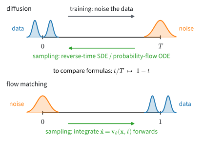
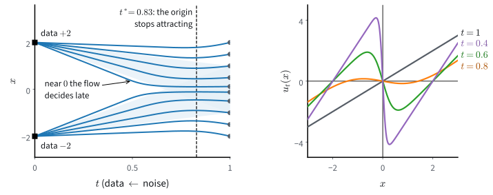
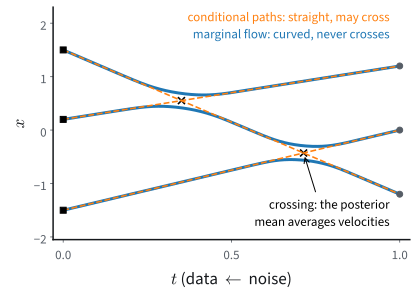
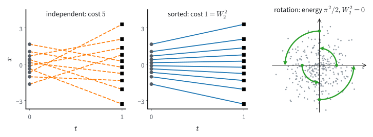

# Flow Matching and Optimal Transport
:label:`sec_mdl-flow-matching-transport`

The previous section learned the score of noised data by least squares and
turned it into samples, with a reverse chain of a thousand small steps or a
few dozen deterministic strides, each of which calls the network once. So
many steps are needed because the paths from noise to data curve, and a
solver can follow a curved path only in short pieces. Those paths were fixed
by the noising process, which we chose for its Gaussian kernels, not for easy
integration. Could we choose the path from noise to data ourselves, and
choose one along which a solver can take long steps?

Picture two data points at $-2$ and $+2$ and a cloud of Gaussian noise that
must end on them. If every particle moved in a straight line at constant
speed toward its own point, one Euler step of length one would carry it there
exactly. But a velocity field is one function of position and time.
Particles bound for different points pass through the same place, and the
field there can point only one way.

Flow matching :cite:`Lipman.Chen.BenHamu.ea.2022` and rectified flow
:cite:`Liu.Gong.Liu.2022` prescribe the path and learn only the velocity that
moves mass along it. The argument is the one we used for the score: the
velocity of the cloud at a point is the average of the velocities of the
per-sample paths through that point, and least squares learns averages.

Which paths are cheapest is a much older question. In 1781 Gaspard Monge
asked how to move a pile of earth into a hole with the least total effort,
and :citet:`Benamou.Brenier.2000` showed that under squared distance the
cheapest motion carries every particle along a straight line at constant
speed.

The cost of a sample is its number of network calls, so straight paths are
the ones we want. We will see why the simplest pairing of noise with data bends
the flow, how re-pairing straightens it, and that the straight limit is
optimal transport. Along the way, a noise predictor trained in the previous
section turns out to be a velocity field already.

::: {.callout-important title="One clock"}
Time runs as in the previous section, from the data at $t = 0$ to the noise,
now at $t = 1$. This holds for scores and velocities alike: training noises
the data forward in time, and every sampler integrates from $t = 1$ down to
$t = 0$.

The flow-matching papers cited in this section, and their code, run time the
other way, from noise at $0$ to data at $1$
(:numref:`fig_mdl-dyn-time-conventions`). To compare a formula with theirs,
substitute $1 - t$ for their $t$, read their noise $\mathbf{x}_0$ as our
$\boldsymbol{\epsilon}$ and their data $\mathbf{x}_1$ as our
$\mathbf{x}_0$, and flip the sign of every velocity.
:::


:label:`fig_mdl-dyn-time-conventions`

The data are $\mathbf{x}_0 \sim p_0$, the noise is
$\boldsymbol{\epsilon} \sim p_1 = \mathcal{N}(\mathbf{0}, \mathbf{I})$, and
$p_t$ is a path of densities between them. Statements about couplings hold
for any two endpoint laws, and there we write the noise end as $\mathbf{x}_1$. A
conditioning variable $\mathbf{z}$ labels per-sample paths; the velocity of
one of them is $\mathbf{u}_t(\mathbf{x} \mid \mathbf{z})$, the velocity of
the whole cloud is $\mathbf{u}_t(\mathbf{x})$, and a network
$\mathbf{v}_{\boldsymbol{\theta}}(\mathbf{x}, t)$ learns it. The running
examples are the two points at $\pm 2$, where everything has a closed form,
and the two-moons data set in the plane, where we train a network.

```{.python .input #mdl-flow-matching-transport-flow-matching-and-optimal-transport}
#@tab mxnet
%matplotlib inline
from d2l import mxnet as d2l
from mxnet import autograd, gluon, init, lr_scheduler, npx
from mxnet import np as mxnp
import numpy as np
npx.set_np()
```

```{.python .input #mdl-flow-matching-transport-flow-matching-and-optimal-transport}
#@tab pytorch
import math
import numpy as np
import torch
from torch import nn
from torch.nn import functional as F
from d2l import torch as d2l
```

```{.python .input #mdl-flow-matching-transport-flow-matching-and-optimal-transport}
#@tab tensorflow
%matplotlib inline
from d2l import tensorflow as d2l
import numpy as np
import tensorflow as tf
```

```{.python .input #mdl-flow-matching-transport-flow-matching-and-optimal-transport}
#@tab jax
import math
import numpy as np
import jax
from jax import numpy as jnp
from flax import nnx
import optax
from d2l import jax as d2l
```

## Flow Matching
:label:`sec_mdl-flow-matching`

### Probability Paths and Velocity Fields

Diffusion got its path from a noising process and then had to learn the
score to run that process backward. Here the path is ours to choose. A
**probability path** is a family of densities $(p_t)_{t \in [0, 1]}$ with
$p_0$ the data and $p_1$ the noise. A velocity field $\mathbf{u}_t$
*realizes* the path if the pair satisfies the continuity equation of
:numref:`sec_mdl-continuity-equation`, which says that a density moved by a
velocity field changes by the net inflow of mass,

$$
\partial_t p_t + \nabla \cdot (p_t\, \mathbf{u}_t) = 0 .
$$

Then, for a Lipschitz field, integrating
$\dot{\mathbf{x}} = \mathbf{u}_t(\mathbf{x})$ from a sample of $p_1$ at
$t = 1$ down to $t = 0$ yields a sample of $p_t$ at every time, and of the
data at $t = 0$. If a network $\mathbf{v}_{\boldsymbol{\theta}}$ approximates
$\mathbf{u}_t$, generation is an ODE solve from noise. Such a model is a
continuous normalizing flow (:numref:`sec_mdl-continuous-normalizing-flows`)
run backward in time: its flow map from $t = 1$ to $t = 0$ is the
generator. Flow matching trains it without
simulating the ODE. The natural objective is the **flow-matching loss**

$$
\mathcal{L}_{\mathrm{FM}}(\boldsymbol{\theta})
= \mathbb{E}_{t \sim \mathcal{U}[0,1],\ \mathbf{x} \sim p_t}
\left[\, \left\| \mathbf{v}_{\boldsymbol{\theta}}(\mathbf{x}, t) - \mathbf{u}_t(\mathbf{x}) \right\|^2 \right].
$$
:eqlabel:`eq_mdl-fm-loss`

It is the mean squared error of the network against the true velocity,
averaged over time and over the cloud. It regresses on a field we cannot
evaluate, because $\mathbf{u}_t$ depends on the whole data distribution.

We therefore build the path out of pieces we can write down. A conditioning
variable $\mathbf{z}$ is a data point, or a pair of a noise point and a data
point. For each of its values, pick a small moving blob
$p_t(\mathbf{x} \mid \mathbf{z})$ that sits on $\mathbf{z}$ at $t = 0$ and
has spread into noise by $t = 1$, with a velocity
$\mathbf{u}_t(\mathbf{x} \mid \mathbf{z})$ that we know in closed form. With $\mathbf{z} \sim q$, the path is the mixture
$p_t(\mathbf{x}) = \int p_t(\mathbf{x} \mid \mathbf{z})\, q(\mathbf{z})\, d\mathbf{z}$.
Which velocity moves the mixture?

**Proposition (the marginal velocity is a posterior mean).** *Suppose that
for each $\mathbf{z}$ the density $p_t(\cdot \mid \mathbf{z})$ is positive and
continuously differentiable in $(\mathbf{x}, t)$, that it satisfies the
continuity equation
$\partial_t p_t(\mathbf{x} \mid \mathbf{z}) = -\nabla \cdot \left( p_t(\mathbf{x} \mid \mathbf{z})\, \mathbf{u}_t(\mathbf{x} \mid \mathbf{z}) \right)$
with a continuously differentiable velocity, and that the integrals below may
be differentiated under the integral sign. Define on $\{p_t > 0\}$ the*
**marginal velocity**

$$
\mathbf{u}_t(\mathbf{x})
= \mathbb{E}\left[ \mathbf{u}_t(\mathbf{x} \mid \mathbf{z}) \mid \mathbf{x}_t = \mathbf{x} \right]
= \int \mathbf{u}_t(\mathbf{x} \mid \mathbf{z})\,
\frac{p_t(\mathbf{x} \mid \mathbf{z})\, q(\mathbf{z})}{p_t(\mathbf{x})}\, d\mathbf{z}.
$$
:eqlabel:`eq_mdl-marginal-velocity`

*Then $(p_t, \mathbf{u}_t)$ satisfies the continuity equation.*

The velocity of the cloud at $\mathbf{x}$ is the average of the velocities of
the blobs that could have put a particle at $\mathbf{x}$, each weighted by how
likely it is to have done so.

**Proof.** Differentiate the mixture under the integral sign, substitute the
conditional continuity equation, and pull the divergence out of the integral:

$$
\partial_t p_t(\mathbf{x})
= \int \partial_t p_t(\mathbf{x} \mid \mathbf{z})\, q(\mathbf{z})\, d\mathbf{z}
= -\nabla \cdot \int p_t(\mathbf{x} \mid \mathbf{z})\, \mathbf{u}_t(\mathbf{x} \mid \mathbf{z})\, q(\mathbf{z})\, d\mathbf{z}
= -\nabla \cdot \left( p_t(\mathbf{x})\, \mathbf{u}_t(\mathbf{x}) \right).
$$

The last step multiplies and divides by $p_t(\mathbf{x})$ and recognizes
:eqref:`eq_mdl-marginal-velocity`. $\blacksquare$

Where only one blob passes, the marginal velocity is that blob's velocity.
Where several pass, it is their average, and this averaging is what will bend
the flow.

### The Conditional Flow Matching Theorem

The target of :eqref:`eq_mdl-fm-loss` is the posterior mean
:eqref:`eq_mdl-marginal-velocity` of a quantity we can compute for every
sample. This is the situation of the regression lemma of
:numref:`sec_mdl-score-matching-diffusion-flow`: for any square-integrable
$Y$ and any function $\mathbf{v}$,

$$
\mathbb{E}\|\mathbf{v}(X) - Y\|^2
= \mathbb{E}\|\mathbf{v}(X) - \mathbb{E}[Y \mid X]\|^2
+ \mathbb{E}\|Y - \mathbb{E}[Y \mid X]\|^2 .
$$

The second term does not involve $\mathbf{v}$, so least squares against a
noisy target fits its conditional mean. We may therefore regress on the
per-sample quantity, which is what the **conditional flow matching** (CFM)
loss does:

$$
\mathcal{L}_{\mathrm{CFM}}(\boldsymbol{\theta})
= \mathbb{E}_{t,\ \mathbf{z} \sim q,\ \mathbf{x} \sim p_t(\cdot \mid \mathbf{z})}
\left[\, \left\| \mathbf{v}_{\boldsymbol{\theta}}(\mathbf{x}, t) - \mathbf{u}_t(\mathbf{x} \mid \mathbf{z}) \right\|^2 \right].
$$
:eqlabel:`eq_mdl-cfm-loss`

It needs only a sample of $(t, \mathbf{z}, \mathbf{x})$ and the closed-form
conditional velocity.

**Theorem (CFM trains the marginal field).** *Let $\mathbf{u}_t$ be the
marginal velocity :eqref:`eq_mdl-marginal-velocity` and suppose that
$\mathbb{E}\|\mathbf{u}_t(\mathbf{x} \mid \mathbf{z})\|^2 < \infty$. Then*

$$
\mathcal{L}_{\mathrm{CFM}}(\boldsymbol{\theta})
= \mathcal{L}_{\mathrm{FM}}(\boldsymbol{\theta}) + C
$$

*with $C$ independent of $\boldsymbol{\theta}$. In particular the two
objectives have the same gradients and the same minimizers*
:cite:`Lipman.Chen.BenHamu.ea.2022,Tong.Fatras.Malkin.ea.2023`.

**Proof.** Apply the regression lemma with $X = (\mathbf{x}, t)$, where
$\mathbf{x} \sim p_t(\cdot \mid \mathbf{z})$, and
$Y = \mathbf{u}_t(\mathbf{x} \mid \mathbf{z})$, which is square-integrable by
hypothesis. The law of $X$ is $t \sim \mathcal{U}[0,1]$ and
$\mathbf{x} \sim p_t$, and the conditional mean of $Y$ given $X$ is the
marginal velocity, by its definition :eqref:`eq_mdl-marginal-velocity`. The
lemma splits $\mathcal{L}_{\mathrm{CFM}}$ into
$\mathbb{E}\| \mathbf{v}_{\boldsymbol{\theta}}(X) - \mathbf{u}_t(\mathbf{x}) \|^2 = \mathcal{L}_{\mathrm{FM}}$
and $C = \mathbb{E}\| Y - \mathbf{u}_t(\mathbf{x}) \|^2$, which does not
involve $\boldsymbol{\theta}$. $\blacksquare$

The theorem needs no hypothesis on the path beyond a square-integrable
target. The proposition is what guarantees that the field it trains carries
$p_1$ to $p_0$ when integrated from $t = 1$ to $t = 0$. The constant $C$ is
the conditional variance of the target. It measures how much the per-sample
velocities through a point disagree, so the CFM loss of a perfect field
equals $C$, not zero. Denoising score matching has the same structure, with
the score of the noising kernel as the per-sample quantity and the marginal score as its posterior mean.

### Example: Two Points in One Dimension
:label:`subsec_mdl-fm-two-point`

Every object of the last two subsections has a closed form for the two-point
data set of the opening, and the closed form shows a failure that the rest of
the section repairs. The data are $x_0 = \pm a$ with probability $\tfrac12$
each, with $a = 2$: the two modes of the chapter's running mixture with
their width removed. The noise is $\epsilon \sim \mathcal{N}(0, 1)$, drawn
independently of $x_0$. The simplest blob is a point sliding along a line,
$x_t = (1 - t)\, x_0 + t\, \epsilon$, with velocity
$\dot{x}_t = \epsilon - x_0$.

Take the data point as the conditioning variable, $\mathbf{z} = x_0$. Given
$x_0$, the position $x_t$ is $\mathcal{N}((1 - t)\, x_0, t^2)$, a positive
density for $t > 0$, so the proposition applies. Eliminating
$\epsilon = (x - (1 - t)\, x_0)/t$ expresses the velocity as a function of
the current position, $u_t(x \mid x_0) = (x - x_0)/t$. Run backward in time,
the particle heads for its data point at the speed that arrives exactly at
$t = 0$.

To average this velocity we need the posterior of $x_0$ at a point $x$. The
posterior odds of $+a$ against $-a$ at $x$ are the ratio of the two Gaussian
densities. In the exponent the terms $x^2$ and $(1 - t)^2 a^2$ cancel and
only the cross term survives, so the odds are
$\exp\big(2 (1 - t)\, a x / t^2\big)$ and the posterior mean is
$\mathbb{E}[x_0 \mid x_t = x] = a \tanh\big((1 - t)\, a x / t^2\big)$. The
marginal velocity is therefore

$$
u_t(x) = \frac{x - a \tanh\!\big(\frac{(1 - t)\, a x}{t^2}\big)}{t}.
$$
:eqlabel:`eq_mdl-two-point-velocity`

Run backward in time, the cloud at $x$ heads for the average of the two
targets, weighted by how plausible each is from $x$, at the speed that
arrives on time. At $(t, x) = (0.5, 0.5)$ the velocity is $-2.86$; at
$(0.7, -1)$ it is $0.97$.
Three properties can be read off :eqref:`eq_mdl-two-point-velocity`, and
:numref:`fig_mdl-dyn-two-point-flow` draws them.

* **At $t = 1$ the field is $u_1(x) = x$.** The noise sample carries no
  information about its target, so the posterior mean is the data mean $0$.
  One Euler step from $t = 1$ to $t = 0$, $x \mapsto x - u_1(x)$, sends
  *every* sample to $0$. This holds for any data under independent pairing:
  $\mathbf{u}_1(\mathbf{x}) = \mathbb{E}[\boldsymbol{\epsilon} - \mathbf{x}_0 \mid \boldsymbol{\epsilon} = \mathbf{x}] = \mathbf{x} - \mathbb{E}[\mathbf{x}_0]$,
  so one step of the exact field lands on the data mean.
* **The origin first attracts, then repels.** As $t$ falls, a sampler moves
  against $u_t$, so a positive slope at the origin pulls particles toward
  it and a negative slope pushes them away. The slope is
  $\partial_x u_t(0) = \big(1 - (1 - t)\, a^2/t^2\big)/t$: $+0.56$ at
  $t = 0.9$, zero at $t^* = 2\sqrt{2} - 2 \approx 0.83$ (the root of
  $(1 - t)\, a^2 = t^2$), $-0.31$ at $t = 0.8$ and $-14$ at $t = 0.5$.
  Particles near $0$ drift toward $0$ until $t$ falls to $t^*$ and leave for
  a mode only later, so the flow chooses a mode late. Far from the origin the
  $\tanh$ saturates and $u_t \approx (x \mp a)/t$, the conditional velocity
  itself.
* **The floor $C$ is finite although the conditional velocity is
  unbounded.** Here
  $C = \mathbb{E}_t \mathbb{E}_x \textrm{Var}(x_0 \mid x_t)/t^2$
  with $\textrm{Var}(x_0 \mid x_t = x) = a^2 \operatorname{sech}^2\big((1 - t)\, a x/t^2\big)$,
  which is tiny except near the origin, where little mass remains as
  $t \to 0$ (:exref:`ex_mdl-flow-matching-transport-late-decisions`).

![Two data points at $\pm 2$ and standard Gaussian noise with independent pairing; sampling runs from the noise at $t=1$ (right) to the data at $t=0$ (left). (a) Trajectories of the exact marginal flow over the one-standard-deviation bands of the two conditional blobs: until $t$ falls to $t^*=0.83$ every trajectory moves toward $0$, and those that start near $0$ leave for a mode only below $t\approx 0.6$. (b) The velocity $u_t(x)$ is $x$ at $t=1$, its slope at the origin turns negative and steep as $t$ falls, and it tends to $(x\mp 2)/t$ away from the origin.](../img/mdl-dyn-two-point-flow.svg)
:label:`fig_mdl-dyn-two-point-flow`

Does the closed form agree with a direct posterior average, where does the
origin stop attracting, and where does one Euler step of the exact field
land? The cell checks all three, the slope by a finite difference.

```{.python .input #mdl-flow-matching-transport-example-two-points-in-one-dimension}
a = 2.0                                       # data at -a and +a, noise N(0, 1)
def u_two_point(x, t):                        # closed form of the marginal velocity
    return (x - a * np.tanh((1 - t) * a * x / t**2)) / t

def u_posterior(x, t):                        # posterior average of (x - x0)/t
    x0 = np.array([-a, a])
    w = np.exp(-(x - (1 - t) * x0)**2 / (2 * t**2))   # likelihood of x given x0
    return (x - (w * x0).sum() / w.sum()) / t

points = [(0.5, 0.5), (0.7, -1.0), (0.2, 0.1)]
print('closed form - posterior average:',
      max(abs(u_two_point(x, t) - u_posterior(x, t)) for t, x in points))
ts = np.array([0.9, 0.8, 0.5])
print('slope at the origin at t = 0.9, 0.8, 0.5:',
      ((u_two_point(1e-6, ts) - u_two_point(-1e-6, ts)) / 2e-6).round(2),
      '   t* =', round(2 * np.sqrt(2) - 2, 4))
eps = np.array([-1.0, 1.0])
print('one Euler step from t = 1 to 0 from', eps, 'lands at', eps - u_two_point(eps, 1.0))
```

The closed form matches the posterior average to rounding error, the slope at
the origin changes sign between $t = 0.9$ and $t = 0.8$, and one Euler step
from either start lands on $0$, the data mean. This is the limit of the
construction. The conditional paths are straight, but the marginal flow is
curved, and one step collapses every sample onto the mean. The rest of the section asks how to pair
noise with data so that the flow comes out straight.

### Score, Noise, and Velocity
:label:`sec_mdl-score-velocity-dictionary`

The previous section trained a network to predict the noise. Do we need a
second training run to obtain a velocity? We do not. On a Gaussian path the
score, the noise, the clean point and the velocity are affine functions of
one posterior mean, so each determines the others. Condition on a data point
and take the path

$$
\mathbf{x}_t = \alpha_t\, \mathbf{x}_0 + \sigma_t\, \boldsymbol{\epsilon},
\qquad \boldsymbol{\epsilon} \sim \mathcal{N}(\mathbf{0}, \mathbf{I}),
$$
:eqlabel:`eq_mdl-gaussian-path`

with smooth coefficients $(\alpha_t, \sigma_t)$, $(\alpha_0, \sigma_0) = (1, 0)$
and $(\alpha_1, \sigma_1) = (0, 1)$. The blob around $\alpha_t \mathbf{x}_0$
has width $\sigma_t$: at $t = 0$ it is the data point, at $t = 1$ the noise.
This is the noising kernel of the previous section, with the horizon set
to $1$.

The smallest case is Gaussian data $x_0 \sim \mathcal{N}(0, s_0^2)$ in one
dimension on the cosine path $\alpha_t = \cos\frac{\pi t}{2}$,
$\sigma_t = \sin\frac{\pi t}{2}$. The marginal is $\mathcal{N}(0, s_t^2)$ with
$s_t^2 = \alpha_t^2 s_0^2 + \sigma_t^2$, the score is $-x/s_t^2$, and the
velocity is $u_t(x) = (\dot{s}_t/s_t)\, x$: a Gaussian cloud only stretches
or shrinks (:exref:`ex_mdl-flow-matching-transport-kinetic-energy`). With
$s_0 = 2$ at $t = \tfrac12$ we get $s_t^2 = 2.5$, and a particle at $x$ moves
with velocity $-0.94\, x$: run from $t = 1$ to $0$, the cloud stretches from
width $1$ to width $2$. With $s_0 = 1$ every $p_t$ is the standard Gaussian
and the cloud never moves: $u \equiv 0$.

**Proposition (score–velocity identity).** *For the Gaussian path
:eqref:`eq_mdl-gaussian-path`, at any $t$ with $\alpha_t, \sigma_t > 0$ and on
$\{p_t > 0\}$, the marginal velocity and the marginal score determine each
other:*

$$
\mathbf{u}_t(\mathbf{x})
= \frac{\dot{\alpha}_t}{\alpha_t}\, \mathbf{x}
- \left( \sigma_t \dot{\sigma}_t - \sigma_t^2\, \frac{\dot{\alpha}_t}{\alpha_t} \right)
\nabla \log p_t(\mathbf{x}).
$$
:eqlabel:`eq_mdl-score-velocity`

The velocity is a multiple of the position plus a multiple of the score, and
the schedule alone fixes both multiples.

**Proof.** We show that both sides are affine in one posterior mean,
$\hat{\mathbf{x}}_0 = \mathbb{E}[\mathbf{x}_0 \mid \mathbf{x}_t = \mathbf{x}]$.
Differentiating the path gives the conditional velocity
$\dot{\mathbf{x}}_t = \dot{\alpha}_t \mathbf{x}_0 + \dot{\sigma}_t \boldsymbol{\epsilon}$,
and $\boldsymbol{\epsilon} = (\mathbf{x} - \alpha_t \mathbf{x}_0)/\sigma_t$.
Taking the posterior mean as in :eqref:`eq_mdl-marginal-velocity`,

$$
\mathbf{u}_t(\mathbf{x})
= \frac{\dot{\sigma}_t}{\sigma_t}\, \mathbf{x}
+ \left( \dot{\alpha}_t - \alpha_t\, \frac{\dot{\sigma}_t}{\sigma_t} \right) \hat{\mathbf{x}}_0.
$$

The marginal score is the posterior mean of the scores of the kernels, which
is Tweedie's formula of the previous section. The kernel
$\mathcal{N}(\alpha_t \mathbf{x}_0, \sigma_t^2 \mathbf{I})$ has score
$(\alpha_t \mathbf{x}_0 - \mathbf{x})/\sigma_t^2$, so

$$
\nabla \log p_t(\mathbf{x})
= \mathbb{E}\left[ \frac{\alpha_t \mathbf{x}_0 - \mathbf{x}}{\sigma_t^2} \,\middle|\, \mathbf{x}_t = \mathbf{x} \right]
= \frac{\alpha_t \hat{\mathbf{x}}_0 - \mathbf{x}}{\sigma_t^2},
\qquad \textrm{i.e.}\quad
\hat{\mathbf{x}}_0 = \frac{\mathbf{x} + \sigma_t^2\, \nabla \log p_t(\mathbf{x})}{\alpha_t}.
$$

Substituting this $\hat{\mathbf{x}}_0$ into the velocity and collecting the
$\mathbf{x}$ and $\nabla \log p_t$ terms gives :eqref:`eq_mdl-score-velocity`.
$\blacksquare$

On a variance-preserving path, $\alpha_t^2 + \sigma_t^2 = 1$, so
$\sigma_t \dot{\sigma}_t = -\alpha_t \dot{\alpha}_t$ and the coefficient of
the score collapses to $\dot{\alpha}_t/\alpha_t$:
$\mathbf{u}_t(\mathbf{x}) = \frac{\dot{\alpha}_t}{\alpha_t}\big(\mathbf{x} + \nabla \log p_t(\mathbf{x})\big)$.
For the variance-preserving SDE of the previous section,
$\alpha_t = \exp\big(-\tfrac12 \int_0^t \beta(s)\, ds\big)$, so
$\dot{\alpha}_t/\alpha_t = -\tfrac12 \beta(t)$ and the velocity is
$-\tfrac12 \beta(t) \big(\mathbf{x} + \nabla \log p_t(\mathbf{x})\big)$.
This is the probability-flow velocity
$\mathbf{f} - \tfrac12 g^2 \nabla \log p_t$ of
:eqref:`eq_mdl-dyn-pf-velocity` with $\mathbf{f} = -\tfrac12 \beta\, \mathbf{x}$
and $g^2 = \beta$: on this path the flow-matching velocity and the
probability-flow ODE are the same field on the same clock.
On the straight path $\alpha_t = 1 - t$, $\sigma_t = t$ the identity reads
$\mathbf{u}_t(\mathbf{x}) = -\big(\mathbf{x} + t\, \nabla \log p_t(\mathbf{x})\big)/(1 - t)$.
For the Gaussian example, $\nabla \log p_t = -x/s_t^2$ turns the
variance-preserving form into
$\frac{\dot\alpha_t}{\alpha_t}(1 - 1/s_t^2)\, x = \alpha_t \dot{\alpha}_t (s_0^2 - 1)\, x / s_t^2$,
the stretching rate $\dot{s}_t/s_t$ found above.

The same posterior mean underlies the targets that networks are trained on in
practice (:numref:`tab_mdl-score-noise-velocity`).

:Network targets on a Gaussian path. Each row gives the quantity a network predicts, the posterior mean it estimates, and its conversion from the score. The name $v$-prediction comes from the literature; on the cosine path its target $\alpha_t\boldsymbol\epsilon - \sigma_t\mathbf{x}_0$ is $2/\pi$ times the velocity target.
:label:`tab_mdl-score-noise-velocity`

| Network predicts | Posterior mean | From the score $\mathbf{s} = \nabla \log p_t$ |
| :-- | :-- | :-- |
| score $\mathbf{s}_{\boldsymbol{\theta}}$ | $\nabla \log p_t(\mathbf{x})$ | $\mathbf{s}$ |
| noise $\hat{\boldsymbol{\epsilon}}$ | $\mathbb{E}[\boldsymbol{\epsilon} \mid \mathbf{x}_t = \mathbf{x}]$ | $-\sigma_t\, \mathbf{s}$ |
| clean point $\hat{\mathbf{x}}_0$ | $\mathbb{E}[\mathbf{x}_0 \mid \mathbf{x}_t = \mathbf{x}]$ | $(\mathbf{x} + \sigma_t^2\, \mathbf{s})/\alpha_t$ |
| velocity $\mathbf{v}_{\boldsymbol{\theta}}$ | $\mathbb{E}[\dot{\mathbf{x}}_t \mid \mathbf{x}_t = \mathbf{x}]$ | the identity :eqref:`eq_mdl-score-velocity` |
| $v$-prediction $\hat{\mathbf{v}}$ | $\mathbb{E}[\alpha_t \boldsymbol{\epsilon} - \sigma_t \mathbf{x}_0 \mid \mathbf{x}_t = \mathbf{x}]$ | $-\tfrac{\sigma_t}{\alpha_t}\, \mathbf{x} - \sigma_t\, \tfrac{\alpha_t^2 + \sigma_t^2}{\alpha_t}\, \mathbf{s}$ |

Each row is a $t$-dependent affine function of the same posterior mean, so a
network trained on any row defines all of them. Which row is easiest to learn
is a separate question, about the variance of the training targets at the two
ends of the path (:exref:`ex_mdl-flow-matching-transport-target-conditioning`).

We can check the identity on the running mixture, components at $\pm 2$ with
variance $0.25$, without fitting any model. At one fixed time on the cosine
path, the cell computes the velocity once from the posterior mean, with no
score in sight, and once from :eqref:`eq_mdl-score-velocity` with the
analytic score.

```{.python .input #mdl-score-matching-diffusion-flow-score-noise-and-velocity-are-one-function}
t = 0.4                                       # one fixed time, cosine schedule
alpha, sigma = np.cos(np.pi * t / 2), np.sin(np.pi * t / 2)
dalpha, dsigma = -np.pi / 2 * sigma, np.pi / 2 * alpha
grid = np.linspace(-4.0, 4.0, 201)
means, var0 = np.array([-2.0, 2.0]), 0.25     # the running mixture
vart = alpha**2 * var0 + sigma**2             # noised component variance
w = np.stack([np.exp(-(grid - alpha * m)**2 / (2 * vart)) for m in means])
w /= w.sum(0)                                 # posterior mode responsibilities
x0_hat = (w * np.stack([m + alpha * var0 / vart * (grid - alpha * m)
                        for m in means])).sum(0)          # E[x_0 | x_t]
u_posterior = dalpha * x0_hat + dsigma / sigma * (grid - alpha * x0_hat)
score = (w * np.stack([(alpha * m - grid) / vart for m in means])).sum(0)
u_dictionary = (dalpha / alpha) * grid \
    - (sigma * dsigma - sigma**2 * dalpha / alpha) * score
print(f'max |u_posterior - u_dictionary| on [-4, 4]: '
      f'{np.abs(u_posterior - u_dictionary).max():.1e}')
```

The two routes agree to about $10^{-15}$, across both modes and the valley
between them. A trained noise predictor is therefore also a velocity field,
and the samplers of this section can run on it unchanged.

## Rectified Flow
:label:`sec_mdl-rectified-flow`

### Straight Paths and Their Crossings

The two-point example used straight conditional paths. In $d$ dimensions the
same construction pairs a data sample $\mathbf{x}_0$ with a noise sample
$\boldsymbol{\epsilon}$, drawn independently, and joins them by a straight
line traversed at constant speed:

$$
\mathbf{x}_t = (1 - t)\, \mathbf{x}_0 + t\, \boldsymbol{\epsilon},
\qquad
\mathbf{u}_t(\mathbf{x}_t \mid \mathbf{z}) = \dot{\mathbf{x}}_t = \boldsymbol{\epsilon} - \mathbf{x}_0,
\qquad \mathbf{z} = (\mathbf{x}_0, \boldsymbol{\epsilon}).
$$
:eqlabel:`eq_mdl-rf-path`

The conditional velocity does not depend on $t$, and the CFM loss
:eqref:`eq_mdl-cfm-loss` becomes the **rectified flow** objective
:cite:`Liu.Gong.Liu.2022,Lipman.Chen.BenHamu.ea.2022`

$$
\mathcal{L}_{\mathrm{RF}}(\boldsymbol{\theta})
= \mathbb{E}_{t,\ \mathbf{x}_0 \sim p_0,\ \boldsymbol{\epsilon} \sim p_1}
\left[\, \left\| \mathbf{v}_{\boldsymbol{\theta}}\big( (1 - t) \mathbf{x}_0 + t \boldsymbol{\epsilon},\ t \big)
- (\boldsymbol{\epsilon} - \mathbf{x}_0) \right\|^2 \right].
$$
:eqlabel:`eq_mdl-rf-loss`

Training draws data and noise, interpolates between them, and regresses on
the difference. Given $\mathbf{z}$, a point sliding along a line has no
density, so the proposition does not apply as stated. Its conclusion still
holds, by the same computation applied to the expectation
$\mathbb{E}\,\varphi(\mathbf{x}_t)$ of a smooth test function $\varphi$
(:exref:`ex_mdl-flow-matching-transport-reflow-fixed-points`). Gaussian
conditional paths with general $(\alpha_t, \sigma_t)$ recover the diffusion
targets of the previous section instead.

Although every conditional path is straight, the marginal flow is not
(:numref:`fig_mdl-dyn-fm-paths`). Two segments that cross at $(\mathbf{x}, t)$
feed the posterior mean :eqref:`eq_mdl-marginal-velocity` two different
directions. A function has one value at each point, so the field averages
them. An ODE whose field is Lipschitz in $\mathbf{x}$ has exactly one
trajectory through each point (:numref:`sec_mdl-ode-existence-uniqueness`),
so two trajectories of the learned flow can never meet. Where the segments
cross, the trajectories bend away from each other instead.


:label:`fig_mdl-dyn-fm-paths`

The goal is a field whose trajectories are straight lines traversed at
constant speed. Such a field is constant along each trajectory, so one Euler
step of any length is exact. The independent pairing is far from this limit,
as the two-point example already showed. The bend comes from the pairing and
not from the loss, because every conditional path is already a straight line.

### Example: Two Moons

The two moons are two interleaved crescents in the plane. One Euler step of
the exact field would collapse the noise onto their mean, and we can count
how many steps a trained field needs instead. To score samples we use the
**squared energy distance** :cite:`Szekely.Rizzo.2013` between laws $P$ and
$Q$ with finite first moments,

$$
\mathcal{E}^2(P, Q) = 2\, \mathbb{E}\|X - Y\| - \mathbb{E}\|X - X'\| - \mathbb{E}\|Y - Y'\|,
$$

where $X, X' \sim P$ and $Y, Y' \sim Q$ are independent. It compares the
mean distance between a point of $P$ and a point of $Q$ with the mean
distances within each law. It is the squared MMD of
:numref:`sec_mdl-ipm-mmd` with the kernel
$k(\mathbf{x}, \mathbf{y}) = \|\mathbf{x}\| + \|\mathbf{y}\| - \|\mathbf{x} - \mathbf{y}\|$,
and it is zero only if $P = Q$. We estimate it from two samples by the
U-statistic, which divides each within-sample sum by the number $n(n-1)$ of
ordered pairs of distinct points, so that the estimate is unbiased.

The cell builds the data, standardized to zero mean and unit variance per
coordinate, a held-out sample of $2{,}048$ points, and one noise array
`z_eval` that every later comparison reuses.

```{.python .input #score-matching-diffusion-flow-two-moons}
def two_moons(n, rng, noise=0.07):
    t = rng.uniform(0.0, np.pi, n)
    m = rng.integers(0, 2, n)                      # which moon
    X = np.stack([np.cos(t) * (1 - 2 * m) + m,
                  np.sin(t) * (1 - 2 * m) + 0.5 * m], axis=1)
    return X + noise * rng.standard_normal((n, 2))

rng = np.random.default_rng()
raw = two_moons(8192, rng)
mu, sd = raw.mean(0), raw.std(0)
moons = (raw - mu) / sd                            # standardized training data
held_out = (two_moons(2048, rng) - mu) / sd
z_eval = rng.standard_normal((2048, 2))            # noise for every comparison

def energy_distance(a, b):                         # squared energy distance, U-statistic
    d = lambda u, v: np.linalg.norm(u[:, None, :] - v[None, :, :], axis=-1)
    n, m = len(a), len(b)
    return (2 * d(a, b).mean() - d(a, a).sum() / (n * (n - 1))
            - d(b, b).sum() / (m * (m - 1)))

print(f'fresh data sample vs held-out: {energy_distance(moons[:2048], held_out):+.4f}')
print(f'point mass at the data mean vs held-out: '
      f'{energy_distance(np.zeros((2048, 2)), held_out):.3f}')
```

Two samples of the same law score within a few thousandths of zero, which
is the resolution of the metric at this sample size. A point mass at the data
mean, which is what one Euler step of the exact field produces, scores about
$0.9$.

The model is a velocity field
$\mathbf{v}_{\boldsymbol{\theta}} : \mathbb{R}^2 \times [0, 1] \to \mathbb{R}^2$,
a $3 \to 64 \to 64 \to 2$ tanh network with Glorot-uniform weights and zero
biases. Like the standardized data, the time enters centered, as $2t - 1$;
the function `field` evaluates the network at a point and a time. It is trained by Adam for $4{,}000$ steps of $256$ pairs, with a
learning rate that falls from $3 \times 10^{-3}$ to zero along a cosine. The
decay keeps the final weights from jittering with the last few batches.

The function `train_rf` takes a sampler of pairs, so that we can reuse it
with a different pairing later. It returns the network and the mean
loss over the last $500$ batches, because the loss of a single batch of $256$
scatters by about $\pm 0.1$. The code averages the squared error over the
two coordinates, so the printed loss is $\mathcal{L}_{\mathrm{RF}}/2$.

```{.python .input #score-matching-diffusion-flow-cfm-train}
#@tab mxnet
def make_net():                         # init.Xavier() is Glorot uniform; biases 0
    net = gluon.nn.HybridSequential()
    net.add(gluon.nn.Dense(64, activation='tanh'),
            gluon.nn.Dense(64, activation='tanh'), gluon.nn.Dense(2))
    net.initialize(init.Xavier())
    net.hybridize()
    return net

def field(net, x, t):                   # the time enters centered, as 2t - 1
    return net(mxnp.concatenate([x, 2 * t - 1], axis=1))

def train_rf(sample_pairs, steps=4000, tail=500):
    """Regress v(x_t, t) on eps - x0 (papers: x1 - x0 at time 1 - t).
    Return the net and the mean tail loss."""
    net = make_net()
    lr = lr_scheduler.CosineScheduler(steps, base_lr=3e-3)   # 3e-3 -> 0
    trainer = gluon.Trainer(net.collect_params(), 'adam',
                            {'learning_rate': 3e-3, 'lr_scheduler': lr})
    tail_sum = 0
    for step in range(steps):
        x0, eps = sample_pairs(256)                # data, noise
        t = mxnp.random.uniform(0, 1, (256, 1))
        xt = (1 - t) * x0 + t * eps                # a point on each segment
        with autograd.record():
            loss = ((field(net, xt, t) - (eps - x0))**2).mean()
        loss.backward()
        trainer.step(1)
        if step >= steps - tail:
            tail_sum = tail_sum + loss             # stays on the device
    return net, float(tail_sum) / tail
```

```{.python .input #score-matching-diffusion-flow-cfm-train}
#@tab pytorch
def make_net():                         # 3 -> 64 -> 64 -> 2, Glorot weights, zero biases
    net = nn.Sequential(nn.Linear(3, 64), nn.Tanh(), nn.Linear(64, 64), nn.Tanh(),
                        nn.Linear(64, 2))
    for layer in net[::2]:
        nn.init.xavier_uniform_(layer.weight)
        nn.init.zeros_(layer.bias)
    return net

def field(net, x, t):                   # the time enters centered, as 2t - 1
    return net(torch.cat([x, 2 * t - 1], 1))

def train_rf(sample_pairs, steps=4000, tail=500):
    """Regress v(x_t, t) on eps - x0 (papers: x1 - x0 at time 1 - t).
    Return the net and the mean tail loss."""
    net = make_net()
    opt = torch.optim.Adam(net.parameters(), lr=3e-3)
    sched = torch.optim.lr_scheduler.CosineAnnealingLR(opt, steps)   # 3e-3 -> 0
    tail_sum = torch.zeros(())
    for step in range(steps):
        x0, eps = sample_pairs(256)                # data, noise
        t = torch.rand(256, 1)
        xt = (1 - t) * x0 + t * eps                # a point on each segment
        loss = ((field(net, xt, t) - (eps - x0))**2).mean()
        opt.zero_grad()
        loss.backward()
        opt.step()
        sched.step()
        if step >= steps - tail:
            tail_sum += loss.detach()              # stays on the device
    return net, (tail_sum / tail).item()
```

```{.python .input #score-matching-diffusion-flow-cfm-train}
#@tab tensorflow
def make_net():                         # Dense: Glorot-uniform weights, zero biases
    net = tf.keras.Sequential([tf.keras.layers.Dense(64, 'tanh'),
                               tf.keras.layers.Dense(64, 'tanh'),
                               tf.keras.layers.Dense(2)])
    net.build((None, 3))
    return net

def field(net, x, t):                   # the time enters centered, as 2t - 1
    return net(tf.concat([x, 2 * t - 1], 1))

def train_rf(sample_pairs, steps=4000, tail=500):
    """Regress v(x_t, t) on eps - x0 (papers: x1 - x0 at time 1 - t).
    Return the net and the mean tail loss."""
    net = make_net()
    lr = tf.keras.optimizers.schedules.CosineDecay(3e-3, steps)   # 3e-3 -> 0
    opt = tf.keras.optimizers.Adam(lr)

    @tf.function
    def train_step():
        x0, eps = sample_pairs(256)                # data, noise
        t = tf.random.uniform((256, 1))
        xt = (1 - t) * x0 + t * eps                # a point on each segment
        with tf.GradientTape() as tape:
            loss = tf.reduce_mean((field(net, xt, t) - (eps - x0))**2)
        grads = tape.gradient(loss, net.trainable_variables)
        opt.apply_gradients(zip(grads, net.trainable_variables))
        return loss

    tail_sum = tf.zeros(())
    for step in range(steps):
        loss = train_step()
        if step >= steps - tail:
            tail_sum += loss                       # stays on the device
    return net, float(tail_sum) / tail
```

```{.python .input #score-matching-diffusion-flow-cfm-train}
#@tab jax
def make_params(key, sizes=(3, 64, 64, 2)):    # Glorot-uniform weights, zero biases
    glorot = jax.nn.initializers.glorot_uniform()
    keys = jax.random.split(key, len(sizes) - 1)
    return [(glorot(k, (i, o)), jnp.zeros(o))
            for k, i, o in zip(keys, sizes[:-1], sizes[1:])]

def mlp(params, x):
    for W, b in params[:-1]:
        x = jnp.tanh(x @ W + b)
    W, b = params[-1]
    return x @ W + b

def field(params, x, t):                # the time enters centered, as 2t - 1
    return mlp(params, jnp.concatenate([x, 2 * t - 1], 1))

def train_rf(sample_pairs, steps=4000, tail=500):
    """Regress v(x_t, t) on eps - x0 (papers: x1 - x0 at time 1 - t).
    Return the parameters and the mean tail loss; sample_pairs(key, n) draws
    n (data, noise) pairs."""
    opt = optax.adam(optax.cosine_decay_schedule(3e-3, steps))   # 3e-3 -> 0
    def loss_fn(params, key):
        k_pairs, k_t = jax.random.split(key)
        x0, eps = sample_pairs(k_pairs, 256)       # data, noise
        t = jax.random.uniform(k_t, (256, 1))
        xt = (1 - t) * x0 + t * eps                # a point on each segment
        return ((field(params, xt, t) - (eps - x0))**2).mean()
    def step(carry, key):
        params, state = carry
        loss, grads = jax.value_and_grad(loss_fn)(params, key)
        updates, state = opt.update(grads, state)
        return (optax.apply_updates(params, updates), state), loss
    k_init, k_steps = jax.random.split(jax.random.key(np.random.randint(2**31)))
    params = make_params(k_init)
    (params, _), losses = jax.lax.scan(step, (params, opt.init(params)),
                                       jax.random.split(k_steps, steps))
    return params, float(losses[-tail:].mean())
```

Where does the loss settle when noise and data are paired independently?

```{.python .input #mdl-flow-matching-transport-example-two-moons-1}
#@tab mxnet
data = mxnp.array(moons)
def independent_pairs(n):                       # random data rows, fresh noise
    return data[mxnp.random.randint(0, len(data), (n,))], mxnp.random.normal(0, 1, (n, 2))

net, plateau = train_rf(independent_pairs)
print(f'CFM loss, mean of the last 500 batches: {plateau:.2f}')
```

```{.python .input #mdl-flow-matching-transport-example-two-moons-1}
#@tab pytorch
data = torch.tensor(moons, dtype=torch.float32)
def independent_pairs(n):                       # random data rows, fresh noise
    return data[torch.randint(0, len(data), (n,))], torch.randn(n, 2)

net, plateau = train_rf(independent_pairs)
print(f'CFM loss, mean of the last 500 batches: {plateau:.2f}')
```

```{.python .input #mdl-flow-matching-transport-example-two-moons-1}
#@tab tensorflow
data = tf.constant(moons, tf.float32)
def independent_pairs(n):                       # random data rows, fresh noise
    return (tf.gather(data, tf.random.uniform((n,), 0, len(moons), tf.int32)),
            tf.random.normal((n, 2)))

net, plateau = train_rf(independent_pairs)
print(f'CFM loss, mean of the last 500 batches: {plateau:.2f}')
```

```{.python .input #mdl-flow-matching-transport-example-two-moons-1}
#@tab jax
data = jnp.asarray(moons, dtype=jnp.float32)
def independent_pairs(key, n):                  # random data rows, fresh noise
    k_rows, k_noise = jax.random.split(key)
    return (data[jax.random.randint(k_rows, (n,), 0, len(data))],
            jax.random.normal(k_noise, (n, 2)))

net, plateau = train_rf(independent_pairs)
print(f'CFM loss, mean of the last 500 batches: {plateau:.2f}')
```

The loss settles at about $1.4$ per coordinate and cannot go much lower. By
the theorem it is bounded below by the floor $C$, the conditional variance of
$\boldsymbol{\epsilon} - \mathbf{x}_0$ given $\mathbf{x}_t$, averaged over $t$. For
this data set the floor can be computed by weighting every training point by
its posterior probability given $\mathbf{x}_t$; it is $1.38$ per coordinate
(:exref:`ex_mdl-flow-matching-transport-crossing-floor`), and the network
sits a few hundredths above it. Almost all of the remaining loss is the
disagreement of crossing segments, which no network can remove.

Sampling integrates $\dot{\mathbf{x}} = \mathbf{v}_{\boldsymbol{\theta}}(\mathbf{x}, t)$
from $t = 1$ down to $0$ with Euler's method
(:numref:`sec_mdl-euler-runge-kutta`): $K$ steps of length $1/K$, each of
which subtracts $\mathbf{v}_{\boldsymbol{\theta}}(\mathbf{x}, t)/K$ at
$t = 1, 1 - 1/K, \ldots, 1/K$. The function `euler_path` takes a NumPy array
of noise points and returns the whole trajectory, of shape
`(steps + 1, n, 2)`, as a NumPy array; its last row is the sample.

```{.python .input #score-matching-diffusion-flow-cfm-sample}
#@tab mxnet
def euler_path(net, z, steps):
    q = mxnp.array(z, dtype='float32')
    path = [q]
    for k in range(steps):                     # t = 1, 1 - 1/steps, ..., 1/steps
        t = mxnp.full((len(z), 1), 1 - k / steps)
        q = q - field(net, q, t) / steps
        path.append(q)
    return mxnp.stack(path).asnumpy()
```

```{.python .input #score-matching-diffusion-flow-cfm-sample}
#@tab pytorch
@torch.inference_mode()
def euler_path(net, z, steps):
    q = torch.tensor(z, dtype=torch.float32)
    path = [q]
    for k in range(steps):                     # t = 1, 1 - 1/steps, ..., 1/steps
        t = torch.full((len(z), 1), 1 - k / steps)
        q = q - field(net, q, t) / steps
        path.append(q)
    return torch.stack(path).numpy()
```

```{.python .input #score-matching-diffusion-flow-cfm-sample}
#@tab tensorflow
def euler_path(net, z, steps):
    q = tf.constant(z, tf.float32)
    path = [q]
    for k in range(steps):                     # t = 1, 1 - 1/steps, ..., 1/steps
        t = tf.fill((len(z), 1), 1 - k / steps)
        q = q - field(net, q, t) / steps
        path.append(q)
    return tf.stack(path).numpy()
```

```{.python .input #score-matching-diffusion-flow-cfm-sample}
#@tab jax
def euler_path(params, z, steps):
    def step(q, t):
        q = q - field(params, q, jnp.full((len(z), 1), t)) / steps
        return q, q
    q1 = jnp.asarray(z, dtype=jnp.float32)                # noise at t = 1
    _, path = jax.lax.scan(step, q1, 1 - jnp.arange(steps) / steps)
    return np.concatenate([np.asarray(q1)[None], np.asarray(path)])
```

How does the quality of the samples depend on the number of Euler steps? The
cell integrates the same noise array `z_eval` with $K = 1, 2, \ldots, 64$
steps and plots the energy distance to the held-out data on log–log axes.

```{.python .input #score-matching-diffusion-flow-steps-quality}
steps_list = [1, 2, 4, 8, 16, 32, 64]
eds = [energy_distance(euler_path(net, z_eval, K)[-1], held_out) for K in steps_list]
print('  '.join(f'{K}: {e:.3f}' for K, e in zip(steps_list, eds)))
d2l.plot(steps_list, eds, 'Euler steps', 'squared energy distance',
         xscale='log', yscale='log')
```

One step scores about $0.7$, the same order as the point mass at the mean
($0.9$): the network has learned, imperfectly, the collapse that the exact
field performs at $t = 1$. Two steps score about $0.15$, four
about $0.04$, eight about $0.01$, and from sixteen steps on the score levels
off, usually at a few thousandths and never much above $0.01$. The decline is Euler's
discretization error. The level that remains is the error of the trained
field; it varies with the training run and is often as small as the metric
can resolve with $2{,}048$ points. The samples show the same progression.

```{.python .input #score-matching-diffusion-flow-cfm-panels}
fig, axes = d2l.plt.subplots(1, 4, figsize=(10, 2.6), sharex=True, sharey=True)
for ax, K in zip(axes, (1, 2, 8, 32)):
    s = euler_path(net, z_eval, K)[-1]
    d2l.plot(s[:, 0], s[:, 1], f'{K} Euler step(s)', fmts=('.',),
             xlim=(-2.5, 2.5), ylim=(-2.5, 2.5), axes=ax)
```

One step gives a blob around the mean, two a bent ellipse, eight
recognizable moons, and thirty-two sharp ones. The curvature that the
independent pairing builds into the flow costs sixteen to thirty-two network
calls per sample.

### Reflow
:label:`subsec_mdl-reflow`

The independent pairing is what bends the flow, and the trained model
supplies a better one. Run its ODE from fresh noise and pair each noise
point $\boldsymbol{\epsilon}$ with the endpoint
$\hat{\mathbf{x}}_0(\boldsymbol{\epsilon})$ at which it arrives. Trajectories of one flow never cross, so these pairs cross far less
than independent ones. Retraining the same architecture on the new pairs is
called **reflow** :cite:`Liu.Gong.Liu.2022`. It keeps both endpoint
distributions and does not increase the cost of transport, for every convex
cost function.

**Proposition (reflow keeps the marginals and lowers the transport cost).**
*Let $(\mathbf{X}_0, \mathbf{X}_1) \sim \pi$ have finite second moments, let $\mathbf{X}_t = (1 - t) \mathbf{X}_0 + t \mathbf{X}_1$,
let $\mathbf{u}_t$ be the marginal velocity of this straight path, and let
$\mathbf{Z}_t$ solve $\dot{\mathbf{Z}}_t = \mathbf{u}_t(\mathbf{Z}_t)$ backward in time from the noise end,
$\mathbf{Z}_1 = \mathbf{X}_1$. Assume that
$\mathbf{X}_t$ has a positive density for every $t > 0$ and that $\mathbf{u}_t$ is
continuously differentiable and Lipschitz in $\mathbf{x}$ with a constant
independent of $t$, so that this flow exists. Then
(i) $\mathbf{Z}_t$ has the law of $\mathbf{X}_t$ for every $t$, in particular $\mathbf{Z}_0 \sim p_0$;
(ii) for every convex function $c$,*

$$
\mathbb{E}\, c(\mathbf{Z}_1 - \mathbf{Z}_0) \;\le\; \mathbb{E}\, c(\mathbf{X}_1 - \mathbf{X}_0).
$$
:eqlabel:`eq_mdl-reflow-cost`

**Proof.** (i) The law of $\mathbf{X}_t$ satisfies the continuity equation with
$\mathbf{u}_t$, by the marginal-velocity proposition with
$\mathbf{z} = (\mathbf{X}_0, \mathbf{X}_1)$ in the weak form that covers point masses
(:exref:`ex_mdl-flow-matching-transport-reflow-fixed-points`). The law of
$\mathbf{Z}_t$ satisfies it too, because $\mathbf{Z}_t$ moves with the field $\mathbf{u}_t$.
Both equal $p_1$ at $t = 1$, and two solutions of the continuity equation
with such a field that agree at one time agree at every time: along each
trajectory both log-densities change at the rate $-\nabla \cdot \mathbf{u}_t$. This is the
argument that gave the probability-flow ODE its marginals in
:numref:`sec_mdl-probability-flow-ode`. (ii) Write the displacement as a
time integral and apply Jensen's inequality twice:

$$
\mathbb{E}\, c(\mathbf{Z}_1 - \mathbf{Z}_0)
= \mathbb{E}\, c\Big(\int_0^1 \mathbf{u}_t(\mathbf{Z}_t)\, dt\Big)
\le \int_0^1 \mathbb{E}\, c\big(\mathbf{u}_t(\mathbf{Z}_t)\big)\, dt
= \int_0^1 \mathbb{E}\, c\big(\mathbb{E}[\mathbf{X}_1 - \mathbf{X}_0 \mid \mathbf{X}_t]\big)\, dt
\le \mathbb{E}\, c(\mathbf{X}_1 - \mathbf{X}_0).
$$

The first inequality is Jensen's inequality for the time average. The
equality uses (i) to replace $\mathbf{Z}_t$ by $\mathbf{X}_t$ and then the definition of the
marginal velocity. The last inequality is the conditional Jensen inequality.
$\blacksquare$

With $c = \|\cdot\|^2$ the last step loses exactly the conditional variance,
so the cost falls at least by the floor of the old pairing:
$\mathbb{E}\|\mathbf{Z}_1 - \mathbf{Z}_0\|^2 \le \mathbb{E}\|\mathbf{X}_1 - \mathbf{X}_0\|^2 - C$. Re-pairing
helps only where segments cross, because there the conditional velocity
is not a function of $(\mathbf{x}_t, t)$.

The two points show the effect in closed form. A flow in one dimension
preserves order, so one round pairs each noise point $\epsilon$ with
$a \operatorname{sign}(\epsilon)$ (:exref:`ex_mdl-flow-matching-transport-reflow-two-points`).
This pairing costs $a^2 - 2a\sqrt{2/\pi} + 1 = 1.81$ against $a^2 + 1 = 5$
for the independent one, and its segments never cross, so the second round
has $C = 0$ and its field is integrated exactly by one Euler step.

For the two moons, the cell draws $8{,}192$ fresh noise points, integrates
the trained model for $32$ steps to obtain their endpoints, and trains a new
network with `train_rf` on these fixed pairs.

```{.python .input #mdl-score-matching-diffusion-flow-one-reflow-round-measured}
#@tab mxnet
eps_pairs = np.random.standard_normal((8192, 2))     # noise endpoints, kept
x0_pairs = euler_path(net, eps_pairs, 32)[-1]         # the model's own endpoints
X0, Eps = mxnp.array(x0_pairs), mxnp.array(eps_pairs)
def model_pairs(n):                                   # the same pairs, never re-paired
    i = mxnp.random.randint(0, len(x0_pairs), (n,))
    return X0[i], Eps[i]

net2, plateau2 = train_rf(model_pairs)
print(f'reflow loss, mean of the last 500 batches: {plateau2:.4f}')
```

```{.python .input #mdl-score-matching-diffusion-flow-one-reflow-round-measured}
#@tab pytorch
eps_pairs = np.random.standard_normal((8192, 2))     # noise endpoints, kept
x0_pairs = euler_path(net, eps_pairs, 32)[-1]         # the model's own endpoints
X0, Eps = (torch.tensor(p, dtype=torch.float32) for p in (x0_pairs, eps_pairs))
def model_pairs(n):                                   # the same pairs, never re-paired
    i = torch.randint(0, len(X0), (n,))
    return X0[i], Eps[i]

net2, plateau2 = train_rf(model_pairs)
print(f'reflow loss, mean of the last 500 batches: {plateau2:.4f}')
```

```{.python .input #mdl-score-matching-diffusion-flow-one-reflow-round-measured}
#@tab tensorflow
eps_pairs = np.random.standard_normal((8192, 2))     # noise endpoints, kept
x0_pairs = euler_path(net, eps_pairs, 32)[-1]         # the model's own endpoints
X0, Eps = (tf.constant(p, tf.float32) for p in (x0_pairs, eps_pairs))
def model_pairs(n):                                   # the same pairs, never re-paired
    i = tf.random.uniform((n,), 0, len(x0_pairs), tf.int32)
    return tf.gather(X0, i), tf.gather(Eps, i)

net2, plateau2 = train_rf(model_pairs)
print(f'reflow loss, mean of the last 500 batches: {plateau2:.4f}')
```

```{.python .input #mdl-score-matching-diffusion-flow-one-reflow-round-measured}
#@tab jax
eps_pairs = np.random.standard_normal((8192, 2))     # noise endpoints, kept
x0_pairs = euler_path(net, eps_pairs, 32)[-1]         # the model's own endpoints
X0, Eps = jnp.asarray(x0_pairs, jnp.float32), jnp.asarray(eps_pairs, jnp.float32)
def model_pairs(key, n):                              # the same pairs, never re-paired
    i = jax.random.randint(key, (n,), 0, len(X0))
    return X0[i], Eps[i]

net2, plateau2 = train_rf(model_pairs)
print(f'reflow loss, mean of the last 500 batches: {plateau2:.4f}')
```

The reflow loss settles at a few thousandths instead of $1.4$, so the new
segments almost never cross. How does this change sampling, and how far did
the pairing cost drop? The next cell compares the two models from the same noise
array and prints the mean squared length of the old and the new pairs.

```{.python .input #mdl-flow-matching-transport-reflow-1}
for K in (1, 2, 32):
    e1 = energy_distance(euler_path(net, z_eval, K)[-1], held_out)
    e2 = energy_distance(euler_path(net2, z_eval, K)[-1], held_out)
    print(f'{K:2d} Euler step(s): energy distance  original {e1:.3f}  reflowed {e2:.3f}')
x0_indep = moons[np.random.randint(0, len(moons), len(eps_pairs))]
print(f'mean squared pair length: independent {np.mean(np.sum((eps_pairs - x0_indep)**2, 1)):.2f}'
      f', reflowed {np.mean(np.sum((eps_pairs - x0_pairs)**2, 1)):.2f}')
```

One Euler step of the reflowed model scores the same as thirty-two steps of
the original, usually a few thousandths, and about a hundred times below the
original's single step. The reflowed network was trained to reproduce the
original's $32$-step endpoints, so matching their quality in one step is the
best it can do. It inherits the first model's error.

The mean squared length of the pairs drops from $4$ to about $0.3$. For the
exact marginal flow the proposition guarantees a drop at least to
$4 - 2.76 = 1.24$, since the floor of the independent pairing is
$2 \times 1.38 = 2.76$ summed over the two coordinates. The trained network
and its $32$ Euler steps only approximate that flow, and the measured drop is
far larger than the bound. The first step of the proof, Jensen's inequality
for the time average, is far from tight on the curved trajectories of the
first flow.

Are the reflowed trajectories straight? The cell measures the mean distance
of each $32$-step trajectory from the chord joining its two ends.

```{.python .input #mdl-flow-matching-transport-reflow-2}
def chord_gap(P):                                     # P: (steps + 1, n, 2) trajectory
    chord = P[0] + (P[-1] - P[0]) * np.linspace(0, 1, len(P))[:, None, None]
    return np.linalg.norm(P - chord, axis=-1).mean()

print(f'mean distance from the chord: original {chord_gap(euler_path(net, z_eval, 32)):.3f}'
      f', reflowed {chord_gap(euler_path(net2, z_eval, 32)):.3f}')
```

The original trajectories wander about a quarter of a unit from their chords,
first toward the mean as the two-point example predicts and then out to the
moons. The reflowed ones stay within about two hundredths, which is why one
step suffices. Reflow straightens a flow, but it does not make it optimal.
In more than one dimension a flow can be crossing-free and still move mass
farther than it must, as we show next.

## Optimal Transport and Straightness
:label:`sec_mdl-ot-connection`

### Couplings and the Wasserstein Distance

Reflow lowered the transport cost. Which pairing is cheapest, and is its flow
straight? :numref:`sec_mdl-optimal-transport` set up the vocabulary, which we
restate. A **coupling**
$\pi$ of $p_0$ and $p_1$ is a joint law of pairs with these marginals, a plan
that says how much mass travels from each source point to each target point.
The **2-Wasserstein distance** is the cost of the cheapest plan under squared
distance,

$$
W_2^2(p_0, p_1) = \min_{\pi \in \Pi(p_0, p_1)}\ \mathbb{E}_{(\mathbf{x}_0, \mathbf{x}_1) \sim \pi}
\left[\, \| \mathbf{x}_1 - \mathbf{x}_0 \|^2 \right],
$$
:eqlabel:`eq_mdl-w2`

where $\Pi(p_0, p_1)$ is the set of couplings. The distance is the least
mean squared distance by which the mass must move. When one of the two laws
has a density and both have finite second moments, the optimal plan is
unique and is a map from the law with the density. For us that law is the
noise $p_1$, and the map is $\mathbf{x}_0 = \nabla \psi(\mathbf{x}_1)$ for a
convex function $\psi$. This is Brenier's theorem :cite:`Brenier.1991`. The
data need no density, and the two points and the two moons have none.

The smallest case is a Gaussian in one dimension, with data
$\mathcal{N}(m, s^2)$, $s > 0$, and noise $\mathcal{N}(0, 1)$. The sorted
pairing sends each quantile to the same quantile, $x_0 = m + s\epsilon$, and
costs $\mathbb{E}(m + s\epsilon - \epsilon)^2 = m^2 + (s - 1)^2$. The
independent pairing costs $\mathbb{E}(\epsilon - x_0)^2 = m^2 + 1 + s^2$. In one dimension the sorted
pairing is optimal for every convex cost: if two pairs cross, swapping their
targets does not increase the cost
(:exref:`ex_mdl-flow-matching-transport-one-dimensional-ot`). Hence

$$
W_2^2\big(\mathcal{N}(0, 1), \mathcal{N}(m, s^2)\big) = m^2 + (s - 1)^2 .
$$
:eqlabel:`eq_mdl-w2-gaussian-1d`

The distance separates the cost of shifting the mean from the cost of
stretching the width. Between $\mathcal{N}(0, 4)$ and $\mathcal{N}(0, 1)$ it
is $1$, against $5$ for independent pairs: the independent pairing spends four
fifths of its cost moving mass past other mass.

This explains where the trajectories of :numref:`fig_mdl-dyn-fm-paths` end.
In one dimension the trajectories of a flow cannot cross, so a flow preserves
order, and the order-preserving pairing is the optimal one. On a line, one
round of reflow therefore reaches optimal transport
(:exref:`ex_mdl-flow-matching-transport-reflow-two-points`).

In two dimensions, freedom from crossings is not enough. Rotate a standard
Gaussian cloud about the origin by a quarter turn in unit time, with the
field that assigns to the point $(\xi_1, \xi_2)$ the velocity
$\tfrac{\pi}{2}\, (-\xi_2, \xi_1)$. No two
trajectories cross, and the cloud ends where it started, so
$W_2^2(p_0, p_1) = 0$. Yet every particle moves, at speed
$\tfrac{\pi}{2}\|\mathbf{x}\|$. The cost of a whole flow, not only of its
endpoints, is its **kinetic energy**
$\int_0^1 \mathbb{E}\|\mathbf{u}_t(\mathbf{x}_t)\|^2\, dt$, the mean squared
speed of the particles integrated over time. For the rotation it is
$(\pi/2)^2\, \mathbb{E}\|\mathbf{x}\|^2 = \pi^2/2 \approx 4.9$. On a line,
crossings are the only way to waste motion; in the plane a flow can also
waste it by turning (:numref:`fig_mdl-dyn-couplings-energy`).

![Three ways to move a Gaussian. (a) Independent pairing of data $\mathcal{N}(0,4)$ at $t=0$ with noise $\mathcal{N}(0,1)$ at $t=1$, drawn for the ten deciles: segments cross, and the mean squared displacement is $5$. (b) The sorted pairing $x_0=2\epsilon$ never crosses and costs $1$, the squared Wasserstein distance. (c) A quarter rotation of a standard Gaussian cloud in two dimensions ends where it started, so $W_2^2=0$, yet its kinetic energy is $\pi^2/2$: in two dimensions a crossing-free flow need not be optimal.](../img/mdl-dyn-couplings-energy.svg)
:label:`fig_mdl-dyn-couplings-energy`

Kinetic energy also ranks flows with the same endpoints. Which of three flows
between data $\mathcal{N}(0, 4)$ and noise $\mathcal{N}(0, 1)$ costs least: the straight
flow of the sorted pairing, the marginal flow of straight segments under the
independent pairing, or the cosine path with data $\mathcal{N}(0, 4)$ from
the score–velocity subsection? All
three have Gaussian marginals $\mathcal{N}(0, s_t^2)$, so their velocity is
$(\dot{s}_t/s_t)\, x$ and the kinetic energy is $\int_0^1 \dot{s}_t^2\, dt$
(:exref:`ex_mdl-flow-matching-transport-kinetic-energy`). The cell also checks
the two pairing costs by sorting samples.

```{.python .input #mdl-flow-matching-transport-couplings-and-the-wasserstein-distance}
n = 200_000
x0, eps = 2 * np.random.standard_normal(n), np.random.standard_normal(n)
print(f'data N(0,4), noise N(0,1): independent pairing {np.mean((eps - x0)**2):.2f}, '
      f'sorted pairing {np.mean((np.sort(eps) - np.sort(x0))**2):.3f}')
t = np.linspace(0, 1, 100_001)
def kinetic_energy(s):                       # marginals N(0, s_t^2): u_t(x) = (s'/s) x
    return np.sum(np.diff(s)**2 / np.diff(t))  # the integral of (ds/dt)^2

for name, s in [('sorted, straight', 2 - t),
                ('independent, straight', np.sqrt(4 * (1 - t)**2 + t**2)),
                ('cosine path', np.sqrt(1 + 3 * np.cos(np.pi * t / 2)**2))]:
    print(f'{name:22s} kinetic energy {kinetic_energy(s):.3f}')
```

The sorted straight flow attains $W_2^2 = 1$. The straight segments of the
independent pairing produce a marginal flow that costs $1.86$, more than the
cosine path's $1.23$. Its width $s_t^2 = 4(1 - t)^2 + t^2$ first shrinks, as
$t$ falls from $1$ to $0.8$, and then grows, so its particles move inward and
back out.
Straight conditional segments under the wrong pairing do not make a straight
flow.

### The Benamou–Brenier Theorem

The last cell compared flows by their kinetic energy, and the cheapest one
reached $W_2^2$. This is a general fact. It connects the static problem
:eqref:`eq_mdl-w2`, which pairs endpoints, to the objects that flow matching
trains, which are flows.

**Theorem (Benamou–Brenier).** *Let one endpoint law, here the noise $p_1$,
have a density, let $p_0$ and $p_1$ have finite second moments, and call a pair $(p_t, \mathbf{u}_t)$
admissible if $\mathbf{u}_t$ is continuously differentiable and Lipschitz in
$\mathbf{x}$ with a constant independent of $t$, and the pair satisfies the
continuity equation with the endpoints $p_0$ and $p_1$. Every admissible pair
has kinetic energy at least $W_2^2(p_0, p_1)$. If the straight interpolation
of an optimal coupling has an admissible marginal velocity (for example, when
the Brenier map is a smooth diffeomorphism whose derivative and inverse
derivative are bounded), that flow has kinetic
energy $W_2^2$, so* :cite:`Benamou.Brenier.2000`

$$
W_2^2(p_0, p_1)
= \min_{(p_t, \mathbf{u}_t)}\ \int_0^1 \int \| \mathbf{u}_t(\mathbf{x}) \|^2\, p_t(\mathbf{x})\, d\mathbf{x}\, dt .
$$
:eqlabel:`eq_mdl-benamou-brenier`

The squared Wasserstein distance is the least kinetic energy of any flow
between $p_0$ and $p_1$.

**Proof.** The proof sandwiches the kinetic energy between $W_2^2$ from
below and from above.

I. *Every flow defines a coupling.* Let $\mathbf{X}_t$ solve
$\dot{\mathbf{X}}_t = \mathbf{u}_t(\mathbf{X}_t)$ backward in time from
$\mathbf{X}_1 \sim p_1$.
By the uniqueness fact used in the reflow proposition, $\mathbf{X}_t \sim p_t$
for every $t$, so $(\mathbf{X}_0, \mathbf{X}_1)$ is a coupling of $p_0$ and
$p_1$.

II. *Lower bound.* The cost of this coupling is at least $W_2^2$, and
Jensen's inequality for the time average bounds it by the kinetic energy:

$$
W_2^2(p_0, p_1)
\le \mathbb{E} \left\| \mathbf{X}_1 - \mathbf{X}_0 \right\|^2
= \mathbb{E} \left\| \int_0^1 \mathbf{u}_t(\mathbf{X}_t)\, dt \right\|^2
\le \int_0^1 \mathbb{E} \left\| \mathbf{u}_t(\mathbf{X}_t) \right\|^2 dt
= \int_0^1\!\! \int \|\mathbf{u}_t\|^2\, p_t\, d\mathbf{x}\, dt .
$$

III. *Upper bound.* Take an optimal coupling $\pi^\star$ and its straight
interpolation $\mathbf{X}_t = (1 - t)\mathbf{X}_0 + t\mathbf{X}_1$, with
marginal velocity
$\mathbf{u}_t(\mathbf{x}) = \mathbb{E}[\mathbf{X}_1 - \mathbf{X}_0 \mid \mathbf{X}_t = \mathbf{x}]$.
By the marginal-velocity proposition in its weak form this pair satisfies
the continuity equation with the right endpoints, and by the conditional
Jensen inequality its kinetic energy is

$$
\int_0^1 \mathbb{E}\big\|\mathbb{E}[\mathbf{X}_1 - \mathbf{X}_0 \mid \mathbf{X}_t]\big\|^2\, dt
\le \mathbb{E}\|\mathbf{X}_1 - \mathbf{X}_0\|^2 = W_2^2(p_0, p_1).
$$

The two bounds meet. $\blacksquare$

When the field that flow matching would learn on an optimal coupling is
admissible, it is the minimizer. Since the lower bound also applies to it, the inequality in III is an equality, so the conditional variance is
zero: the segments of an optimal coupling do not cross. Jensen's
inequality in II is tight only if each particle moves at constant velocity,
so every minimizer moves its particles along straight lines at constant
speed. A straight constant-speed flow attains $W_2^2$ only if, in addition,
its pairing is optimal. The straight interpolation between each
$\mathbf{x}_0$ and its quarter turn $\mathbf{R}\mathbf{x}_0$
(:exref:`ex_mdl-flow-matching-transport-reflow-fixed-points`) is straight,
crossing-free and not optimal.

### Approximate Optimal Couplings

The probability-flow trajectories of diffusion are curved, and for a fixed
pairing curvature raises the kinetic energy. Curvature does not by itself
fix the number of solver steps, which also depends on the solver and on how
fast the field varies. Reflow re-pairs by the model and never raises the cost, as the
proposition shows. A *minibatch optimal-transport* pairing
:cite:`Tong.Fatras.Malkin.ea.2023,Pooladian.BenHamu.DomingoEnrich.ea.2023`
re-pairs each batch of $256$ noise and data points by the assignment of least
total squared distance before training. On the two moons this lowers the
loss plateau from $1.4$ to about $0.06$ per coordinate and the one-step energy distance to a
few thousandths (:exref:`ex_mdl-flow-matching-transport-minibatch-ot`).
Neither method finds the optimal coupling of the marginals: a batch plan
depends on the batch, and reflow inherits the errors of the first model.

## Sampling with a Learned Field
:label:`sec_mdl-sampling-learned-dynamics`

### Deterministic and Stochastic Samplers

A trained network is a score $\mathbf{s}_{\boldsymbol{\theta}}$ or a velocity
$\mathbf{v}_{\boldsymbol{\theta}}$, and generating a sample means integrating
the dynamics it defines from $t = 1$ down to $t = 0$. A velocity is
integrated as it is. A score is integrated, with the forward drift
$\mathbf{f}$ and diffusion coefficient $g$ of the noising process, by the
probability-flow ODE of :numref:`sec_mdl-probability-flow-ode` or the
reverse SDE of :numref:`sec_mdl-time-reversal`:

$$
\underbrace{\dot{\mathbf{x}} = \mathbf{v}_{\boldsymbol{\theta}}(\mathbf{x}, t)
\quad \textrm{or} \quad
\dot{\mathbf{x}} = \mathbf{f} - \tfrac{1}{2} g^2\, \mathbf{s}_{\boldsymbol{\theta}}}_{\textrm{deterministic (ODE)}}
\qquad \textrm{versus} \qquad
\underbrace{d\mathbf{x} = \left[ \mathbf{f} - g^2\, \mathbf{s}_{\boldsymbol{\theta}} \right] dt + g\, d\bar{\mathbf{W}}}_{\textrm{stochastic (reverse SDE)}},
$$

where $\bar{\mathbf{W}}$ is a Brownian motion run backward in time. The two
score samplers share the drift $\mathbf{f}$. The SDE doubles the score term
and adds noise, and the two changes balance so that both have the same
marginals. On a variance-preserving path the velocity and the
probability-flow ODE are the same field, by the score–velocity identity. Both are integrated by the solvers of
:numref:`sec_mdl-euler-runge-kutta` and :numref:`sec_mdl-euler-maruyama`.

The ODE is deterministic, so one starting point gives one sample. The trace
integral of :numref:`sec_mdl-continuous-normalizing-flows` gives the
log-density of the model's own flow, up to solver and trace-estimation
error, and it equals the data density only when the learned field is exact.
The SDE injects fresh noise at every step, and the number of steps it needs
is tuned separately from that of the ODE.

### Solver Order at Equal Cost

The cost of a sample is the number of field evaluations (NFE). Heun's method
is second order but evaluates the field twice per step. Is it worth two
evaluations? To isolate the discretization error from the learning error, we
use the probability-flow ODE with the *exact* score of the running mixture,
components at $\pm 2$ with variance $0.25$, under the variance-preserving
schedule with $\beta(t)$ rising linearly from $0.1$ to $20$. The cell
integrates from $t = 1$ to $t = 0$ on the diffusion clock with Euler and with
Heun's method (:numref:`sec_mdl-euler-runge-kutta`), and compares the
endpoints of $8{,}000$ starting points with a Heun solution of $800$ steps.
Both methods get the same budgets of $10$ to $80$ evaluations, spent on two
grids of times: equal steps in $t$, and the *squared* grid $t_k = u_k^2$
with $u_k$ equally spaced from $1$ to $0$, whose steps shrink toward the
data end $t = 0$.

```{.python .input #score-matching-diffusion-flow-euler-vs-heun}
bmin, bmax = 0.1, 20.0
beta_fn = lambda t: bmin + t * (bmax - bmin)            # VP noise schedule
abar_fn = lambda t: np.exp(-(bmin * t + 0.5 * (bmax - bmin) * t**2))
def score_vp(q, t, means=(-2.0, 2.0), var=0.25):        # exact mixture score
    a = abar_fn(t)
    v = a * var + (1 - a)
    w = np.stack([np.exp(-(q - np.sqrt(a) * m)**2 / (2 * v)) for m in means])
    return (w * np.stack([(np.sqrt(a) * m - q) / v
                          for m in means])).sum(0) / w.sum(0)
def pf_ode(q, t):                                       # probability-flow ODE
    return -0.5 * beta_fn(t) * (q + score_vp(q, t))
def solve(q, ts, heun=False):                           # steps along grid ts
    for t1, t2 in zip(ts[:-1], ts[1:]):
        h, d1 = t2 - t1, pf_ode(q, t1)
        q = q + 0.5 * h * (d1 + pf_ode(q + h * d1, t2)) if heun else q + h * d1
    return q
grids = {'uniform': lambda K: np.linspace(1, 0, K + 1),     # equal steps in t
         'squared': lambda K: np.linspace(1, 0, K + 1)**2}  # dense near t = 0
z = np.random.default_rng(0).standard_normal(8000)
ref = solve(z, grids['uniform'](800), heun=True)        # fine reference
nfes = [10, 20, 40, 80]                                 # Heun: n // 2 steps
errs = {f'{m}, {g}': [np.abs(solve(z, grid(n // k), k == 2) - ref).mean()
                      for n in nfes]
        for g, grid in grids.items() for m, k in (('Euler', 1), ('Heun', 2))}
print(f'{"NFE":16s}' + ''.join(f'{n:8d}' for n in nfes))
for name, e in errs.items():
    print(f'{name:16s}' + ''.join(f'{v:8.4f}' for v in e))
d2l.plot(nfes, list(errs.values()), 'field evaluations', 'mean endpoint error',
         legend=list(errs), xscale='log', yscale='log')
```

On the uniform grid the orders show in the rates. Each doubling of the
budget divides Euler's error by about two and Heun's by a factor that grows
toward four ($2.8$, $3.3$, $3.6$). At equal cost, though, Heun loses at $10$
evaluations (about $0.08$ against Euler's $0.04$) and at $20$ ($0.028$
against $0.02$), and leads only from $40$. On the squared grid Heun wins at
every budget, and at $10$ evaluations its error, about $0.03$, is below
Euler's on either grid. Euler moves the other way: the squared grid more
than doubles its error. Where the steps go matters more than the order of
the solver.

The shape of the paths explains this. Until about $t = 0.5$ the noised law
is close to $\mathcal{N}(0, 1)$, whose score $-x$ cancels the drift, so the
field is nearly zero and the paths cover less than a tenth of their length.
They then speed up toward their modes, fastest near $t = 0.25$, where the
samples that start between the modes commit to one of them, and slow down
as they settle. The error of each step, carried forward to $t = 0$, has a
sign that depends on where the step lies. Euler moves with the velocity at
the start of a step, so it falls short while the paths speed up and
overshoots while they slow down. Heun's step acts like the trapezoid rule
for the velocity. It overshoots where the speed curves upward, above about
$t = 0.4$, falls short where it curves downward, between about $t = 0.1$ and
$0.4$, and is nearly exact near $t = 0$, where the speed falls almost
linearly.

The endpoint error is what remains after these signed errors cancel. On the
uniform grid Euler's shortfalls and overshoots are about equal, and they
cancel to about an eighth of their total size at every budget. Heun's
errors are mostly shortfalls, because its overshoots come from the stretch
where the field is nearly zero, so little cancels. The squared grid changes
the total size of the step errors little, by about a tenth for Euler and
less for Heun, but it changes their balance. Its longer early steps and
shorter late steps shrink Euler's overshoots, so Euler loses its
cancellation. For Heun the same grid enlarges the overshoots and shrinks the
shortfalls, and its error halves. The steep parts of the field play little
part: the slope at the origin reaches about $-33$ at $t = 0.1$, but by then
the paths have left the origin, and near $t = 1$ the large $\beta$
multiplies a field that is nearly zero.

Diffusion samplers crowd their steps toward the data as well, and choose how
much by measurement. EDM :cite:`Karras.Aittala.Aila.ea.2022` spaces its
noise levels so that $\sigma_i^{1/\rho}$ is equally spaced from
$\sigma_{\max}^{1/\rho}$ to $\sigma_{\min}^{1/\rho}$, which crowds the steps
at low noise as the squared grid crowds them near $t = 0$. Its authors
report that $\rho = 3$ nearly equalizes the local errors of the steps, yet
$\rho$ between $5$ and $10$ samples images better, and they use $\rho = 7$.
Paired with Heun's method, this grid samples $32 \times 32$ images in $35$
evaluations. The grid and the solver are chosen together, and the best grid
depends on the schedule and on the data.

### Comparison of Model Families
:label:`sec_mdl-unifying-table`

The methods of this section and the previous one differ in the path they
fix, the quantity they regress on, and the solver they sample with.

| Model family | Object learned | Training loss | Sampler | Stochastic? |
| :-- | :-- | :-- | :-- | :-- |
| **DDPM** :cite:`ho2020denoising` | noise $\boldsymbol{\epsilon}_{\boldsymbol{\theta}}(\mathbf{x}_t, t)$, a rescaled score | $\mathbb{E} \lVert \boldsymbol{\epsilon} - \boldsymbol{\epsilon}_{\boldsymbol{\theta}} \rVert^2$, denoising score matching with weight $w(t) = \sigma_t^2$ | ancestral reverse chain of about $1000$ steps | yes |
| **Score SDE** :cite:`song2021score` | score $\mathbf{s}_{\boldsymbol{\theta}}(\mathbf{x}, t)$ | the noise-conditional denoising score matching loss of the previous section | reverse SDE by Euler–Maruyama | yes |
| **Probability-flow ODE** :cite:`song2021score` | the same $\mathbf{s}_{\boldsymbol{\theta}}$ | the same | ODE solver; log-density of the model's own flow by the trace integral | no |
| **DDIM** :cite:`Song.Meng.Ermon.2020` | the same $\boldsymbol{\epsilon}_{\boldsymbol{\theta}}$ as DDPM | the same as DDPM | the deterministic DDIM update of the previous section on a sparse time grid | no |
| **Flow matching, rectified flow** :cite:`Lipman.Chen.BenHamu.ea.2022,Liu.Gong.Liu.2022` | velocity $\mathbf{v}_{\boldsymbol{\theta}}(\mathbf{x}, t)$ | CFM :eqref:`eq_mdl-cfm-loss`; on the straight path, regression on $\boldsymbol{\epsilon} - \mathbf{x}_0$ | ODE solver | no |

Every row regresses onto a conditional mean of a closed-form per-sample
quantity, and samples with a solver from this chapter.

We can now learn a score or a velocity from samples by one regression and
convert either into the other on a Gaussian path. We can read the cost of a
flow from its kinetic energy, and integrate any of these fields with the
solvers of :numref:`sec_mdl-odes-solvers`, choosing the solver and its time grid together. What remains
open is the pairing of noise with data. Independent pairs make the flow
curve, and reflow and batch re-pairing straighten it on the two moons. No
known method finds the optimal pairing cheaply in high dimension, and the
number of steps a learned field needs is still found by trial.
:numref:`chap_diffusion` takes up both questions for images.

## Summary

A probability path from noise to data can be chosen freely. The velocity
that realizes it is the posterior mean of the velocities of per-sample paths,
so conditional flow matching trains it by least squares, with the same
gradients as the intractable marginal loss. On a Gaussian path the velocity
and the score are affine in one posterior mean, so one network can be read as
either. On straight conditional paths the marginal flow bends wherever
segments cross. Reflow re-pairs noise with the model's own endpoints, does
not increase the transport cost, and straightens the flow: one Euler step of
the reflowed two-moons model matches thirty-two steps of the original. The squared Wasserstein distance is the least kinetic energy of
any flow between the endpoints, attained by straight constant-speed motion
under an optimal pairing. Sampling is numerical integration, and where the
steps go matters more than the order of the solver: on a uniform grid Heun's
method loses to Euler below about $40$ evaluations, and on a grid crowded
toward the data it wins at every budget.

## Exercises

1. **Crossing segments and the floor.** The constant $C$ of the CFM theorem
   is the conditional variance
   $\mathbb{E} \| Y - \mathbf{u}_t(\mathbf{x}) \|^2$ of the target
   $Y = \mathbf{u}_t(\mathbf{x} \mid \mathbf{z})$.
    1. Show that $C = 0$ if and only if, for almost every $t$, the
       conditional velocity is almost surely a function of
       $(\mathbf{x}_t, t)$. What does this require of the segments of the
       straight path :eqref:`eq_mdl-rf-path`?
    1. For the independent pairing of $\mathcal{N}(\mathbf{0}, \mathbf{I})$
       with the standardized `moons`, compute the conditional variance of
       $\boldsymbol{\epsilon} - \mathbf{x}_0$ given $\mathbf{x}_t$, summed over
       coordinates, at $t = 0$ and at $t = 1$. The training cell prints the
       loss per coordinate; which number should it be compared with?
    1. Compute the floor numerically. Draw $(t, \mathbf{x}_0, \boldsymbol{\epsilon})$,
       form $\mathbf{x}_t$, weight every training point $\mathbf{x}_0'$ by
       $\exp\big(-\|\mathbf{x}_t - (1 - t)\mathbf{x}_0'\|^2 / 2t^2\big)$, and
       average the posterior variance of $\mathbf{x}_0$, divided by
       $t^2$, over a few thousand draws. Compare the result with the
       printed plateau. At which $t$ is the per-$t$ floor largest, and why
       does it fall toward both ends?
    1. The reflow loss settles at a few thousandths. What does this say about
       crossings among the segments from
       $\hat{\mathbf{x}}_0(\boldsymbol{\epsilon})$ to $\boldsymbol{\epsilon}$,
       allowing for the approximation
       error of the network?
   :exlabel:`ex_mdl-flow-matching-transport-crossing-floor`

1. **Stochastic interpolants.** ● :citet:`Albergo.Boffi.VandenEijnden.2023`
   write the paths of this section and of the previous one as
   $\mathbf{x}_t = a_t \mathbf{x}_0 + b_t \mathbf{x}_1 + c_t \mathbf{w}$,
   where $(\mathbf{x}_0, \mathbf{x}_1)$ is drawn from a coupling of $p_0$
   and $p_1$, $\mathbf{w} \sim \mathcal{N}(\mathbf{0}, \mathbf{I})$ is
   independent of both, and the smooth schedules satisfy $a_0 = b_1 = 1$ and
   $a_1 = b_0 = c_0 = c_1 = 0$. With a Gaussian $p_1$ the diffusion and
   rectified-flow paths are the one-sided case $c \equiv 0$; the latent term
   $c_t \mathbf{w}$ serves two-sided paths between arbitrary $p_0$ and $p_1$.
    1. Take $\mathbf{z} = (\mathbf{x}_0, \mathbf{x}_1, \mathbf{w})$ in the
       marginal velocity :eqref:`eq_mdl-marginal-velocity`. Show that it is
       $\mathbb{E}[\dot{a}_t \mathbf{x}_0 + \dot{b}_t \mathbf{x}_1 + \dot{c}_t \mathbf{w} \mid \mathbf{x}_t = \mathbf{x}]$,
       and write the corresponding CFM loss :eqref:`eq_mdl-cfm-loss`.
    1. Give schedules that recover rectified flow :eqref:`eq_mdl-rf-path`
       and the cosine path, whose data and noise coefficients are
       $\cos \tfrac{\pi t}{2}$ and $\sin \tfrac{\pi t}{2}$, both with
       independent endpoints and $p_1 = \mathcal{N}(\mathbf{0}, \mathbf{I})$.
    1. For $p_1 = \mathcal{N}(\mathbf{0}, \mathbf{I})$, independent
       endpoints, and $c_t > 0$, show that the interpolant has the same
       marginal velocity as the interpolant with $c \equiv 0$ and
       $\sqrt{b_t^2 + c_t^2}$ in place of $b_t$.
    1. For $c_t > 0$, show that
       $\nabla \log p_t(\mathbf{x}) = -\mathbb{E}[\mathbf{w} \mid \mathbf{x}_t = \mathbf{x}] / c_t$.
       What does interior noise provide when $p_1$ is an arbitrary
       distribution rather than a Gaussian?
   :exlabel:`ex_mdl-score-matching-diffusion-flow-stochastic-interpolants`

1. **Late decisions.** Take the two-point example with data $\pm a$.
    1. Derive :eqref:`eq_mdl-two-point-velocity` from the posterior over
       $x_0$, and show that the terms in $x^2$ cancel in the log-odds.
    1. Show that $\partial_x u_t(0) = \big(1 - (1 - t)\, a^2/t^2\big)/t$
       and that, as $t$ falls, the origin turns from attracting to repelling
       at $t^* = \tfrac12\big(\sqrt{a^4 + 4a^2} - a^2\big)$, which is
       $2\sqrt{2} - 2 \approx 0.83$ for $a = 2$. How does $t^*$ behave as
       $a \to \infty$ and as $a \to 0$? Interpret both limits.
    1. Show that away from the origin the slope $\partial_x u_t$ tends to
       $1/t$, and that an Euler step from $t = h$ down to $t = 0$ lands
       exactly on $\pm a$ from any point where the $\tanh$ is saturated.
       Which part of the flow, then, limits a fixed-step solver, and at which
       times?
    1. Show that
       $C = \mathbb{E}_t \mathbb{E}_x \textrm{Var}(x_0 \mid x_t)/t^2$
       is finite although the conditional velocity $(x - x_0)/t$ is
       unbounded. Use
       $\textrm{Var}(x_0 \mid x_t = x) = a^2 \operatorname{sech}^2\big((1 - t)\, a x/t^2\big)$
       and the fact that the density of $x_t$ near $0$ is of order
       $e^{-(1 - t)^2 a^2/2t^2}/t$.
   :exlabel:`ex_mdl-flow-matching-transport-late-decisions`

1. [code] **Optimal transport in one dimension.**
    1. For data $\mathcal{N}(m, s^2)$ with $s > 0$ and noise
       $\mathcal{N}(0, 1)$, show that the sorted pairing is
       $x_0 = m + s\epsilon$ and costs $m^2 + (s - 1)^2$, while the
       independent pairing costs $m^2 + 1 + s^2$.
    1. Prove that in one dimension the sorted pairing minimizes
       $\mathbb{E}\, c(x_1 - x_0)$ for every convex $c$. Suppose two pairs
       $(x_0, x_1)$ and $(x_0', x_1')$ cross: $x_0 < x_0'$ but $x_1 > x_1'$.
       Show that
       $c(x_1' - x_0) + c(x_1 - x_0') \le c(x_1 - x_0) + c(x_1' - x_0')$.
       (The two new differences lie between the two old ones and have the
       same sum.) Conclude :eqref:`eq_mdl-w2-gaussian-1d`.
    1. Show that the flow map from $t = 1$ to $t = 0$ of a one-dimensional
       flow with a Lipschitz field is increasing, and hence that a flow
       carrying $p_1$ to $p_0$, with $p_1$ a density, induces the sorted
       pairing. Conclude that in one
       dimension every such flow has an optimal pairing.
    1. Check (a) by sorting $10^5$ samples for $(m, s) = (0, 2)$ and
       $(1, 2)$.
   :exlabel:`ex_mdl-flow-matching-transport-one-dimensional-ot`

1. [code] **Kinetic energy of Gaussian paths.**
    1. Show that if $p_t = \mathcal{N}(0, s_t^2)$ in one dimension, the
       velocity $u_t(x) = (\dot{s}_t/s_t)\, x$ satisfies the continuity
       equation, and that its kinetic energy is $\int_0^1 \dot{s}_t^2\, dt$.
       Why does a Gaussian cloud need no other velocity?
    1. For data $\mathcal{N}(0, 4)$ and noise $\mathcal{N}(0, 1)$, find
       $s_t$ for (i) the
       straight flow of the sorted pairing, (ii) the marginal flow of
       straight segments under the independent pairing, and (iii) the cosine
       path. Compute the three kinetic energies in closed form or by
       quadrature, and order them against $W_2^2 = 1$.
    1. Explain why (ii) costs more than (iii) although its conditional
       segments are straight. Sketch $s_t$ for both.
    1. Repeat (ii) for data $\mathcal{N}(0, 1)$. Show that
       the independent pairing has kinetic energy about $0.43$ although
       $W_2^2 = 0$. Which pairing costs nothing, and what is its flow?
   :exlabel:`ex_mdl-flow-matching-transport-kinetic-energy`

1. [code] **One reflow round on two points.** Take data $\pm a$, noise
   $\mathcal{N}(0, 1)$, the independent pairing, and the marginal flow
   :eqref:`eq_mdl-two-point-velocity` of the two-point example.
    1. Using part (c) of
       :exref:`ex_mdl-flow-matching-transport-one-dimensional-ot`, show that
       the flow map from $t = 1$ to $t = 0$ is
       $\epsilon \mapsto a \operatorname{sign}(\epsilon)$, so one reflow
       round produces the sorted pairing.
    1. Show that its cost is $a^2 - 2a\sqrt{2/\pi} + 1$, about $1.81$ for
       $a = 2$, against $a^2 + 1 = 5$ for the independent pairing, and
       explain why this cost is $W_2^2$.
    1. Show that the reflowed segments $(1 - t)\, a \operatorname{sign}(\epsilon) + t\, \epsilon$
       never cross, so that the floor of the second round is $C = 0$, and
       write down its field. Is one Euler step of it exact?
    1. Integrate the closed-form field with RK4 from $20{,}000$ Gaussian
       draws at $t = 1$ down to $t = 10^{-3}$ (the velocity grows like
       $1/t$, so stop short of $0$), and check the endpoints and the cost.
    1. The floor of the independent pairing is $C \approx 2.03$ for $a = 2$
       (compute it). Check the bound
       $\mathbb{E}\|\mathbf{Z}_1 - \mathbf{Z}_0\|^2 \le \mathbb{E}\|\mathbf{X}_1 - \mathbf{X}_0\|^2 - C$ of the
       reflow proposition. How much slack does it leave here?
   :exlabel:`ex_mdl-flow-matching-transport-reflow-two-points`

1. [code] **Minibatch optimal-transport pairing.** Replace
   `independent_pairs` by a sampler that draws $256$ noise points and $256$
   data points and re-pairs them by the assignment of least total squared
   distance (`scipy.optimize.linear_sum_assignment` on the $256 \times 256$
   cost matrix), and train with `train_rf`.
    1. Report the loss plateau, the energy distance at $1$, $2$, $8$ and
       $32$ steps, and the mean squared pair length before and after
       re-pairing. Compare with the independent pairing and with reflow.
    1. Show that a re-paired noise point is still a standard Gaussian draw
       and a re-paired data point is still a draw from the data, so the
       marginal field still carries $p_1$ to $p_0$.
    1. Explain why the batch pairing is not an optimal coupling of the two
       distributions, and what happens as the batch size grows. Which of
       the two re-pairing methods needs a trained model, and which inherits
       its errors?
   :exlabel:`ex_mdl-flow-matching-transport-minibatch-ot`

1. **Conditioning of prediction targets.** Take the Gaussian path
   :eqref:`eq_mdl-gaussian-path` with one-dimensional data
   $x_0 \sim \mathcal{N}(0, 1)$ and the cosine path.
    1. Compute, as functions of $t$, the variances of the sampled training
       targets in :numref:`tab_mdl-score-noise-velocity`: the conditional
       score $-\epsilon/\sigma_t$, the noise $\epsilon$, the clean point
       $x_0$, the velocity $\dot{\alpha}_t x_0 + \dot{\sigma}_t \epsilon$,
       and the $v$-target $\alpha_t \epsilon - \sigma_t x_0$. Which blow up,
       and at which end of the path?
    1. A network trained on the noise outputs $\hat{\epsilon}$ with error
       $\delta$. Show that the implied clean point
       $(x - \sigma_t \hat{\epsilon})/\alpha_t$ carries the error
       $\sigma_t \delta/\alpha_t$, and that the noise implied by a clean-point
       prediction with error $\delta$ carries $\alpha_t \delta/\sigma_t$.
       At which end of the path is each amplified?
    1. Show that on the cosine path the velocity target equals $\pi/2$
       times the $v$-target, so that $v$-prediction is velocity prediction,
       and that the velocity implied by a noise prediction carries the error
       $\pi\delta/(2\alpha_t)$. Which parameterizations keep the error bounded
       at both ends?
   :exlabel:`ex_mdl-flow-matching-transport-target-conditioning`

1. **Reflow preserves marginals and can stall.**
    1. Prove part (i) of the reflow proposition in detail for the straight
       path, whose conditional laws are point masses. For a smooth test
       function $\varphi$ with compact support, show that
       $\frac{d}{dt}\mathbb{E}\,\varphi(\mathbf{X}_t) = \mathbb{E}\big[\nabla\varphi(\mathbf{X}_t) \cdot \mathbf{u}_t(\mathbf{X}_t)\big]$,
       which is the continuity equation in weak form. Where is the tower
       property used, and where the Lipschitz hypothesis?
    1. Let $\pi_k$ be the pairing after $k$ rounds. Show that
       $\mathbb{E}_{\pi_k}\|\mathbf{x}_1 - \mathbf{x}_0\|^2$ is non-increasing
       and bounded below by $W_2^2$, hence convergent.
    1. Show that if a round changes nothing, $\pi_{k+1} = \pi_k$, then $C = 0$
       for $\pi_k$. Identify the fixed point in one dimension.
    1. In two dimensions pair each $\mathbf{x}_0 \sim \mathcal{N}(\mathbf{0}, \mathbf{I})$
       with $\mathbf{R}\mathbf{x}_0$, where $\mathbf{R}$ is the quarter-turn
       rotation. Show that the segments
       $\big((1 - t)\mathbf{I} + t\mathbf{R}\big)\mathbf{x}_0$ never cross
       (the matrix is invertible for every $t$, because its eigenvalues are
       $(1 - t) \pm \mathrm{i}\, t$), so that $C = 0$ and reflow changes
       nothing, while the cost is
       $\mathbb{E}\|\mathbf{R}\mathbf{x}_0 - \mathbf{x}_0\|^2 = 4$ against
       $W_2^2 = 0$. Which property beyond being straight and crossing-free
       does optimality need?
   :exlabel:`ex_mdl-flow-matching-transport-reflow-fixed-points`

1. [code] **A stochastic sampler for a flow-matching model.** ●
    1. On the straight path $\alpha_t = 1 - t$, $\sigma_t = t$, invert
       :eqref:`eq_mdl-score-velocity` to get
       $\nabla \log p_t(\mathbf{x}) = -\big(\mathbf{x} + (1 - t)\, \mathbf{u}_t(\mathbf{x})\big)/t$.
    1. Show that for every $g \ge 0$ the SDE
       $d\mathbf{X} = \big[\mathbf{u}_t(\mathbf{X}) - \tfrac12 g^2 \nabla \log p_t(\mathbf{X})\big] dt + g\, d\bar{\mathbf{W}}$,
       integrated from $t = 1$ down to $t = 0$ with a Brownian motion
       $\bar{\mathbf{W}}$ that runs backward in time, has the marginals
       $p_t$. Substitute $\tau = 1 - t$, write the Fokker–Planck equation in
       $\tau$, and use $\nabla \cdot (p \nabla \log p) = \Delta p$. Why does
       the score term enter with a minus sign here? A trained velocity field
       therefore defines a family of stochastic samplers.
    1. Implement the sampler with Euler–Maruyama for the trained two-moons
       field, with $g \in \{0, \tfrac12, 1\}$ and $K \in \{8, 32, 128\}$
       steps. Stop at $t = 1/K$, because the score grows like $1/t$, and
       report the energy distance of each run. Which $g$
       needs the fewest steps for a given quality, and does noise help at
       $K = 8$?
    1. Repeat for the reflowed field. Explain, from the straightness of its
       trajectories, why no one-step stochastic sample can match its one-step
       deterministic sample.
   :exlabel:`ex_mdl-flow-matching-transport-stochastic-sampler`

[Discussions](https://d2l.discourse.group/t/36869)

<!-- slides -->

::: {.slide}
::: {.cover}
[Dive into Deep Learning · §29.6]{.kicker}

Can we choose the path from noise to data, and choose it straight?<br>**paths · velocities · reflow · couplings · solvers**
:::
:::

::: {.slide title="Score Samplers Take Many Steps Because Their Paths Curve"}
[The problem]{.kicker}

- A diffusion sampler: a reverse chain of $1000$ steps, or a few dozen
  deterministic strides; every step is one network call.
- The path was fixed by the noising process, not chosen for easy
  integration, and it curves.
- A particle moving in a straight line at constant speed is integrated
  exactly by **one** Euler step of any length.
- Two data points at $\pm2$, Gaussian noise: particles bound for different
  points pass through the same place, and a field has one value there.

::: {.d2l-note .rule}
Choose the path; learn only the velocity that moves mass along it.
:::
:::

::: {.slide title="By the End of This Deck You Can"}
[Goals]{.kicker}

- compute the velocity of a chosen path as a posterior mean;
- prove that per-pair regression has the gradients of the marginal loss;
- convert a score into a velocity and back;
- explain why straight segments give a curved flow, and what re-pairing does;
- compute $W_2$ between Gaussians on a line; prove $W_2^2$ is the least
  kinetic energy;
- pick a solver and a time grid for a budget of network calls.

**Running examples:** two points at $\pm2$ (closed form); two moons in the
plane (trained network).
:::

::: {.slide title="Flow Matching Chooses the Path That Diffusion Inherited"}
[Where this fits]{.kicker}

::: {.cols .vc}
::: {.col}
| section | adds |
|---|---|
| ODEs and Solvers | exact motion and its numerical steps |
| Neural ODEs | a learned field, its gradient, its density |
| Stochastic Differential Equations | noise, Itô calculus, the OU process |
| Fokker–Planck and Probability Flow | how the density moves; the score |
| Score Matching and Diffusion | learning the score, sampling with it |
| **Flow Matching and Transport** | **learning a velocity; straight paths** |
:::

::: {.col .narrow}
- **Uses:** $\partial_tp_t+\nabla\cdot(p_t\mathbf u_t)=0$; least squares fits
  $\mathbb{E}[Y\mid X]$.
- **Skips:** images, distillation, discrete diffusion.
:::
:::
:::

::: {.slide title="One Clock: Data at t = 0, Noise at t = 1"}
[One clock]{.kicker}

{width=80%}

Scores and velocities alike: train forward, sample from $t=1$ to $0$.
Flow-matching papers run the other way: their $t$ is our $1-t$, their
$(\mathbf x_0,\mathbf x_1)$ our $(\boldsymbol\epsilon,\mathbf x_0)$, their
$\mathbf u$ our $-\mathbf u$.
:::

::: {.slide title="The Velocity of the Cloud Is the Posterior Mean of Per-Sample Velocities"}
[Marginal velocity]{.kicker}

Blobs $p_t(\mathbf x\mid\mathbf z)$ with known velocities
$\mathbf u_t(\mathbf x\mid\mathbf z)$; path $p_t=\int p_t(\cdot\mid\mathbf z)\,q(\mathbf z)\,d\mathbf z$.

$$\mathbf u_t(\mathbf x)=\mathbb{E}\big[\mathbf u_t(\mathbf x\mid\mathbf z)\,\big|\,\mathbf x_t=\mathbf x\big]$$

- I. Differentiate the mixture under the integral.
- II. Substitute each blob's continuity equation.
- III. Multiply and divide by $p_t(\mathbf x)$: the flux is $p_t\mathbf u_t$.

::: {.d2l-note .rule}
Where one blob passes, its velocity; where several pass, their average.
:::
:::

::: {.slide title="Per-Pair Regression Has the Gradients of the Marginal Loss"}
[Conditional flow matching]{.kicker}

Least squares fits the conditional mean:
$\mathbb{E}\|\mathbf v(X)-Y\|^2=\mathbb{E}\|\mathbf v(X)-\mathbb{E}[Y\mid X]\|^2+\mathbb{E}\|Y-\mathbb{E}[Y\mid X]\|^2$.

$$\mathcal L_{\mathrm{CFM}}=\mathbb{E}\,\|\mathbf v_{\boldsymbol\theta}(\mathbf x,t)-\mathbf u_t(\mathbf x\mid\mathbf z)\|^2=\mathcal L_{\mathrm{FM}}+C$$

- $X=(\mathbf x,t)$, $Y=\mathbf u_t(\mathbf x\mid\mathbf z)$: same gradients, same minimizer.
- The floor $C$ is the disagreement of per-sample velocities through a point.

::: {.d2l-note .rule}
A perfect field still has loss $C$, not $0$.
:::
:::

::: {.slide title="Two Points at ±2: The Flow Contracts, Then Decides"}
[The two-point example]{.kicker}

{width=88%}

$u_t(x)=\big(x-2\tanh\frac{2(1-t)x}{t^2}\big)/t$: $u_1=x$; as $t$ falls, the
origin stops attracting at $t^*=2\sqrt2-2\approx0.83$.
:::

::: {.slide title="Check: Where Does One Euler Step of the Exact Field Land?"}
[Check]{.kicker}

Independent pairing, any data, one step from $t=1$ to $t=0$ from noise $\boldsymbol\epsilon$.

::: {.fragment .fade-up}
::: {.d2l-note}
**Answer.** At the data mean: $\mathbf u_1(\mathbf x)=\mathbb{E}[\boldsymbol\epsilon-\mathbf x_0\mid\boldsymbol\epsilon=\mathbf x]=\mathbf x-\mathbb{E}\mathbf x_0$.
For the two points every sample lands on $0$:
:::

@!mdl-flow-matching-transport-example-two-points-in-one-dimension
:::
:::

::: {.slide title="Velocity and Score Are Affine in One Posterior Mean"}
[Score, noise, and velocity]{.kicker}

Gaussian path $\mathbf x_t=\alpha_t\mathbf x_0+\sigma_t\boldsymbol\epsilon$:

$$\mathbf u_t(\mathbf x)=\frac{\dot\alpha_t}{\alpha_t}\mathbf x-\Big(\sigma_t\dot\sigma_t-\sigma_t^2\frac{\dot\alpha_t}{\alpha_t}\Big)\nabla\log p_t(\mathbf x)$$

- If $\alpha_t^2+\sigma_t^2=1$: $\mathbf u_t=\frac{\dot\alpha_t}{\alpha_t}(\mathbf x+\nabla\log p_t)$,
  the probability-flow velocity.
- Two routes on the running mixture, no model fitted:

@!mdl-score-matching-diffusion-flow-score-noise-and-velocity-are-one-function
:::

::: {.slide title="Straight Segments That Cross Produce a Curved Flow"}
[Rectified flow]{.kicker}

Pairs $(\mathbf x_0,\boldsymbol\epsilon)$, path $(1-t)\mathbf x_0+t\boldsymbol\epsilon$,
target $\boldsymbol\epsilon-\mathbf x_0$.

{width=62%}

- A field has one value per point, so it averages crossing directions.
- A Lipschitz ODE has one trajectory per point, so the flow bends.
:::

::: {.slide title="Two Moons: The Loss Settles at the Floor 1.4, Not at Zero"}
[Training]{.kicker}

$3\to64\to64\to2$ tanh network, Glorot init, Adam with cosine decay,
$4{,}000$ steps of $256$ independent pairs:

@!mdl-flow-matching-transport-example-two-moons-1

- The floor from posterior variances: $1.38$ per coordinate.
- The rest of the loss is the disagreement of crossing segments.
:::

::: {.slide title="One Step Gives the Mean; Thirty-Two Give the Moons"}
[Sampling]{.kicker}

@!score-matching-diffusion-flow-cfm-panels

Squared energy distance to held-out data: about $0.7$ at $1$ step,
about $0.15$ at $2$, $0.01$ at $8$, about $0.01$ or less from $16$ on.
:::

::: {.slide title="Reflow Does Not Increase the Transport Cost"}
[Reflow]{.kicker}

$\mathbf{X}_t=(1-t)\mathbf{X}_0+t\mathbf{X}_1$, marginal velocity $\mathbf u_t$; run
$\dot{\mathbf{Z}}_t=\mathbf u_t(\mathbf{Z}_t)$ back from the noise $\mathbf{Z}_1=\mathbf{X}_1$ and pair it with $\mathbf{Z}_0$. For convex $c$:

$$\mathbb{E}\,c(\mathbf{Z}_1-\mathbf{Z}_0)\le\int_0^1\mathbb{E}\,c(\mathbf u_t(\mathbf{Z}_t))\,dt=\int_0^1\mathbb{E}\,c\big(\mathbb{E}[\mathbf{X}_1-\mathbf{X}_0\mid\mathbf{X}_t]\big)dt\le\mathbb{E}\,c(\mathbf{X}_1-\mathbf{X}_0)$$

- I. Jensen for the time average.
- II. $\mathbf{Z}_t\sim\mathbf{X}_t$: both laws solve one continuity equation.
- III. Conditional Jensen.

::: {.d2l-note .rule}
With $c=\|\cdot\|^2$ the cost falls by at least the floor $C$.
:::
:::

::: {.slide title="After One Reflow Round, One Step Matches Thirty-Two"}
[Reflow on the two moons]{.kicker}

$8{,}192$ noise points paired with their $32$-step endpoints, then retrained:

@!mdl-flow-matching-transport-reflow-1

- Reflow loss: a few thousandths instead of $1.4$.
- Distance of trajectories from their chords: $0.25\to0.02$.
:::

::: {.slide title="Check: After Reflow on the Two Points, What Is the Floor C?"}
[Check]{.kicker}

One round of reflow on data $\pm2$ with Gaussian noise. Hint: a flow on a
line preserves order.

::: {.fragment .fade-up}
::: {.d2l-note}
**Answer.** $C=0$. The new pairing is $\epsilon\mapsto2\operatorname{sign}(\epsilon)$,
its segments never cross, and it costs $5-4\sqrt{2/\pi}=1.81$ against $5$.
:::
:::
:::

::: {.slide title="On a Line Sorting Is Optimal; in the Plane, Crossing-Free Is Not"}
[Couplings]{.kicker}

{width=92%}

- Data $\mathcal N(m,s^2)$, noise $\mathcal N(0,1)$: $W_2^2=m^2+(s-1)^2$; independent pairs cost $m^2+1+s^2$.
- Rotation by a quarter turn: no crossings, $W_2^2=0$, kinetic energy $\pi^2/2$.
:::

::: {.slide title="Every Flow Costs at Least W₂²"}
[Benamou–Brenier, lower bound]{.kicker}

Kinetic energy $\int_0^1\mathbb{E}\|\mathbf u_t(\mathbf X_t)\|^2dt$ of a
flow between $p_0$ and $p_1$, Lipschitz field:

- I. Its endpoints $(\mathbf X_0,\mathbf X_1)$ are a coupling of $p_0,p_1$.
- II. Jensen for the time average:

$$W_2^2\le\mathbb{E}\|\mathbf X_1-\mathbf X_0\|^2=\mathbb{E}\Big\|\int_0^1\mathbf u_t(\mathbf X_t)\,dt\Big\|^2\le\int_0^1\mathbb{E}\|\mathbf u_t(\mathbf X_t)\|^2dt$$

Equality in II iff every particle moves at constant velocity.
:::

::: {.slide title="The Optimal Pairing, Joined by Straight Lines, Costs Exactly W₂²"}
[Benamou–Brenier, upper bound]{.kicker}

- III. Optimal coupling $\pi^\star$, straight path $\mathbf X_t$, velocity
  $\mathbf u_t=\mathbb{E}[\mathbf X_1-\mathbf X_0\mid\mathbf X_t]$:

$$\int_0^1\mathbb{E}\big\|\mathbb{E}[\mathbf X_1-\mathbf X_0\mid\mathbf X_t]\big\|^2dt\le\mathbb{E}_{\pi^\star}\|\mathbf X_1-\mathbf X_0\|^2=W_2^2$$

::: {.d2l-note .rule}
$W_2^2=\min\int_0^1\!\int\|\mathbf u_t\|^2p_t$: the least kinetic energy of any
flow, attained by straight constant-speed motion under an optimal pairing.
:::

Since the lower bound applies too, the segments of $\pi^\star$ do not cross.
:::

::: {.slide title="Check: Three Flows Between N(0, 4) and N(0, 1)"}
[Check]{.kicker}

What is $W_2^2$? What does the marginal flow of straight segments under
independent pairs cost? Gaussian marginals $\mathcal N(0,s_t^2)$ move with
$u=(\dot s_t/s_t)x$, so the energy is $\int_0^1\dot s_t^2\,dt$.

::: {.fragment .fade-up}
::: {.d2l-note}
**Answer.** $W_2^2=1$, attained by $s_t=2-t$. Independent straight segments:
$s_t^2=4(1-t)^2+t^2$ shrinks as $t$ falls from $1$ to $0.8$ and costs $1.86$;
the cosine path costs $1.23$.
:::
:::
:::

::: {.slide title="Where the Steps Go Matters More Than Solver Order"}
[Solver order]{.kicker}

Exact-score probability-flow ODE of the running mixture; mean endpoint error:

| grid, solver | 10 NFE | 20 NFE | 40 NFE |
|:--|--:|--:|--:|
| uniform, Euler | 0.04 | 0.02 | 0.010 |
| uniform, Heun | 0.08 | 0.028 | 0.008 |
| $t=u^2$, Euler | 0.11 | 0.05 | 0.026 |
| $t=u^2$, Heun | 0.03 | 0.014 | 0.005 |

- Step errors of opposite sign cancel: Euler's on uniform steps, Heun's on $t=u^2$.
:::

::: {.slide title="Five Model Families, One Regression"}
[Comparison]{.kicker}

| family | learns | samples with |
|:--|:--|:--|
| DDPM | noise $\boldsymbol\epsilon_{\boldsymbol\theta}$ | reverse chain |
| score SDE | score $\mathbf s_{\boldsymbol\theta}$ | reverse SDE |
| probability-flow ODE | the same score | ODE solver |
| DDIM | the same noise | deterministic strides |
| flow matching | velocity $\mathbf v_{\boldsymbol\theta}$ | ODE solver |

::: {.d2l-note .rule}
Each regresses on a closed-form per-sample quantity and samples with a solver.
:::
:::

::: {.slide title="Choose the Path, Learn the Velocity, Pair Well"}
[Wrap-up]{.kicker}

- Marginal velocity = posterior mean; CFM = FM $+\,C$; floor $1.38$ per
  coordinate on the moons.
- Velocity and score are affine in $\hat{\mathbf x}_0$: one network serves both.
- Independent pairs: one step about $0.7$, thirty-two steps about $0.01$ or less.
- Reflow: one step matches thirty-two; pair cost $4\to0.3$.
- $W_2^2(\mathcal N(0,1),\mathcal N(0,4))=1$ against $5$; $W_2^2$ = least kinetic energy.
- Equal cost: on a uniform grid Heun beats Euler only from about $40$
  evaluations; on a grid crowded toward the data it wins at every budget.

**Next:** finding good pairings cheaply in high dimension, and guidance and
distillation for images, in the diffusion chapter.
:::
