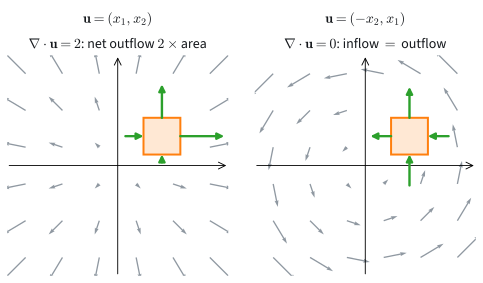
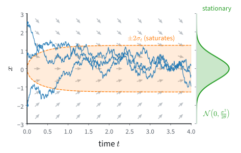
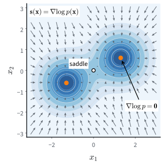
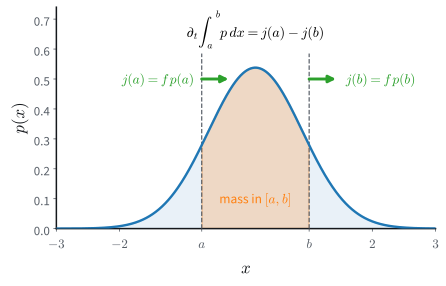
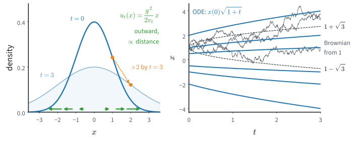
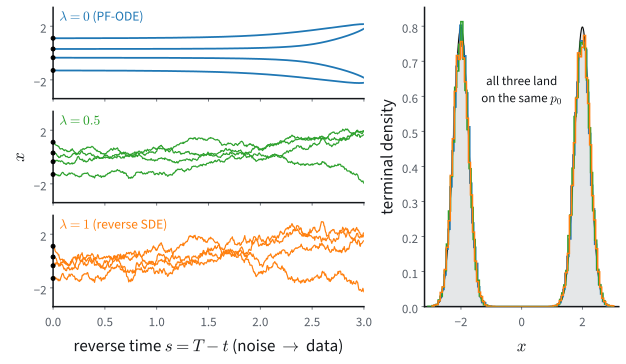

# The Fokker--Planck Equation and Probability Flow
:label:`sec_mdl-fokker-planck-probability-flow`

The previous section simulated the Ornstein--Uhlenbeck process, the
stochastic differential equation $dX=-X\,dt+\sqrt2\,dW$ that pulls a
particle toward the origin while kicking it with noise. Every run drew
different paths, and no single path can be predicted. Yet something repeats
from run to run. Start a hundred thousand particles at $x=2$ and look at
their histogram at time $t=0.5$: on every run it is the same bell curve,
centered near $1.21$ with a standard deviation near $0.80$. The randomness of
the paths averages out, and the density of the cloud moves
deterministically. Which equation moves it?

Adriaan Fokker and Max Planck wrote that equation for Brownian particles
pushed by a force :cite:`Fokker.1914,Planck.1917`, and Andrey Kolmogorov
showed that it governs the density of every diffusion :cite:`Kolmogorov.1931`.
It has two terms: the drift carries the density along, and the noise smooths
it. The smoothing can also be written as transport, a flow that moves
probability from where the density is high toward where it is low. Seen at the
level of the density, noise acts like a deterministic velocity.

This matters for generative models. A diffusion model generates data by
running a noising process backward. A single noisy path cannot be reversed,
because it has forgotten where it started, but its density can. Replacing the
noise by the outward flow gives an ordinary differential equation whose
particles have the same histogram as the stochastic process at every time.
Running the density equation backward gives a stochastic process that turns
noise into data. We choose the drift and the noise level ourselves. Both
constructions need one more quantity: the direction in which the log-density
increases, at every point and time.

The SDE section gave us the forward process and its Gaussian transition
density. Here we derive the equation for the density, an ODE that moves the
same density, and the time reversal of the SDE. We check each on the
Ornstein--Uhlenbeck process and on a two-mode "data" density whose
log-density gradient has a closed form. For real data that gradient is
unknown, and this is the question we leave open.

Throughout, $\mathbf f$ is the drift, $g$ the noise level, $p_t$ the density
at time $t$ and $\mathbf s_t$ the gradient of $\log p_t$ (the score). A
velocity field is written $\mathbf u$, a probability current $\mathbf j$, and
a clock that runs backward $\bar t=T-t$. Each is defined where it first
appears.

```{.python .input #fokker-planck-imports}
#@tab mxnet
import math
import numpy as np
from mxnet import autograd, gluon, init, np as mnp, npx
from mxnet.gluon import nn
from d2l import mxnet as d2l
npx.set_np()
```

```{.python .input #fokker-planck-imports}
#@tab pytorch
import math
import numpy as np
import torch
from torch import nn
from torch.nn import functional as F
from d2l import torch as d2l
```

```{.python .input #fokker-planck-imports}
#@tab tensorflow
import math
import numpy as np
import tensorflow as tf
from d2l import tensorflow as d2l
```

```{.python .input #fokker-planck-imports}
#@tab jax
import math
import numpy as np
import jax
from jax import numpy as jnp
from flax import nnx
import optax
from d2l import jax as d2l
```

```{.python .input #mdl-fokker-planck-probability-flow-the-fokker-planck-equation-and-probability-flow-1}
from scipy.special import erf
```

## From Paths to Densities
:label:`sec_mdl-paths-to-densities`

We first separate the two things an SDE produces, random paths and a
deterministic density, and confirm on a simulation that the density is the
same on every run.

### Pathwise and Ensemble Views

To speak about "the" density we need the process in one fixed form. Every SDE
in this section is

$$
d\mathbf{X} = \mathbf{f}(\mathbf{X}, t)\,dt + g(t)\,d\mathbf{W},
$$

with a drift $\mathbf{f} : \mathbb{R}^d \times [0, T] \to \mathbb{R}^d$, a
scalar noise level $g(t)$, a $d$-dimensional Brownian motion $\mathbf W$, and
a random start $\mathbf{X}_0 \sim p_0$. Over a short step the particle moves
by $\mathbf f\,dt$ plus an independent Gaussian kick of variance $g^2\,dt$ in
each coordinate.

There are two ways to look at this process. The pathwise view follows one
particle: one realization of the Brownian motion produces one path
$\mathbf{X}_t$, different on every run. The ensemble view fixes a point
$\mathbf{x}$ and asks for the density $p_t(\mathbf{x})$ of the random variable
$\mathbf{X}_t$, called the **time-marginal**. The marginal averages over both
sources of randomness, the draw of $\mathbf{X}_0$ and the noise along the way.
This averaging makes it deterministic.

Our running process is the Ornstein--Uhlenbeck (OU) process of
:numref:`sec_mdl-ornstein-uhlenbeck`, $dX = -\theta X\,dt + g\,dW$. Started
from a point $X_0 = x_0$, its marginal is the Gaussian derived in that section:

$$
X_t \sim \mathcal{N}\big(\alpha_t x_0,\; \sigma_t^2\big),
\qquad \alpha_t = e^{-\theta t},\quad
\sigma_t^2 = \frac{g^2}{2\theta}\left(1 - e^{-2\theta t}\right).
$$
:eqlabel:`eq_mdl-dyn-ou-marginal`

The mean decays to the origin, and the variance grows from zero and saturates
at $g^2/(2\theta)$. We take $\theta = 1$ and $g = \sqrt{2}$ throughout, so the
saturated law is $\mathcal{N}(0, 1)$. The two halves of the SDE already show
in this formula: the drift transports the cloud (its center slides along
$\dot x=-\theta x$), and the diffusion spreads it (its variance grows). The
Fokker--Planck equation will turn both halves into operators on $p_t$.

### Simulated Marginals

The opening claimed that a large cloud has the same histogram on every run.
To test it, $100{,}000$ particles start at $x_0 = 2$ and move by
Euler--Maruyama steps of size $\Delta t = 0.002$
(:numref:`sec_mdl-euler-maruyama`). At $t=0.1$, $0.5$ and $2$ we compare the
cloud with the Gaussian :eqref:`eq_mdl-dyn-ou-marginal`.

```{.python .input #fokker-planck-cloud-marginals}
theta, g = 1.0, np.sqrt(2.0)            # OU: dX = -theta X dt + g dW

def ou_mean_var(x0, t, theta=theta, g=g):
    """Mean and variance of X_t started at x0: N(alpha_t x0, sigma_t^2)."""
    alpha = np.exp(-theta * t)
    return alpha * x0, g**2 / (2 * theta) * (1 - alpha**2)

rng = np.random.default_rng()
n, dt, snap_at = 100_000, 0.002, {50: 0.1, 250: 0.5, 1000: 2.0}  # step -> t
x, snaps = np.full(n, 2.0), {}          # every particle starts at x0 = 2
for k in range(1, max(snap_at) + 1):    # Euler--Maruyama
    x += -theta * x * dt + g * np.sqrt(dt) * rng.standard_normal(n)
    if k in snap_at:
        snaps[snap_at[k]] = x.copy()

grid = np.linspace(-3.5, 4.5, 400)
d2l.set_figsize((6, 2.5))
for (t, cloud), c in zip(snaps.items(), ('C0', 'C1', 'C2')):
    m, v = ou_mean_var(2.0, t)
    print(f't={t}: mean {cloud.mean():.3f} (exact {m:.3f}), '
          f'std {cloud.std():.3f} (exact {np.sqrt(v):.3f})')
    d2l.plt.hist(cloud, bins=80, density=True, alpha=0.35, color=c)
    d2l.plt.plot(grid, np.exp(-(grid - m)**2 / (2 * v)) / np.sqrt(2 * np.pi * v),
                 color=c, label=f't = {t}')
d2l.plt.xlabel('x'); d2l.plt.ylabel('density'); d2l.plt.legend();
```

At every snapshot the cloud's mean and standard deviation agree with
$2e^{-t}$ and $\sqrt{1-e^{-2t}}$ to a few thousandths, the size of the Monte
Carlo error (for the mean at $t=0.5$ it is $0.80/\sqrt{10^5}\approx0.0025$).
At $t = 2$ the mean is still $2e^{-2}\approx0.27$, about a quarter of a
standard deviation away from the stationary $\mathcal{N}(0, 1)$. The paths
differ from run to run, but the density does not. We now look for the
equation that moves it.

## The Fokker--Planck Equation
:label:`sec_mdl-fokker-planck`

A path cannot be differentiated in time, but the average of a smooth function
of $\mathbf X_t$ over all paths can. Turning a statement about averages into a statement about the density
requires moving derivatives from the function onto the density, and that needs
three facts about fields in $\mathbb R^d$.

### Divergence, Laplacian, and Integration by Parts
:label:`sec_mdl-dyn-vector-calculus`

The derivation uses only the gradient of :numref:`sec_mdl-multivariable_calculus`
and three tools built from it, each of which also has a physical meaning we will
need later. Let $\mathbf{u} : \mathbb{R}^d \to \mathbb{R}^d$ be a smooth vector
field, which we picture as the velocity of a fluid, and
$h : \mathbb{R}^d \to \mathbb{R}$ a smooth scalar field.

**Divergence.** We want to know how much fluid leaves a small box per unit
time. The **divergence** of $\mathbf u$ is the scalar field

$$
\nabla \cdot \mathbf{u} = \sum_{i=1}^d \frac{\partial u_i}{\partial x_i}.
$$
:eqlabel:`eq_mdl-dyn-divergence`

It is the net rate at which fluid leaves an infinitesimal box around
$\mathbf{x}$, divided by the volume of the box: positive at a source, negative
at a sink. Two plane fields show the range. The expanding field
$\mathbf u=(x_1,x_2)$ has $\nabla\cdot\mathbf u=1+1=2$, so every box of area
$A$ loses fluid at the rate $2A$, wherever it sits. The rotation
$\mathbf u=(-x_2,x_1)$ has $\nabla\cdot\mathbf u=0+0=0$: fluid circulates, and
no box gains or loses any. A zero divergence therefore does not mean a zero
field. :numref:`fig_mdl-dyn-divergence-boxes` checks both statements on one box.

![The divergence as net outflow, on the box of side $0.5$ centered at $(0.6,0.4)$. Each green arrow is the normal component of the field at the midpoint of a side, drawn away from the side for outflow and onto it for inflow. (a) For $\mathbf u=(x_1,x_2)$ fluid enters through the left and bottom sides and leaves through the right and top; the outflow exceeds the inflow by $2\times$ the area. (b) For the rotation $\mathbf u=(-x_2,x_1)$ the inflow through the right and bottom sides equals the outflow through the other two.](../img/mdl-dyn-divergence-boxes.svg)
:label:`fig_mdl-dyn-divergence-boxes`

Summing the outflow of many small boxes cancels every interior face, which
leaves the flux through the outer boundary. This is the **divergence
theorem**: for a bounded region $\Omega$ with outward unit normal $\mathbf{n}$,

$$
\int_\Omega \nabla \cdot \mathbf{u}\; d\mathbf{x} = \oint_{\partial\Omega} \mathbf{u} \cdot \mathbf{n}\; dS.
$$
:eqlabel:`eq_mdl-dyn-divergence-theorem`

The total divergence inside a region equals the net flow out through its
boundary. In one dimension it is the fundamental theorem of calculus,
$\int_a^b u'(x)\,dx = u(b) - u(a)$. We use the theorem without proof; it is
proved in any text on multivariable calculus.

**Laplacian.** We want a measure of how a function compares with its
surroundings. The **Laplacian** is the divergence of the gradient,

$$
\Delta h = \nabla \cdot (\nabla h) = \sum_{i=1}^d \frac{\partial^2 h}{\partial x_i^2}.
$$
:eqlabel:`eq_mdl-dyn-laplacian`

It compares $h$ at a point with its average over a small sphere of radius $r$
around the point: that average is
$h(\mathbf{x}) + \frac{r^2}{2d}\Delta h(\mathbf{x}) + O(r^4)$, which Exercise
:exref:`ex_mdl-fokker-planck-probability-flow-laplacian-averaging` proves. In
the smallest case, $h(x)=x^2$ in one dimension, the "sphere" is the pair of
points $x\pm r$, the average is $\frac12\big((x-r)^2+(x+r)^2\big)=x^2+r^2$, and
$\frac{r^2}{2}h''=r^2$, so the formula holds with no remainder (at $x=1$,
$r=0.3$ the average is $1.09$). Thus $\Delta h > 0$ means that $h$ lies below
its neighborhood average. A zero Laplacian does not mean a constant function:
$h=x_1^2-x_2^2$ has $\Delta h=2-2=0$ and equals its average over every circle.

**Integration by parts.** This is the $d$-dimensional form of the
one-dimensional rule of :numref:`subsec_mdl-integration-by-parts`, and it is
the tool that moves a derivative from one factor onto the other. If $h$ and
$\mathbf{u}$ are smooth and $h\,\mathbf u$ decays fast enough at infinity (in
this section, because $h$ vanishes outside a bounded set or because both
factors have Gaussian tails), then

$$
\int h\, (\nabla \cdot \mathbf{u})\; d\mathbf{x} = -\int \nabla h \cdot \mathbf{u}\; d\mathbf{x}.
$$
:eqlabel:`eq_mdl-dyn-integration-by-parts`

The derivative moves from $\mathbf u$ onto $h$, and the sign flips.

*Proof.* The product rule gives
$\nabla \cdot (h \mathbf{u}) = \nabla h \cdot \mathbf{u} + h\, \nabla \cdot \mathbf{u}$.
Integrate both sides over a ball of radius $R$ and let $R \to \infty$. By the
divergence theorem the left side is the flux of $h\mathbf{u}$ through the
sphere of radius $R$, which tends to zero under the decay assumption.
$\blacksquare$

Applied twice, first with $\mathbf{u} = \nabla p$ and then with the roles
exchanged, it moves a whole Laplacian across the integral sign, and the two
signs cancel: $\int h\, \Delta p = -\int\nabla h\cdot\nabla p = \int p\, \Delta h$.

### From Itô's Lemma to the PDE

We now derive the equation for $p_t$. Throughout we assume that $\mathbf f$ is
continuously differentiable in $\mathbf x$ and continuous in $t$, that $g$ is
continuous, that $p_t$ is smooth and positive, and that derivatives in $t$ may
be taken under the integral sign.

The idea is to look at the cloud through averages. If $\phi$ is a smooth bump
equal to $1$ on a small box and $0$ outside a slightly larger one, then
$\mathbb{E}[\phi(\mathbf{X}_t)]$ is roughly the probability of the box.
Knowing how every such average changes over time determines how the density
changes. So take any smooth **test function** $\phi : \mathbb{R}^d \to \mathbb{R}$
that vanishes outside a bounded set.

Itô's lemma (:numref:`sec_mdl-ito-lemma`) is the chain rule for SDE paths.
For $d\mathbf X=\mathbf f\,dt+\mathbf G\,d\mathbf W$ it adds to the ordinary
chain rule the second-order term
$\tfrac12\sum_{ij}(\mathbf G\mathbf G^\top)_{ij}\,\partial_i\partial_j\phi$,
because the squared Brownian increment $(dW)^2$ is of size $dt$ rather than
negligible. With
$\mathbf{G} = g(t)\, \mathbf I$ that term is $\tfrac12 g^2$ times the
Laplacian of $\phi$:

$$
d\phi(\mathbf{X}_t) = \left(\nabla\phi \cdot \mathbf{f} + \tfrac12 g^2 \Delta\phi\right) dt + g\, \nabla\phi \cdot d\mathbf{W}.
$$

The function changes by a drift part, the chain rule plus the Laplacian
correction, and a noise part. Now take expectations. The Itô integral of
$g\nabla\phi$ has mean zero, because each Brownian increment is independent of
the integrand at the start of that increment (:numref:`sec_mdl-ito-integral`).
The noise part drops out:

$$
\frac{d}{dt}\, \mathbb{E}[\phi(\mathbf{X}_t)] = \mathbb{E}\!\left[\nabla\phi \cdot \mathbf{f} + \tfrac12 g^2 \Delta\phi\right].
$$
:eqlabel:`eq_mdl-dyn-expectation-evolution`

The average of $\phi$ changes at the average rate of its drift-plus-diffusion
derivative. Both sides are integrals against the marginal density. Writing
$\mathbb{E}[\,\cdot\,] = \int (\cdot)\, p_t(\mathbf{x})\, d\mathbf{x}$ and
moving $d/dt$ under the integral,

$$
\int \phi\; \partial_t p_t\; d\mathbf{x} = \int (\nabla\phi \cdot \mathbf{f})\, p_t\; d\mathbf{x} + \tfrac12 g^2 \int (\Delta\phi)\, p_t\; d\mathbf{x}.
$$

The derivatives on the right still act on $\phi$; we move them onto $p_t$ with
integration by parts :eqref:`eq_mdl-dyn-integration-by-parts`. Because $\phi$
vanishes outside a bounded set, no boundary terms appear and no decay of $p_t$
is needed. The drift term needs one move, with $h=\phi$ and
$\mathbf u=\mathbf fp_t$; the diffusion term needs two, and its signs cancel:

$$
\int (\nabla\phi\cdot\mathbf f)\,p_t\,d\mathbf x=-\int\phi\,\nabla\cdot(\mathbf f\,p_t)\,d\mathbf x,
\qquad
\int(\Delta\phi)\,p_t\,d\mathbf x=\int\phi\,\Delta p_t\,d\mathbf x.
$$

Substituting both gives one integral against $\phi$:

$$
\int \phi\, \Big(\partial_t p_t +\nabla \cdot (\mathbf{f}\, p_t) - \tfrac12 g^2 \Delta p_t\Big)\, d\mathbf{x}=0.
$$

This holds for every test function $\phi$. The bracket is continuous, and a
continuous function that integrates to zero against every bump is zero (a bump
placed where it is positive would give a positive integral). So the bracket
vanishes pointwise, and $p_t$ solves the **Fokker--Planck equation**, also
called the *Kolmogorov forward equation*:

$$
\partial_t p_t(\mathbf{x}) = -\nabla \cdot \big(\mathbf{f}(\mathbf{x}, t)\, p_t(\mathbf{x})\big) + \tfrac12 g(t)^2\, \Delta p_t(\mathbf{x}).
$$
:eqlabel:`eq_mdl-dyn-fokker-planck`

The first term is the drift's contribution, the second the noise's. For a
matrix noise $\mathbf G\,d\mathbf W$ the second term becomes
$\tfrac12\sum_{ij}\partial_i\partial_j(a_{ij}p_t)$ with
$\mathbf a=\mathbf G\mathbf G^\top$; Exercise
:exref:`ex_mdl-fokker-planck-probability-flow-state-dependent-noise` works out
what changes. :citet:`Risken.1996` collects the many variants of the equation
used in physics.

### The Heat Equation and the Two Terms

The smallest case shows each term at work. Switch the drift off. Then the
Fokker--Planck equation is the **heat equation**,

$$
\mathbf{f} = \mathbf{0} : \qquad \partial_t p_t = \tfrac12 g^2\, \Delta p_t.
$$
:eqlabel:`eq_mdl-dyn-heat-equation`

The density rises wherever it lies below its neighborhood average. Before any
general statement, we check it at one point. Take $g=1$, $d=1$ and
$p_t=\mathcal N(0,t)$, the law of Brownian motion started at $0$. With
$p=e^{-x^2/(2t)}/\sqrt{2\pi t}$, direct differentiation gives
$\partial_tp=p\,\big(\tfrac{x^2}{2t^2}-\tfrac1{2t}\big)$ and
$\partial_{xx}p=p\,\big(\tfrac{x^2}{t^2}-\tfrac1t\big)$. At $x=0$, $t=1$:
$p=0.399$, $\partial_tp=-0.1995$ and $\tfrac12\partial_{xx}p=-0.1995$. The
peak sinks at the rate the Laplacian predicts.

More generally, a Gaussian $\mathcal N(\mathbf m,v_t\mathbf I)$ solves the heat
equation when its variance grows as $v_t=v_0+g^2t$ for constant $g$, or as
$v_t=v_0+\int_0^tg(\tau)^2\,d\tau$ when $g$ changes with time. This is the
$\textrm{Var}(W_t)=t$ law of Brownian motion. The "variance-exploding" forward
process of diffusion models is this equation with a growing $g(t)$.

We can now read the two terms of :eqref:`eq_mdl-dyn-fokker-planck`. The
first, $-\nabla \cdot (\mathbf{f} p)$, is *advection*: by the meaning of the
divergence, it removes density wherever the drift carries more mass out of a
small box than in, so probability moves along the drift field. The second,
$\tfrac12 g^2 \Delta p$, is *diffusion*: it raises the density where it lies
below its neighborhood average and lowers it where it lies above, which
smooths it. The second term is Itô's $(dW)^2 = dt$ correction, seen at the
level of the density.

### Gaussian Solutions of the OU Equation

For the OU process we know the answer in closed form, which lets us test the
equation on a whole family of solutions. With $f(x) = -\theta x$ in one
dimension, :eqref:`eq_mdl-dyn-fokker-planck` reads

$$
\partial_t p = \theta\, \partial_x (x\, p) + \tfrac12 g^2\, \partial_{xx} p.
$$

The drift term pushes density toward the origin and the diffusion term spreads
it. Substituting a general Gaussian reduces this PDE to two ODEs.

**Proposition (Gaussian solutions of the OU equation).** *Let
$p(x, t) = \mathcal{N}(x; m(t), v(t))$ be a Gaussian density with
differentiable mean $m(t)$ and variance $v(t) > 0$. Then $p$ solves the OU
Fokker--Planck equation if and only if*

$$
\dot{m} = -\theta m, \qquad \dot{v} = g^2 - 2\theta v.
$$
:eqlabel:`eq_mdl-dyn-moment-odes`

**Proof.** For a Gaussian, $\partial_x p = -\frac{x - m}{v}\, p$. Direct
differentiation turns each side of the PDE into $p$ times a quadratic
polynomial in $(x - m)$:

$$
\partial_t p = p \left[\frac{\dot m}{v}(x - m) + \frac{\dot v}{2v^2}\big((x - m)^2 - v\big)\right],
$$

while, writing $x = (x - m) + m$ in the drift term,

$$
\theta\, \partial_x(x p) + \tfrac{g^2}{2} \partial_{xx} p = p \left[-\frac{\theta m}{v}(x - m) + \Big(\frac{g^2}{2v^2} - \frac{\theta}{v}\Big)\big((x - m)^2 - v\big)\right].
$$

The functions $1, (x - m), (x - m)^2$ are linearly independent, so the two
sides agree for all $x$ only when the coefficients match:
$\dot{m} = -\theta m$ from the linear term and
$\dot{v} = g^2 - 2\theta v$ from the quadratic term (the constant term
repeats the latter). $\blacksquare$

The mean decays and the variance relaxes toward $g^2/(2\theta)$. Solving the
two ODEs from $m(0)=m_0$, $v(0)=v_0$ gives

$$
m(t)=m_0e^{-\theta t},\qquad v(t)=v_0e^{-2\theta t}+\frac{g^2}{2\theta}\big(1-e^{-2\theta t}\big).
$$

For a point start, $v_0=0$, this is the kernel
:eqref:`eq_mdl-dyn-ou-marginal` at every $t>0$, so the transition density of
:numref:`sec_mdl-ornstein-uhlenbeck` solves the Fokker--Planck equation.

The fixed point $\dot m = \dot v = 0$ is $m = 0$, $v = g^2/(2\theta)$: the
stationary Gaussian is the steady state $\partial_t p = 0$ of the PDE
(Exercise :exref:`ex_mdl-fokker-planck-probability-flow-stationary-density`
derives it without assuming a Gaussian form). Setting $\theta = 0$ recovers
the heat equation's $\dot v = g^2$. For the running values $\theta=1$,
$g=\sqrt2$, a cloud of variance $v_0=4$ relaxes as $v(t)=1+3e^{-2t}$.

### Linearity and Mixtures

Real data are not Gaussian, so we need a density with more structure that we
can still follow in closed form. Linearity provides one.

**Proposition (superposition).** *The Fokker--Planck equation is linear in
$p$: if $p^{(1)}_t$ and $p^{(2)}_t$ solve it, so does
$w_1p^{(1)}_t+w_2p^{(2)}_t$ for any constants $w_1,w_2$. For $w_1,w_2\ge0$
with $w_1+w_2=1$ this is again a density.*

**Proof.** Both $-\nabla\cdot(\mathbf fp)$ and $\tfrac12g^2\Delta p$ are linear
in $p$, and so is $\partial_tp$. $\blacksquare$

Under OU, each component $\mathcal N(\mu_k,v_k)$ of a Gaussian mixture follows
the moment ODEs :eqref:`eq_mdl-dyn-moment-odes` on its own, so the mixture of
the evolved components solves the equation. Our running "data" density is

$$
p_0=\tfrac12\,\mathcal N(-2,\,0.25)+\tfrac12\,\mathcal N(2,\,0.25),
$$

two well-separated modes of standard deviation $0.5$. With $\theta=1$,
$g=\sqrt2$ its marginal at time $t$ is the mixture of
$\mathcal N\big(\pm2e^{-t},\,1-0.75\,e^{-2t}\big)$, in closed form at every
time. The next cell defines it, together with its CDF and a sampler. The
parameters are explicit arguments, so the exercises can change them.

```{.python .input #fokker-planck-mixture-setup}
ws, mus, v0s = np.array([0.5, 0.5]), np.array([-2.0, 2.0]), np.array([0.25, 0.25])

def mixture_params(t, mus=mus, v0s=v0s, theta=theta, g=g):
    """Means and variances of the OU-evolved components (moment ODEs)."""
    alpha = np.exp(-theta * t)
    return alpha * mus, alpha**2 * v0s + g**2 / (2 * theta) * (1 - alpha**2)

def gauss(x, m, v):
    return np.exp(-(x - m)**2 / (2 * v)) / np.sqrt(2 * np.pi * v)

def p_t(x, t, ws=ws, mus=mus, v0s=v0s):
    """Exact marginal density of the mixture at time t."""
    m, v = mixture_params(t, mus, v0s)
    return sum(w * gauss(x, mk, vk) for w, mk, vk in zip(ws, m, v))

def mixture_cdf(x, t, ws=ws, mus=mus, v0s=v0s):
    m, v = mixture_params(t, mus, v0s)
    return sum(w * 0.5 * (1 + erf((x - mk) / np.sqrt(2 * vk)))
               for w, mk, vk in zip(ws, m, v))

def sample_p0(n, rng, ws=ws, mus=mus, v0s=v0s):
    k = rng.choice(len(ws), size=n, p=ws)   # component of each draw
    return mus[k] + np.sqrt(v0s[k]) * rng.standard_normal(n)
```

No proposition about a single Gaussian covers the mixture; linearity does. We
check numerically that the closed-form mixture density satisfies the PDE,
evaluating both sides on a grid, $\partial_t$ by a centered difference in time and the
$x$-derivatives by `np.gradient`, at $t=0.25$, $1$ and $3$.

```{.python .input #fokker-planck-ou-residual}
xs = np.linspace(-5.0, 5.0, 4001)
dx, eps = xs[1] - xs[0], 1e-5
for t in (0.25, 1.0, 3.0):
    dpdt = (p_t(xs, t + eps) - p_t(xs, t - eps)) / (2 * eps)
    p = p_t(xs, t)
    rhs = (np.gradient(theta * xs * p, dx)                 # -d/dx(f p)
           + 0.5 * g**2 * np.gradient(np.gradient(p, dx), dx))
    res = (dpdt - rhs)[5:-5]            # trim the one-sided edge stencils
    print(f't={t}: max|residual| = {np.abs(res).max():.1e}, '
          f'max|dp/dt| = {np.abs(dpdt).max():.1e}')
```

The residual is three to five orders of magnitude below $\partial_tp$ at each
time ($4\times10^{-6}$ against $0.44$ at $t=0.25$; at $t=3$ the density barely
moves, and $10^{-6}$ stands against $3\times10^{-3}$). This is the truncation
error of the finite differences. The closed-form mixture solves the
Fokker--Planck equation, and the simulation above showed that the SDE's
particles follow such a solution.

## The Score Function
:label:`sec_mdl-score-function`

The rest of the section rewrites the diffusion term with the gradient of
$\log p_t$, and every construction that follows needs this gradient. We meet it
first, with the mixture as the main example.

### Definition and Geometry

The question is which direction, from a point $\mathbf x$, leads most quickly
toward more probable points. The **score** of a density $p_t$ answers it:

$$
\mathbf{s}_t(\mathbf{x}) = \nabla_{\mathbf{x}} \log p_t(\mathbf{x}).
$$
:eqlabel:`eq_mdl-dyn-score-def`

The score is a vector field over data space that points uphill on the
log-density. The gradient is with respect to the input $\mathbf{x}$, not the
parameters of a model. :numref:`sec_mdl-fisher-divergence` introduced this
data score and the Fisher divergence built from it, and contrasted it with the
parameter score of :numref:`sec_mdl-maximum_likelihood`.

The length of $\mathbf s_t$ is the rate at which $\log p_t$ increases,
$\|\nabla p_t\|/p_t$. It is therefore large where the density is small but
changing, in the tails and in the valleys between modes, and not where the
density is large. The score vanishes at the critical points of $p_t$: modes, minima and
saddles, which its derivative tells apart.

The smallest case is a Gaussian. For
$p(\mathbf{x}) = \mathcal{N}(\mathbf{x}; \boldsymbol{\mu}, v\mathbf I)$ the
log-density is $-\|\mathbf{x} - \boldsymbol{\mu}\|^2 / (2v) + \textrm{const}$,
so

$$
\nabla \log p(\mathbf{x}) = -\frac{\mathbf{x} - \boldsymbol{\mu}}{v}.
$$
:eqlabel:`eq_mdl-dyn-gaussian-score`

The score of a Gaussian is a linear spring pulling toward the mean, stiffer
for smaller variance. With $\mu=0$, $v=0.25$ and $x=1$ it is $-4$, four times
the pull at unit variance. For a general covariance the spring is
$-\boldsymbol\Sigma^{-1}(\mathbf{x} - \boldsymbol{\mu})$.

One more property follows from the definition. A constant factor in $p$ drops
out of $\nabla\log p$, so the score of $\tilde p/Z$ is the score of $\tilde
p$ for any constant $Z$. The score can therefore be learned without ever
computing a normalizing constant.
:numref:`fig_mdl-dyn-score-field` shows the score field of a two-mode density
in two dimensions.


:label:`fig_mdl-dyn-score-field`

### The Score of a Gaussian Mixture

Our data density is a mixture, so we need its score in a form we can evaluate
and read. For $p(x) = \sum_k w_k\, N_k(x)$ with weights $w_k$ and components
$N_k(x)=\mathcal{N}(x; \mu_k, v_k)$, differentiate $\log p$ directly:

$$
\nabla \log p(x) = \frac{\sum_k w_k \nabla N_k(x)}{\sum_j w_j N_j(x)} = \sum_k r_k(x) \left(-\frac{x - \mu_k}{v_k}\right), \qquad r_k(x) = \frac{w_k N_k(x)}{\sum_j w_j N_j(x)}.
$$
:eqlabel:`eq_mdl-dyn-mixture-score`

The mixture's score is a weighted average of the component springs. The weight
$r_k(x)$ is the *responsibility* of component $k$, the posterior probability
that a point at $x$ came from it. For two components with equal weights,
means $\pm\mu$ and a common variance $v_0$, the responsibilities reduce to a
logistic function of $x$ and the score has the closed form

$$
s_0(x) = \frac{\mu \tanh\!\left(\mu x / v_0\right) - x}{v_0}.
$$
:eqlabel:`eq_mdl-dyn-tanh-score`

Near each mode $\tanh \to \pm 1$ and the score is the local spring
$-(x \mp \mu)/v_0$. For the running mixture, $\mu=2$ and $v_0=0.25$, it is
$s_0(x)=8\tanh(8x)-4x$. At $x = 0$ the score vanishes, the third critical
point, and it grows from zero with slope

$$
s_0'(0)=\frac{\mu^2-v_0}{v_0^2}=60.
$$

A positive slope means that $x=0$ is a minimum of the density, a repeller of
the uphill flow $\dot x=s_0(x)$. This happens when $\mu^2>v_0$, the condition
for two modes that Exercise
:exref:`ex_mdl-fokker-planck-probability-flow-mode-merging` derives. The next
cell implements :eqref:`eq_mdl-dyn-mixture-score` with a numerically stable
softmax for the responsibilities, checks it against the tanh form, and locates
the zeros and the slope at $0$.

```{.python .input #fokker-planck-mixture-score}
def score_t(x, t, ws=ws, mus=mus, v0s=v0s):
    """Exact score of p_t: responsibility-weighted component springs."""
    m, v = mixture_params(t, mus, v0s)
    logw = np.stack([np.log(w) - 0.5 * np.log(2 * np.pi * vk)
                     - (x - mk)**2 / (2 * vk) for w, mk, vk in zip(ws, m, v)])
    r = np.exp(logw - logw.max(axis=0))
    r /= r.sum(axis=0)                  # responsibilities, a stable softmax
    return sum(rk * -(x - mk) / vk for rk, mk, vk in zip(r, m, v))

gs = np.linspace(-3.5, 3.5, 1400)
mu, v0 = mus[1], v0s[1]
s = score_t(gs, 0.0)
s_tanh = (mu * np.tanh(mu * gs / v0) - gs) / v0
print(f'max|responsibility form - tanh form| = {np.abs(s - s_tanh).max():.1e}')
mid = (gs[:-1] + gs[1:]) / 2
print('score changes sign near', np.round(mid[s[:-1] * s[1:] < 0], 2) + 0.0)
delta = 1e-5                            # centered difference at x = 0
print(f'slope at 0: {(score_t(delta, 0.0) - score_t(-delta, 0.0)) / (2 * delta):.2f}, '
      f'formula (mu^2 - v0) / v0^2 = {(mu**2 - v0) / v0**2:.2f}')
dens = p_t(gs, 0.0)
d2l.plot(gs, [s, dens * np.abs(s).max() / dens.max()], 'x', '',
         legend=['score s(x)', 'density (rescaled)'], figsize=(5.5, 3))
```

The two formulas agree to machine precision, the score changes sign at the
modes $\pm2$ and at the minimum $0$, and its slope there is $60$. The plot
shows where the score is large: in the valley between the modes, where the
density is nearly zero but its logarithm climbs steeply toward either mode,
and in the tails.

## The Continuity Equation and the Probability-Flow ODE
:label:`sec_mdl-continuity-equation`

The Fokker--Planck equation describes particles that move at random. We now
ask which law governs particles that move deterministically, and find that the
two laws coincide once the noise is written as a velocity.

### Conservation of Probability

Forget noise for a moment. Suppose every particle follows a velocity field,
$\dot{\mathbf{x}} = \mathbf{u}(\mathbf{x}, t)$. What PDE does their density
$q_t$ obey? Probability is neither created nor destroyed, so the mass inside a
fixed region $\Omega$ can change only by flowing across its boundary.
Particles cross a small patch of boundary at the rate density times velocity.
We call this flux density the **probability current**,
$\mathbf j=q\,\mathbf u$: at each point it gives the rate, per unit area, at
which probability crosses a surface placed there. The mass balance of the
region is

$$
\frac{d}{dt} \int_\Omega q_t\; d\mathbf{x} = -\oint_{\partial\Omega} \mathbf j \cdot \mathbf{n}\; dS = -\int_\Omega \nabla \cdot (q_t \mathbf{u})\; d\mathbf{x},
$$
:eqlabel:`eq_mdl-dyn-mass-balance`

where the divergence theorem :eqref:`eq_mdl-dyn-divergence-theorem` turned the
boundary flux into a volume integral. The mass inside changes at minus the net
outflow. Since $\Omega$ is arbitrary, the integrands agree pointwise, which
gives the **continuity equation**:

$$
\partial_t q_t + \nabla \cdot (q_t\, \mathbf{u}) = 0.
$$
:eqlabel:`eq_mdl-dyn-continuity`

The density at a point falls at the rate at which the current diverges there.
The same law governs the mass of a fluid and electric charge. In one
dimension the balance reads $\partial_t \int_a^b q\,dx = j(a) - j(b)$: what
flows in at $a$ minus what flows out at $b$.
:numref:`fig_mdl-dyn-fokker-planck-flux` draws it.


:label:`fig_mdl-dyn-fokker-planck-flux`

The balance also says what happens at the edges of the domain. On all of
$\mathbb R^d$ we assume that the current decays at infinity. For the
Fokker--Planck equation this means that $\mathbf fp_t$ and $\nabla p_t$ decay,
which Gaussian tails ensure even though the OU drift grows linearly. Integrating
:eqref:`eq_mdl-dyn-continuity` over $\mathbb{R}^d$ then gives
$\frac{d}{dt}\int q_t = 0$: total probability is conserved. On a bounded
domain a *reflecting* boundary imposes $\mathbf j\cdot\mathbf n=0$, so mass is
conserved there too, while an *absorbing* boundary imposes $q=0$, and mass can
leave.

Two small cases show the equation at work in one dimension. For a translation,
$u=c$, the equation is $\partial_tq+c\,\partial_xq=0$, solved by
$q_t(x)=q_0(x-ct)$: the profile slides without changing shape. For a
contraction, $u=-x$, every particle moves as $x(t)=x(0)e^{-t}$, the cloud
shrinks by the factor $e^{-t}$, and since the mass of each interval is
preserved, the density carried along each trajectory rises by $e^{t}$.

The contraction suggests a general rule for the density seen by a moving
particle. Expanding the divergence with the product rule,

$$
\nabla\cdot(q\,\mathbf u)=\mathbf u\cdot\nabla q+q\,\nabla\cdot\mathbf u,
$$

the continuity equation becomes $\partial_tq+\mathbf u\cdot\nabla q=-q\,\nabla\cdot\mathbf u$.
The left side is the rate of change of $q$ along a trajectory
$\mathbf x(t)$ of $\dot{\mathbf x}=\mathbf u$, by the chain rule. Dividing by
$q$,

$$
\frac{d}{dt}\log q_t(\mathbf{x}(t)) = -\nabla \cdot \mathbf{u}(\mathbf{x}(t), t).
$$
:eqlabel:`eq_mdl-dyn-log-density-rule`

Along a trajectory the log-density falls at the rate of the local expansion.
For the contraction, $\nabla\cdot u=-1$ and the log-density rises at rate
$1$, as computed above. The trajectories of $\dot{\mathbf x}=\mathbf u$ are
called the **characteristics** of the continuity equation. The rule is the
instantaneous change of variables of :numref:`sec_mdl-continuous-normalizing-flows`,
proved there along trajectories.

### Diffusion as Transport

The Fokker--Planck equation :eqref:`eq_mdl-dyn-fokker-planck` is not yet a
continuity equation: next to the transport term $-\nabla \cdot (\mathbf{f} p)$
it has a Laplacian. The chain rule turns the Laplacian into a transport term.
Wherever $p > 0$,

$$
\nabla p = p\, \nabla \log p,
$$
:eqlabel:`eq_mdl-dyn-grad-log`

which is the derivative of $\log p$ written backward, and therefore

$$
\tfrac12 g^2\, \Delta p = \tfrac12 g^2\, \nabla \cdot (\nabla p) = \nabla \cdot \big(p \cdot \tfrac12 g^2 \nabla \log p\big).
$$
:eqlabel:`eq_mdl-dyn-diffusion-as-transport`

The diffusion term is the divergence of a current, the density times
$+\tfrac12 g^2\nabla\log p$. Moved to the left side of a continuity equation
it appears with a minus sign, as a velocity $-\tfrac12 g^2\nabla\log p$.

**Proposition (Fokker--Planck is a continuity equation).** *Wherever
$p_t > 0$, the Fokker--Planck equation :eqref:`eq_mdl-dyn-fokker-planck` is
equivalent to*

$$
\partial_t p_t + \nabla \cdot (p_t\, \mathbf{u}_t) = 0, \qquad \mathbf{u}_t(\mathbf{x}) = \mathbf{f}(\mathbf{x}, t) - \tfrac12 g(t)^2\, \nabla \log p_t(\mathbf{x}).
$$
:eqlabel:`eq_mdl-dyn-pf-velocity`

**Proof.** Substitute :eqref:`eq_mdl-dyn-diffusion-as-transport` into
:eqref:`eq_mdl-dyn-fokker-planck` and merge the two divergences:

$$
\partial_t p = -\nabla \cdot (\mathbf{f} p) + \nabla \cdot \big(p \cdot \tfrac12 g^2 \nabla \log p\big) = -\nabla \cdot \big(p\, [\mathbf{f} - \tfrac12 g^2 \nabla \log p]\big). \qquad \blacksquare
$$

At the level of densities, the SDE moves probability as if each particle
followed the velocity $\mathbf u_t$: the drift plus a push down the
log-density gradient. The corresponding current is

$$
\mathbf j=\mathbf f\,p_t-\tfrac12g^2\,\nabla p_t=p_t\,\mathbf u_t.
$$
:eqlabel:`eq_mdl-dyn-probability-current`

The drift carries mass with the flow, and the diffusion pushes it down the
density gradient.

The heat equation shows what this velocity looks like. Take $\mathbf f=0$ and
$p_t=\mathcal N(0,v_t)$ in one dimension with $v_t=v_0+g^2t$. The score is
$-x/v_t$, so

$$
u_t(x)=-\tfrac12g^2\Big(-\frac{x}{v_t}\Big)=\frac{g^2}{2v_t}\,x.
$$

The velocity points away from the center and is proportional to the distance
from it, and it weakens as the density widens. The ODE $\dot x=g^2x/(2v_t)$
separates: $\frac{d}{dt}\log x=\frac{g^2}{2v_t}=\frac12\frac{d}{dt}\log v_t$,
so

$$
x(t)=x(0)\sqrt{v_t/v_0}.
$$
:eqlabel:`eq_mdl-dyn-heat-pf-solution`

Every particle is stretched by the same factor, and a Gaussian stretched by
$\sqrt{v_t/v_0}$ has variance $v_t$, which is the variance that Brownian
motion produces. With $v_0=g=1$ and $t=3$ every particle doubles its distance
from the center. A Brownian particle started at $x=1$ instead lands anywhere
in $1\pm1.73$ (one standard deviation, $\sqrt3$). The two processes agree on
the histogram at every time but move individual particles differently
(:numref:`fig_mdl-dyn-diffusion-outward-flow`).


:label:`fig_mdl-dyn-diffusion-outward-flow`

There is a limit to this construction. As $v_0\to0$ the velocity at small
times is $g^2x/(2g^2t)=x/(2t)$, which is unbounded as $t\to0$. A
deterministic flow can spread a point mass into a Gaussian only through a
field that blows up at the start, because a Lipschitz flow maps one point to
one point (Exercise
:exref:`ex_mdl-fokker-planck-probability-flow-affine-gaussian-flow`).

We check the worked example numerically, together with the identity
:eqref:`eq_mdl-dyn-diffusion-as-transport` itself. From one draw of
$20{,}000$ points of $\mathcal N(0,1)$ we form a Brownian cloud at $t=3$
(adding an independent $\mathcal N(0,3)$ increment) and a flow cloud by
integrating $\dot x=x/(2(1+t))$ with Heun steps
(:numref:`sec_mdl-odes-solvers`).

```{.python .input #fokker-planck-diffusion-identity}
p = gauss(xs, 0.0, 2.0)                 # a heat-equation Gaussian, g = 1
lhs = 0.5 * np.gradient(np.gradient(p, dx), dx)
rhs = np.gradient(p * 0.5 * np.gradient(np.log(p), dx), dx)
print(f'identity: max|lhs - rhs| = {np.abs(lhs - rhs)[5:-5].max():.1e} '
      f'(max|lhs| = {np.abs(lhs).max():.2f})')

def heat_velocity(x, t, v0=1.0, g=1.0):  # u_t = -(1/2) g^2 score = g^2 x / (2 v_t)
    return g**2 * x / (2 * (v0 + g**2 * t))

n, T, steps = 20_000, 3.0, 600
dt = T / steps
z = rng.standard_normal(n)              # p_0 = N(0, 1)
x_bm = z + np.sqrt(T) * rng.standard_normal(n)   # Brownian motion to time T
x_ode = z.copy()
for k in range(steps):                  # Heun steps for the probability flow
    k1 = heat_velocity(x_ode, k * dt)
    k2 = heat_velocity(x_ode + dt * k1, (k + 1) * dt)
    x_ode += 0.5 * dt * (k1 + k2)
print(f'std at t={T}: Brownian {x_bm.std():.3f}, flow {x_ode.std():.3f}, '
      f'exact {np.sqrt(1 + T):.3f}')
print(f'max|x_ode - 2 z| = {np.abs(x_ode - 2 * z).max():.1e}')
```

The identity holds to finite-difference precision. Both clouds have standard
deviation $2.00$ up to sampling error of about $0.01$, and the flow map equals
$x\mapsto2x$ up to the Heun error of about $10^{-5}$. The Brownian particles
spread by random kicks, the flow particles by a deterministic stretch, and the
two clouds have the same histogram.

### The Probability-Flow ODE
:label:`sec_mdl-probability-flow-ode`

The heat equation was one example. The proposition above says that the same
construction works for every SDE of our form: following the velocity
$\mathbf u_t$ gives an ODE,

$$
\frac{d\mathbf{x}}{dt} = \mathbf{u}_t(\mathbf{x}) = \mathbf{f}(\mathbf{x}, t) - \tfrac12 g(t)^2\, \nabla \log p_t(\mathbf{x}),
$$
:eqlabel:`eq_mdl-dyn-pf-ode`

the **probability-flow ODE** :cite:`song2021score`. Each particle follows the
drift, corrected by a push down the log-density gradient that stands in for
the noise.

**Proposition (the deterministic twin).** *Let $p_t$ be a smooth positive
solution of the Fokker--Planck equation for
$d\mathbf{X} = \mathbf{f}\,dt + g\,d\mathbf{W}$, $\mathbf{X}_0 \sim p_0$, with
the decay of the previous subsection. Suppose that $\mathbf u_t$ is
continuous in $t$, continuously differentiable in $\mathbf x$, and Lipschitz
in $\mathbf x$ with a constant that does not depend on $t$. Let
$\mathbf{x}(t)$ solve :eqref:`eq_mdl-dyn-pf-ode` with
$\mathbf{x}(0) \sim p_0$. Then $\mathbf{x}(t) \sim p_t$ for every $t$: the ODE
and the SDE share all time-marginals.*

The Lipschitz hypothesis holds for the OU drift and for the score of a
Gaussian or a Gaussian mixture with positive component variances, whose
slope is bounded for $t$ in $[0,T]$.

**Proof.** By the existence and uniqueness theorem of
:numref:`sec_mdl-ode-existence-uniqueness`, a field that is Lipschitz with a
constant independent of $t$ has exactly one trajectory through every point,
forward and backward, so its time-$t$ map is a bijection of $\mathbb R^d$. Let
$q_t$ be the density of the ODE's state. The field $\mathbf{u}_t$ is fixed and
known (it is built from $p$, not from $q$), so $q_t$ obeys the continuity
equation $\partial_t q + \nabla \cdot (q \mathbf{u}_t)=0$, which is linear in
$q$. By the previous proposition $p_t$ solves the same equation, and both
start from $q_0 = p_0$. The derivation of the log-density rule
:eqref:`eq_mdl-dyn-log-density-rule` used only this PDE, so along each
characteristic $\log q_t$ and $\log p_t$ change at the same rate
$-\nabla\cdot\mathbf u_t$, and they start equal. Since the characteristics
reach every point, $q_t = p_t$ everywhere. $\blacksquare$

The marginals agree; the paths do not. An SDE path is jagged, crosses other
paths, and is redrawn at every instant. An ODE trajectory is smooth, and two
trajectories never meet at the same point at the same time, by uniqueness.
The two processes move the same crowd in different ways, as panel (b) of
:numref:`fig_mdl-dyn-diffusion-outward-flow` shows.

The ODE also gives a likelihood. Integrating the log-density rule
:eqref:`eq_mdl-dyn-log-density-rule` with $q_t=p_t$ along a trajectory from $0$
to $T$ gives

$$
\log p_0(\mathbf{x}(0)) = \log p_T(\mathbf{x}(T)) + \int_0^T \nabla \cdot \mathbf{u}_t(\mathbf{x}(t))\; dt.
$$
:eqlabel:`eq_mdl-dyn-pf-likelihood`

The log-density of a data point is the log-density of its image at time $T$,
which is nearly Gaussian and easy to evaluate, plus the accumulated expansion
along the way. With the exact score this gives $\log p_0$ itself. With a
learned score it gives, up to solver error, the log-density of the *model*
defined by that field, which is how likelihoods of diffusion models are
reported :cite:`song2021score`.

In the probability-flow ODE :eqref:`eq_mdl-dyn-pf-ode` we chose $\mathbf{f}$
and $g$ ourselves. The only quantity in its velocity that we do not know for
real data is $\nabla \log p_t$.

### SDE and ODE Marginals Compared

The proposition makes a strong claim: two processes as different as the
jagged and smooth paths of :numref:`fig_mdl-dyn-diffusion-outward-flow` should
have the same histogram at every time, for any data density. We test it on the
mixture, whose marginal and score we have in closed form. From one sample of
$p_0$ we launch two clouds of $20{,}000$ particles: one follows the SDE with
Euler--Maruyama steps, the other the probability-flow ODE with Heun steps and
the exact score. As a yardstick we compute the one-sample
Kolmogorov--Smirnov distance of each cloud to the exact CDF of $p_t$, the
largest gap between the empirical and the exact CDF. For an exact sample of
size $n$ this distance exceeds $1.36/\sqrt n$ only $5\%$ of the time.

```{.python .input #fokker-planck-pf-ode-overlay}
def pf_velocity(x, t, score=score_t, theta=theta, g=g):
    return -theta * x - 0.5 * g**2 * score(x, t)   # u_t = f - (1/2) g^2 s_t

def ks_exact(sample, t, **mixture):
    """One-sample Kolmogorov--Smirnov distance to the exact p_t."""
    xs_sorted, n = np.sort(sample), len(sample)
    F = mixture_cdf(xs_sorted, t, **mixture)
    return max((np.arange(1, n + 1) / n - F).max(), (F - np.arange(n) / n).max())

n, T, steps = 20_000, 3.0, 600
dt = T / steps
x_sde = sample_p0(n, rng)
x_ode = x_sde.copy()                    # both clouds start from one sample
snaps = {}
for k in range(steps):
    t = k * dt
    x_sde += -theta * x_sde * dt + g * np.sqrt(dt) * rng.standard_normal(n)
    k1 = pf_velocity(x_ode, t)          # Heun steps for the ODE
    k2 = pf_velocity(x_ode + dt * k1, t + dt)
    x_ode += 0.5 * dt * (k1 + k2)
    if k + 1 in (50, 200, 600):         # t = 0.25, 1, 3
        snaps[(k + 1) * dt] = (x_sde.copy(), x_ode.copy())
print(f'95% band for n = {n}: {1.36 / np.sqrt(n):.4f}')
for t, (a, b) in snaps.items():
    print(f't={t:.2f}: KS(SDE) = {ks_exact(a, t):.4f}, KS(ODE) = {ks_exact(b, t):.4f}')
gx = np.linspace(-3.5, 3.5, 400)
d2l.set_figsize((5.5, 3))
d2l.plt.hist(snaps[0.25][0], bins=80, density=True, alpha=0.4, label='SDE')
d2l.plt.hist(snaps[0.25][1], bins=80, density=True, alpha=0.4, label='PF-ODE')
d2l.plt.plot(gx, p_t(gx, 0.25), 'k', label='exact $p_t$, t = 0.25')
d2l.plt.xlabel('x'); d2l.plt.legend(loc='upper center', fontsize=8);
```

In most runs both clouds stay within the $0.0096$ band at all three times,
with distances of order $0.003$ to $0.009$. A value just above the band occurs
about as often as it would for an exact sample. At
$t=0.25$ the marginal is still bimodal, and both histograms reproduce its two
modes; by $t=1$ it has a single mode (the merging time is $0.78$, Exercise
:exref:`ex_mdl-fokker-planck-probability-flow-mode-merging`). The ODE's
distance hardly changes with time. A strictly increasing map that carries
$p_0$ to $p_t$ carries the sample's empirical CDF along with it, so the ODE
cloud keeps the distance its starting sample had and adds only solver error.
The SDE cloud is redrawn by the noise and its distance fluctuates.

## Time Reversal
:label:`sec_mdl-time-reversal`

The forward SDE turns data into noise. Generation needs the process played
backward, from noise to data. The ODE of the previous subsection can be
integrated backward. For the SDE the answer is less obvious: the backward
process is again a diffusion, and its drift carries twice the score correction
of the ODE.

### Bayes' Rule on an Infinitesimal Step

To reverse one small step we use Bayes' rule to ask where a particle came
from.
Over a short interval $\tau$ the forward step is the Euler--Maruyama Gaussian
(:numref:`sec_mdl-euler-maruyama`):

$$
p(\mathbf{x}_{t+\tau} \mid \mathbf{x}_t) \approx \mathcal{N}\big(\mathbf{x}_{t+\tau};\; \mathbf{x}_t + \mathbf{f}(\mathbf{x}_t, t)\,\tau,\; g^2 \tau\, \mathbf I\big).
$$

The particle moves by the drift plus a Gaussian kick of variance $g^2\tau$.
Now condition on the endpoint $\mathbf{x}_{t+\tau} = \mathbf{y}$. Bayes' rule
gives the probable starting points as the forward kernel reweighted by the
marginal at time $t$:

$$
p(\mathbf{x}_t = \mathbf{x} \mid \mathbf{x}_{t+\tau} = \mathbf{y}) \propto p(\mathbf{y} \mid \mathbf{x})\; p_t(\mathbf{x}).
$$

A starting point is likely if it could have reached $\mathbf y$ and if it was
likely to begin with. Take logarithms and expand $\log p_t(\mathbf{x})$ around
the endpoint:
$\log p_t(\mathbf{x}) \approx \log p_t(\mathbf{y}) + (\mathbf{x} - \mathbf{y}) \cdot \nabla \log p_t(\mathbf{y})$.
The step $\mathbf x-\mathbf y$ is of size $\sqrt{\tau}$, so the neglected
quadratic term is of order $\tau$ and changes the posterior only at higher
order. Adding the linear term to the Gaussian exponent
$-\|\mathbf{x} - (\mathbf{y} - \mathbf{f}\tau)\|^2 / (2 g^2 \tau)$ and
completing the square shifts the mean by $g^2 \tau\, \nabla \log p_t(\mathbf{y})$:

$$
p(\mathbf{x} \mid \mathbf{y}) \approx \mathcal{N}\big(\mathbf{x};\; \mathbf{y} - [\mathbf{f}(\mathbf{y}, t) - g^2 \nabla \log p_t(\mathbf{y})]\,\tau,\; g^2 \tau\, \mathbf I\big).
$$
:eqlabel:`eq_mdl-dyn-reverse-step`

A backward step is a Gaussian kick of the same variance $g^2\tau$, whose
drift is the forward drift corrected by the full $g^2$ times the score. The
marginal $p_t$ acts as a prior that bends the reversed step toward where the
data density was. Evaluating $\mathbf{f}$ and the score at $\mathbf{y}$
instead of $\mathbf{x}$ changes the mean only at order $\tau^{3/2}$.

### Anderson's Theorem

The one-step result extends to the whole process :cite:`Anderson.1982`. The
time reversal of the diffusion $d\mathbf{X} = \mathbf{f}\,dt + g\,d\mathbf{W}$
is the **reverse-time SDE**

$$
d\mathbf{X} = \big[\mathbf{f}(\mathbf{X}, t) - g(t)^2\, \nabla_{\mathbf{x}} \log p_t(\mathbf{X})\big]\,dt + g(t)\, d\bar{\mathbf{W}},
$$
:eqlabel:`eq_mdl-dyn-reverse-sde`

integrated from $t = T$ down to $t = 0$. Here $\bar{\mathbf{W}}$ is a Brownian
motion that runs backward in time; in a simulation it means a fresh Gaussian
increment at each backward step. Started from $\mathbf{X}_T \sim p_T$, the
process has marginal $p_t$ at every intermediate time, and at $t=0$ it
delivers the data density.

The smallest case can be checked by hand. Take OU at stationarity,
$p_t=\mathcal N(0,1)$ for all $t$, with $\theta=1$, $g=\sqrt2$ and score
$-x$. The probability-flow velocity is
$-x-\tfrac12\cdot2\cdot(-x)=0$: the ODE particles do not move, so the cloud
stays $\mathcal N(0,1)$. In the reversed clock
$\bar t=T-t$ the reverse SDE has drift $-\mathbf f+g^2\mathbf s_t=x-2x=-x$
and noise $\sqrt2$, which is the same OU process. Stationary OU is its own
reverse.

With $\tfrac12g^2$ in place of $g^2$ the reverse drift would be
$x-x=0$, and the cloud would spread like Brownian motion instead of staying
put. So the reverse SDE needs the full factor $g^2$, twice the correction of
the ODE. A family of samplers explains the factor.

**Proposition (one family, marginals fixed).** *Let $p_t$ solve the
Fokker--Planck equation. For any $\lambda \ge 0$, the reverse-time SDE with
noise level $\lambda g$ and drift*

$$
\mathbf{b}_\lambda = \mathbf{f} - \tfrac{1 + \lambda^2}{2}\, g^2\, \nabla \log p_t
$$
:eqlabel:`eq_mdl-dyn-reverse-family`

*has marginals $p_t$ when started from $p_T$. The choice $\lambda = 1$ is
Anderson's reverse SDE :eqref:`eq_mdl-dyn-reverse-sde`; the choice
$\lambda = 0$ is the probability-flow ODE :eqref:`eq_mdl-dyn-pf-ode`.*

The more noise a sampler injects, the larger its score correction.

**Proof.** Run the clock backward: let $\bar t = T - t$ and
$q_{\bar t} = p_{T-\bar t}$, the density evolution played in reverse, so that
$\partial_{\bar t} q = -\partial_t p = \nabla \cdot (\mathbf{f} q) - \tfrac12 g^2 \Delta q$,
with $\mathbf f$ and $g$ evaluated at forward time $T-\bar t$. A process
$d\mathbf{Y} = \mathbf{b}'\,d\bar t + \lambda g\, d\mathbf{W}$ in the reversed
clock has its own Fokker--Planck equation
$\partial_{\bar t} q = -\nabla \cdot (q\, \mathbf{b}') + \tfrac{\lambda^2}{2} g^2 \Delta q$.
For the two to agree we need

$$
-\nabla \cdot (q\, \mathbf{b}') = \nabla \cdot (\mathbf{f} q) - \tfrac{1 + \lambda^2}{2} g^2 \Delta q = \nabla \cdot \Big(q \Big[\mathbf{f} - \tfrac{1 + \lambda^2}{2} g^2 \nabla \log q\Big]\Big),
$$

where *both* Laplacians were converted to transport form with
:eqref:`eq_mdl-dyn-diffusion-as-transport`. The equation holds for
$\mathbf{b}' = -\mathbf{f} + \tfrac{1+\lambda^2}{2} g^2 \nabla \log q$.
(Other drifts with the same marginals differ from it by a field $\mathbf w$
with $\nabla\cdot(q\mathbf w)=0$; Exercise
:exref:`ex_mdl-fokker-planck-probability-flow-divergence-free` builds such
fields.) A drift
$\mathbf b'$ in the reversed clock is a drift $-\mathbf b'$ in forward time,
which gives :eqref:`eq_mdl-dyn-reverse-family`. It remains to pass from equal
evolution equations and the equal start $q_0 = p_T$ to equal marginals. For
$\lambda = 0$ this is the uniqueness argument of the deterministic twin. For
$\lambda > 0$ it is uniqueness for a parabolic equation, which we take as
given under our standing assumptions
:cite:`Bogachev.Krylov.Rockner.ea.2015`. $\blacksquare$

The proof also explains the factor of two. A reverse process with noise
$\lambda g$ smooths its own density, so its drift must undo two smoothings.
One $\tfrac12 g^2 \nabla \log p_t$ cancels the forward smoothing; that is the
whole correction of the probability-flow ODE, which injects no noise. A
further $\tfrac{\lambda^2}2 g^2 \nabla \log p_t$ compensates the smoothing by
the reverse process's own noise. Anderson's $\lambda = 1$ contains both
halves. Anderson's theorem itself is stronger than the proposition: it
identifies the reverse process as a whole, not only its marginals.

Intermediate values of $\lambda$ trade the randomness of the sampler against
the size of the correction at fixed marginals, and diffusion-model samplers
use this freedom. :numref:`fig_mdl-dyn-lambda-family` shows three values of
$\lambda$ on the running mixture. The deterministic paths split toward the two
modes near $\bar t\approx2.2$, that is, near forward time $0.78$, where the
marginal stops being bimodal.


:label:`fig_mdl-dyn-lambda-family`

Equation :eqref:`eq_mdl-dyn-reverse-sde` separates what we know from what we
do not. The forward drift $\mathbf{f}$ and the noise level $g$ are chosen by
us. The terminal density $p_T$ is close to a known Gaussian by design; that is
the purpose of noising. The score $\nabla \log p_t$ is the only unknown, and
it is the same field that the probability-flow ODE needs, so one estimate of
it serves both samplers. :numref:`fig_mdl-dyn-forward-reverse` shows the pair
of processes as evolving densities.


:label:`fig_mdl-dyn-forward-reverse`

### Reverse-Time Sampling

We now generate data with the exact score in place of a trained network. We
draw $20{,}000$ points from $\mathcal{N}(0, 1)$, which approximates $p_T$ at
$T = 3$, and integrate Anderson's reverse SDE down to $t = 0$. In the reversed
clock $\bar t = T - t$, :eqref:`eq_mdl-dyn-reverse-sde` reads
$d\mathbf{Y} = [-\mathbf{f} + g^2 \nabla \log p_{T-\bar t}]\,d\bar t + g\,d\mathbf{W}$,
an ordinary forward SDE that Euler--Maruyama can integrate. The cell first
measures how far $p_T$ is from $\mathcal N(0,1)$, then compares the generated
modes with the targets $\pm2$ and width $0.5$.

```{.python .input #fokker-planck-reverse-sde}
print(f'max|p_T - N(0,1)| at T=3: {np.abs(p_t(gs, 3.0) - gauss(gs, 0.0, 1.0)).max():.4f}'
      f' (peak {p_t(gs, 3.0).max():.2f})')
x = rng.standard_normal(n)              # N(0, 1) stands in for p_T
for k in range(steps):                  # reversed clock: t_bar = k dt
    t = T - k * dt                      # forward time
    x += (theta * x + g**2 * score_t(x, t)) * dt \
         + g * np.sqrt(dt) * rng.standard_normal(n)
left, right = x[x < 0], x[x >= 0]
print(f'mass on the left: {len(left) / n:.3f} (target 0.5)')
print(f'means {left.mean():+.3f}, {right.mean():+.3f} (targets -2, +2)')
print(f'widths {left.std():.3f}, {right.std():.3f} (target 0.5)')
print(f'KS to the exact p_0: {ks_exact(x, 0.0):.4f}')
d2l.set_figsize((5.5, 3))
d2l.plt.hist(x, bins=80, density=True, alpha=0.4, color='C1',
             label='reverse-SDE samples')
d2l.plt.plot(gs, p_t(gs, 0.0), 'k', lw=1, label='data density $p_0$')
d2l.plt.xlabel('x'); d2l.plt.ylabel('density'); d2l.plt.legend();
```

The terminal mismatch $\max_x|p_T-\mathcal N(0,1)|$ is $0.0016$ against a peak
of $0.40$, so starting from Gaussian noise is justified. The reverse SDE
recovers modes at $\pm2$ to within about $0.02$ and splits the mass within
about $0.01$ of one half (the binomial standard deviation is $0.0035$). Its
widths scatter around $0.505$ by a few thousandths, slightly above the target
$0.5$, and the KS distance to the exact $p_0$ is usually below $0.01$, close
to the $0.0096$ band of an exact sample.

Part of the width excess is the bias of Euler--Maruyama, which has weak order
one (:numref:`sec_mdl-euler-maruyama`). The Monte Carlo error of a width from
$10{,}000$ samples, $0.5/\sqrt{2\cdot10^4}\approx0.0035$, hides it, but we can
isolate it without sampling. For Gaussian data $\mathcal N(2,0.25)$, the
right mode alone, every reverse step is affine in $x$. The mean $m$ and the
variance $V$ of the sampler's state then follow an exact recursion. With
$\kappa_t=\theta-g^2/v_t$ the slope of the reverse drift, it reads
$m\leftarrow m+\Delta t\,(\kappa_tm+g^2m_t/v_t)$ and
$V\leftarrow(1+\kappa_t\Delta t)^2V+g^2\Delta t$. Starting from the exact
$p_T$, the only error left is the discretization.

```{.python .input #mdl-fokker-planck-probability-flow-reverse-time-sampling-1}
def em_reverse_width(steps, T=3.0, mu=2.0, v0=0.25):
    """Exact output width of reverse Euler--Maruyama on data N(mu, v0)."""
    dt, mu, v0 = T / steps, np.array([mu]), np.array([v0])
    (m,), (V,) = mixture_params(T, mu, v0)          # start from the exact p_T
    for k in range(steps):
        (mt,), (vt,) = mixture_params(T - k * dt, mu, v0)
        kappa = theta - g**2 / vt       # slope of the reverse drift in x
        m, V = (m + dt * (kappa * m + g**2 * mt / vt),
                (1 + kappa * dt)**2 * V + g**2 * dt)
    return np.sqrt(V)

for steps in (300, 600, 1200, 2400):
    print(f'{steps:4d} steps: width {em_reverse_width(steps):.4f} (target 0.5)')
```

The width excess over $0.5$ is $0.0096$, $0.0047$, $0.0024$ and $0.0012$: it
halves when the step halves, the first-order bias of Euler--Maruyama. Most of
it arises near $t=0$, where the reverse drift is stiff: its slope there is
$\theta-g^2/v_0=1-8=-7$, against $-1$ near $t=T$
(:numref:`sec_mdl-stiffness-implicit`). Making the steps ten times finer on
$t\le0.5$ alone removes nearly nine tenths of the bias. At $600$ steps the
bias, $0.005$, is only slightly larger than the Monte Carlo error of a width.
One sampling run therefore cannot resolve it, while the recursion can.

We can now write the density equation of any SDE with scalar noise and check
a closed-form density against it. We can replace the SDE by an ODE with the
same marginals and compute a likelihood along its trajectories. We can also
run either process backward from noise, with the reverse SDE's correction
twice the ODE's. Every one of these steps needs $\nabla\log p_t$ at every
point and time. Here the data were a two-component mixture whose score has a
closed form, and the only errors were Euler--Maruyama's bias and the small gap
between $p_T$ and $\mathcal N(0,1)$.

For images we have samples of $p_0$ and nothing else, so $p_t$ and its score
are unknown. :numref:`sec_mdl-score-matching-diffusion-flow` shows that a
regression on noised samples recovers the score.

## Summary

The density of an SDE $d\mathbf X=\mathbf f\,dt+g\,d\mathbf W$ obeys the
Fokker--Planck equation $\partial_tp=-\nabla\cdot(\mathbf fp)+\tfrac12g^2\Delta p$,
in which the drift transports the density and the noise smooths it. For OU a
Gaussian solves it if and only if its moments obey $\dot m=-\theta m$ and
$\dot v=g^2-2\theta v$. Because $\nabla p=p\nabla\log p$, the smoothing term
is transport with velocity $-\tfrac12g^2\nabla\log p$, so the Fokker--Planck
equation is a continuity equation with velocity
$\mathbf u_t=\mathbf f-\tfrac12g^2\nabla\log p_t$. The probability-flow ODE
$\dot{\mathbf x}=\mathbf u_t(\mathbf x)$ has the SDE's marginals at every
time, with smooth, non-crossing trajectories along which the likelihood can be
computed. The time reversal of the SDE has drift $\mathbf f-g^2\nabla\log p_t$:
one half of the correction undoes the forward smoothing, and the other
compensates the noise of the reverse process. A parameter $\lambda$
interpolates between the ODE and the SDE at fixed marginals, and in all of
these samplers the only unknown is the score $\nabla\log p_t$.

## Exercises

1. **Laplacian as averaging.** Averaging a smooth $h$ over the sphere of
   radius $r$ centered at $\mathbf{x}$ gives
   $h(\mathbf{x}) + \frac{r^2}{2d}\Delta h(\mathbf{x}) + O(r^4)$, as
   stated in :numref:`sec_mdl-dyn-vector-calculus`.
    1. Let $\mathbf{e}$ be uniformly distributed on the unit sphere of
       $\mathbb{R}^d$. Show by symmetry that $\mathbb{E}[e_i] = 0$,
       $\mathbb{E}[e_i e_j] = \delta_{ij}/d$ and
       $\mathbb{E}[e_i e_j e_k] = 0$. Use these moments in a Taylor
       expansion of $h(\mathbf{x} + r\mathbf{e})$ to prove the averaging
       formula. Why does no $r^3$ term appear?
    1. In one dimension the sphere is the pair of points $x \pm \delta$.
       Show that one forward-Euler step of the heat equation
       $\partial_t p = D\,\partial_{xx} p$, with $\partial_{xx} p$ replaced
       by the centered difference $(p_{i+1} - 2p_i + p_{i-1})/\delta^2$,
       sets each new $p_i$ to a weighted combination of $p_{i-1}$, $p_i$
       and $p_{i+1}$ whose weights sum to one. Find the largest step
       $\Delta t$ for which all three weights are nonnegative. Why can the
       iteration then never create a new maximum?
   :exlabel:`ex_mdl-fokker-planck-probability-flow-laplacian-averaging`

1. **Moments from the weak form.** The evolution law
   :eqref:`eq_mdl-dyn-expectation-evolution` was derived for test functions
   that vanish outside a bounded set. Assume that it also holds for
   polynomial $\phi$, which the Gaussian tails of this section's densities
   justify.
    1. For the one-dimensional OU process, insert $\phi(x) = x$ and
       $\phi(x) = x^2$ and derive ODEs for the mean $m(t)$ and the variance
       $v(t)$ of $X_t$. Show that they are the moment ODEs
       :eqref:`eq_mdl-dyn-moment-odes` for every initial law $p_0$, Gaussian
       or not. Check this against `mixture_params` by computing the mean and
       the variance of the two-mode mixture at time $t$.
    1. For the linear SDE $d\mathbf{X} = \mathbf A\mathbf{X}\,dt + g\,d\mathbf{W}$
       in $\mathbb{R}^d$ with a constant matrix $\mathbf A$, use
       $\phi(\mathbf{x}) = x_i$ and $\phi(\mathbf{x}) = x_i x_j$ to show that
       the mean and the covariance satisfy
       $\dot{\mathbf{m}} = \mathbf A\mathbf{m}$ and
       $\dot{\boldsymbol\Sigma} = \mathbf A\boldsymbol\Sigma + \boldsymbol\Sigma\mathbf A^\top + g^2 \mathbf I$.
       Which matrix equation must a stationary covariance solve?
   :exlabel:`ex_mdl-fokker-planck-probability-flow-moments-weak-form`

1. **Stationary density from zero current.**
    1. Set $\partial_t p = 0$ in the OU Fokker--Planck equation,
       $0 = \theta\,\partial_x(x p) + \tfrac12 g^2 \partial_{xx} p$.
       Integrate once in $x$ and argue from decay at infinity that the
       constant of integration, which is minus the probability current
       :eqref:`eq_mdl-dyn-probability-current`, vanishes. Solve the
       resulting first-order ODE and show that
       $p_\infty = \mathcal{N}(0, g^2/(2\theta))$ without assuming a
       Gaussian form.
    1. Repeat the argument for a general drift $f(x)$ with constant $g$, and
       express $p_\infty$ through a potential $U$ with $f = -U'$. Conversely,
       given a density $p \propto e^{-E(x)}$, find the drift that makes $p$
       stationary and write it through the score of $p$.
    1. Apply the result to the double-well drift $f(x) = x - x^3$ with
       $g = \sqrt{2}$ and find the modes of $p_\infty$. What goes wrong for
       the unstable drift $f(x) = \theta x$ with $\theta > 0$?
   :exlabel:`ex_mdl-fokker-planck-probability-flow-stationary-density`

1. **Affine Gaussian flow.** Start the OU process from
   $X_0 \sim \mathcal{N}(x_0, v_0)$ with $v_0 > 0$. Then
   $p_t = \mathcal{N}(m_t, v_t)$, where $m_t$ and $v_t$ solve the moment
   ODEs :eqref:`eq_mdl-dyn-moment-odes`. This is the heat-equation example
   of :numref:`sec_mdl-continuity-equation` with a drift and a moving
   center.
    1. Write the probability-flow velocity :eqref:`eq_mdl-dyn-pf-velocity`
       for this $p_t$ and show that it is affine in $x$. Show that the
       standardized coordinate $z = (x - m_t)/\sqrt{v_t}$ is constant along
       every trajectory, and write the trajectory $x(t)$ in closed form.
       Compare it with :eqref:`eq_mdl-dyn-heat-pf-solution`.
    1. Compute $\partial_x u_t$, evaluate the time integral in the likelihood
       identity :eqref:`eq_mdl-dyn-pf-likelihood` along a trajectory, and
       verify the identity by comparing the two Gaussian log-densities.
    1. Let $v_0 \to 0$, so that the process starts from the point mass at
       $x_0$ of :eqref:`eq_mdl-dyn-ou-marginal`. What happens to the
       velocity field as $t \to 0$? Use
       :numref:`sec_mdl-ode-existence-uniqueness` to explain why a
       deterministic flow can spread a point mass into a Gaussian only
       through a field of this kind.
   :exlabel:`ex_mdl-fokker-planck-probability-flow-affine-gaussian-flow`

1. [code] **Same marginals, different couplings.** The
   `#fokker-planck-pf-ode-overlay` cell launches the SDE cloud and the ODE
   cloud from one shared sample of $p_0$. Store a copy of that sample
   before the loop.
    1. At each snapshot time, compute for both clouds the fraction of
       particles whose sign differs from the sign of their starting point,
       that is, the fraction that has switched modes. The order-preservation
       proposition of :numref:`subsec_mdl-flow-order` says that the time-$T$
       map of a field on $\mathbb{R}$ that is continuous in $t$ and globally
       Lipschitz in $x$ is strictly increasing. Use this and the symmetry of $p_0$ to
       explain why the fraction is zero for the exact flow. Does Heun's
       method keep it at zero? (Hint: the slope of $u_t$ at $0$ near $t=0$
       is $-\theta-\tfrac12g^2s_0'(0)=-61$.)
    1. Compute the correlation between starting and current positions for
       both clouds. Predict the value for the SDE cloud from the OU
       solution $X_t=e^{-\theta t}X_0+g\int_0^te^{-\theta(t-s)}\,dW_s$ of
       :numref:`sec_mdl-ornstein-uhlenbeck` and the variance $4.25$ of the
       mixture $p_0$, and compare.
    1. Which uses of a diffusion model need the deterministic coupling of
       the probability-flow ODE, and not only its marginals?
   :exlabel:`ex_mdl-fokker-planck-probability-flow-couplings`

1. **Mode merging.** Consider the symmetric two-component mixture with the
   score :eqref:`eq_mdl-dyn-tanh-score`.
    1. Derive :eqref:`eq_mdl-dyn-tanh-score` from the responsibility
       formula :eqref:`eq_mdl-dyn-mixture-score`.
    1. Show that the score has three zeros when $\mu^2 > v_0$ and only the
       zero $x = 0$ when $\mu^2 \le v_0$. Classify each zero as a local
       maximum or a local minimum of the density. (Hint: the slope at $0$ is
       $(\mu^2-v_0)/v_0^2$.)
    1. Under the OU process the mixture stays symmetric, with component
       means $\pm\mu e^{-\theta t}$ and the component variance computed by
       `mixture_params`. Find the time $t^*$ at which $p_t$ stops being
       bimodal for the section's parameters, $\mu = 2$, $v_0 = 0.25$,
       $\theta = 1$ and $g = \sqrt{2}$, and find the panel of
       :numref:`fig_mdl-dyn-forward-reverse` that shows it.
    1. What does the change at $t^*$ mean for a reverse-time sampler that
       starts from noise? (:citet:`Biroli.Bonnaire.deBortoli.ea.2024`
       analyze the high-dimensional counterpart of this symmetry breaking
       and call it speciation.)
   :exlabel:`ex_mdl-fokker-planck-probability-flow-mode-merging`

1. [code] **State-dependent noise.** ● For an SDE
   $d\mathbf X=\mathbf f\,dt+\mathbf G(\mathbf X,t)\,d\mathbf W$ with a
   matrix noise, write $\mathbf a=\mathbf G\mathbf G^\top$. Itô's correction
   is then $\tfrac12\sum_{ij}a_{ij}\,\partial_i\partial_j\phi$, and two
   integrations by parts,
   $\int p\,a_{ij}\,\partial_i\partial_j\phi=\int\phi\,\partial_i\partial_j(a_{ij}p)$,
   give $\partial_tp=-\nabla\cdot\mathbf j$ with the current

   $$
   j_i=f_i\,p-\tfrac12\sum_k\partial_k(a_{ik}\,p)
   $$

   and, dividing by $p$, the probability-flow velocity

   $$
   \mathbf u=\mathbf f-\tfrac12\,\mathbf a\,\nabla\log p-\tfrac12\,\nabla\cdot\mathbf a,
   \qquad(\nabla\cdot\mathbf a)_i=\sum_k\partial_ka_{ik}.
   $$

   A constant matrix only replaces $g^2$ by $\mathbf a$ in the score term;
   a state-dependent $\mathbf a$ adds the last term. Now let
   $dX = g(X)\,dW$ with no drift and a smooth positive $g$, on the circle
   $[0, 1)$ with periodic boundaries.
    1. Specialize the matrix current and the general velocity above
       to this SDE. Show
       that a stationary density has constant current, that periodicity
       forces the constant to vanish, and find $p_\infty$.
    1. Replacing the constant $g^2$ of :eqref:`eq_mdl-dyn-fokker-planck` by
       $g(x)^2$ gives the PDE $\partial_t p = \tfrac12 g(x)^2\,\partial_{xx} p$.
       Which stationary density does this PDE predict?
    1. Simulate $50{,}000$ particles started from the uniform distribution
       with Euler--Maruyama, $g(x) = 1 + \tfrac12 \sin(2\pi x)$ and
       $\Delta t = 10^{-3}$ up to $t = 2$, wrapping positions modulo $1$.
       Compare the histogram with both predictions. Where do the particles
       accumulate, and why?
   :exlabel:`ex_mdl-fokker-planck-probability-flow-state-dependent-noise`

1. [code] **Fokker--Planck on a grid.** ● Divide $[-6, 6]$ into $N$ cells
   of width $\delta = 12/N$ with centers $x_i$, and let $p_i(t)$
   approximate the density in cell $i$. A conservative discretization of
   the OU equation assigns to each interior face $x_{i+1/2}$ the current

   $$j_{i+1/2} = f(x_{i+1/2})\,\frac{p_i + p_{i+1}}{2} - \frac{g^2}{2}\,\frac{p_{i+1} - p_i}{\delta},$$

   sets the current through the two outer faces to zero, and evolves
   $\dot{p}_i = -(j_{i+1/2} - j_{i-1/2})/\delta$. This is a linear system
   $\dot{\mathbf{p}} = \mathbf F\mathbf{p}$.
    1. Show that $\sum_i p_i\,\delta$ is conserved for every $\mathbf{p}$,
       the discrete counterpart of the divergence theorem
       :eqref:`eq_mdl-dyn-divergence-theorem`, and say which boundary condition of
       :numref:`sec_mdl-continuity-equation` the zero outer currents
       impose.
    1. Build $\mathbf F$ for $\theta = 1$, $g = \sqrt{2}$ and
       $\delta = 0.05$. Start from the two-mode mixture `p_t(x, 0.0)` on the
       cell centers and integrate to $t = 0.5$ with forward Euler at step
       $\Delta t = 10^{-3}$ and with backward Euler at step $\Delta t = 10^{-2}$ (one
       `np.linalg.solve` per step). Compare both results with
       `p_t(x, 0.5)`.
    1. Increase the forward-Euler step from $10^{-3}$ and find the largest
       step that stays stable on a run to $t = 5$, long enough for an
       unstable mode seeded by rounding error to grow. Relate this step to
       the most negative eigenvalue $-\nu$ of $\mathbf F$ through the bound
       $\Delta t < 2/\nu$ of :numref:`sec_mdl-stiffness-implicit`. How does the
       limit change when $\delta$ is halved? Compare it with the condition
       of Exercise :exref:`ex_mdl-fokker-planck-probability-flow-laplacian-averaging`b.
    1. A grid with $100$ cells per axis in $d$ dimensions has $100^d$
       unknowns. Evaluate this count for $d = 2$ and for $d = 784$, the
       pixel count of a $28 \times 28$ image. What does it imply for how
       diffusion models use the Fokker--Planck equation?

   *Adapted from :citet:`Sarkka.Solin.2019`, Exercise 5.3.*

1. **Divergence-free velocity fields.** ● Let $\mathbf R$ be a constant
   antisymmetric $d \times d$ matrix.
    1. Show that $\nabla \cdot (p\,\mathbf R\nabla \log p) = 0$ for every
       smooth positive density $p$. Conclude that for every
       $\beta \in \mathbb{R}$ the ODE
       $\dot{\mathbf{x}} = \mathbf{u}_t(\mathbf{x}) + \beta \mathbf R \nabla \log p_t(\mathbf{x})$,
       with $\mathbf{u}_t$ from :eqref:`eq_mdl-dyn-pf-velocity`, has the
       same marginals as the probability-flow ODE.
    1. Take the two-dimensional OU process at stationarity,
       $p_t = \mathcal{N}(\mathbf{0}, \frac{g^2}{2\theta} \mathbf I)$ for
       all $t$, and $\mathbf R = \left(\begin{smallmatrix}0&-1\\1&0\end{smallmatrix}\right)$.
       Show that the probability-flow velocity vanishes, and describe the
       trajectories of the modified ODE.
    1. Now put the rotation into the SDE itself:
       $d\mathbf{X} = (-\theta \mathbf I + \beta \mathbf R)\mathbf{X}\,dt + g\,d\mathbf{W}$
       in $\mathbb{R}^2$. Use the covariance equation of Exercise
       :exref:`ex_mdl-fokker-planck-probability-flow-moments-weak-form`b to
       show that $\frac{g^2}{2\theta} \mathbf I$ is a stationary covariance
       for every $\beta$, so that the SDE has the same stationary density as
       in (b). Compute its stationary current, the current
       :eqref:`eq_mdl-dyn-probability-current` of this SDE. Why does the argument of
       Exercise :exref:`ex_mdl-fokker-planck-probability-flow-stationary-density`a,
       which forces a stationary current to vanish, fail in two dimensions?
    1. Suppose that $\mathbf{f} = -\nabla U$, so that $\mathbf{u}_t$ is a
       gradient field. Among all velocity fields $\mathbf{w}$ whose
       continuity equation :eqref:`eq_mdl-dyn-continuity` is solved by
       $p_t$, show that $\mathbf{u}_t$ has the smallest kinetic energy
       $\mathbb{E}_{p_t}\|\mathbf{w}\|^2$. The Benamou--Brenier formulation
       :cite:`Benamou.Brenier.2000` minimizes the same energy over the path
       $p_t$ as well.
   :exlabel:`ex_mdl-fokker-planck-probability-flow-divergence-free`

1. **Exact Gaussian reverse step.** ● Let $p_t = \mathcal{N}(m_t, v_t)$ be a
   Gaussian OU marginal. Over a step $\tau$, the exact forward transition is
   $X_{t+\tau} \mid X_t = x \sim \mathcal{N}(\alpha_\tau x, \sigma_\tau^2)$
   with $\alpha_\tau = e^{-\theta\tau}$ and
   $\sigma_\tau^2 = \frac{g^2}{2\theta}(1 - e^{-2\theta\tau})$, by the
   kernel :eqref:`eq_mdl-dyn-ou-marginal`.
    1. Use Gaussian conditioning to show that

       $$X_t \mid X_{t+\tau} = y \;\sim\; \mathcal{N}\!\left(\frac{\sigma_\tau^2\, m_t + \alpha_\tau v_t\, y}{v_{t+\tau}},\; \frac{\sigma_\tau^2\, v_t}{v_{t+\tau}}\right).$$

       Here $v_{t+\tau} = \alpha_\tau^2 v_t + \sigma_\tau^2$ is the marginal
       variance at time $t + \tau$.
    1. Expand the mean and the variance to first order in $\tau$, and
       recover the reverse step :eqref:`eq_mdl-dyn-reverse-step`, including
       the full factor $g^2$ in front of the score.
   :exlabel:`ex_mdl-fokker-planck-probability-flow-gaussian-reverse-step`

1. [code] **Mismatched drift and noise.** ● Consider a reverse-time sampler
   in the reversed clock $\bar t = T - t$ with drift
   $-\mathbf{f} + c\, g^2 \nabla \log p_t$ and noise $\lambda g$. The family
   :eqref:`eq_mdl-dyn-reverse-family` uses $c = (1 + \lambda^2)/2$.
    1. Take Gaussian data $p_0 = \mathcal{N}(0, v_0)$ and the OU forward
       process, so that $p_t = \mathcal{N}(0, v_t)$. Derive the ODE for the
       variance $V(\bar t)$ of the sampler's state, and show that
       $V(\bar t) = v_{T-\bar t}$ solves it for every $v_0$ only when
       $c = (1 + \lambda^2)/2$.
    1. From the sign of the mismatch term in your ODE, predict whether the
       generated distribution is too wide or too narrow for $c = \tfrac12$,
       $\lambda = 1$ (the ODE's correction with the SDE's noise) and for
       $c = 1$, $\lambda = 0$ (the SDE's correction without noise).
    1. Modify the `#fokker-planck-reverse-sde` cell to run both settings on
       the two-mode mixture. Report the recovered mode means and widths
       against the targets $\pm 2$ and $0.5$.

1. [extended] **Prior mismatch, ODE versus SDE.** ●● Samplers start from
   the reference $q_T = \mathcal{N}(0, 1)$ instead of the exact $p_T$.
   This project compares how the reverse SDE and the reverse
   probability-flow ODE carry that mismatch to $t = 0$. Use unequal weights
   $w=(0.25, 0.75)$, which make $p_T$ differ visibly from $q_T$ for small
   $T$: pass `ws=np.array([0.25, 0.75])` to `p_t`, `score_t`,
   `mixture_cdf` and `sample_p0`, and
   `score=lambda x, t: score_t(x, t, ws=np.array([0.25, 0.75]))` to
   `pf_velocity`.
    1. Run Anderson's reverse SDE as in `#fokker-planck-reverse-sde` and
       the reverse-time probability-flow ODE with Heun steps, both from
       $q_T$, for $T \in \{0.25, 0.5, 1, 2, 3\}$ with step
       $\Delta t = 0.005$. Record the fraction of samples with $x < 0$,
       whose target is $0.25$.
    1. Anderson's theorem holds for the whole process: started at
       $X_T = y$, the reverse SDE produces $X_0 \sim p(x_0 \mid x_T = y)$.
       Use this to predict the SDE's left-mode mass as an expectation over
       $y \sim q_T$ of a responsibility of $p_T$
       (:eqref:`eq_mdl-dyn-mixture-score`). For the ODE, use that its map
       from $x_T$ to $x_0$ is increasing and carries $p_T$ to $p_0$, and
       predict the left-mode mass from the standard normal CDF and the CDFs
       of $p_T$ and $p_0$. Evaluate both predictions by quadrature and
       compare them with the measurements.
    1. Let $q_0$ be the law of a sampler's output. Use the data-processing
       inequality of :numref:`sec_mdl-tv-pinsker` to prove that the ODE
       output satisfies $D_{\textrm{KL}}(q_0 \| p_0) = D_{\textrm{KL}}(q_T \| p_T)$,
       while the SDE output satisfies
       $D_{\textrm{KL}}(q_0 \| p_0) \le D_{\textrm{KL}}(q_T \| p_T)$.
    1. Compute $D_{\textrm{KL}}(q_T \| p_T)$ and the SDE's
       $D_{\textrm{KL}}(q_0 \| p_0)$ by quadrature for each $T$. The
       posterior $p(x_0 \mid x_T = y)$ is a two-component Gaussian mixture
       whose components follow from Exercise
       :exref:`ex_mdl-fokker-planck-probability-flow-gaussian-reverse-step`a,
       so $q_0$ is a one-dimensional integral over $y$. By what factor does
       the SDE shrink the mismatch at $T = 1$?
    1. Repeat the measurement of (a) at $T = 1$ for the samplers of the
       family :eqref:`eq_mdl-dyn-reverse-family` with
       $\lambda \in \{0, 0.5, 1, 2\}$. Which sampler would you use when the
       forward horizon $T$ must be short? What limits how large $\lambda$
       can be at a fixed step size?

[Discussions](https://d2l.discourse.group/t/36839)

<!-- slides -->

::: {.slide}
::: {.cover}
[Dive into Deep Learning · §29.4]{.kicker}

The Fokker–Planck Equation and Probability Flow<br>**one density, two generators**
:::
:::

::: {.slide title="A Hundred Thousand Random Paths, One Histogram"}
[The problem]{.kicker}

OU, $dX=-X\,dt+\sqrt2\,dW$, $100{,}000$ particles from $x=2$:

@!fokker-planck-cloud-marginals

Every run: $\mathcal N(1.21,\,0.80^2)$ at $t=0.5$. Which equation moves the
density, and can we run it backward?
:::

::: {.slide title="By the End of This Deck You Can"}
[Goals]{.kicker}

- derive the PDE that moves the density of an SDE;
- rewrite the noise term as a deterministic velocity;
- build an ODE with the SDE's marginals, and its likelihood;
- write the reverse-time SDE and explain its factor of two.

**Running example:** OU with $\theta=1$, $g=\sqrt2$ (stationary
$\mathcal N(0,1)$) on the "data" $\tfrac12\mathcal N(-2,0.25)+\tfrac12\mathcal N(2,0.25)$.
:::

::: {.slide title="From Paths to Densities"}
[Where this fits]{.kicker}

::: {.cols .vc}
::: {.col}
| section | adds |
|---|---|
| ODEs and Solvers | exact motion and its numerical steps |
| Neural ODEs | a learned field, its gradient, its density |
| Stochastic Differential Equations | noise, Itô calculus, the OU process |
| **Fokker–Planck and Probability Flow** | **how the density moves; the score** |
| Score Matching and Diffusion | learning the score, sampling with it |
| Flow Matching and Transport | learning a velocity; straight paths |
:::

::: {.col .narrow}
- **Uses:** Itô's lemma, the OU kernel, Euler–Maruyama, Heun.
- **Skips:** learning; scores are in closed form here.
:::
:::
:::

::: {.slide title="Averages of Smooth Functions Can Be Differentiated"}
[The idea]{.kicker}

- A path $\mathbf X_t$ is nowhere differentiable.
- For a smooth bump $\phi$, $\mathbb{E}[\phi(\mathbf X_t)]$ is a smooth
  function of $t$.
- $\phi=1$ on a small box, $0$ outside: the average is the box's probability.
- Knowing $\frac{d}{dt}\mathbb{E}[\phi(\mathbf X_t)]$ for every bump pins down
  $\partial_tp_t$.

SDE throughout: $d\mathbf X=\mathbf f\,dt+g\,d\mathbf W$, scalar noise $g$.
:::

::: {.slide title="Divergence Counts Outflow, Integration by Parts Moves Derivatives"}
[Vector calculus]{.kicker}

{width=62%}

- $\nabla\cdot\mathbf u$ = net outflow per volume: $(x_1,x_2)\to2$, rotation $\to0$.
- $\Delta h$: average of $x^2$ over $x\pm r$ is $x^2+r^2=h+\tfrac{r^2}2h''$.
- By parts: $\int h\,\nabla\cdot\mathbf u=-\int\nabla h\cdot\mathbf u$; twice: $\int h\,\Delta p=\int p\,\Delta h$.
:::

::: {.slide title="Derivation I: Taking Expectations Removes the Noise Term"}
[Derivation]{.kicker}

Itô's lemma with $\mathbf G=g\mathbf I$:
$$d\phi(\mathbf X_t)=\big(\nabla\phi\cdot\mathbf f+\tfrac12g^2\Delta\phi\big)\,dt+g\,\nabla\phi\cdot d\mathbf W$$

The Itô integral has mean zero, so

$$\frac{d}{dt}\mathbb{E}[\phi(\mathbf X_t)]=\mathbb{E}\big[\nabla\phi\cdot\mathbf f+\tfrac12g^2\Delta\phi\big]$$

[Assumes $\mathbf f\in C^1$ in $\mathbf x$, $p_t$ smooth and positive.]{.small}
:::

::: {.slide title="Derivation II: Two By-Parts Moves Give the PDE"}
[Derivation]{.kicker}

$\int(\nabla\phi\cdot\mathbf f)p=-\int\phi\,\nabla\cdot(\mathbf fp)$,
$\quad\int(\Delta\phi)p=\int\phi\,\Delta p$; true for every $\phi$, so

::: {.d2l-note .rule}
$$\partial_tp_t=-\nabla\cdot(\mathbf f\,p_t)+\tfrac12g^2\,\Delta p_t$$
:::

Check, $\mathbf f=0$, $g=1$, $p_t=\mathcal N(0,t)$ at $x=0$, $t=1$:
$\partial_tp=-0.1995=\tfrac12\partial_{xx}p$.
:::

::: {.slide title="Drift Transports, Diffusion Smooths"}
[Reading the PDE]{.kicker}

::: {.cols .vc}
::: {.col}
- $\mathbf f=0$: heat equation, Gaussian variance $v_t=v_0+g^2t$.
- OU: $\mathcal N(m,v)$ solves it **iff**
  $\dot m=-\theta m$, $\dot v=g^2-2\theta v$.
- Fixed point: $\mathcal N\big(0,\,g^2/(2\theta)\big)$.
:::

::: {.col .fig}
{width=98%}
:::
:::
:::

::: {.slide title="Check: How Does a Wide Cloud Relax?"}
[Check]{.kicker}

OU with $\theta=1$, $g=\sqrt2$. What is the stationary variance, and what is
$v_t$ for a Gaussian cloud started with $v_0=4$?

::: {.fragment .fade-up}
::: {.d2l-note}
**Answer.** $g^2/(2\theta)=1$. Solving $\dot v=2-2v$: $v_t=1+3e^{-2t}$.
:::
:::
:::

::: {.slide title="The Equation Is Linear: Mixtures of Solutions Solve It"}
[Linearity]{.kicker}

- Each component $\mathcal N(\pm2,\,0.25)$ follows the moment ODEs:
  $\mathcal N\big(\pm2e^{-t},\,1-0.75e^{-2t}\big)$.
- So the data mixture has a closed-form marginal at every $t$.

Finite-difference residual of the PDE on the mixture:

@!fokker-planck-ou-residual
:::

::: {.slide title="The Score Points Uphill on the Log-Density"}
[The score]{.kicker}

::: {.cols .vc}
::: {.col}
- $\mathbf s_t=\nabla\log p_t$, length $\|\nabla p\|/p$. Gaussian: $-(x-\mu)/v$, at $v=0.25$, $x=1$: $-4$.
- Mixture: responsibility-weighted springs; ours is $8\tanh(8x)-4x$, slope $60$ at $0$.
- No normalizer needed: $\nabla\log(\tilde p/Z)=\nabla\log\tilde p$.
:::

::: {.col .fig}
{width=98%}
:::
:::
:::

::: {.slide title="Mass Changes Only by Flowing Across the Boundary"}
[Continuity]{.kicker}

{width=52%}

- Particles with $\dot{\mathbf x}=\mathbf u$: $\partial_tq+\nabla\cdot(q\mathbf u)=0$, current $\mathbf j=q\mathbf u$.
- Contraction $u=-x$: cloud shrinks by $e^{-t}$, density rises by $e^{t}$.
- Along a trajectory: $\frac{d}{dt}\log q=-\nabla\cdot\mathbf u$.
:::

::: {.slide title="Diffusion Acts as an Outward Flow"}
[The key identity]{.kicker}

Because $\nabla p=p\,\nabla\log p$,

$$\tfrac12g^2\Delta p=\nabla\cdot\big(p\cdot\tfrac12g^2\nabla\log p\big)$$

so the Fokker–Planck equation is a continuity equation with

::: {.d2l-note .rule}
$$\mathbf u_t=\mathbf f-\tfrac12g^2\,\nabla\log p_t$$
:::

Noise pushes probability down the log-density gradient.
:::

::: {.slide title="The Heat Equation, Solved as a Flow"}
[Worked example]{.kicker}

{width=80%}

- Score $-x/v_t$, so $u_t=\frac{g^2}{2v_t}x$ and $x(t)=x(0)\sqrt{v_t/v_0}$.
- $v_0=g=1$, $t=3$: every particle doubles; a Brownian one lands in $1\pm1.73$.
:::

::: {.slide title="A Deterministic ODE Reproduces Every SDE Marginal"}
[Probability-flow ODE]{.kicker}

$$\dot{\mathbf x}=\mathbf f(\mathbf x,t)-\tfrac12g^2\,\nabla\log p_t(\mathbf x)$$

- Same continuity equation, same start $p_0$, so same $p_t$ at every $t$.
- Marginals agree, paths do not: smooth and non-crossing.
- Likelihood: $\log p_0(\mathbf x_0)=\log p_T(\mathbf x_T)+\int_0^T\nabla\cdot\mathbf u_t\,dt$.
- $\mathbf f$, $g$ are ours; $\nabla\log p_t$ is the one unknown.

[Assumes $\mathbf u_t$ Lipschitz in $\mathbf x$, uniformly in $t$.]{.small}
:::

::: {.slide title="SDE Cloud and ODE Cloud: Same Histogram"}
[Experiment]{.kicker}

::: {.cols .vc}
::: {.col}
One sample of the mixture, $20{,}000$ particles; KS distance to the exact $p_t$.

In most runs both stay inside the $95\%$ band $1.36/\sqrt n$, as an exact sample would.
:::

::: {.col .fig .narrow}
@!fokker-planck-pf-ode-overlay
:::
:::
:::

::: {.slide title="Check: How Fast Do PF-ODE Particles Move at Stationarity?"}
[Check]{.kicker}

OU with $\theta=1$, $g=\sqrt2$ started from its stationary law
$\mathcal N(0,1)$. What is the probability-flow velocity?

::: {.fragment .fade-up}
::: {.d2l-note}
**Answer.** Zero: $u=-x-\tfrac12\cdot2\cdot(-x)=0$. The particles stand still,
and the density stays $\mathcal N(0,1)$.
:::
:::
:::

::: {.slide title="Derivation III: Bayes on One Small Step"}
[Time reversal]{.kicker}

- Forward: $\mathbf y\mid\mathbf x\sim\mathcal N(\mathbf x+\mathbf f\tau,\;g^2\tau\mathbf I)$.
- Backward: $p(\mathbf x\mid\mathbf y)\propto p(\mathbf y\mid\mathbf x)\,p_t(\mathbf x)$.
- Linearize $\log p_t(\mathbf x)\approx\log p_t(\mathbf y)+(\mathbf x-\mathbf y)\cdot\nabla\log p_t(\mathbf y)$.
- Complete the square: mean
  $\mathbf y-[\mathbf f-g^2\nabla\log p_t]\tau$, variance $g^2\tau$.

The prior $p_t$ bends each backward step toward the data.
:::

::: {.slide title="Anderson: The Reverse Process Is Again a Diffusion"}
[Time reversal]{.kicker}

$$d\mathbf X=\big[\mathbf f-g^2\,\nabla\log p_t(\mathbf X)\big]\,dt+g\,d\bar{\mathbf W},\quad t:T\to0,\ \mathbf X_T\sim p_T$$

- $d\bar{\mathbf W}$: a fresh Gaussian increment at each backward step.
- Stationary OU, score $-x$: reverse drift $x-2x=-x$, the same OU process.
- With $\tfrac12g^2$ instead: drift $0$, the cloud would spread.
:::

::: {.slide title="More Reverse Noise Needs More Score Correction"}
[The noise dial]{.kicker}

{width=62%}

$\mathbf b_\lambda=\mathbf f-\frac{1+\lambda^2}2g^2\nabla\log p_t$, noise $\lambda g$: same
$p_t$ for every $\lambda$. Proof: match two Fokker–Planck equations, convert both Laplacians.
:::

::: {.slide title="Check: Half the Correction, Full Noise"}
[Check]{.kicker}

A reverse sampler uses drift $\mathbf f-\tfrac12g^2\nabla\log p_t$ with the full
noise $g$. Is its output too wide or too narrow?

::: {.fragment .fade-up}
::: {.d2l-note}
**Answer.** Too wide. At stationarity its drift vanishes and the cloud spreads
like Brownian motion; on $\mathcal N(0,0.25)$ data with $T=3$ the width is
about $1.45$ instead of $0.5$.
:::
:::
:::

::: {.slide title="The Exact Score Generates the Data From Noise"}
[Generation]{.kicker}

$20{,}000$ draws of $\mathcal N(0,1)$, $600$ reverse Euler–Maruyama steps:

@!fokker-planck-reverse-sde
:::

::: {.slide title="Euler–Maruyama's Width Bias Halves With the Step"}
[Discretization]{.kicker}

Exact moment recursion of the reverse sampler on $\mathcal N(2,0.25)$:

@!mdl-fokker-planck-probability-flow-reverse-time-sampling-1

- Excess $0.0096\to0.0047\to0.0024\to0.0012$: weak order one.
- Largest near $t=0$, where the reverse drift has slope $-7$.
:::

::: {.slide title="Recap"}
[Wrap-up]{.kicker}

- Fokker–Planck: $\partial_tp=-\nabla\cdot(\mathbf fp)+\tfrac12g^2\Delta p$; checked on OU, mixtures.
- Diffusion is an outward flow: $\mathbf u_t=\mathbf f-\tfrac12g^2\nabla\log p_t$.
- Heat equation as a flow: $x(t)=x(0)\sqrt{v_t/v_0}$.
- PF-ODE: same marginals, smooth paths, a likelihood.
- Reverse SDE: correction $g^2$, twice the ODE's; the $\lambda$-dial in between.
- The only unknown is the score. Next: learn it by regression on noised samples.
:::
