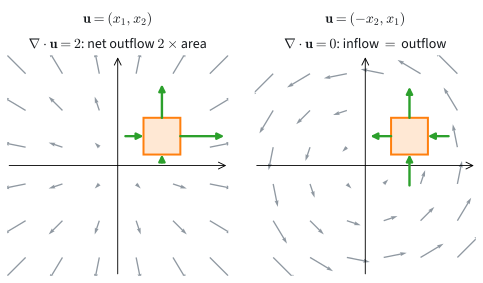
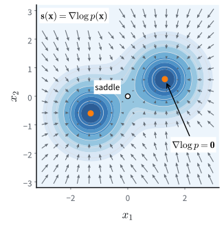
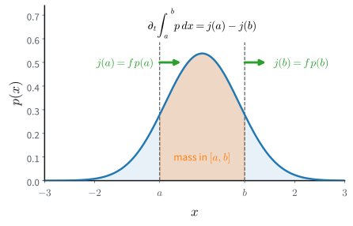
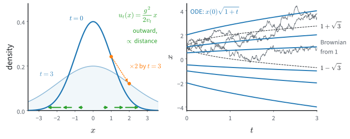
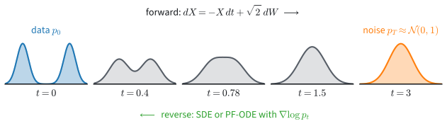
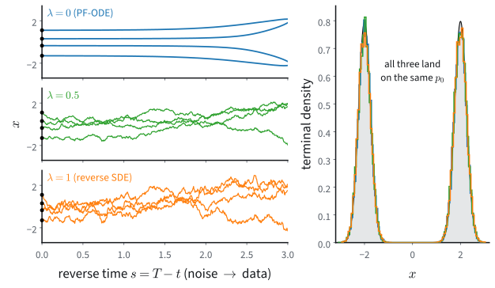

# The Fokker--Planck Equation and Probability Flow
:label:`sec_mdl-fokker-planck-probability-flow`

The previous section simulated the Ornstein--Uhlenbeck process, the
stochastic differential equation $dX=-X\,dt+\sqrt2\,dW$ that pulls a
particle toward the origin while kicking it with noise. Every run drew
different paths, and no single path can be predicted. Yet something repeats
from run to run. Start a hundred thousand particles at $x=2$ and look at
their histogram at time $t=0.5$: on every run it is the same bell curve,
centered near $1.21$ with a standard deviation near $0.80$. The randomness of
the paths averages out, and the density of the cloud moves
deterministically. Which equation moves it?

Adriaan Fokker and Max Planck wrote that equation for particles that feel a
steady force and random kicks :cite:`Fokker.1914,Planck.1917`, and Andrey
Kolmogorov showed that it governs the density of every diffusion
:cite:`Kolmogorov.1931`. It has two terms: the drift carries the density
along, and the noise smooths it. The smoothing can also be written as
transport, a flow that moves probability from where the density is high
toward where it is low. Seen at the level of the density, noise acts like a
deterministic velocity.

This matters for generative models. A diffusion model generates data by
running a noising process backward. No map takes the endpoint of a noisy path
back to its start, since many starts lead to the same endpoint. But we know
how the density of the whole cloud changed, and we can build processes whose
density changes the other way. One is an ordinary differential equation,
obtained by replacing the noise with the outward flow; its particles have the
same histogram as the stochastic process at every time. The other is again a
stochastic process, and it turns noise into data. In both, the drift and the
amount of noise are ours to choose. One quantity is not: the direction in
which the log-density increases, at every point and time.

We check each step on the Ornstein--Uhlenbeck process and on a two-mode
"data" density for which that direction has a closed form. For real data it
is unknown, and this is the question we leave open. If the derivations fade,
three displays should stay: the Fokker--Planck equation
:eqref:`eq_mdl-dyn-fokker-planck`, the identity
:eqref:`eq_mdl-dyn-diffusion-as-transport` that turns its smoothing term into
transport, and the family of reverse processes
:eqref:`eq_mdl-dyn-reverse-family`. A reader at home with the divergence
theorem can skip :numref:`sec_mdl-dyn-vector-calculus`, and the likelihood
formula and the bias computation at the end can wait for a second reading.

```{.python .input #fokker-planck-imports}
#@tab mxnet
import math
import numpy as np
from mxnet import autograd, gluon, init, np as mnp, npx
from mxnet.gluon import nn
from d2l import mxnet as d2l
npx.set_np()
```

```{.python .input #fokker-planck-imports}
#@tab pytorch
import math
import numpy as np
import torch
from torch import nn
from torch.nn import functional as F
from d2l import torch as d2l
```

```{.python .input #fokker-planck-imports}
#@tab tensorflow
import math
import numpy as np
import tensorflow as tf
from d2l import tensorflow as d2l
```

```{.python .input #fokker-planck-imports}
#@tab jax
import math
import numpy as np
import jax
from jax import numpy as jnp
from flax import nnx
import optax
from d2l import jax as d2l
```

## From Paths to Densities
:label:`sec_mdl-paths-to-densities`

### Paths and Marginals

Every SDE in this section is

$$
d\mathbf{X} = \mathbf{f}(\mathbf{X}, t)\,dt + g(t)\,d\mathbf{W},
$$

with a drift $\mathbf{f} : \mathbb{R}^d \times [0, T] \to \mathbb{R}^d$, a
scalar noise amplitude $g(t)$, a $d$-dimensional Brownian motion $\mathbf W$, and
a random start $\mathbf{X}_0 \sim p_0$. Over a short step the particle moves
by $\mathbf f\,dt$ plus an independent Gaussian kick of variance $g^2\,dt$ in
each coordinate.

One realization of the Brownian motion produces one path $\mathbf{X}_t$,
different on every run. The object of this section is instead the density
$p_t(\mathbf{x})$ of the random variable $\mathbf{X}_t$, called the
**time-marginal**. It averages over both sources of randomness, the draw of
$\mathbf{X}_0$ and the noise along the way, and this averaging makes it
deterministic.

Our running process is the Ornstein--Uhlenbeck (OU) process of
:numref:`sec_mdl-ornstein-uhlenbeck`, $dX = -\theta X\,dt + g\,dW$. Started
from a point $X_0 = x_0$, its marginal is the Gaussian kernel
:eqref:`eq_mdl-sde-ou-kernel`, which we write as

$$
X_t \sim \mathcal{N}\big(\alpha_t x_0,\; \sigma_t^2\big),
\qquad \alpha_t = e^{-\theta t},\quad
\sigma_t^2 = \frac{g^2}{2\theta}\left(1 - e^{-2\theta t}\right).
$$
:eqlabel:`eq_mdl-dyn-ou-marginal`

We take $\theta = 1$ and $g = \sqrt{2}$ throughout, so the variance saturates
at $g^2/(2\theta)=1$ and the stationary law is $\mathcal{N}(0, 1)$. The
drift moves the center of the cloud and the noise widens it; the
Fokker--Planck equation will turn both actions into operators on $p_t$.

### Simulated Marginals

The SDE section compared the moments of such a cloud with the kernel. Here we
look at the whole histogram: $100{,}000$ particles start at $x_0 = 2$ and move
by Euler--Maruyama steps of size $\Delta t = 0.002$
(:numref:`sec_mdl-euler-maruyama`), and at $t=0.1$, $0.5$ and $2$ the cloud is
drawn against its exact Gaussian density.

```{.python .input #fokker-planck-cloud-marginals}
theta, g = 1.0, np.sqrt(2.0)            # OU: dX = -theta X dt + g dW

def ou_mean_var(x0, t, theta=theta, g=g):
    """Mean and variance of X_t started at x0: N(alpha_t x0, sigma_t^2)."""
    alpha = np.exp(-theta * t)
    return alpha * x0, g**2 / (2 * theta) * (1 - alpha**2)

rng = np.random.default_rng()
n, dt, snap_at = 100_000, 0.002, {50: 0.1, 250: 0.5, 1000: 2.0}  # step -> t
x, snaps = np.full(n, 2.0), {}          # every particle starts at x0 = 2
for k in range(1, max(snap_at) + 1):    # Euler--Maruyama
    x += -theta * x * dt + g * np.sqrt(dt) * rng.standard_normal(n)
    if k in snap_at:
        snaps[snap_at[k]] = x.copy()

grid = np.linspace(-3.5, 4.5, 400)
d2l.set_figsize((6, 2.5))
for (t, cloud), c in zip(snaps.items(), ('C0', 'C1', 'C2')):
    m, v = ou_mean_var(2.0, t)
    d2l.plt.hist(cloud, bins=80, density=True, alpha=0.35, color=c)
    d2l.plt.plot(grid, np.exp(-(grid - m)**2 / (2 * v)) / np.sqrt(2 * np.pi * v),
                 color=c, label=f't = {t}')
d2l.plt.xlabel('x'); d2l.plt.ylabel('density'); d2l.plt.legend();
```

At each of the three times the histogram lies on its curve. By
:eqref:`eq_mdl-dyn-ou-marginal` the curves have mean $2e^{-t}$ and standard
deviation $\sqrt{1-e^{-2t}}$; they are drawn from the formula, not fitted to
the cloud. At $t = 2$ the mean is still $2e^{-2}\approx0.27$, about a quarter
of a standard deviation away from the stationary $\mathcal{N}(0, 1)$:
forgetting a start takes time. This is one run, but the three curves it
matches contain no randomness. A second run would differ in every path and
match the same curves. It is time to find the equation that moves them.

## The Fokker--Planck Equation
:label:`sec_mdl-fokker-planck`

A path cannot be differentiated in time, but the average of a smooth function
of $\mathbf X_t$ over all paths can. Turning a statement about averages into
a statement about the density requires moving derivatives from the function
onto the density, and that needs three facts about fields in $\mathbb R^d$.

### Divergence, Laplacian, and Integration by Parts
:label:`sec_mdl-dyn-vector-calculus`

All three are built from the gradient of
:numref:`sec_mdl-multivariable_calculus`, and each has a physical meaning that
we will need again. Let $\mathbf{u} : \mathbb{R}^d \to \mathbb{R}^d$ be a
smooth vector field, which we picture as the velocity of a fluid, and
$\psi : \mathbb{R}^d \to \mathbb{R}$ a smooth scalar field.

**Divergence.** We want to know how much fluid leaves a small box per unit
time. The **divergence** of $\mathbf u$ is the scalar field

$$
\nabla \cdot \mathbf{u} = \sum_{i=1}^d \frac{\partial u_i}{\partial x_i}.
$$
:eqlabel:`eq_mdl-dyn-divergence`

It is the net rate at which fluid leaves an infinitesimal box around
$\mathbf{x}$, divided by the volume of the box: positive at a source, negative
at a sink. Two plane fields show the range. The expanding field
$\mathbf u=(x_1,x_2)$ has $\nabla\cdot\mathbf u=1+1=2$, so every box of area
$A$ loses fluid at the rate $2A$, wherever it sits. The rotation
$\mathbf u=(-x_2,x_1)$ has $\nabla\cdot\mathbf u=0+0=0$: fluid circulates, and
no box gains or loses any. A zero divergence therefore does not mean a zero
field. :numref:`fig_mdl-dyn-divergence-boxes` checks both statements on one box.

![The divergence as net outflow, on the box of side $0.5$ centered at $(0.6,0.4)$. Each green arrow is the normal component of the field at the midpoint of a side, drawn away from the side for outflow and onto it for inflow. (a) For $\mathbf u=(x_1,x_2)$ fluid enters through the left and bottom sides and leaves through the right and top; the outflow exceeds the inflow by $2\times$ the area. (b) For the rotation $\mathbf u=(-x_2,x_1)$ the inflow through the right and bottom sides equals the outflow through the other two.](../img/mdl-dyn-divergence-boxes.svg)
:label:`fig_mdl-dyn-divergence-boxes`

Summing the outflow of many small boxes cancels every interior face, which
leaves the flux through the outer boundary. This is the **divergence
theorem**: for a bounded region $\Omega$ with outward unit normal $\mathbf{n}$,

$$
\int_\Omega \nabla \cdot \mathbf{u}\; d\mathbf{x} = \oint_{\partial\Omega} \mathbf{u} \cdot \mathbf{n}\; dS.
$$
:eqlabel:`eq_mdl-dyn-divergence-theorem`

The total divergence inside a region equals the net flow out through its
boundary. In one dimension it is the fundamental theorem of calculus,
$\int_a^b u'(x)\,dx = u(b) - u(a)$. We use the theorem without proof; it is
proved in any text on multivariable calculus.

**Laplacian.** We want a measure of how a function compares with its
surroundings. The **Laplacian** is the divergence of the gradient (in front of
a function, $\Delta$ is this operator and not an increment as in $\Delta t$),

$$
\Delta \psi = \nabla \cdot (\nabla \psi) = \sum_{i=1}^d \frac{\partial^2 \psi}{\partial x_i^2}.
$$
:eqlabel:`eq_mdl-dyn-laplacian`

It compares $\psi$ at a point with its average over a small sphere of radius
$r$ around the point: that average is
$\psi(\mathbf{x}) + \frac{r^2}{2d}\Delta \psi(\mathbf{x}) + O(r^4)$, which
Exercise :exref:`ex_mdl-fokker-planck-probability-flow-laplacian-averaging`
proves. In one dimension, with $\psi(x)=x^2$, the "sphere" is the pair of
points $x\pm r$, the average is $\frac12\big((x-r)^2+(x+r)^2\big)=x^2+r^2$, and
$\frac{r^2}{2}\psi''=r^2$, so the formula holds with no remainder (at $x=1$,
$r=0.3$ the average is $1.09$). So $\Delta \psi > 0$ means that $\psi$ lies
below its neighborhood average. A zero Laplacian does not mean a constant
function: $\psi=x_1^2-x_2^2$ has $\Delta \psi=2-2=0$ and equals its average
over every circle.

**Integration by parts.** This is the $d$-dimensional form of the
one-dimensional rule of :numref:`subsec_mdl-integration-by-parts`, and it is
the tool that moves a derivative from one factor onto the other. If $\psi$
and $\mathbf{u}$ are smooth and $\psi\,\mathbf u$ decays fast enough at
infinity (in this section, because $\psi$ vanishes outside a bounded set or
because both factors have Gaussian tails), then

$$
\int \psi\, (\nabla \cdot \mathbf{u})\; d\mathbf{x} = -\int \nabla \psi \cdot \mathbf{u}\; d\mathbf{x}.
$$
:eqlabel:`eq_mdl-dyn-integration-by-parts`

The derivative moves from $\mathbf u$ onto $\psi$, and the sign flips.

**Proof.** The product rule gives
$\nabla \cdot (\psi \mathbf{u}) = \nabla \psi \cdot \mathbf{u} + \psi\, \nabla \cdot \mathbf{u}$.
Integrate both sides over a ball of radius $R$ and let $R \to \infty$. By the
divergence theorem the left side is the flux of $\psi\mathbf{u}$ through the
sphere of radius $R$, which tends to zero under the decay assumption.
$\blacksquare$

Applied twice, first with $\mathbf{u} = \nabla p$ and then with the roles
exchanged, it moves a whole Laplacian across the integral sign, and the two
signs cancel:
$\int \psi\, \Delta p = -\int\nabla \psi\cdot\nabla p = \int p\, \Delta \psi$.

### From Itô's Lemma to the PDE

We now derive the equation for $p_t$. Throughout we assume that $\mathbf f$ is
continuously differentiable in $\mathbf x$ and continuous in $t$, that $g$ is
continuous, that $p_t$ is smooth and positive, and that derivatives in $t$ may
be taken under the integral sign.

The idea is to look at the cloud through averages. If $\phi$ is a smooth bump
equal to $1$ on a small box and $0$ outside a slightly larger one, then
$\mathbb{E}[\phi(\mathbf{X}_t)]$ is roughly the probability of the box.
Knowing how every such average changes over time determines how the density
changes. So take any smooth **test function** $\phi : \mathbb{R}^d \to \mathbb{R}$
that vanishes outside a bounded set.

Itô's lemma (:numref:`sec_mdl-ito-lemma`) is the chain rule for SDE paths.
For $d\mathbf X=\mathbf f\,dt+\mathbf G\,d\mathbf W$ it adds to the ordinary
chain rule the second-order term
$\tfrac12\sum_{ij}(\mathbf G\mathbf G^\top)_{ij}\,\partial_i\partial_j\phi$,
because the squared Brownian increment $(dW)^2$ is of size $dt$ rather than
negligible. With
$\mathbf{G} = g(t)\, \mathbf I$ that term is $\tfrac12 g^2$ times the
Laplacian of $\phi$:

$$
d\phi(\mathbf{X}_t) = \left(\nabla\phi \cdot \mathbf{f} + \tfrac12 g^2 \Delta\phi\right) dt + g\, \nabla\phi \cdot d\mathbf{W}.
$$

The function changes by a drift part, the chain rule plus the Laplacian
correction, and a noise part. Now take expectations. The Itô integral of
$g\nabla\phi$ has mean zero, because each Brownian increment is independent of
the integrand at the start of that increment (:numref:`sec_mdl-ito-integral`).
The noise part drops out:

$$
\frac{d}{dt}\, \mathbb{E}[\phi(\mathbf{X}_t)] = \mathbb{E}\!\left[\nabla\phi \cdot \mathbf{f} + \tfrac12 g^2 \Delta\phi\right].
$$
:eqlabel:`eq_mdl-dyn-expectation-evolution`

The average of $\phi$ changes at the average of the rate that Itô's lemma
gave. Both sides are integrals against the marginal density. Writing
$\mathbb{E}[\,\cdot\,] = \int (\cdot)\, p_t(\mathbf{x})\, d\mathbf{x}$ and
moving $d/dt$ under the integral,

$$
\int \phi\; \partial_t p_t\; d\mathbf{x} = \int (\nabla\phi \cdot \mathbf{f})\, p_t\; d\mathbf{x} + \tfrac12 g^2 \int (\Delta\phi)\, p_t\; d\mathbf{x}.
$$

The derivatives on the right still act on $\phi$; we move them onto $p_t$ with
integration by parts :eqref:`eq_mdl-dyn-integration-by-parts`. Because $\phi$
vanishes outside a bounded set, no boundary terms appear and no decay of $p_t$
is needed. The drift term needs one move, with $\psi=\phi$ and
$\mathbf u=\mathbf fp_t$; the diffusion term needs two, and its signs cancel:

$$
\int (\nabla\phi\cdot\mathbf f)\,p_t\,d\mathbf x=-\int\phi\,\nabla\cdot(\mathbf f\,p_t)\,d\mathbf x,
\qquad
\int(\Delta\phi)\,p_t\,d\mathbf x=\int\phi\,\Delta p_t\,d\mathbf x.
$$

Substituting both gives one integral against $\phi$:

$$
\int \phi\, \Big(\partial_t p_t +\nabla \cdot (\mathbf{f}\, p_t) - \tfrac12 g^2 \Delta p_t\Big)\, d\mathbf{x}=0.
$$

This holds for every test function $\phi$. The bracket is continuous, and a
continuous function that integrates to zero against every bump is zero (a bump
placed where it is positive would give a positive integral). So the bracket
vanishes pointwise, and $p_t$ solves the **Fokker--Planck equation**, also
called the *Kolmogorov forward equation*:

$$
\partial_t p_t(\mathbf{x}) = -\nabla \cdot \big(\mathbf{f}(\mathbf{x}, t)\, p_t(\mathbf{x})\big) + \tfrac12 g(t)^2\, \Delta p_t(\mathbf{x}).
$$
:eqlabel:`eq_mdl-dyn-fokker-planck`

The first term is the drift's contribution, the second the noise's. For a
matrix noise $\mathbf G\,d\mathbf W$ the second term becomes
$\tfrac12\sum_{ij}\partial_i\partial_j(a_{ij}p_t)$ with
$\mathbf a=\mathbf G\mathbf G^\top$; Exercise
:exref:`ex_mdl-fokker-planck-probability-flow-state-dependent-noise` works out
what changes. :citet:`Risken.1996` collects the many variants of the equation
used in physics.

The derivation gives one direction only: the marginal of the SDE solves the
equation. Later we need the converse, that a solution which starts from $p_0$
*is* the marginal, and for this the equation must have only one solution. It
does under mild conditions, which every drift we use satisfies: $g>0$, and a
drift that is Lipschitz in $\mathbf x$ uniformly in $t$, that is, with a
slope in $\mathbf x$ bounded by one constant for all $t$. Among probability
densities with a given initial law the solution is then unique
(:citet:`Bogachev.Krylov.Rockner.ea.2015` give precise statements). We use
this uniqueness without proof, and say so where we do.

### The Heat Equation and the Two Terms

Switch the drift off. The Fokker--Planck equation is then the **heat
equation**,

$$
\mathbf{f} = \mathbf{0} : \qquad \partial_t p_t = \tfrac12 g^2\, \Delta p_t.
$$
:eqlabel:`eq_mdl-dyn-heat-equation`

The density rises wherever it lies below its neighborhood average. Before any
general statement, we check it at one point. Take $g=1$, $d=1$ and
$p_t=\mathcal N(0,t)$, the law of Brownian motion started at $0$. With
$p=e^{-x^2/(2t)}/\sqrt{2\pi t}$, direct differentiation gives
$\partial_tp=p\,\big(\tfrac{x^2}{2t^2}-\tfrac1{2t}\big)$ and
$\partial_{xx}p=p\,\big(\tfrac{x^2}{t^2}-\tfrac1t\big)$. At $x=0$, $t=1$:
$p=0.399$, $\partial_tp=-0.1995$ and $\tfrac12\partial_{xx}p=-0.1995$. The
peak sinks at the rate the Laplacian predicts.

More generally, a Gaussian $\mathcal N(\mathbf m,v_t\mathbf I)$ solves the heat
equation when its variance grows as $v_t=v_0+g^2t$ for constant $g$, or as
$v_t=v_0+\int_0^tg(\tau)^2\,d\tau$ when $g$ changes with time. This is the
$\textrm{Var}(W_t)=t$ law of Brownian motion. Noise alone is the
*variance-exploding* family of :numref:`sec_mdl-why-randomness`, which
diffusion models use with a growing $g(t)$.

Now read the two terms of :eqref:`eq_mdl-dyn-fokker-planck`. The first,
$-\nabla \cdot (\mathbf{f} p)$, is *advection*: it removes density wherever
the drift carries more mass out of a small box than in. The second,
$\tfrac12 g^2 \Delta p$, is *diffusion*: it raises the density where it lies
below its neighborhood average and lowers it where it lies above. It is Itô's
$(dW)^2 = dt$ correction, seen at the level of the density.

### Gaussian Solutions of the OU Equation

For the OU process we know the answer in closed form, which lets us test the
equation on a whole family of solutions. With $f(x) = -\theta x$ in one
dimension, :eqref:`eq_mdl-dyn-fokker-planck` reads

$$
\partial_t p = \theta\, \partial_x (x\, p) + \tfrac12 g^2\, \partial_{xx} p.
$$

The unknown of a partial differential equation is a whole function, and one
rarely finds it by hand. Here we are lucky. It turns out that for a Gaussian
the equation collapses to two ordinary differential equations, one for the
mean and one for the variance.

**Proposition (Gaussian solutions of the OU equation).** *Let
$p(x, t) = \mathcal{N}(x; m(t), v(t))$ be a Gaussian density with
differentiable mean $m(t)$ and variance $v(t) > 0$. Then $p$ solves the OU
Fokker--Planck equation if and only if*

$$
\dot{m} = -\theta m, \qquad \dot{v} = g^2 - 2\theta v.
$$
:eqlabel:`eq_mdl-dyn-moment-odes`

**Proof.** For a Gaussian, $\partial_x p = -\frac{x - m}{v}\, p$. Direct
differentiation turns each side of the PDE into $p$ times a quadratic
polynomial in $(x - m)$:

$$
\partial_t p = p \left[\frac{\dot m}{v}(x - m) + \frac{\dot v}{2v^2}\big((x - m)^2 - v\big)\right],
$$

while, writing $x = (x - m) + m$ in the drift term,

$$
\theta\, \partial_x(x p) + \tfrac{g^2}{2} \partial_{xx} p = p \left[-\frac{\theta m}{v}(x - m) + \Big(\frac{g^2}{2v^2} - \frac{\theta}{v}\Big)\big((x - m)^2 - v\big)\right].
$$

The functions $1, (x - m), (x - m)^2$ are linearly independent, so the two
sides agree for all $x$ only when the coefficients match:
$\dot{m} = -\theta m$ from the linear term and
$\dot{v} = g^2 - 2\theta v$ from the quadratic term (the constant term
repeats the latter). $\blacksquare$

The mean decays and the variance relaxes toward $g^2/(2\theta)$. Solving the
two ODEs from $m(0)=m_0$, $v(0)=v_0$ gives

$$
m(t)=m_0e^{-\theta t},\qquad v(t)=v_0e^{-2\theta t}+\frac{g^2}{2\theta}\big(1-e^{-2\theta t}\big).
$$

For a point start, $v_0=0$, this is the kernel
:eqref:`eq_mdl-dyn-ou-marginal` at every $t>0$, so the transition density of
:numref:`sec_mdl-ornstein-uhlenbeck` solves the Fokker--Planck equation.

The fixed point $\dot m = \dot v = 0$ is $m = 0$, $v = g^2/(2\theta)$: the
stationary Gaussian is the steady state $\partial_t p = 0$ of the PDE
(Exercise :exref:`ex_mdl-fokker-planck-probability-flow-stationary-density`
derives it without assuming a Gaussian form). Setting $\theta = 0$ recovers
the heat equation's $\dot v = g^2$.

The luck has a cause, and a limit. The drift is linear, so a Gaussian stays
Gaussian and its first two moments form a closed system. For the double-well
drift $f(x)=x-x^3$ of the same exercise, the equation for
$\mathbb{E}[X^2]$ contains $\mathbb{E}[X^4]$, the one for $\mathbb{E}[X^4]$
contains $\mathbb{E}[X^6]$, and the chain never closes.

### Linearity and Mixtures

Real data are not Gaussian either, so we need a density with more structure
that we can still follow in closed form. With a linear drift a Gaussian
mixture is one. Our running "data" density is

$$
p_0=\tfrac12\,\mathcal N(-2,\,0.25)+\tfrac12\,\mathcal N(2,\,0.25),
$$

two well-separated modes of standard deviation $0.5$. A draw from $p_0$ picks
a component $\mathcal N(\mu_k,v_k)$ and then a point from it. By the kernel
:eqref:`eq_mdl-dyn-ou-marginal`, $X_t$ is $\alpha_tX_0$ plus an independent
$\mathcal N(0,\sigma_t^2)$ variable. Given the component, it is therefore a
sum of two independent Gaussians, with mean $\alpha_t\mu_k$ and variance
$\alpha_t^2v_k+\sigma_t^2$, and averaging over the component gives the
marginal: the mixture of the evolved components. With $\theta=1$,
$g=\sqrt2$ it is the mixture of
$\mathcal N\big(\pm2e^{-t},\,1-0.75\,e^{-2t}\big)$, in closed form at every
time.

The same fact can be read off the Fokker--Planck equation, which is linear in
$p$. A mixture $w_1p^{(1)}_t+w_2p^{(2)}_t$ of solutions is therefore a
solution, and by the uniqueness stated after
:eqref:`eq_mdl-dyn-fokker-planck` it is the marginal for the mixed start.
Under OU each Gaussian component follows the moment ODEs
:eqref:`eq_mdl-dyn-moment-odes` on its own.

Every experiment from here on uses this marginal, so we define it once,
together with its CDF and a sampler. The parameters are explicit arguments, so
the exercises can change them.

```{.python .input #fokker-planck-mixture-setup}
ws, mus, v0s = np.array([0.5, 0.5]), np.array([-2.0, 2.0]), np.array([0.25, 0.25])
erf = np.vectorize(math.erf)            # the error function, on arrays

def mixture_params(t, mus=mus, v0s=v0s, theta=theta, g=g):
    """Means and variances of the OU-evolved components (moment ODEs)."""
    alpha = np.exp(-theta * t)
    return alpha * mus, alpha**2 * v0s + g**2 / (2 * theta) * (1 - alpha**2)

def gauss(x, m, v):
    return np.exp(-(x - m)**2 / (2 * v)) / np.sqrt(2 * np.pi * v)

def p_t(x, t, ws=ws, mus=mus, v0s=v0s):
    """Exact marginal density of the mixture at time t."""
    m, v = mixture_params(t, mus, v0s)
    return sum(w * gauss(x, mk, vk) for w, mk, vk in zip(ws, m, v))

def mixture_cdf(x, t, ws=ws, mus=mus, v0s=v0s):
    m, v = mixture_params(t, mus, v0s)
    return sum(w * 0.5 * (1 + erf((x - mk) / np.sqrt(2 * vk)))
               for w, mk, vk in zip(ws, m, v))

def sample_p0(n, rng, ws=ws, mus=mus, v0s=v0s):
    k = rng.choice(len(ws), size=n, p=ws)   # component of each draw
    return mus[k] + np.sqrt(v0s[k]) * rng.standard_normal(n)
```

With the closed form in code, we can put it into the PDE directly. Both sides
are evaluated on a grid at $t=0.25$, $1$ and $3$, with $\partial_t$ by a
centered difference in time and the $x$-derivatives by `np.gradient`. Finite
differences leave a residual even for an exact solution, so the cell uses two
grids, the second twice as fine: the truncation error of these second-order
stencils must fall by a factor of four.

```{.python .input #fokker-planck-ou-residual}
def fp_residual(t, points, eps=1e-5):
    """Largest Fokker--Planck residual on a grid of `points`, and max|dp/dt|."""
    xs = np.linspace(-5.0, 5.0, points)
    dx = xs[1] - xs[0]
    dpdt = (p_t(xs, t + eps) - p_t(xs, t - eps)) / (2 * eps)
    p = p_t(xs, t)
    rhs = (np.gradient(theta * xs * p, dx)                 # -d/dx(f p)
           + 0.5 * g**2 * np.gradient(np.gradient(p, dx), dx))
    res = (dpdt - rhs)[5:-5]            # trim the one-sided edge stencils
    return np.abs(res).max(), np.abs(dpdt).max()

for t in (0.25, 1.0, 3.0):
    (r1, dpdt), (r2, _) = fp_residual(t, 4001), fp_residual(t, 8001)
    print(f't={t}: max|dp/dt| = {dpdt:.1e}; max|residual| at 4001, 8001 points: '
          f'{r1:.1e}, {r2:.1e} (ratio {r1 / r2:.1f})')
```

The residual is three to five orders of magnitude below $\partial_tp$ at each
time ($4\times10^{-6}$ against $0.44$ at $t=0.25$; at $t=3$ the density barely
moves, and $10^{-6}$ stands against $3\times10^{-3}$), and the finer grid
divides it by four at all three times. What is left is truncation error. The
argument did not need this computation; the cell guards against a slip in the
code on which all later experiments rely.

## The Score Function
:label:`sec_mdl-score-function`

The smoothing term of the Fokker--Planck equation will turn out to be
transport in disguise, and the velocity of that transport is built from one
field, the gradient of $\log p_t$. The identity
$\nabla p=p\,\nabla\log p$ puts it inside the Laplacian
(:numref:`sec_mdl-continuity-equation`). Every construction from there on
needs this field, so we look at it first, with the mixture as the main
example.

### Definition and Geometry

The question is which direction, from a point $\mathbf x$, leads most quickly
toward more probable points. The **score** of a density $p_t$ answers it:

$$
\mathbf{s}_t(\mathbf{x}) = \nabla_{\mathbf{x}} \log p_t(\mathbf{x}).
$$
:eqlabel:`eq_mdl-dyn-score-def`

The score is a vector field over data space that points uphill on the
log-density. The gradient is with respect to the input $\mathbf{x}$, not the
parameters of a model; :numref:`sec_mdl-fisher-divergence` introduced this
data score and contrasted it with the parameter score of maximum likelihood.

The length of $\mathbf s_t$ is the rate at which $\log p_t$ increases,
$\|\nabla p_t\|/p_t$. It is therefore large where the density is small but
changing, in the tails and in the valleys between modes, and not where the
density is large. The score vanishes at the critical points of $p_t$: modes,
minima and saddles, which its derivative tells apart.

Take a Gaussian first. For
$p(\mathbf{x}) = \mathcal{N}(\mathbf{x}; \boldsymbol{\mu}, v\mathbf I)$ the
log-density is $-\|\mathbf{x} - \boldsymbol{\mu}\|^2 / (2v) + \textrm{const}$,
so

$$
\nabla \log p(\mathbf{x}) = -\frac{\mathbf{x} - \boldsymbol{\mu}}{v}.
$$
:eqlabel:`eq_mdl-dyn-gaussian-score`

This is the linear spring of :numref:`sec_mdl-fisher-divergence`: it pulls
toward the mean, and it is stiffer for smaller variance. With $\mu=0$,
$v=0.25$ and $x=1$ it is $-4$, four times the pull at unit variance. For a
general covariance the spring is
$-\boldsymbol\Sigma^{-1}(\mathbf{x} - \boldsymbol{\mu})$.
:numref:`fig_mdl-dyn-score-field` shows the score field of a two-mode density
in two dimensions.


:label:`fig_mdl-dyn-score-field`

### The Score of a Gaussian Mixture

Our data density is a mixture, so we need its score in a form we can evaluate
and read. For $p(x) = \sum_k w_k\, N_k(x)$ with weights $w_k$ and components
$N_k(x)=\mathcal{N}(x; \mu_k, v_k)$, differentiate $\log p$ directly:

$$
\nabla \log p(x) = \frac{\sum_k w_k \nabla N_k(x)}{\sum_j w_j N_j(x)} = \sum_k r_k(x) \left(-\frac{x - \mu_k}{v_k}\right), \qquad r_k(x) = \frac{w_k N_k(x)}{\sum_j w_j N_j(x)}.
$$
:eqlabel:`eq_mdl-dyn-mixture-score`

The mixture's score is a weighted average of the component springs. The weight
$r_k(x)$ is the *responsibility* of component $k$, the posterior probability
that a point at $x$ came from it, as in :numref:`sec_mdl-fisher-divergence`.
For two components with equal weights, means $\pm\mu$ and a common variance
$v_0$, the responsibilities reduce to a logistic function of $x$ and the
score has the closed form

$$
s_0(x) = \frac{\mu \tanh\!\left(\mu x / v_0\right) - x}{v_0}.
$$
:eqlabel:`eq_mdl-dyn-tanh-score`

Near each mode $\tanh \to \pm 1$ and the score is the local spring
$-(x \mp \mu)/v_0$. For the running mixture, $\mu=2$ and $v_0=0.25$, it is
$s_0(x)=8\tanh(8x)-4x$. At $x = 0$ the score vanishes, the third critical
point, and it grows from zero with slope

$$
s_0'(0)=\frac{\mu^2-v_0}{v_0^2}=60.
$$

A positive slope means that $x=0$ is a minimum of the density, a repeller of
the uphill flow $\dot x=s_0(x)$. The mixture has two modes exactly when
$\mu^2>v_0$; for $\mu^2\le v_0$ they merge into one (Exercise
:exref:`ex_mdl-fokker-planck-probability-flow-mode-merging`).

In code we use the general formula :eqref:`eq_mdl-dyn-mixture-score`, with a
numerically stable softmax for the responsibilities, because the later
experiments need the score of $p_t$ at every time. The tanh form, the zeros
and the slope $60$ serve as checks on the implementation.

```{.python .input #fokker-planck-mixture-score}
def score_t(x, t, ws=ws, mus=mus, v0s=v0s):
    """Exact score of p_t: responsibility-weighted component springs."""
    m, v = mixture_params(t, mus, v0s)
    logw = np.stack([np.log(w) - 0.5 * np.log(2 * np.pi * vk)
                     - (x - mk)**2 / (2 * vk) for w, mk, vk in zip(ws, m, v)])
    r = np.exp(logw - logw.max(axis=0))
    r /= r.sum(axis=0)                  # responsibilities, a stable softmax
    return sum(rk * -(x - mk) / vk for rk, mk, vk in zip(r, m, v))

gs = np.linspace(-3.5, 3.5, 1400)
mu, v0 = mus[1], v0s[1]
s = score_t(gs, 0.0)
s_tanh = (mu * np.tanh(mu * gs / v0) - gs) / v0
print(f'max|responsibility form - tanh form| = {np.abs(s - s_tanh).max():.1e}')
mid = (gs[:-1] + gs[1:]) / 2
print('score changes sign near', np.round(mid[s[:-1] * s[1:] < 0], 2) + 0.0)
delta = 1e-5                            # centered difference at x = 0
print(f'slope at 0: {(score_t(delta, 0.0) - score_t(-delta, 0.0)) / (2 * delta):.2f}, '
      f'formula (mu^2 - v0) / v0^2 = {(mu**2 - v0) / v0**2:.2f}')
dens = p_t(gs, 0.0)
d2l.plot(gs, [s, dens * np.abs(s).max() / dens.max()], 'x', '',
         legend=['score s(x)', 'density (rescaled)'], figsize=(5.5, 3))
```

The checks pass: the two formulas agree to machine precision, and the zeros
and the slope are where we computed them. What the plot adds is where the
score is large: in the valley between the modes, where the density is nearly
zero but its logarithm climbs steeply toward either mode, and in the tails.

## The Continuity Equation and the Probability-Flow ODE
:label:`sec_mdl-continuity-equation`

The Fokker--Planck equation describes particles that move at random. Which
law governs particles that move deterministically? It turns out that the two
laws coincide once the noise is written as a velocity.

### Conservation of Probability

Forget noise for a moment. Suppose every particle follows a velocity field,
$\dot{\mathbf{x}} = \mathbf{u}(\mathbf{x}, t)$. What PDE does their density
$q_t$ obey? Probability is neither created nor destroyed, so the mass inside a
fixed region $\Omega$ can change only by flowing across its boundary.
Particles cross a small patch of boundary at the rate density times velocity.
We call this flux density the **probability current**,
$\mathbf j=q\,\mathbf u$: at each point it gives the rate, per unit area, at
which probability crosses a surface placed there. The mass balance of the
region is

$$
\frac{d}{dt} \int_\Omega q_t\; d\mathbf{x} = -\oint_{\partial\Omega} \mathbf j \cdot \mathbf{n}\; dS = -\int_\Omega \nabla \cdot (q_t \mathbf{u})\; d\mathbf{x},
$$
:eqlabel:`eq_mdl-dyn-mass-balance`

where the divergence theorem :eqref:`eq_mdl-dyn-divergence-theorem` turned the
boundary flux into a volume integral. The mass inside changes at minus the net
outflow. Since $\Omega$ is arbitrary, the integrands agree pointwise, which
gives the **continuity equation**:

$$
\partial_t q_t + \nabla \cdot (q_t\, \mathbf{u}) = 0.
$$
:eqlabel:`eq_mdl-dyn-continuity`

The density at a point falls at the rate at which the current diverges there.
In one dimension the balance reads
$\partial_t \int_a^b q\,dx = j(a) - j(b)$: what flows in at $a$ minus what
flows out at $b$.
:numref:`fig_mdl-dyn-fokker-planck-flux` draws it.


:label:`fig_mdl-dyn-fokker-planck-flux`

The balance also says what happens at the edges of the domain. On all of
$\mathbb R^d$ we assume that the current decays at infinity. For the
Fokker--Planck equation this means that $\mathbf fp_t$ and $\nabla p_t$ decay,
which Gaussian tails ensure even though the OU drift grows linearly. Integrating
:eqref:`eq_mdl-dyn-continuity` over $\mathbb{R}^d$ then gives
$\frac{d}{dt}\int q_t = 0$: total probability is conserved. On a bounded
domain a *reflecting* boundary imposes $\mathbf j\cdot\mathbf n=0$, so mass is
conserved there too, while an *absorbing* boundary imposes $q=0$, and mass can
leave.

Two small cases show the equation at work in one dimension. For a translation,
$u=c$, the equation is $\partial_tq+c\,\partial_xq=0$, solved by
$q_t(x)=q_0(x-ct)$: the profile slides without changing shape. For a
contraction, $u=-x$, every particle moves as $x(t)=x(0)e^{-t}$, the cloud
shrinks by the factor $e^{-t}$, and since the mass of each interval is
preserved, the density carried along each trajectory rises by $e^{t}$.

The contraction suggests a general rule for the density seen by a moving
particle. Expanding the divergence with the product rule,

$$
\nabla\cdot(q\,\mathbf u)=\mathbf u\cdot\nabla q+q\,\nabla\cdot\mathbf u,
$$

the continuity equation becomes $\partial_tq+\mathbf u\cdot\nabla q=-q\,\nabla\cdot\mathbf u$.
The left side is the rate of change of $q$ along a trajectory
$\mathbf x(t)$ of $\dot{\mathbf x}=\mathbf u$, by the chain rule. Dividing by
$q$,

$$
\frac{d}{dt}\log q_t(\mathbf{x}(t)) = -\nabla \cdot \mathbf{u}(\mathbf{x}(t), t).
$$
:eqlabel:`eq_mdl-dyn-log-density-rule`

Along a trajectory the log-density falls at the rate of the local expansion.
For the contraction, $\nabla\cdot u=-1$ and the log-density rises at rate
$1$, as computed above. The trajectories of $\dot{\mathbf x}=\mathbf u$ are
called the **characteristics** of the continuity equation. The rule is the
instantaneous change of variables of :numref:`sec_mdl-continuous-normalizing-flows`,
proved there along trajectories.

### Diffusion as Transport

The Fokker--Planck equation :eqref:`eq_mdl-dyn-fokker-planck` is not yet a
continuity equation: next to the transport term $-\nabla \cdot (\mathbf{f} p)$
it has a Laplacian. The chain rule turns the Laplacian into a transport term.
It is a one-line calculation, and the most consequential one of the section.
Wherever $p > 0$,

$$
\nabla p = p\, \nabla \log p,
$$
:eqlabel:`eq_mdl-dyn-grad-log`

which is the derivative of $\log p$ written backward, and therefore

$$
\tfrac12 g^2\, \Delta p = \tfrac12 g^2\, \nabla \cdot (\nabla p) = \nabla \cdot \big(p \cdot \tfrac12 g^2 \nabla \log p\big).
$$
:eqlabel:`eq_mdl-dyn-diffusion-as-transport`

The diffusion term is the divergence of a current, the density times
$+\tfrac12 g^2\nabla\log p$. Moved to the left side of a continuity equation
it appears with a minus sign, as a velocity $-\tfrac12 g^2\nabla\log p$.

**Proposition (Fokker--Planck is a continuity equation).** *Wherever
$p_t > 0$, the Fokker--Planck equation :eqref:`eq_mdl-dyn-fokker-planck` is
equivalent to*

$$
\partial_t p_t + \nabla \cdot (p_t\, \mathbf{u}_t) = 0, \qquad \mathbf{u}_t(\mathbf{x}) = \mathbf{f}(\mathbf{x}, t) - \tfrac12 g(t)^2\, \nabla \log p_t(\mathbf{x}).
$$
:eqlabel:`eq_mdl-dyn-pf-velocity`

**Proof.** Substitute :eqref:`eq_mdl-dyn-diffusion-as-transport` into
:eqref:`eq_mdl-dyn-fokker-planck` and merge the two divergences:

$$
\begin{aligned}
\partial_t p
&= -\nabla \cdot (\mathbf{f} p) + \nabla \cdot \big(p \cdot \tfrac12 g^2 \nabla \log p\big) \\
&= -\nabla \cdot \big(p\, [\mathbf{f} - \tfrac12 g^2 \nabla \log p]\big). \qquad \blacksquare
\end{aligned}
$$

At the level of densities, the SDE moves probability as if each particle
followed the velocity $\mathbf u_t$: the drift plus a push down the
log-density gradient. The corresponding current is

$$
\mathbf j=\mathbf f\,p_t-\tfrac12g^2\,\nabla p_t=p_t\,\mathbf u_t.
$$
:eqlabel:`eq_mdl-dyn-probability-current`

The heat equation shows what this velocity looks like. Take $\mathbf f=0$ and
$p_t=\mathcal N(0,v_t)$ in one dimension with $v_t=v_0+g^2t$. The score is
$-x/v_t$, so

$$
u_t(x)=-\tfrac12g^2\Big(-\frac{x}{v_t}\Big)=\frac{g^2}{2v_t}\,x.
$$

The velocity points away from the center and is proportional to the distance
from it, and it weakens as the density widens. The ODE $\dot x=g^2x/(2v_t)$
separates: $\frac{d}{dt}\log x=\frac{g^2}{2v_t}=\frac12\frac{d}{dt}\log v_t$,
so

$$
x(t)=x(0)\sqrt{v_t/v_0}.
$$
:eqlabel:`eq_mdl-dyn-heat-pf-solution`

Every particle is stretched by the same factor, and a Gaussian stretched by
$\sqrt{v_t/v_0}$ has variance $v_t$, which is the variance that Brownian
motion produces. With $v_0=g=1$ and $t=3$ every particle doubles its distance
from the center. A Brownian particle started at $x=1$ instead lands at $1$
plus a draw of standard deviation $\sqrt3\approx1.73$. The two processes
agree on the histogram at every time but move individual particles differently
(:numref:`fig_mdl-dyn-diffusion-outward-flow`).


:label:`fig_mdl-dyn-diffusion-outward-flow`

There is a limit to this construction. As $v_0\to0$ the velocity at small
times is $g^2x/(2g^2t)=x/(2t)$, which is unbounded as $t\to0$. A
deterministic flow can spread a point mass into a Gaussian only through a
field that blows up at the start, because a Lipschitz flow maps one point to
one point.

The next cell runs this example. From one draw of $20{,}000$ points of
$\mathcal N(0,1)$ it forms a Brownian cloud at $t=3$ (adding an independent
$\mathcal N(0,3)$ increment) and a flow cloud by integrating
$\dot x=x/(2(1+t))$ with Heun's method (:numref:`sec_mdl-euler-runge-kutta`).
It prints the two standard deviations, and how far the flow cloud is from the
starting sample doubled.

```{.python .input #fokker-planck-diffusion-identity}
def heat_velocity(x, t, v0=1.0, g=1.0):  # u_t = -(1/2) g^2 score = g^2 x / (2 v_t)
    return g**2 * x / (2 * (v0 + g**2 * t))

n, T, steps = 20_000, 3.0, 600
dt = T / steps
z = rng.standard_normal(n)              # p_0 = N(0, 1)
x_bm = z + np.sqrt(T) * rng.standard_normal(n)   # Brownian motion to time T
x_ode = z.copy()
for k in range(steps):                  # Heun steps for the probability flow
    k1 = heat_velocity(x_ode, k * dt)
    k2 = heat_velocity(x_ode + dt * k1, (k + 1) * dt)
    x_ode += 0.5 * dt * (k1 + k2)
print(f'std at t={T}: Brownian {x_bm.std():.3f}, flow {x_ode.std():.3f}, '
      f'exact {np.sqrt(1 + T):.3f}')
print(f'max|x_ode - 2 z| = {np.abs(x_ode - 2 * z).max():.1e}')
```

Both clouds have standard deviation $2.00$ up to a sampling error of order
$0.01$, and the flow map equals $x\mapsto2x$ up to a Heun error below
$10^{-5}$. Random kicks and a deterministic stretch have produced the same
histogram.

### The Probability-Flow ODE
:label:`sec_mdl-probability-flow-ode`

The heat equation was one example. The proposition above says that the same
construction works for every SDE of our form: following the velocity
$\mathbf u_t$ gives an ODE,

$$
\frac{d\mathbf{x}}{dt} = \mathbf{u}_t(\mathbf{x}) = \mathbf{f}(\mathbf{x}, t) - \tfrac12 g(t)^2\, \nabla \log p_t(\mathbf{x}),
$$
:eqlabel:`eq_mdl-dyn-pf-ode`

the **probability-flow ODE** :cite:`song2021score`. The next proposition is
the first of the two results that generative models take from this section.

**Proposition (the deterministic twin).** *Let $p_t$ be the marginal density
of $d\mathbf{X} = \mathbf{f}\,dt + g\,d\mathbf{W}$,
$\mathbf{X}_0 \sim p_0$, assumed smooth and positive, so that it solves the
Fokker--Planck equation. Suppose that $\mathbf u_t$ is
continuous in $t$, continuously differentiable in $\mathbf x$, and Lipschitz
in $\mathbf x$ with a constant that does not depend on $t$. Let
$\mathbf{x}(t)$ solve :eqref:`eq_mdl-dyn-pf-ode` with
$\mathbf{x}(0) \sim p_0$. Then $\mathbf{x}(t) \sim p_t$ for every $t$: the ODE
and the SDE share all time-marginals.*

**Proof.** By the existence and uniqueness theorem of
:numref:`sec_mdl-ode-existence-uniqueness`, a field that is Lipschitz with a
constant independent of $t$ has exactly one trajectory through every point,
forward and backward, so its time-$t$ map is a bijection of $\mathbb R^d$. Let
$q_t$ be the density of the ODE's state. There is no circle here: the field
$\mathbf{u}_t$ is built from $p$, not from $q$, so it is a known velocity and
$q_t$ obeys the continuity equation
$\partial_t q + \nabla \cdot (q \mathbf{u}_t)=0$. By the previous
proposition $p_t$ solves the same equation, and both start from
$q_0 = p_0$. The derivation of the log-density rule
:eqref:`eq_mdl-dyn-log-density-rule` used only this PDE, so along each
characteristic $\log q_t$ and $\log p_t$ change at the same rate
$-\nabla\cdot\mathbf u_t$, and they start equal. Since the characteristics
reach every point, $q_t = p_t$ everywhere. $\blacksquare$

The Lipschitz hypothesis holds for the OU drift and for the score of a
Gaussian or a Gaussian mixture with positive component variances, whose
slope is bounded for $t$ in $[0,T]$.

The marginals agree; the paths do not. An SDE path is jagged and crosses
other paths. An ODE trajectory is smooth, and two trajectories never meet at
the same point at the same time, by uniqueness (panel (b) of
:numref:`fig_mdl-dyn-diffusion-outward-flow`).

The ODE also gives a likelihood. Integrating the log-density rule
:eqref:`eq_mdl-dyn-log-density-rule` with $q_t=p_t$ along a trajectory from $0$
to $T$ gives

$$
\log p_0(\mathbf{x}(0)) = \log p_T(\mathbf{x}(T)) + \int_0^T \nabla \cdot \mathbf{u}_t(\mathbf{x}(t))\; dt.
$$
:eqlabel:`eq_mdl-dyn-pf-likelihood`

The log-density of a data point is the log-density of its image at time $T$,
which is nearly Gaussian and easy to evaluate, plus the accumulated expansion
along the way. With a learned score in place of the exact one this is, up to
solver error, the log-density of the *model* defined by that field
:cite:`song2021score`. It is one of the two numbers by which the likelihood
of a diffusion model is reported; the other is a variational bound
(:numref:`sec_diffusion-design-space`).

### SDE and ODE Marginals Compared

The heat flow was a stretch of one Gaussian. On the mixture the proposition
has more to do: the density changes shape, from two modes to one, and the
jagged and the smooth process must still agree on it at every time. From one
sample of $p_0$ we launch two clouds of $20{,}000$ particles: one follows the
SDE with Euler--Maruyama steps, the other the probability-flow ODE with Heun
steps and the exact score. As a yardstick we compute the one-sample
Kolmogorov--Smirnov distance of each cloud to the exact CDF of $p_t$, the
largest gap between the empirical and the exact CDF. For an exact sample of
size $n$ this distance exceeds $1.36/\sqrt n$ only $5\%$ of the time. Before
looking at the output, guess which cloud's distance changes more from one
snapshot to the next.

```{.python .input #fokker-planck-pf-ode-overlay}
def pf_velocity(x, t, score=score_t, theta=theta, g=g):
    return -theta * x - 0.5 * g**2 * score(x, t)   # u_t = f - (1/2) g^2 s_t

def ks_exact(sample, t, **mixture):
    """One-sample Kolmogorov--Smirnov distance to the exact p_t."""
    xs_sorted, n = np.sort(sample), len(sample)
    F = mixture_cdf(xs_sorted, t, **mixture)
    return max((np.arange(1, n + 1) / n - F).max(), (F - np.arange(n) / n).max())

n, T, steps = 20_000, 3.0, 600
dt = T / steps
x_sde = sample_p0(n, rng)
x_ode = x_sde.copy()                    # both clouds start from one sample
snaps = {}
for k in range(steps):
    t = k * dt
    x_sde += -theta * x_sde * dt + g * np.sqrt(dt) * rng.standard_normal(n)
    k1 = pf_velocity(x_ode, t)          # Heun steps for the ODE
    k2 = pf_velocity(x_ode + dt * k1, t + dt)
    x_ode += 0.5 * dt * (k1 + k2)
    if k + 1 in (50, 200, 600):         # t = 0.25, 1, 3
        snaps[(k + 1) * dt] = (x_sde.copy(), x_ode.copy())
print(f'95% band for n = {n}: {1.36 / np.sqrt(n):.4f}')
for t, (a, b) in snaps.items():
    print(f't={t:.2f}: KS(SDE) = {ks_exact(a, t):.4f}, KS(ODE) = {ks_exact(b, t):.4f}')
gx = np.linspace(-3.5, 3.5, 400)
d2l.set_figsize((5.5, 3))
d2l.plt.hist(snaps[0.25][0], bins=80, density=True, alpha=0.4, label='SDE')
d2l.plt.hist(snaps[0.25][1], bins=80, density=True, alpha=0.4, label='PF-ODE')
d2l.plt.plot(gx, p_t(gx, 0.25), 'k', label='exact $p_t$, t = 0.25')
d2l.plt.xlabel('x'); d2l.plt.legend(loc='upper center', fontsize=8);
```

In most runs both clouds stay within the $0.0096$ band at all three times,
with distances between about $0.003$ and $0.01$. A value just above the band
is no alarm: the band is a $5\%$ threshold, and an exact sample crosses it one
time in twenty. At $t=0.25$ the marginal is still bimodal, and both
histograms reproduce its two modes; by $t=1$ it has a single mode (the
merging time is $0.78$, Exercise
:exref:`ex_mdl-fokker-planck-probability-flow-mode-merging`).

Now the guess. The ODE's distance is the same at all three times, to every
digit printed. A strictly increasing map that carries $p_0$ to $p_t$ carries
the sample's empirical CDF along with it, so the ODE cloud keeps the distance
its starting sample had and adds only solver error. The SDE cloud is redrawn
by the noise at every step, and its distance fluctuates.

## Time Reversal
:label:`sec_mdl-time-reversal`

The forward SDE turns data into noise. Generation needs the process played
backward, from noise to data. This may sound impossible: the heat equation
cannot be solved backward from an arbitrary final density, because smoothing
destroys detail that nothing can restore. We do not solve it backward. The
forward family $p_t$ is given, and we ask only for a process that visits it
in reverse order (:numref:`fig_mdl-dyn-forward-reverse`); its drift will
contain $\nabla\log p_t$, which carries the destroyed detail. The
probability-flow ODE is one such process, integrated backward. For the SDE
the answer is less obvious: the backward process is again a diffusion, and
its drift carries twice the score correction of the ODE.


:label:`fig_mdl-dyn-forward-reverse`

### Bayes' Rule on an Infinitesimal Step

To reverse one small step we use Bayes' rule to ask where a particle came
from. Over a short interval $\tau$ the forward step is the Euler--Maruyama
Gaussian (:numref:`sec_mdl-euler-maruyama`):

$$
p(\mathbf{x}_{t+\tau} \mid \mathbf{x}_t) \approx \mathcal{N}\big(\mathbf{x}_{t+\tau};\; \mathbf{x}_t + \mathbf{f}(\mathbf{x}_t, t)\,\tau,\; g^2 \tau\, \mathbf I\big).
$$

Now condition on the endpoint $\mathbf{x}_{t+\tau} = \mathbf{y}$. Bayes' rule
gives the probable starting points as the forward kernel reweighted by the
marginal at time $t$:

$$
p(\mathbf{x}_t = \mathbf{x} \mid \mathbf{x}_{t+\tau} = \mathbf{y}) \propto p(\mathbf{y} \mid \mathbf{x})\; p_t(\mathbf{x}).
$$

A starting point is likely if it could have reached $\mathbf y$ and if it was
likely to begin with. Take logarithms and expand $\log p_t(\mathbf{x})$ around
the endpoint:
$\log p_t(\mathbf{x}) \approx \log p_t(\mathbf{y}) + (\mathbf{x} - \mathbf{y}) \cdot \nabla \log p_t(\mathbf{y})$.
The step $\mathbf x-\mathbf y$ is of size $\sqrt{\tau}$, so the neglected
quadratic term is of order $\tau$ and changes the posterior only at higher
order. To the same order we may evaluate $\mathbf f$ at $\mathbf y$ instead of
$\mathbf x$, since $\mathbf f(\mathbf x,t)-\mathbf f(\mathbf y,t)$ is of size
$\sqrt\tau$ and is multiplied by $\tau$. Now a linear term added to a
Gaussian exponent shifts the mean by the variance times the slope and leaves
the variance alone (complete the square). The exponent is
$-\|\mathbf{x} - (\mathbf{y} - \mathbf{f}(\mathbf y,t)\,\tau)\|^2 / (2 g^2 \tau)$,
the variance is $g^2\tau$ and the slope is $\nabla \log p_t(\mathbf{y})$:

$$
p(\mathbf{x} \mid \mathbf{y}) \approx \mathcal{N}\big(\mathbf{x};\; \mathbf{y} - [\mathbf{f}(\mathbf{y}, t) - g^2 \nabla \log p_t(\mathbf{y})]\,\tau,\; g^2 \tau\, \mathbf I\big).
$$
:eqlabel:`eq_mdl-dyn-reverse-step`

A backward step is a Gaussian kick of the same variance $g^2\tau$, whose
drift is the forward drift corrected by the full $g^2$ times the score. The
marginal $p_t$ acts as a prior that bends the reversed step toward where the
data density was.

### The Reverse-Time SDE

The one-step calculation is a heuristic: it expands to first order and starts
from an approximate kernel. :citet:`Anderson.1982` proved that it gives the
right answer for the whole process. We state his theorem without proof: the
time reversal of the diffusion $d\mathbf{X} = \mathbf{f}\,dt + g\,d\mathbf{W}$
is the **reverse-time SDE**

$$
d\mathbf{X} = \big[\mathbf{f}(\mathbf{X}, t) - g(t)^2\, \nabla_{\mathbf{x}} \log p_t(\mathbf{X})\big]\,dt + g(t)\, d\bar{\mathbf{W}},
$$
:eqlabel:`eq_mdl-dyn-reverse-sde`

integrated from $t = T$ down to $t = 0$. Here $\bar{\mathbf{W}}$ is a Brownian
motion that runs backward in time; in a simulation it means a fresh Gaussian
increment at each backward step. Started from $\mathbf{X}_T \sim p_T$, the
process has marginal $p_t$ at every intermediate time, and at $t=0$ it
delivers the data density. The theorem identifies the reversed process as a
whole; below we prove only the statement about marginals, which is the part
that sampling needs.

Read as steps, the display is the calculation of the previous subsection.
Going from $t+\tau$ down to $t$ is a step with $dt=-\tau$, so the particle
moves by $-[\mathbf f-g^2\nabla\log p_t]\,\tau$ plus a kick of variance
$g^2\tau$, and this is the Gaussian :eqref:`eq_mdl-dyn-reverse-step`. A clock
that runs forward is easier to compute with. In the **reversed clock**
$\bar t=T-t$ the same process is an ordinary SDE with drift
$-\mathbf f+g^2\,\nabla\log p_t$ and noise $g$: the drift changes sign with
the direction of time, and the noise does not care.

The smallest case can be checked by hand. Take OU at stationarity,
$p_t=\mathcal N(0,1)$ for all $t$, with $\theta=1$, $g=\sqrt2$ and score
$-x$. The probability-flow velocity is
$-x-\tfrac12\cdot2\cdot(-x)=0$: the ODE particles do not move, so the cloud
stays $\mathcal N(0,1)$. In the reversed clock the reverse SDE has drift
$-f+g^2s_t=x-2x=-x$ and noise $\sqrt2$, which is the same OU process.
Stationary OU is its own reverse.

With $\tfrac12g^2$ in place of $g^2$ the reverse drift would be
$x-x=0$, and the cloud would spread like Brownian motion instead of staying
put. So the reverse SDE needs the full factor $g^2$, twice the correction of
the ODE. A family of samplers explains the factor.

**Proposition (one family, marginals fixed).** *Let $p_t$ be the marginal
density of the forward SDE, under the hypotheses of the deterministic-twin
proposition and with $\mathbf f$ Lipschitz in $\mathbf x$. For any
$\lambda \ge 0$, the reverse-time SDE with noise amplitude $\lambda g$ and
drift*

$$
\mathbf{b}_\lambda = \mathbf{f} - \tfrac{1 + \lambda^2}{2}\, g^2\, \nabla \log p_t
$$
:eqlabel:`eq_mdl-dyn-reverse-family`

*has marginals $p_t$ when started from $p_T$. The choice $\lambda = 1$ is
Anderson's reverse SDE :eqref:`eq_mdl-dyn-reverse-sde`; the choice
$\lambda = 0$ is the probability-flow ODE :eqref:`eq_mdl-dyn-pf-ode`.*

The more noise a sampler injects, the larger its score correction.

**Proof.** Work in the reversed clock $\bar t = T - t$ and let
$q_{\bar t} = p_{T-\bar t}$, the density evolution played in reverse, so that
$\partial_{\bar t} q = -\partial_t p = \nabla \cdot (\mathbf{f} q) - \tfrac12 g^2 \Delta q$,
with $\mathbf f$ and $g$ evaluated at forward time $T-\bar t$. A process
$d\mathbf{Y} = \mathbf{b}'\,d\bar t + \lambda g\, d\mathbf{W}$ in the reversed
clock has its own Fokker--Planck equation
$\partial_{\bar t} q = -\nabla \cdot (q\, \mathbf{b}') + \tfrac{\lambda^2}{2} g^2 \Delta q$.
For the two to agree we need

$$
-\nabla \cdot (q\, \mathbf{b}') = \nabla \cdot (\mathbf{f} q) - \tfrac{1 + \lambda^2}{2} g^2 \Delta q = \nabla \cdot \Big(q \Big[\mathbf{f} - \tfrac{1 + \lambda^2}{2} g^2 \nabla \log q\Big]\Big),
$$

where *both* Laplacians were converted to transport form with
:eqref:`eq_mdl-dyn-diffusion-as-transport`. The equation holds for
$\mathbf{b}' = -\mathbf{f} + \tfrac{1+\lambda^2}{2} g^2 \nabla \log q$. A
drift $\mathbf b'$ in the reversed clock is a drift $-\mathbf b'$ in forward
time, which gives :eqref:`eq_mdl-dyn-reverse-family`. It remains to pass from
equal evolution equations and the equal start $q_0 = p_T$ to equal marginals,
and this is the step that needs uniqueness. For $\lambda = 0$ it is the
argument along characteristics of the deterministic twin. For $\lambda > 0$
it is the uniqueness stated after :eqref:`eq_mdl-dyn-fokker-planck`, which we
did not prove; it applies because $\mathbf b'$ is Lipschitz when $\mathbf f$
and $\mathbf u_t$ are. $\blacksquare$

The proof also explains the factor of two. A reverse process with noise
$\lambda g$ smooths its own density, so its drift must undo two smoothings.
One $\tfrac12 g^2 \nabla \log p_t$ cancels the forward smoothing; that is the
whole correction of the probability-flow ODE, which injects no noise. A
further $\tfrac{\lambda^2}2 g^2 \nabla \log p_t$ compensates the smoothing by
the reverse process's own noise. Anderson's $\lambda = 1$ contains both
halves. The marginals do not determine the drift, though: any other drift
with the same marginals differs from $\mathbf b'$ by a field $\mathbf w$ with
$\nabla\cdot(q\mathbf w)=0$, and Exercise
:exref:`ex_mdl-fokker-planck-probability-flow-divergence-free` builds such
fields.

What is the freedom good for? Noise lets a sampler forget. An error in the
distribution of the state, from a start that is not quite $p_T$ or from an
earlier step, is carried by the ODE all the way to $t=0$: its map is a
bijection and loses nothing. The noise of an SDE washes part of the error
out (Exercise
:exref:`ex_mdl-fokker-planck-probability-flow-prior-mismatch` makes both
statements exact). In exchange the score term is larger, and a long noisy
step adds error of its own. Diffusion-model samplers choose $\lambda$ with
this in mind (:numref:`sec_diffusion-samplers`). Whatever the choice, the
sampler needs the same field $\nabla\log p_t$, so one estimate of the score
serves the whole family.

:numref:`fig_mdl-dyn-lambda-family` shows three values of $\lambda$ on the
running mixture. The deterministic paths split toward the two modes near
$\bar t\approx2.2$, that is, near forward time $0.78$, where the marginal
stops being bimodal.


:label:`fig_mdl-dyn-lambda-family`

### Reverse-Time Sampling

Let us generate data, with the exact score in place of a trained network. For
this one experiment we make the data lopsided. The modes keep their places
and widths, but four fifths of the mass go to the left:
$p_0=0.8\,\mathcal N(-2,0.25)+0.2\,\mathcal N(2,0.25)$. A sampler that starts
from symmetric noise must then get the proportions right as well as the
modes, and that is a test it can fail.

We draw $20{,}000$ points from $\mathcal{N}(0, 1)$, which stands in for $p_T$
at $T = 3$, and integrate Anderson's reverse SDE down to $t = 0$ with
Euler--Maruyama steps in the reversed clock. The cell first measures how far
$p_T$ is from $\mathcal N(0,1)$, then compares the sample with the data: the
mass to the left of the origin, the means and widths of the modes, and the
KS distance to $p_0$ beside that of an exact sample of the same size.

```{.python .input #fokker-planck-reverse-sde}
uneven = dict(ws=np.array([0.8, 0.2]))  # four fifths of the data on the left
pT = p_t(gs, 3.0, **uneven)
print(f'max|p_T - N(0,1)| at T=3: {np.abs(pT - gauss(gs, 0.0, 1.0)).max():.4f} '
      f'(peak {pT.max():.2f})')
x = rng.standard_normal(n)              # N(0, 1) stands in for p_T
for k in range(steps):                  # reversed clock: t_bar = k dt
    t = T - k * dt                      # forward time
    x += (theta * x + g**2 * score_t(x, t, **uneven)) * dt \
         + g * np.sqrt(dt) * rng.standard_normal(n)
left, right = x[x < 0], x[x >= 0]
print(f'mass on the left: {len(left) / n:.3f} (data 0.800)')
print(f'means {left.mean():+.3f}, {right.mean():+.3f} (data -2, +2)')
print(f'widths {left.std():.3f}, {right.std():.3f} (data 0.5)')
x_ref = sample_p0(n, rng, **uneven)     # an exact sample of the same size
print(f'KS to the exact p_0: sampler {ks_exact(x, 0.0, **uneven):.4f}, '
      f'exact sample {ks_exact(x_ref, 0.0, **uneven):.4f}')
d2l.set_figsize((5.5, 3))
d2l.plt.hist(x, bins=80, density=True, alpha=0.4, color='C1',
             label='reverse-SDE samples')
d2l.plt.plot(gs, p_t(gs, 0.0, **uneven), 'k', lw=1, label='data density $p_0$')
d2l.plt.xlabel('x'); d2l.plt.ylabel('density'); d2l.plt.legend();
```

The sampler recovers the data. Its modes sit within about $0.02$ of $\pm2$,
their widths are close to $0.5$, and four fifths of the particles end on the
left, to within a hundredth. This last number is the one to look at. Half of
the particles started to the right of the origin, and nothing in the sampler
mentions the weights except the score. Where does the score keep them? Not
near $t=0$. There the responsibilities in :eqref:`eq_mdl-dyn-mixture-score`
are $0$ or $1$ wherever the density is not negligible, and the score is one
of the two springs $-(x\pm2)/0.25$, whatever the weights. This is the
blindness of the score to the weights of distant modes that
:numref:`sec_mdl-fisher-divergence` found. Not at $t=3$ either. There the two
components are almost the same Gaussian, and the responsibility of the left
one is close to its weight, $0.8$, wherever a particle sits. But the two
springs nearly coincide as well: they differ by $2m_t/v_t$, for component
means $\mp m_t$ and variance $v_t$, which is $0.2$ at $t=3$ against $16$ at
$t=0$. Averaging two almost equal springs with the weights $0.8$ and $0.2$
gives a small steady push to the left and decides no particle's mode.

The weights act in between, while the modes separate. The two components are
equally responsible at the point $x^*_t=v_t\ln(0.8/0.2)/(2m_t)$. A particle
to the left of this point more probably came from the left component, and
under the reverse process it will more probably end there. At $t=3$ the
watershed lies at $x^*\approx7$, far to the right of every particle. At
$t=1$ it has come in to $0.85$, so a particle at $x=+0.5$ is still more
likely to end on the left than on the right. At $t=0$ it sits at $0.09$, in
the valley, and by then the valley is empty. At high noise the weights are
everywhere and decide nothing; at low noise they would decide, and no
particle is there.

The start was not quite right, and it hardly mattered. With unequal weights
$p_T$ has not forgotten the data altogether: its mean is
$-1.2\,e^{-3}\approx-0.06$, and the first line shows a gap of up to $0.0145$
to $\mathcal N(0,1)$, against a peak of $0.40$. The noise of the reverse SDE
washes most of this mismatch out: it costs about $0.002$ of the left mode's
mass, less than the binomial noise $0.003$ of the printed fraction. The
probability-flow ODE, which forgets nothing, would lose several times as
much (Exercise :exref:`ex_mdl-fokker-planck-probability-flow-prior-mismatch`).

The sampler is not exact, and the KS line gives no more than a hint of it.
Both distances are of the order of the $0.0096$ band. The sampler's is
usually the larger, and it lands above the band in about one run in six,
where an exact sample does so in one run in twenty. A single run of this
size cannot tell such a sampler from an exact one. Besides the start there
is a second source of error, the discretization. Euler--Maruyama has weak
order one
(:numref:`sec_mdl-euler-maruyama`), so its output carries a bias
proportional to the step. The bias sits in the widths, but one run cannot
measure it there: the Monte Carlo error of a width estimated from $M$
samples is the width divided by $\sqrt{2M}$, about $0.003$ for the left mode
with its $16{,}000$ samples and $0.006$ for the right mode with $4{,}000$.

The bias can be isolated without sampling. For Gaussian data
$\mathcal N(2,0.25)$, the right mode alone, the marginal is a Gaussian
$\mathcal N(m_t,v_t)$ with score $-(x-m_t)/v_t$, so every reverse step is
affine in $x$, and the mean $m$ and the variance $V$ of the sampler's state
follow an exact recursion. With $\kappa_t=\theta-g^2/v_t$ the slope of the
reverse drift, it reads $m\leftarrow m+\Delta t\,(\kappa_tm+g^2m_t/v_t)$ and
$V\leftarrow(1+\kappa_t\Delta t)^2V+g^2\Delta t$. Started from the exact
$p_T$, the recursion has no error but the discretization. The cell evaluates
it on uniform grids of $300$ to $2{,}400$ steps, and then spends $1{,}500$
steps in two ways: uniformly, and with $1{,}000$ of them on $t\le0.5$.

```{.python .input #mdl-fokker-planck-probability-flow-reverse-time-sampling-1}
def em_reverse_width(ts, mu=2.0, v0=0.25):
    """Exact output width of reverse Euler--Maruyama on data N(mu, v0),
    stepping down the time grid ts = (0, t_1, ..., T) from T to 0."""
    mu, v0 = np.array([mu]), np.array([v0])
    (m,), (V,) = mixture_params(ts[-1], mu, v0)     # start from the exact p_T
    for t, dt in zip(ts[:0:-1], np.diff(ts)[::-1]):
        (mt,), (vt,) = mixture_params(t, mu, v0)
        kappa = theta - g**2 / vt       # slope of the reverse drift in x
        m, V = (m + dt * (kappa * m + g**2 * mt / vt),
                (1 + kappa * dt)**2 * V + g**2 * dt)
    return np.sqrt(V)

grids = {f'{N} uniform steps': np.linspace(0, T, N + 1)
         for N in (300, 600, 1200, 2400, 1500)}
grids['1500 steps, 1000 on t <= 0.5'] = np.concatenate(
    [np.linspace(0, 0.5, 1001), np.linspace(0.5, T, 501)[1:]])
for name, ts in grids.items():
    print(f'{name:>28}: width excess {em_reverse_width(ts) - 0.5:.4f}')
```

On the first four grids the width excess over $0.5$ is $0.0096$, $0.0047$,
$0.0024$ and $0.0012$: it halves when the step halves, as a first-order bias
must. At $600$ steps, the grid of the sampling run, it is $0.005$. This is
about the excess to expect in the printed widths, and it is the size of their
Monte Carlo errors: one sampling run cannot resolve it, and the recursion
can.

The last two lines ask where the steps should go. Spending $1{,}500$ steps
uniformly removes six tenths of the $600$-step bias. Making the steps ten
times finer on $t\le0.5$ only, also $1{,}500$ steps in all, removes nearly
nine tenths. A tenfold refinement divides the bias from the refined part by
ten, so the drop from $0.0047$ to $0.0006$ says that almost all of the
output's bias comes from the steps on $t\le0.5$, the last sixth of the
reverse run.

Two things combine. The reverse drift is steepest there, with slope
$\theta-g^2/v_0=1-8=-7$ at $t=0$ against $-1$ near $t=T$, so each step errs
more. And an error made early in the reverse run is contracted by every
later step, through the factor $(1+\kappa_t\Delta t)^2<1$ of the recursion,
while an error made in the last steps reaches the output as it is. For
narrower data the slope $\theta-g^2/v_0$ grows without bound, and the step
then meets the stability limit of :numref:`sec_mdl-stiffness-implicit`; here
we are far from it. Exercise
:exref:`ex_mdl-fokker-planck-probability-flow-step-placement` measures both
effects and looks for the best placement.

All of this rested on a score we could write down. The data were a
two-component mixture, and the only errors left were Euler--Maruyama's bias
and the small gap between $p_T$ and $\mathcal N(0,1)$. Real data offer no
such formula, and computing $p_t$ from the Fokker--Planck equation is out of
the question: a grid with $100$ cells per axis has $100^d$ unknowns, and $d$
counts pixels. The score has to be learned
(:numref:`sec_mdl-score-matching-diffusion-flow`). For images we have samples
of $p_0$ and nothing else.

## Summary

The density of an SDE $d\mathbf X=\mathbf f\,dt+g\,d\mathbf W$ obeys the
Fokker--Planck equation $\partial_tp=-\nabla\cdot(\mathbf fp)+\tfrac12g^2\Delta p$:
the drift transports the density and the noise smooths it. Because
$\nabla p=p\nabla\log p$, the smoothing is itself transport, with velocity
$-\tfrac12g^2\nabla\log p$, so the same density is moved by an ordinary
differential equation, the probability-flow ODE
$\dot{\mathbf x}=\mathbf f-\tfrac12g^2\nabla\log p_t$. This ODE has the SDE's
marginals at every time, smooth trajectories that never cross, and a
likelihood. The same densities can be visited in reverse order, by a family
of processes with noise $\lambda g$ and drift
$\mathbf f-\tfrac{1+\lambda^2}2g^2\nabla\log p_t$. One half of the score
correction undoes the forward smoothing and the rest compensates the
sampler's own noise, which is why Anderson's reverse SDE ($\lambda=1$) carries
twice the correction of the ODE ($\lambda=0$). We proved this for the
marginals, given uniqueness for the Fokker--Planck equation; Anderson's
theorem for the whole process is cited. Driven by the exact score, the
reverse SDE turned symmetric noise into a mixture with weights $0.8$ and
$0.2$, modes and proportions alike; the proportions are decided at
intermediate noise, while the modes separate. In all of these samplers the
only unknown is the score $\nabla\log p_t$.

## Exercises

1. **Laplacian as averaging.** Averaging a smooth $\psi$ over the sphere of
   radius $r$ centered at $\mathbf{x}$ gives
   $\psi(\mathbf{x}) + \frac{r^2}{2d}\Delta \psi(\mathbf{x}) + O(r^4)$, as
   stated in :numref:`sec_mdl-dyn-vector-calculus`.
    1. Let $\mathbf{e}$ be uniformly distributed on the unit sphere of
       $\mathbb{R}^d$. Show by symmetry that $\mathbb{E}[e_i] = 0$,
       $\mathbb{E}[e_i e_j] = \delta_{ij}/d$ and
       $\mathbb{E}[e_i e_j e_k] = 0$. Use these moments in a Taylor
       expansion of $\psi(\mathbf{x} + r\mathbf{e})$ to prove the averaging
       formula. Why does no $r^3$ term appear?
    1. In one dimension the sphere is the pair of points $x \pm \delta$.
       Show that one forward-Euler step of the heat equation
       $\partial_t p = D\,\partial_{xx} p$, with $\partial_{xx} p$ replaced
       by the centered difference $(p_{i+1} - 2p_i + p_{i-1})/\delta^2$,
       sets each new $p_i$ to a weighted combination of $p_{i-1}$, $p_i$
       and $p_{i+1}$ whose weights sum to one. Find the largest step
       $\Delta t$ for which all three weights are nonnegative. Why can the
       iteration then never create a new maximum?
   :exlabel:`ex_mdl-fokker-planck-probability-flow-laplacian-averaging`

1. **Moments from the weak form.** The evolution law
   :eqref:`eq_mdl-dyn-expectation-evolution` was derived for test functions
   that vanish outside a bounded set. Assume that it also holds for
   polynomial $\phi$, which the Gaussian tails of this section's densities
   justify.
    1. For the one-dimensional OU process, insert $\phi(x) = x$ and
       $\phi(x) = x^2$ and derive ODEs for the mean $m(t)$ and the variance
       $v(t)$ of $X_t$. Show that they are the moment ODEs
       :eqref:`eq_mdl-dyn-moment-odes` for every initial law $p_0$, Gaussian
       or not. Check this against `mixture_params` by computing the mean and
       the variance of the two-mode mixture at time $t$.
    1. For the linear SDE $d\mathbf{X} = \mathbf A\mathbf{X}\,dt + g\,d\mathbf{W}$
       in $\mathbb{R}^d$ with a constant matrix $\mathbf A$, use
       $\phi(\mathbf{x}) = x_i$ and $\phi(\mathbf{x}) = x_i x_j$ to show that
       the mean and the covariance satisfy
       $\dot{\mathbf{m}} = \mathbf A\mathbf{m}$ and
       $\dot{\boldsymbol\Sigma} = \mathbf A\boldsymbol\Sigma + \boldsymbol\Sigma\mathbf A^\top + g^2 \mathbf I$.
       Which matrix equation must a stationary covariance solve?
   :exlabel:`ex_mdl-fokker-planck-probability-flow-moments-weak-form`

1. **Stationary density from zero current.**
    1. Set $\partial_t p = 0$ in the OU Fokker--Planck equation,
       $0 = \theta\,\partial_x(x p) + \tfrac12 g^2 \partial_{xx} p$.
       Integrate once in $x$ and argue from decay at infinity that the
       constant of integration, which is minus the probability current
       :eqref:`eq_mdl-dyn-probability-current`, vanishes. Solve the
       resulting first-order ODE and show that
       $p_\infty = \mathcal{N}(0, g^2/(2\theta))$ without assuming a
       Gaussian form.
    1. Repeat the argument for a general drift $f(x)$ with constant $g$, and
       express $p_\infty$ through a potential $U$ with $f = -U'$. Conversely,
       given a density $p \propto e^{-E(x)}$, find the drift that makes $p$
       stationary and write it through the score of $p$.
    1. Apply the result to the double-well drift $f(x) = x - x^3$ with
       $g = \sqrt{2}$ and find the modes of $p_\infty$. What goes wrong for
       the unstable drift $f(x) = \theta x$ with $\theta > 0$?
   :exlabel:`ex_mdl-fokker-planck-probability-flow-stationary-density`

1. **Mode merging.** Consider the symmetric two-component mixture with the
   score :eqref:`eq_mdl-dyn-tanh-score`.
    1. Derive :eqref:`eq_mdl-dyn-tanh-score` from the responsibility
       formula :eqref:`eq_mdl-dyn-mixture-score`.
    1. Show that the score has three zeros when $\mu^2 > v_0$ and only the
       zero $x = 0$ when $\mu^2 \le v_0$. Classify each zero as a local
       maximum or a local minimum of the density. (Hint: the slope at $0$ is
       $(\mu^2-v_0)/v_0^2$.)
    1. Under the OU process the mixture stays symmetric, with component
       means $\pm\mu e^{-\theta t}$ and the component variance computed by
       `mixture_params`. Find the time $t^*$ at which $p_t$ stops being
       bimodal for the section's parameters, $\mu = 2$, $v_0 = 0.25$,
       $\theta = 1$ and $g = \sqrt{2}$.
    1. What does the change at $t^*$ mean for a reverse-time sampler that
       starts from noise? (:citet:`Biroli.Bonnaire.deBortoli.ea.2024`
       analyze the high-dimensional counterpart of this symmetry breaking
       and call it speciation.)
   :exlabel:`ex_mdl-fokker-planck-probability-flow-mode-merging`

1. [code] **State-dependent noise.** ● For an SDE
   $d\mathbf X=\mathbf f\,dt+\mathbf G(\mathbf X,t)\,d\mathbf W$ with a
   matrix noise, write $\mathbf a=\mathbf G\mathbf G^\top$. Itô's correction
   is then $\tfrac12\sum_{ij}a_{ij}\,\partial_i\partial_j\phi$, and two
   integrations by parts,
   $\int p\,a_{ij}\,\partial_i\partial_j\phi=\int\phi\,\partial_i\partial_j(a_{ij}p)$,
   give $\partial_tp=-\nabla\cdot\mathbf j$ with the current

   $$
   j_i=f_i\,p-\tfrac12\sum_k\partial_k(a_{ik}\,p)
   $$

   and, dividing by $p$, the probability-flow velocity

   $$
   \mathbf u=\mathbf f-\tfrac12\,\mathbf a\,\nabla\log p-\tfrac12\,\nabla\cdot\mathbf a,
   \qquad(\nabla\cdot\mathbf a)_i=\sum_k\partial_ka_{ik}.
   $$

   A constant matrix only replaces $g^2$ by $\mathbf a$ in the score term;
   a state-dependent $\mathbf a$ adds the last term. Now let
   $dX = g(X)\,dW$ with no drift and a smooth positive $g$, on the circle
   $[0, 1)$ with periodic boundaries.
    1. Specialize the matrix current and the general velocity above
       to this SDE. Show
       that a stationary density has constant current, that periodicity
       forces the constant to vanish, and find $p_\infty$.
    1. Replacing the constant $g^2$ of :eqref:`eq_mdl-dyn-fokker-planck` by
       $g(x)^2$ gives the PDE $\partial_t p = \tfrac12 g(x)^2\,\partial_{xx} p$.
       Which stationary density does this PDE predict?
    1. Simulate $50{,}000$ particles started from the uniform distribution
       with Euler--Maruyama, $g(x) = 1 + \tfrac12 \sin(2\pi x)$ and
       $\Delta t = 10^{-3}$ up to $t = 2$, wrapping positions modulo $1$.
       Compare the histogram with both predictions. Where do the particles
       accumulate, and why?
   :exlabel:`ex_mdl-fokker-planck-probability-flow-state-dependent-noise`

1. [code] **Fokker--Planck on a grid.** ● Divide $[-6, 6]$ into $N$ cells
   of width $\delta = 12/N$ with centers $x_i$, and let $p_i(t)$
   approximate the density in cell $i$. A conservative discretization of
   the OU equation assigns to each interior face $x_{i+1/2}$ the current

   $$j_{i+1/2} = f(x_{i+1/2})\,\frac{p_i + p_{i+1}}{2} - \frac{g^2}{2}\,\frac{p_{i+1} - p_i}{\delta},$$

   sets the current through the two outer faces to zero, and evolves
   $\dot{p}_i = -(j_{i+1/2} - j_{i-1/2})/\delta$. This is a linear system
   $\dot{\mathbf{p}} = \mathbf F\mathbf{p}$.
    1. Show that $\sum_i p_i\,\delta$ is conserved for every $\mathbf{p}$,
       the discrete counterpart of the divergence theorem
       :eqref:`eq_mdl-dyn-divergence-theorem`, and say which boundary condition of
       :numref:`sec_mdl-continuity-equation` the zero outer currents
       impose.
    1. Build $\mathbf F$ for $\theta = 1$, $g = \sqrt{2}$ and
       $\delta = 0.05$. Start from the two-mode mixture `p_t(x, 0.0)` on the
       cell centers and integrate to $t = 0.5$ with forward Euler at step
       $\Delta t = 10^{-3}$ and with backward Euler at step $\Delta t = 10^{-2}$ (one
       `np.linalg.solve` per step). Compare both results with
       `p_t(x, 0.5)`.
    1. Increase the forward-Euler step from $10^{-3}$ and find the largest
       step that stays stable on a run to $t = 5$, long enough for an
       unstable mode seeded by rounding error to grow. Relate this step to
       the most negative eigenvalue $-\nu$ of $\mathbf F$ through the bound
       $\Delta t < 2/\nu$ of :numref:`sec_mdl-stiffness-implicit`. How does the
       limit change when $\delta$ is halved? Compare it with the condition
       of Exercise :exref:`ex_mdl-fokker-planck-probability-flow-laplacian-averaging`b.
    1. A grid with $100$ cells per axis in $d$ dimensions has $100^d$
       unknowns. Evaluate this count for $d = 2$ and for $d = 784$, the
       pixel count of a $28 \times 28$ image. What does it imply for how
       diffusion models use the Fokker--Planck equation?

   *Adapted from :citet:`Sarkka.Solin.2019`, Exercise 5.3.*
   :exlabel:`ex_mdl-fokker-planck-probability-flow-grid`

1. **Divergence-free velocity fields.** ● Let $\mathbf R$ be a constant
   antisymmetric $d \times d$ matrix.
    1. Show that $\nabla \cdot (p\,\mathbf R\nabla \log p) = 0$ for every
       smooth positive density $p$. Conclude that for every
       $\beta \in \mathbb{R}$ the ODE
       $\dot{\mathbf{x}} = \mathbf{u}_t(\mathbf{x}) + \beta \mathbf R \nabla \log p_t(\mathbf{x})$,
       with $\mathbf{u}_t$ from :eqref:`eq_mdl-dyn-pf-velocity`, has the
       same marginals as the probability-flow ODE.
    1. Take the two-dimensional OU process at stationarity,
       $p_t = \mathcal{N}(\mathbf{0}, \frac{g^2}{2\theta} \mathbf I)$ for
       all $t$, and $\mathbf R = \left(\begin{smallmatrix}0&-1\\1&0\end{smallmatrix}\right)$.
       Show that the probability-flow velocity vanishes, and describe the
       trajectories of the modified ODE.
    1. Now put the rotation into the SDE itself:
       $d\mathbf{X} = (-\theta \mathbf I + \beta \mathbf R)\mathbf{X}\,dt + g\,d\mathbf{W}$
       in $\mathbb{R}^2$. Use the covariance equation of Exercise
       :exref:`ex_mdl-fokker-planck-probability-flow-moments-weak-form`b to
       show that $\frac{g^2}{2\theta} \mathbf I$ is a stationary covariance
       for every $\beta$, so that the SDE has the same stationary density as
       in (b). Compute its stationary current, the current
       :eqref:`eq_mdl-dyn-probability-current` of this SDE. Why does the argument of
       Exercise :exref:`ex_mdl-fokker-planck-probability-flow-stationary-density`a,
       which forces a stationary current to vanish, fail in two dimensions?
    1. Suppose that $\mathbf{f} = -\nabla U$, so that $\mathbf{u}_t$ is a
       gradient field. Among all velocity fields $\mathbf{w}$ whose
       continuity equation :eqref:`eq_mdl-dyn-continuity` is solved by
       $p_t$, show that $\mathbf{u}_t$ has the smallest kinetic energy
       $\mathbb{E}_{p_t}\|\mathbf{w}\|^2$. The Benamou--Brenier formulation
       :cite:`Benamou.Brenier.2000` minimizes the same energy over the path
       $p_t$ as well.
   :exlabel:`ex_mdl-fokker-planck-probability-flow-divergence-free`

1. **Exact Gaussian reverse step.** ● Let $p_t = \mathcal{N}(m_t, v_t)$ be a
   Gaussian OU marginal. Over a step $\tau$, the exact forward transition is
   $X_{t+\tau} \mid X_t = x \sim \mathcal{N}(\alpha_\tau x, \sigma_\tau^2)$
   with $\alpha_\tau = e^{-\theta\tau}$ and
   $\sigma_\tau^2 = \frac{g^2}{2\theta}(1 - e^{-2\theta\tau})$, by the
   kernel :eqref:`eq_mdl-dyn-ou-marginal`.
    1. Use Gaussian conditioning to show that

       $$X_t \mid X_{t+\tau} = y \;\sim\; \mathcal{N}\!\left(\frac{\sigma_\tau^2\, m_t + \alpha_\tau v_t\, y}{v_{t+\tau}},\; \frac{\sigma_\tau^2\, v_t}{v_{t+\tau}}\right).$$

       Here $v_{t+\tau} = \alpha_\tau^2 v_t + \sigma_\tau^2$ is the marginal
       variance at time $t + \tau$.
    1. Expand the mean and the variance to first order in $\tau$, and
       recover the reverse step :eqref:`eq_mdl-dyn-reverse-step`, including
       the full factor $g^2$ in front of the score.
   :exlabel:`ex_mdl-fokker-planck-probability-flow-gaussian-reverse-step`

1. [code] **Placing the steps.** ● The function `em_reverse_width` returns
   the exact output width of reverse Euler--Maruyama on the data
   $\mathcal N(2, 0.25)$ for any time grid. The text compared two grids of
   $1{,}500$ steps.
    1. Start from the uniform grid of $600$ steps and make the steps ten
       times finer on $t \le c$ only, for
       $c \in \{0.1, 0.25, 0.5, 1, 2\}$. Record the number of steps and
       the width excess. A tenfold refinement divides the bias from the
       refined part by ten. Use this to compute the share of the $600$-step
       bias that comes from the steps on $t \le c$. How many extra steps
       on $t \le 0.1$ do the work of the $900$ extra uniform steps of the
       text? The text names two reasons why these steps dominate. Measure
       each on the uniform grid: for the single step that leaves
       $t \in \{0.1, 0.5, 3\}$, compute the error in $V$ that it commits
       when it starts from the exact $v_t$, and the factor by which the
       later steps multiply this error before $t = 0$.
    1. With a budget of $N = 1{,}500$ steps, try the grids
       $t_i = T\,(i/N)^\rho$ for $\rho \in \{1, 1.5, 2, 3, 4, 6\}$. Which
       $\rho$ gives the smallest excess? Why does a large $\rho$ do worse
       again?
    1. Is the bias on the squared grid, $\rho = 2$, still of first order in
       $1/N$? Check with $N = 750$, $1{,}500$ and $3{,}000$. What has the
       grid changed, the order or the constant?
    1. Repeat (b) for narrower data, $v_0 = 0.01$, where the slope of the
       reverse drift at $t = 0$ is $1 - 2/0.01 = -199$, and compare each
       excess with the target width $0.1$. How does the best $\rho$ move?
       What does this suggest for data whose variance is small in some
       directions? (:numref:`sec_diffusion-samplers` crowds the steps of
       image samplers toward low noise with a power-law grid in the noise
       level.)
   :exlabel:`ex_mdl-fokker-planck-probability-flow-step-placement`

1. [extended] **Prior mismatch, ODE versus SDE.** ●● Samplers start from
   the reference $q_T = \mathcal{N}(0, 1)$ instead of the exact $p_T$.
   This project compares how the reverse SDE and the reverse
   probability-flow ODE carry that mismatch to $t = 0$. Use the unequal
   weights $w=(0.8, 0.2)$ of the reverse sampler in
   :numref:`sec_mdl-time-reversal`, which make $p_T$ differ visibly from
   $q_T$ for small $T$: pass `**uneven` to `p_t`, `score_t`, `mixture_cdf`
   and `sample_p0`, and
   `score=lambda x, t: score_t(x, t, **uneven)` to `pf_velocity`.
    1. Run Anderson's reverse SDE as in the text and the reverse-time
       probability-flow ODE with Heun steps, both from $q_T$, for
       $T \in \{0.25, 0.5, 1, 2, 3\}$ with step $\Delta t = 0.005$. Record
       the fraction of samples with $x < 0$, whose target is $0.8$. The
       SDE at $T = 3$ is the run of the text.
    1. Anderson's theorem holds for the whole process: started at
       $X_T = y$, the reverse SDE produces $X_0 \sim p(x_0 \mid x_T = y)$.
       Use this to predict the SDE's left-mode mass as an expectation over
       $y \sim q_T$ of a responsibility of $p_T$
       (:eqref:`eq_mdl-dyn-mixture-score`). For the ODE, use that its map
       from $x_T$ to $x_0$ is increasing and carries $p_T$ to $p_0$, and
       predict the left-mode mass from the standard normal CDF and the CDFs
       of $p_T$ and $p_0$. Evaluate both predictions by quadrature and
       compare them with the measurements.
    1. Let $q_0$ be the law of a sampler's output. Use the data-processing
       inequality of :numref:`sec_mdl-tv-pinsker` to prove that the ODE
       output satisfies $D_{\textrm{KL}}(q_0 \| p_0) = D_{\textrm{KL}}(q_T \| p_T)$,
       while the SDE output satisfies
       $D_{\textrm{KL}}(q_0 \| p_0) \le D_{\textrm{KL}}(q_T \| p_T)$.
    1. Compute $D_{\textrm{KL}}(q_T \| p_T)$ and the SDE's
       $D_{\textrm{KL}}(q_0 \| p_0)$ by quadrature for each $T$. The
       posterior $p(x_0 \mid x_T = y)$ is a two-component Gaussian mixture
       whose components follow from Exercise
       :exref:`ex_mdl-fokker-planck-probability-flow-gaussian-reverse-step`a,
       so $q_0$ is a one-dimensional integral over $y$. By what factor does
       the SDE shrink the mismatch at $T = 1$?
    1. Repeat the measurement of (a) at $T = 1$ for the samplers of the
       family :eqref:`eq_mdl-dyn-reverse-family` with
       $\lambda \in \{0, 0.5, 1, 2\}$. Which sampler would you use when the
       forward horizon $T$ must be short? What limits how large $\lambda$
       can be at a fixed step size?
   :exlabel:`ex_mdl-fokker-planck-probability-flow-prior-mismatch`

[Discussions](https://d2l.discourse.group/t/36839)

<!-- slides -->

::: {.slide}
::: {.cover}
[Dive into Deep Learning · §38.5]{.kicker}

The Fokker–Planck Equation, Reverse SDEs, and Probability Flow<br>**marginal density PDE · score function · diffusion as transport · probability-flow ODE · Anderson time reversal**
:::
:::

::: {.slide title="100,000 Random Paths Draw the Exact Same Histogram"}
[Motivation]{.kicker}

Under the Ornstein–Uhlenbeck SDE $dX = -X\,dt + \sqrt{2}\,dW$, every individual particle path is unpredictable. Yet launching $100{,}000$ particles from $x_0 = 2$ produces the exact same bell-curve histogram $\mathcal{N}(2e^{-t}, 1 - e^{-2t})$ on every run:

@!fokker-planck-cloud-marginals

::: {.d2l-note}
**From Random Paths to Deterministic Densities:** Which partial differential equation moves the marginal density $p_t(\mathbf{x})$ of an SDE cloud, and how can we run that density evolution backward from noise to data?
:::
:::

::: {.slide title="Vector Calculus: Divergence, Laplacian, and Parts"}
[Mathematical Preliminaries]{.kicker}

Turning Itô's lemma for particle averages into a PDE for $p_t(\mathbf{x})$ relies on three multivariable operators:

::: {.cols .vc}
::: {.col}
- **Divergence ($\nabla \cdot \mathbf{u} = \sum_{i=1}^d \partial_i u_i$):** Net outflow per unit volume ($\nabla\cdot(x_1, x_2) = 2$; pure rotation $\nabla\cdot(-x_2, x_1) = 0$). By the **divergence theorem**, $\int_\Omega \nabla\cdot\mathbf{u}\,d\mathbf{x} = \oint_{\partial\Omega} \mathbf{u}\cdot\mathbf{n}\,dS$.
- **Laplacian ($\Delta \psi = \nabla \cdot \nabla \psi = \sum_{i=1}^d \partial_i^2 \psi$):** Measures how much $\psi(\mathbf{x})$ lies below its local sphere average ($\bar{\psi}_r(\mathbf{x}) - \psi(\mathbf{x}) \approx \frac{r^2}{2d}\Delta\psi(\mathbf{x})$).
- **Integration by Parts:** For fields decaying at infinity, moving $\nabla\cdot$ flips the sign once, while moving $\Delta$ flips it twice:
  $$\int \psi\,(\nabla\cdot\mathbf{u})\,d\mathbf{x} = -\int \nabla\psi \cdot \mathbf{u}\,d\mathbf{x}, \quad \int \psi\,\Delta p\,d\mathbf{x} = \int p\,\Delta\psi\,d\mathbf{x}$$
:::

::: {.col .fig}

:::
:::
:::

::: {.slide title="Deriving Fokker–Planck, I: Expected Bump Evolution"}
[Weak-Form Derivation]{.kicker}

A jagged SDE path $\mathbf{X}_t$ has no time derivative, but the expectation $\mathbb{E}[\phi(\mathbf{X}_t)]$ of any smooth, compactly supported test function ("bump") $\phi: \mathbb{R}^d \to \mathbb{R}$ is differentiable in time:

1. **Apply Multivariate Itô's Lemma:** Along $d\mathbf{X} = \mathbf{f}(\mathbf{X}, t)\,dt + g(t)\,d\mathbf{W}$, the $(dW)^2 = dt$ correction adds $\frac{1}{2}g(t)^2\Delta\phi$:
   $$d\phi(\mathbf{X}_t) = \left(\nabla\phi(\mathbf{X}_t) \cdot \mathbf{f}(\mathbf{X}_t, t) + \frac{1}{2}g(t)^2\,\Delta\phi(\mathbf{X}_t)\right)dt + g(t)\,\nabla\phi(\mathbf{X}_t) \cdot d\mathbf{W}_t$$
2. **Take Expectations Across All Paths:** Because the Itô integral has mean zero ($\mathbb{E}[\int g\nabla\phi \cdot d\mathbf{W}] = 0$), the stochastic term drops out completely:
   $$\frac{d}{dt}\mathbb{E}\!\left[\phi(\mathbf{X}_t)\right] = \mathbb{E}\!\left[\nabla\phi(\mathbf{X}_t) \cdot \mathbf{f}(\mathbf{X}_t, t) + \frac{1}{2}g(t)^2\,\Delta\phi(\mathbf{X}_t)\right]$$
:::

::: {.slide title="Deriving Fokker–Planck, II: Integration by Parts"}
[The Density PDE]{.kicker}

::: {.cols .vc}
::: {.col}
Moving derivatives off the test bump $\phi(\mathbf{x})$ onto $p_t(\mathbf{x})$ via integration by parts yields the **Fokker–Planck PDE**:

$$\partial_t p_t(\mathbf{x}) = -\nabla \cdot \big(\mathbf{f}(\mathbf{x}, t)\,p_t(\mathbf{x})\big) + \frac{1}{2}g(t)^2\,\Delta p_t(\mathbf{x})$$

- **Two competing operators:** First-order **advection** $-\nabla\cdot(\mathbf{f}p_t)$ transports mass along the drift $\mathbf{f}$, while second-order **diffusion** $\tfrac12 g^2\Delta p_t$ smooths peaks into valleys.
:::

::: {.col .fig}
@fig:ch38-dyn-fp-weak-derivation
:::
:::
:::

::: {.slide title="Advection vs. Diffusion and the Heat Equation"}
[Physical Interpretation]{.kicker}

Each operator on the right-hand side of $\partial_t p_t = -\nabla\cdot(\mathbf{f}p_t) + \frac{1}{2}g(t)^2\Delta p_t$ reshapes the probability cloud in a complementary way:

- **Advection ($-\nabla\cdot(\mathbf{f}p_t)$):** First-order deterministic drift transport. It increases density wherever the vector field $\mathbf{f}$ carries more probability mass into a small box than out of it.
- **Diffusion ($\frac{1}{2}g(t)^2\Delta p_t$):** Second-order Laplacian smoothing, which is Itô's $(dW)^2 = dt$ correction seen at the density level. It lowers peaks ($\Delta p_t < 0$) and fills valleys ($\Delta p_t > 0$).
- **The Heat Equation ($\mathbf{f} = \mathbf{0}$):** Switching off the drift leaves $\partial_t p_t = \frac{1}{2}g(t)^2\Delta p_t$. Any isotropic Gaussian $\mathcal{N}(\mathbf{m}, v_t\mathbf{I})$ solves it with linearly growing variance $v_t = v_0 + \int_0^t g(\tau)^2\,d\tau$ (at $x=0, t=1, g=1$, both $\partial_t p$ and $\frac{1}{2}\partial_{xx}p$ equal $-\frac{1}{2\sqrt{2\pi}} \approx -0.1995$).
:::

::: {.slide title="Gaussian Moment ODEs for Ornstein–Uhlenbeck"}
[Exact Moment Closure]{.kicker}

::: {.cols .vc}
::: {.col}
Substituting a Gaussian ansatz $p(x, t) = \mathcal{N}(x; m(t), v(t))$ into the 1D OU Fokker–Planck PDE $\partial_t p = \theta\partial_x(xp) + \tfrac12 g^2\partial_{xx}p$ reduces the PDE to two scalar ODEs:

$$\dot{m} = -\theta m, \qquad \dot{v} = g^2 - 2\theta v$$

- **Stationary equilibrium ($\dot{m} = \dot{v} = 0$):** At $m_\infty = 0$ and $v_\infty = \frac{g^2}{2\theta}$, inward drift compression cancels outward Laplacian diffusion everywhere.
:::

::: {.col .fig}
@fig:ch38-dyn-ou-moment-odes
:::
:::
:::

::: {.slide title="Linearity of Fokker–Planck and Mixture Marginals"}
[Bimodal Benchmark]{.kicker}

Because the Fokker–Planck PDE is linear in $p_t$, any convex mixture of Gaussian solutions $p_0(x) = \sum_k w_k \mathcal{N}(x; \mu_k, v_{0,k})$ evolves by applying the moment ODEs to each component independently:

$$p_0 = \frac{1}{2}\mathcal{N}(-2, 0.25) + \frac{1}{2}\mathcal{N}(2, 0.25) \;\xrightarrow{\text{OU }(\theta=1, g=\sqrt{2})}\; p_t = \frac{1}{2}\mathcal{N}\!\left(-2e^{-t}, 1 - 0.75e^{-2t}\right) + \frac{1}{2}\mathcal{N}\!\left(+2e^{-t}, 1 - 0.75e^{-2t}\right)$$

@!fokker-planck-ou-residual

::: {.d2l-note}
Doubling the spatial grid from $4{,}001$ to $8{,}001$ points divides the centered-difference PDE residual by $4.0\times$ at every time $t$, confirming second-order stencil convergence to zero.
:::
:::

::: {.slide title="The Score Function: Pointing Uphill on Log-Density"}
[The Score Field]{.kicker}

The **score** of a probability density $p_t(\mathbf{x})$ is the gradient of its log-density with respect to the state $\mathbf{x}$:

$$\mathbf{s}_t(\mathbf{x}) = \nabla_{\mathbf{x}}\log p_t(\mathbf{x}) = \frac{\nabla_{\mathbf{x}} p_t(\mathbf{x})}{p_t(\mathbf{x})}$$

::: {.cols .vc}
::: {.col}
- **Gaussian Score Is a Linear Spring:** For $p(\mathbf{x}) = \mathcal{N}(\mathbf{x}; \boldsymbol{\mu}, v\mathbf{I})$,
  $$\nabla_{\mathbf{x}}\log p(\mathbf{x}) = -\frac{\mathbf{x} - \boldsymbol{\mu}}{v}$$
  pulling particles toward the mean $\boldsymbol{\mu}$ with stiffness $1/v$.
- **Critical Points and Tails:** $\mathbf{s}_t(\mathbf{x}) = \mathbf{0}$ at modes, local minima, and saddle points of $p_t$, while $\|\mathbf{s}_t(\mathbf{x})\|$ is largest in low-density valleys and far tails where $\log p_t$ changes steeply.
:::

::: {.col .fig}

:::
:::
:::

::: {.slide title="Closed-Form Score of a Gaussian Mixture"}
[Responsibility-Weighted Springs]{.kicker}

For a mixture $p(x) = \sum_k w_k N_k(x)$ with Gaussian components $N_k(x) = \mathcal{N}(x; \mu_k, v_k)$, differentiating $\log p(x)$ expresses the score as a posterior-weighted average of the individual component springs:

$$\nabla\log p(x) = \sum_{k} r_k(x)\left(-\frac{x - \mu_k}{v_k}\right), \qquad r_k(x) = \frac{w_k N_k(x)}{\sum_j w_j N_j(x)} = P(\text{component } k \mid x)$$

- **Symmetric Two-Mode Formula ($w_1 = w_2 = \frac{1}{2}$, $\mu_k = \pm\mu$, $v_k = v_0$):** The responsibilities simplify to a logistic sigmoid, giving the hyperbolic tangent score:
  $$s_0(x) = \frac{\mu\tanh(\mu x / v_0) - x}{v_0} = 8\tanh(8x) - 4x \qquad (\mu = 2, v_0 = 0.25)$$
- **Bimodality Criterion:** The origin $x = 0$ has slope $s_0'(0) = \frac{\mu^2 - v_0}{v_0^2} = 60 > 0$ (a density minimum separating two modes at $\approx \pm 2$ whenever $\mu^2 > v_0$; the modes merge into one when $\mu_t^2 \le v_t$).
:::

::: {.slide title="Verifying the Mixture Score and Its Valley Geometry"}
[Numerical Verification]{.kicker}

Comparing the general softmax-responsibility score `score_t(x, 0)` against the analytic `tanh` formula confirms machine-precision agreement and highlights the steep restoring force across the central valley:

@!fokker-planck-mixture-score
:::

::: {.slide title="Conservation of Probability and Continuity Equation"}
[Deterministic Transport]{.kicker}

When particles move deterministically along an ODE velocity field $\dot{\mathbf{x}} = \mathbf{u}(\mathbf{x}, t)$, probability mass is conserved. The flux crossing a surface per unit area and time is the **probability current** $\mathbf{j}(\mathbf{x}, t) = q_t(\mathbf{x})\mathbf{u}(\mathbf{x}, t)$:

::: {.cols .vc}
::: {.col}
- **Integral Mass Balance:** By the divergence theorem, the rate of change of probability inside any region $\Omega$ equals minus the net boundary outflow:
  $$\frac{d}{dt}\int_\Omega q_t\,d\mathbf{x} = -\oint_{\partial\Omega} \mathbf{j}\cdot\mathbf{n}\,dS = -\int_\Omega \nabla\cdot(q_t\mathbf{u})\,d\mathbf{x}$$
- **The Continuity Equation:** Pointwise conservation requires:
  $$\partial_t q_t + \nabla \cdot (q_t\,\mathbf{u}) = 0$$
- **Log-Density Along Characteristics:** Expanding $\nabla\cdot(q_t\mathbf{u}) = \mathbf{u}\cdot\nabla q_t + q_t\nabla\cdot\mathbf{u}$ recovers Liouville's trace rule $\frac{d}{dt}\log q_t(\mathbf{x}(t)) = -\nabla\cdot\mathbf{u}(\mathbf{x}(t), t)$.
:::

::: {.col .fig}

:::
:::
:::

::: {.slide title="The Key Identity: Rewriting Diffusion as Transport"}
[Bridging SDEs and ODEs]{.kicker}

::: {.cols .vc}
::: {.col}
Using $\nabla p_t = p_t\nabla\log p_t$ converts the second-order Laplacian $\tfrac12 g^2\Delta p_t$ into a first-order transport divergence:

$$\partial_t p_t + \nabla \cdot \big(p_t\,\mathbf{u}_t\big) = 0, \qquad \mathbf{u}_t(\mathbf{x}) = \mathbf{f}(\mathbf{x}, t) - \frac{1}{2}g(t)^2\,\nabla\log p_t(\mathbf{x})$$

- **Probability-flow velocity $\mathbf{u}_t$:** At the marginal density level, random Brownian kicks act identically to a deterministic velocity $-\tfrac12 g^2\nabla\log p_t$ pushing probability downhill.
:::

::: {.col .fig}
@fig:ch38-dyn-laplacian-to-score-flow
:::
:::
:::

::: {.slide title="Worked Example: Solving the Heat Equation as a Flow"}
[Outward Probability Flow]{.kicker}

Consider pure Brownian motion ($\mathbf{f} = \mathbf{0}, g = 1$) started from $p_0 = \mathcal{N}(0, v_0)$, so $p_t = \mathcal{N}(0, v_t)$ with $v_t = v_0 + t$ and score $\nabla\log p_t(x) = -x/v_t$:

::: {.cols .vc}
::: {.col}
- **Outward Flow Velocity:**
  $$u_t(x) = -\frac{1}{2}g^2\nabla\log p_t(x) = \frac{x}{2v_t} = \frac{x}{2(v_0 + t)}$$
- **Exact ODE Trajectories:** Separating variables in $\dot{x} = \frac{x}{2(v_0 + t)}$ gives smooth, non-crossing rays:
  $$x(t) = x(0)\sqrt{\frac{v_0 + t}{v_0}}$$
- **Same Histogram, Different Paths:** For $v_0 = 1$ at $t = 3$, the ODE stretches every particle deterministically by $\sqrt{4} = 2\times$, matching the $\mathcal{N}(0, 4)$ marginal of jagged Brownian paths.
:::

::: {.col .fig}

:::
:::
:::

::: {.slide title="Simulating the Heat Flow: Brownian Kicks vs. Heun ODE"}
[Numerical Verification]{.kicker}

Starting from $20{,}000$ draws $z \sim \mathcal{N}(0, 1)$, adding a Brownian increment $\mathcal{N}(0, 3)$ and integrating $\dot{x} = \frac{x}{2(1+t)}$ with Heun's method both produce a $\mathcal{N}(0, 2^2)$ cloud at $T = 3$:

@!fokker-planck-diffusion-identity
:::

::: {.slide title="The Probability-Flow ODE: Deterministic Twin of an SDE"}
[Probability-Flow ODE]{.kicker}

For any SDE $d\mathbf{X} = \mathbf{f}(\mathbf{X}, t)\,dt + g(t)\,d\mathbf{W}$, defining an ODE with velocity $\mathbf{u}_t$ yields a deterministic process that shares the exact same marginal density $p_t(\mathbf{x})$ at every instant $t \in [0, T]$:

$$\frac{d\mathbf{x}}{dt} = \mathbf{u}_t(\mathbf{x}) = \mathbf{f}(\mathbf{x}, t) - \frac{1}{2}g(t)^2\,\nabla_{\mathbf{x}}\log p_t(\mathbf{x})$$

- **Why the Marginals Match:** Because $\mathbf{u}_t$ satisfies $\partial_t p_t + \nabla\cdot(p_t\mathbf{u}_t) = 0$, the ODE density $q_t$ and SDE density $p_t$ obey the exact same continuity equation from $q_0 = p_0$, so $\log q_t$ and $\log p_t$ change at the same rate $-\nabla\cdot\mathbf{u}_t$ along every characteristic trajectory.
- **Exact Likelihood Evaluation:** Integrating Liouville's trace rule from $0$ to $T$ turns any score-based diffusion model into a Continuous Normalizing Flow:
  $$\log p_0(\mathbf{x}(0)) = \log p_T(\mathbf{x}(T)) + \int_0^T \nabla \cdot \mathbf{u}_t(\mathbf{x}(t))\,dt$$
:::

::: {.slide title="Comparing SDE and PF-ODE Marginals on the Mixture"}
[Bimodal Evolution]{.kicker}

Evolving $20{,}000$ particles from our bimodal mixture $p_0 = \frac{1}{2}\mathcal{N}(-2, 0.25) + \frac{1}{2}\mathcal{N}(2, 0.25)$ via Euler–Maruyama on the OU SDE vs. Heun's method on the probability-flow ODE:

@!fokker-planck-pf-ode-overlay

::: {.d2l-note}
Why is `KS(ODE)` identical ($0.0044$) at $t = 0.25, 1.00, 3.00$? In 1D, the ODE flow map $\Phi_t$ is strictly increasing and maps the true CDF $F_0$ to $F_t$, so it transports the initial sample's empirical quantiles without adding any stochastic resampling noise!
:::
:::

::: {.slide title="Time Reversal: Visiting Forward Marginals Backward"}
[Generative Reversal]{.kicker}

The forward SDE smooths data $p_0$ into noise $p_T \approx \mathcal{N}(\mathbf{0}, \mathbf{I})$ (merging the two modes at $t^* \approx 0.78$). How can we run the process from right to left ($t: T \to 0$) to generate data from noise?



- **Why Backward Heat Flow Is Possible Here:** Solving the raw heat equation $\partial_t p = \frac{1}{2}g^2\Delta p$ backward from an unknown profile is ill-posed. Instead, the forward marginals $p_t$ are **already fixed**, and their score $\nabla\log p_t$ supplies the exact uphill restoring force that undoes the smoothing.
:::

::: {.slide title="Infinitesimal Bayes' Rule on a Single Backward Step"}
[Deriving the Reverse Drift]{.kicker}

::: {.cols .vc}
::: {.col}
By Bayes' rule, $p(\mathbf{x}_t = \mathbf{x} \mid \mathbf{x}_{t+\tau} = \mathbf{y}) \propto p(\mathbf{y} \mid \mathbf{x})\,p_t(\mathbf{x})$. Expanding $\log p_t(\mathbf{x}) \approx \log p_t(\mathbf{y}) + (\mathbf{x} - \mathbf{y})\cdot\nabla\log p_t(\mathbf{y})$ and completing the square in the Gaussian exponent shifts the backward mean by $+g^2\tau\nabla\log p_t(\mathbf{y})$, yielding **Anderson's reverse-time SDE** ($t : T \to 0$):

$$d\mathbf{X} = \Big[\mathbf{f}(\mathbf{X}, t) - g(t)^2\,\nabla_{\mathbf{x}}\log p_t(\mathbf{X})\Big]\,dt + g(t)\,d\bar{\mathbf{W}}$$
:::

::: {.col .fig}
@fig:ch38-dyn-anderson-bayes-tilt
:::
:::
:::

::: {.slide title="Anderson's Reverse-Time SDE and the Factor of Two"}
[Reverse-Time Diffusion]{.kicker}

Taking the continuous limit $\tau \to 0$ gives **Anderson's reverse-time SDE**, integrated backward from $t = T$ down to $t = 0$:

$$d\mathbf{X} = \Big[\mathbf{f}(\mathbf{X}, t) - g(t)^2\,\nabla_{\mathbf{x}}\log p_t(\mathbf{X})\Big]\,dt + g(t)\,d\bar{\mathbf{W}}$$

- **Forward Reversed Clock ($\bar{t} = T - t \in [0, T]$):** Stepping forward in $\bar{t}$ ($d\bar{t} = -dt > 0$) negates the deterministic drift while keeping the noise amplitude $g$:
  $$d\mathbf{Y}_{\bar{t}} = \Big[-\mathbf{f}(\mathbf{Y}_{\bar{t}}, T - \bar{t}) + g(T - \bar{t})^2\,\nabla\log p_{T-\bar{t}}(\mathbf{Y}_{\bar{t}})\Big]\,d\bar{t} + g(T - \bar{t})\,d\mathbf{W}_{\bar{t}}$$
- **Sanity Check on Stationary OU ($p_t \equiv \mathcal{N}(0, 1)$, $f = -x$, $g = \sqrt{2}$, $s_t = -x$):**
  - **Probability-Flow ODE:** $u_t(x) = f - \frac{1}{2}g^2 s_t = -x - 1(-x) = 0$ (particles stand still).
  - **Reverse SDE in $\bar{t}$:** Drift is $-f + g^2 s_t = +x + 2(-x) = -x$ with noise $\sqrt{2}$ (stationary OU is its own time reversal!). With only $\frac{1}{2}g^2$, the reverse drift would be $0$ and the cloud would explode like pure Brownian motion.
:::

::: {.slide title="The λ-Family of Reverse Samplers Sharing Marginals"}
[Unifying ODE and SDE Samplers]{.kicker}

Why does the reverse SDE carry **twice** the score correction ($g^2\nabla\log p_t$) of the probability-flow ODE ($\frac{1}{2}g^2\nabla\log p_t$)? Both belong to a one-parameter family of reverse processes with noise amplitude $\lambda g$ ($\lambda \ge 0$):

::: {.cols .vc}
::: {.col}
- **Reverse Family Drift ($t: T \to 0$):**
  $$\mathbf{b}_\lambda(\mathbf{x}, t) = \mathbf{f}(\mathbf{x}, t) - \frac{1 + \lambda^2}{2}g(t)^2\,\nabla\log p_t(\mathbf{x})$$
- **Why Two Halves Are Needed:** In the reversed clock $\bar{t} = T - t$, the first $+\frac{1}{2}g^2\nabla\log p_t$ undoes the forward Fokker–Planck smoothing ($\lambda = 0$, the **probability-flow ODE**). Injecting reverse noise $\lambda g\,d\mathbf{W}_{\bar{t}}$ adds a new Laplacian smoothing $+\frac{\lambda^2}{2}g^2\Delta p_t$, which requires an extra $+\frac{\lambda^2}{2}g^2\nabla\log p_t$ uphill pull to cancel ($\lambda = 1$, **Anderson's reverse SDE**).
:::

::: {.col .fig}

:::
:::
:::

::: {.slide title="Generating Asymmetric Modes From Symmetric Noise"}
[Reverse-Time Sampling]{.kicker}

Starting $20{,}000$ particles from symmetric prior noise $\mathcal{N}(0, 1)$ at $T = 3$ and integrating Anderson's reverse SDE down to $t = 0$ on the **lopsided** mixture $p_0 = 0.8\,\mathcal{N}(-2, 0.25) + 0.2\,\mathcal{N}(2, 0.25)$:

@!fokker-planck-reverse-sde

- **When Does the Score Allocate the 80% / 20% Mode Weights?**
  - **Not at $t = 0$:** In each mode, $r_k(x) \in \{0, 1\}$, so $s_0(x) \approx -(x \pm 2)/0.25$ is blind to the mixture weights $(0.8, 0.2)$.
  - **Not at $t = 3$:** Both components overlap near $\mathcal{N}(0, 1)$, so their springs nearly coincide.
  - **At Intermediate Noise ($t \approx 1$):** The equal-responsibility watershed $x_t^* = \frac{v_t}{2m_t}\ln\frac{0.8}{0.2}$ sweeps across $+0.85$, steering particles at $x \in (0, 0.85)$ into the heavier left mode as the two peaks separate!
:::

::: {.slide title="Discretization Bias and Step Placement Near t = 0"}
[Where Solver Steps Matter Most]{.kicker}

Tracking the exact variance recursion of reverse Euler–Maruyama on a single Gaussian mode $\mathcal{N}(2, 0.25)$ ($\text{true width} = 0.5$) isolates the discretization bias without Monte Carlo noise:

@!mdl-fokker-planck-probability-flow-reverse-time-sampling-1

- **97% of the Bias Comes From $t \le 0.5$:** Refining steps $10\times$ only on the final sixth of the reverse run ($t \in [0, 0.5]$) cuts the width excess from $0.0047$ to $0.0006$.
- **Two Compounding Causes:** (1) The reverse drift slope $\kappa_t = \theta - g^2/v_t$ is steepest at $t = 0$ ($1 - 2/0.25 = -7$ vs. $-1$ near $t = T$), and (2) early errors at large $t$ are contracted by every subsequent step factor $(1 + \kappa_t\Delta t)^2 < 1$, whereas errors near $t = 0$ reach the output unattenuated.
:::

::: {.slide title="Concept Check: Fokker–Planck, Scores, and Time Reversal"}
[Concept Check]{.kicker}

Test your understanding of density evolution and reverse-time processes:

1. **Score of a Narrow Gaussian:** For $p(x) = \mathcal{N}(x; 3, 0.1^2)$, what is the score $s(x) = \nabla_x \log p(x)$ at $x = 3.2$, and which way does it point?
2. **Custom Reverse Noise ($\lambda = \sqrt{3}$):** If a reverse-time sampler for $d\mathbf{X} = \mathbf{f}\,dt + g\,d\mathbf{W}$ injects noise of amplitude $\sqrt{3}\,g$, what drift $\mathbf{b}(\mathbf{x}, t)$ must it use to preserve the exact marginals $p_t$?
3. **Prior Mismatch at $t = T$:** Why does Anderson's reverse SDE ($\lambda = 1$) recover the $0.8 / 0.2$ mode weights from $\mathcal{N}(0, 1)$ at $T = 3$ more accurately than the deterministic probability-flow ODE ($\lambda = 0$)?

::: {.d2l-note .fragment .fade-up}
**Answers:**

1. $s(x) = -\frac{x - 3}{0.01} = -100(x - 3)$, so $s(3.2) = -20$, pointing strongly left (back toward the mode $\mu = 3$).
2. Using $\mathbf{b}_\lambda = \mathbf{f} - \frac{1+\lambda^2}{2}g^2\nabla\log p_t$ with $\lambda^2 = 3$ gives $\mathbf{b}_{\sqrt{3}} = \mathbf{f} - 2g^2\nabla\log p_t$.
3. At finite $T = 3$, $p_T$ still has mean $-1.2e^{-3} \approx -0.06 \ne 0$. Because the PF-ODE is a deterministic bijection, it preserves the exact CDF quantiles of the mismatched $\mathcal{N}(0, 1)$ start all the way to $t = 0$, whereas the reverse SDE's noise injection mixes and washes out initial prior mismatch.
:::
:::

::: {.slide title="Summary: Fokker–Planck, Probability Flow, and Reversal"}
[Key Takeaways]{.kicker}

| Equation / Object | Mathematical Form | Generative Modeling Role |
| :--- | :--- | :--- |
| **Fokker–Planck PDE** | $\partial_t p_t = -\nabla\cdot(\mathbf{f}p_t) + \frac{1}{2}g(t)^2\Delta p_t$ | Deterministic evolution of an SDE's marginal density $p_t(\mathbf{x})$ |
| **Score Function** | $\mathbf{s}_t(\mathbf{x}) = \nabla_{\mathbf{x}}\log p_t(\mathbf{x}) = \frac{\nabla p_t(\mathbf{x})}{p_t(\mathbf{x})}$ | Points uphill on log-density; only unknown needed for reversal |
| **Diffusion as Transport** | $\frac{1}{2}g^2\Delta p_t = \nabla\cdot\big(p_t \cdot \frac{1}{2}g^2\nabla\log p_t\big)$ | Converts Laplacian smoothing into a continuity velocity $-\frac{1}{2}g^2\mathbf{s}_t$ |
| **Probability-Flow ODE** | $\dot{\mathbf{x}} = \mathbf{u}_t(\mathbf{x}) = \mathbf{f}(\mathbf{x}, t) - \frac{1}{2}g(t)^2\nabla\log p_t(\mathbf{x})$ | Deterministic twin sharing all SDE marginals $p_t$; gives exact likelihoods |
| **Anderson's Reverse SDE** | $d\mathbf{X} = \big[\mathbf{f}(\mathbf{X}, t) - g(t)^2\nabla\log p_t(\mathbf{X})\big]\,dt + g(t)\,d\bar{\mathbf{W}}$ | Generates data $p_0$ from noise $p_T$; full $g^2$ undoes forward + reverse noise |
| **$\lambda$-Sampler Family** | Drift $\mathbf{f} - \frac{1+\lambda^2}{2}g^2\nabla\log p_t$, noise $\lambda g$ | Interpolates between deterministic ODE ($\lambda=0$) and reverse SDE ($\lambda=1$) |
:::

