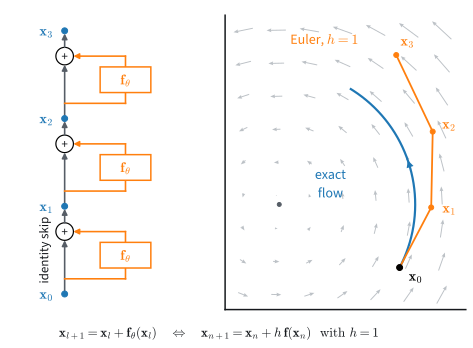
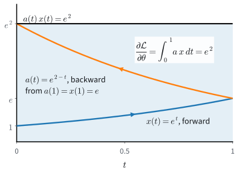

# Neural ODEs, Adjoints, and Continuous Flows
:label:`sec_mdl-neural-odes-cnf`

The previous section ended with two observations about methods we have used
for many chapters: a residual block is one forward-Euler step of size $h=1$,
and gradient descent is Euler's method applied to "move downhill". That
section also showed that the exact flow of a Lipschitz field can be run backward, so it
never maps two points to one. If a residual network is a numerical solution
of a differential equation, what do we gain by taking the equation itself as
the model, and what does it cost?

Generative modelling gives one answer. A normalizing flow is a network that
can be inverted, so that every output comes from exactly one input. The
density of its outputs then follows from the change-of-variables formula,
which asks for the determinant of the network's Jacobian at every sample. For
a small colour image of $32\times32$ pixels that Jacobian has $3072$ rows,
and its determinant costs about $2\times10^{10}$ operations, thousands of
times the cost of evaluating one layer on the same image.
Discrete flows avoid this cost by restricting the form of their layers. A
flow in continuous time avoids it differently: the determinant turns into a
trace, and the trace can be estimated with one backward pass.

The model is a differential equation
$\dot{\mathbf{x}}=\mathbf{f}_{\boldsymbol\theta}(\mathbf{x},t)$ whose
solution at a final time is the output, a *Neural ODE*
:cite:`Chen.Rubanova.Bettencourt.ea.2018`. Training it and computing its
density each come down to integrating one more equation alongside the state.
For training, that equation is the *adjoint* equation, which optimal control
developed in the 1950s to ask how the cost of a trajectory changes with its
controls :cite:`Pontryagin.Boltyanskii.Gamkrelidze.ea.1962`. For the density,
it is an integral of the trace of the Jacobian, and a model that computes it
is a *continuous normalizing flow* :cite:`Grathwohl.Chen.Bettencourt.ea.2018`.
Compared with a fixed residual stack, the model gains an invertible map, a
computable density, and a step count that can be chosen after training. The
diffusion samplers later in this chapter rely on the last of these when they
integrate a learned field.

We train such a model through a solver, derive the adjoint and compare it
with backpropagation, and then follow a density along a flow. Everything
stays deterministic until the next section adds noise. Notation: the field
$\mathbf{f}_{\boldsymbol\theta}$ has parameters $\boldsymbol\theta$ and
Jacobian $\mathbf J=\partial\mathbf{f}/\partial\mathbf{x}$, $\Phi_t$ is its flow
map, a solver takes $N$ steps of size $h$ to the horizon $T=Nh$,
$\mathcal{L}$ is a loss, $\mathbf{a}(t)$ the adjoint and $p_t$ the density.

```{.python .input #mdl-neural-odes-neural-odes-adjoints-and-continuous-flows-2}
#@tab mxnet
from mxnet import autograd, gluon, init, np as mnp, npx
from mxnet.gluon import nn
import numpy as np
npx.set_np()
```

```{.python .input #mdl-neural-odes-neural-odes-adjoints-and-continuous-flows-2}
#@tab pytorch
import numpy as np
import torch
```

```{.python .input #mdl-neural-odes-neural-odes-adjoints-and-continuous-flows-2}
#@tab tensorflow
import numpy as np
import tensorflow as tf
```

```{.python .input #mdl-neural-odes-neural-odes-adjoints-and-continuous-flows-2}
#@tab jax
import jax
from jax import numpy as jnp
import numpy as np
import optax
```

The adjoint and density checks reuse the spiral field $\mathbf A$ and the starting
point $\mathbf{x}_0$ of :numref:`sec_mdl-odes-solvers`, together with two
tools from there: the matrix exponential $e^{\mathbf Bs}=\mathbf Ve^{\boldsymbol\Lambda s}\mathbf V^{-1}$ from
the eigendecomposition $\mathbf B=\mathbf V\boldsymbol\Lambda \mathbf V^{-1}$, and the classical fourth-order
Runge--Kutta solver (RK4).

```{.python .input #mdl-neural-odes-neural-odes-adjoints-and-continuous-flows-1}
A = np.array([[-0.5, -1.0], [1.0, -0.5]])      # spiral sink: eigenvalues -0.5 +- i
x0 = np.array([2.0, 0.0])

def expm_eig(B, s):
    """e^{Bs} via the eigendecomposition B = V diag(mu) V^{-1}."""
    mu, V = np.linalg.eig(B)
    return (V @ np.diag(np.exp(mu * s)) @ np.linalg.inv(V)).real

def rk4(f, x, T, n):
    """n classical RK4 steps of dx/dt = f(x) from time 0 to time T."""
    h = T / n
    for _ in range(n):
        k1 = f(x)
        k2 = f(x + h / 2 * k1)
        k3 = f(x + h / 2 * k2)
        k4 = f(x + h * k3)
        x = x + h / 6 * (k1 + 2 * k2 + 2 * k3 + k4)
    return x
```

## Neural ODEs
:label:`sec_mdl-neural-odes`

A Neural ODE is what a residual network becomes when its depth turns into
time. We first make that limit precise, then show one thing the limit cannot
do, and then train a small model through its solver.

### From Residual Blocks to a Continuous Model

We start from the network we already have, a stack of residual blocks, and
ask which continuous model it approximates. A residual block
:cite:`He.Zhang.Ren.ea.2016` and a forward-Euler step of the ODE
$\dot{\mathbf{x}}=\mathbf{f}(\mathbf{x},t)$ read

$$
\mathbf{x}_{l+1}=\mathbf{x}_l+\mathbf{f}_{\boldsymbol\theta_l}(\mathbf{x}_l)
\qquad\textrm{and}\qquad
\mathbf{x}_{n+1}=\mathbf{x}_n+h\,\mathbf{f}(\mathbf{x}_n,t_n).
$$
:eqlabel:`eq_mdl-ode-resnet-euler`

With $h=1$ and $\mathbf{f}(\cdot,t_l)=\mathbf{f}_{\boldsymbol\theta_l}$ the
two updates are the same formula. A ResNet whose blocks have different
weights is therefore a time-dependent field sampled at the layer times and
integrated by Euler's method with unit steps
(:numref:`fig_mdl-dyn-resnet-as-euler`).


:label:`fig_mdl-dyn-resnet-as-euler`

Why pass to the limit at all? The exact flow of an ODE has three properties
that a finite stack is not guaranteed to have. It is invertible. Its effect
on probability densities can be written down, as the last part of this
section shows. And the number of steps used to compute it is no longer part
of the model, so it can be chosen at evaluation time.

To take the limit, share one field across all steps and let the steps
shrink: $N$ steps of size $h=T/N$ at the times $t_n=nh$,

$$
\mathbf{x}_{n+1}=\mathbf{x}_n+h\,\mathbf{f}_{\boldsymbol\theta}(\mathbf{x}_n,t_n),
\qquad
\mathbf{x}_N\;\xrightarrow{\;N\to\infty\;}\;
\mathbf{x}(T)=\mathbf{x}_0+\int_0^T\mathbf{f}_{\boldsymbol\theta}(\mathbf{x}(t),t)\,dt .
$$
:eqlabel:`eq_mdl-ode-neural-ode`

The convergence follows from Euler's global error bound in
:numref:`sec_mdl-euler-runge-kutta`: for a smooth field that is Lipschitz in
$\mathbf{x}$, the Euler iterate after $N$ steps is within $O(h)$ of the exact
solution. The **Neural ODE** is the limit object: the model whose output is
the solution $\mathbf{x}(T)$ of
$\dot{\mathbf{x}}=\mathbf{f}_{\boldsymbol\theta}(\mathbf{x},t)$ with
$\mathbf{x}(0)=\mathbf{x}_0$. The parameters define the field. The solver
(Euler, RK4, an adaptive method) is a choice made afterwards, which changes
the computed map, its cost and its error, but not the model.

The exact map and the computed map can differ in kind, not only in accuracy.
The field $\dot{x}=-x$ has the exact flow $\Phi_t(x)=e^{-t}x$, a bijection of
$\mathbb{R}$ for every $t$. One Euler step with $h=1$ computes
$x+1\cdot(-x)=0$ and maps every input to zero. The exact map, by contrast,
is always invertible when the field is continuous in $t$ and globally
Lipschitz in $\mathbf{x}$ (:numref:`sec_mdl-ode-existence-uniqueness`). The
reversed path $\mathbf{y}(s)=\mathbf{x}(T-s)$ solves
$\dot{\mathbf{y}}=-\mathbf{f}(\mathbf{y},T-s)$, whose field is again
Lipschitz. So every endpoint is reached from exactly one start, and running
the reversed field recovers it.

### Order Preservation on the Line
:label:`subsec_mdl-flow-order`

Invertibility is a gain, but it is also a constraint. Is a Neural ODE at
least as expressive as the residual stack it came from? On the real line it
is not, and a picture shows why. In the $(t,x)$ plane, trajectories
of a Lipschitz field never cross. Two trajectories that swapped $-1$ and $1$
would have to meet on the way (:numref:`fig_mdl-dyn-flow-order`a).

**Proposition (flows on $\mathbb{R}$ preserve order).** *Let $f(x,t)$ be
continuous in $t$ and globally Lipschitz in $x$, and write $\Phi_t(x)$ for
the solution at time $t$ started from $x$ at time $0$. Then for every $T>0$
the map $\Phi_T$ is strictly increasing.*

**Proof.** Let $x<y$ and suppose $\Phi_T(x)\ge\Phi_T(y)$. The function
$g(t)=\Phi_t(y)-\Phi_t(x)$ is continuous with $g(0)>0$ and $g(T)\le0$, so by
the intermediate value theorem $g(s)=0$ for some $s\in(0,T]$: the two
trajectories meet at time $s$ at a point $z$. Now run time backward from $s$.
Both reversed trajectories $\tau\mapsto\Phi_{s-\tau}(x)$ and
$\tau\mapsto\Phi_{s-\tau}(y)$ solve the same initial-value problem
$\dot{w}=-f(w,s-\tau)$, $w(0)=z$, whose field is again Lipschitz. By
Picard--Lindelöf that problem has only one solution, so the two reversed
trajectories coincide, and at $\tau=s$ this says $x=y$, a contradiction.
$\blacksquare$

The step that is not routine is to apply uniqueness backward, from the
meeting time. Thus no Neural ODE on $\mathbb{R}$ realizes $x\mapsto-x$: that
map sends $-1$ to $1$ and $1$ to $-1$, which reverses their order.

The residual block $x+f(x)$ with $f(x)=-2x$ does realize it, in one step
(:numref:`fig_mdl-dyn-flow-order`b). That block is the Euler step with $h=1$
of $\dot{x}=-2x$, whose exact flow $e^{-2t}x$ never reverses order. The two
statements agree because one Euler step $x+hf(x)$ of a field with Lipschitz
constant $L$ is guaranteed to be increasing when $hL<1$: for $x>y$,

$$
\big(x+hf(x)\big)-\big(y+hf(y)\big)\;\ge\;(x-y)-hL\,(x-y)\;=\;(1-hL)(x-y),
$$

which is positive when $hL<1$. Here $hL=2$, so the step may reverse order.
A finite step is not a flow, and the proposition does not constrain it.

One more dimension removes the obstruction. Let
$\mathbf K=\left(\begin{smallmatrix}0&-1\\1&0\end{smallmatrix}\right)$, which
satisfies $\mathbf K^2=-\mathbf{I}$, so that the exponential series splits into
$e^{s\mathbf K}=\cos s\,\mathbf{I}+\sin s\,\mathbf K$, the rotation by the angle $s$. The
field $\dot{\mathbf{x}}=\pi \mathbf K\mathbf{x}$ has the time-one map

$$
\Phi_1=e^{\pi \mathbf K}=\cos\pi\,\mathbf{I}+\sin\pi\,\mathbf K=-\mathbf{I}.
$$

It carries $(x,0)$ to $(-x,0)$ along half circles, and trajectories pass each
other in the plane without meeting (:numref:`fig_mdl-dyn-flow-order`c).
Adding dimensions in this way is called *augmentation*
:cite:`Dupont.Doucet.Teh.2019`. A flow is a continuous rearrangement of
space, and on a line there is no room for two points to pass.


:label:`fig_mdl-dyn-flow-order`

### Training Through the Solver

The forward pass of a Neural ODE is a loop of $N$ solver steps. The direct
way to train it is to *discretize, then differentiate*: write the solver into
the computation graph, compute the loss on $\mathbf{x}_N$, and backpropagate
through the unrolled steps. With Euler as the solver the program is a ResNet
of $N$ blocks that share one set of weights, so ordinary automatic
differentiation trains it.

Can ten shared-weight residual updates learn a prescribed deformation of the
plane? We take a field with one hidden layer of $32$ tanh units and ask that
its time-one flow carry $64$ points of the unit circle to the matching points
of the ellipse centred at $(1.5,0)$ with semi-axes $1.2$ and $0.4$. The loss
is the mean squared error at the endpoints, the solver takes $N=10$ Euler
steps of size $h=0.1$, and Adam (:numref:`sec_mdl-adaptive-stochastic-methods`)
runs $400$ full-batch iterations at learning rate $0.05$, lowered to $0.005$
for the last $100$. The function
`flow` takes the step count and step size as arguments, so that the trained
field can later be integrated in other ways.

```{.python .input #odes-solvers-neural-ode-train}
#@tab pytorch
angle = np.linspace(0, 2 * np.pi, 64, endpoint=False)
X0_ring = np.stack([np.cos(angle), np.sin(angle)], axis=1)            # circle
X1_ring = np.stack([1.5 + 1.2 * np.cos(angle), 0.4 * np.sin(angle)], axis=1)
X, Y = torch.tensor(X0_ring).float(), torch.tensor(X1_ring).float()
net = torch.nn.Sequential(torch.nn.Linear(2, 32), torch.nn.Tanh(),
                          torch.nn.Linear(32, 2))
for layer in net[::2]:                         # Glorot-uniform weights, zero biases
    torch.nn.init.xavier_uniform_(layer.weight)
    torch.nn.init.zeros_(layer.bias)

def flow(X, N=10, h=0.1, sign=1.0):
    """N Euler steps of size h; sign=-1 integrates the field backward."""
    for _ in range(N):                         # one Euler step = one residual block
        X = X + sign * h * net(X)
    return X

opt = torch.optim.Adam(net.parameters(), lr=0.05)
sched = torch.optim.lr_scheduler.MultiStepLR(opt, [300], 0.1)  # 0.005 from 300
for it in range(401):
    loss = ((flow(X) - Y) ** 2).mean()
    opt.zero_grad()
    loss.backward()
    opt.step()
    sched.step()
    if it % 200 == 0:
        print(f'iter {it:3d}  loss {loss.item():.1e}')
```

```{.python .input #odes-solvers-neural-ode-train}
#@tab mxnet
angle = np.linspace(0, 2 * np.pi, 64, endpoint=False)
X0_ring = np.stack([np.cos(angle), np.sin(angle)], axis=1)            # circle
X1_ring = np.stack([1.5 + 1.2 * np.cos(angle), 0.4 * np.sin(angle)], axis=1)
X, Y = mnp.array(X0_ring, dtype='float32'), mnp.array(X1_ring, dtype='float32')
net = nn.HybridSequential()
net.add(nn.Dense(32, activation='tanh'), nn.Dense(2))
net.initialize(init.Xavier())                  # Glorot-uniform weights, zero biases
net.hybridize()

def flow(X, N=10, h=0.1, sign=1.0):
    """N Euler steps of size h; sign=-1 integrates the field backward."""
    for _ in range(N):                         # one Euler step = one residual block
        X = X + sign * h * net(X)
    return X

trainer = gluon.Trainer(net.collect_params(), 'adam', {'learning_rate': 0.05})
for it in range(401):
    if it == 300:
        trainer.set_learning_rate(0.005)       # tenfold smaller for the last 100
    with autograd.record():
        loss = ((flow(X) - Y) ** 2).mean()
    loss.backward()
    trainer.step(1)
    if it % 200 == 0:
        print(f'iter {it:3d}  loss {float(loss):.1e}')
```

```{.python .input #odes-solvers-neural-ode-train}
#@tab tensorflow
angle = np.linspace(0, 2 * np.pi, 64, endpoint=False)
X0_ring = np.stack([np.cos(angle), np.sin(angle)], axis=1)            # circle
X1_ring = np.stack([1.5 + 1.2 * np.cos(angle), 0.4 * np.sin(angle)], axis=1)
X, Y = tf.constant(X0_ring, tf.float32), tf.constant(X1_ring, tf.float32)
net = tf.keras.Sequential([tf.keras.layers.Dense(32, activation='tanh'),
                           tf.keras.layers.Dense(2)])  # Glorot-uniform, zero biases

def flow(X, N=10, h=0.1, sign=1.0):
    """N Euler steps of size h; sign=-1 integrates the field backward."""
    for _ in range(N):                         # one Euler step = one residual block
        X = X + sign * h * net(X)
    return X

lr = tf.keras.optimizers.schedules.PiecewiseConstantDecay([300], [0.05, 0.005])
opt = tf.keras.optimizers.Adam(learning_rate=lr)  # 0.005 after iteration 300

@tf.function
def train_step():
    with tf.GradientTape() as tape:
        loss = tf.reduce_mean((flow(X) - Y) ** 2)
    opt.apply_gradients(zip(tape.gradient(loss, net.trainable_variables),
                            net.trainable_variables))
    return loss

for it in range(401):
    loss = train_step()
    if it % 200 == 0:
        print(f'iter {it:3d}  loss {float(loss):.1e}')
```

```{.python .input #odes-solvers-neural-ode-train}
#@tab jax
angle = np.linspace(0, 2 * np.pi, 64, endpoint=False)
X0_ring = np.stack([np.cos(angle), np.sin(angle)], axis=1)            # circle
X1_ring = np.stack([1.5 + 1.2 * np.cos(angle), 0.4 * np.sin(angle)], axis=1)
X, Y = jnp.array(X0_ring), jnp.array(X1_ring)
k1, k2 = jax.random.split(jax.random.key(np.random.randint(2**31)))
glorot = jax.nn.initializers.glorot_uniform()  # Glorot-uniform weights, zero biases
params = {'W1': glorot(k1, (2, 32)), 'b1': jnp.zeros(32),
          'W2': glorot(k2, (32, 2)), 'b2': jnp.zeros(2)}

def net(params, X):
    return jnp.tanh(X @ params['W1'] + params['b1']) @ params['W2'] + params['b2']

def flow(params, X, N=10, h=0.1, sign=1.0):
    """N Euler steps of size h; sign=-1 integrates the field backward."""
    step = lambda i, X: X + sign * h * net(params, X)  # one residual block
    return jax.lax.fori_loop(0, N, step, X)

opt = optax.adam(optax.piecewise_constant_schedule(0.05, {300: 0.1}))
opt_state = opt.init(params)

@jax.jit
def train_step(params, opt_state):
    loss, grads = jax.value_and_grad(
        lambda p: ((flow(p, X) - Y) ** 2).mean())(params)
    updates, opt_state = opt.update(grads, opt_state)
    return optax.apply_updates(params, updates), opt_state, loss

for it in range(401):
    params, opt_state, loss = train_step(params, opt_state)
    if it % 200 == 0:
        print(f'iter {it:3d}  loss {float(loss):.1e}')
```

The loss falls from order one to between $10^{-7}$ and $10^{-5}$: one small field,
integrated by ten shared-weight residual updates, reproduces the prescribed
endpoints.

Is what we trained a continuous flow or a ten-step program? Two tests answer
this. First, integrate the trained field with $N=100$ and $N=1000$ steps
($Nh=1$ throughout); the larger $N$, the closer the computed map is to the
exact time-one flow of the field. Second, integrate forward $N$ steps and
then backward $N$ steps with
$\mathbf{x}\leftarrow\mathbf{x}-h\,\mathbf{f}_{\boldsymbol\theta}(\mathbf{x})$,
and measure how far the round trip lands from where it started.

```{.python .input #mdl-neural-odes-training-through-the-solver-1}
#@tab pytorch
with torch.inference_mode():
    for n in (10, 100, 1000):
        fwd = flow(X, n, 1 / n)
        back = flow(fwd, n, 1 / n, sign=-1.0)
        err = torch.linalg.vector_norm(fwd - Y, dim=1).mean()
        trip = torch.linalg.vector_norm(back - X, dim=1).mean()
        print(f'N = {n:4d}: endpoint error {err:.1e}, '
              f'forward-backward round trip {trip:.1e}')
```

```{.python .input #mdl-neural-odes-training-through-the-solver-1}
#@tab mxnet
for n in (10, 100, 1000):
    fwd = flow(X, n, 1 / n)
    back = flow(fwd, n, 1 / n, sign=-1.0)
    err = mnp.sqrt(((fwd - Y) ** 2).sum(axis=1)).mean()
    trip = mnp.sqrt(((back - X) ** 2).sum(axis=1)).mean()
    print(f'N = {n:4d}: endpoint error {float(err):.1e}, '
          f'forward-backward round trip {float(trip):.1e}')
```

```{.python .input #mdl-neural-odes-training-through-the-solver-1}
#@tab tensorflow
for n in (10, 100, 1000):
    fwd = flow(X, n, 1 / n)
    back = flow(fwd, n, 1 / n, sign=-1.0)
    err = tf.reduce_mean(tf.norm(fwd - Y, axis=1))
    trip = tf.reduce_mean(tf.norm(back - X, axis=1))
    print(f'N = {n:4d}: endpoint error {float(err):.1e}, '
          f'forward-backward round trip {float(trip):.1e}')
```

```{.python .input #mdl-neural-odes-training-through-the-solver-1}
#@tab jax
for n in (10, 100, 1000):
    fwd = flow(params, X, n, 1 / n)
    back = flow(params, fwd, n, 1 / n, sign=-1.0)
    err = jnp.linalg.norm(fwd - Y, axis=1).mean()
    trip = jnp.linalg.norm(back - X, axis=1).mean()
    print(f'N = {n:4d}: endpoint error {float(err):.1e}, '
          f'forward-backward round trip {float(trip):.1e}')
```

At the training step count the endpoints lie a few thousandths from
their targets. With finer steps the endpoint error *rises* to about $0.02$ and
then stops changing. Training fitted the ten-step program. The exact
time-one flow of the same field, which $N=1000$ approximates, lands about
$0.02$ from the targets, under $2\%$ of the ellipse's long semi-axis. The
field defines a flow close to its ten-step program, not equal to it.

The round trip misses its start by about $0.055$ at $N=10$, $0.0056$ at
$N=100$ and $0.00056$ at $N=1000$, tenfold less per tenfold more steps. Each
pair of forward and backward Euler steps leaves a residual of order $h^2$,
and $N$ of them add up to $O(h)$, Euler's order. The exact flow is
invertible, whereas the numerical map becomes invertible only in the limit
$h\to0$.

## The Adjoint Method
:label:`sec_mdl-adjoint-method`

Backpropagating through $N$ solver steps stores the $N$ intermediate states,
and an adaptive solver does not even know $N$ in advance. The adjoint method
instead differentiates the exact flow: it integrates one linear ODE backward
in time, and it can recompute the states on the way instead of storing them.
Its central object is the *adjoint state*
$\mathbf{a}(t)=\partial\mathcal{L}/\partial\mathbf{x}(t)$, the gradient of
the loss with respect to the state at time $t$. It is the continuous
analogue of the quantity that backpropagation carries from layer to layer,
the gradient of the loss with respect to a layer's output
(:numref:`sec_mdl-matrix-calculus-autodiff`).

### The Scalar Case

Before the general statement we work one example to the end, an example in
which every quantity has a closed form. Take $\dot{x}=\theta x$ with $x(0)=x_0$ and the
loss $\mathcal{L}=\tfrac12x(T)^2$ on the endpoint. Directly,
$x(T)=e^{\theta T}x_0$, so $\partial x(T)/\partial\theta=T\,x(T)$ and

$$
\frac{\partial\mathcal{L}}{\partial\theta}=x(T)\,\frac{\partial x(T)}{\partial\theta}=T\,x(T)^2 .
$$

With $\theta=T=x_0=1$ this is $e^2=7.389$.

The adjoint reaches the same number by another route. A nudge $\delta$ to
the state at time $t$ grows to $e^{\theta(T-t)}\delta$ by time $T$ and
changes the loss by $x(T)\,e^{\theta(T-t)}\delta$, so
$a(t)=e^{\theta(T-t)}x(T)$. This adjoint solves the ODE $\dot{a}=-\theta a$
backward from the final value $a(T)=x(T)$, which is the derivative of the
loss $\ell(x)=\tfrac12x^2$ at $x(T)$. A change of $\theta$ pushes the
trajectory at the rate $\partial f/\partial\theta=x$, and the adjoint
converts each push into a change of the loss. Summing over time,

$$
\int_0^T a(t)\,\frac{\partial f}{\partial\theta}\,dt
=\int_0^T e^{\theta(T-t)}x(T)\;e^{\theta t}x_0\,dt
=\int_0^T x(T)^2\,dt
=T\,x(T)^2 .
$$
:eqlabel:`eq_mdl-ode-scalar-adjoint`

The integrand is constant: $x$ grows forward, $a$ shrinks by the same factor
when read forward, and their product stays at $x(T)^2$
(:numref:`fig_mdl-dyn-adjoint-timeline`). The gradient is the area under it.
In words, $a(t)$ answers "how much does the loss change if the trajectory is
nudged at time $t$?", and the parameter gradient adds up, over time, the
nudge the parameter causes times the loss's sensitivity to it.


:label:`fig_mdl-dyn-adjoint-timeline`

### The Adjoint Equations

The general case keeps the shape of the scalar one: an adjoint that runs
backward from the gradient of the loss, and a parameter gradient that
integrates the adjoint against $\partial\mathbf{f}/\partial\boldsymbol\theta$.

**Proposition (the adjoint equations).** *Let $\mathbf{f}$ be continuously
differentiable in $\mathbf{x}$ and $\boldsymbol\theta$, let $\mathbf{x}(t)$
solve $\dot{\mathbf{x}}=\mathbf{f}(\mathbf{x},\boldsymbol\theta,t)$ on
$[0,T]$ from a fixed $\mathbf{x}(0)$, and let
$\mathcal{L}=\ell(\mathbf{x}(T))$ for a differentiable $\ell$. Then the
adjoint state satisfies the linear ODE*

$$
\dot{\mathbf{a}}(t) = -\left(\frac{\partial \mathbf{f}}{\partial \mathbf{x}}\right)^{\!\top}\! \mathbf{a}(t),
\qquad
\mathbf{a}(T) = \nabla \ell(\mathbf{x}(T)),
$$
:eqlabel:`eq_mdl-ode-adjoint`

*integrated backward from $T$, and the parameter gradient is the integral*

$$
\frac{\partial \mathcal{L}}{\partial \boldsymbol\theta}
= \int_0^T \left(\frac{\partial \mathbf{f}}{\partial \boldsymbol\theta}\right)^{\!\top}\! \mathbf{a}(t)\, dt,
$$
:eqlabel:`eq_mdl-ode-adjoint-grad`

*with both partial derivatives evaluated along the trajectory
$(\mathbf{x}(t),\boldsymbol\theta,t)$* :cite:`Chen.Rubanova.Bettencourt.ea.2018`.

**Proof (variational).** Perturb the parameters by an infinitesimal
$\delta\boldsymbol\theta$. Because $\mathbf{f}$ is $C^1$, the solution is
differentiable in $\boldsymbol\theta$, and the first-order perturbation
$\delta\mathbf{x}(t)$ of the trajectory obeys the *linearization* of the
dynamics (differentiate the ODE in $\boldsymbol\theta$ and use the chain
rule):

$$
\delta\dot{\mathbf{x}}
= \frac{\partial \mathbf{f}}{\partial \mathbf{x}}\,\delta\mathbf{x}
+ \frac{\partial \mathbf{f}}{\partial \boldsymbol\theta}\,\delta\boldsymbol\theta,
\qquad
\delta\mathbf{x}(0) = \mathbf{0}.
$$

Define $\mathbf{a}(t)$ by the backward ODE :eqref:`eq_mdl-ode-adjoint` and
differentiate the pairing $\mathbf{a}^\top\delta\mathbf{x}$:

$$
\frac{d}{dt}\left(\mathbf{a}^\top \delta\mathbf{x}\right)
= \dot{\mathbf{a}}^\top \delta\mathbf{x} + \mathbf{a}^\top \delta\dot{\mathbf{x}}
= -\mathbf{a}^\top \frac{\partial \mathbf{f}}{\partial \mathbf{x}}\,\delta\mathbf{x}
+ \mathbf{a}^\top \frac{\partial \mathbf{f}}{\partial \mathbf{x}}\,\delta\mathbf{x}
+ \mathbf{a}^\top \frac{\partial \mathbf{f}}{\partial \boldsymbol\theta}\,\delta\boldsymbol\theta
= \mathbf{a}^\top \frac{\partial \mathbf{f}}{\partial \boldsymbol\theta}\,\delta\boldsymbol\theta .
$$

The state-coupling terms cancel, and the adjoint ODE was defined so that
they would. Integrate from $0$ to $T$, using
$\delta\mathbf{x}(0)=\mathbf{0}$ at the left endpoint:

$$
\mathbf{a}(T)^\top \delta\mathbf{x}(T)
= \int_0^T \mathbf{a}(t)^\top \frac{\partial \mathbf{f}}{\partial \boldsymbol\theta}\, dt \;\delta\boldsymbol\theta .
$$

The left side is $\nabla\ell(\mathbf{x}(T))^\top\delta\mathbf{x}(T)=\delta\mathcal{L}$,
the first-order change of the loss; the right side is linear in
$\delta\boldsymbol\theta$ with coefficient :eqref:`eq_mdl-ode-adjoint-grad`.
(The same telescoping, started at an intermediate time $s$ instead of $0$,
shows $\delta\mathcal{L}=\mathbf{a}(s)^\top\delta\mathbf{x}(s)$ for a nudge
injected at time $s$, so the solution of :eqref:`eq_mdl-ode-adjoint` is
$\partial\mathcal{L}/\partial\mathbf{x}(s)$.) $\blacksquare$

The backward ODE is linear in $\mathbf{a}$, with the transposed Jacobian as
its matrix. Each of its steps computes
$\mathbf{a}^\top\partial\mathbf{f}/\partial\mathbf{x}$, one vector--Jacobian
product, which costs one reverse-mode pass through $\mathbf{f}$
(:numref:`sec_mdl-matrix-calculus-autodiff`). (A ReLU field is only
piecewise $C^1$, so the proposition does not cover it, although autograd
still differentiates the unrolled solver piece by piece. Smooth activations
such as tanh or GELU satisfy the hypothesis.)

### Backpropagation as the Discrete Adjoint

What does backpropagation through the Euler program compute, and how does it
relate to the adjoint ODE? Differentiate the program
$\mathbf{x}_{k+1}=\mathbf{x}_k+h\,\mathbf{f}(\mathbf{x}_k,\boldsymbol\theta)$
by the chain rule, with $\mathbf{a}_k=\partial\mathcal{L}/\partial\mathbf{x}_k$.
The Jacobian of one step is $\mathbf{I}+h\mathbf J(\mathbf{x}_k)$, so

$$
\mathbf{a}_k=\big(\mathbf{I}+h\mathbf J(\mathbf{x}_k)\big)^{\!\top}\mathbf{a}_{k+1},
\qquad
\mathbf{a}_N=\nabla\ell(\mathbf{x}_N),
\qquad
\frac{\partial\mathcal{L}}{\partial\boldsymbol\theta}
=\sum_{k=0}^{N-1}h\left(\frac{\partial\mathbf{f}}{\partial\boldsymbol\theta}(\mathbf{x}_k)\right)^{\!\top}\mathbf{a}_{k+1}.
$$
:eqlabel:`eq_mdl-ode-discrete-adjoint`

Compare this with one explicit Euler step of the adjoint ODE
:eqref:`eq_mdl-ode-adjoint` from $t_{k+1}$ back to $t_k$:

$$
\mathbf{a}_k=\mathbf{a}_{k+1}+h\,\mathbf J(\mathbf{x}_{k+1})^\top\mathbf{a}_{k+1}.
$$

The two updates differ only in where the Jacobian is evaluated: at the start
$\mathbf{x}_k$ of the forward step or at its end $\mathbf{x}_{k+1}$. The sum in
:eqref:`eq_mdl-ode-discrete-adjoint` is a rectangle rule for the integral
:eqref:`eq_mdl-ode-adjoint-grad`. So backpropagation through a solver is a
*discrete adjoint*, and a solver applied to the adjoint ODE is the
*continuous adjoint*, discretized. The literature calls the two routes
discretize-then-optimize and optimize-then-discretize :cite:`Kidger.2022`.

The scalar example shows both at once. For $\dot{x}=\theta x$ the Euler
program is $x_N=(1+h\theta)^Nx_0$, so
$\partial x_N/\partial\theta=Nh(1+h\theta)^{N-1}x_0=T\,x_N/(1+h\theta)$ and
the discrete adjoint gives
$\partial\mathcal{L}/\partial\theta=T\,x_N^2/(1+h\theta)$. With
$\theta=T=x_0=1$ this is $6.116$ at $N=10$, $7.244$ at $N=100$ and $7.374$
at $N=1000$, against the exact $e^2=7.389$. The gaps $1.27$, $0.145$ and
$0.0148$ shrink tenfold per tenfold $N$. The discrete adjoint is the exact
gradient of the program, and the program's gradient converges to the flow's
at the solver's order.

The spiral field of :numref:`sec_mdl-odes-solvers`, $\dot{\mathbf{x}}=\mathbf A\mathbf{x}$
with $\mathbf A=\left(\begin{smallmatrix}-0.5&-1\\1&-0.5\end{smallmatrix}\right)$,
gives the same check in two dimensions with every ingredient in closed form.
Take $\boldsymbol\theta$ to be the entries of $\mathbf A$ and
$\mathcal{L}=\tfrac12\|\mathbf{x}(T)\|^2$. The trajectory is
$e^{\mathbf At}\mathbf{x}_0$, the adjoint is
$\mathbf{a}(t)=e^{\mathbf A^\top(T-t)}\mathbf{x}(T)$ (the solution of
$\dot{\mathbf{a}}=-\mathbf A^\top\mathbf{a}$), and since
$\partial\mathbf{f}/\partial A_{ij}=x_j\mathbf{e}_i$, the gradient
:eqref:`eq_mdl-ode-adjoint-grad` becomes
$\partial\mathcal{L}/\partial \mathbf A=\int_0^T\mathbf{a}(t)\,\mathbf{x}(t)^\top dt$.
Does a hand-written backward sweep through the unrolled Euler program give the
exact gradient of that program? The next cell compares it with central finite
differences on the same program, for $T=2$ and $N=1000$ steps.

```{.python .input #odes-solvers-adjoint-check}
def loss_and_grad_unrolled(A, x0, T, n):
    """L = ||x_n||^2 / 2 through n unrolled Euler steps; dL/dA by hand-written
    reverse mode, the discrete adjoint."""
    h, xs = T / n, [x0]
    for k in range(n):
        xs.append(xs[-1] + h * (A @ xs[-1]))   # forward sweep, tape the states
    a, gA = xs[-1].copy(), np.zeros_like(A)    # a_n = dL/dx_n = x_n
    for k in range(n - 1, -1, -1):             # backward sweep: one VJP per step
        gA += h * np.outer(a, xs[k])           # dL/dA += h a_{k+1} x_k^T
        a = a + h * (A.T @ a)                  # a_k = (I + hA)^T a_{k+1}
    return 0.5 * xs[-1] @ xs[-1], gA

T, n = 2.0, 1000
_, g_disc = loss_and_grad_unrolled(A, x0, T, n)
g_fd = np.zeros_like(A)                        # central finite differences
for i in range(2):
    for j in range(2):
        E = np.zeros_like(A); E[i, j] = 1e-5
        g_fd[i, j] = (loss_and_grad_unrolled(A + E, x0, T, n)[0]
                      - loss_and_grad_unrolled(A - E, x0, T, n)[0]) / 2e-5
print(f'discrete adjoint vs finite differences: {np.abs(g_disc - g_fd).max():.1e}')
```

The two agree to about $10^{-10}$, the accuracy of the finite differences
themselves: the backward sweep is the exact gradient of the unrolled
program. How far is that gradient from the gradient of the exact flow? The
next cell evaluates the continuous adjoint integral by the trapezoid rule on
$2000$ intervals, with $\mathbf{a}$ and $\mathbf{x}$ from the matrix
exponential, and compares it with the discrete adjoint for three step counts.

```{.python .input #mdl-neural-odes-backpropagation-as-the-discrete-adjoint-1}
n_quad = 2000                                  # continuous adjoint, trapezoid rule
ts = np.linspace(0.0, T, n_quad + 1)
xT = expm_eig(A, T) @ x0
F = np.stack([np.outer(expm_eig(A.T, T - s) @ xT, expm_eig(A, s) @ x0)
              for s in ts])                    # a(s) x(s)^T
g_cont = (T / n_quad) * (F[1:-1].sum(axis=0) + 0.5 * (F[0] + F[-1]))
for n_steps in (100, 1000, 10000):
    gap = np.abs(loss_and_grad_unrolled(A, x0, T, n_steps)[1] - g_cont).max()
    print(f'n = {n_steps:5d} Euler steps: |discrete - continuous adjoint| = {gap:.1e}')
```

The gap falls from $2.9\times10^{-2}$ to $2.8\times10^{-3}$ to
$2.8\times10^{-4}$, tenfold per tenfold $N$, as in the scalar case.
Backpropagation through a solver differentiates the discrete program, and
the continuous adjoint differentiates the exact flow. The two gradients agree
to the solver's order.

### Memory and Drift

The adjoint ODE needs $\mathbf{x}(t)$ at every backward step, because the
Jacobian is evaluated there. There are two ways to supply it. Store the
forward states, which costs memory proportional to $N$, or re-integrate
$\dot{\mathbf{x}}=\mathbf{f}$ backward from $\mathbf{x}(T)$ alongside
$\mathbf{a}$, which keeps the memory constant in $N$ at the cost of one more
field evaluation per step. The smallest case shows that the second option
amplifies errors.

For $\dot{x}=-\lambda x$ with $\lambda>0$, the backward integration solves
$\dot{x}=+\lambda x$. An absolute error $\delta$ in the stored $x(T)$
therefore becomes $e^{\lambda T}\delta$ by the time it reaches $t=0$. Take
$\lambda=50$, the fast decay rate of the stiff example of
:numref:`sec_mdl-stiffness-implicit`, and $\delta=10^{-16}$, the
double-precision rounding error of a number of size one. The reconstructed
start is then off by $2.7\times10^{-11}$ at $T=0.25$, by $7\times10^{-6}$ at
$T=0.5$ and by $5\times10^{5}$ at $T=1$, larger than the state itself. (A
lone scalar escapes this, because its tiny stored value is rounded relative to
its own size. In a state whose other coordinates stay of size one, rounding
leaves an error of about $10^{-16}$ in the fast direction, and
:exref:`ex_mdl-odes-solvers-backward-reconstruction` measures its growth.)

For the spiral, whose eigenvalues have real part $-0.5$, the factor over
$T=2$ is only $e$. A strongly contracting forward flow is a strongly
expanding backward one, so re-integration saves memory at the cost of drift.
For stiff fields *checkpointing* is the sturdier choice: it stores the state
only at a few checkpoints and recomputes the states in between.

## Continuous Normalizing Flows
:label:`sec_mdl-continuous-normalizing-flows`

A Neural ODE moves points. A generative model must also say how probable
each output is, so we now follow a density along the flow, check the result
on a linear and a nonlinear field, and estimate its rate of change with one
backward pass per step.

### Density Along a Flow

Pushing samples through a flow turns it into a generator: draw
$\mathbf{x}(0)$ from a simple density $p_0$ and integrate. Training such a
generator by maximum likelihood needs the density of what comes out. A
*normalizing flow* is an invertible network trained in this way, and its
density follows from the change-of-variables formula of
:numref:`sec_mdl-random_variables`: for an invertible differentiable map
$\mathbf{g}$ with Jacobian $\mathbf J_{\mathbf{g}}$,

$$
\log p_{\textrm{out}}(\mathbf{g}(\mathbf{x}))
= \log p_{\textrm{in}}(\mathbf{x}) - \log \left|\det \mathbf J_{\mathbf{g}}(\mathbf{x})\right| .
$$
:eqlabel:`eq_mdl-ode-discrete-cov`

The log-density drops by the logarithm of the factor by which $\mathbf{g}$
stretches volume near $\mathbf{x}$. A flow built from many layers needs one
log-determinant per layer and sample. A general determinant costs $O(d^3)$
operations, about $2\times10^{10}$ at $d=3072$. Discrete flows therefore
restrict their layers to triangular Jacobians, whose determinant is the
product of the diagonal, or to identity-plus-low-rank Jacobians, such as
$\det(\mathbf{I}+\mathbf{u}\mathbf{v}^\top)=1+\mathbf{v}^\top\mathbf{u}$.
Both determinants cost $O(d)$.

In continuous time the formula simplifies, and the smallest case shows how.
The field $\dot{x}=\theta x$ on $\mathbb{R}$ has the flow
$\Phi_t(x)=e^{\theta t}x$, which stretches every interval by $e^{\theta t}$.
A density carried along is divided by the stretch, so
$\log p_t(x(t))=\log p_0(x_0)-\theta t$ and
$\tfrac{d}{dt}\log p_t(x(t))=-\theta$. The number $\theta$ is the
$1\times1$ Jacobian of the field, and therefore also its trace.

The spiral is the running example in two dimensions. Since
$\mathbf A=-\tfrac12\mathbf{I}+\mathbf K$ and $\mathbf{I}$ commutes with $\mathbf K$,
$e^{\mathbf At}=e^{-t/2}e^{t\mathbf K}$, a rotation followed by a shrink by $e^{-t/2}$. A disc
is carried to a disc of $e^{-t/2}$ times its radius, so its area is
multiplied by $e^{-t}$, and the density along each trajectory rises by
$e^{t}$. Here $\operatorname{tr}\mathbf A=-1$, so the rate of change of the
log-density is again minus the trace. :numref:`fig_mdl-dyn-divergence-volume`
draws this beside a field that preserves area and one that expands it.


:label:`fig_mdl-dyn-divergence-volume`

The general case needs one fact about determinants: over a short step the
flow map is close to the identity, and the determinant of a matrix close to
the identity is governed by its trace.

**Lemma.** *For any square matrix $\mathbf J$,
$\det(\mathbf{I}+h\mathbf J)=1+h\operatorname{tr}\mathbf J+O(h^2)$.*

**Proof.** In the Leibniz expansion of the determinant, any permutation other
than the identity uses at least two off-diagonal entries, each of size
$O(h)$, so it contributes $O(h^2)$. The identity permutation contributes
$\prod_i(1+hJ_{ii})=1+h\sum_iJ_{ii}+O(h^2)$. $\blacksquare$

**Proposition (instantaneous change of variables).** *Let
$\dot{\mathbf{x}}=\mathbf{f}(\mathbf{x},t)$ with $\mathbf{f}$ continuously
differentiable in $(\mathbf{x},t)$ and globally Lipschitz in $\mathbf{x}$, so
that each flow map $\Phi_t$ is a $C^1$ bijection with a $C^1$ inverse (the
solution of a $C^1$ field is $C^1$ in its initial value
:cite:`Hairer.Norsett.Wanner.1993`, and the inverse runs the field
backward). Let $\mathbf{x}(0)\sim p_0$ for a positive differentiable density
$p_0$. Then the density $p_t$ of $\mathbf{x}(t)$ exists and is positive, and
along each trajectory* :cite:`Chen.Rubanova.Bettencourt.ea.2018`

$$
\frac{d}{dt} \log p_t(\mathbf{x}(t))
= -\operatorname{tr}\!\left(\frac{\partial \mathbf{f}}{\partial \mathbf{x}}\right)\!(\mathbf{x}(t), t).
$$
:eqlabel:`eq_mdl-ode-instant-cov`

**Proof.** The density exists by :eqref:`eq_mdl-ode-discrete-cov` applied to
the bijection $\Phi_t$, and it is positive because $p_0$ is and the Jacobian
of a map with a differentiable inverse is nonsingular. Over a short interval
the flow advances by the map
$\Phi_{t\to t+h}(\mathbf{x})=\mathbf{x}+\int_t^{t+h}\mathbf{f}(\mathbf{x}(s),s)\,ds$.
Differentiating in $\mathbf{x}$ and using the continuity of $\mathbf J$, its Jacobian
is $\mathbf{I}+h\mathbf J+o(h)$, where $\mathbf J=\partial\mathbf{f}/\partial\mathbf{x}$ is
evaluated at $(\mathbf{x}(t),t)$ and $o(h)$ stands for terms that vanish
faster than $h$. Apply :eqref:`eq_mdl-ode-discrete-cov` to this one map and
expand with the Lemma, which tolerates the perturbation: replacing $h\mathbf J$ by
$h\mathbf J+o(h)$ changes the determinant only by $o(h)$. For small $h$ the
determinant is close to $1$, hence positive, so the absolute value can be
dropped:

$$
\log p_{t+h}(\mathbf{x}(t+h))
= \log p_t(\mathbf{x}(t)) - \log\det\!\big(\mathbf{I} + h\mathbf J + o(h)\big)
= \log p_t(\mathbf{x}(t)) - h \operatorname{tr} \mathbf J + o(h),
$$

using $\log(1+u)=u+O(u^2)$. Subtract $\log p_t(\mathbf{x}(t))$, divide by
$h$, and let $h\to0$. $\blacksquare$

The trace of the Jacobian is the *divergence* of the field, the local rate at
which the flow expands volume. Where the field spreads samples apart
($\operatorname{tr}\mathbf J>0$) the log-density along each trajectory falls.
Where it compresses them, the log-density rises and probability
concentrates. Integrating
:eqref:`eq_mdl-ode-instant-cov` along a trajectory gives

$$
\log p_T(\mathbf{x}(T))
= \log p_0(\mathbf{x}(0)) - \int_0^T \operatorname{tr}\!\left(\frac{\partial \mathbf{f}}{\partial \mathbf{x}}\right) dt .
$$
:eqlabel:`eq_mdl-ode-cnf-likelihood`

The per-layer sum of log-determinants of a discrete flow has become an
integral of traces. A model that computes it, by integrating the augmented
state $(\mathbf{x},\log p)$ with any ODE solver, is a **continuous
normalizing flow** (CNF). It needs no restriction on the architecture of
$\mathbf{f}$.

For a linear field the trace integral is $t\operatorname{tr}\mathbf A$, and
:eqref:`eq_mdl-ode-cnf-likelihood` compared with
:eqref:`eq_mdl-ode-discrete-cov` for the map $e^{\mathbf At}$ says
$\log\det e^{\mathbf At}=t\operatorname{tr}\mathbf A$. This is Jacobi's formula, which also
follows in one line from the eigendecomposition $\mathbf A=\mathbf V\boldsymbol\Lambda \mathbf V^{-1}$:

$$
\det e^{\mathbf At}=\det\big(\mathbf Ve^{\boldsymbol\Lambda t}\mathbf V^{-1}\big)=\prod_je^{\Lambda_{jj}t}=e^{t\operatorname{tr}\mathbf A}
$$
:eqlabel:`eq_mdl-ode-jacobi`

for diagonalizable $\mathbf A$, and for every $\mathbf A$ by continuity, since
diagonalizable matrices are dense. For the spiral both sides equal
$e^{-1.5}=0.2231$ at $t=1.5$. The proposition follows individual
trajectories. Stated for the whole density at once instead of along one
trajectory, the same law is the continuity equation of fluid mechanics.

### Checking the Trace Integral

Does the trace integral equal the log-determinant of the flow map, both when
the trace is constant and when it varies along the path? For the spiral we
can compare with a closed form. Start from $p_0=\mathcal{N}(\mathbf{0},\mathbf{I})$;
a linear map sends it to $p_t=\mathcal{N}(\mathbf{0},e^{\mathbf At}e^{\mathbf A^\top t})$,
which for the spiral is $\mathcal{N}(\mathbf{0},e^{-t}\mathbf{I})$ because
$e^{t\mathbf K}$ is orthogonal. The cell evaluates this Gaussian at the transported
points of four random samples and compares with
$\log p_0(\mathbf{x}_0)-t\operatorname{tr}\mathbf A$.

```{.python .input #odes-solvers-cnf-trace}
t = 1.5
X0s = np.random.randn(4, 2)                    # four samples from p_0 = N(0, I)
Et = expm_eig(A, t)
Xts = X0s @ Et.T                               # flow each sample to time t
Sig = Et @ Et.T                                # x(t) ~ N(0, E_t E_t^T)
logp0 = -0.5 * (X0s ** 2).sum(axis=1) - np.log(2 * np.pi)
logpt = (-0.5 * np.einsum('ki,ij,kj->k', Xts, np.linalg.inv(Sig), Xts)
         - 0.5 * np.log(np.linalg.det(Sig)) - np.log(2 * np.pi))
print('log p_t(x(t)), Gaussian formula :', logpt.round(6))
print('log p_0(x_0) - t tr(A)          :', (logp0 - t * np.trace(A)).round(6))
```

The two rows agree in every printed digit for any draw, as Jacobi's formula
says they must. A nonlinear field is the real test, because its trace
changes along the path. Take the planar field
$\mathbf{f}(\mathbf{x})=\mathbf W_2\tanh(\mathbf W_1\mathbf{x}+\mathbf{b}_1)$ with $8$ hidden
units and random weights. Its Jacobian and trace are explicit:

$$
\mathbf J=\mathbf W_2\,\mathrm{diag}(\mathbf{s})\,\mathbf W_1,
\qquad
\mathbf{s}=1-\tanh^2(\mathbf W_1\mathbf{x}+\mathbf{b}_1),
\qquad
\operatorname{tr}\mathbf J=\sum_is_i\,(\mathbf W_1\mathbf W_2)_{ii},
$$

using the cyclic property
$\operatorname{tr}\big(\mathbf W_2\,\mathrm{diag}(\mathbf{s})\,\mathbf W_1\big)=\operatorname{tr}\big(\mathrm{diag}(\mathbf{s})\,\mathbf W_1\mathbf W_2\big)$.
The cell integrates the augmented
state $(\mathbf{x},\int\operatorname{tr}\mathbf J\,dt)$ with RK4 to $T=1$ and
compares the integral with $\log|\det D\Phi_T|$, computed from central finite
differences of the flow map itself.

```{.python .input #mdl-neural-odes-checking-the-trace-integral-1}
H = 8
W1, b1 = np.random.randn(H, 2), np.random.randn(H)
W2 = np.random.randn(2, H) / np.sqrt(H)
field = lambda x: W2 @ np.tanh(W1 @ x + b1)
trJ = lambda x: np.sum((1 - np.tanh(W1 @ x + b1) ** 2)
                       * np.einsum('ij,ji->i', W1, W2))
aug = lambda z: np.append(field(z[:2]), trJ(z[:2]))  # d/dt (x, int tr J)
xa, n = np.random.randn(2), 200
zT = rk4(aug, np.append(xa, 0.0), 1.0, n)
D = np.zeros((2, 2))                           # D Phi_1 by central differences
for j in range(2):
    e = np.zeros(2); e[j] = 1e-5
    D[:, j] = (rk4(field, xa + e, 1.0, n) - rk4(field, xa - e, 1.0, n)) / 2e-5
logdet = np.log(abs(np.linalg.det(D)))
print(f'tr J at x(0) {trJ(xa):+.3f}, at x(1) {trJ(zT[:2]):+.3f}')
print(f'trace integral {zT[2]:+.6f}  log|det D Phi| {logdet:+.6f}  '
      f'gap {abs(zT[2] - logdet):.1e}')
```

The trace generally takes different values at the two ends of the path,
yet the integral and the log-determinant agree to about $10^{-10}$, and never
worse than about $10^{-9}$, for any draw of the weights. That gap is the
accuracy of the solver and of the finite differences. Nothing in the
proposition used linearity.

### The Hutchinson Trace Estimator

The formula for $\operatorname{tr}\mathbf J$ above used the structure of a
one-layer field. For a general network the trace needs the $d$ diagonal
entries of $\mathbf J$, which cost $d$ reverse-mode passes, one per coordinate. At
$d=3072$ that is the cost we set out to avoid. A random projection gives an
unbiased estimate from a single pass :cite:`Hutchinson.1989`.

**Proposition (Hutchinson estimator).** *For any matrix
$\mathbf M\in\mathbb{R}^{d\times d}$ and any random vector
$\boldsymbol\epsilon\in\mathbb{R}^d$ with
$\mathbb{E}[\boldsymbol\epsilon\boldsymbol\epsilon^\top]=\mathbf{I}$, such as
a standard Gaussian or a Rademacher vector with independent entries $\pm1$ of
equal probability,*

$$
\operatorname{tr}(\mathbf M) = \mathbb{E}\!\left[\boldsymbol{\epsilon}^\top \mathbf M \boldsymbol{\epsilon}\right].
$$
:eqlabel:`eq_mdl-ode-hutchinson`

**Proof.** $\mathbb{E}[\boldsymbol\epsilon^\top \mathbf M\boldsymbol\epsilon]
=\mathbb{E}[\operatorname{tr}(\mathbf M\boldsymbol\epsilon\boldsymbol\epsilon^\top)]
=\operatorname{tr}(\mathbf M\,\mathbb{E}[\boldsymbol\epsilon\boldsymbol\epsilon^\top])
=\operatorname{tr}(\mathbf M)$, by the cyclic property of the trace and its
linearity, which lets it commute with the expectation. $\blacksquare$

The estimator touches $\mathbf J$ only through $\boldsymbol\epsilon^\top \mathbf J$, one
vector--Jacobian product, which is one reverse-mode pass through $\mathbf{f}$
with $\boldsymbol\epsilon$ as the seed; no Jacobian is formed. For the
one-hidden-layer field the product is explicit,

$$
\boldsymbol\epsilon^\top \mathbf J=\big((\boldsymbol\epsilon^\top \mathbf W_2)\odot\mathbf{s}\big)\,\mathbf W_1,
$$

and it costs about as much as evaluating $\mathbf{f}$. A CNF evaluates one
such product with every evaluation of the field, so the likelihood costs one additional backward
pass per field evaluation (FFJORD, :cite:`Grathwohl.Chen.Bettencourt.ea.2018`).

Can we estimate the trace from vector--Jacobian products alone, without
ever forming $\mathbf J$? We take a one-hidden-layer field in $d=50$ with $64$
hidden units, compute its exact trace from the formula above, and draw
$m=10^5$ Rademacher probes.

```{.python .input #mdl-neural-odes-the-hutchinson-trace-estimator-1}
d, H, m = 50, 64, 100_000
W1, b1 = np.random.randn(H, d) / np.sqrt(d), 0.1 * np.random.randn(H)
W2 = np.random.randn(d, H) / np.sqrt(H)
x = np.random.randn(d)
s = 1 - np.tanh(W1 @ x + b1) ** 2
tr_exact = np.sum(s * np.einsum('ij,ji->i', W1, W2))
E = np.random.choice([-1.0, 1.0], size=(m, d))  # Rademacher probes, one per row
print(f'exact trace {tr_exact:.4f}')
```

Each framework's reverse mode computes the rows $\boldsymbol\epsilon_k^\top \mathbf J$
when its backward pass is seeded with the probes $\boldsymbol\epsilon_k$
instead of with a loss gradient.

```{.python .input #mdl-neural-odes-the-hutchinson-trace-estimator-2}
#@tab pytorch
W1t, b1t, W2t = (torch.tensor(w) for w in (W1, b1, W2))
field = lambda x: W2t @ torch.tanh(W1t @ x + b1t)
_, vjp = torch.func.vjp(field, torch.tensor(x))  # reverse mode at x
rows = torch.func.vmap(vjp)(torch.tensor(E))[0]  # row k: eps_k^T J
est = (rows * torch.tensor(E)).sum(dim=1)        # eps_k^T J eps_k
print(f'Hutchinson {est.mean():.4f} +- {est.std() / m ** 0.5:.4f} '
      f'({m} probes, one VJP each)')
```

```{.python .input #mdl-neural-odes-the-hutchinson-trace-estimator-2}
#@tab mxnet
xs = mnp.array(np.tile(x, (m, 1)))             # m copies of x, one per probe
xs.attach_grad()
with autograd.record():
    ys = mnp.tanh(xs @ mnp.array(W1).T + mnp.array(b1)) @ mnp.array(W2).T
ys.backward(mnp.array(E))                      # seed the backward pass with the probes
est = (xs.grad * mnp.array(E)).sum(axis=1)     # row k of xs.grad: eps_k^T J
print(f'Hutchinson {float(est.mean()):.4f} +- '
      f'{float(est.std()) / m ** 0.5:.4f} ({m} probes, one VJP each)')
```

```{.python .input #mdl-neural-odes-the-hutchinson-trace-estimator-2}
#@tab tensorflow
xs = tf.constant(np.tile(x, (m, 1)))           # m copies of x, one per probe
with tf.GradientTape() as tape:
    tape.watch(xs)
    ys = tf.tanh(xs @ W1.T + b1) @ W2.T
rows = tape.gradient(ys, xs, output_gradients=tf.constant(E))  # eps_k^T J
est = tf.reduce_sum(rows * E, axis=1)
print(f'Hutchinson {float(tf.reduce_mean(est)):.4f} +- '
      f'{float(tf.math.reduce_std(est)) / m ** 0.5:.4f} '
      f'({m} probes, one VJP each)')
```

```{.python .input #mdl-neural-odes-the-hutchinson-trace-estimator-2}
#@tab jax
W1j, b1j, W2j = (jnp.array(w) for w in (W1, b1, W2))
field = lambda x: W2j @ jnp.tanh(W1j @ x + b1j)
_, vjp = jax.vjp(field, jnp.array(x))          # reverse mode at x
rows = jax.vmap(vjp)(jnp.array(E))[0]          # row k: eps_k^T J
est = (rows * E).sum(axis=1)                   # eps_k^T J eps_k
print(f'Hutchinson {float(est.mean()):.4f} +- '
      f'{float(est.std()) / m ** 0.5:.4f} ({m} probes, one VJP each)')
```

The estimate lies within a few standard errors of the exact trace, as expected
of an unbiased average of $10^5$ independent probes, and no $d\times d$
matrix appeared. The estimate is noisy, however. For Rademacher probes one
probe has variance $2\sum_{i\ne j}S_{ij}^2$ with $\mathbf S=(\mathbf J+\mathbf J^\top)/2$, so the
off-diagonal entries set the noise, and the relative error grows with $d$
when they dominate the diagonal. Here one probe has a standard deviation of
about $4$ to $5$, while the trace is typically a few tenths in size. A
standard error of $0.01$ would take about $2\times10^5$ probes.

We can now write a residual network as an Euler program and train it. We
can derive the adjoint ODE, recognize backpropagation through a solver as a
first-order discretization of it, and decide between storing the states and
re-integrating them backward. And we can compute how a flow changes a
density with one trace, or one vector--Jacobian product, per step.
Everything here moved deterministically.
A diffusion model adds fresh noise at every step, and increments that scale
like $\sqrt{h}$ break the Taylor expansions this section relied on.
:numref:`sec_mdl-sdes` asks how to integrate such an equation.

## Summary

A residual block is an Euler step, and sharing one field while shrinking the
step gives a Neural ODE. Its exact flow is invertible and, on $\mathbb{R}$,
order-preserving, so the map $x\mapsto-x$ needs a second dimension. The
gradient of a loss on $\mathbf{x}(T)$ is the integral of
$(\partial\mathbf{f}/\partial\boldsymbol\theta)^\top\mathbf{a}$ along the
trajectory, where the adjoint $\mathbf{a}$ solves a linear ODE backward from
$\nabla\ell(\mathbf{x}(T))$. Backpropagation through Euler is a first-order
discretization of that ODE: it is exact for the program and within $O(h)$ of
the gradient of the flow. Re-integrating the state backward saves memory but
amplifies a stored error by $e^{\lambda T}$ for a mode that decays at rate
$\lambda$, from $10^{-16}$ to about $5\times10^5$ for $\lambda=50$ and $T=1$.
Along a trajectory $\tfrac{d}{dt}\log p_t=-\operatorname{tr}\mathbf J$, so the
spiral, with $\operatorname{tr}\mathbf A=-1$, raises the density along each
trajectory by $e^{t}$. Hutchinson's estimator obtains the trace from one
vector--Jacobian product per probe.

## Exercises

1. [code] **The learned field at other step counts.** The
   `#odes-solvers-neural-ode-train` cell trains the field with $N=10$ Euler
   steps of size $h=0.1$, and the text found that the endpoint error rises
   from about $10^{-3}$ to about $0.02$ when the same field is integrated
   with $N=100$ or $N=1000$ steps.
    1. Evaluate the trained `flow` with $N=1$, $2$ and $5$ steps ($Nh=1$).
       Why is the error at $N=1$ large although ten steps of the same field
       are accurate to about $10^{-3}$? Which map does one Euler step of
       the trained field compute?
    1. What does the error at $N=1000$ measure? Name the two maps whose
       distance it is, and explain why it does not shrink as $N$ grows
       further.
    1. Integrate the trained field backward from the targets `Y` with
       $N=10$, $100$ and $1000$ steps of
       $\mathbf{x}\leftarrow\mathbf{x}-h\,\mathbf{f}_{\boldsymbol\theta}(\mathbf{x})$
       and compare the result with `X`. The forward--backward round trip of
       the text went to zero like $1/N$; this error settles near $0.03$.
       Why? *Hint: at large $N$ the backward integration applies the exact
       inverse flow to the ellipse, not to the ten-step image of the
       circle.*
    1. Retrain with $N=1$ and with $N=2$, and repeat (a). Which of the three
       trained fields comes closest to its own time-one flow?
   :exlabel:`ex_mdl-odes-solvers-step-count-transfer`

1. [code] **What a flow cannot represent.** ● Two trajectories of a field
   with Lipschitz constant $L$ satisfy
   $e^{-Lt}\|\mathbf{x}-\mathbf{y}\|\le\|\Phi_t(\mathbf{x})-\Phi_t(\mathbf{y})\|\le e^{Lt}\|\mathbf{x}-\mathbf{y}\|$
   (:exref:`ex_mdl-odes-solvers-trajectory-separation`), and
   :numref:`subsec_mdl-flow-order` showed that no flow on $\mathbb{R}$
   reverses order :cite:`Dupont.Doucet.Teh.2019`.
    1. Let $d=1$. Use the lower bound to give a second proof that $\Phi_T$
       is strictly increasing, and show that
       $\Phi_T(1)-\Phi_T(-1)\ge2e^{-LT}$. Which of the two statements, order
       or distance, does the proposition of the text give, and which needs
       the bound?
    1. The training example carries the circle points $(0,\pm1)$, which are
       $2$ apart, to $(1.5,\pm0.4)$, which are $0.8$ apart. Show that the
       exact time-$T$ flow of a field with Lipschitz constant $L$ can do this
       only if $LT\ge\ln2.5\approx0.92$, whereas the long axis, stretched from
       $2$ to $2.4$, gives only $LT\ge\ln1.2$. A one-hidden-layer tanh field
       has $L\le\|\mathbf W_2\|_2\|\mathbf W_1\|_2$ because $\tanh$ is $1$-Lipschitz.
       Compute this bound for the trained field and check the inequality.
    1. Embed $\mathbb{R}$ in $\mathbb{R}^2$ as $x\mapsto(x,0)$. Show that
       every linear field $\dot{\mathbf{x}}=\mathbf B\mathbf{x}$ whose time-one map
       sends $(x,0)$ to $(-x,0)$ for every $x$ has $e^{\mathbf B}=-\mathbf{I}$.
       *Hint: an eigenvalue $-1$ of $e^{\mathbf B}$ comes from an eigenvalue $\mu$ of
       $\mathbf B$ with $e^{\mu}=-1$, which is not real.* Find such a field whose
       trajectories are ellipses rather than circles.
    1. Change the training cell to fit the map $x\mapsto-x$ on $64$ evenly
       spaced points of $[-1,1]$ with a field of input and output dimension
       $1$ and $N=10$ steps. What does the trained model output, and why does
       the loss settle at a value you can predict before training? Repeat
       with a field of dimension $2$, inputs $(x,0)$, and the loss on the
       first coordinate.
    1. Train the one-dimensional model once more with $N=1$ and $h=1$, and
       evaluate it with $N=1$ and with $N=100$ steps of size $h=0.01$.
       Relate the two results to the proposition and to the condition
       $hL<1$.
   :exlabel:`ex_mdl-odes-solvers-flow-expressivity`

1. **Adjoint with a running loss.** ● The adjoint equations
   :eqref:`eq_mdl-ode-adjoint` and :eqref:`eq_mdl-ode-adjoint-grad` treat a
   loss on the endpoint. Regularizers such as the kinetic energy
   $\int_0^T\|\mathbf{f}(\mathbf{x}(t),\boldsymbol\theta,t)\|^2\,dt$ of
   :citet:`Finlay.Jacobsen.Nurbekyan.ea.2020` accumulate a cost along the
   trajectory. Let

   $$
   \mathcal{L} = \ell_T(\mathbf{x}(T)) + \int_0^T \ell(\mathbf{x}(t), \boldsymbol\theta, t)\,dt .
   $$

    1. Extend the variational proof of :eqref:`eq_mdl-ode-adjoint` to show
       that the adjoint acquires a source term,
       $\dot{\mathbf{a}} = -(\partial\mathbf{f}/\partial\mathbf{x})^\top\mathbf{a} - \nabla_{\mathbf{x}}\ell$
       with $\mathbf{a}(T) = \nabla\ell_T(\mathbf{x}(T))$, and that
       $\partial\mathcal{L}/\partial\boldsymbol\theta = \int_0^T \big((\partial\mathbf{f}/\partial\boldsymbol\theta)^\top\mathbf{a} + \nabla_{\boldsymbol\theta}\ell\big)\,dt$.
    1. :citet:`Finlay.Jacobsen.Nurbekyan.ea.2020` instead append a
       coordinate $E$ with $\dot{E} = \ell$ and $E(0) = 0$ to the state, and
       add $E(T)$ to the endpoint loss. Apply :eqref:`eq_mdl-ode-adjoint` to
       the augmented state and show that it reproduces (a).
    1. For the kinetic energy, $\ell = \|\mathbf{f}\|^2$. Write
       $\nabla_{\mathbf{x}}\ell$ as a vector--Jacobian product. How many
       reverse-mode passes through $\mathbf{f}$ does one step of the adjoint
       ODE then require?
   :exlabel:`ex_mdl-odes-solvers-running-loss-adjoint`

1. [code] **Reconstructing the trajectory backward.** ● The continuous
   adjoint can avoid storing the forward states by integrating
   $\mathbf{x}(t)$ backward from $\mathbf{x}(T)$ alongside $\mathbf{a}(t)$,
   and :numref:`sec_mdl-adjoint-method` quoted the resulting drift
   $e^{\lambda T}\delta$.
    1. For $\dot{x}=-\lambda x$ with $\lambda>0$, an error $\delta$ in the
       stored $x(T)$ causes an error in the reconstructed $x(0)$. Derive it.
    1. Let $\mathbf R$ be the rotation by $0.6$ radians and
       $\mathbf B=\mathbf R\,\mathrm{diag}(-50,-1)\,\mathbf R^\top$. Integrate
       $\dot{\mathbf{x}}=\mathbf B\mathbf{x}$ from $(1,1)$ to time $T$ with `rk4` and
       $2000$ steps, then integrate the field $-\mathbf B\mathbf{x}$ from the result
       for the same time. Report the reconstruction error for
       $T=0.25$, $0.5$, $1$ and $2$, and compare its growth with (a), taking
       $\delta$ to be the double-precision rounding error $\approx10^{-16}$.
       Repeat with $\mathrm{diag}(-50,-1)$ itself. Why does the diagonal
       matrix reconstruct far more accurately?
    1. Activation checkpointing (:numref:`subsec_activation_checkpointing`)
       stores the state at the start of each segment of the trajectory. A
       hybrid scheme reconstructs the states within a segment by integrating
       backward from the checkpoint at its end. For the matrix $\mathbf B$ of (b),
       what is the longest segment duration for which the error of (a)
       stays below $10^{-8}$?
   :exlabel:`ex_mdl-odes-solvers-backward-reconstruction`

1. **Log-determinant of a residual step.** ● The instantaneous change of
   variables :eqref:`eq_mdl-ode-instant-cov` is a limit of infinitesimal
   steps. A finite residual step
   $F(\mathbf{x})=\mathbf{x}+\mathbf{g}(\mathbf{x})$ needs its exact
   log-determinant, as in the invertible residual networks of
   :citet:`Behrmann.Grathwohl.Chen.ea.2019`.
    1. Let $\mathbf{g}$ be Lipschitz with constant $c<1$. For $d=1$ the
       one-line argument of :numref:`subsec_mdl-flow-order` (an Euler step
       is increasing when $hL<1$) shows that $F$ is strictly increasing,
       hence injective. For general $d$, write $F(\mathbf{x})=\mathbf{y}$ as
       a fixed-point equation for $\mathbf{x}$ and use the Banach
       fixed-point theorem, as in the proof of Picard--Lindelöf, to show
       that $F$ is a bijection of $\mathbb{R}^d$. How fast does the
       fixed-point iteration converge?
    1. Show that $\|\mathbf J_{\mathbf{g}}\|\le c$, where $\mathbf J_{\mathbf{g}}$ is the
       Jacobian of $\mathbf{g}$, and use the eigenvalues of $\mathbf J_{\mathbf{g}}$
       to show that

       $$
       \log\det(\mathbf{I} + \mathbf J_{\mathbf{g}})
       = \sum_{k=1}^\infty \frac{(-1)^{k+1}}{k}\operatorname{tr}\big(\mathbf J_{\mathbf{g}}^k\big).
       $$

    1. An Euler step has $\mathbf{g}=h\mathbf{f}$ and $\mathbf J_{\mathbf{g}}=h\mathbf J$.
       Compare $\log\det(\mathbf{I}+h\mathbf J)$ with the term $h\operatorname{tr}\mathbf J$
       that :eqref:`eq_mdl-ode-cnf-likelihood` accumulates per step. How
       large is the difference per step, and how large is it in total over
       $T/h$ steps?
    1. The Hutchinson estimator :eqref:`eq_mdl-ode-hutchinson` estimates
       $\operatorname{tr}(\mathbf J_{\mathbf{g}}^k)$ by
       $\boldsymbol{\epsilon}^\top \mathbf J_{\mathbf{g}}^k\boldsymbol{\epsilon}$.
       How many vector--Jacobian products per probe does the series
       truncated after $n$ terms cost?
   :exlabel:`ex_mdl-odes-solvers-residual-logdet`

1. [code] **Variance of the Hutchinson estimator.** ● The estimator
   :eqref:`eq_mdl-ode-hutchinson` estimates $\operatorname{tr}\mathbf M$ by
   $\boldsymbol{\epsilon}^\top \mathbf M\boldsymbol{\epsilon}$ for a single probe
   $\boldsymbol{\epsilon}$. Let $\mathbf S=(\mathbf M+\mathbf M^\top)/2$, so that
   $\boldsymbol{\epsilon}^\top \mathbf M\boldsymbol{\epsilon}=\boldsymbol{\epsilon}^\top \mathbf S\boldsymbol{\epsilon}$.
    1. Show that the variance of
       $\boldsymbol{\epsilon}^\top \mathbf M\boldsymbol{\epsilon}$ is $2\|\mathbf S\|_F^2$
       for Gaussian probes and $2\sum_{i\neq j}S_{ij}^2$ for Rademacher
       probes. For which matrices is a single Rademacher probe exact?
    1. Form the Jacobian $\mathbf J=\mathbf W_2\,\mathrm{diag}(\mathbf{s})\,\mathbf W_1$ of the field
       in the `#mdl-neural-odes-the-hutchinson-trace-estimator-1` cell
       explicitly (it is $50\times50$), evaluate both variances, and compare
       the Rademacher value with $m$ times the square of the standard error
       that the next cell printed. How many probes does each distribution
       need for a standard error of $0.01$?
    1. In a CNF, $\mathbf M$ is the Jacobian $\partial\mathbf{f}/\partial\mathbf{x}$
       in dimension $d$. Suppose that all entries have comparable magnitude.
       How does the relative standard error
       $\sqrt{\textrm{Var}}/|\operatorname{tr}\mathbf M|$ of one probe scale
       with $d$ when the diagonal entries share one sign, and when their
       signs are random?
   :exlabel:`ex_mdl-odes-solvers-hutchinson-variance`

1. [code] **Discrete and continuous adjoints.** ●● Backpropagation through
   a solver differentiates the executed program, whereas a solver applied to
   the adjoint ODE :eqref:`eq_mdl-ode-adjoint` approximates the gradient of
   the exact flow :cite:`Kidger.2022`. Compare the two recursions step by
   step for an autonomous field with Jacobian
   $\mathbf J(\mathbf{x})=\partial\mathbf{f}/\partial\mathbf{x}$ and forward states
   $\mathbf{x}_k$.
    1. For forward Euler, the discrete adjoint
       :eqref:`eq_mdl-ode-discrete-adjoint` computes
       $\mathbf{a}_k=(\mathbf{I}+h\mathbf J(\mathbf{x}_k))^\top\mathbf{a}_{k+1}$,
       whereas an explicit Euler step of the adjoint ODE from $t_{k+1}$ back
       to $t_k$ computes
       $\mathbf{a}_k=\mathbf{a}_{k+1}+h\mathbf J(\mathbf{x}_{k+1})^\top\mathbf{a}_{k+1}$.
       Bound the difference of the two updates for a smooth $\mathbf{f}$.
       For a linear field the two coincide; what then produces the gap that
       the `#mdl-neural-odes-backpropagation-as-the-discrete-adjoint-1` cell
       prints? For the scalar program $x_N=(1+h\theta)^Nx_0$ the text found
       the gradient $T\,x_N^2/(1+h\theta)$; show that this is what the
       recursion computes.
    1. Differentiate one Heun step
       $\mathbf{x}_{k+1}=\mathbf{x}_k+\tfrac{h}{2}\big[\mathbf{f}(\mathbf{x}_k)+\mathbf{f}(\mathbf{u}_k)\big]$
       with $\mathbf{u}_k=\mathbf{x}_k+h\mathbf{f}(\mathbf{x}_k)$ to obtain
       its discrete adjoint recursion. Show that this recursion is a Heun
       step of the adjoint ODE from $t_{k+1}$ to $t_k$ in which
       $\mathbf J(\mathbf{x}_{k+1})$ is replaced by $\mathbf J(\mathbf{u}_k)$. At which order
       in $h$ do the two updates differ?
    1. For a linear field $\mathbf{f}(\mathbf{x})=\mathbf A\mathbf{x}$, one RK4 step
       multiplies the state by $R(h\mathbf A)$, where
       $R(z)=1+z+z^2/2+z^3/6+z^4/24$ is the RK4 stability polynomial
       (:exref:`ex_mdl-odes-solvers-rotating-modes`). Show that the discrete
       adjoint of RK4 is an RK4 step of the adjoint ODE.
    1. Replace the Euler step of `loss_and_grad_unrolled` by an RK4 step,
       and compute the gradient of the unrolled loss by central finite
       differences instead of a hand-written backward sweep. Measure its gap
       to the continuous-adjoint gradient `g_cont` for $n=5$, $10$, $20$,
       $40$ and $80$ steps. The trapezoid rule that computes `g_cont` uses
       `n_quad = 2000` intervals and is accurate only to about $10^{-7}$, so
       refine it first. Which slope do you measure? Which order does the
       gradient computed through a solver of order $p$ inherit?
   :exlabel:`ex_mdl-odes-solvers-re-derive-adjoint-equations`

1. **Checkpointing arithmetic.** ● A forward pass of $N$ Euler steps is
   differentiated by the discrete adjoint
   :eqref:`eq_mdl-ode-discrete-adjoint`, whose backward sweep needs
   $\mathbf{x}_k$ at step $k$.
    1. Storing every state holds $N$ states and recomputes nothing. Suppose
       instead that only every $k$-th state is stored as a checkpoint, and
       that when the backward sweep enters a segment of $k$ steps, the
       segment is recomputed forward from its checkpoint and its states are
       held until the sweep leaves it. How many states are held at the peak,
       and how many extra forward steps are computed in total?
    1. Minimize the peak over $k$. Show that the minimum is near
       $k=\sqrt N$, and that the extra work is about one forward pass
       whatever $k$ is. For $N=1000$, compare the peak with the $1000$
       states of full storage.
    1. Recursive checkpointing applies the same idea inside each segment and
       holds $O(\log N)$ states at the cost of $O(\log N)$ forward passes
       :cite:`Griewank.1992`. Compare it with the continuous adjoint, whose
       memory is constant but whose backward re-integration amplifies an
       error by $e^{\lambda T}$ on $\dot{x}=-\lambda x$. For which
       $\lambda T$ does re-integration from a state stored in single
       precision ($\delta\approx6\times10^{-8}$) lose all accuracy?
   :exlabel:`ex_mdl-neural-odes-checkpoint-arithmetic`

1. [code] **Liouville's formula.** ●● The instantaneous change of variables
   followed a density along a trajectory. This exercise proves it a second
   way, through the Jacobian $\mathbf M(t)=D\Phi_t(\mathbf{x}_0)$ of the flow map
   itself.
    1. Differentiate
       $\tfrac{d}{dt}\Phi_t(\mathbf{x}_0)=\mathbf{f}(\Phi_t(\mathbf{x}_0),t)$
       with respect to $\mathbf{x}_0$ to obtain the variational equation
       $\dot{\mathbf M}=\mathbf J(\mathbf{x}(t),t)\,\mathbf M$ with $\mathbf M(0)=\mathbf{I}$.
    1. Prove Jacobi's formula
       $\tfrac{d}{dt}\det \mathbf M=\operatorname{tr}(\mathbf M^{-1}\dot{\mathbf M})\det \mathbf M$ for
       invertible $\mathbf M(t)$. *Hint: write
       $\det \mathbf M(t+h)=\det \mathbf M(t)\,\det\big(\mathbf{I}+h\mathbf M^{-1}\dot{\mathbf M}+O(h^2)\big)$
       and use the Lemma.*
    1. Conclude that
       $\log|\det D\Phi_T(\mathbf{x}_0)|=\int_0^T\operatorname{tr}\mathbf J(\mathbf{x}(t),t)\,dt$,
       and derive :eqref:`eq_mdl-ode-cnf-likelihood` from the discrete
       change of variables :eqref:`eq_mdl-ode-discrete-cov` applied to the
       bijection $\Phi_T$. For a linear field the result is
       :eqref:`eq_mdl-ode-jacobi`, Jacobi's formula.
    1. Integrate $\dot{\mathbf M}=\mathbf J\mathbf M$ with RK4 alongside the $8$-unit tanh field of
       the `#mdl-neural-odes-checking-the-trace-integral-1` cell (re-create
       its weights, since the Hutchinson cells reuse the names) and compare
       $\log|\det \mathbf M(1)|$ with the two numbers that cell prints.
   :exlabel:`ex_mdl-neural-odes-liouville`

[Discussions](https://d2l.discourse.group/)

<!-- slides -->

::: {.slide}
::: {.cover}
[Dive into Deep Learning · §29.2]{.kicker}

What do we gain by taking the ODE itself as the model?<br>**Neural ODEs · adjoints · continuous normalizing flows**
:::
:::

::: {.slide title="A Density on 32×32 Colour Images Needs a 3072×3072 Determinant"}
[The problem]{.kicker}

An invertible network $\mathbf g$ (a normalizing flow) has the density
$$\log p_{\textrm{out}}(\mathbf g(\mathbf x))=\log p_{\textrm{in}}(\mathbf x)-\log\left|\det \mathbf J_{\mathbf g}(\mathbf x)\right|.$$

- $d=3\cdot32\cdot32=3072$: one determinant costs $\approx\tfrac23d^3\approx2\times10^{10}$ operations.
- That is $\approx3000\times$ one layer of width $1024$ ($2\cdot3072\cdot1024$).
- A residual block $\mathbf x+\mathbf f(\mathbf x)$ is an Euler step. In continuous time the
  determinant becomes a **trace**, estimated with one backward pass.
:::

::: {.slide title="By the End of This Deck You Can"}
[Goals]{.kicker}

- write a ResNet as an Euler program and train it as a Neural ODE;
- derive the adjoint ODE and see backpropagation as a discretization of it;
- decide between storing states and re-integrating them, from $e^{\lambda T}$;
- compute $\tfrac{d}{dt}\log p=-\operatorname{tr}\mathbf J$ and estimate a trace with one VJP.

**Running examples:** the spiral $\mathbf A=-\tfrac12\mathbf I+\mathbf K$,
$\mathbf K=\left(\begin{smallmatrix}0&-1\\1&0\end{smallmatrix}\right)$, eigenvalues
$-0.5\pm\mathrm i$; a $32$-unit tanh field that maps the unit circle to an ellipse.
:::

::: {.slide title="From Exact Motion to Learned Motion"}
[Where this fits]{.kicker}

::: {.cols .vc}
::: {.col}
| section | adds |
|---|---|
| ODEs and Solvers | exact motion and its numerical steps |
| **Neural ODEs** | **a learned field, its gradient, its density** |
| Stochastic Differential Equations | noise, Itô calculus, the OU process |
| Fokker–Planck and Probability Flow | how the density moves; the score |
| Score Matching and Diffusion | learning the score, sampling with it |
| Flow Matching and Transport | learning a velocity; straight paths |
:::

::: {.col .narrow}
- **Uses:** Euler, RK4, $e^{\mathbf At}$, Picard–Lindelöf, reverse-mode AD.
- **Skips:** noise, adaptive solvers, latent ODEs.
:::
:::
:::

::: {.slide title="A Residual Block Is One Euler Step with $h=1$"}
[From ResNets to ODEs]{.kicker}

@fig:mdl-dyn-resnet-as-euler

- $\mathbf x_{l+1}=\mathbf x_l+\mathbf f_{\boldsymbol\theta_l}(\mathbf x_l)$ is $\mathbf x_{n+1}=\mathbf x_n+h\,\mathbf f(\mathbf x_n,t_n)$ at $h=1$.
- Exact and numerical maps differ in kind: $\dot x=-x$ has the bijection
  $e^{-t}x$; one Euler step with $h=1$ sends every $x$ to $0$.
:::

::: {.slide title="Sharing One Field and Shrinking the Step Gives a Neural ODE"}
[Definition]{.kicker}

$N$ steps of size $h=T/N$ with one field $\mathbf f_{\boldsymbol\theta}$:
$$\mathbf x_{n+1}=\mathbf x_n+h\,\mathbf f_{\boldsymbol\theta}(\mathbf x_n,t_n)
\;\xrightarrow{N\to\infty}\;
\mathbf x(T)=\mathbf x_0+\int_0^T\mathbf f_{\boldsymbol\theta}(\mathbf x(t),t)\,dt.$$

- Parameters define the field; the solver is chosen afterwards.
- Gains: the exact map is **invertible** (run the field backward), its
  **density** is computable, and the **step count** is a dial set after training.
:::

::: {.slide title="No Flow on the Line Can Reverse Order"}
[A limit]{.kicker}

@fig:mdl-dyn-flow-order

- If $x<y$ but $\Phi_T(x)\ge\Phi_T(y)$, the paths meet at some $s$; uniqueness backward from $s$ gives $x=y$.
- Euler step: $(x+hf(x))-(y+hf(y))\ge(1-hL)(x-y)$; $f=-2x$ has $hL=2$.
- In 2-D, $e^{\pi \mathbf K}=-\mathbf I$ sends $(x,0)$ to $(-x,0)$ along half circles.
:::

::: {.slide title="Ten Shared-Weight Euler Steps Learn the Circle-to-Ellipse Map"}
[Training through the solver]{.kicker}

Field: one hidden layer of $32$ tanh units. Target: $64$ circle points to the
ellipse centred at $(1.5,0)$, semi-axes $1.2$ and $0.4$. $N=10$, $h=0.1$,
Adam at $0.05$ then $0.005$, backpropagation through the unrolled steps.

@!odes-solvers-neural-ode-train

::: {.d2l-note}
The program is a ResNet of ten blocks that share one set of weights.
:::
:::

::: {.slide title="The Field Defines a Flow Close to, Not Equal to, Its Ten-Step Program"}
[Flow or program?]{.kicker}

Same field, $Nh=1$: endpoint error, and forward $N$ steps then backward $N$
steps with $\mathbf x\leftarrow\mathbf x-h\,\mathbf f_{\boldsymbol\theta}(\mathbf x)$.

@!mdl-neural-odes-training-through-the-solver-1

::: {.d2l-note}
Training fitted the ten-step program; the exact flow lands $0.02$ away. The
round trip falls tenfold per tenfold $N$: Euler's $O(h)$.
:::
:::

::: {.slide title="Check: Round Trips and Invertibility"}
[Check]{.kicker}

At $N=10{,}000$ steps, how far does the forward–backward round trip land from
its start? Which map is invertible: the exact flow or the ten-step Euler map?

::: {.fragment .fade-up}
::: {.d2l-note}
**Answer.** About $6\times10^{-5}$, another factor of ten. The exact flow is
invertible for a Lipschitz field; the Euler map only in the limit $h\to0$.
:::
:::
:::

::: {.slide title="The Scalar Adjoint: $x$ Grows, $a$ Shrinks, $a\,x$ Is Flat"}
[The adjoint method]{.kicker}

@fig:mdl-dyn-adjoint-timeline

$\dot x=\theta x$, $\mathcal L=\tfrac12x(T)^2$. I: directly $\partial\mathcal L/\partial\theta=Tx(T)^2$.
II: $a(t)=\partial\mathcal L/\partial x(t)=e^{\theta(T-t)}x(T)$, run backward.
III: $\int_0^Ta\,x\,dt=Tx(T)^2$; at $\theta=T=x_0=1$, $\boxed{e^2=7.39}$.
:::

::: {.slide title="The Adjoint ODE Carries the Loss Sensitivity Backward"}
[The adjoint equations]{.kicker}

For $\dot{\mathbf x}=\mathbf f(\mathbf x,\boldsymbol\theta,t)$ and $\mathcal L=\ell(\mathbf x(T))$,
with $\mathbf a(t)=\partial\mathcal L/\partial\mathbf x(t)$:
$$\dot{\mathbf a}=-\Big(\frac{\partial\mathbf f}{\partial\mathbf x}\Big)^{\!\top}\mathbf a,\quad
\mathbf a(T)=\nabla\ell(\mathbf x(T)),\qquad
\frac{\partial\mathcal L}{\partial\boldsymbol\theta}=\int_0^T\Big(\frac{\partial\mathbf f}{\partial\boldsymbol\theta}\Big)^{\!\top}\mathbf a\,dt.$$

- Why: $\tfrac{d}{dt}(\mathbf a^\top\delta\mathbf x)=\mathbf a^\top\tfrac{\partial\mathbf f}{\partial\boldsymbol\theta}\delta\boldsymbol\theta$; the state terms cancel.
- Each backward step is one vector–Jacobian product.
:::

::: {.slide title="Backpropagation Through Euler Is the Discrete Adjoint"}
[Discrete adjoint]{.kicker}

| backprop through the program | Euler step of the adjoint ODE |
|---|---|
| $\mathbf a_k=(\mathbf I+h\mathbf J(\mathbf x_k))^\top\mathbf a_{k+1}$ | $\mathbf a_k=\mathbf a_{k+1}+h\mathbf J(\mathbf x_{k+1})^\top\mathbf a_{k+1}$ |

Spiral, $\mathcal L=\tfrac12\|\mathbf x(T)\|^2$, $T=2$, $1000$ steps: a hand-written
backward sweep against finite differences.

@!odes-solvers-adjoint-check
:::

::: {.slide title="The Two Gradients Differentiate Different Objects and Agree to $O(h)$"}
[Discrete vs continuous]{.kicker}

Discrete adjoint (the program) against the continuous adjoint (the exact flow),
$\partial\mathcal L/\partial \mathbf A=\int_0^T\mathbf a\,\mathbf x^\top dt$:

@!mdl-neural-odes-backpropagation-as-the-discrete-adjoint-1

Scalar case: $Tx_N^2/(1+h\theta)=6.12,\ 7.24,\ 7.37$ at $N=10,100,1000$, against $e^2=7.39$.
:::

::: {.slide title="Re-Integrating Backward Saves Memory and Amplifies Errors by $e^{\lambda T}$"}
[Memory and drift]{.kicker}

- Store all $N$ states, or re-integrate $\mathbf x$ backward next to $\mathbf a$ (constant memory).
- $\dot x=-\lambda x$ run backward is $\dot x=+\lambda x$: an error $\delta$ in $x(T)$ grows to $e^{\lambda T}\delta$.
- $\lambda=50$, $\delta=10^{-16}$: $2.7\times10^{-11}$ at $T=0.25$, $5\times10^{5}$ at $T=1$.
- Checkpoints every $k=\sqrt N$ steps: $63$ states instead of $1000$, one extra forward pass.
:::

::: {.slide title="Check: How Much Drift?"}
[Check]{.kicker}

$\dot x=-50x$ over $T=0.5$: how large does a $10^{-16}$ error in $x(T)$ become at
$t=0$? And for the spiral, real part $-0.5$, over $T=2$?

::: {.fragment .fade-up}
::: {.d2l-note}
**Answer.** $e^{25}\cdot10^{-16}\approx7\times10^{-6}$. For the spiral the factor
is $e^{0.5\cdot2}=e$, so the error stays near $3\times10^{-16}$.
:::
:::
:::

::: {.slide title="A Flow Changes Log-Density at the Rate $-\operatorname{tr}\mathbf J$"}
[Instantaneous change of variables]{.kicker}

- 1-D: $\dot x=\theta x$ stretches by $e^{\theta t}$, so $\log p_t(x(t))=\log p_0(x_0)-\theta t$.
- Lemma: $\det(\mathbf I+h\mathbf J)=1+h\operatorname{tr}\mathbf J+O(h^2)$ (off-diagonal terms are $O(h^2)$).
- One short step of the flow has Jacobian $\mathbf I+h\mathbf J+o(h)$, hence
$$\frac{d}{dt}\log p_t(\mathbf x(t))=-\operatorname{tr}\mathbf J,\qquad
\log p_T(\mathbf x(T))=\log p_0(\mathbf x(0))-\int_0^T\operatorname{tr}\mathbf J\,dt.$$
:::

::: {.slide title="The Spiral Shrinks Area by $e^{-t}$ and Raises Density by $e^{t}$"}
[Divergence as volume change]{.kicker}

@fig:mdl-dyn-divergence-volume

$e^{\mathbf At}=e^{-t/2}\times$rotation, $\operatorname{tr}\mathbf A=-1$; Jacobi:
$\det e^{\mathbf At}=e^{t\operatorname{tr}\mathbf A}$, $0.2231$ at $t=1.5$.
:::

::: {.slide title="The Trace Integral Equals $\log\lvert\det D\Phi\rvert$ Even When the Trace Varies"}
[Checking the trace integral]{.kicker}

Spiral, four samples from $\mathcal N(\mathbf 0,\mathbf I)$ at $t=1.5$: Gaussian formula
against $\log p_0-t\operatorname{tr}\mathbf A$:

@!odes-solvers-cnf-trace

Tanh field $\mathbf W_2\tanh(\mathbf W_1\mathbf x+\mathbf b_1)$, $8$ units: RK4 on $(\mathbf x,\int\operatorname{tr}\mathbf J)$
against finite differences of $\Phi_1$:

@!mdl-neural-odes-checking-the-trace-integral-1
:::

::: {.slide title="Hutchinson Estimates the Trace from One VJP per Probe"}
[The Hutchinson estimator]{.kicker}

$\mathbb{E}[\boldsymbol\epsilon\boldsymbol\epsilon^\top]=\mathbf I$ gives
$\mathbb{E}[\boldsymbol\epsilon^\top \mathbf J\boldsymbol\epsilon]=\operatorname{tr}(\mathbf J\,\mathbb{E}[\boldsymbol\epsilon\boldsymbol\epsilon^\top])=\operatorname{tr}\mathbf J$.

- $\boldsymbol\epsilon^\top \mathbf J$ is one reverse-mode pass seeded with $\boldsymbol\epsilon$; $\mathbf J$ is never formed.
- Tanh field: $\boldsymbol\epsilon^\top \mathbf J=((\boldsymbol\epsilon^\top \mathbf W_2)\odot\mathbf s)\mathbf W_1$, $\mathbf s=1-\tanh^2(\cdot)$.

$d=50$, $64$ hidden units, $10^5$ Rademacher probes:

@!mdl-neural-odes-the-hutchinson-trace-estimator-1

@!mdl-neural-odes-the-hutchinson-trace-estimator-2
:::

::: {.slide title="Check: Sign and Cost"}
[Check]{.kicker}

For the spiral, is $\tfrac{d}{dt}\log p_t(\mathbf x(t))$ positive or negative, and
how large? What does one Hutchinson probe cost?

::: {.fragment .fade-up}
::: {.d2l-note}
**Answer.** $-\operatorname{tr}\mathbf A=+1$: the contracting flow concentrates
probability. One probe costs one backward pass through $\mathbf f$.
:::
:::
:::

::: {.slide title="Recap"}
[Wrap-up]{.kicker}

- A ResNet is an Euler program; the trained field's flow lands $0.02$ from its
  ten-step program, and round trips shrink like $O(h)$.
- On $\mathbb R$ flows preserve order: $x\mapsto-x$ needs a second dimension.
- Backprop through Euler matches finite differences to $10^{-10}$; it is within $O(h)$ of the continuous adjoint.
- Re-integration drifts by $e^{\lambda T}$: $5\times10^5$ for $\lambda=50$, $T=1$.
- $\tfrac{d}{dt}\log p=-\operatorname{tr}\mathbf J$, estimated with one VJP per probe.

**Next:** fresh noise at every step, with increments of size $\sqrt h$.
:::
