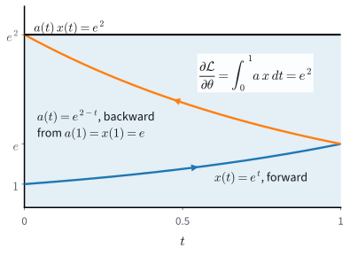
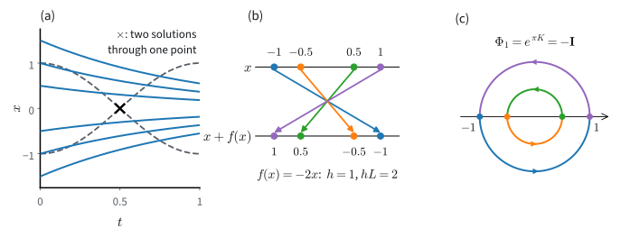
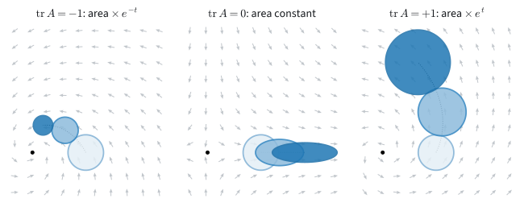

# Neural ODEs, Adjoints, and Continuous Flows
:label:`sec_mdl-neural-odes-cnf`

A residual block adds a correction to its input, and so does a step of
Euler's method (:numref:`sec_mdl-euler-runge-kutta`). If a residual network
(:numref:`sec_resnet`) is a numerical solution of a differential equation,
what do we gain by taking the equation itself as the model, and what does it
cost?

Generative modelling gives one answer. Maximum likelihood needs the density
of what a model produces. A normalizing flow is a network that can be
inverted, so that this density follows from the change-of-variables formula.
The formula asks for the determinant of the network's Jacobian at every
sample, a matrix with $3072$ rows for a colour image of $32\times32$ pixels.
In continuous time the determinant turns into a trace, and the trace can be
estimated with one backward pass.

A *Neural ODE* :cite:`Chen.Rubanova.Bettencourt.ea.2018` takes the equation
itself as the model: a differential equation
$\dot{\mathbf{x}}=\mathbf{f}_{\boldsymbol\theta}(\mathbf{x},t)$ whose field
is a network and whose solution at a final time is the output. Training it
and computing its density each come down to integrating one more equation
beside the state. For training it is the *adjoint* equation, which optimal
control developed in the 1950s to ask how the cost of a trajectory changes
with its controls :cite:`Pontryagin.Boltyanskii.Gamkrelidze.ea.1962`. For
the density it is an integral of the Jacobian's trace.

Compared with a residual stack, the model gains an invertible map, a step
count that is no longer part of the model, a gradient that needs no stored
activations, and a computable density. Each gain has a catch, and this
section measures all four: a flow on the line cannot swap two points, a
trained field is tied to its solver, the gradient computed without stored
states drifts, and the cheap trace is noisy.

We train such a model through a solver, derive the adjoint, and follow a
density along the flow. The results to carry away are the adjoint equations
and the trace rule :eqref:`eq_mdl-ode-instant-cov`, on which the likelihoods
of diffusion models rest; a reader who wants only the second can begin at
:numref:`sec_mdl-continuous-normalizing-flows`. Nothing later builds on the
subsection on memory and drift.

```{.python .input #mdl-neural-odes-neural-odes-adjoints-and-continuous-flows-2}
#@tab mxnet
import math
import numpy as np
from mxnet import autograd, gluon, init, np as mnp, npx
from mxnet.gluon import nn
from d2l import mxnet as d2l
npx.set_np()
```

```{.python .input #mdl-neural-odes-neural-odes-adjoints-and-continuous-flows-2}
#@tab pytorch
import math
import numpy as np
import torch
from torch import nn
from torch.nn import functional as F
from d2l import torch as d2l
```

```{.python .input #mdl-neural-odes-neural-odes-adjoints-and-continuous-flows-2}
#@tab tensorflow
import math
import numpy as np
import tensorflow as tf
from d2l import tensorflow as d2l
```

```{.python .input #mdl-neural-odes-neural-odes-adjoints-and-continuous-flows-2}
#@tab jax
import math
import numpy as np
import jax
from jax import numpy as jnp
from flax import nnx
import optax
from d2l import jax as d2l
```

The cells below train through the Euler and RK4 steps of
:numref:`sec_mdl-euler-runge-kutta`: the loop `solve` takes $N$ of them, of
size $T/N$, and a negative $T$ runs the field backward. The check of the
adjoint, further down, uses the spiral $\mathbf A$, its start
$\mathbf{x}_0$ and the matrix exponential
$e^{\mathbf Cs}=\mathbf Ve^{\boldsymbol\Lambda s}\mathbf V^{-1}$ of
:numref:`sec_mdl-odes-solvers`.

```{.python .input #mdl-neural-odes-neural-odes-adjoints-and-continuous-flows-1}
rng = np.random.default_rng()
A = np.array([[-0.5, -1.0], [1.0, -0.5]])      # spiral sink: eigenvalues -0.5 +- i
x0 = np.array([2.0, 0.0])

def expm_eig(C, s):
    """e^{Cs} via the eigendecomposition C = V diag(mu) V^{-1}."""
    mu, V = np.linalg.eig(C)
    return (V @ np.diag(np.exp(mu * s)) @ np.linalg.inv(V)).real

def euler_step(f, x, h):
    """One forward-Euler step of size h for dx/dt = f(x)."""
    return x + h * f(x)

def rk4_step(f, x, h):
    """One classical Runge-Kutta step of size h for dx/dt = f(x)."""
    k1 = f(x)
    k2 = f(x + h / 2 * k1)
    k3 = f(x + h / 2 * k2)
    k4 = f(x + h * k3)
    return x + h / 6 * (k1 + 2 * k2 + 2 * k3 + k4)

def solve(step, f, x, T, N):
    """N steps of size T/N from time 0 to time T; T < 0 runs the field backward."""
    for _ in range(N):
        x = step(f, x, T / N)
    return x
```

## Neural ODEs
:label:`sec_mdl-neural-odes`

A Neural ODE is what a residual network becomes when its depth turns into
time.

### From Residual Blocks to a Continuous Model

Set a residual block :cite:`He.Zhang.Ren.ea.2016` beside a forward-Euler
step of the ODE $\dot{\mathbf{x}}=\mathbf{f}(\mathbf{x},t)$:

$$
\mathbf{x}_{l+1}=\mathbf{x}_l+\mathbf{f}_{\boldsymbol\theta_l}(\mathbf{x}_l)
\qquad\textrm{and}\qquad
\mathbf{x}_{n+1}=\mathbf{x}_n+h\,\mathbf{f}(\mathbf{x}_n,t_n).
$$
:eqlabel:`eq_mdl-ode-resnet-euler`

With $h=1$ and $\mathbf{f}(\cdot,t_l)=\mathbf{f}_{\boldsymbol\theta_l}$ the
two updates are the same formula. A ResNet whose blocks have different
weights is therefore a time-dependent field sampled at the layer times and
integrated by Euler's method with unit steps
(:numref:`fig_mdl-dyn-resnet-as-euler` draws the case in which all blocks
share one field). Its horizon is its depth: ten blocks integrate the field
to time $10$.


:label:`fig_mdl-dyn-resnet-as-euler`

To take the limit, fix the horizon $T$, keep one parameter vector
$\boldsymbol\theta$ for all times, and let the steps shrink. In the language
of layers, the network grows deeper while each layer corrects less. (The
field may still depend on $t$: the network takes $t$ as an input, and that
is how one parameter vector serves blocks that differ.) With $N$ steps of
size $h=T/N$ at the times $t_n=nh$,

$$
\mathbf{x}_{n+1}=\mathbf{x}_n+h\,\mathbf{f}_{\boldsymbol\theta}(\mathbf{x}_n,t_n),
\qquad
\mathbf{x}_N\;\xrightarrow{\;N\to\infty\;}\;
\mathbf{x}(T)=\mathbf{x}_0+\int_0^T\mathbf{f}_{\boldsymbol\theta}(\mathbf{x}(t),t)\,dt .
$$
:eqlabel:`eq_mdl-ode-neural-ode`

The convergence is Euler's error bound from
:numref:`sec_mdl-euler-runge-kutta`: for a smooth field that is Lipschitz in
$\mathbf{x}$, the Euler iterate after $N$ steps is within $O(h)$ of the exact
solution. The **Neural ODE** is the limit object: the model whose output is
the solution $\mathbf{x}(T)$ of
$\dot{\mathbf{x}}=\mathbf{f}_{\boldsymbol\theta}(\mathbf{x},t)$ with
$\mathbf{x}(0)=\mathbf{x}_0$. The parameters define the field. The solver
(Euler, RK4, an adaptive method) is a choice made afterwards, which changes
the computed map, its cost and its error, but not the model.

The exact map and the computed map can differ in kind, not only in accuracy.
The field $\dot{x}=-x$ has the exact flow $\Phi_t(x)=e^{-t}x$, a bijection of
$\mathbb{R}$ for every $t$. One Euler step with $h=1$ computes
$x+1\cdot(-x)=0$ and maps every input to zero. The exact map, by contrast,
is a bijection whenever the field is continuous in $t$ and globally
Lipschitz in $\mathbf{x}$: running the field backward from $\mathbf{x}(T)$
is again a problem with exactly one solution, and that solution leads back
to the start (:numref:`sec_mdl-ode-existence-uniqueness`).

### Order Preservation on the Line
:label:`subsec_mdl-flow-order`

Invertibility is a gain, but it is also a constraint. Is a Neural ODE at
least as expressive as the residual stack it came from? On the real line it
is not, and a picture shows why. In the $(t,x)$ plane, trajectories
of a Lipschitz field never cross. Two trajectories that swapped $-1$ and $1$
would have to meet on the way (panel (a) of :numref:`fig_mdl-dyn-flow-order`).


:label:`fig_mdl-dyn-flow-order`

**Proposition (flows on $\mathbb{R}$ preserve order).** *Let $f(x,t)$ be
continuous in $t$ and globally Lipschitz in $x$, and write $\Phi_t(x)$ for
the solution at time $t$ started from $x$ at time $0$. Then for every $T>0$
the map $\Phi_T$ is strictly increasing.*

**Proof.** Let $x<y$ and suppose $\Phi_T(x)\ge\Phi_T(y)$. The function
$g(t)=\Phi_t(y)-\Phi_t(x)$ is continuous with $g(0)>0$ and $g(T)\le0$, so by
the intermediate value theorem $g(s)=0$ for some $s\in(0,T]$: the two
trajectories meet at time $s$ at a point $z$. Now run time backward from $s$.
Both reversed trajectories $\tau\mapsto\Phi_{s-\tau}(x)$ and
$\tau\mapsto\Phi_{s-\tau}(y)$ solve the same initial-value problem
$\dot{w}=-f(w,s-\tau)$, $w(0)=z$, whose field is again Lipschitz. By
Picard--Lindelöf that problem has only one solution, so the two reversed
trajectories coincide, and at $\tau=s$ this says $x=y$, a contradiction.
$\blacksquare$

The proof has one idea, to apply uniqueness backward from the meeting time.
As a consequence, no Neural ODE on $\mathbb{R}$ realizes $x\mapsto-x$: that
map sends $-1$ to $1$ and $1$ to $-1$, which reverses their order.

The residual block $x+f(x)$ with $f(x)=-2x$ does realize it, in one step
(panel (b) of :numref:`fig_mdl-dyn-flow-order`). That block is the Euler
step with $h=1$ of $\dot{x}=-2x$, whose exact flow $e^{-2t}x$ never reverses
order. The two statements agree because one Euler step $x+hf(x)$ of a field
with Lipschitz constant $L$ is guaranteed to be increasing when $hL<1$: for
$x>y$,

$$
\big(x+hf(x)\big)-\big(y+hf(y)\big)\;\ge\;(x-y)-hL\,(x-y)\;=\;(1-hL)(x-y),
$$

which is positive when $hL<1$. Here $hL=2$, so the step may reverse order.
A finite step is not a flow, and the proposition does not constrain it.

One more dimension removes the obstruction. The rotation field
$\dot{\mathbf{x}}=\mathbf K\mathbf{x}$ of :numref:`sec_mdl-odes-solvers`,
with $\mathbf K=\left(\begin{smallmatrix}0&-1\\1&0\end{smallmatrix}\right)$,
has the flow $e^{s\mathbf K}=\cos s\,\mathbf{I}+\sin s\,\mathbf K$, which
turns the plane by the angle $s$. Run $\pi$ times as fast, as
$\dot{\mathbf{x}}=\pi \mathbf K\mathbf{x}$, it has the time-one map

$$
\Phi_1=e^{\pi \mathbf K}=\cos\pi\,\mathbf{I}+\sin\pi\,\mathbf K=-\mathbf{I}.
$$

It carries $(x,0)$ to $(-x,0)$ along half circles, and trajectories pass each
other in the plane without meeting (panel (c) of :numref:`fig_mdl-dyn-flow-order`).
Adding dimensions in this way is called *augmentation*
:cite:`Dupont.Doucet.Teh.2019`: the input $x$ is embedded as $(x,0)$, the
flow runs in the plane, and the first coordinate is read out. A flow is a
continuous rearrangement of space, and on a line there is no room for two
points to pass.

### Training Through the Solver

The forward pass of a Neural ODE is a loop of $N$ solver steps. The direct
way to train it is to *discretize, then differentiate*: write the solver into
the computation graph, compute the loss on $\mathbf{x}_N$, and backpropagate
through the unrolled steps. With Euler as the solver the program is a ResNet
of $N$ blocks that share one set of weights, so ordinary automatic
differentiation trains it.

Let us try this on a task that is deliberately easy: carry $64$ points of
the unit circle to the matching points of the ellipse centred at $(1.5,0)$
with semi-axes $1.2$ and $0.4$, a stretch and a shift. The exact flow of the
affine field
$\dot{\mathbf{x}}=\mathrm{diag}(\ln1.2,\ln0.4)\,\mathbf{x}+\mathbf{c}$ does
this without error for a suitable $\mathbf{c}$, so whatever error we find
will not be for want of a solution. Will the trained field still reach the
targets when it is integrated accurately, or only with the ten steps it was
trained with? In the first case training has found a flow, in the second
only a ten-step program.

The field has one hidden layer of $32$ tanh units, the loss is the mean
squared error at the endpoints, and Adam
(:numref:`sec_mdl-adaptive-stochastic-methods`) runs full-batch iterations
$0$ to $400$ at learning rate $0.05$, lowered to $0.005$ for the last
hundred. We train twice from the same initial weights: once through $N=10$
Euler steps of size $h=0.1$, and once through ten steps of RK4, which
evaluates the field four times per step.

```{.python .input #mdl-neural-odes-training-through-the-solver-2}
angle = np.linspace(0, 2 * np.pi, 64, endpoint=False)
X0_ring = np.stack([np.cos(angle), np.sin(angle)], axis=1)            # circle
X1_ring = np.stack([1.5 + 1.2 * np.cos(angle), 0.4 * np.sin(angle)], axis=1)
solvers = {'Euler': euler_step, 'RK4': rk4_step}
seed = int(rng.integers(2**31))                # one initialization for both solvers
```

```{.python .input #odes-solvers-neural-ode-train}
#@tab pytorch
X, Y = torch.tensor(X0_ring).float(), torch.tensor(X1_ring).float()

def train(name, step, seed):
    """Fit the field through 10 steps of one solver, from the given seed."""
    torch.manual_seed(seed)
    net = nn.Sequential(nn.Linear(2, 32), nn.Tanh(), nn.Linear(32, 2))
    for layer in net[::2]:                     # Glorot-uniform weights, zero biases
        nn.init.xavier_uniform_(layer.weight)
        nn.init.zeros_(layer.bias)
    opt = torch.optim.Adam(net.parameters(), lr=0.05)
    sched = torch.optim.lr_scheduler.MultiStepLR(opt, [300], 0.1)  # 0.005 from 300
    losses = []
    for it in range(401):
        loss = ((solve(step, net, X, 1.0, 10) - Y) ** 2).mean()
        opt.zero_grad()
        loss.backward()
        opt.step()
        sched.step()
        if it % 200 == 0:
            losses.append(loss.item())
    print(f'{name}-trained: loss', ', '.join(f'{l:.1e}' for l in losses),
          'at iterations 0, 200, 400')
    return net

trained = {name: train(name, step, seed) for name, step in solvers.items()}
```

```{.python .input #odes-solvers-neural-ode-train}
#@tab mxnet
X, Y = mnp.array(X0_ring, dtype='float32'), mnp.array(X1_ring, dtype='float32')

def train(name, step, seed):
    """Fit the field through 10 steps of one solver, from the given seed."""
    npx.random.seed(seed)
    net = nn.HybridSequential()
    net.add(nn.Dense(32, activation='tanh'), nn.Dense(2))
    net.initialize(init.Xavier())              # Glorot-uniform weights, zero biases
    net.hybridize()
    trainer = gluon.Trainer(net.collect_params(), 'adam', {'learning_rate': 0.05})
    losses = []
    for it in range(401):
        if it == 300:
            trainer.set_learning_rate(0.005)   # tenfold smaller for the last 100
        with autograd.record():
            loss = ((solve(step, net, X, 1.0, 10) - Y) ** 2).mean()
        loss.backward()
        trainer.step(1)
        if it % 200 == 0:
            losses.append(float(loss))
    print(f'{name}-trained: loss', ', '.join(f'{l:.1e}' for l in losses),
          'at iterations 0, 200, 400')
    return net

trained = {name: train(name, step, seed) for name, step in solvers.items()}
```

```{.python .input #odes-solvers-neural-ode-train}
#@tab tensorflow
X, Y = tf.constant(X0_ring, tf.float32), tf.constant(X1_ring, tf.float32)

def train(name, step, seed):
    """Fit the field through 10 steps of one solver, from the given seed."""
    tf.keras.utils.set_random_seed(seed)
    net = tf.keras.Sequential([tf.keras.layers.Dense(32, activation='tanh'),
                               tf.keras.layers.Dense(2)])  # Glorot-uniform, zero biases
    lr = tf.keras.optimizers.schedules.PiecewiseConstantDecay([299], [0.05, 0.005])
    opt = tf.keras.optimizers.Adam(learning_rate=lr)  # 0.005 from iteration 300

    @tf.function
    def train_step():
        with tf.GradientTape() as tape:
            loss = tf.reduce_mean((solve(step, net, X, 1.0, 10) - Y) ** 2)
        opt.apply_gradients(zip(tape.gradient(loss, net.trainable_variables),
                                net.trainable_variables))
        return loss

    losses = []
    for it in range(401):
        loss = train_step()
        if it % 200 == 0:
            losses.append(float(loss))
    print(f'{name}-trained: loss', ', '.join(f'{l:.1e}' for l in losses),
          'at iterations 0, 200, 400')
    return tf.function(net)                    # a compiled field evaluates faster

trained = {name: train(name, step, seed) for name, step in solvers.items()}
```

```{.python .input #odes-solvers-neural-ode-train}
#@tab jax
X, Y = jnp.array(X0_ring), jnp.array(X1_ring)
k1, k2 = jax.random.split(jax.random.key(seed))
glorot = jax.nn.initializers.glorot_uniform()  # Glorot-uniform weights, zero biases
params0 = {'W1': glorot(k1, (2, 32)), 'b1': jnp.zeros(32),
           'W2': glorot(k2, (32, 2)), 'b2': jnp.zeros(2)}
opt = optax.adam(optax.piecewise_constant_schedule(0.05, {300: 0.1}))

def net(params, X):
    return jnp.tanh(X @ params['W1'] + params['b1']) @ params['W2'] + params['b2']

def flow(params, step, X, T, N):
    """solve() as a fori_loop: N steps of size T/N along the field net(params)."""
    f = lambda x: net(params, x)
    return jax.lax.fori_loop(0, N, lambda n, X: step(f, X, T / N), X)

@jax.jit(static_argnames='step')
def train_step(params, opt_state, step):
    loss, grads = jax.value_and_grad(
        lambda p: ((flow(p, step, X, 1.0, 10) - Y) ** 2).mean())(params)
    updates, opt_state = opt.update(grads, opt_state)
    return optax.apply_updates(params, updates), opt_state, loss

def train(name, step):
    """Fit the field through 10 steps of one solver, from the shared params0."""
    params, opt_state, losses = params0, opt.init(params0), []
    for it in range(401):
        params, opt_state, loss = train_step(params, opt_state, step)
        if it % 200 == 0:
            losses.append(float(loss))
    print(f'{name}-trained: loss', ', '.join(f'{l:.1e}' for l in losses),
          'at iterations 0, 200, 400')
    return params

trained = {name: train(name, step) for name, step in solvers.items()}
```

Both losses fall from order one to below $10^{-5}$. Judged by the loss they
were trained on, the two fields are equally good.

Two tests follow. The first puts our question directly: integrate each
trained field with its own solver at $N=100$ and $N=1000$ steps ($Nh=1$
throughout). The larger $N$, the closer the computed map is to the exact
time-one flow of the field. Before running the cell, guess what this does to
the two endpoint errors. The second test is about invertibility, the first
gain on our list. Take the Euler-trained field forward $N$ steps and then
backward $N$ steps, and measure how far the round trip lands from where it
started. An exact flow would return every point to its start.

```{.python .input #mdl-neural-odes-training-through-the-solver-1}
#@tab pytorch
dist = lambda P, Q: torch.linalg.vector_norm(P - Q, dim=1).mean().item()
print('   N   Euler-trained   RK4-trained   Euler round trip')
with torch.inference_mode():
    for N in (10, 100, 1000):
        err = [dist(solve(solvers[k], trained[k], X, 1.0, N), Y) for k in solvers]
        fwd = solve(euler_step, trained['Euler'], X, 1.0, N)
        back = solve(euler_step, trained['Euler'], fwd, -1.0, N)
        print(f'{N:4d}   {err[0]:13.1e}   {err[1]:11.1e}   {dist(back, X):16.1e}')
```

```{.python .input #mdl-neural-odes-training-through-the-solver-1}
#@tab mxnet
dist = lambda P, Q: float(mnp.sqrt(((P - Q) ** 2).sum(axis=1)).mean())
print('   N   Euler-trained   RK4-trained   Euler round trip')
for N in (10, 100, 1000):
    err = [dist(solve(solvers[k], trained[k], X, 1.0, N), Y) for k in solvers]
    fwd = solve(euler_step, trained['Euler'], X, 1.0, N)
    back = solve(euler_step, trained['Euler'], fwd, -1.0, N)
    print(f'{N:4d}   {err[0]:13.1e}   {err[1]:11.1e}   {dist(back, X):16.1e}')
```

```{.python .input #mdl-neural-odes-training-through-the-solver-1}
#@tab tensorflow
dist = lambda P, Q: float(tf.reduce_mean(tf.norm(P - Q, axis=1)))
print('   N   Euler-trained   RK4-trained   Euler round trip')
for N in (10, 100, 1000):
    err = [dist(solve(solvers[k], trained[k], X, 1.0, N), Y) for k in solvers]
    fwd = solve(euler_step, trained['Euler'], X, 1.0, N)
    back = solve(euler_step, trained['Euler'], fwd, -1.0, N)
    print(f'{N:4d}   {err[0]:13.1e}   {err[1]:11.1e}   {dist(back, X):16.1e}')
```

```{.python .input #mdl-neural-odes-training-through-the-solver-1}
#@tab jax
dist = lambda P, Q: float(jnp.linalg.norm(P - Q, axis=1).mean())
print('   N   Euler-trained   RK4-trained   Euler round trip')
for N in (10, 100, 1000):
    err = [dist(flow(trained[k], solvers[k], X, 1.0, N), Y) for k in solvers]
    fwd = flow(trained['Euler'], euler_step, X, 1.0, N)
    back = flow(trained['Euler'], euler_step, fwd, -1.0, N)
    print(f'{N:4d}   {err[0]:13.1e}   {err[1]:11.1e}   {dist(back, X):16.1e}')
```

Take the round trip first, in the last column. It misses its start by about
$0.055$ at $N=10$, $0.0055$ at $N=100$ and $0.00055$ at $N=1000$, tenfold
less per tenfold more steps. Each pair of a forward and a backward Euler step
leaves a residual of order $h^2$, and $N$ of them add up to $O(h)$, Euler's
order. Running the field backward undoes the exact flow. It undoes the
Euler program only in the limit $h\to0$. An Euler program with $hL<1$ does
have an inverse, since each of its steps is then a bijection (Exercise
:exref:`ex_mdl-odes-solvers-residual-logdet`). But that inverse is made of
implicit steps, not of Euler steps with $-h$.

Now the endpoint errors. At the training step count both fields land within
a few thousandths of their targets. Surprisingly, finer steps make the
Euler-trained field worse: its error *rises* to about $0.02$ and then stops
changing. Training fitted the ten-step program. The exact time-one flow of
that field, which $N=1000$ approximates, lands $0.02$ from the targets,
under $2\%$ of the ellipse's long semi-axis: the field defines a flow close
to its ten-step program, not equal to it.

The RK4-trained field prints the same error at ten, a hundred and a
thousand steps. Ten RK4 steps already compute the flow of so smooth a field
to the digits shown, so fitting the program fitted the flow, and the step
count is free after training. A field trained through a crude solver is a
program; a field trained through an accurate one is a flow.

The accuracy has to be supplied in every iteration, however. Training
through RK4 evaluates the field forty times per iteration and backpropagates
through all forty evaluations; training through Euler, ten times. A hundred
Euler steps or a second-order solver would change the count and nothing else.
The alternative is to take the solver out of training altogether: fit the
field by regression onto targets that are known in closed form, at one field
evaluation per example, so that what is fitted is a flow from the start. This
is how :numref:`sec_mdl-score-matching-diffusion-flow` and
:numref:`sec_mdl-flow-matching-transport` learn their fields.

## The Adjoint Method
:label:`sec_mdl-adjoint-method`

Training gave us the gradient of the ten-step program, and the program and
the flow turned out to be different maps. Are their gradients different too?
And can the gradient of the flow be computed at all, when no finite program
computes the flow?

It can, by an idea that reverse-mode differentiation already contains.
Reverse mode carries the derivative of the loss with respect to a layer's
activations backward from layer to layer;
:numref:`subsec_mdl-backpropagation` called it the adjoint of a node. The
adjoint method carries the same quantity backward through time, with one
node $\mathbf{x}(t)$ for every instant. Its central object is the
*adjoint state* $\mathbf{a}(t)=\partial\mathcal{L}/\partial\mathbf{x}(t)$,
the gradient of the loss with respect to the state at time $t$, and it
turns out to obey a linear differential equation of its own.

### The Scalar Case

Before the general statement we work one example to the end, an example in
which every quantity has a closed form. Take $\dot{x}=\theta x$ with
$x(0)=x_0$ and the loss $\mathcal{L}=\tfrac12x(T)^2$ on the endpoint.
Directly,
$x(T)=e^{\theta T}x_0$, so $\partial x(T)/\partial\theta=T\,x(T)$ and

$$
\frac{\partial\mathcal{L}}{\partial\theta}=x(T)\,\frac{\partial x(T)}{\partial\theta}=T\,x(T)^2 .
$$

With $\theta=T=x_0=1$ this is $e^2=7.389$.

The adjoint reaches the same number by another route. A nudge $\delta$ to
the state at time $t$ grows to $e^{\theta(T-t)}\delta$ by time $T$ and
changes the loss by $x(T)\,e^{\theta(T-t)}\delta$, so
$a(t)=e^{\theta(T-t)}x(T)$. This adjoint solves the ODE $\dot{a}=-\theta a$
backward from the final value $a(T)=x(T)$, which is the derivative of the
loss $\ell(x)=\tfrac12x^2$ at $x(T)$. A change $\delta\theta$ of the
parameter alters the velocity by $x(t)\,\delta\theta$ at every instant,
since $\partial f/\partial\theta=x$, and the adjoint converts each of these
nudges into a change of the loss. Summing over time,

$$
\int_0^T a(t)\,\frac{\partial f}{\partial\theta}\,dt
=\int_0^T e^{\theta(T-t)}x(T)\;e^{\theta t}x_0\,dt
=\int_0^T x(T)^2\,dt
=T\,x(T)^2 .
$$
:eqlabel:`eq_mdl-ode-scalar-adjoint`

The integrand is constant: $x$ grows forward, $a$ shrinks by the same factor
when read forward, and their product stays at $x(T)^2$
(:numref:`fig_mdl-dyn-adjoint-timeline`). The gradient is the area under it.


:label:`fig_mdl-dyn-adjoint-timeline`

### The Adjoint Equations

The general case keeps the shape of the scalar one: an adjoint that runs
backward from the gradient of the loss, and a parameter gradient that
integrates the adjoint against $\partial\mathbf{f}/\partial\boldsymbol\theta$.

**Proposition (the adjoint equations).** *Let $\mathbf{f}$ be continuously
differentiable in $\mathbf{x}$ and $\boldsymbol\theta$, let $\mathbf{x}(t)$
solve $\dot{\mathbf{x}}=\mathbf{f}(\mathbf{x},\boldsymbol\theta,t)$ (the
field $\mathbf{f}_{\boldsymbol\theta}$, with its parameters written as an
argument) on $[0,T]$ from a fixed $\mathbf{x}(0)$, and let
$\mathcal{L}=\ell(\mathbf{x}(T))$ for a differentiable $\ell$. Then the
adjoint state satisfies the linear ODE*

$$
\dot{\mathbf{a}}(t) = -\left(\frac{\partial \mathbf{f}}{\partial \mathbf{x}}\right)^{\!\top}\! \mathbf{a}(t),
\qquad
\mathbf{a}(T) = \nabla \ell(\mathbf{x}(T)),
$$
:eqlabel:`eq_mdl-ode-adjoint`

*integrated backward from $T$, and the parameter gradient is the integral*

$$
\frac{\partial \mathcal{L}}{\partial \boldsymbol\theta}
= \int_0^T \left(\frac{\partial \mathbf{f}}{\partial \boldsymbol\theta}\right)^{\!\top}\! \mathbf{a}(t)\, dt,
$$
:eqlabel:`eq_mdl-ode-adjoint-grad`

*with both partial derivatives evaluated along the trajectory
$(\mathbf{x}(t),\boldsymbol\theta,t)$* :cite:`Chen.Rubanova.Bettencourt.ea.2018`.

**Proof (variational).** Perturb the parameters by an infinitesimal
$\delta\boldsymbol\theta$. Because $\mathbf{f}$ is $C^1$, the solution is
differentiable in $\boldsymbol\theta$, and the first-order perturbation
$\delta\mathbf{x}(t)$ of the trajectory obeys the *linearization* of the
dynamics (differentiate the ODE in $\boldsymbol\theta$ and use the chain
rule):

$$
\delta\dot{\mathbf{x}}
= \frac{\partial \mathbf{f}}{\partial \mathbf{x}}\,\delta\mathbf{x}
+ \frac{\partial \mathbf{f}}{\partial \boldsymbol\theta}\,\delta\boldsymbol\theta,
\qquad
\delta\mathbf{x}(0) = \mathbf{0}.
$$

Define $\mathbf{a}(t)$ by the backward ODE :eqref:`eq_mdl-ode-adjoint` and
differentiate the pairing $\mathbf{a}^\top\delta\mathbf{x}$:

$$
\frac{d}{dt}\left(\mathbf{a}^\top \delta\mathbf{x}\right)
= \dot{\mathbf{a}}^\top \delta\mathbf{x} + \mathbf{a}^\top \delta\dot{\mathbf{x}}
= -\mathbf{a}^\top \frac{\partial \mathbf{f}}{\partial \mathbf{x}}\,\delta\mathbf{x}
+ \mathbf{a}^\top \frac{\partial \mathbf{f}}{\partial \mathbf{x}}\,\delta\mathbf{x}
+ \mathbf{a}^\top \frac{\partial \mathbf{f}}{\partial \boldsymbol\theta}\,\delta\boldsymbol\theta
= \mathbf{a}^\top \frac{\partial \mathbf{f}}{\partial \boldsymbol\theta}\,\delta\boldsymbol\theta .
$$

The state-coupling terms cancel, and the adjoint ODE was defined so that
they would. Integrate from $0$ to $T$, using
$\delta\mathbf{x}(0)=\mathbf{0}$ at the left endpoint:

$$
\mathbf{a}(T)^\top \delta\mathbf{x}(T)
= \int_0^T \mathbf{a}(t)^\top \frac{\partial \mathbf{f}}{\partial \boldsymbol\theta}\, dt \;\delta\boldsymbol\theta .
$$

The left side is $\nabla\ell(\mathbf{x}(T))^\top\delta\mathbf{x}(T)=\delta\mathcal{L}$,
the first-order change of the loss; the right side is linear in
$\delta\boldsymbol\theta$ with coefficient :eqref:`eq_mdl-ode-adjoint-grad`.
It remains to identify $\mathbf{a}$ with the adjoint state. Run the same
argument with $\delta\boldsymbol\theta=\mathbf{0}$ and a nudge
$\delta\mathbf{x}(s)$ injected at time $s$: the pairing
$\mathbf{a}^\top\delta\mathbf{x}$ is then constant on $[s,T]$, so
$\delta\mathcal{L}=\mathbf{a}(T)^\top\delta\mathbf{x}(T)=\mathbf{a}(s)^\top\delta\mathbf{x}(s)$,
and the solution of :eqref:`eq_mdl-ode-adjoint` is
$\partial\mathcal{L}/\partial\mathbf{x}(s)$. $\blacksquare$

The backward ODE is linear in $\mathbf{a}$, with the transposed Jacobian as
its matrix. Each of its steps computes
$\mathbf{a}^\top\partial\mathbf{f}/\partial\mathbf{x}$, one vector--Jacobian
product, which costs one reverse-mode pass through $\mathbf{f}$
(:numref:`sec_mdl-matrix-calculus-autodiff`). The same pass returns
$(\partial\mathbf{f}/\partial\boldsymbol\theta)^\top\mathbf{a}$, the
integrand of the parameter gradient, however many parameters there are. (A
ReLU field is only piecewise $C^1$, so the proposition does not cover it,
although automatic differentiation still differentiates the unrolled solver
piece by piece. Smooth activations such as tanh or GELU satisfy the
hypothesis.)

### Backpropagation as the Discrete Adjoint

Backpropagation through the Euler program can now be set beside the adjoint
ODE, line by line. To keep the formulas short, let the field be autonomous
and write $\mathbf J=\partial\mathbf{f}/\partial\mathbf{x}$ for its
Jacobian. Differentiate the program
$\mathbf{x}_{n+1}=\mathbf{x}_n+h\,\mathbf{f}(\mathbf{x}_n,\boldsymbol\theta)$
by the chain rule, with $\mathbf{a}_n=\partial\mathcal{L}/\partial\mathbf{x}_n$.
The Jacobian of one step is $\mathbf{I}+h\mathbf J(\mathbf{x}_n)$, so

$$
\mathbf{a}_n=\big(\mathbf{I}+h\mathbf J(\mathbf{x}_n)\big)^{\!\top}\mathbf{a}_{n+1},
\qquad
\mathbf{a}_N=\nabla\ell(\mathbf{x}_N),
\qquad
\frac{\partial\mathcal{L}}{\partial\boldsymbol\theta}
=\sum_{n=0}^{N-1}h\left(\frac{\partial\mathbf{f}}{\partial\boldsymbol\theta}(\mathbf{x}_n)\right)^{\!\top}\mathbf{a}_{n+1}.
$$
:eqlabel:`eq_mdl-ode-discrete-adjoint`

Compare this with one explicit Euler step of the adjoint ODE
:eqref:`eq_mdl-ode-adjoint` from $t_{n+1}$ back to $t_n$:

$$
\mathbf{a}_n=\mathbf{a}_{n+1}+h\,\mathbf J(\mathbf{x}_{n+1})^\top\mathbf{a}_{n+1}.
$$

The two updates differ only in where the Jacobian is evaluated: at the start
$\mathbf{x}_n$ of the forward step or at its end $\mathbf{x}_{n+1}$. The sum in
:eqref:`eq_mdl-ode-discrete-adjoint` is a rectangle rule for the integral
:eqref:`eq_mdl-ode-adjoint-grad`. So backpropagation through a solver is a
*discrete adjoint*, and a solver applied to the adjoint ODE is the
*continuous adjoint*, discretized. The literature calls the two routes
discretize-then-optimize, which is the "discretize, then differentiate" of
our training run, and optimize-then-discretize :cite:`Kidger.2022`. The
first is the exact gradient of the program, the second approximates the
gradient of the flow, and for Euler the two gradients differ at first order
in $h$. Of everything in this subsection, this is the statement to keep.

The scalar example shows both gradients at once. For $\dot{x}=\theta x$
the Euler program is $x_N=(1+h\theta)^Nx_0$, so
$\partial x_N/\partial\theta=Nh(1+h\theta)^{N-1}x_0=T\,x_N/(1+h\theta)$ and
the discrete adjoint gives
$\partial\mathcal{L}/\partial\theta=T\,x_N^2/(1+h\theta)$. With
$\theta=T=x_0=1$ this is $6.116$ at $N=10$, $7.244$ at $N=100$ and $7.374$
at $N=1000$, against the exact $e^2=7.389$. The gaps $1.27$, $0.145$ and
$0.0148$ shrink tenfold per tenfold $N$.

The spiral field of :numref:`sec_mdl-odes-solvers`, $\dot{\mathbf{x}}=\mathbf A\mathbf{x}$
with $\mathbf A=\left(\begin{smallmatrix}-0.5&-1\\1&-0.5\end{smallmatrix}\right)$,
gives the same check in two dimensions with every ingredient in closed form.
For a linear field the Jacobian is $\mathbf A$ at every point, so the two
recursions displayed above are one and the same. What is left to measure is
the error that both have against the flow, where the states, the adjoint
and the sum are all Euler's.

Take $\boldsymbol\theta$ to be the entries of $\mathbf A$ and
$\mathcal{L}=\tfrac12\|\mathbf{x}(T)\|^2$. The trajectory is
$e^{\mathbf At}\mathbf{x}_0$, the adjoint is
$\mathbf{a}(t)=e^{\mathbf A^\top(T-t)}\mathbf{x}(T)$ (the solution of
$\dot{\mathbf{a}}=-\mathbf A^\top\mathbf{a}$), and since
$\partial\mathbf{f}/\partial A_{ij}=x_j\mathbf{e}_i$, the gradient
:eqref:`eq_mdl-ode-adjoint-grad` becomes
$\partial\mathcal{L}/\partial \mathbf A=\int_0^T\mathbf{a}(t)\,\mathbf{x}(t)^\top dt$.

The cell writes the backward sweep :eqref:`eq_mdl-ode-discrete-adjoint` by
hand, for $T=2$. Its first line of output tests the sweep against central
finite differences of the same program at $N=1000$ steps, which tells us
only that the sweep is coded correctly. The distance that matters is the
one to the gradient of the exact flow. For it the cell evaluates the
continuous adjoint integral by the trapezoid rule on $2000$ intervals, with
$\mathbf{a}$ and $\mathbf{x}$ from the matrix exponential, and compares it
with the discrete adjoint at three step counts.

```{.python .input #mdl-neural-odes-backpropagation-as-the-discrete-adjoint-1}
def loss_and_grad_unrolled(A, x0, T, N):
    """L = ||x_N||^2 / 2 through N unrolled Euler steps; dL/dA by hand-written
    reverse mode, the discrete adjoint."""
    h, xs = T / N, [x0]
    for _ in range(N):
        xs.append(xs[-1] + h * (A @ xs[-1]))   # forward sweep, tape the states
    a, gA = xs[-1].copy(), np.zeros_like(A)    # a_N = dL/dx_N = x_N
    for n in range(N - 1, -1, -1):             # backward sweep: one VJP per step
        gA += h * np.outer(a, xs[n])           # dL/dA += h a_{n+1} x_n^T
        a = a + h * (A.T @ a)                  # a_n = (I + hA)^T a_{n+1}
    return 0.5 * xs[-1] @ xs[-1], gA

T = 2.0
loss = lambda A: loss_and_grad_unrolled(A, x0, T, 1000)[0]
g_fd = np.array([(loss(A + 1e-5 * E) - loss(A - 1e-5 * E)) / 2e-5
                 for E in np.eye(4).reshape(4, 2, 2)]).reshape(2, 2)
gap_fd = np.abs(loss_and_grad_unrolled(A, x0, T, 1000)[1] - g_fd).max()
print(f'N =  1000: |backward sweep - central differences| = {gap_fd:.1e}')
n_quad = 2000                                  # continuous adjoint, trapezoid rule
ts = np.linspace(0.0, T, n_quad + 1)
xT = expm_eig(A, T) @ x0
AX = np.stack([np.outer(expm_eig(A.T, T - s) @ xT, expm_eig(A, s) @ x0)
               for s in ts])                   # a(s) x(s)^T
g_cont = (T / n_quad) * (AX[1:-1].sum(axis=0) + 0.5 * (AX[0] + AX[-1]))
for N in (100, 1000, 10000):
    gap = np.abs(loss_and_grad_unrolled(A, x0, T, N)[1] - g_cont).max()
    print(f'N = {N:5d}: |discrete - continuous adjoint|     = {gap:.1e}')
```

The sweep matches the finite differences to about $10^{-10}$, the accuracy
of the differences themselves. Its gap to the gradient of the flow falls
from $2.9\times10^{-2}$ to $2.8\times10^{-3}$ to $2.8\times10^{-4}$, tenfold
per tenfold $N$, as in the scalar case.

### Memory and Drift

The adjoint ODE needs $\mathbf{x}(t)$ at every backward step, because the
Jacobian is evaluated there. There are two ways to supply it. Store the
forward states, as backpropagation does, which costs memory proportional to
$N$. Or re-integrate $\dot{\mathbf{x}}=\mathbf{f}$ backward from
$\mathbf{x}(T)$ alongside $\mathbf{a}$, which keeps the memory constant in
$N$ at the cost of one more field evaluation per step. The second option
sounds too good, and the smallest case shows why: it amplifies errors.

For $\dot{x}=-\lambda x$ with $\lambda>0$, the backward integration solves
$\dot{x}=+\lambda x$. An absolute error $\delta$ in the stored $x(T)$
therefore becomes $e^{\lambda T}\delta$ by the time it reaches $t=0$.

How large is $\delta$? Picture a state with two modes. One decays at the rate
$\lambda=50$, the fast rate of the stiff example of
:numref:`sec_mdl-stiffness-implicit`, and the other hardly moves. Let the
fast mode point along a diagonal, so that every coordinate contains some of
it. By time $T$ the fast mode has died out, the coordinates that are stored
are of size one, and double precision rounds each of them at about
$10^{-16}$. Rounding knows nothing of modes: part of the error lies along
the fast direction, so $\delta\approx10^{-16}$. The reconstructed start is
then off by $2.7\times10^{-11}$ at $T=0.25$, by $7\times10^{-6}$ at $T=0.5$
and by $5\times10^{5}$ at $T=1$, larger than the state itself. A double
carries about sixteen digits, and a factor of $e^{50}\approx5\times10^{21}$
is five digits more than it has. Exercise
:exref:`ex_mdl-odes-solvers-backward-reconstruction` measures this growth.

For the spiral, whose eigenvalues have real part $-0.5$, the factor over
$T=2$ is only $e$. A strongly contracting forward flow is a strongly
expanding backward one, so re-integration saves memory at the cost of drift.
For stiff fields *checkpointing* (:numref:`subsec_mdl-checkpointing`) is the
sturdier choice. It stores the state only at a few checkpoints and
recomputes the states in between forward from the checkpoint before them, so
nothing is ever integrated against the flow. With a checkpoint every
$\sqrt N$ steps the backward sweep holds about $2\sqrt N$ states, $63$
instead of $1000$ for $N=1000$, at the cost of one extra forward pass.

That makes three routes to a gradient. Which would we use? Backpropagation
through the solver, with checkpoints when memory is short: it returns the
exact gradient of the program that is actually run. The continuous adjoint
is what that gradient converges to, and the formula to reason with.
Re-integrating the state is a last resort, for fields that are not stiff.

## Continuous Normalizing Flows
:label:`sec_mdl-continuous-normalizing-flows`

A Neural ODE moves points. A generative model trained by maximum likelihood
must also say how probable each of its outputs is, so we now follow a
density along the flow.

### Density Along a Flow

Pushing samples through a flow turns it into a generator: draw
$\mathbf{x}(0)$ from a simple density $p_0$ and integrate. Training such a
generator by maximum likelihood needs the density of what comes out. A
*normalizing flow* is an invertible network trained in this way, and its
density follows from the change-of-variables formula of
:numref:`sec_mdl-joint-distributions`: for an invertible differentiable map
$\mathbf{g}$ with Jacobian $\mathbf J_{\mathbf{g}}$,

$$
\log p_{\textrm{out}}(\mathbf{g}(\mathbf{x}))
= \log p_{\textrm{in}}(\mathbf{x}) - \log \left|\det \mathbf J_{\mathbf{g}}(\mathbf{x})\right| .
$$
:eqlabel:`eq_mdl-ode-discrete-cov`

The log-density drops by the logarithm of the factor by which $\mathbf{g}$
stretches volume near $\mathbf{x}$. A normalizing flow built from many
layers needs one log-determinant per layer and sample. A general determinant
costs $O(d^3)$ operations, about $2\times10^{10}$ for the $d=3072$ of a
$32\times32$ colour image. Discrete flows therefore restrict their layers to
triangular Jacobians, whose determinant is the product of the diagonal, or
to identity-plus-low-rank Jacobians, such as
$\det(\mathbf{I}+\mathbf{u}\mathbf{v}^\top)=1+\mathbf{v}^\top\mathbf{u}$.
Both determinants cost $O(d)$.

In continuous time the formula simplifies. Start with one dimension.
The field $\dot{x}=\theta x$ on $\mathbb{R}$ has the flow
$\Phi_t(x)=e^{\theta t}x$, which stretches every interval by $e^{\theta t}$.
A density carried along is divided by the stretch, so
$\log p_t(x(t))=\log p_0(x_0)-\theta t$ and
$\tfrac{d}{dt}\log p_t(x(t))=-\theta$. The number $\theta$ is the
$1\times1$ Jacobian of the field, and therefore also its trace.

The spiral is the running example in two dimensions. Its flow
$e^{\mathbf At}=e^{-t/2}e^{t\mathbf K}$ is a rotation followed by a shrink
by $e^{-t/2}$ (:numref:`sec_mdl-odes-solvers`). A disc is carried to a disc
of $e^{-t/2}$ times its radius, so its area is multiplied by $e^{-t}$, and
the density along each trajectory rises by $e^{t}$. Here
$\operatorname{tr}\mathbf A=-1$, so the rate of change of the log-density is
again minus the trace. :numref:`fig_mdl-dyn-divergence-volume` draws this
beside a field that preserves area and one that expands it: the darkest
disc of the spiral, at $t=1.2$, has $e^{-1.2}\approx0.30$ of the area of the
lightest.


:label:`fig_mdl-dyn-divergence-volume`

### The Instantaneous Change of Variables

Both examples were linear, and in both the log-density changed at the rate
minus the trace. The general case needs one fact about determinants: over a
short step the flow map is close to the identity, and the determinant of a
matrix close to the identity is governed by its trace.

**Lemma.** *For any square matrix $\mathbf J$,
$\det(\mathbf{I}+h\mathbf J)=1+h\operatorname{tr}\mathbf J+O(h^2)$.*

**Proof.** The permutation formula
(:numref:`subsec_mdl-determinant-general`) writes the determinant as a
signed sum, over all permutations, of products with one entry from every
row and every column. Any permutation other than the identity picks at
least two off-diagonal entries, each of size $O(h)$, so it contributes
$O(h^2)$. The identity permutation contributes
$\prod_i(1+hJ_{ii})=1+h\sum_iJ_{ii}+O(h^2)$. $\blacksquare$

**Proposition (instantaneous change of variables).** *Let
$\dot{\mathbf{x}}=\mathbf{f}(\mathbf{x},t)$ with $\mathbf{f}$ continuously
differentiable in $(\mathbf{x},t)$ and globally Lipschitz in $\mathbf{x}$, so
that each flow map $\Phi_t$ is a $C^1$ bijection with a $C^1$ inverse (the
solution of a $C^1$ field is $C^1$ in its initial value
:cite:`Hairer.Norsett.Wanner.1993`, and the inverse runs the field
backward). Let $\mathbf{x}(0)\sim p_0$ for a positive differentiable density
$p_0$. Then the density $p_t$ of $\mathbf{x}(t)$ exists and is positive, and
along each trajectory* :cite:`Chen.Rubanova.Bettencourt.ea.2018`

$$
\frac{d}{dt} \log p_t(\mathbf{x}(t))
= -\operatorname{tr}\!\left(\frac{\partial \mathbf{f}}{\partial \mathbf{x}}\right)\!(\mathbf{x}(t), t).
$$
:eqlabel:`eq_mdl-ode-instant-cov`

**Proof.** The density exists by :eqref:`eq_mdl-ode-discrete-cov` applied to
the bijection $\Phi_t$, and it is positive because $p_0$ is and the Jacobian
of a map with a differentiable inverse is nonsingular. Over a short interval
the flow advances by the map
$\Phi_{t\to t+h}(\mathbf{x})=\mathbf{x}+\int_t^{t+h}\mathbf{f}(\mathbf{x}(s),s)\,ds$.
Differentiating in $\mathbf{x}$ and using the continuity of $\mathbf J$, its Jacobian
is $\mathbf{I}+h\mathbf J+o(h)$, where $\mathbf J=\partial\mathbf{f}/\partial\mathbf{x}$ is
evaluated at $(\mathbf{x}(t),t)$ and $o(h)$ stands for terms that vanish
faster than $h$. Apply :eqref:`eq_mdl-ode-discrete-cov` to this one map and
expand with the Lemma, which tolerates the perturbation: replacing $h\mathbf J$ by
$h\mathbf J+o(h)$ changes the determinant only by $o(h)$. For small $h$ the
determinant is close to $1$, hence positive, so the absolute value can be
dropped:

$$
\log p_{t+h}(\mathbf{x}(t+h))
= \log p_t(\mathbf{x}(t)) - \log\det\!\big(\mathbf{I} + h\mathbf J + o(h)\big)
= \log p_t(\mathbf{x}(t)) - h \operatorname{tr} \mathbf J + o(h),
$$

using $\log(1+u)=u+O(u^2)$. Subtract $\log p_t(\mathbf{x}(t))$, divide by
$h$, and let $h\to0$. $\blacksquare$

The hypotheses look heavier than they are. They ask only that every flow map
be a smooth bijection, which a field with smooth Lipschitz activations such
as tanh provides. The content of the proposition is the one line with the
trace.

The trace of the Jacobian is the *divergence* $\nabla\cdot\mathbf{f}$ of
the field, the local rate at which the flow expands volume. Where the field
spreads samples apart
($\operatorname{tr}\mathbf J>0$) the log-density along each trajectory falls,
and where it compresses them, it rises. Integrating
:eqref:`eq_mdl-ode-instant-cov` along a trajectory gives

$$
\log p_T(\mathbf{x}(T))
= \log p_0(\mathbf{x}(0)) - \int_0^T \operatorname{tr}\!\left(\frac{\partial \mathbf{f}}{\partial \mathbf{x}}\right) dt .
$$
:eqlabel:`eq_mdl-ode-cnf-likelihood`

The per-layer sum of log-determinants of a discrete flow has become an
integral of traces. A model that computes it, by integrating the pair
$(\mathbf{x},\log p)$ with any ODE solver, is a **continuous normalizing
flow** (CNF) :cite:`Chen.Rubanova.Bettencourt.ea.2018`. It needs no
restriction on the architecture of $\mathbf{f}$. To evaluate the density of
a given point $\mathbf{x}(T)$, integrate the field backward from it to
$\mathbf{x}(0)$, accumulate the trace on the way, and read off $p_0$ there.
Likelihoods of diffusion models are computed in this way
(:numref:`sec_diffusion-design-space`). Nothing in the formula prefers a
direction of time: the generators of
:numref:`sec_mdl-score-matching-diffusion-flow` and
:numref:`sec_mdl-flow-matching-transport` put the noise at the final time
and the data at $t=0$, and the same formula serves them.

For a linear field the trace integral is $t\operatorname{tr}\mathbf A$, and
:eqref:`eq_mdl-ode-cnf-likelihood` compared with
:eqref:`eq_mdl-ode-discrete-cov` for the map $e^{\mathbf At}$ says
$\log\det e^{\mathbf At}=t\operatorname{tr}\mathbf A$. For a diagonalizable
$\mathbf A=\mathbf V\boldsymbol\Lambda \mathbf V^{-1}$ the identity also
follows in one line from the eigenvalues,

$$
\det e^{\mathbf At}=\det\big(\mathbf Ve^{\boldsymbol\Lambda t}\mathbf V^{-1}\big)=\prod_je^{\Lambda_{jj}t}=e^{t\operatorname{tr}\mathbf A},
$$
:eqlabel:`eq_mdl-ode-jacobi`

and the comparison of the two formulas gives it for every $\mathbf A$.

The proposition follows one trajectory at a time. Stated for the whole
density at once, the same law is the continuity equation of fluid
mechanics, which :numref:`sec_mdl-fokker-planck-probability-flow` derives
together with the term that noise adds.

### Checking the Trace Integral

A linear field is a weak test of the proposition: its trace is constant,
and the integral is just $t\operatorname{tr}\mathbf A$. A nonlinear field
is a real one, because its trace changes along the path. Take the planar
field
$\mathbf{f}(\mathbf{x})=\mathbf W_2\tanh(\mathbf W_1\mathbf{x}+\mathbf{b}_1)$ with $8$ hidden
units and random weights. Its Jacobian and trace are explicit:

$$
\mathbf J=\mathbf W_2\,\mathrm{diag}(\mathbf{s})\,\mathbf W_1,
\qquad
\mathbf{s}=1-\tanh^2(\mathbf W_1\mathbf{x}+\mathbf{b}_1),
\qquad
\operatorname{tr}\mathbf J=\sum_is_i\,(\mathbf W_1\mathbf W_2)_{ii},
$$

using the cyclic property
$\operatorname{tr}\big(\mathbf W_2\,\mathrm{diag}(\mathbf{s})\,\mathbf W_1\big)=\operatorname{tr}\big(\mathrm{diag}(\mathbf{s})\,\mathbf W_1\mathbf W_2\big)$.
The cell integrates the pair
$(\mathbf{x},\int\operatorname{tr}\mathbf J\,dt)$ with RK4 to $T=1$ and
keeps the path. It prints the smallest and the largest trace met on the
way, and then compares the integral with $\log|\det D\Phi_T|$, where the
Jacobian $D\Phi_T$ of the flow map is computed from central finite
differences of the flow map itself.

```{.python .input #mdl-neural-odes-checking-the-trace-integral-1}
n_hidden = 8
W1, b1 = rng.standard_normal((n_hidden, 2)), rng.standard_normal(n_hidden)
W2 = rng.standard_normal((2, n_hidden)) / np.sqrt(n_hidden)
field = lambda x: W2 @ np.tanh(W1 @ x + b1)
trJ = lambda x: np.sum((1 - np.tanh(W1 @ x + b1) ** 2)
                       * np.einsum('ij,ji->i', W1, W2))
aug = lambda z: np.append(field(z[:2]), trJ(z[:2]))  # d/dt (x, int tr J)
xa, N = rng.standard_normal(2), 200
zs = [np.append(xa, 0.0)]                      # RK4 path of (x, int tr J)
for _ in range(N):
    zs.append(rk4_step(aug, zs[-1], 1.0 / N))
zT, tr_path = zs[-1], [trJ(z[:2]) for z in zs]
D = np.zeros((2, 2))                           # D Phi_1 by central differences
for j in range(2):
    e = np.zeros(2); e[j] = 1e-5
    D[:, j] = (solve(rk4_step, field, xa + e, 1.0, N)
               - solve(rk4_step, field, xa - e, 1.0, N)) / 2e-5
logdet = np.log(abs(np.linalg.det(D)))
print(f'tr J along the path: from {min(tr_path):+.3f} to {max(tr_path):+.3f}')
print(f'trace integral {zT[2]:+.6f}  log|det D Phi| {logdet:+.6f}  '
      f'gap {abs(zT[2] - logdet):.1e}')
```

The trace does move: the first line gives the interval that it covers along
the path. How wide the interval is depends on the draw of the weights. A
tenth or more is typical, and in some draws the interval contains zero, so
that the flow expands area on one stretch of the path and compresses it on
another. Yet the integral and the log-determinant agree to eight digits or
better, the accuracy of the solver and of the finite differences. Nothing in
the proposition used linearity.

### The Hutchinson Trace Estimator

The formula for $\operatorname{tr}\mathbf J$ above used the structure of a
one-layer field. For a general network the trace needs the $d$ diagonal
entries of $\mathbf J$, which cost $d$ reverse-mode passes, one per coordinate.
The trace has already replaced an $O(d^3)$ determinant by $d$ passes. A random
projection replaces the $d$ passes by one, and returns an unbiased but noisy
estimate :cite:`Hutchinson.1989`.

**Proposition (Hutchinson estimator).** *For any matrix
$\mathbf M\in\mathbb{R}^{d\times d}$ and any random vector
$\boldsymbol\epsilon\in\mathbb{R}^d$ with
$\mathbb{E}[\boldsymbol\epsilon\boldsymbol\epsilon^\top]=\mathbf{I}$, such as
a standard Gaussian or a Rademacher vector with independent entries $\pm1$ of
equal probability,*

$$
\operatorname{tr}(\mathbf M) = \mathbb{E}\!\left[\boldsymbol{\epsilon}^\top \mathbf M \boldsymbol{\epsilon}\right].
$$
:eqlabel:`eq_mdl-ode-hutchinson`

**Proof.** $\mathbb{E}[\boldsymbol\epsilon^\top \mathbf M\boldsymbol\epsilon]
=\mathbb{E}[\operatorname{tr}(\mathbf M\boldsymbol\epsilon\boldsymbol\epsilon^\top)]
=\operatorname{tr}(\mathbf M\,\mathbb{E}[\boldsymbol\epsilon\boldsymbol\epsilon^\top])
=\operatorname{tr}(\mathbf M)$, by the cyclic property of the trace and its
linearity, which lets it commute with the expectation. $\blacksquare$

The estimator touches $\mathbf J$ only through $\boldsymbol\epsilon^\top \mathbf J$, one
vector--Jacobian product, which is one reverse-mode pass through $\mathbf{f}$
with $\boldsymbol\epsilon$ as the seed; no Jacobian is formed. For the
one-hidden-layer field the product is explicit,

$$
\boldsymbol\epsilon^\top \mathbf J=\big((\boldsymbol\epsilon^\top \mathbf W_2)\odot\mathbf{s}\big)\,\mathbf W_1,
$$

and it costs about as much as evaluating $\mathbf{f}$. A CNF evaluates one
such product with every evaluation of the field, so the likelihood costs one
additional backward pass per field evaluation. This is the method that
:citet:`Grathwohl.Chen.Bettencourt.ea.2018` named FFJORD.

The proposition says that the average over probes converges to the trace.
It does not say how fast, and for a single probe that is the whole question.
With $\mathbf S=(\mathbf J+\mathbf J^\top)/2$, one Rademacher probe has
variance $2\sum_{i\ne j}S_{ij}^2$ and one Gaussian probe
$2\sum_{i,j}S_{ij}^2$, the same sum with the diagonal included
(Exercise :exref:`ex_mdl-odes-solvers-hutchinson-variance`). The trace sees
only the diagonal of $\mathbf J$, and the noise of a Rademacher probe only
what lies off it.

Let us try the estimator on a field in $d=50$ whose trace we can predict: a
random one-hidden-layer part with $64$ tanh units and a pull toward the
origin,
$\mathbf{f}(\mathbf{x})=\mathbf W_2\tanh(\mathbf W_1\mathbf{x}+\mathbf{b}_1)-\mathbf{x}$.
Its Jacobian is
$\mathbf W_2\,\mathrm{diag}(\mathbf{s})\,\mathbf W_1-\mathbf{I}$, so the
pull contributes $-50$ to the trace and the random part a number of order
one. The pull also adds $-\boldsymbol\epsilon^\top\boldsymbol\epsilon$ to
every estimate. For a Rademacher probe this is $-50$ exactly, and all the
noise comes from the random part. For a Gaussian probe
$\boldsymbol\epsilon^\top\boldsymbol\epsilon$ is itself random, and the two
variance formulas say what that costs. They differ by the diagonal term
$2\sum_iS_{ii}^2$, and here every $S_{ii}=J_{ii}$ is close to $-1$, so the
variance of a Gaussian probe should exceed that of a Rademacher probe by
about $2\cdot50=100$. The cell draws $m=1000$ probes of each kind and
computes each $\boldsymbol\epsilon^\top\mathbf J$ by reverse mode.

```{.python .input #mdl-neural-odes-the-hutchinson-trace-estimator-1}
d, n_hidden, m = 50, 64, 1000
W1 = rng.standard_normal((n_hidden, d)) / np.sqrt(d)
b1 = 0.1 * rng.standard_normal(n_hidden)
W2 = rng.standard_normal((d, n_hidden)) / np.sqrt(n_hidden)
x = rng.standard_normal(d)
s = 1 - np.tanh(W1 @ x + b1) ** 2
tr_tanh = np.sum(s * np.einsum('ij,ji->i', W1, W2))  # trace of W2 diag(s) W1
E = rng.choice([-1.0, 1.0], size=(m, d))         # Rademacher probes, one per row
E_gauss = rng.standard_normal((m, d))            # Gaussian probes, one per row
```

```{.python .input #mdl-neural-odes-the-hutchinson-trace-estimator-2}
#@tab pytorch
W1t, b1t, W2t = (torch.tensor(w) for w in (W1, b1, W2))
field = lambda x: W2t @ torch.tanh(W1t @ x + b1t) - x
_, vjp = torch.func.vjp(field, torch.tensor(x))      # reverse mode at x
for name, P in (('Rademacher', E), ('Gaussian', E_gauss)):
    P = torch.tensor(P)
    rows = torch.func.vmap(vjp)(P)[0]                # row k: eps_k^T J
    est = (rows * P).sum(dim=1)                      # eps_k^T J eps_k
    sd = est.std(correction=0)
    print(f'{name:10s}: exact {tr_tanh - d:+6.2f}, mean of {m} probes '
          f'{est.mean():+6.2f} +- {sd / m ** 0.5:.2f}, one probe sd {sd:.2f}')
```

```{.python .input #mdl-neural-odes-the-hutchinson-trace-estimator-2}
#@tab mxnet
xs = mnp.array(np.tile(x, (m, 1)))             # m copies of x, one per probe
W1m, b1m, W2m = (mnp.array(w) for w in (W1, b1, W2))
field = lambda xs: mnp.tanh(xs @ W1m.T + b1m) @ W2m.T - xs
for name, P in (('Rademacher', E), ('Gaussian', E_gauss)):
    P = mnp.array(P)
    xs.attach_grad()
    with autograd.record():
        ys = field(xs)
    ys.backward(P)                             # seed the backward pass with the probes
    est = (xs.grad * P).sum(axis=1)            # row k of xs.grad: eps_k^T J
    mean, sd = float(est.mean()), float(est.std())
    print(f'{name:10s}: exact {tr_tanh - d:+6.2f}, mean of {m} probes '
          f'{mean:+6.2f} +- {sd / m ** 0.5:.2f}, one probe sd {sd:.2f}')
```

```{.python .input #mdl-neural-odes-the-hutchinson-trace-estimator-2}
#@tab tensorflow
xs = tf.constant(np.tile(x, (m, 1)))           # m copies of x, one per probe
field = lambda xs: tf.tanh(xs @ W1.T + b1) @ W2.T - xs
for name, P in (('Rademacher', E), ('Gaussian', E_gauss)):
    with tf.GradientTape() as tape:
        tape.watch(xs)
        ys = field(xs)
    rows = tape.gradient(ys, xs, output_gradients=tf.constant(P))  # eps_k^T J
    est = tf.reduce_sum(rows * P, axis=1)      # eps_k^T J eps_k
    mean, sd = float(tf.reduce_mean(est)), float(tf.math.reduce_std(est))
    print(f'{name:10s}: exact {tr_tanh - d:+6.2f}, mean of {m} probes '
          f'{mean:+6.2f} +- {sd / m ** 0.5:.2f}, one probe sd {sd:.2f}')
```

```{.python .input #mdl-neural-odes-the-hutchinson-trace-estimator-2}
#@tab jax
W1j, b1j, W2j = (jnp.array(w) for w in (W1, b1, W2))
field = lambda x: W2j @ jnp.tanh(W1j @ x + b1j) - x
_, vjp = jax.vjp(field, jnp.array(x))          # reverse mode at x
for name, P in (('Rademacher', E), ('Gaussian', E_gauss)):
    rows = jax.vmap(vjp)(jnp.array(P))[0]      # row k: eps_k^T J
    est = (rows * P).sum(axis=1)               # eps_k^T J eps_k
    mean, sd = float(est.mean()), float(est.std())
    print(f'{name:10s}: exact {tr_tanh - d:+6.2f}, mean of {m} probes '
          f'{mean:+6.2f} +- {sd / m ** 0.5:.2f}, one probe sd {sd:.2f}')
```

Both averages lie within a few of their standard errors of the exact
trace, as unbiased estimates should. One Rademacher probe has a standard
deviation of about $5$, a tenth of the trace: a single backward pass locates
the trace to ten percent, where the exact value takes $50$ passes. One
Gaussian probe has a standard deviation of about $11$, and $11^2-5^2=96$,
close to the predicted $100$. Rademacher probes are never the noisier kind,
and here they are much the quieter.

The ten percent belongs to this field, not to the estimator. Without the
pull every Rademacher estimate would shift by exactly $+50$: the standard
deviation would still be $5$, the trace would be of order one, and a single
probe would say next to nothing about it. Which of the two cases a model in
high dimension resembles is the subject of Exercise
:exref:`ex_mdl-odes-solvers-hutchinson-variance`.

A likelihood needs more than one trace. It needs the integral
$\int_0^T\operatorname{tr}\mathbf J\,dt$ along a trajectory, one estimate
per solver step, and the probes can be supplied in two ways: one probe held
for the whole solve, or a fresh one at every step. What should we expect? A
held probe sees the sum $\sum_nh\,\mathbf J(\mathbf x_n)$ as one matrix and
estimates its trace once, so its noise is that of a single estimate whatever
$N$ is. Fresh probes make independent errors, each weighted by $h=1/N$, so
the noise of their sum falls like $1/\sqrt N$. The next cell follows one
Euler trajectory of the same field to $T=1$ with $N=10$, $100$ and $1000$
steps and repeats each policy $200$ times with Rademacher probes, taking
$\boldsymbol\epsilon^\top\mathbf J$ from the explicit product above.

```{.python .input #mdl-neural-odes-the-hutchinson-trace-estimator-3}
field = lambda x: W2 @ np.tanh(W1 @ x + b1) - x
diag_W1W2 = np.einsum('ij,ji->i', W1, W2)
for N in (10, 100, 1000):
    h, xs = 1 / N, [x]
    for _ in range(N - 1):                     # Euler trajectory x_0, ..., x_{N-1}
        xs.append(xs[-1] + h * field(xs[-1]))
    S = 1 - np.tanh(np.array(xs) @ W1.T + b1) ** 2  # s at every step, (N, n_hidden)
    exact = h * (S @ diag_W1W2).sum() - d      # h * sum_n tr J(x_n)
    held = np.broadcast_to(rng.choice([-1.0, 1.0], (200, 1, d)), (200, N, d))
    fresh = rng.choice([-1.0, 1.0], (200, N, d))
    row = f'N = {N:4d}: exact {exact:+.2f}'
    for name, P in (('held probe', held), ('fresh probes', fresh)):
        est = h * np.einsum('rnh,nh,rnh->r', P @ W2, S, P @ W1.T) - d  # eps^T eps = d
        row += f' | {name} {est.mean():+.2f}, sd {est.std():.2f}'
    print(row)
```

The exact integral is again close to $-50$, and the means of both policies
agree with it to within sampling error: the estimate is unbiased either way.
The spreads are as predicted. A held probe has a standard deviation of about
$5$ to $6$ at every $N$. Fresh probes come to between $1.5$ and $1.8$ at
$N=10$, about $0.5$ to $0.6$ at $N=100$ and just under $0.2$ at $N=1000$:
in each row, the held value divided by $\sqrt N$.

Fresh probes are about thirty times quieter at $N=1000$ and cost the same.
Why would anyone hold the probe? Because a held probe leaves the solver an
ordinary differential equation. With $\boldsymbol\epsilon$ fixed, the
estimate $\boldsymbol\epsilon^\top\mathbf J(\mathbf{x})\boldsymbol\epsilon$
is a deterministic function of the state, so any solver applies, an adaptive
one can control its error, and the adjoint equations give the gradient. With
a fresh probe at every evaluation the right-hand side is noise, and a solver
that compares two evaluations to judge its step would be comparing two
random draws. Our cell could use fresh probes because its Euler steps were
fixed in advance. FFJORD holds the probe, and keeps the noise.

Training can live with that noise, because training never needs an accurate
likelihood, only an unbiased one. The estimate enters the log-likelihood
linearly, so the estimated log-likelihood and its gradient are unbiased too,
and a stochastic gradient asks for nothing more
(:numref:`sec_mdl-stochastic-gradient-methods`). The noise of the probes is
averaged over the minibatch and over iterations, as the noise of the
minibatch itself is. What one held probe cannot give is the likelihood of a
single point. An error of $5$ in a log-likelihood is a factor of
$e^5\approx150$ in the density, so for that one averages many probes, draws
fresh ones along a fixed grid of steps, or computes the exact trace.

The only noise in this section sat in our probes. The trajectories
themselves were deterministic. A diffusion model adds fresh noise to the
state at every step, and increments that scale like $\sqrt{h}$ break the
Taylor expansions this section relied on. Integrating such an equation takes
a calculus of its own (:numref:`sec_mdl-sdes`).

## Summary

A residual block is an Euler step, and one field with shrinking steps gives
a Neural ODE, whose exact flow is invertible and whose step count is left to
a solver. Both gains have limits: on $\mathbb{R}$ a flow preserves order, so
$x\mapsto-x$ needs a second dimension, and a field trained through ten Euler
steps fits the ten-step program, where one trained through RK4 fits the flow
at four times the field evaluations. The gradient of a loss on
$\mathbf{x}(T)$ is the integral of
$(\partial\mathbf{f}/\partial\boldsymbol\theta)^\top\mathbf{a}$ along the
trajectory, where the adjoint $\mathbf{a}$ solves a linear ODE backward from
$\nabla\ell(\mathbf{x}(T))$; backpropagation through Euler is exact for the
program and within $O(h)$ of this gradient. Re-integrating the state
backward saves memory but amplifies a stored error by $e^{\lambda T}$ for a
mode that decays at rate $\lambda$. Along a trajectory
$\tfrac{d}{dt}\log p_t=-\operatorname{tr}\mathbf J$, a trace where a
discrete flow needs a determinant. Hutchinson's estimator obtains the trace
from one vector--Jacobian product per probe, without bias but with noise
that training averages out and a single likelihood does not.

## Exercises

1. [code] **What a flow cannot represent.** ● Two trajectories of a field
   with Lipschitz constant $L$ satisfy
   $e^{-Lt}\|\mathbf{x}-\mathbf{y}\|\le\|\Phi_t(\mathbf{x})-\Phi_t(\mathbf{y})\|\le e^{Lt}\|\mathbf{x}-\mathbf{y}\|$
   (Exercise :exref:`ex_mdl-odes-solvers-trajectory-separation` of
   :numref:`sec_mdl-odes-solvers`), and :numref:`subsec_mdl-flow-order`
   showed that no flow on $\mathbb{R}$ reverses order
   :cite:`Dupont.Doucet.Teh.2019`.
    1. Let $d=1$. Use the lower bound to give a second proof that $\Phi_T$
       is strictly increasing, and show that
       $\Phi_T(1)-\Phi_T(-1)\ge2e^{-LT}$. Which of the two statements, order
       or distance, does the proposition of the text give, and which needs
       the bound?
    1. The training example carries the circle points $(0,\pm1)$, which are
       $2$ apart, to $(1.5,\pm0.4)$, which are $0.8$ apart. Show that the
       exact time-$T$ flow of a field with Lipschitz constant $L$ can do this
       only if $LT\ge\ln2.5\approx0.92$, whereas the long axis, stretched from
       $2$ to $2.4$, gives only $LT\ge\ln1.2$. A one-hidden-layer tanh field
       has $L\le\|\mathbf W_2\|_2\|\mathbf W_1\|_2$ because $\tanh$ is $1$-Lipschitz.
       Compute this bound for the RK4-trained field and check the
       inequality.
    1. Embed $\mathbb{R}$ in $\mathbb{R}^2$ as $x\mapsto(x,0)$. Show that
       every linear field $\dot{\mathbf{x}}=\mathbf C\mathbf{x}$ whose time-one map
       sends $(x,0)$ to $(-x,0)$ for every $x$ has $e^{\mathbf C}=-\mathbf{I}$.
       *Hint: an eigenvalue $-1$ of $e^{\mathbf C}$ comes from an eigenvalue $\mu$ of
       $\mathbf C$ with $e^{\mu}=-1$, which is not real.* Find such a field whose
       trajectories are ellipses rather than circles.
    1. Change the training cell to fit the map $x\mapsto-x$ on $64$ evenly
       spaced points of $[-1,1]$ with a field of input and output dimension
       $1$ and $N=10$ Euler steps. What does the trained model output, and
       why does the loss settle at a value you can predict before training?
       Repeat with a field of dimension $2$, inputs $(x,0)$, and the loss on
       the first coordinate.
    1. Train the one-dimensional model once more with $N=1$ and $h=1$, and
       evaluate it with $N=1$ and with $N=100$ steps of size $h=0.01$.
       Relate the two results to the proposition and to the condition
       $hL<1$.
   :exlabel:`ex_mdl-odes-solvers-flow-expressivity`

1. **Adjoint with a running loss.** ● The adjoint equations
   :eqref:`eq_mdl-ode-adjoint` and :eqref:`eq_mdl-ode-adjoint-grad` treat a
   loss on the endpoint. Regularizers such as the kinetic energy
   $\int_0^T\|\mathbf{f}(\mathbf{x}(t),\boldsymbol\theta,t)\|^2\,dt$ of
   :citet:`Finlay.Jacobsen.Nurbekyan.ea.2020` accumulate a cost along the
   trajectory. Let

   $$
   \mathcal{L} = \ell_T(\mathbf{x}(T)) + \int_0^T \ell(\mathbf{x}(t), \boldsymbol\theta, t)\,dt .
   $$

    1. Extend the variational proof of :eqref:`eq_mdl-ode-adjoint` to show
       that the adjoint acquires a source term,
       $\dot{\mathbf{a}} = -(\partial\mathbf{f}/\partial\mathbf{x})^\top\mathbf{a} - \nabla_{\mathbf{x}}\ell$
       with $\mathbf{a}(T) = \nabla\ell_T(\mathbf{x}(T))$, and that
       $\partial\mathcal{L}/\partial\boldsymbol\theta = \int_0^T \big((\partial\mathbf{f}/\partial\boldsymbol\theta)^\top\mathbf{a} + \nabla_{\boldsymbol\theta}\ell\big)\,dt$.
    1. :citet:`Finlay.Jacobsen.Nurbekyan.ea.2020` instead append a
       coordinate $E$ with $\dot{E} = \ell$ and $E(0) = 0$ to the state, and
       add $E(T)$ to the endpoint loss. Apply :eqref:`eq_mdl-ode-adjoint` to
       the extended state $(\mathbf{x},E)$ and show that it reproduces (a).
    1. For the kinetic energy, $\ell = \|\mathbf{f}\|^2$. Write
       $\nabla_{\mathbf{x}}\ell$ as a vector--Jacobian product. How many
       reverse-mode passes through $\mathbf{f}$ does one step of the adjoint
       ODE then require?
   :exlabel:`ex_mdl-odes-solvers-running-loss-adjoint`

1. [code] **Reconstructing the trajectory backward.** ● The continuous
   adjoint can avoid storing the forward states by integrating
   $\mathbf{x}(t)$ backward from $\mathbf{x}(T)$ alongside $\mathbf{a}(t)$.
   :numref:`sec_mdl-adjoint-method` found that a mode which decays at the
   rate $\lambda$ then amplifies an error $\delta$ in the stored
   $\mathbf{x}(T)$ to $e^{\lambda T}\delta$.
    1. Let $\mathbf R$ be the rotation by $0.6$ radians and
       $\mathbf C=\mathbf R\,\mathrm{diag}(-50,-1)\,\mathbf R^\top$. Integrate
       $\dot{\mathbf{x}}=\mathbf C\mathbf{x}$ from $(1,1)$ to time $T$ with
       $2000$ RK4 steps (`solve` with `rk4_step`), then integrate backward
       from the result for the same time, with a negative horizon. Report
       the reconstruction error for $T=0.25$, $0.5$, $1$ and $2$, and
       compare its growth with $e^{50T}\delta$. Which $\delta$ fits? Why is
       it nearer $10^{-17}$ than the $10^{-16}$ of the text? *Hint: how
       large are the coordinates of $\mathbf{x}(T)$?*
    1. Repeat with $\mathrm{diag}(-50,-1)$ itself. From $T=0.5$ on it
       reconstructs the start far more accurately than $\mathbf C$ does.
       Why?
    1. Activation checkpointing (:numref:`subsec_activation_checkpointing`)
       stores the state at the start of each segment of the trajectory. A
       hybrid scheme reconstructs the states within a segment by integrating
       backward from the checkpoint at its end. For the matrix $\mathbf C$
       of (a), what is the longest segment duration for which the drift
       $e^{50T}\delta$ with $\delta=10^{-16}$ stays below $10^{-8}$?
   :exlabel:`ex_mdl-odes-solvers-backward-reconstruction`

1. **Log-determinant of a residual step.** ●● The instantaneous change of
   variables :eqref:`eq_mdl-ode-instant-cov` is a limit of infinitesimal
   steps. A finite residual step
   $F(\mathbf{x})=\mathbf{x}+\mathbf{g}(\mathbf{x})$ needs its exact
   log-determinant, as in the invertible residual networks of
   :citet:`Behrmann.Grathwohl.Chen.ea.2019`.
    1. Let $\mathbf{g}$ be Lipschitz with constant $c<1$. For $d=1$ the
       one-line argument of :numref:`subsec_mdl-flow-order` (an Euler step
       is increasing when $hL<1$) shows that $F$ is strictly increasing,
       hence injective. For general $d$, write $F(\mathbf{x})=\mathbf{y}$ as
       a fixed-point equation for $\mathbf{x}$ and use the Banach
       fixed-point theorem, as in the proof of Picard--Lindelöf, to show
       that $F$ is a bijection of $\mathbb{R}^d$. How fast does the
       fixed-point iteration converge?
    1. Show that $\|\mathbf J_{\mathbf{g}}\|\le c$, where $\mathbf J_{\mathbf{g}}$ is the
       Jacobian of $\mathbf{g}$, and use the eigenvalues of $\mathbf J_{\mathbf{g}}$
       to show that

       $$
       \log\det(\mathbf{I} + \mathbf J_{\mathbf{g}})
       = \sum_{k=1}^\infty \frac{(-1)^{k+1}}{k}\operatorname{tr}\big(\mathbf J_{\mathbf{g}}^k\big).
       $$

    1. An Euler step has $\mathbf{g}=h\mathbf{f}$ and $\mathbf J_{\mathbf{g}}=h\mathbf J$.
       Compare $\log\det(\mathbf{I}+h\mathbf J)$ with the term $h\operatorname{tr}\mathbf J$
       that :eqref:`eq_mdl-ode-cnf-likelihood` accumulates per step. How
       large is the difference per step, and how large is it in total over
       $T/h$ steps?
    1. The Hutchinson estimator :eqref:`eq_mdl-ode-hutchinson` estimates
       $\operatorname{tr}(\mathbf J_{\mathbf{g}}^k)$ by
       $\boldsymbol{\epsilon}^\top \mathbf J_{\mathbf{g}}^k\boldsymbol{\epsilon}$.
       How many vector--Jacobian products per probe does the series
       truncated after $K$ terms cost?
   :exlabel:`ex_mdl-odes-solvers-residual-logdet`

1. [code] **Variance of the Hutchinson estimator.** ● The estimator
   :eqref:`eq_mdl-ode-hutchinson` estimates $\operatorname{tr}\mathbf M$ by
   $\boldsymbol{\epsilon}^\top \mathbf M\boldsymbol{\epsilon}$ for a single probe
   $\boldsymbol{\epsilon}$. Let $\mathbf S=(\mathbf M+\mathbf M^\top)/2$, so that
   $\boldsymbol{\epsilon}^\top \mathbf M\boldsymbol{\epsilon}=\boldsymbol{\epsilon}^\top \mathbf S\boldsymbol{\epsilon}$.
    1. Show that the variance of
       $\boldsymbol{\epsilon}^\top \mathbf M\boldsymbol{\epsilon}$ is $2\|\mathbf S\|_F^2$
       for Gaussian probes and $2\sum_{i\neq j}S_{ij}^2$ for Rademacher
       probes. For which matrices is a single Rademacher probe exact?
    1. Form the Jacobian
       $\mathbf J=\mathbf W_2\,\mathrm{diag}(\mathbf{s})\,\mathbf W_1-\mathbf{I}$
       of the field with the pull explicitly, from the weights and the point
       of the Hutchinson experiment (it is $50\times50$). Evaluate both
       variances and compare their square roots with the two one-probe
       standard deviations that the experiment printed. How many probes does
       each distribution need for a standard error of $0.01$?
    1. In a CNF, $\mathbf M$ is the Jacobian $\partial\mathbf{f}/\partial\mathbf{x}$
       in dimension $d$. Suppose that all entries have comparable magnitude.
       How does the relative standard error
       $\sqrt{\textrm{Var}}/|\operatorname{tr}\mathbf M|$ of one probe scale
       with $d$ when the diagonal entries share one sign, and when their
       signs are random?
    1. In training, each of the $B$ points of a minibatch has its own
       trajectory and its own held probe. How does the noise of the average
       log-likelihood depend on $B$? For which $B$ does it match the noise
       that one point has with fresh probes at $N=100$ steps?
   :exlabel:`ex_mdl-odes-solvers-hutchinson-variance`

1. [code] **Discrete and continuous adjoints.** ●● Backpropagation through
   a solver differentiates the executed program, whereas a solver applied to
   the adjoint ODE :eqref:`eq_mdl-ode-adjoint` approximates the gradient of
   the exact flow :cite:`Kidger.2022`. Compare the two recursions step by
   step for an autonomous field with Jacobian
   $\mathbf J(\mathbf{x})=\partial\mathbf{f}/\partial\mathbf{x}$ and forward states
   $\mathbf{x}_n$.
    1. For forward Euler, the discrete adjoint
       :eqref:`eq_mdl-ode-discrete-adjoint` computes
       $\mathbf{a}_n=(\mathbf{I}+h\mathbf J(\mathbf{x}_n))^\top\mathbf{a}_{n+1}$,
       whereas an explicit Euler step of the adjoint ODE from $t_{n+1}$ back
       to $t_n$ computes
       $\mathbf{a}_n=\mathbf{a}_{n+1}+h\mathbf J(\mathbf{x}_{n+1})^\top\mathbf{a}_{n+1}$.
       Bound the difference of the two updates for a smooth $\mathbf{f}$.
       For a linear field the two coincide, and the text said that the gap
       to the gradient of the flow is then Euler's own error. Make this
       precise for the scalar program $x_N=(1+h\theta)^Nx_0$: show that the
       recursion computes the gradient $T\,x_N^2/(1+h\theta)$ that the text
       found, and that this equals
       $T\,x(T)^2\big(1-h\theta(1+\theta T)\big)+O(h^2)$.
    1. Differentiate one Heun step
       $\mathbf{x}_{n+1}=\mathbf{x}_n+\tfrac{h}{2}\big[\mathbf{f}(\mathbf{x}_n)+\mathbf{f}(\mathbf{u}_n)\big]$
       with $\mathbf{u}_n=\mathbf{x}_n+h\mathbf{f}(\mathbf{x}_n)$ to obtain
       its discrete adjoint recursion. Show that this recursion is a Heun
       step of the adjoint ODE from $t_{n+1}$ to $t_n$ in which
       $\mathbf J(\mathbf{x}_{n+1})$ is replaced by $\mathbf J(\mathbf{u}_n)$. At which order
       in $h$ do the two updates differ?
    1. For a linear field $\mathbf{f}(\mathbf{x})=\mathbf A\mathbf{x}$, one RK4 step
       multiplies the state by $R(h\mathbf A)$, where
       $R(z)=1+z+z^2/2+z^3/6+z^4/24$ is the stability function of RK4
       (:numref:`sec_mdl-euler-runge-kutta`; Exercise
       :exref:`ex_mdl-odes-solvers-rotating-modes` there studies it on the
       imaginary axis). Show that the discrete
       adjoint of RK4 is an RK4 step of the adjoint ODE.
    1. Replace the Euler step of `loss_and_grad_unrolled` by an RK4 step,
       and compute the gradient of the unrolled loss by central finite
       differences instead of a hand-written backward sweep. Measure its gap
       to the continuous-adjoint gradient `g_cont` for $N=5$, $10$, $20$,
       $40$ and $80$ steps. The trapezoid rule that computes `g_cont` uses
       `n_quad = 2000` intervals and is accurate only to about $10^{-7}$, so
       refine it first. Which slope do you measure? Which order does the
       gradient computed through a solver of order $p$ inherit?
   :exlabel:`ex_mdl-odes-solvers-re-derive-adjoint-equations`

1. [code] **Liouville's formula.** ●● The instantaneous change of variables
   followed a density along a trajectory. This exercise proves it a second
   way, through the Jacobian $\mathbf M(t)=D\Phi_t(\mathbf{x}_0)$ of the flow map
   itself.
    1. Differentiate
       $\tfrac{d}{dt}\Phi_t(\mathbf{x}_0)=\mathbf{f}(\Phi_t(\mathbf{x}_0),t)$
       with respect to $\mathbf{x}_0$ to obtain the variational equation
       $\dot{\mathbf M}=\mathbf J(\mathbf{x}(t),t)\,\mathbf M$ with $\mathbf M(0)=\mathbf{I}$.
    1. Prove Jacobi's formula
       $\tfrac{d}{dt}\det \mathbf M=\operatorname{tr}(\mathbf M^{-1}\dot{\mathbf M})\det \mathbf M$ for
       invertible $\mathbf M(t)$. *Hint: write
       $\det \mathbf M(t+h)=\det \mathbf M(t)\,\det\big(\mathbf{I}+h\mathbf M^{-1}\dot{\mathbf M}+O(h^2)\big)$
       and use the Lemma.*
    1. Conclude that
       $\log|\det D\Phi_T(\mathbf{x}_0)|=\int_0^T\operatorname{tr}\mathbf J(\mathbf{x}(t),t)\,dt$,
       and derive :eqref:`eq_mdl-ode-cnf-likelihood` from the discrete
       change of variables :eqref:`eq_mdl-ode-discrete-cov` applied to the
       bijection $\Phi_T$. For a linear field the result is the
       formula :eqref:`eq_mdl-ode-jacobi`.
    1. Integrate $\dot{\mathbf M}=\mathbf J\mathbf M$ with RK4 alongside the
       $8$-unit tanh field of :numref:`sec_mdl-continuous-normalizing-flows`,
       in the cell that checks the trace integral (before the Hutchinson
       experiment reuses the names of its weights), and compare
       $\log|\det \mathbf M(1)|$ with the trace integral and the
       log-determinant that cell prints.
   :exlabel:`ex_mdl-neural-odes-liouville`

[Discussions](https://d2l.discourse.group/t/36868)

<!-- slides -->

::: {.slide}
::: {.cover}
[Dive into Deep Learning · §38.3]{.kicker}

What do we gain by taking the ODE itself as the model?<br>**Neural ODEs · adjoints · continuous normalizing flows**
:::
:::

::: {.slide title="A Density on 32×32 Colour Images Needs a 3072×3072 Determinant"}
[The problem]{.kicker}

An invertible network $\mathbf g$ (a normalizing flow) with Jacobian $\mathbf J_{\mathbf g}$ has the density
$$\log p_{\textrm{out}}(\mathbf g(\mathbf x))=\log p_{\textrm{in}}(\mathbf x)-\log\left|\det \mathbf J_{\mathbf g}(\mathbf x)\right|.$$

- Maximum likelihood needs this density at every sample.
- $d=3\cdot32\cdot32=3072$: one determinant costs $\approx\tfrac23d^3\approx2\times10^{10}$ operations.
- A dense layer $3072\to1024$ costs $2\cdot3072\cdot1024\approx6\times10^6$: one determinant costs $3000$ of them.

::: {.d2l-note}
A residual block $\mathbf x+\mathbf f(\mathbf x)$ is an Euler step. In continuous time
the determinant becomes a **trace**, estimated with one backward pass.
:::
:::

::: {.slide title="By the End of This Deck You Can"}
[Goals]{.kicker}

- write a ResNet as an Euler program and say when a trained field is a flow;
- derive the adjoint ODE and see backpropagation as a discretization of it;
- decide between storing states and re-integrating them, from $e^{\lambda T}$;
- compute $\tfrac{d}{dt}\log p=-\operatorname{tr}\mathbf J$ and estimate a trace with one backward pass.

**Running examples:** the spiral $\mathbf A=-\tfrac12\mathbf I+\mathbf K$,
$\mathbf K=\left(\begin{smallmatrix}0&-1\\1&0\end{smallmatrix}\right)$, eigenvalues
$-0.5\pm\mathrm i$; a $32$-unit tanh field that maps the unit circle to an ellipse.

**The idea:** when the equation is the model, training and density each cost one more equation integrated beside the state.
:::

::: {.slide title="From Given Fields to a Learned One"}
[Where this fits]{.kicker}

::: {.cols .vc}
::: {.col}
| section | adds |
|---|---|
| Ordinary Differential Equations | exact motion: uniqueness, eigenvalues |
| Numerical Solvers | steps: their order and stability |
| **Neural ODEs** | **a learned field, its gradient, its density** |
| Stochastic Differential Equations | noise, Itô calculus, the OU process |
| Fokker–Planck and Probability Flow | how the density moves; the score |
| Score Matching and Diffusion | learning the score, sampling with it |
| Flow Matching and Transport | learning a velocity; straight paths |
:::

::: {.col .narrow}
- **Uses:** Euler, RK4, $e^{\mathbf At}$, one trajectory per point, reverse-mode differentiation.
- **Skips:** noise, adaptive solvers, latent ODEs.
:::
:::
:::

::: {.slide title="A Residual Block Is One Euler Step with $h=1$"}
[From ResNets to ODEs]{.kicker}

::: {.cols .vc}
::: {.col}
- Block $l$: $\mathbf x_{l+1}=\mathbf x_l+\mathbf f_{\boldsymbol\theta_l}(\mathbf x_l)$. Euler on $\dot{\mathbf x}=\mathbf f(\mathbf x,t)$: $\mathbf x_{n+1}=\mathbf x_n+h\,\mathbf f(\mathbf x_n,t_n)$. Equal at $h=1$.
- Exact and computed maps differ in kind: $\dot x=-x$ has the bijection
  $e^{-t}x$; one Euler step with $h=1$ sends every $x$ to $0$.
:::

::: {.col .fig .big}

:::
:::
:::

::: {.slide title="One Field and Shrinking Steps Give a Neural ODE"}
[Definition]{.kicker}

$N$ steps of size $h=T/N$ with one field $\mathbf f_{\boldsymbol\theta}$ (parameters $\boldsymbol\theta$):
$$\mathbf x_{n+1}=\mathbf x_n+h\,\mathbf f_{\boldsymbol\theta}(\mathbf x_n,t_n)
\;\xrightarrow{N\to\infty}\;
\mathbf x(T)=\mathbf x_0+\int_0^T\mathbf f_{\boldsymbol\theta}(\mathbf x(t),t)\,dt.$$

- The parameters define the field; the solver is chosen afterwards.
- Gains: an **invertible** map, a **step count** outside the model, a gradient **without stored states**, a computable **density**.

::: {.d2l-note .warn}
Four catches: order on the line, a field tied to its solver, drift, a noisy trace.
:::
:::

::: {.slide title="No Flow on the Line Can Reverse Order"}
[First catch]{.kicker}

{width=74%}

- **(a)** Paths never cross: a swap of $-1$ and $1$ needs two solutions through one point.
- **(b)** An Euler step is guaranteed increasing if $hL<1$ ($L$: Lipschitz constant of $f$); here $hL=2$.
- **(c)** In the plane, $e^{\pi \mathbf K}=-\mathbf I$ carries $(x,0)$ to $(-x,0)$.
:::

::: {.slide title="One Field Is Trained Twice: Through Ten Euler Steps and Ten RK4 Steps"}
[Training through the solver]{.kicker}

Field: $32$ tanh units. Task: $64$ circle points to the ellipse centred at
$(1.5,0)$ with semi-axes $1.2$, $0.4$. Loss: mean squared endpoint error, by
backpropagation through the unrolled steps ($h=0.1$).

@!odes-solvers-neural-ode-train

::: {.d2l-note}
Same initial weights, losses of the same size at the end. An affine field
solves the task exactly, so any error is training's.
:::
:::

::: {.slide title="The Euler-Trained Field Is a Program, the RK4-Trained Field a Flow"}
[Flow or program?]{.kicker}

A **program** is right only at the step count it was trained with, a **flow**
at every step count. Each field with its own solver at $N$ steps, $Nh=1$;
last column: Euler forward $N$ steps, then backward.

@!mdl-neural-odes-training-through-the-solver-1

::: {.d2l-note}
Euler-trained: the error **rises** to $0.02$. RK4-trained: unchanged. Round
trip: first order in $h$.
:::
:::

::: {.slide title="A Flow Costs Field Evaluations in Every Training Iteration"}
[Second catch]{.kicker}

| training route | field evaluations per iteration | error when $N$ grows |
|---|---|---|
| $10$ Euler steps | $10$ | rises to $0.02$ |
| $10$ RK4 steps | $40$ | unchanged |
| regression on the field, no solver | $1$ per example | no step count in training |

::: {.d2l-note .rule}
A field trained through a crude solver is a program. Score matching and flow
matching fit the field directly, without a solver.
:::
:::

::: {.slide title="Check: Round Trips and Invertibility"}
[Check]{.kicker}

At $N=10{,}000$ steps, how far does the forward–backward round trip land from
its start? Which round trip returns to its start: the exact flow's, or the
Euler program's?

::: {.fragment .fade-up}
::: {.d2l-note}
**Answer.** Between $5\times10^{-5}$ and $6\times10^{-5}$, another factor of
ten. The exact flow's: $\Phi_{-T}$ inverts $\Phi_T$. Euler steps with $-h$
invert Euler steps with $+h$ only in the limit $h\to0$.
:::
:::
:::

::: {.slide title="The Scalar Adjoint: $x$ Grows, $a$ Shrinks, $a\,x$ Is Flat"}
[A case solved by hand]{.kicker}

::: {.cols .vc}
::: {.col}
$\dot x=\theta x$, loss $\mathcal L=\tfrac12x(T)^2$.

- **I.** Directly: $\partial\mathcal L/\partial\theta=Tx(T)^2$.
- **II.** Adjoint $a(t)=\partial\mathcal L/\partial x(t)=e^{\theta(T-t)}x(T)$.
- **III.** $\partial f/\partial\theta=x$, so $\int_0^Ta\,x\,dt=Tx(T)^2$; at $\theta=T=x_0=1$: $\boxed{e^2=7.39}$.
:::

::: {.col .fig .big}

:::
:::
:::

::: {.slide title="The Adjoint ODE Carries the Loss Sensitivity Backward"}
[The adjoint equations]{.kicker}

For $\dot{\mathbf x}=\mathbf f(\mathbf x,\boldsymbol\theta,t)$ and $\mathcal L=\ell(\mathbf x(T))$,
with $\mathbf a(t)=\partial\mathcal L/\partial\mathbf x(t)$:
$$\dot{\mathbf a}=-\Big(\frac{\partial\mathbf f}{\partial\mathbf x}\Big)^{\!\top}\mathbf a,\quad
\mathbf a(T)=\nabla\ell(\mathbf x(T)),\qquad
\frac{\partial\mathcal L}{\partial\boldsymbol\theta}=\int_0^T\Big(\frac{\partial\mathbf f}{\partial\boldsymbol\theta}\Big)^{\!\top}\mathbf a\,dt.$$

- Why: for a perturbation $\delta\boldsymbol\theta$ and its effect $\delta\mathbf x$, $\tfrac{d}{dt}(\mathbf a^\top\delta\mathbf x)=\mathbf a^\top\tfrac{\partial\mathbf f}{\partial\boldsymbol\theta}\delta\boldsymbol\theta$; the state terms cancel.
- Each backward step is one vector–Jacobian product.
:::

::: {.slide title="Backpropagation Through Euler Is the Discrete Adjoint"}
[Discrete adjoint]{.kicker}

With $\mathbf a_n=\partial\mathcal L/\partial\mathbf x_n$ and $\mathbf J=\partial\mathbf f/\partial\mathbf x$:

| backprop through the program | Euler step of the adjoint ODE |
|---|---|
| $\mathbf a_n=(\mathbf I+h\mathbf J(\mathbf x_n))^\top\mathbf a_{n+1}$ | $\mathbf a_n=\mathbf a_{n+1}+h\mathbf J(\mathbf x_{n+1})^\top\mathbf a_{n+1}$ |

Scalar case, $x_N=(1+h\theta)^Nx_0$: the program's gradient is $Tx_N^2/(1+h\theta)$.

| $N$ | $10$ | $100$ | $1000$ | flow |
|---|---|---|---|---|
| gradient | $6.12$ | $7.24$ | $7.37$ | $e^2=7.39$ |

::: {.d2l-note .rule}
Exact for the program; first order in $h$ from the flow.
:::
:::

::: {.slide title="On the Spiral the Two Gradients Differ by $O(h)$"}
[Discrete vs continuous]{.kicker}

$\dot{\mathbf x}=\mathbf A\mathbf x$, $\mathcal L=\tfrac12\|\mathbf x(T)\|^2$, $T=2$. A hand-written backward
sweep against finite differences, then against
$\partial\mathcal L/\partial \mathbf A=\int_0^T\mathbf a\,\mathbf x^\top dt$:

@!mdl-neural-odes-backpropagation-as-the-discrete-adjoint-1

::: {.d2l-note}
The sweep is the program's exact gradient; its gap to the flow's gradient
falls tenfold per tenfold $N$.
:::
:::

::: {.slide title="Re-Integrating Backward Saves Memory and Amplifies Errors by $e^{\lambda T}$"}
[Third catch]{.kicker}

- Store all $N$ states, or re-integrate $\mathbf x$ backward next to $\mathbf a$ (constant memory).
- $\dot x=-\lambda x$ run backward is $\dot x=+\lambda x$: an error $\delta$ in $x(T)$ grows to $e^{\lambda T}\delta$.
- $\lambda=50$, $\delta=10^{-16}$: $2.7\times10^{-11}$ at $T=0.25$, $5\times10^{5}$ at $T=1$.
- Checkpoints every $\sqrt N$ steps: $63$ states instead of $1000$, one extra forward pass.

::: {.d2l-note .rule}
Default: backpropagate through the solver, with checkpoints when memory is short.
:::
:::

::: {.slide title="Check: How Much Drift?"}
[Check]{.kicker}

$\dot x=-50x$ over $T=0.5$: how large does a $10^{-16}$ error in $x(T)$ become at
$t=0$? And for the spiral, real part $-0.5$, over $T=2$?

::: {.fragment .fade-up}
::: {.d2l-note}
**Answer.** $e^{25}\cdot10^{-16}\approx7\times10^{-6}$. For the spiral the factor
is $e^{0.5\cdot2}=e$, so the error stays near $3\times10^{-16}$.
:::
:::
:::

::: {.slide title="A Flow Changes Log-Density at the Rate $-\operatorname{tr}\mathbf J$"}
[Instantaneous change of variables]{.kicker}

$p_t$: density of $\mathbf x(t)$; $\mathbf J=\partial\mathbf f/\partial\mathbf x$.

- **I.** 1-D: $\dot x=\theta x$ stretches by $e^{\theta t}$, so $\log p_t(x(t))=\log p_0(x_0)-\theta t$.
- **II.** $\det(\mathbf I+h\mathbf J)=1+h\operatorname{tr}\mathbf J+O(h^2)$: off-diagonal terms are $O(h^2)$.
- **III.** One short step of the flow has Jacobian $\mathbf I+h\mathbf J+o(h)$, hence

$$\boxed{\frac{d}{dt}\log p_t(\mathbf x(t))=-\operatorname{tr}\mathbf J},\qquad
\log p_T(\mathbf x(T))=\log p_0(\mathbf x(0))-\int_0^T\operatorname{tr}\mathbf J\,dt.$$
:::

::: {.slide title="The Spiral Shrinks Area by $e^{-t}$ and Raises Density by $e^{t}$"}
[Divergence as volume change]{.kicker}

{width=86%}

$e^{\mathbf At}=e^{-t/2}\times$rotation and $\operatorname{tr}\mathbf A=-1$:
$\det e^{\mathbf At}=e^{t\operatorname{tr}\mathbf A}$, which is $e^{-1.2}\approx0.30$ at $t=1.2$, the darkest disc.
:::

::: {.slide title="The Trace Integral Equals $\log\lvert\det D\Phi\rvert$ Even When the Trace Varies"}
[Checking the trace integral]{.kicker}

Tanh field $\mathbf W_2\tanh(\mathbf W_1\mathbf x+\mathbf b_1)$, $8$ units, random weights. RK4
on $(\mathbf x,\int\operatorname{tr}\mathbf J\,dt)$ against finite differences of the
time-one map $\Phi_1$:

@!mdl-neural-odes-checking-the-trace-integral-1

::: {.d2l-note}
The trace varies along the path (first line); the integral and the
log-determinant agree to eight digits or better.
:::
:::

::: {.slide title="Hutchinson Estimates the Trace from One Backward Pass per Probe"}
[The Hutchinson estimator]{.kicker}

A random probe $\boldsymbol\epsilon$ with $\mathbb{E}[\boldsymbol\epsilon\boldsymbol\epsilon^\top]=\mathbf I$ gives
$\mathbb{E}[\boldsymbol\epsilon^\top \mathbf J\boldsymbol\epsilon]=\operatorname{tr}(\mathbf J\,\mathbb{E}[\boldsymbol\epsilon\boldsymbol\epsilon^\top])=\operatorname{tr}\mathbf J$.

- $\boldsymbol\epsilon^\top \mathbf J$ is one reverse-mode pass seeded with $\boldsymbol\epsilon$; $\mathbf J$ is never formed.
- Variance of one probe, $\mathbf S=(\mathbf J+\mathbf J^\top)/2$:

| probe | entries | variance |
|---|---|---|
| Rademacher | $\pm1$ | $2\sum_{i\ne j}S_{ij}^2$ |
| Gaussian | $\mathcal N(0,1)$ | $2\sum_{i,j}S_{ij}^2$ |
:::

::: {.slide title="One Rademacher Probe Finds a Trace of $-50$ to Ten Percent"}
[One probe at a point]{.kicker}

$\mathbf f(\mathbf x)=\mathbf W_2\tanh(\mathbf W_1\mathbf x+\mathbf b_1)-\mathbf x$, $d=50$: the pull $-\mathbf x$ puts
$-50$ on the trace. The exact trace takes $50$ backward passes. $1000$ probes of each kind:

@!mdl-neural-odes-the-hutchinson-trace-estimator-2

::: {.d2l-note}
Rademacher noise is off-diagonal only. Gaussian probes add
$2\sum_iJ_{ii}^2\approx100$: $11^2-5^2=96$.
:::
:::

::: {.slide title="A Held Probe Keeps Its Noise; Fresh Probes Average It Like $1/\sqrt N$"}
[Fourth catch]{.kicker}

$\int_0^1\operatorname{tr}\mathbf J\,dt$ along $N$ Euler steps, $200$ repetitions: one probe held
for the solve, or a fresh probe per step.

@!mdl-neural-odes-the-hutchinson-trace-estimator-3

::: {.d2l-note .rule}
Held: the solver sees a deterministic ODE, so adaptive steps and the adjoint
apply. Unbiased either way, which is all a stochastic gradient needs. One
point's likelihood needs many probes or the exact trace.
:::
:::

::: {.slide title="Check: Sign and Minibatches"}
[Check]{.kicker}

For the spiral, is $\tfrac{d}{dt}\log p_t(\mathbf x(t))$ positive or negative, and
how large? With one held probe per point, how does the noise of the mean
log-likelihood of $B$ points scale?

::: {.fragment .fade-up}
::: {.d2l-note}
**Answer.** $-\operatorname{tr}\mathbf A=+1$: the contracting flow concentrates
probability. The noise falls like $1/\sqrt B$; $B=100$ points match $100$
fresh probes on one point.
:::
:::
:::

::: {.slide title="Recap"}
[Wrap-up]{.kicker}

- A ResNet is an Euler program. Trained through ten Euler steps, a field's
  flow lands $0.02$ from its program; trained through RK4, flow and program agree.
- On $\mathbb R$ flows preserve order: $x\mapsto-x$ needs a second dimension.
- Backprop through Euler is exact for the program and within $O(h)$ of the adjoint gradient ($6.12$ against $e^2=7.39$ at $N=10$).
- Re-integration drifts by $e^{\lambda T}$: $5\times10^5$ for $\lambda=50$, $T=1$.
- $\tfrac{d}{dt}\log p=-\operatorname{tr}\mathbf J$; one probe is unbiased, with noise of about $5$ on a trace of $-50$.

**Next:** fresh noise at every step, with increments of size $\sqrt h$.
:::
