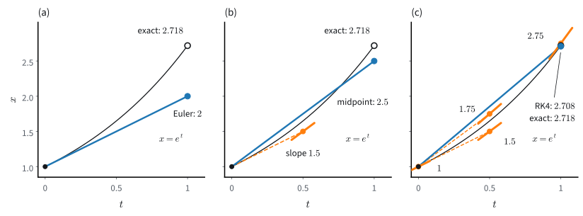

# Numerical Solvers
:label:`sec_mdl-euler-runge-kutta`

Anyone who has trained a network has seen a run blow up because the learning
rate was too large.
It is tempting to blame the loss surface, with its sharp valleys and its
plateaus. Yet the same thing happens on the simplest loss there is. Gradient
descent on the bowl $\mathcal L(x)=25x^2$ takes the step
$x\leftarrow x-\eta\cdot 50x$, and for every learning rate above $\eta=0.04$
the iterates grow without bound, although the bowl has a single minimum and
nothing about it is difficult. If the loss is not the problem, what is?

The answer comes from an older subject. Gradient descent is a step-by-step
solution of the differential equation $\dot x=-50x$, which says: move downhill
at a speed proportional to the slope. Its exact solution
$x(t)=e^{-50t}x_0$ decays to zero from every start. Euler proposed in 1768 to
solve such an equation by following the arrow for a short time $h$ and then
reading it again, and the learning rate plays the role of $h$. One step
multiplies $x$ by $1-50h$. With $h=0.01$ the factor is $0.5$, and the computed
solution decays like the true one. With $h=0.05$ it is $-1.5$, and the
computed solution flips sign and grows. The equation is stable; the steps are
not. The idea of this section is that the eigenvalues of a differential
equation decide both how its exact motion behaves and how large a step can
follow it.

Deep learning meets this gap between an equation and its steps in three
places. Gradient descent (:numref:`sec_gd`) is the first. A residual network
(:numref:`sec_resnet`) adds a small update to its input at every layer, which
is one such step. Diffusion and flow-matching models
(:numref:`sec_diffusion-samplers`) generate an image by following a learned
velocity field from noise to data, one network evaluation per step, so the
number of steps is the cost of a sample.

<!-- WRITER: the opening moved here from the old combined section. Add the clause that ties it to the decay
equation solved in :numref:`sec_mdl-odes-solvers`; "The idea of this section" now refers to this section only. -->

Few differential equations have a closed-form solution, so in practice we
compute: follow the field for a short time $h$, read it again, and repeat.
How far does such a step-by-step solution drift from the true one, how can it
drift less for the same work, and when do the steps become unstable although
the equation is not? The answers are an error law $O(h^p)$ and a region of
stable steps, both read from one polynomial. At the end, gradient descent
turns out to be the simplest of these solvers.

```{.python .input #mdl-numerical-solvers-imports}
#@tab mxnet
import math
import numpy as np
from mxnet import autograd, gluon, init, np as mnp, npx
from mxnet.gluon import nn
from d2l import mxnet as d2l
npx.set_np()
```

```{.python .input #mdl-numerical-solvers-imports}
#@tab pytorch
import math
import numpy as np
import torch
from torch import nn
from torch.nn import functional as F
from d2l import torch as d2l
```

```{.python .input #mdl-numerical-solvers-imports}
#@tab tensorflow
import math
import numpy as np
import tensorflow as tf
from d2l import tensorflow as d2l
```

```{.python .input #mdl-numerical-solvers-imports}
#@tab jax
import math
import numpy as np
import jax
from jax import numpy as jnp
from flax import nnx
import optax
from d2l import jax as d2l
```

## Forward Euler

Over one short step, the integral form
:eqref:`eq_mdl-ode-integral-form` can be approximated by holding the velocity
at its value at the start of the step. Let us first see what this does on an
equation whose answer we know.

Take $\dot x=x$ from $x_0=1$ to $T=1$, where the answer is $e=2.718$. Divide
the interval into $n$ steps of length $h=1/n$, and in each step move with the
velocity at its start: $x\leftarrow x+hx=(1+1/n)x$. After $n$ steps,
$x_n=(1+1/n)^n$. This is a dollar at 100% annual interest compounded $n$
times a year:

| $n$ | 1 | 2 | 4 | 8 | 16 | 32 | 365 |
|---|---|---|---|---|---|---|---|
| $(1+1/n)^n$ | 2.000 | 2.250 | 2.441 | 2.566 | 2.638 | 2.677 | 2.7146 |
| error | 0.718 | 0.468 | 0.277 | 0.153 | 0.080 | 0.041 | 0.0037 |

The ratios of consecutive errors are $1.53,1.69,1.82,1.90,1.95$: doubling the
number of steps comes closer and closer to halving the error. For large $n$
the error is about $e/(2n)=1.36\,h$, because
$(1+1/n)^n=\exp\bigl(n\log(1+1/n)\bigr)=\exp\bigl(1-\tfrac1{2n}+\cdots\bigr)\approx e\,(1-\tfrac1{2n})$.
Error proportional to $h$ is what we will call order one.

For a general field, with step size $h$ and grid $t_n = nh$, **forward Euler**
is

$$
\mathbf{x}_{n+1} = \mathbf{x}_n + h\, \mathbf{f}(\mathbf{x}_n, t_n) .
$$
:eqlabel:`eq_mdl-ode-euler-update`

The method follows the arrow at the current point for time $h$, then reads the
field again. Equivalently, it is the Taylor expansion of the true solution cut
after the linear term, and the error of one step is the first term dropped. If
$\|\ddot{\mathbf{x}}(t)\| \le M$ along the solution, then

$$
\mathbf{x}(t_{n+1}) = \mathbf{x}(t_n) + h\,\mathbf{f}(\mathbf{x}(t_n), t_n) + \mathbf{r}_n,
\qquad
\|\mathbf{r}_n\| \le \tfrac{M h^2}{2}.
$$

A per-step error of order $h^2$ does not give a final error of order $h^2$:
reaching a fixed horizon $T$ takes $T/h$ steps, the per-step errors
accumulate, and each step may amplify the error already made. One power of
$h$ is lost, and the proof is short.

**Proposition (Euler converges at order 1).** *Let $\mathbf{f}$ be
$L$-Lipschitz in $\mathbf{x}$, and let the solution of
:eqref:`eq_mdl-ode-ivp` on $[0, T]$ satisfy
$\|\ddot{\mathbf{x}}(t)\| \le M$. Then the Euler iterates
:eqref:`eq_mdl-ode-euler-update` obey*

$$
\max_{n \le T/h} \|\mathbf{x}_n - \mathbf{x}(t_n)\|
\;\le\; \frac{M h}{2L}\left(e^{LT} - 1\right)
\;=\; O(h).
$$

**Proof.** Let $\varepsilon_n = \|\mathbf{x}_n - \mathbf{x}(t_n)\|$, and
subtract the Taylor identity above from the update
:eqref:`eq_mdl-ode-euler-update`:

$$
\varepsilon_{n+1}
\le \underbrace{\|\mathbf{x}_n - \mathbf{x}(t_n)\| + h\,\|\mathbf{f}(\mathbf{x}_n, t_n) - \mathbf{f}(\mathbf{x}(t_n), t_n)\|}_{\le\, (1 + hL)\, \varepsilon_n \textrm{ by Lipschitz}}
\;+\; \underbrace{\|\mathbf{r}_n\|}_{\le\, Mh^2/2} .
$$

Each step multiplies the existing error by at most $1 + hL$ and adds at most
$Mh^2/2$. Unrolling the recursion from $\varepsilon_0 = 0$ sums a geometric
series:

$$
\varepsilon_n \le \frac{Mh^2}{2} \sum_{j=0}^{n-1} (1 + hL)^j
= \frac{Mh^2}{2} \cdot \frac{(1 + hL)^n - 1}{hL}
\le \frac{Mh}{2L}\left(e^{LT} - 1\right),
$$

using $(1 + hL)^n \le e^{nhL} \le e^{LT}$. $\blacksquare$

For $\dot x=x$ on $[0,1]$ we have $M=\max|\ddot x|=e$ and $L=1$, so the bound
is $\tfrac e2(e-1)h=2.3\,h$, against the true error $1.36\,h$: the right
order, with a pessimistic constant. The structure of the bound recurs for
every solver. A local error of order $h^{p+1}$ per step becomes a global
error of order $h^p$ after $T/h$ steps, inflated by the factor $e^{LT}$ that
measures how strongly the dynamics amplify old mistakes. A method with global
error of order $h^p$ has **order** $p$; Euler has order $1$.

## Runge--Kutta Methods

Euler commits to the slope at the start of the step while the trajectory
curves away from it. Runge--Kutta methods measure the slope at points inside
the step and combine the measurements. :numref:`fig_mdl-dyn-solver-geometry`
shows one step of size $h=1$ on $\dot x=x$ from $x=1$.


:label:`fig_mdl-dyn-solver-geometry`

The simplest improvement, the **midpoint method**, takes half an Euler step
only to measure the slope there, and then takes the real step with that slope:
$\mathbf{x}_{n+1} = \mathbf{x}_n + h\,\mathbf{f}\!\left(\mathbf{x}_n + \tfrac{h}{2}\mathbf{f}(\mathbf{x}_n)\right)$
(autonomous notation). One Taylor line in one dimension shows why it helps:

$$
x + h f\!\left(x + \tfrac{h}{2} f(x)\right)
= x + h f + \tfrac{h^2}{2} f' f + O(h^3).
$$

The true expansion is $x(t+h) = x + h\dot{x} + \tfrac{h^2}{2}\ddot{x} + O(h^3)$
with $\ddot{x} = \tfrac{d}{dt} f(x(t)) = f' f$, so the $h^2$ term is now
right instead of missing. The local error is $O(h^3)$ and the global order
$2$, for two field evaluations per step. **Heun's method** takes a full trial
Euler step and averages the slopes at its two ends,
$\mathbf{x}_{n+1} = \mathbf{x}_n + \tfrac{h}{2}\left[\mathbf{f}(\mathbf{x}_n) + \mathbf{f}\!\left(\mathbf{x}_n + h\,\mathbf{f}(\mathbf{x}_n)\right)\right]$,
with the same order and the same two evaluations. Many diffusion samplers use
this two-stage method (:numref:`sec_diffusion-samplers`).

Four slope measurements give the standard general-purpose method of
scientific computing, **classical Runge--Kutta (RK4)**:

$$
\begin{aligned}
\mathbf{k}_1 &= \mathbf{f}(\mathbf{x}_n,\, t_n), \\
\mathbf{k}_2 &= \mathbf{f}(\mathbf{x}_n + \tfrac{h}{2}\mathbf{k}_1,\, t_n + \tfrac{h}{2}), \\
\mathbf{k}_3 &= \mathbf{f}(\mathbf{x}_n + \tfrac{h}{2}\mathbf{k}_2,\, t_n + \tfrac{h}{2}), \\
\mathbf{k}_4 &= \mathbf{f}(\mathbf{x}_n + h\,\mathbf{k}_3,\, t_n + h), \\
\mathbf{x}_{n+1} &= \mathbf{x}_n + \tfrac{h}{6}\left(\mathbf{k}_1 + 2\mathbf{k}_2 + 2\mathbf{k}_3 + \mathbf{k}_4\right).
\end{aligned}
$$
:eqlabel:`eq_mdl-ode-rk4-update`

The update averages four slope measurements, weighting the two at the
midpoint twice. These weights are Simpson's rule,
$\int_a^b g \approx \tfrac{b-a}{6}\bigl(g(a) + 4g(\tfrac{a+b}{2}) + g(b)\bigr)$,
which integrates cubics exactly, with the midpoint value split between two
measurements.

Why order $4$? On a linear field the answer takes one computation. Each method
applied to the scalar test equation $\dot y=\lambda y$ multiplies $y$ by a
fixed function of $z=h\lambda$ per step, and we can compare that function
with the exact factor $e^z$.

**Proposition (stability functions).** *On $\dot y=\lambda y$, with
$\lambda$ real or complex and $z=h\lambda$, one step of each method multiplies
$y$ by its **stability function** $R(z)$:*

$$
R_{\textrm{Euler}}(z)=1+z,
\qquad
R_{\textrm{mid}}(z)=R_{\textrm{Heun}}(z)=1+z+\frac{z^2}{2},
\qquad
R_{\textrm{RK4}}(z)=1+z+\frac{z^2}{2}+\frac{z^3}{6}+\frac{z^4}{24}.
$$
:eqlabel:`eq_mdl-ode-stability-function`

**Proof.** For RK4 the four measurements are $\mathbf k_1=\lambda y$,
$\mathbf k_2=\lambda y(1+\tfrac z2)$,
$\mathbf k_3=\lambda y(1+\tfrac z2+\tfrac{z^2}4)$ and
$\mathbf k_4=\lambda y(1+z+\tfrac{z^2}2+\tfrac{z^3}4)$, each obtained by
substituting the previous one. The update is
$y+\tfrac z6\left(6+3z+z^2+\tfrac{z^3}4\right)y$, which is the stated
polynomial times $y$. For Euler, $y+zy$. For the midpoint method,
$y+h\lambda(y+\tfrac z2y)$, and for Heun, $y+\tfrac z2(y+(1+z)y)$; both are
$(1+z+\tfrac{z^2}2)y$. $\blacksquare$

Each $R$ is the Taylor polynomial of the exact factor $e^z$, cut at the
method's order. For RK4, $e^z-R_{\textrm{RK4}}(z)=z^5/120+O(z^6)$, so on this
equation one step errs by $O(h^5)$ and $T/h$ steps by $O(h^4)$. For nonlinear
fields that are four times continuously differentiable and Lipschitz in
$\mathbf x$, a longer Taylor match gives the same orders: midpoint and Heun
have order $2$, RK4 order $4$ :cite:`Hairer.Norsett.Wanner.1993`; we do not
prove this. The stability function returns when we ask which steps are
stable.

Practical solvers also choose the step size as they go. An *embedded pair*
such as Dormand--Prince
computes solutions of orders $4$ and $5$ from the same evaluations and uses
their difference as an estimate of the local error :cite:`Dormand.Prince.1980`;
:exref:`ex_mdl-odes-solvers-adaptive-steps` builds the simplest such
controller.

On log--log axes, $\textrm{error} \approx C h^p$ is a line of slope $p$, so
the measured slopes should be $1$ and $4$. We test this on the spiral
$\dot{\mathbf x}=\mathbf A\mathbf x$ of :numref:`fig_mdl-dyn-ode-field`, whose
eigenvalues are $-0.5\pm\mathrm i$ and whose exact endpoint
$e^{\mathbf AT}\mathbf x_0$ at $T=2$ the matrix-exponential cell computed,
halving the step six times.
<!-- WRITER: the matrix-exponential cell is in another notebook now. The setup cell below takes the endpoint
from the closed form of :numref:`sec_mdl-odes-solvers`, x(2) = e^{-1}(2 cos 2, 2 sin 2) = (-0.3062, 0.6690). -->

```{.python .input #mdl-numerical-solvers-runge-kutta-methods-1}
A = np.array([[-0.5, -1.0], [1.0, -0.5]])      # the spiral, eigenvalues -0.5 +- i
x0, T = np.array([2.0, 0.0]), 2.0
x_true = np.exp(-1) * np.array([2 * np.cos(2), 2 * np.sin(2)])  # e^{AT} x0
```

```{.python .input #odes-solvers-euler-rk4-order}
def euler(f, x0, T, n):
    """Forward Euler: n steps of size h = T/n."""
    x, h = np.asarray(x0, dtype=float), T / n
    for _ in range(n):
        x = x + h * f(x)
    return x

def rk4(f, x0, T, n):
    """Classical Runge-Kutta: four slope measurements per step."""
    x, h = np.asarray(x0, dtype=float), T / n
    for _ in range(n):
        k1 = f(x)
        k2 = f(x + 0.5 * h * k1)
        k3 = f(x + 0.5 * h * k2)
        k4 = f(x + h * k3)
        x = x + (h / 6) * (k1 + 2 * k2 + 2 * k3 + k4)
    return x

f = lambda x: A @ x                            # the spiral field
ns = 2 ** np.arange(3, 10)                     # 8, 16, ..., 512 steps
hs = T / ns
err_eu = np.array([np.linalg.norm(euler(f, x0, T, n) - x_true) for n in ns])
err_rk = np.array([np.linalg.norm(rk4(f, x0, T, n) - x_true) for n in ns])
print('measured slope, Euler:', f'{np.polyfit(np.log(hs), np.log(err_eu), 1)[0]:.3f}')
print('measured slope, RK4  :', f'{np.polyfit(np.log(hs), np.log(err_rk), 1)[0]:.3f}')
print(f'error at 512 steps: Euler {err_eu[-1]:.1e}, RK4 {err_rk[-1]:.1e}')
print('RK4 with 128 steps (the same 512 evaluations):',
      f'{np.linalg.norm(rk4(f, x0, T, 128) - x_true):.1e}')
d2l.plot(hs, [err_eu, err_rk, err_eu[-1] * (hs / hs[-1]),
              err_rk[-1] * (hs / hs[-1]) ** 4],
         'step size h', 'global error at T', xscale='log', yscale='log',
         legend=['Euler', 'RK4', 'slope 1', 'slope 4'])
```

The fitted slopes are $1.04$ and $4.02$. What the slopes do not show is the
cost. A method of order $p$ reaches error $\varepsilon$ with a number of
steps proportional to $\varepsilon^{-1/p}$, so a high order pays even at four
evaluations per step: at $512$ steps Euler is off by $3.6\times10^{-3}$, and
with the same $512$ field evaluations, that is $128$ steps, RK4 reaches
$1.3\times10^{-9}$, six orders of magnitude below.

## Stiffness and Implicit Methods
:label:`sec_mdl-stiffness-implicit`

Order measures how accurate a step is when it is small. Stability asks a
different question: whether the errors of many steps die out or compound. For
explicit methods such as Euler and RK4, stability caps the step size, however
little accuracy we need.

The smallest system that shows the problem has two decoupled modes,
$\dot{\mathbf x}=\mathrm{diag}(-50,-1)\,\mathbf x$ from $(1,1)$, followed to
$T=1$. The fast mode has decayed to $e^{-50}\approx10^{-22}$; the slow one is
at $e^{-1}=0.368$. After $t\approx0.1$ only the slow mode is left, and steps
of $h=0.1$ would follow it well. Yet the fast coordinate is the opening's
equation $\dot x=-50x$, and Euler multiplies it by $1-50h$ at every step for
as long as we integrate. A system is **stiff** when some Jacobian eigenvalues
have large negative real parts compared with the rate at which the solution
of interest varies: a mode that is long gone still sets the step.

To see which steps are allowed, and what a remedy looks like, we use the test
equation $\dot y=\lambda y$ with complex $\lambda$, whose solution decays if
and only if $\operatorname{Re}\lambda<0$.

**Proposition (Euler and backward Euler on the test equation).** *Let
$z=h\lambda$. Forward Euler gives $y_n=(1+z)^ny_0$, which decays if and only
if $|1+z|<1$; for real $\lambda<0$ this is*

$$
h < \frac{2}{|\lambda|} .
$$

*Backward Euler,
$\mathbf{x}_{n+1} = \mathbf{x}_n + h\,\mathbf{f}(\mathbf{x}_{n+1}, t_{n+1})$,
gives $y_n=(1-z)^{-n}y_0$, which decays for every $h>0$ whenever
$\operatorname{Re}\lambda<0$.*

**Proof.** Forward Euler: $y_{n+1}=y_n+h\lambda y_n=(1+z)y_n$; iterate. For
real $z<0$ the condition $|1+z|<1$ reads $-2<z<0$. Backward Euler:
$y_{n+1}=y_n+h\lambda y_{n+1}$, so $y_{n+1}=y_n/(1-z)$, and
$|1-z|\ge\operatorname{Re}(1-z)=1-\operatorname{Re}z>1$ when
$\operatorname{Re}z<0$. $\blacksquare$

Backward Euler evaluates the field at the end of the step, which is not yet
known, so each step is an equation to solve. That is the meaning of
*implicit*. The price is a linear solve per step when the field is linear and
a few Newton iterations otherwise
(:exref:`ex_mdl-odes-solvers-stiff-newton`), and it is worth paying when the
stability limit, not accuracy, would set the step of an explicit method.

A plot of the $z$ plane shows all methods at once. The **stability region**
of a method is the set $\{z:|R(z)|<1\}$ where its update decays; for backward
Euler $R(z)=1/(1-z)$. A method is **A-stable** if its region contains the
whole open left half-plane $\operatorname{Re}z<0$: it makes every decaying
mode decay, whatever the step :cite:`Dahlquist.1963`. Backward Euler is
A-stable, since its region is everything outside the closed unit disc around
$+1$. No explicit Runge--Kutta method is A-stable, because its $R$ is a
polynomial (:exref:`ex_mdl-odes-solvers-rotating-modes`).

:numref:`fig_mdl-dyn-stability-regions` marks the examples. The opening's
step $h=0.05$ on $\dot x=-50x$ is the point $z=-2.5$, outside Euler's disc,
and $h=0.01$ is $z=-0.5$, inside. The spiral, with $\lambda=-0.5\pm\mathrm i$,
gives $|1+z|^2=(1-h/2)^2+h^2$, which is below $1$ if and only if $h<0.8$; at
$h=0.8$ its two points $-0.4\pm0.8\,\mathrm i$ lie on the circle. The
exact step $e^{z}$ of :numref:`subsec_mdl-ode-driven-linear` has modulus below
one on the whole left half-plane, which is the behaviour backward Euler
imitates and forward Euler does not.

![Stability regions in the complex plane of $z = h\lambda$ for the test equation $\dot{y} = \lambda y$; a decaying mode sits in the left half-plane. Forward Euler decays only inside the disc $\lvert 1 + z \rvert < 1$, whose real slice is $-2 < h\lambda < 0$; RK4 enlarges it to a lobed region reaching $\approx -2.79$ on the real axis; backward Euler is stable everywhere except the disc around $+1$, in particular on the entire left half-plane, which is A-stability. The marked points are the opening's $h=0.05$ step, its $h=0.01$ step, and the spiral's largest stable Euler step.](../img/mdl-dyn-stability-regions.svg)
:label:`fig_mdl-dyn-stability-regions`

We now run both methods on the two-mode system at five step sizes, backward
Euler with one linear solve per step. The reader can predict the first row:
at $h=0.1$ forward Euler multiplies the fast coordinate by $1-5=-4$ ten
times.

```{.python .input #odes-solvers-stiffness-sweep}
def backward_euler_linear(A, x0, T, n):
    """Backward Euler on dx/dt = A x: solve (I - h A) x_new = x at each step."""
    x, h = np.asarray(x0, dtype=float), T / n
    for _ in range(n):
        x = np.linalg.solve(np.eye(len(x)) - h * A, x)
    return x

A_stiff = np.diag([-50.0, -1.0])               # one fast mode, one slow mode
x0_stiff = np.array([1.0, 1.0])
T = 1.0
print(f'exact at T = 1: fast {np.exp(-50):.1e}, slow {np.exp(-1):.4f}')
print(f'{"h":>5} {"fwd fast":>10} {"fwd slow":>9} {"bwd fast":>10} {"bwd slow":>9}')
for n in [10, 20, 25, 50, 100]:
    fwd = euler(lambda x: A_stiff @ x, x0_stiff, T, n)
    bwd = backward_euler_linear(A_stiff, x0_stiff, T, n)
    print(f'{T / n:5.2f} {fwd[0]:10.1e} {fwd[1]:9.4f} {bwd[0]:10.1e} {bwd[1]:9.4f}')
```

At $h=0.1$ both methods have the slow mode within about $5\%$ of the truth
($0.349$ and $0.386$ against $0.368$), accurate enough for many purposes.
Forward Euler nonetheless returns $4^{10}\approx10^6$ for the fast component,
whose true value is $10^{-22}$. At $h=0.04$ the factor is $-1$, and the fast
component flips sign at every step and never shrinks. Forward Euler needs
$h<0.04$, and at $h=0.02$ its slow mode is five times more accurate than the
$5\%$ we were content with.

Backward Euler is stable at every step size. Its slow-mode error is the
$O(h)$ error of a first-order method, so stability does not bring accuracy.
In practice, explicit adaptive solvers are the default, and implicit methods
are used when the field is stiff, which a learned reverse-time field can be.

## Gradient Descent as a Solver
:label:`sec_mdl-gd-as-solver`

The opening treated one coordinate. With several, the same factor appears
once per eigenvalue of the Hessian. Infinitesimal descent on a loss
$\mathcal L$ is the **gradient flow**

$$
\dot{\mathbf{x}} = -\nabla \mathcal L(\mathbf{x}),
$$

a field whose fixed points are the critical points of $\mathcal L$ and along
whose trajectories the loss only falls:
$\tfrac{d}{dt}\mathcal L(\mathbf{x}(t)) = \nabla \mathcal L^\top \dot{\mathbf{x}} = -\|\nabla \mathcal L\|^2 \le 0$.
Gradient descent with learning rate $\eta$,
$\mathbf{x}_{k+1} = \mathbf{x}_k - \eta\, \nabla \mathcal L(\mathbf{x}_k)$,
is forward Euler :eqref:`eq_mdl-ode-euler-update` on this flow with $h = \eta$.

:numref:`sec_mdl-gradient-based-optimization` derives the learning-rate
ceiling $\eta<2/\lambda_{\max}(\mathbf H)$ on a quadratic with Hessian
$\mathbf H$ and studies the speed below it. We do not repeat that analysis.
What the solver view adds is where the ceiling comes from. Near a minimum
the flow linearizes, eigenvector by eigenvector, onto the test equation:

$$
\begin{aligned}
\dot{\mathbf{x}} = -\nabla \mathcal L(\mathbf{x})
\;\;&\xrightarrow{\textrm{linearize}}\;\;
\dot{\boldsymbol{\delta}} = -\mathbf H\boldsymbol{\delta}
\;\;\xrightarrow{\textrm{Euler}, \, h = \eta}\;\;
\boldsymbol{\delta}_{k+1} = (\mathbf I - \eta \mathbf H)\,\boldsymbol{\delta}_k \\
&\xrightarrow{\textrm{stability}}\;\;
\eta < \frac{2}{\lambda_{\max}(\mathbf H)} .
\end{aligned}
$$

The learning-rate ceiling is thus the boundary of Euler's stability disc,
reached by the stiffest mode at $z=-\eta\lambda_{\max}=-2$. The cell reruns
the sweep of :numref:`sec_mdl-gradient-based-optimization` on
$\mathbf H=\mathrm{diag}(10,1)$ from $(1,1)$ for 100 steps, and each row can
be read in :numref:`fig_mdl-dyn-stability-regions`.

<!-- WRITER: the cell no longer reruns the sweep of sec_mdl-gradient-based-optimization (cite it, do not
rerun it). New content: gradient flow dx/dt = -H x on H = diag(10, 1) from (1, 1), 100 steps of size eta,
three solvers, reusing this notebook's euler, rk4 and backward_euler_linear (backward Euler on the
gradient flow is the proximal-point step x_{k+1} = (I + eta H)^{-1} x_k). Per row it prints the factor of
the steep and of the flat mode (the diagonal of one step's matrix, i.e. R(-eta*10) and R(-eta*1)) and
||x_100||. Rows: forward Euler eta 0.19, 0.21; RK4 0.27, 0.29; backward Euler 0.25, 25. The rows can
still be read in fig_mdl-dyn-stability-regions (steep mode at z = -1.9, -2.1, -2.7, -2.9, -2.5, -250). -->

```{.python .input #mdl-odes-solvers-gradient-descent-is-a-solver}
H = np.diag([10.0, 1.0])                       # Hessian of L(x) = x^T H x / 2
flow = lambda x: -H @ x                        # the gradient flow
solvers = {                                    # n steps of size eta on the flow
    'forward Euler': lambda x0, eta, n: euler(flow, x0, n * eta, n),
    'RK4': lambda x0, eta, n: rk4(flow, x0, n * eta, n),
    'backward Euler': lambda x0, eta, n: backward_euler_linear(-H, x0, n * eta, n)}
print(f'{"solver":<15}{"eta":>6}{"steep factor":>14}{"flat factor":>13}{"||x_100||":>12}')
for name, eta in [('forward Euler', 0.19), ('forward Euler', 0.21), ('RK4', 0.27),
                  ('RK4', 0.29), ('backward Euler', 0.25), ('backward Euler', 25)]:
    steep, flat = np.diag(solvers[name](np.eye(2), eta, 1))  # one step's matrix
    x_100 = solvers[name](np.array([1.0, 1.0]), eta, 100)
    print(f'{name:<15}{eta:6.2f}{steep:14.3f}{flat:13.3f}{np.linalg.norm(x_100):12.1e}')
```

<!-- WRITER: the paragraph below reads the old sweep (the eta = 0.201 row, factor -1.01, flat
coordinate 1e-10) and is false now. Printed (deterministic NumPy, identical in all four tabs):
  solver            eta  steep factor  flat factor   ||x_100||
  forward Euler    0.19        -0.900        0.810     2.7e-05
  forward Euler    0.21        -1.100        0.790     1.4e+04
  RK4              0.27         0.879        0.763     2.5e-06
  RK4              0.29         1.187        0.748     2.8e+07
  backward Euler   0.25         0.286        0.800     2.0e-10
  backward Euler  25.00         0.004        0.038    3.2e-142
Readings: forward Euler's ceiling 2/lambda_max = 0.2 is the edge of its disc (steep factor -0.9 converges,
-1.1 diverges, oscillating in sign). RK4 moves the ceiling to 2.785/lambda_max = 0.2785, but each step
costs four gradients: 0.0696 of flow time per gradient against Euler's 0.2, a loss per gradient. RK4's
steep factor leaves the region through +1 (1.187, monotone growth, no sign flip), since RK4's R(z) = 1
at z = -2.785 on the real axis (R(z) - 1 = z(1 + z/2 + z^2/6 + z^3/24)). Backward Euler converges at
every eta, faster as eta grows (steep 1/(1 + 10 eta), flat 1/(1 + eta)); at eta = 25 the norm is at
3e-142, i.e. effectively zero: the step nears the exact minimizer. The ceiling belongs to the solver, not
to the loss. Do not quote 3.2e-142 to its digits; "below 1e-140" or "effectively zero". -->

This is the table of the stiff system with $\eta$ in place of $h$. At
$\eta=0.201$ the steep mode sits at $z=-2.01$, just outside the disc: its
factor is $-1.01$, and after 100 steps the iterate has grown past its start
while the flat coordinate is about $10^{-10}$. Stability fixes $\eta$ through
$\lambda_{\max}$, and $\lambda_{\min}$ then sets the speed, so the condition
number of the Hessian is the stiffness of the gradient flow. A diverging
learning rate is a solver instability.

Two more readings are left to the exercises. The $O(\eta^2)$ error of each explicit step has a meaning too: to that
order gradient descent follows the flow of a modified loss that penalizes
large gradients
(:exref:`ex_mdl-odes-solvers-implicit-gradient-regularization`). Polyak's
heavy-ball momentum discretizes the second-order equation
$m\ddot{\mathbf x}+c\dot{\mathbf x}=-\nabla\mathcal L(\mathbf x)$ of a ball
with mass and friction :cite:`Polyak.1964`
(:exref:`ex_mdl-odes-solvers-heavy-ball-ode`).

Every field in this section was given to us. The next section,
:numref:`sec_mdl-neural-odes-cnf`, defines a model whose layers are Euler
steps of a field that is *learned*, and asks how such a model is trained and
what it does to a probability density.

## Summary

*Numerical solvers.* A numerical solver turns a local error $O(h^{p+1})$
into a global error $O(h^p)$, with $p=1$ for Euler and $p=4$ for RK4. Forward
Euler is stable only for $|1+h\lambda|<1$ and backward Euler on the whole
left half-plane, and a system is stiff when a decayed fast mode still sets
the step. Gradient descent is forward Euler on
$\dot{\mathbf x}=-\nabla\mathcal L$, so $\eta<2/\lambda_{\max}(\mathbf H)$ is
a solver stability bound and ill-conditioning is stiffness.

## Exercises

1. **Rotating modes.** The stiffness proposition treats a single decaying
   mode. A complex eigenvalue $\lambda$ enters through $z = h\lambda$, the
   coordinate of :numref:`fig_mdl-dyn-stability-regions`.
    1. For the spiral field of :numref:`fig_mdl-dyn-ode-field`, with
       eigenvalues $-0.5 \pm \mathrm i$, find the largest step size for which
       forward Euler decays.
    1. For the rotational field
       $\dot{\mathbf{x}} = \left(\begin{smallmatrix}0&-b\\b&0\end{smallmatrix}\right)\mathbf{x}$,
       show that forward Euler multiplies $\|\mathbf{x}\|$ by
       $\sqrt{1 + h^2 b^2}$ per step and that backward Euler divides it by the
       same factor. By which factor does each method change $\|\mathbf{x}\|$
       over one revolution, that is $2\pi/(hb)$ steps, when $hb = 0.1$?
    1. The stability function of RK4 is the last formula in
       :eqref:`eq_mdl-ode-stability-function`, and its square modulus on the
       imaginary axis decides rotation. Show that
       $|R(\mathrm iy)|^2 = 1 - y^6/72 + y^8/576$ for real $y$, and find the
       range of $hb$ for which RK4 does not amplify the rotation.
    1. An explicit Runge--Kutta method with $s$ stages computes
       $\mathbf{k}_i = \mathbf{f}\big(\mathbf{x}_n + h\sum_{j<i} a_{ij}\mathbf{k}_j\big)$
       for $i = 1, \ldots, s$ and
       $\mathbf{x}_{n+1} = \mathbf{x}_n + h\sum_{i} b_i\mathbf{k}_i$, as RK4
       does in :eqref:`eq_mdl-ode-rk4-update`. Show that its stability
       function is a polynomial in $z$ of degree at most $s$. Why does this
       rule out A-stability for explicit methods?
   :exlabel:`ex_mdl-odes-solvers-rotating-modes`

1. **Heavy ball as a discretized ODE.** Heavy-ball momentum
   $\mathbf{x}_{k+1} = \mathbf{x}_k - \eta\nabla \mathcal L(\mathbf{x}_k) + \beta(\mathbf{x}_k - \mathbf{x}_{k-1})$
   discretizes the equation
   $m\ddot{\mathbf{x}} + c\dot{\mathbf{x}} = -\nabla \mathcal L(\mathbf{x})$
   of a ball with mass $m$ and friction $c$.
    1. Replace $\ddot{\mathbf{x}}(t_k)$ by the central difference
       $(\mathbf{x}_{k+1} - 2\mathbf{x}_k + \mathbf{x}_{k-1})/h^2$ and
       $\dot{\mathbf{x}}(t_k)$ by the backward difference
       $(\mathbf{x}_k - \mathbf{x}_{k-1})/h$. Show that the result is the
       heavy-ball update, and express $\eta$ and $\beta$ through $m$, $c$,
       and $h$.
    1. For $\mathcal L(x) = \tfrac{\lambda}{2}x^2$ the ODE is a damped
       oscillator, critically damped at $c = 2\sqrt{m\lambda}$. Express this
       condition through $\eta$, $\beta$, and $\lambda$. The heavy-ball
       recurrence is critically damped when its characteristic polynomial
       $z^2 - (1 + \beta - \eta\lambda)z + \beta$ has a double root. Find the
       corresponding $\beta$ and compare the two conditions for small
       $\eta\lambda$.
    1. The heavy-ball recurrence on this quadratic converges if and only if
       $0 < \eta\lambda < 2(1 + \beta)$ for $0 \le \beta < 1$ (exercise
       :exref:`ex_mdl-gradient-based-optimization-edge-of-stability-momentum`a
       of :numref:`sec_mdl-gradient-based-optimization` asks for the proof).
       Translate the condition into one on $h$, $m$, $c$, and $\lambda$. The
       ODE decays for every $\lambda > 0$, but its discretization does not.
       What is the largest stable step $h$ as $c \to 0$, in terms of the
       angular frequency $\sqrt{\lambda/m}$ of the oscillator? Which
       eigenvalue of the Hessian of an ill-conditioned quadratic sets the
       step limit?
   :exlabel:`ex_mdl-odes-solvers-heavy-ball-ode`

1. [code] **Adaptive step size.** ● The embedded pairs of
   :numref:`sec_mdl-euler-runge-kutta` estimate the local error from two
   methods of different order. The simplest pair uses the stages
   $\mathbf{k}_1 = \mathbf{f}(\mathbf{x})$ and
   $\mathbf{k}_2 = \mathbf{f}(\mathbf{x} + h\mathbf{k}_1)$ of Heun's method:
   the Euler value $\mathbf{x} + h\mathbf{k}_1$ and the Heun value
   $\mathbf{x} + \tfrac{h}{2}(\mathbf{k}_1 + \mathbf{k}_2)$ differ by
   $\Delta = \tfrac{h}{2}\|\mathbf{k}_2 - \mathbf{k}_1\|$. A controller
   accepts the step, keeping the Heun value, when $\Delta \le \texttt{tol}$,
   and in either case continues with the step size

   $$
   h \leftarrow h \min\!\Big(2,\ \max\!\big(0.2,\ 0.9\sqrt{\texttt{tol}/\Delta}\,\big)\Big).
   $$

    1. Which order of the local error does the exponent $1/2$ assume?
    1. Implement the controller, starting from $h = 0.1$ and shortening the
       last step so that it ends at $T$. Integrate the spiral field `f` from
       `x0` to $T = 2$ for $\texttt{tol} = 10^{-2}, 10^{-3}, \ldots, 10^{-6}$.
       Count the field evaluations, including those of rejected steps, and
       compare the error with the exact endpoint `x_true`. How does the
       number of evaluations scale with $\texttt{tol}$?
    1. Integrate the field of `A_stiff` from $(1, 1)$ to $T = 10$ with
       $\texttt{tol} = 10^{-3}$ and plot the accepted step sizes against
       time. At which value do they settle after the fast mode has decayed?
       Explain this value with Heun's stability function
       $1 + z + z^2/2$ from :eqref:`eq_mdl-ode-stability-function`.
   :exlabel:`ex_mdl-odes-solvers-adaptive-steps`

1. [code] **Implicit gradient regularization.** ●● Gradient descent is
   forward Euler on the gradient flow (:numref:`sec_mdl-gd-as-solver`), so
   each step leaves the flow of $\mathcal L$ by $O(\eta^2)$. Backward error
   analysis looks for a modified field
   $\tilde{\mathbf{f}} = \mathbf{f} + \eta\mathbf{f}_1$ whose exact
   time-$\eta$ flow agrees with one Euler step up to $O(\eta^3)$.
   :citet:`Barrett.Dherin.2021` find that for gradient descent this field is
   again a gradient field, of the modified loss

   $$
   \tilde{\mathcal L}(\mathbf{x}) = \mathcal L(\mathbf{x}) + \frac{\eta}{4}\|\nabla \mathcal L(\mathbf{x})\|^2 .
   $$

    1. Expand the exact flow of $\tilde{\mathbf{f}}$ over time $\eta$ to
       second order, and show that
       $\mathbf{f}_1 = -\tfrac12(\partial\mathbf{f}/\partial\mathbf{x})\,\mathbf{f}$.
       Derive $\tilde{\mathcal L}$ for $\mathbf{f} = -\nabla \mathcal L$.
       Which regions of parameter space does the added term penalize?
    1. For $\mathcal L(x) = \tfrac{\lambda}{2}x^2$ with $0 < \eta\lambda < 1$,
       show that the iterates of gradient descent lie exactly on the gradient
       flow of $\tfrac{\tilde{\lambda}}{2}x^2$ with
       $\tilde{\lambda} = -\log(1 - \eta\lambda)/\eta$. Expand
       $\tilde{\lambda}$ in $\eta$ and compare it with the curvature of
       $\tilde{\mathcal L}$.
    1. Gradient descent on this quadratic still converges for
       $1 < \eta\lambda < 2$, with iterates that alternate in sign.
       Trajectories of a scalar autonomous field with a Lipschitz constant
       cannot cross, so the time-$\eta$ map of such a field preserves order.
       Conclude that no such field takes the values of the iterates at the
       times $k\eta$. For a quadratic with Hessian $\mathbf H$ in $d$
       dimensions, show that for every starting point with a component along
       the top eigenvector, the iterates lie on the flow of no gradient field
       $-\nabla\big(\tfrac12\mathbf{x}^\top\tilde{\mathbf H}\mathbf{x}\big)$
       once $\eta \ge 1/\lambda_{\max}(\mathbf H)$.
    1. For $\mathcal L(x) = x^4/4 + x^2/2$ and $x_0 = 1.5$, run gradient
       descent to $T = 1$ with $\eta = 0.1, 0.05, 0.025, 0.0125$. Compute the
       gradient flows of $\mathcal L$ and of $\tilde{\mathcal L}$ to $T = 1$
       with `rk4` and many steps, the latter separately for each $\eta$. Fit
       the slopes of the two endpoint errors of gradient descent against
       $\eta$.
   :exlabel:`ex_mdl-odes-solvers-implicit-gradient-regularization`

1. [code] **Symplectic Euler and splitting.** The harmonic oscillator
   $\dot q=p$, $\dot p=-q$ conserves $q^2+p^2$. Forward Euler spirals out of
   its circular orbits and backward Euler spirals in. The *symplectic Euler*
   update advances $q$ with the old $p$ and then $p$ with the new $q$:
   $q_{n+1}=q_n+hp_n$, $p_{n+1}=p_n-hq_{n+1}$.
    1. Write the update as a matrix $\mathbf S_h$ acting on $(q,p)$ and show
       that $\det\mathbf S_h=1$ for every $h$, so the update preserves area as
       the exact flow does, while forward Euler's matrix has determinant
       $1+h^2$.
    1. Show that the eigenvalues of $\mathbf S_h$ are distinct and lie on the
       unit circle if and only if $0<h<2$. What happens at $h=2$ and for
       $h>2$?
    1. Show that $q^2+p^2+hqp$ is conserved exactly by the update. What does
       its level set through $(1,0)$ look like, and how far from the origin
       can the computed orbit get at $h=0.5$ and at $h=1$? (Hint: the axes of
       the quadratic form have lengths in the ratio
       $\sqrt{(2+h)/(2-h)}$.)
    1. Integrate from $(1,0)$ to $T=200$ with forward Euler, backward Euler
       and symplectic Euler at $h=0.1$ and $h=1$, and report the largest and
       smallest $\|(q,p)\|$ along each run.
    1. The update is the exact flow of $\dot q=p$ with $p$ frozen, for time
       $h$, followed by the exact flow of $\dot p=-q$ with $q$ frozen. Write
       the two generators $\mathbf P$ and $\mathbf Q$, whose sum is the
       oscillator's matrix, compute $e^{h\mathbf P}$, $e^{h\mathbf Q}$ and
       $e^{h(\mathbf P+\mathbf Q)}$, and show that
       $e^{h\mathbf Q}e^{h\mathbf P}=\mathbf S_h$ differs from
       $e^{h(\mathbf P+\mathbf Q)}$ by terms of order $h^2$. Which property
       used for the spiral's closed form fails here? The symmetric splitting
       $e^{h\mathbf Q/2}e^{h\mathbf P}e^{h\mathbf Q/2}$ is the *leapfrog*
       integrator of Hamiltonian Monte Carlo :cite:`Neal.2011`; what is its
       order?
   :exlabel:`ex_mdl-odes-solvers-symplectic-euler`

1. [code] **Order on a nonlinear field.** The text measured the orders on a
   linear field, where they follow from the stability function. Here only
   the Taylor argument explains them (the exercise is adapted from
   :citet:`Sarkka.Solin.2019`). Implement Heun's method beside the
   text's `euler` and `rk4`. Integrate the damped pendulum with $c=0.5$ from
   $(\phi,\omega)=(2.5,0)$ to $T=5$ with $n=16,32,\ldots,1024$ steps, using
   `rk4` with $2^{16}$ steps as the reference. Plot the endpoint errors
   against $h$ on log--log axes and fit the slopes. Which method reaches an
   error of $10^{-6}$ with the fewest field evaluations? Then set $c=0$ and
   integrate to $T=50$ at $h=0.1$, plotting the energy
   $\tfrac12\omega^2+(1-\cos\phi)$ of each method against time. Which methods
   drift, and in which direction?
   :exlabel:`ex_mdl-odes-solvers-nonlinear-order`

1. [code] **Implicit steps on a stiff nonlinear field.** ● The text's stiff
   system is linear and diagonal, so each backward-Euler step was one linear
   solve. Take instead the heavily damped pendulum, $c=50$, from
   $(\phi,\omega)=(1,0)$ to $T=2$.
    1. Compute the Jacobian eigenvalues at the bottom and the step-size limits
       of forward Euler and RK4 that they imply.
    1. Show that after the fast transient the motion nearly satisfies
       $\dot\phi=-\sin\phi/c$, and compute $\phi(2)$ from this
       one-dimensional equation.
    1. One backward-Euler step solves
       $\mathbf g(\mathbf y)=\mathbf y-\mathbf x_n-h\mathbf f(\mathbf y)=\mathbf 0$
       for $\mathbf y=\mathbf x_{n+1}$. Write Newton's iteration
       $\mathbf y\leftarrow\mathbf y-(\mathbf I-h\mathbf J(\mathbf y))^{-1}\mathbf g(\mathbf y)$
       for it, and implement backward Euler with three Newton iterations per
       step, started from $\mathbf x_n$.
    1. Run forward Euler, RK4 and backward Euler at $h=0.1$, $0.06$, $0.055$
       and $0.02$, against a reference computed with `rk4` and $2^{16}$
       steps. Count the field and Jacobian evaluations each method needs for
       an endpoint error below $10^{-4}$. Which method wins, and why?
   :exlabel:`ex_mdl-odes-solvers-stiff-newton`

<!-- COORDINATOR: this page needs its own forum topic (tools/create_forum_topics.py); add the [Discussions](...) line here. -->

<!-- slides -->

::: {.slide}
::: {.cover}
[Dive into Deep Learning · §38.2]{.kicker}

Following a field step by step<br>**Numerical solvers**
:::
:::

::: {.slide title="Gradient Descent on 25x² Diverges Above η = 0.04, and the Bowl Is Not the Reason"}
[The problem]{.kicker}

- Loss $\mathcal L(x)=25x^2$: update $x\leftarrow x-\eta\cdot50x=(1-50\eta)\,x$.
- Same update: one step of size $h=\eta$ along $\dot x=-50x$, exact solution $e^{-50t}x_0$.
- $h=0.01$: factor $0.5$, decays. $h=0.05$: factor $-1.5$, flips sign and grows.

::: {.d2l-note .warn}
The equation decays from every start. The steps need not.
:::
:::

::: {.slide title="By the End of This Deck You Can"}
[Goals]{.kicker}

- choose a step and an order from the error law $O(h^p)$;
- recognize a stiff system and know when to take implicit steps;
- read a diverging learning rate as a solver instability.

**Running examples:** $\dot x=-50x$; the spiral $\mathbf A=\left(\begin{smallmatrix}-0.5&-1\\1&-0.5\end{smallmatrix}\right)$, eigenvalues $-0.5\pm\mathrm i$.

**The idea:** eigenvalues decide the motion and the step that can follow it.
:::

<!-- WRITER: the "Where this fits" slide of the old deck lists one combined ODE section; give this deck its own version. -->

::: {.slide}
::: {.divider}
[01]{.dnum}

[Numerical solvers]{.dtitle}

[accuracy, order, stability, stiffness]{.dsub}
:::
:::

::: {.slide title="Euler on dx/dt = x Is Compound Interest: (1 + 1/n)ⁿ → e"}
[Forward Euler]{.kicker}

$\mathbf x_{n+1}=\mathbf x_n+h\,\mathbf f(\mathbf x_n)$: the left-endpoint sum of $\int\mathbf f$.

| $n$ | 1 | 2 | 4 | 8 | 16 | 32 |
|---|---|---|---|---|---|---|
| $(1+1/n)^n$ | 2.000 | 2.250 | 2.441 | 2.566 | 2.638 | 2.677 |
| error | 0.718 | 0.468 | 0.277 | 0.153 | 0.080 | 0.041 |

::: {.d2l-note .rule}
Doubling $n$ about halves the error: error $\approx e/(2n)=1.36\,h$. Order one.
:::
:::

::: {.slide title="Euler's Global Error, I: Each Step Amplifies by 1 + hL and Adds Mh²/2"}
[Derivation]{.kicker}

Let $\varepsilon_n=\|\mathbf x_n-\mathbf x(t_n)\|$, $\|\ddot{\mathbf x}\|\le M$, $\mathbf f$ $L$-Lipschitz.

$$\varepsilon_{n+1}\le\underbrace{(1+hL)\,\varepsilon_n}_{\text{old error, propagated}}+\underbrace{Mh^2/2}_{\text{new Taylor remainder}}$$

::: {.d2l-note .rule}
Local error $O(h^2)$, but $T/h$ steps of it.
:::
:::

::: {.slide title="Euler's Global Error, II: The Geometric Sum Costs One Power of h"}
[Derivation]{.kicker}

$$\varepsilon_n\le\frac{Mh^2}{2}\sum_{j<n}(1+hL)^j=\frac{Mh}{2L}\big((1+hL)^n-1\big)\le\boxed{\frac{Mh}{2L}\left(e^{LT}-1\right)}$$

- Local $O(h^{p+1})$ becomes global $O(h^p)$.
- $\dot x=x$ on $[0,1]$: bound $2.3\,h$, truth $1.36\,h$.
:::

::: {.slide title="Runge–Kutta Measures the Slope Inside the Step"}
[Runge--Kutta]{.kicker}



One step $h=1$ on $\dot x=x$: Euler $2$, midpoint $2.5$, RK4 $2.708$, exact $2.718$.
RK4 weights the four slopes $\tfrac16(1,2,2,1)$.
:::

::: {.slide title="One RK4 Step Multiplies by the Taylor Polynomial of e^z"}
[Order]{.kicker}

::: {.cols .vc}
::: {.col}
On $\dot y=\lambda y$, $z=h\lambda$:

- Euler $R=1+z$;
- RK4 $R=1+z+\tfrac{z^2}2+\tfrac{z^3}6+\tfrac{z^4}{24}$;
- $e^z-R=z^5/120$: local $h^5$, global $h^4$.
- Spiral, same 512 evaluations: Euler $3.6\times10^{-3}$, RK4 $1.3\times10^{-9}$.
:::

::: {.col .fig .narrow}
@!odes-solvers-euler-rk4-order
:::
:::
:::

::: {.slide title="Check: Halving the Step"}
[Check]{.kicker}

Halve $h$. By what factor does RK4's error fall? Euler's?
What is the largest stable Euler step for the spiral, eigenvalues $-0.5\pm\mathrm i$?

::: {.fragment .fade-up}
::: {.d2l-note}
**Answer.** RK4: $2^4=16$. Euler: $2$. Spiral: $|1+h\lambda|^2=(1-h/2)^2+h^2<1$ iff $h<0.8$.
:::
:::
:::

::: {.slide title="Backward Euler Is Stable on the Whole Left Half-Plane"}
[Stability regions]{.kicker}

::: {.cols .vc}
::: {.col .fig}

:::

::: {.col}
- Forward Euler: stable inside $|1+z|<1$.
- Backward Euler: $y_{n+1}=y_n/(1-z)$.
- **A-stable**: $|R(z)|\le1$ whenever $\operatorname{Re}z\le0$.
- Cost: one equation solve per step.
:::
:::
:::

::: {.slide title="Stiffness: A Mode That Is Already Gone Still Sets the Step"}
[Stiffness]{.kicker}

$\dot{\mathbf x}=\mathrm{diag}(-50,-1)\,\mathbf x$ from $(1,1)$ to $T=1$; forward and backward Euler:

@!odes-solvers-stiffness-sweep

At $h=0.1$ both slow values are within $5\%$; forward Euler's fast value is $10^6$ for a true $10^{-22}$.
:::

<!-- WRITER (slides): the cell under this slide now prints the three-solver table (forward Euler 0.19/0.21,
RK4 0.27/0.29, backward Euler 0.25/25; see the WRITER note after the cell in the body). The slide's
claim per slide-guide: "The learning-rate ceiling belongs to the solver". The table is 7 lines of
under 70 columns. -->
::: {.slide title="Gradient Descent Is Forward Euler on the Gradient Flow"}
[Training as dynamics]{.kicker}

$\dot{\boldsymbol\delta}=-\mathbf H\boldsymbol\delta\ \to\ \boldsymbol\delta_{k+1}=(\mathbf I-\eta\mathbf H)\boldsymbol\delta_k\ \Rightarrow\ \eta<2/\lambda_{\max}$; here $\mathbf H=\mathrm{diag}(10,1)$:

@!mdl-odes-solvers-gradient-descent-is-a-solver

::: {.d2l-note .rule}
$\lambda_{\max}$ sets stability, $\lambda_{\min}$ sets speed: ill-conditioning is stiffness.
:::
:::

::: {.slide title="Check: Step Limits for dx/dt = −50x"}
[Check]{.kicker}

Largest stable forward-Euler step? With RK4, whose real stability limit is $z\approx-2.785$?
Why does backward Euler at $h=0.1$ give $0.386$ for the slow mode $e^{-1}=0.368$?

::: {.fragment .fade-up}
::: {.d2l-note}
**Answer.** $2/50=0.04$; $2.785/50\approx0.056$. Stable is not accurate:
the $5\%$ is the $O(h)$ error of a first-order method, $(1+h)^{-10}$ against $e^{-1}$.
:::
:::
:::

::: {.slide title="Recap"}
[Wrap-up]{.kicker}

- $\dot x=-50x$: Euler factor $1-50h$, $-1.5$ at $h=0.05$.
- Euler $(1+1/n)^n$, slope $1$; RK4 slope $4$.
- Stiff: forward Euler $10^6$ at $h=0.1$, backward Euler $0.386$.
- Gradient descent: $\eta<2/\lambda_{\max}(\mathbf H)$.

**Next:** a model whose layers are Euler steps of a learned field.
:::
