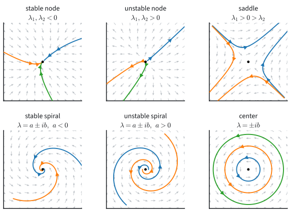
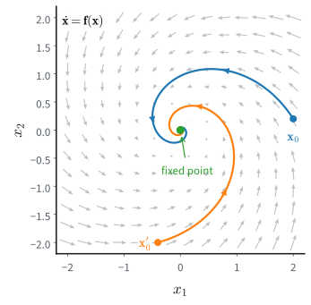
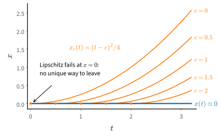
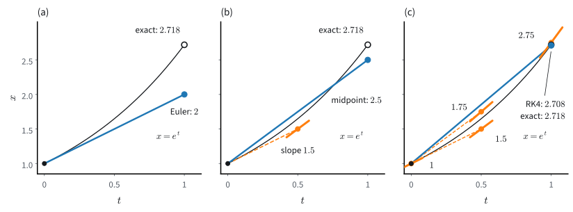
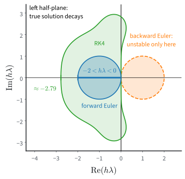

# Ordinary Differential Equations and Numerical Solvers
:label:`sec_mdl-odes-solvers`

Every network in this book is trained by gradient descent, and anyone who has
trained one has seen a run blow up because the learning rate was too large.
It is tempting to blame the loss surface, with its sharp valleys and its
plateaus. Yet the same thing happens on the simplest loss there is. Gradient
descent on the bowl $\mathcal L(x)=25x^2$ takes the step
$x\leftarrow x-\eta\cdot 50x$, and for every learning rate above $\eta=0.04$
the iterates grow without bound, although the bowl has a single minimum and
nothing about it is difficult. If the loss is not the problem, what is?

The answer comes from an older subject. Gradient descent is a step-by-step
solution of the differential equation $\dot x=-50x$, which says: move downhill
at a speed proportional to the slope. Its exact solution
$x(t)=e^{-50t}x_0$ decays to zero from every start. Euler proposed in 1768 to
solve such an equation by following the arrow for a short time $h$ and then
reading it again, and the learning rate plays the role of $h$. One step
multiplies $x$ by $1-50h$. With $h=0.01$ the factor is $0.5$, and the computed
solution decays like the true one. With $h=0.05$ it is $-1.5$, and the
computed solution flips sign and grows. The equation is stable; the steps are
not. The idea of this section is that the eigenvalues of a differential
equation decide both how its exact motion behaves and how large a step can
follow it.

Deep learning meets this gap between an equation and its steps in three
places. Gradient descent is the first. A residual network adds a small update
to its input at every layer, which is one such step. Diffusion and
flow-matching models generate an image by following a learned velocity field
from noise to data, one network evaluation per step, so the number of steps is
the cost of a sample.

We first ask when a differential equation has exactly one solution, and we
solve the linear case completely. We then ask how accurate and how stable a
step-by-step solution is, and how to get more accuracy from each step.
Finally we read gradient descent as one of these solvers. The chapter uses the
symbols below throughout; each section restates the few it needs.

:Notation for the dynamics chapter. The later rows belong to later sections, which define them where they are first used.
:label:`tab_mdl-dyn-notation`

| Symbol | Meaning | First used in |
|---|---|---|
| $\mathbf x(t)\in\mathbb R^d$, $\dot{\mathbf x}$ | state, its time derivative | ODEs and solvers |
| $\mathbf f(\mathbf x,t)$ | vector field of an ODE; drift of an SDE | ODEs and solvers; SDEs |
| $\Phi_t$ | flow map, $\Phi_t(\mathbf x_0)=\mathbf x(t)$ | ODEs and solvers |
| $L$ | Lipschitz constant of $\mathbf f$ | ODEs and solvers |
| $\mathbf A$; $\lambda_j=a_j+\mathrm i\,b_j$; $\mathbf V,\boldsymbol\Lambda$ | linear field; its eigenvalues; eigenvectors and their diagonal | ODEs and solvers |
| $\mathbf K$ | rotation generator $\left(\begin{smallmatrix}0&-1\\1&0\end{smallmatrix}\right)$ | ODEs and solvers |
| $\mathbf J$ | Jacobian of $\mathbf f$ | ODEs and solvers |
| $h$, $t_n=nh$, $\mathbf x_n$ | step size, time grid, numerical iterate | ODEs and solvers |
| $R(z)$, $z=h\lambda$ | stability function of a solver | ODEs and solvers |
| $\varepsilon_n$ | global error $\lVert\mathbf x_n-\mathbf x(t_n)\rVert$ | ODEs and solvers |
| $\mathcal L$, $\eta$, $\mathbf H$ | loss, learning rate, Hessian | ODEs and solvers |
| $c$; $T$ | damping coefficient; time horizon | ODEs and solvers |
| $\boldsymbol\theta$ | network parameters | Neural ODEs |
| $\mathbf a(t)$ | adjoint state | Neural ODEs |
| $p_t$ | density of the state at time $t$ | Neural ODEs |
| $\mathbf W_t$ | Brownian motion | SDEs |
| $g(t)$; $\mathbf G$ | diffusion coefficient; noise matrix | SDEs |
| $\theta$, $g$ | OU rate and noise amplitude, $dX=-\theta X\,dt+g\,dW$ | SDEs |
| $\alpha_t$, $\sigma_t$ | mean coefficient and standard deviation of $\mathbf X_t$ given $\mathbf X_0$ | SDEs |
| $\mathbf x_0$; $\boldsymbol\epsilon$ | data endpoint at $t=0$; noise endpoint at the final time, $t=1$ from flow matching on | SDEs |
| $\mathbf s_t=\nabla\log p_t$; $\mathbf s_{\boldsymbol\theta}$ | score; learned score | Fokker--Planck |
| $\mathbf u_t$; $\mathbf v_{\boldsymbol\theta}$ | true (probability-flow) velocity; learned velocity | Fokker--Planck |
| $\mathbf j$ | probability current | Fokker--Planck |
| $\bar t=T-t$ | reversed clock | Fokker--Planck |
| $w_k$, $r_k(\mathbf x)$, $v_k$ | mixture weights, responsibilities, component variances | Fokker--Planck |
| $\beta_t$, $\bar\alpha_t$ | DDPM noise schedule | Score matching |
| $w(t)$; $\gamma$ | loss weighting over noise levels; guidance scale | Score matching |
| $\pi$ | coupling | Flow matching |
| $\mathrm i$, $\mathbf I$, $D_{\textrm{KL}}$ | imaginary unit (upright), identity, KL divergence | throughout |

```{.python .input #odes-solvers-imports}
#@tab mxnet
%matplotlib inline
from d2l import mxnet as d2l
import numpy as np
```

```{.python .input #odes-solvers-imports}
#@tab pytorch
import math
import numpy as np
import torch
from torch import nn
from torch.nn import functional as F
from d2l import torch as d2l
```

```{.python .input #odes-solvers-imports}
#@tab tensorflow
%matplotlib inline
from d2l import tensorflow as d2l
import numpy as np
```

```{.python .input #odes-solvers-imports}
#@tab jax
import math
import numpy as np
import jax
from jax import numpy as jnp
from flax import nnx
import optax
from d2l import jax as d2l
```

## Vector Fields and Flows
:label:`sec_mdl-vector-fields-trajectories`

Before we can ask how well a solver follows a motion, we need to know what
the motion is. A differential equation describes it by prescribing a velocity
at every point. We start from two simple motions, write down the general
problem, and then ask when it determines a single path.

### Decay, Rotation, and the Spiral

Two motions, decay and rotation, are the building blocks of every linear
field, and both can be solved by hand. We solve them first and name the
general objects afterwards.

The first is *decay*. The rule "move toward zero at a speed proportional to
the distance" is the equation $\dot x=-x$, where the dot is the derivative in
time. Its solution from $x(0)=x_0$ is

$$
x(t)=e^{-t}x_0,
$$

as differentiating shows: $\dot x=-e^{-t}x_0=-x$. Each unit of time
multiplies the distance to the origin by $e^{-1}\approx0.37$, so a start at
$x_0=2$ is at $0.74$ after one second and at $0.27$ after two.

The second is *rotation*. In the plane, let the velocity be the position
turned by a right angle,

$$
\dot{\mathbf x}=\mathbf K\mathbf x,
\qquad
\mathbf K=\begin{pmatrix}0&-1\\1&0\end{pmatrix},
$$

that is $\dot x_1=-x_2$ and $\dot x_2=x_1$. The velocity is perpendicular to
the position, because $\mathbf x^\top\mathbf K\mathbf x=-x_1x_2+x_2x_1=0$, so
the length of $\mathbf x$ never changes:

$$
\frac{d}{dt}\|\mathbf x\|^2=2\,\mathbf x^\top\dot{\mathbf x}
=2\,\mathbf x^\top\mathbf K\mathbf x=0 .
$$

A point moves on a circle, and since its speed $\|\mathbf K\mathbf x\|$
equals its radius $\|\mathbf x\|$ it turns at one radian per unit of time:
one revolution takes $2\pi$.

Adding the two motions gives the field we use as the running example of the
chapter,

$$
\dot{\mathbf x}=\mathbf A\mathbf x,
\qquad
\mathbf A=-\tfrac12\mathbf I+\mathbf K
=\begin{pmatrix}-0.5&-1\\1&-0.5\end{pmatrix}.
$$

The rotation part does not change the length and the decay part shrinks it:
$\tfrac{d}{dt}\|\mathbf x\|^2=2\mathbf x^\top\mathbf A\mathbf x
=-\|\mathbf x\|^2$, so $\|\mathbf x(t)\|=e^{-t/2}\|\mathbf x_0\|$. A point
decays at rate $\tfrac12$ while it turns at unit speed: it spirals into the
origin (:numref:`fig_mdl-dyn-ode-field`). The eigenvalues of $\mathbf A$ are
$-0.5\pm\mathrm i$. Their real part gives the decay rate and their imaginary
part the angular speed, and :numref:`sec_mdl-linear-odes-stability` shows that
these two numbers describe the whole motion. In this sense a linear field is a
sum of decays, growths and rotations, one for each eigenvalue.


:label:`fig_mdl-dyn-ode-field`

### The Initial-Value Problem

Most fields are not linear, so we need a form that covers every rule of
motion. The general problem gives a velocity rule and a starting point:

$$
\dot{\mathbf{x}}(t) = \mathbf{f}(\mathbf{x}(t), t),
\qquad \mathbf{x}(0) = \mathbf{x}_0 .
$$
:eqlabel:`eq_mdl-ode-ivp`

Here $\mathbf x(t)\in\mathbb R^d$ is the state. The function
$\mathbf f:\mathbb R^d\times\mathbb R\to\mathbb R^d$ is a **vector field**:
it attaches an arrow to every point at every time. A **trajectory** is a
differentiable path whose tangent at each instant is the arrow at its current
position.

The vector $\mathbf x_0$ is the **initial value**, and :eqref:`eq_mdl-ode-ivp`
is called an **initial-value problem**. When $\mathbf f$ does not depend on
$t$, the system is **autonomous**: the arrows stay fixed and only the state
moves. Decay, rotation and the spiral are the autonomous fields
$\mathbf f(\mathbf x)=-\mathbf x$, $\mathbf K\mathbf x$ and
$\mathbf A\mathbf x$.

Integrating both sides from $0$ to $t$ (:numref:`sec_mdl-integral_calculus`)
gives the equivalent **integral form**

$$
\mathbf{x}(t) = \mathbf{x}_0 + \int_0^t \mathbf{f}(\mathbf{x}(s), s)\,ds .
$$
:eqlabel:`eq_mdl-ode-integral-form`

The solution is the start plus the accumulated velocity. For decay, the
right-hand side with $x(s)=e^{-s}x_0$ is $x_0-x_0(1-e^{-t})=e^{-t}x_0$, as it
should be. The existence proof below works with the integral form, and
Euler's method, which we meet later in this section, is the left-endpoint
Riemann sum of this integral.

### The Flow Map

A generative model moves a whole cloud of starting points at once, so we fix
the field and vary the start. For an autonomous field, and
assuming that each initial value has a unique solution (we prove this next),
write

$$
\Phi_t(\mathbf x_0)=\mathbf x(t)
$$

for the state at time $t$ of the trajectory started at $\mathbf x_0$. This
**flow map** $\Phi_t:\mathbb R^d\to\mathbb R^d$ moves all of space forward by
$t$ along the arrows.

For decay the flow map is $\Phi_t(x)=e^{-t}x$. Flowing for $s$ and then for
$t$ gives $\Phi_t(\Phi_s(x))=e^{-t}e^{-s}x=e^{-(t+s)}x=\Phi_{t+s}(x)$, and
$\Phi_{-t}(x)=e^{t}x$ undoes $\Phi_t$. The same law holds for every
autonomous field:

$$
\Phi_0 = \mathrm{id},
\qquad
\Phi_{t+s} = \Phi_t \circ \Phi_s .
$$
:eqlabel:`eq_mdl-ode-flow-group`

Flowing $s$ seconds and then $t$ more is flowing $t+s$. The reason is that the
arrows do not change with time: the path $\tau\mapsto\mathbf x(s+\tau)$
starts at $\Phi_s(\mathbf x_0)$ and follows the same arrows, so by uniqueness
it is the trajectory from that point. The flow maps thus form a family of maps
that compose like time. Once we have shown that solutions exist and are
unique backward in time as well (the corollary below), each $\Phi_t$ is a
bijection with inverse $\Phi_{-t}$. An invertible map from noise to data whose
inverse can be computed is what a generative flow needs, and the next section
builds one.

### Existence and Uniqueness
:label:`sec_mdl-ode-existence-uniqueness`

The flow map assumed that exactly one trajectory leaves each point. For a
model defined by a field, this uniqueness is what makes the output a function
of the input, and it can fail.

Consider $\dot x=\sqrt{|x|}$ from $x_0=0$. The constant path $x\equiv0$
solves it. So does, for every waiting time $c\ge0$,

$$
x_c(t) =
\begin{cases}
0, & t \le c, \\
(t - c)^2/4, & t > c,
\end{cases}
$$

since $\dot x_c=(t-c)/2=\sqrt{x_c}$ for $t>c$. A particle at rest may leave
at any time (:numref:`fig_mdl-dyn-uniqueness-fan`), so a model defined by
this field does not assign one output to its input. The cause is the slope of
$\sqrt{|x|}$, which is unbounded at $0$: a small displacement $x$ produces the
much larger velocity $\sqrt{|x|}$.


:label:`fig_mdl-dyn-uniqueness-fan`

For a well-behaved field a solution can be built by iterating the integral
form :eqref:`eq_mdl-ode-integral-form`: guess a path, compute the path the
field would produce from it, and repeat. This is **Picard iteration**. For
$\dot x=x$ with $x_0=1$, start from the constant path $\varphi_0\equiv1$ and
set $\varphi_{k+1}(t)=1+\int_0^t\varphi_k(s)\,ds$:

$$
\varphi_1(t) = 1 + t,
\qquad
\varphi_2(t) = 1 + t + \tfrac{t^2}{2},
\qquad
\varphi_3(t) = 1 + t + \tfrac{t^2}{2} + \tfrac{t^3}{6} .
$$

The iterates converge to the solution $e^t$. Here each iteration adds one
Taylor term of $e^t$; for other fields the iterates look different, but they
still converge, provided the field does not change too abruptly from point to
point. The next proposition makes "too abruptly" precise.

**Proposition (Picard--Lindelöf).** *Let $\mathbf{f}(\mathbf{x}, t)$ be
continuous in $t$ and globally Lipschitz in $\mathbf{x}$: there is an $L$
with*

$$
\|\mathbf{f}(\mathbf{x}, t) - \mathbf{f}(\mathbf{y}, t)\| \le L\,\|\mathbf{x} - \mathbf{y}\|
\qquad \textrm{for all } \mathbf{x}, \mathbf{y}, t.
$$

*Then the initial-value problem :eqref:`eq_mdl-ode-ivp` has exactly one
solution on $[0, T]$, for every $\mathbf{x}_0$ and every $T>0$*
:cite:`Coddington.Levinson.1955`.

The fan is what happens when no such $L$ exists near $0$. The proof shows that
the Picard iterates converge, and that they converge to the only solution.

**Proof.** A continuous path $\boldsymbol\varphi$ on $[0,\delta]$ solves the
problem if and only if it is a fixed point of the **Picard operator**

$$
(P\boldsymbol{\varphi})(t) = \mathbf{x}_0 + \int_0^t \mathbf{f}(\boldsymbol{\varphi}(s), s)\,ds .
$$

In words, $P$ replaces a guessed path by the path the field would produce from
it. (A solution satisfies the integral form; conversely, a continuous fixed
point is differentiable by the fundamental theorem of calculus, with the right
derivative and the right start.)

The one step that is not routine pulls the Lipschitz bound through the
integral. For two paths on $[0,\delta]$, write
$d(\boldsymbol\varphi,\boldsymbol\psi)=\max_{t\le\delta}\|\boldsymbol\varphi(t)-\boldsymbol\psi(t)\|$.
Then for $t\le\delta$,

$$
\|(P\boldsymbol{\varphi})(t) - (P\boldsymbol{\psi})(t)\|
\le \int_0^t L\,\|\boldsymbol{\varphi}(s) - \boldsymbol{\psi}(s)\|\,ds
\le L\,\delta\; d(\boldsymbol\varphi,\boldsymbol\psi) .
$$

With $\delta=1/(2L)$, every application of $P$ halves the distance between
two candidate paths.

Start from the constant path $\boldsymbol\varphi_0\equiv\mathbf x_0$ and set
$\boldsymbol\varphi_{k+1}=P\boldsymbol\varphi_k$. Consecutive iterates then
differ by at most $2^{-k}d(\boldsymbol\varphi_1,\boldsymbol\varphi_0)$, and
these differences add up like a geometric series. So the iterates converge
uniformly on $[0,\delta]$, and a uniform limit of continuous paths is a
continuous path $\boldsymbol\varphi$. (This is the one place where the
completeness of the continuous paths is used.) Since
$d(P\boldsymbol\varphi_k,P\boldsymbol\varphi)\le\tfrac12d(\boldsymbol\varphi_k,\boldsymbol\varphi)\to0$,
the limit satisfies $\boldsymbol\varphi=P\boldsymbol\varphi$: it is a
solution. Two solutions $\boldsymbol\varphi,\boldsymbol\psi$ would satisfy
$d(\boldsymbol\varphi,\boldsymbol\psi)=d(P\boldsymbol\varphi,P\boldsymbol\psi)\le\tfrac12d(\boldsymbol\varphi,\boldsymbol\psi)$,
so they coincide.

Finally restart at $t=\delta$ from $\boldsymbol\varphi(\delta)$. The step
length $1/(2L)$ does not depend on where the solution is, because $L$ is the
same everywhere, so $\lceil 2LT\rceil$ restarts cover $[0,T]$, with one
solution on each piece. $\blacksquare$

The theorem runs forward in time. Running a field backward is the same
theorem applied to a second field, and this settles the invertibility of the
flow map.

**Corollary (the flow map is a bijection).** *Let $\mathbf f(\mathbf x)$ be
autonomous and globally Lipschitz. Then $\Phi_t$ exists for every
$t\in\mathbb R$, and each $\Phi_t$ is a bijection of $\mathbb R^d$ with
inverse $\Phi_{-t}$.*

**Proof.** The field $\mathbf g(\mathbf y)=-\mathbf f(\mathbf y)$ is Lipschitz
with the same $L$. A path $\mathbf x(t)$ solves $\dot{\mathbf x}=\mathbf f$ on
$[-T,0]$ if and only if $\mathbf y(s)=\mathbf x(-s)$ solves
$\dot{\mathbf y}=\mathbf g$ on $[0,T]$, since
$\dot{\mathbf y}(s)=-\dot{\mathbf x}(-s)=-\mathbf f(\mathbf y(s))$. The
theorem applied to $\mathbf g$ gives a unique solution backward in time for
every start, so $\Phi_t$ is defined for all real $t$. The composition law
:eqref:`eq_mdl-ode-flow-group` then gives
$\Phi_{-t}\circ\Phi_t=\Phi_t\circ\Phi_{-t}=\Phi_0=\mathrm{id}$.
$\blacksquare$

One consequence is that two different trajectories never meet: a meeting point
would have two different backward solutions. (For a time-dependent field the
same argument applies to $\mathbf g(\mathbf y,s)=-\mathbf f(\mathbf y,-s)$.)

The theorem asks for a Lipschitz bound and for that bound to hold globally,
and each requirement rules out a different failure. The fan shows what happens
without a Lipschitz bound. Without the global bound, the solution can blow up.
The field $\dot x=x^2$ is smooth, and from $x_0>0$ separation of variables
gives

$$
x(t) = \frac{x_0}{1 - x_0 t},
$$

which reaches infinity at the finite time $t=1/x_0$. The proof shows why the
theorem does not cover it. On the interval $|x|\le\rho$ the field is
Lipschitz with $L=2\rho$, since $|x^2-y^2|=|x+y|\,|x-y|$. The restart length
$1/(2L)=1/(4\rho)$ therefore shrinks as the solution grows, and the restarts
can add up to a finite time. A field that is Lipschitz only on bounded sets
guarantees a solution only for a while.

The fields of many neural networks satisfy both requirements. A field built
from linear maps and Lipschitz activations, such as
$\mathbf f(\mathbf x)=\mathbf W_2\tanh(\mathbf W_1\mathbf x+\mathbf b_1)+\mathbf b_2$,
is globally Lipschitz, with $L$ at most the product of the weight norms and
the activations' constants ($\|\mathbf W_2\|\,\|\mathbf W_1\|$ here). The
model of the next section is therefore well-posed, and by the corollary its
time-$T$ map is a bijection.

## Linear ODEs and Stability
:label:`sec_mdl-linear-odes-stability`

Linear fields are the one family we can solve completely, and they describe
every other field near a point where it vanishes. This part solves them,
reads stability off the eigenvalues, shows where the eigenvalues mislead, and
applies the result to a pendulum.

### The Matrix Exponential

The scalar equation $\dot x=ax$ is solved by $x(t)=e^{at}x_0$. For a linear
system

$$
\dot{\mathbf{x}} = \mathbf A\mathbf{x},
\qquad
\mathbf{x}(0) = \mathbf{x}_0,
\qquad \mathbf A \in \mathbb{R}^{d \times d},
$$

we look for the same form with a matrix in the exponent. For any square
matrix $\mathbf C$, define the **matrix exponential** by the power series that
defines $e^z$:

$$
e^{\mathbf C} = \sum_{k=0}^{\infty} \frac{\mathbf C^k}{k!}
= \mathbf I + \mathbf C + \frac{\mathbf C^2}{2} + \frac{\mathbf C^3}{6} + \cdots .
$$
:eqlabel:`eq_mdl-ode-matrix-exp-series`

The series converges for every matrix: term by term,
$\|\mathbf C^k\| \le \|\mathbf C\|^k$ (the operator norm is
submultiplicative), so it is dominated by the scalar series for
$e^{\|\mathbf C\|}$, which converges.

**Proposition (the matrix exponential solves linear ODEs).**
*$\mathbf{x}(t) = e^{\mathbf At}\mathbf{x}_0$ is the unique solution of
$\dot{\mathbf{x}} = \mathbf A\mathbf{x}$, $\mathbf{x}(0) = \mathbf{x}_0$.*

**Proof.** Differentiate the series :eqref:`eq_mdl-ode-matrix-exp-series` with
$\mathbf C = \mathbf At$ term by term (legitimate: on any bounded $t$-interval
the differentiated series still converges uniformly, by the same domination):

$$
\frac{d}{dt} e^{\mathbf At}
= \sum_{k=1}^{\infty} \frac{\mathbf A^k\, t^{k-1}}{(k-1)!}
= \mathbf A \sum_{j=0}^{\infty} \frac{(\mathbf At)^j}{j!}
= \mathbf A\, e^{\mathbf At}.
$$

So $\mathbf{x}(t) = e^{\mathbf At}\mathbf{x}_0$ satisfies the ODE, and at
$t = 0$ the series collapses to $\mathbf I$, so $\mathbf{x}(0) = \mathbf{x}_0$.
Uniqueness is Picard--Lindelöf: the field $\mathbf{x} \mapsto \mathbf A\mathbf{x}$
is Lipschitz with $L = \|\mathbf A\|$. $\blacksquare$

An infinite series of matrix powers is not yet a formula we can read. The
eigendecomposition turns it into $d$ scalar exponentials. Recall that if
$\mathbf A$ has $d$ independent eigenvectors $\mathbf v_j$,
$\mathbf A\mathbf v_j=\lambda_j\mathbf v_j$, then with
$\mathbf V=(\mathbf v_1,\ldots,\mathbf v_d)$ and
$\boldsymbol\Lambda=\mathrm{diag}(\lambda_1,\ldots,\lambda_d)$ we have
$\mathbf A=\mathbf V\boldsymbol\Lambda\mathbf V^{-1}$
(:numref:`sec_mdl-eigendecompositions`).

**Proposition (matrix exponential by eigendecomposition).** *If
$\mathbf A = \mathbf V \boldsymbol\Lambda \mathbf V^{-1}$ with
$\boldsymbol\Lambda = \mathrm{diag}(\lambda_1, \ldots, \lambda_d)$, then*

$$
e^{\mathbf At} = \mathbf V e^{\boldsymbol\Lambda t} \mathbf V^{-1},
\qquad
e^{\boldsymbol\Lambda t} = \mathrm{diag}\!\left(e^{\lambda_1 t}, \ldots, e^{\lambda_d t}\right).
$$
:eqlabel:`eq_mdl-ode-matrix-exp-eig`

**Proof.** Powers telescope: $(\mathbf At)^k = \mathbf V (\boldsymbol\Lambda t)^k \mathbf V^{-1}$,
because each adjacent $\mathbf V^{-1} \mathbf V$ cancels. Summing the series
:eqref:`eq_mdl-ode-matrix-exp-series` and pulling $\mathbf V, \mathbf V^{-1}$
out of the sum gives
$e^{\mathbf At} = \mathbf V\left(\sum_k (\boldsymbol\Lambda t)^k / k!\right) \mathbf V^{-1}$.
The inner sum is the exponential of a diagonal matrix, which is diagonal with
entries $\sum_k (\lambda_j t)^k / k! = e^{\lambda_j t}$. $\blacksquare$

The formula is a decoupling statement. Expand the start in the eigenbasis,
$\mathbf{x}_0 = \sum_j c_j \mathbf{v}_j$; then

$$
\mathbf{x}(t) = \sum_{j=1}^{d} c_j\, e^{\lambda_j t}\, \mathbf{v}_j .
$$

Along each eigendirection the system is the scalar equation
$\dot{x} = \lambda_j x$ we solved first, evolving independently of the others.
Each term $c_je^{\lambda_jt}\mathbf v_j$ is called a **mode** of the system.

For the spiral we can do better than the general formula. Because
$\mathbf A=-\tfrac12\mathbf I+\mathbf K$ and $\mathbf I$ commutes with
$\mathbf K$, the exponential splits, $e^{\mathbf At}=e^{-t/2}e^{\mathbf Kt}$.
Because $\mathbf K^2=-\mathbf I$, the powers of $\mathbf K$ cycle through
$\mathbf I,\mathbf K,-\mathbf I,-\mathbf K$, and the series for
$e^{\mathbf Kt}$ splits into even and odd terms, the series of $\cos t$ and
$\sin t$:

$$
e^{\mathbf At}
=e^{-t/2}\left(\cos t\,\mathbf I+\sin t\,\mathbf K\right)
=e^{-t/2}\begin{pmatrix}\cos t&-\sin t\\\sin t&\cos t\end{pmatrix}.
$$

The flow shrinks by $e^{-t/2}$ and turns by $t$ radians, as the first
subsection found by looking at the field. From $\mathbf x_0=(2,0)$ at $t=2$
the state is $e^{-1}(2\cos2,\,2\sin2)=(-0.306,\,0.669)$, with length
$2e^{-1}=0.736$. For this $\mathbf A$ the eigenvectors and eigenvalues
$-0.5\pm\mathrm i$ are complex, but the product
$\mathbf Ve^{\boldsymbol\Lambda t}\mathbf V^{-1}$ is real.

The one step that needed care was the split of the exponential. The rule
$e^{\mathbf P+\mathbf Q}=e^{\mathbf P}e^{\mathbf Q}$ holds when
$\mathbf P\mathbf Q=\mathbf Q\mathbf P$, since then $(\mathbf P+\mathbf Q)^k$
expands by the binomial theorem. For matrices that do not commute it fails
(:exref:`ex_mdl-odes-solvers-symplectic-euler`).

Do the series, the eigendecomposition and the compound-interest limit
$(\mathbf I+t\mathbf A/n)^n$ give the same matrix, and does the length fall
like $e^{-t/2}$? The cell computes all three for the spiral at $t=2$.

```{.python .input #odes-solvers-matrix-exponential}
A = np.array([[-0.5, -1.0], [1.0, -0.5]])      # spiral: eigenvalues -0.5 +- i
t = 2.0
lam, V = np.linalg.eig(A)                      # A = V diag(lam) V^{-1}
expAt_eig = (V @ np.diag(np.exp(lam * t)) @ np.linalg.inv(V)).real
term, expAt_series = np.eye(2), np.eye(2)      # identity plus 29 terms (At)^k / k!
for k in range(1, 30):
    term = term @ (A * t) / k
    expAt_series += term
x0 = np.array([2.0, 0.0])
print('eigenvalues of A:', lam.round(4))
print(f'|series - eigen formula| = {np.abs(expAt_series - expAt_eig).max():.1e}')
for n in [2 ** 10, 2 ** 16, 2 ** 24]:          # compounding (I + tA/n)^n
    expAt_n = np.linalg.matrix_power(np.eye(2) + (t / n) * A, n)
    err = np.abs(expAt_n - expAt_eig).max()
    print(f'n = 2^{int(np.log2(n))}: |(I+tA/n)^n - eigen| = {err:.1e}, '
          f'n * error = {n * err:.2f}')
print('x(2) =', (expAt_eig @ x0).round(4))
print(f'||x(2)|| = {np.linalg.norm(expAt_eig @ x0):.6f},  '
      f'e^(-t/2) ||x0|| = {np.exp(-0.5 * t) * np.linalg.norm(x0):.6f}')
```

Thirty terms of the series agree with the eigendecomposition to about
$10^{-16}$, and the state $(-0.3062,\,0.6690)$ and its length $0.735759$ are
the values computed by hand. The compounding converges much more slowly: its
error times $n$ stays at $0.90$ as $n$ grows from $2^{10}$ to $2^{24}$, so the
error falls like $1/n$. This is compound interest with a matrix interest
rate. The product $(\mathbf I+t\mathbf A/n)^n$ is also $n$ steps of the
simplest numerical solver, met in :numref:`sec_mdl-euler-runge-kutta`, whose
error is of order $1/n$.

### Stability from Eigenvalues

The decoupled form tells us at a glance whether a linear system settles down.
Write each eigenvalue as $\lambda_j = a_j + \mathrm i\, b_j$. Its mode has
magnitude $|e^{\lambda_j t}| = e^{a_j t}$, since
$e^{\mathrm i b_jt}=\cos b_jt+\mathrm i\sin b_jt$ has modulus one. The real
part sets growth or decay; the imaginary part sets rotation. For a
diagonalizable $\mathbf A$ this gives the following classification.

* If $\operatorname{Re}\lambda_j < 0$ for all $j$, every mode decays, and
  $\mathbf{x}(t) \to \mathbf{0}$ from every start: the origin is
  **asymptotically stable**. The slowest mode sets the decay rate
  $-\max_j \operatorname{Re}\lambda_j$.
* If $\operatorname{Re}\lambda_j > 0$ for some $j$, that mode grows
  exponentially, and every start with a component along $\mathbf v_j$
  escapes: the origin is **unstable**.
* If $\operatorname{Im}\lambda_j \neq 0$, the conjugate pair
  $a\pm\mathrm ib$ contributes a rotation at angular speed $b$, decaying or
  growing with the sign of $a$.

The rotation case is the spiral of the first subsection with general rates. In a
suitable real basis of the plane spanned by the real and imaginary parts of
the eigenvector, $\mathbf A$ acts there as $a\mathbf I+b\mathbf K$, and the
computation above gives

$$
e^{(a\mathbf I+b\mathbf K)t}=e^{at}\left(\cos bt\,\mathbf I+\sin bt\,\mathbf K\right):
$$

scaling by $e^{at}$ composed with rotation by the angle $bt$. The same block,
iterated in discrete time instead of flowed, appears in
:numref:`subsec_mdl-complex-rotation`, where a matrix turns the plane by a
fixed angle at each step.

In two dimensions, and for $\det\mathbf A\ne0$, the signs of the eigenvalues
give six standard pictures. (A zero eigenvalue gives a whole line of fixed
points.)

| eigenvalues of $\mathbf A$ ($2\times 2$)      | portrait        | behavior                    |
|-----------------------------------------------|-----------------|-----------------------------|
| real, both negative                           | stable node     | monotone decay              |
| real, both positive                           | unstable node   | monotone growth             |
| real, opposite signs                          | saddle          | decay in, escape out        |
| complex pair, $\operatorname{Re}\lambda < 0$  | stable spiral   | decaying oscillation        |
| complex pair, $\operatorname{Re}\lambda > 0$  | unstable spiral | growing oscillation         |
| purely imaginary pair                         | center          | closed orbits               |

:numref:`fig_mdl-dyn-phase-portraits` draws one field of each kind. In a
saddle, trajectories come in along the stable eigendirection and leave along
the unstable one. The stable spiral is the field of
:numref:`fig_mdl-dyn-ode-field`, and the center is pure rotation.


:label:`fig_mdl-dyn-phase-portraits`

When $\mathbf A$ is not diagonalizable (:numref:`sec_mdl-eigendecompositions`),
the modes acquire polynomial factors $t^ke^{\lambda t}$. Off the imaginary
axis the exponential still decides stability; on it, a Jordan block can make
solutions grow like $t^k$.

### Transient Growth
:label:`subsec_mdl-ode-transient-growth`

The classification says that when every mode decays, the state goes to zero.
It is tempting to conclude that the length $\|\mathbf x(t)\|$ decreases all
the way. It need not, and the smallest counterexample is a triangular
$2\times2$ matrix.

Take

$$
\mathbf B=\begin{pmatrix}-1&10\\0&-2\end{pmatrix},
\qquad \mathbf x_0=(0,1),
$$

with eigenvalues $-1$ and $-2$, both negative. The second row involves only
$x_2$, so $x_2(t)=e^{-2t}$. Substituting it into the first row gives
$\dot x_1=-x_1+10e^{-2t}$ with $x_1(0)=0$, solved by

$$
x_1(t)=10\left(e^{-t}-e^{-2t}\right),
$$

as differentiating confirms: $\dot x_1=-10e^{-t}+20e^{-2t}=-x_1+10x_2$. The
first coordinate starts at $0$, rises to $10(\tfrac12-\tfrac14)=2.5$ at
$t=\log2\approx0.69$, and only then decays. The length of the state, $1$ at
the start, grows to about $2.5$ before it shrinks.

The cause is the geometry of the eigenvectors. They are $\mathbf v_1=(1,0)$
and $\mathbf v_2=(-0.995,\,0.0995)$, only $5.7^\circ$ apart, so the short
vector $\mathbf x_0$ is the difference of two long ones,
$\mathbf x_0=10.0\,\mathbf v_1+10.05\,\mathbf v_2$. At $t=0$ the two
components cancel almost exactly. They decay at different rates, the
cancellation stops, and their difference grows before both have died away.

For a normal matrix $\mathbf N$, whose eigenvectors are orthogonal, nothing
can cancel, and
$\|e^{\mathbf Nt}\|_2=e^{t\max_j\operatorname{Re}\lambda_j(\mathbf N)}$ for all
$t\ge0$. In discrete time the same mechanism makes the powers of the
triangular matrix with diagonal $0.9$ and $0.8$ grow tenfold before they decay
(:numref:`subsec_mdl-transient-growth`).

Does the closed form agree with the eigendecomposition formula, and how large
does the state get? The cell evaluates both on a grid and plots the length
against the two modes $e^{-t}$ and $e^{-2t}$.

```{.python .input #mdl-odes-solvers-transient-growth}
B = np.array([[-1.0, 10.0], [0.0, -2.0]])     # both eigenvalues negative
ts = np.linspace(0, 4, 401)
x1 = 10 * (np.exp(-ts) - np.exp(-2 * ts))      # closed form from x0 = (0, 1)
x2 = np.exp(-2 * ts)
lam_B, V_B = np.linalg.eig(B)
x_eig = np.array([(V_B @ np.diag(np.exp(lam_B * s)) @ np.linalg.inv(V_B))[:, 1]
                  for s in ts])                # e^{Bt} x0 = second column
norm = np.hypot(x1, x2)
print('eigenvalues of B:', lam_B)
print('|coefficients of x0|:', np.abs(np.linalg.solve(V_B, [0.0, 1.0])).round(2))
print(f'|closed form - eigen| = {np.abs(x_eig - np.c_[x1, x2]).max():.1e}')
print(f'peak {norm.max():.3f} at t = {ts[norm.argmax()]:.2f}')
d2l.plot(ts, [norm, np.exp(-ts), np.exp(-2 * ts)], 't', '||x(t)||',
         legend=['B from (0, 1)', 'exp(-t)', 'exp(-2t)'])
```

Both modes decay from the first instant, yet the length climbs to $2.51$ at
$t\approx0.68$. Only afterwards does it decay, like $10e^{-t}$, at the rate
of the slower mode. Eigenvalues give the asymptotic rate of decay, not the
size of the transient. Momentum in optimization has the same structure, as
:exref:`ex_mdl-odes-solvers-transient-growth` shows.

### Linearization at Fixed Points
:label:`subsec_mdl-ode-linearization`

Nonlinear fields have no closed-form solution, but near a point where the
field vanishes they behave like a linear one. A **fixed point** of an
autonomous field is a state $\mathbf x^\star$ with
$\mathbf f(\mathbf x^\star)=\mathbf 0$: a particle placed there never moves.
For a continuously differentiable $\mathbf f$ and a small displacement
$\boldsymbol\delta(t)=\mathbf x(t)-\mathbf x^\star$, Taylor's theorem
(:numref:`sec_mdl-multivariable_calculus`) gives

$$
\dot{\boldsymbol{\delta}}
= \mathbf{f}(\mathbf{x}^\star + \boldsymbol{\delta})
= \mathbf J\,\boldsymbol{\delta} + o(\|\boldsymbol{\delta}\|),
\qquad
\mathbf J = \frac{\partial \mathbf{f}}{\partial \mathbf{x}}(\mathbf{x}^\star) .
$$

Near the fixed point the field is the linear field of its Jacobian
$\mathbf J$. A fixed point is **hyperbolic** if no eigenvalue of $\mathbf J$
has zero real part. For a hyperbolic fixed point, the Hartman--Grobman theorem
:cite:`Hartman.1960,Grobman.1959` says that near $\mathbf x^\star$ the
trajectories of the nonlinear field are those of
$\dot{\boldsymbol\delta}=\mathbf J\boldsymbol\delta$, up to a continuous change
of coordinates. The eigenvalues of the Jacobian then decide local stability by
the classification above.

The damped pendulum is the smallest nonlinear case worth computing. Its angle
$\phi$ from the bottom obeys $\ddot\phi=-\sin\phi-c\dot\phi$, with damping
coefficient $c\ge0$. With the angular velocity $\omega=\dot\phi$ it becomes the
first-order system

$$
\dot\phi=\omega,\qquad \dot\omega=-\sin\phi-c\,\omega,
\qquad
\mathbf J(\phi,\omega)=\begin{pmatrix}0&1\\-\cos\phi&-c\end{pmatrix}.
$$

The fixed points have $\omega=0$ and $\sin\phi=0$: the pendulum hanging at
$\phi=0$ and balanced upright at $\phi=\pi$.

* At the bottom, $\mathbf J$ has characteristic polynomial
  $\lambda^2+c\lambda+1$, with roots
  $\lambda=-c/2\pm\mathrm i\sqrt{1-c^2/4}$ for $c<2$. At $c=0.5$ they are
  $-0.25\pm0.97\,\mathrm i$: a stable spiral, the ring-down of a released
  pendulum, which swings with period about $2\pi/0.97$ while its amplitude
  decays like $e^{-t/4}$.
* At the top, the polynomial is $\lambda^2+c\lambda-1$, whose roots
  $(-c\pm\sqrt{c^2+4})/2$ have product $-1$, so one is positive and one
  negative for every $c$. At $c=0.5$ they are $0.78$ and $-1.28$: a saddle.
  Only the starts on one curve approach the top. They are the pendulum swung
  up with just the right speed, which comes to rest balanced like a pencil on
  its tip.

The same computation, a Jacobian and its eigenvalues, classifies the fixed
points of a trained field, with one exception. When an eigenvalue lies on the
imaginary axis, the linearization decides nothing. The fields $\dot x=-x^3$ and $\dot x=x^3$ both have Jacobian $0$ at
the origin. The first is stable, with $x(t)=x_0/\sqrt{1+2x_0^2t}\to0$; the
second escapes to infinity at $t=1/(2x_0^2)$.

## Numerical Solvers
:label:`sec_mdl-euler-runge-kutta`

Beyond linear fields there is rarely a closed form, so we compute. This part
asks how far a step-by-step solution drifts from the true one, how to make it
drift less per unit of work, and when the steps become unstable.

### Forward Euler

Over one short step, the integral form
:eqref:`eq_mdl-ode-integral-form` can be approximated by holding the velocity
at its value at the start of the step. We first see what this does on the
equation whose answer we know.

Take $\dot x=x$ from $x_0=1$ to $T=1$, where the answer is $e=2.718$. Divide
the interval into $n$ steps of length $h=1/n$, and in each step move with the
velocity at its start: $x\leftarrow x+hx=(1+1/n)x$. After $n$ steps,
$x_n=(1+1/n)^n$. This is a dollar at 100% annual interest compounded $n$
times a year:

| $n$ | 1 | 2 | 4 | 8 | 16 | 32 | 365 |
|---|---|---|---|---|---|---|---|
| $(1+1/n)^n$ | 2.000 | 2.250 | 2.441 | 2.566 | 2.638 | 2.677 | 2.7146 |
| error | 0.718 | 0.468 | 0.277 | 0.153 | 0.080 | 0.041 | 0.0037 |

The ratios of consecutive errors are $1.53,1.69,1.82,1.90,1.95$: doubling the
number of steps comes closer and closer to halving the error. For large $n$
the error is about $e/(2n)=1.36\,h$. Error proportional to $h$ is what we will
call order one.

For a general field, with step size $h$ and grid $t_n = nh$, **forward Euler**
is

$$
\mathbf{x}_{n+1} = \mathbf{x}_n + h\, \mathbf{f}(\mathbf{x}_n, t_n) .
$$
:eqlabel:`eq_mdl-ode-euler-update`

The method follows the arrow at the current point for time $h$, then reads the
field again. Equivalently, it is the Taylor expansion of the true solution cut
after the linear term, and the error of one step is the first term dropped. If
$\|\ddot{\mathbf{x}}(t)\| \le M$ along the solution, then

$$
\mathbf{x}(t_{n+1}) = \mathbf{x}(t_n) + h\,\mathbf{f}(\mathbf{x}(t_n), t_n) + \mathbf{r}_n,
\qquad
\|\mathbf{r}_n\| \le \tfrac{M h^2}{2}.
$$

The true solution satisfies the update up to a remainder of order $h^2$. A
per-step error of order $h^2$ does not give a final error of order $h^2$:
reaching a fixed horizon $T$ takes $T/h$ steps, the per-step errors
accumulate, and each step may amplify the error already made. One power of
$h$ is lost, and the proof is short.

**Proposition (Euler converges at order 1).** *Let $\mathbf{f}$ be
$L$-Lipschitz in $\mathbf{x}$, and let the solution of
:eqref:`eq_mdl-ode-ivp` on $[0, T]$ satisfy
$\|\ddot{\mathbf{x}}(t)\| \le M$. Then the Euler iterates
:eqref:`eq_mdl-ode-euler-update` obey*

$$
\max_{n \le T/h} \|\mathbf{x}_n - \mathbf{x}(t_n)\|
\;\le\; \frac{M h}{2L}\left(e^{LT} - 1\right)
\;=\; O(h).
$$

**Proof.** Let $\varepsilon_n = \|\mathbf{x}_n - \mathbf{x}(t_n)\|$, and
subtract the Taylor identity above from the update
:eqref:`eq_mdl-ode-euler-update`:

$$
\varepsilon_{n+1}
\le \underbrace{\|\mathbf{x}_n - \mathbf{x}(t_n)\| + h\,\|\mathbf{f}(\mathbf{x}_n, t_n) - \mathbf{f}(\mathbf{x}(t_n), t_n)\|}_{\le\, (1 + hL)\, \varepsilon_n \textrm{ by Lipschitz}}
\;+\; \underbrace{\|\mathbf{r}_n\|}_{\le\, Mh^2/2} .
$$

Each step multiplies the existing error by at most $1 + hL$ and adds at most
$Mh^2/2$. Unrolling the recursion from $\varepsilon_0 = 0$ sums a geometric
series:

$$
\varepsilon_n \le \frac{Mh^2}{2} \sum_{j=0}^{n-1} (1 + hL)^j
= \frac{Mh^2}{2} \cdot \frac{(1 + hL)^n - 1}{hL}
\le \frac{Mh}{2L}\left(e^{LT} - 1\right),
$$

using $(1 + hL)^n \le e^{nhL} \le e^{LT}$. $\blacksquare$

For $\dot x=x$ on $[0,1]$ we have $M=\max|\ddot x|=e$ and $L=1$, so the bound
is $\tfrac e2(e-1)h=2.3\,h$, against the true error $1.36\,h$: the right
order, with a pessimistic constant. The structure of the bound recurs for
every solver. A local error of order $h^{p+1}$ per step becomes a global
error of order $h^p$ after $T/h$ steps, inflated by the factor $e^{LT}$ that
measures how strongly the dynamics amplify old mistakes. A method with global
error of order $h^p$ has **order** $p$; Euler has order $1$.

### Runge--Kutta Methods

Euler commits to the slope at the start of the step while the trajectory
curves away from it. Runge--Kutta methods measure the slope at points inside
the step and combine the measurements. :numref:`fig_mdl-dyn-solver-geometry`
shows one step of size $h=1$ on $\dot x=x$ from $x=1$.


:label:`fig_mdl-dyn-solver-geometry`

The simplest improvement, the **midpoint method**, takes half an Euler step
only to measure the slope there, and then takes the real step with that slope:
$\mathbf{x}_{n+1} = \mathbf{x}_n + h\,\mathbf{f}\!\left(\mathbf{x}_n + \tfrac{h}{2}\mathbf{f}(\mathbf{x}_n)\right)$
(autonomous notation). One Taylor line in one dimension shows why it helps:

$$
x + h f\!\left(x + \tfrac{h}{2} f(x)\right)
= x + h f + \tfrac{h^2}{2} f' f + O(h^3).
$$

The true expansion is $x(t+h) = x + h\dot{x} + \tfrac{h^2}{2}\ddot{x} + O(h^3)$
with $\ddot{x} = \tfrac{d}{dt} f(x(t)) = f' f$, so the $h^2$ term is now
right instead of missing. The local error is $O(h^3)$ and the global order
$2$, for two field evaluations per step. **Heun's method** takes a full trial
Euler step and averages the slopes at its two ends,
$\mathbf{x}_{n+1} = \mathbf{x}_n + \tfrac{h}{2}\left[\mathbf{f}(\mathbf{x}_n) + \mathbf{f}\!\left(\mathbf{x}_n + h\,\mathbf{f}(\mathbf{x}_n)\right)\right]$,
with the same order and the same two evaluations. Many diffusion samplers use
this two-stage method.

Four slope measurements give the standard general-purpose method of
scientific computing, **classical Runge--Kutta (RK4)**:

$$
\begin{aligned}
\mathbf{k}_1 &= \mathbf{f}(\mathbf{x}_n,\, t_n), \\
\mathbf{k}_2 &= \mathbf{f}(\mathbf{x}_n + \tfrac{h}{2}\mathbf{k}_1,\, t_n + \tfrac{h}{2}), \\
\mathbf{k}_3 &= \mathbf{f}(\mathbf{x}_n + \tfrac{h}{2}\mathbf{k}_2,\, t_n + \tfrac{h}{2}), \\
\mathbf{k}_4 &= \mathbf{f}(\mathbf{x}_n + h\,\mathbf{k}_3,\, t_n + h), \\
\mathbf{x}_{n+1} &= \mathbf{x}_n + \tfrac{h}{6}\left(\mathbf{k}_1 + 2\mathbf{k}_2 + 2\mathbf{k}_3 + \mathbf{k}_4\right).
\end{aligned}
$$
:eqlabel:`eq_mdl-ode-rk4-update`

The update averages four slope measurements, weighting the two at the
midpoint twice. These weights are Simpson's rule,
$\int_a^b g \approx \tfrac{b-a}{6}\bigl(g(a) + 4g(\tfrac{a+b}{2}) + g(b)\bigr)$,
with the midpoint value split between two measurements.

Why order $4$? On a linear field the answer takes one computation. Each method
applied to the scalar test equation $\dot y=\lambda y$ multiplies $y$ by a
fixed function of $z=h\lambda$ per step, and we can compare that function
with the exact factor $e^z$.

**Proposition (stability functions).** *On $\dot y=\lambda y$, with
$\lambda$ real or complex and $z=h\lambda$, one step of each method multiplies
$y$ by its **stability function** $R(z)$:*

$$
R_{\textrm{Euler}}(z)=1+z,
\qquad
R_{\textrm{mid}}(z)=R_{\textrm{Heun}}(z)=1+z+\frac{z^2}{2},
\qquad
R_{\textrm{RK4}}(z)=1+z+\frac{z^2}{2}+\frac{z^3}{6}+\frac{z^4}{24}.
$$
:eqlabel:`eq_mdl-ode-stability-function`

**Proof.** For RK4 the four measurements are $\mathbf k_1=\lambda y$,
$\mathbf k_2=\lambda y(1+\tfrac z2)$,
$\mathbf k_3=\lambda y(1+\tfrac z2+\tfrac{z^2}4)$ and
$\mathbf k_4=\lambda y(1+z+\tfrac{z^2}2+\tfrac{z^3}4)$, each obtained by
substituting the previous one. The update is
$y+\tfrac z6\left(6+3z+z^2+\tfrac{z^3}4\right)y$, which is the stated
polynomial times $y$. For Euler, $y+zy$. For the midpoint method,
$y+h\lambda(y+\tfrac z2y)$, and for Heun, $y+\tfrac z2(y+(1+z)y)$; both are
$(1+z+\tfrac{z^2}2)y$. $\blacksquare$

Each $R$ is the Taylor polynomial of the exact factor $e^z$, cut at the
method's order. For RK4, $e^z-R_{\textrm{RK4}}(z)=z^5/120+O(z^6)$, so on this
equation one step errs by $O(h^5)$ and $T/h$ steps by $O(h^4)$. For nonlinear
fields that are four times continuously differentiable and Lipschitz in
$\mathbf x$, a longer Taylor match gives the same orders: midpoint and Heun
have order $2$, RK4 order $4$ :cite:`Hairer.Norsett.Wanner.1993`. The stability
function returns when we ask which steps are stable.

The order sets the cost. A method of order $p$ reaches error $\varepsilon$
with a number of steps proportional to $\varepsilon^{-1/p}$. For a target
error of $10^{-6}$, ignoring constants, Euler needs about $10^6$ field
evaluations and RK4 about $4\times10^{1.5}\approx130$.

Practical solvers also choose the step size as they go. An *embedded pair*
such as Dormand--Prince
computes solutions of orders $4$ and $5$ from the same evaluations and uses
their difference as an estimate of the local error :cite:`Dormand.Prince.1980`;
:exref:`ex_mdl-odes-solvers-adaptive-steps` builds the simplest such
controller.

Are the slopes $1$ and $4$ measurable? We integrate the spiral to $T = 2$,
where the matrix-exponential cell gave the exact answer, and halve the step
six times. On log--log axes, $\textrm{error} \approx C h^p$ is a line of
slope $p$.

```{.python .input #odes-solvers-euler-rk4-order}
def euler(f, x0, T, n):
    """Forward Euler: n steps of size h = T/n."""
    x, h = np.asarray(x0, dtype=float), T / n
    for k in range(n):
        x = x + h * f(x)
    return x

def rk4(f, x0, T, n):
    """Classical Runge-Kutta: four slope measurements per step."""
    x, h = np.asarray(x0, dtype=float), T / n
    for k in range(n):
        k1 = f(x)
        k2 = f(x + 0.5 * h * k1)
        k3 = f(x + 0.5 * h * k2)
        k4 = f(x + h * k3)
        x = x + (h / 6) * (k1 + 2 * k2 + 2 * k3 + k4)
    return x

f = lambda x: A @ x                            # the spiral field from above
T = 2.0
x_true = expAt_eig @ x0                        # exact endpoint via e^{At}
ns = 2 ** np.arange(3, 10)                     # 8, 16, ..., 512 steps
hs = T / ns
err_eu = np.array([np.linalg.norm(euler(f, x0, T, n) - x_true) for n in ns])
err_rk = np.array([np.linalg.norm(rk4(f, x0, T, n) - x_true) for n in ns])
print('measured slope, Euler:', f'{np.polyfit(np.log(hs), np.log(err_eu), 1)[0]:.3f}')
print('measured slope, RK4  :', f'{np.polyfit(np.log(hs), np.log(err_rk), 1)[0]:.3f}')
print(f'error at 512 steps: Euler {err_eu[-1]:.1e}, RK4 {err_rk[-1]:.1e}')
print('RK4 with 128 steps (the same 512 evaluations):',
      f'{np.linalg.norm(rk4(f, x0, T, 128) - x_true):.1e}')
d2l.plot(hs, [err_eu, err_rk, err_eu[-1] * (hs / hs[-1]),
              err_rk[-1] * (hs / hs[-1]) ** 4],
         'step size h', 'global error at T', xscale='log', yscale='log',
         legend=['Euler', 'RK4', 'slope 1', 'slope 4'])
```

The fitted slopes are $1.04$ and $4.02$, and each halving of $h$ divides the
RK4 error by about $16$. At $512$ steps Euler is off by $3.6\times10^{-3}$
and RK4 by $5.0\times10^{-12}$. The fair comparison holds the work fixed: with
the same $512$ field evaluations, that is $128$ steps, RK4 reaches
$1.3\times10^{-9}$, six orders of magnitude below Euler.

### Stiffness and Implicit Methods
:label:`sec_mdl-stiffness-implicit`

Order measures how accurate a step is when it is small. Stability asks a
different question: whether the errors of many steps die out or compound. For
explicit methods such as Euler and RK4, stability caps the step size, however
little accuracy we need. We use the test equation $\dot y=\lambda y$ with
complex $\lambda$, whose solution decays if and only if
$\operatorname{Re}\lambda<0$.

**Proposition (Euler and backward Euler on the test equation).** *Let
$z=h\lambda$. Forward Euler gives $y_n=(1+z)^ny_0$, which decays if and only
if $|1+z|<1$; for real $\lambda<0$ this is*

$$
h < \frac{2}{|\lambda|} .
$$

*Backward Euler,
$\mathbf{x}_{n+1} = \mathbf{x}_n + h\,\mathbf{f}(\mathbf{x}_{n+1}, t_{n+1})$,
gives $y_n=(1-z)^{-n}y_0$, which decays for every $h>0$ whenever
$\operatorname{Re}\lambda<0$.*

**Proof.** Forward Euler: $y_{n+1}=y_n+h\lambda y_n=(1+z)y_n$; iterate. For
real $z<0$ the condition $|1+z|<1$ reads $-2<z<0$. Backward Euler:
$y_{n+1}=y_n+h\lambda y_{n+1}$, so $y_{n+1}=y_n/(1-z)$, and
$|1-z|\ge\operatorname{Re}(1-z)=1-\operatorname{Re}z>1$ when
$\operatorname{Re}z<0$. $\blacksquare$

Backward Euler evaluates the field at the end of the step, which is not yet
known, so each step is an equation to solve. That is the meaning of
*implicit*.

The two methods differ in where they are stable, and a plot of the $z$ plane
shows all methods at once. The **stability region** of a method is the set
$\{z:|R(z)|<1\}$ where its update decays; for backward Euler $R(z)=1/(1-z)$.
A method is **A-stable** if $|R(z)|\le1$ for every $z$ with
$\operatorname{Re}z\le0$: it never amplifies a decaying mode, whatever the
step :cite:`Dahlquist.1963`. Backward Euler is A-stable, since its region is
everything outside the unit disc around $+1$. No explicit Runge--Kutta method
is A-stable, because its $R$ is a polynomial
(:exref:`ex_mdl-odes-solvers-rotating-modes`).

:numref:`fig_mdl-dyn-stability-regions` marks the examples. The opening's
step $h=0.05$ on $\dot x=-50x$ is the point $z=-2.5$, outside Euler's disc,
and $h=0.01$ is $z=-0.5$, inside. The spiral, with $\lambda=-0.5\pm\mathrm i$,
gives $|1+z|^2=(1-h/2)^2+h^2$, which is below $1$ if and only if $h<0.8$; at
$h=0.8$ its two points $-0.4\pm0.8\,\mathrm i$ lie on the circle. The
proposition's condition for real $\lambda$ is the slice of the figure along
the negative real axis.

![Stability regions in the complex plane of $z = h\lambda$ for the test equation $\dot{y} = \lambda y$; a decaying mode sits in the left half-plane. Forward Euler decays only inside the disc $\lvert 1 + z \rvert < 1$, whose real slice is $-2 < h\lambda < 0$; RK4 enlarges it to a lobed region reaching $\approx -2.79$ on the real axis; backward Euler is stable everywhere except the disc around $+1$, in particular on the entire left half-plane, which is A-stability. The marked points are the opening's $h=0.05$ step, its $h=0.01$ step, and the spiral's largest stable Euler step.](../img/mdl-dyn-stability-regions.svg)
:label:`fig_mdl-dyn-stability-regions`

The cost of implicitness is one equation solve per step: a linear solve when
the field is linear, a few Newton iterations otherwise
(:exref:`ex_mdl-odes-solvers-stiff-newton`). Implicit steps are the better
choice when the stability limit, not accuracy, would set the step of an
explicit method.

A system is **stiff** when some Jacobian eigenvalues have large negative real
parts compared with the rate at which the solution of interest varies. An
explicit method's stability bound then forces a step far smaller than
accuracy needs. The fast mode is gone after a few multiples of
$1/|\lambda_{\textrm{fast}}|$, yet it still sets
$h<2/|\lambda_{\textrm{fast}}|$.

The smallest stiff system has two decoupled modes,
$\dot{\mathbf x}=\mathrm{diag}(-50,-1)\,\mathbf x$ from $(1,1)$, followed to
$T=1$. The fast mode has decayed to $e^{-50}\approx10^{-22}$; the slow one is
at $e^{-1}=0.368$. With the fast mode decayed after $t\approx0.1$, how large a
step does each method allow for the slow mode? The cell runs forward Euler and
backward Euler, the latter with one linear solve per step, at five step sizes.

```{.python .input #odes-solvers-stiffness-sweep}
def backward_euler_linear(A, x0, T, n):
    """Backward Euler on dx/dt = A x: solve (I - h A) x_new = x at each step."""
    x, h = np.asarray(x0, dtype=float), T / n
    for _ in range(n):
        x = np.linalg.solve(np.eye(len(x)) - h * A, x)
    return x

A_stiff = np.diag([-50.0, -1.0])               # one fast mode, one slow mode
x0_stiff = np.array([1.0, 1.0])
T = 1.0
print(f'exact at T = 1: fast {np.exp(-50):.1e}, slow {np.exp(-1):.4f}')
print(f'{"h":>5} {"fwd fast":>10} {"fwd slow":>9} {"bwd fast":>10} {"bwd slow":>9}')
for n in [10, 20, 25, 50, 100]:
    fwd = euler(lambda x: A_stiff @ x, x0_stiff, T, n)
    bwd = backward_euler_linear(A_stiff, x0_stiff, T, n)
    print(f'{T / n:5.2f} {fwd[0]:10.1e} {fwd[1]:9.4f} {bwd[0]:10.1e} {bwd[1]:9.4f}')
```

At $h=0.1$ both methods have the slow mode within about $5\%$ of the truth
($0.349$ and $0.386$ against $0.368$), accurate enough for many purposes.
Forward Euler nonetheless returns about $10^6$ for the fast component, a mode
whose true value is $10^{-22}$. The $h=0.05$ row is the opening's factor
$-1.5$, applied twenty times. At $h=0.04$ the factor is $-1$, and the fast
component flips sign at every step and never shrinks. Forward Euler needs
$h<0.04$, and at $h=0.02$ its slow mode is five times more accurate than the
$5\%$ we were content with.

Backward Euler is stable at every step size. Its slow-mode error is the
$O(h)$ error of a first-order method, so stability does not bring accuracy.
In practice, explicit adaptive solvers are the default, and implicit methods
are used when the field is stiff, which a learned reverse-time field can be.

### Gradient Descent as a Solver
:label:`sec_mdl-gd-as-solver`

We can now return to the question of the opening. Infinitesimal descent on a
loss $\mathcal L$ is the **gradient flow**

$$
\dot{\mathbf{x}} = -\nabla \mathcal L(\mathbf{x}),
$$

a field whose fixed points are the critical points of $\mathcal L$ and along
whose trajectories the loss only falls:
$\tfrac{d}{dt}\mathcal L(\mathbf{x}(t)) = \nabla \mathcal L^\top \dot{\mathbf{x}} = -\|\nabla \mathcal L\|^2 \le 0$.
Gradient descent with learning rate $\eta$,
$\mathbf{x}_{k+1} = \mathbf{x}_k - \eta\, \nabla \mathcal L(\mathbf{x}_k)$,
is forward Euler :eqref:`eq_mdl-ode-euler-update` on this flow with $h = \eta$.

The gradient-descent section of the optimization chapter
(:numref:`sec_mdl-gradient-based-optimization`) derived the learning-rate
ceiling from the quadratic $\mathcal L(\mathbf x)=\tfrac12\mathbf x^\top\mathbf H\mathbf x$
with positive definite $\mathbf H$: the update is
$\mathbf x_{k+1}=(\mathbf I-\eta\mathbf H)\mathbf x_k$, which contracts along
every eigenvector if and only if $\eta<2/\lambda_{\max}(\mathbf H)$. The solver
view explains this ceiling. Near a minimum with Hessian $\mathbf H$ the flow
linearizes, eigenvector by eigenvector, onto the test equation:

$$
\begin{aligned}
\dot{\mathbf{x}} = -\nabla \mathcal L(\mathbf{x})
\;\;&\xrightarrow{\textrm{linearize}}\;\;
\dot{\boldsymbol{\delta}} = -\mathbf H\boldsymbol{\delta}
\;\;\xrightarrow{\textrm{Euler}, \, h = \eta}\;\;
\boldsymbol{\delta}_{k+1} = (\mathbf I - \eta \mathbf H)\,\boldsymbol{\delta}_k \\
&\xrightarrow{\textrm{stability}}\;\;
\eta < \frac{2}{\lambda_{\max}(\mathbf H)} .
\end{aligned}
$$

The solver bound $h<2/|\lambda|$ for the stiffest mode is the learning-rate
ceiling. As in the stiffness subsection, the steepest direction sets the
step, and the flattest direction sets how long convergence takes.

How do the two directions share the work as $\eta$ approaches the ceiling? We
run gradient descent on
$\mathcal L(\mathbf x)=\tfrac12\mathbf x^\top\mathbf H\mathbf x$ with
$\mathbf H=\mathrm{diag}(10,1)$ from $(1,1)$ for 100 steps, printing the
per-step factor of each direction.

```{.python .input #mdl-odes-solvers-gradient-descent-is-a-solver}
H = np.diag([10.0, 1.0])                       # lambda_max = 10, lambda_min = 1
print('GD on this quadratic is stable iff eta < 2/lambda_max =', 2 / H[0, 0])
print(f'{"eta":>6} {"|1-eta*lam_max|":>16} {"|1-eta*lam_min|":>16} {"||x_100||":>10}')
for eta in [0.05, 0.15, 0.19, 0.201, 0.21, 0.25]:
    x = np.array([1.0, 1.0])
    for _ in range(100):
        x = x - eta * (H @ x)                  # gradient descent = forward Euler
    print(f'{eta:6.3f} {abs(1 - eta * H[0, 0]):16.2f} '
          f'{abs(1 - eta * H[1, 1]):16.3f} {np.linalg.norm(x):10.2e}')
```

At $\eta=0.05$ the steep coordinate contracts by $0.5$ per step and is gone,
yet $\|\mathbf x\|$ is still $5.9\times10^{-3}$ after 100 steps, because the
flat coordinate contracts only by $0.95$ per step. At $\eta=0.19$ the two
factors are $0.9$ and $0.81$. At $\eta=0.201$ the steep factor is $-1.01$:
the iterate has grown past its start, oscillating in sign, while the flat
coordinate is about $10^{-10}$. Stability fixes $\eta$ through
$\lambda_{\max}$, and $\lambda_{\min}$ then sets the speed. Their ratio is the
condition number, and an ill-conditioned loss is a stiff gradient flow. A
diverging learning rate is a solver instability.

Momentum can be read the same way. Polyak's heavy-ball momentum
discretizes the second-order equation
$m\ddot{\mathbf x}+c\dot{\mathbf x}=-\nabla\mathcal L(\mathbf x)$ of a ball
with mass and friction :cite:`Polyak.1964`
(:exref:`ex_mdl-odes-solvers-heavy-ball-ode`).

We can now read from the eigenvalues of a field whether its motion decays,
rotates or escapes, and whether a given step follows it. We can choose a step
and an order from the error law $O(h^p)$, recognize a stiff system and know
when an implicit step is worth the extra solve, and read a diverging learning rate
as a solver instability. Every field in this section was given to us. The next
section, :numref:`sec_mdl-neural-odes-cnf`, defines a model whose layers are
Euler steps of a field that is *learned*, and asks how such a model is trained
and what it does to a probability density.

## Summary

An ordinary differential equation prescribes a velocity at every point. When
the field is globally Lipschitz, exactly one trajectory passes through each
point, and the flow map is a bijection. Linear systems are solved by
$e^{\mathbf At}=\mathbf Ve^{\boldsymbol\Lambda t}\mathbf V^{-1}$, so the real
parts of the eigenvalues decide decay and the imaginary parts rotation.
Nearly parallel eigenvectors allow transient growth, and at a hyperbolic fixed
point the Jacobian classifies a nonlinear field the same way. A numerical
solver turns a local error $O(h^{p+1})$ into a global error $O(h^p)$, with
$p=1$ for Euler and $p=4$ for RK4. Forward Euler is stable only for
$|1+h\lambda|<1$ and backward Euler on the whole left half-plane, and a
system is stiff when a decayed fast mode still sets the step. Gradient descent
is forward Euler on $\dot{\mathbf x}=-\nabla\mathcal L$, so
$\eta<2/\lambda_{\max}(\mathbf H)$ is a solver stability bound and
ill-conditioning is stiffness.

## Exercises

1. **Separation of trajectories.** Consider a field of the form
   $\mathbf{f}(\mathbf{x}) = \mathbf W_2 \tanh(\mathbf W_1\mathbf{x} + \mathbf{b}_1) + \mathbf{b}_2$,
   the Neural ODE field of the next section.
    1. Show that $\mathbf{f}$ is Lipschitz with constant
       $L = \|\mathbf W_2\|\,\|\mathbf W_1\|$ in the operator norm. Which
       property of $\tanh$ does the proof use? Does the bound change when
       $\tanh$ is replaced by ReLU?
    1. Let $\mathbf{x}(t)$ and $\mathbf{y}(t)$ be two trajectories of an
       autonomous field with Lipschitz constant $L$. Differentiate
       $\|\mathbf{x}(t) - \mathbf{y}(t)\|^2$ and show that

       $$
       e^{-Lt}\|\mathbf{x}(0) - \mathbf{y}(0)\|
       \le \|\mathbf{x}(t) - \mathbf{y}(t)\|
       \le e^{Lt}\|\mathbf{x}(0) - \mathbf{y}(0)\| .
       $$

       What does the lower bound imply for two trajectories that start at
       distinct points? What do the two bounds imply for the Lipschitz
       constants of $\Phi_T$ and of its inverse?
   :exlabel:`ex_mdl-odes-solvers-trajectory-separation`

1. **Rotating modes.** The stiffness proposition treats a single decaying
   mode. A complex eigenvalue $\lambda$ enters through $z = h\lambda$, the
   coordinate of :numref:`fig_mdl-dyn-stability-regions`.
    1. For the spiral field of :numref:`fig_mdl-dyn-ode-field`, with
       eigenvalues $-0.5 \pm \mathrm i$, find the largest step size for which
       forward Euler decays.
    1. For the rotational field
       $\dot{\mathbf{x}} = \left(\begin{smallmatrix}0&-b\\b&0\end{smallmatrix}\right)\mathbf{x}$,
       show that forward Euler multiplies $\|\mathbf{x}\|$ by
       $\sqrt{1 + h^2 b^2}$ per step and that backward Euler divides it by the
       same factor. By which factor does each method change $\|\mathbf{x}\|$
       over one revolution, that is $2\pi/(hb)$ steps, when $hb = 0.1$?
    1. The stability function of RK4 is the last formula in
       :eqref:`eq_mdl-ode-stability-function`, and its square modulus on the
       imaginary axis decides rotation. Show that
       $|R(\mathrm iy)|^2 = 1 - y^6/72 + y^8/576$ for real $y$, and find the
       range of $hb$ for which RK4 does not amplify the rotation.
    1. An explicit Runge--Kutta method with $s$ stages computes
       $\mathbf{k}_i = \mathbf{f}\big(\mathbf{x}_n + h\sum_{j<i} a_{ij}\mathbf{k}_j\big)$
       for $i = 1, \ldots, s$ and
       $\mathbf{x}_{n+1} = \mathbf{x}_n + h\sum_{i} b_i\mathbf{k}_i$, as RK4
       does in :eqref:`eq_mdl-ode-rk4-update`. Show that its stability
       function is a polynomial in $z$ of degree at most $s$. Why does this
       rule out A-stability for explicit methods?
   :exlabel:`ex_mdl-odes-solvers-rotating-modes`

1. **Heavy ball as a discretized ODE.** Heavy-ball momentum
   $\mathbf{x}_{k+1} = \mathbf{x}_k - \eta\nabla \mathcal L(\mathbf{x}_k) + \beta(\mathbf{x}_k - \mathbf{x}_{k-1})$
   discretizes the equation
   $m\ddot{\mathbf{x}} + c\dot{\mathbf{x}} = -\nabla \mathcal L(\mathbf{x})$
   of a ball with mass $m$ and friction $c$.
    1. Replace $\ddot{\mathbf{x}}(t_k)$ by the central difference
       $(\mathbf{x}_{k+1} - 2\mathbf{x}_k + \mathbf{x}_{k-1})/h^2$ and
       $\dot{\mathbf{x}}(t_k)$ by the backward difference
       $(\mathbf{x}_k - \mathbf{x}_{k-1})/h$. Show that the result is the
       heavy-ball update, and express $\eta$ and $\beta$ through $m$, $c$,
       and $h$.
    1. For $\mathcal L(x) = \tfrac{\lambda}{2}x^2$ the ODE is a damped
       oscillator, critically damped at $c = 2\sqrt{m\lambda}$. Express this
       condition through $\eta$, $\beta$, and $\lambda$. The heavy-ball
       recurrence is critically damped when its characteristic polynomial
       $z^2 - (1 + \beta - \eta\lambda)z + \beta$ has a double root. Find the
       corresponding $\beta$ and compare the two conditions for small
       $\eta\lambda$.
    1. The heavy-ball recurrence on this quadratic converges if and only if
       $0 < \eta\lambda < 2(1 + \beta)$ for $0 \le \beta < 1$ (exercise
       :exref:`ex_mdl-gradient-based-optimization-edge-of-stability-momentum`a
       of :numref:`sec_mdl-gradient-based-optimization` asks for the proof).
       Translate the condition into one on $h$, $m$, $c$, and $\lambda$. The
       ODE decays for every $\lambda > 0$, but its discretization does not.
       What is the largest stable step $h$ as $c \to 0$, in terms of the
       angular frequency $\sqrt{\lambda/m}$ of the oscillator? Which
       eigenvalue of the Hessian of an ill-conditioned quadratic sets the
       step limit?
   :exlabel:`ex_mdl-odes-solvers-heavy-ball-ode`

1. [code] **Adaptive step size.** ● The embedded pairs of
   :numref:`sec_mdl-euler-runge-kutta` estimate the local error from two
   methods of different order. The simplest pair uses the stages
   $\mathbf{k}_1 = \mathbf{f}(\mathbf{x})$ and
   $\mathbf{k}_2 = \mathbf{f}(\mathbf{x} + h\mathbf{k}_1)$ of Heun's method:
   the Euler value $\mathbf{x} + h\mathbf{k}_1$ and the Heun value
   $\mathbf{x} + \tfrac{h}{2}(\mathbf{k}_1 + \mathbf{k}_2)$ differ by
   $\Delta = \tfrac{h}{2}\|\mathbf{k}_2 - \mathbf{k}_1\|$. A controller
   accepts the step, keeping the Heun value, when $\Delta \le \texttt{tol}$,
   and in either case continues with the step size

   $$
   h \leftarrow h \min\!\Big(2,\ \max\!\big(0.2,\ 0.9\sqrt{\texttt{tol}/\Delta}\,\big)\Big).
   $$

    1. Which order of the local error does the exponent $1/2$ assume?
    1. Implement the controller, starting from $h = 0.1$ and shortening the
       last step so that it ends at $T$. Integrate the spiral field `f` from
       `x0` to $T = 2$ for $\texttt{tol} = 10^{-2}, 10^{-3}, \ldots, 10^{-6}$.
       Count the field evaluations, including those of rejected steps, and
       compare the error with the exact endpoint `x_true`. How does the
       number of evaluations scale with $\texttt{tol}$?
    1. Integrate the field of `A_stiff` from $(1, 1)$ to $T = 10$ with
       $\texttt{tol} = 10^{-3}$ and plot the accepted step sizes against
       time. At which value do they settle after the fast mode has decayed?
       Explain this value with Heun's stability function
       $1 + z + z^2/2$ from :eqref:`eq_mdl-ode-stability-function`.
   :exlabel:`ex_mdl-odes-solvers-adaptive-steps`

1. [code] **Implicit gradient regularization.** ●● Gradient descent is
   forward Euler on the gradient flow (:numref:`sec_mdl-gd-as-solver`), so
   each step leaves the flow of $\mathcal L$ by $O(\eta^2)$. Backward error
   analysis looks for a modified field
   $\tilde{\mathbf{f}} = \mathbf{f} + \eta\mathbf{f}_1$ whose exact
   time-$\eta$ flow agrees with one Euler step up to $O(\eta^3)$.
   :citet:`Barrett.Dherin.2021` find that for gradient descent this field is
   again a gradient field, of the modified loss

   $$
   \tilde{\mathcal L}(\mathbf{x}) = \mathcal L(\mathbf{x}) + \frac{\eta}{4}\|\nabla \mathcal L(\mathbf{x})\|^2 .
   $$

    1. Expand the exact flow of $\tilde{\mathbf{f}}$ over time $\eta$ to
       second order, and show that
       $\mathbf{f}_1 = -\tfrac12(\partial\mathbf{f}/\partial\mathbf{x})\,\mathbf{f}$.
       Derive $\tilde{\mathcal L}$ for $\mathbf{f} = -\nabla \mathcal L$.
       Which regions of parameter space does the added term penalize?
    1. For $\mathcal L(x) = \tfrac{\lambda}{2}x^2$ with $0 < \eta\lambda < 1$,
       show that the iterates of gradient descent lie exactly on the gradient
       flow of $\tfrac{\tilde{\lambda}}{2}x^2$ with
       $\tilde{\lambda} = -\log(1 - \eta\lambda)/\eta$. Expand
       $\tilde{\lambda}$ in $\eta$ and compare it with the curvature of
       $\tilde{\mathcal L}$.
    1. Gradient descent on this quadratic still converges for
       $1 < \eta\lambda < 2$, with iterates that alternate in sign.
       Trajectories of a scalar autonomous field with a Lipschitz constant
       cannot cross, so the time-$\eta$ map of such a field preserves order.
       Conclude that no such field takes the values of the iterates at the
       times $k\eta$. For a quadratic with Hessian $\mathbf H$ in $d$
       dimensions, show that for every starting point with a component along
       the top eigenvector, the iterates lie on the flow of no gradient field
       $-\nabla\big(\tfrac12\mathbf{x}^\top\tilde{\mathbf H}\mathbf{x}\big)$
       once $\eta \ge 1/\lambda_{\max}(\mathbf H)$.
    1. For $\mathcal L(x) = x^4/4 + x^2/2$ and $x_0 = 1.5$, run gradient
       descent to $T = 1$ with $\eta = 0.1, 0.05, 0.025, 0.0125$. Compute the
       gradient flows of $\mathcal L$ and of $\tilde{\mathcal L}$ to $T = 1$
       with `rk4` and many steps, the latter separately for each $\eta$. Fit
       the slopes of the two endpoint errors of gradient descent against
       $\eta$.
   :exlabel:`ex_mdl-odes-solvers-implicit-gradient-regularization`

1. [code] **Symplectic Euler and splitting.** The harmonic oscillator
   $\dot q=p$, $\dot p=-q$ conserves $q^2+p^2$. Forward Euler spirals out of
   its circular orbits and backward Euler spirals in. The *symplectic Euler*
   update advances $q$ with the old $p$ and then $p$ with the new $q$:
   $q_{n+1}=q_n+hp_n$, $p_{n+1}=p_n-hq_{n+1}$.
    1. Write the update as a matrix $\mathbf S_h$ acting on $(q,p)$ and show
       that $\det\mathbf S_h=1$ for every $h$, so the update preserves area as
       the exact flow does, while forward Euler's matrix has determinant
       $1+h^2$.
    1. Show that the eigenvalues of $\mathbf S_h$ are distinct and lie on the
       unit circle if and only if $0<h<2$. What happens at $h=2$ and for
       $h>2$?
    1. Show that $q^2+p^2+hqp$ is conserved exactly by the update. What does
       its level set through $(1,0)$ look like, and how far from the origin
       can the computed orbit get at $h=0.5$ and at $h=1$? (Hint: the axes of
       the quadratic form have lengths in the ratio
       $\sqrt{(2+h)/(2-h)}$.)
    1. Integrate from $(1,0)$ to $T=200$ with forward Euler, backward Euler
       and symplectic Euler at $h=0.1$ and $h=1$, and report the largest and
       smallest $\|(q,p)\|$ along each run.
    1. The update is the exact flow of $\dot q=p$ with $p$ frozen, for time
       $h$, followed by the exact flow of $\dot p=-q$ with $q$ frozen. Write
       the two generators $\mathbf P$ and $\mathbf Q$, whose sum is the
       oscillator's matrix, compute $e^{h\mathbf P}$, $e^{h\mathbf Q}$ and
       $e^{h(\mathbf P+\mathbf Q)}$, and show that
       $e^{h\mathbf Q}e^{h\mathbf P}=\mathbf S_h$ differs from
       $e^{h(\mathbf P+\mathbf Q)}$ by terms of order $h^2$. Which property
       used for the spiral's closed form fails here? The symmetric splitting
       $e^{h\mathbf Q/2}e^{h\mathbf P}e^{h\mathbf Q/2}$ is the *leapfrog*
       integrator of Hamiltonian Monte Carlo :cite:`Neal.2011`; what is its
       order?
   :exlabel:`ex_mdl-odes-solvers-symplectic-euler`

1. [code] **Transient growth and nonnormality.** The text shows one matrix
   with transient growth. This exercise finds how the growth depends on the
   angle between the eigenvectors, and meets it again in momentum.
    1. For $\mathbf B_\nu=\left(\begin{smallmatrix}-1&\nu\\0&-2\end{smallmatrix}\right)$
       and $\mathbf x_0=(0,1)$, show that $x_1(t)=\nu(e^{-t}-e^{-2t})$ and find
       the peak of $x_1$ and the time at which it occurs. Find numerically the
       smallest $\nu$ for which $\|\mathbf x(t)\|$ ever exceeds
       $\|\mathbf x_0\|$.
    1. Compute the angle between the two eigenvectors of $\mathbf B_\nu$ as a
       function of $\nu$, express $\mathbf x_0$ in the eigenbasis, and explain
       the growth as the cancellation of two large components.
    1. Compute $\max_t\|e^{\mathbf B_\nu t}\|_2$ for $\nu=1,5,10,20$ numerically
       and compare it with the peak of the trajectory from $(0,1)$. Why can
       the first never be smaller than the second?
    1. The heavy-ball recurrence of
       :exref:`ex_mdl-odes-solvers-heavy-ball-ode` on
       $\mathcal L(x)=\tfrac\lambda2x^2$ is the linear map
       $(x_{k+1},x_k)=\mathbf M(x_k,x_{k-1})$ with
       $\mathbf M=\left(\begin{smallmatrix}1+\beta-\eta\lambda&-\beta\\1&0\end{smallmatrix}\right)$.
       Show that $\mathbf M$ is not normal, and compute its eigenvalues for
       $\beta=0.9$, $\eta\lambda=0.1$. Run it from $(x_0,x_{-1})=(1,0)$: for
       how many steps does $\|(x_{k+1},x_k)\|$ grow before it decays, and to
       what peak? What does this say about reading the first iterations of a
       momentum run as divergence?
   :exlabel:`ex_mdl-odes-solvers-transient-growth`

1. **Limits of linearization.**
    1. Classify the origin of $\dot x=-x^3$, $\dot x=x^3$ and $\dot x=x^2$
       (stable, unstable, or stable from one side only) by solving each
       equation. All three have Jacobian $0$ there. What does
       Hartman--Grobman say about them?
    1. For the damped pendulum, find the damping $c$ at which the bottom rest
       point changes from a spiral to a node, and show that the top is a
       saddle for every $c\ge0$.
    1. Sketch the portrait near the bottom for $c=0.5$, $c=2$ and $c=4$, and
       describe how a released pendulum moves in each case.
   :exlabel:`ex_mdl-odes-solvers-linearization-limits`

1. [code] **Order on a nonlinear field.** The text measured the orders on a
   linear field, where they follow from the stability function. Here only
   the Taylor argument explains them (the exercise is adapted from
   :citet:`Sarkka.Solin.2019`). Implement Heun's method beside the
   text's `euler` and `rk4`. Integrate the damped pendulum with $c=0.5$ from
   $(\phi,\omega)=(2.5,0)$ to $T=5$ with $n=16,32,\ldots,1024$ steps, using
   `rk4` with $2^{16}$ steps as the reference. Plot the endpoint errors
   against $h$ on log--log axes and fit the slopes. Which method reaches an
   error of $10^{-6}$ with the fewest field evaluations? Then set $c=0$ and
   integrate to $T=50$ at $h=0.1$, plotting the energy
   $\tfrac12\omega^2+(1-\cos\phi)$ of each method against time. Which methods
   drift, and in which direction?
   :exlabel:`ex_mdl-odes-solvers-nonlinear-order`

1. [code] **Implicit steps on a stiff nonlinear field.** ● The text's stiff
   system is linear and diagonal, so each backward-Euler step was one linear
   solve. Take instead the heavily damped pendulum, $c=50$, from
   $(\phi,\omega)=(1,0)$ to $T=2$.
    1. Compute the Jacobian eigenvalues at the bottom and the step-size limits
       of forward Euler and RK4 that they imply.
    1. Show that after the fast transient the motion nearly satisfies
       $\dot\phi=-\sin\phi/c$, and compute $\phi(2)$ from this
       one-dimensional equation.
    1. One backward-Euler step solves
       $\mathbf g(\mathbf y)=\mathbf y-\mathbf x_n-h\mathbf f(\mathbf y)=\mathbf 0$
       for $\mathbf y=\mathbf x_{n+1}$. Write Newton's iteration
       $\mathbf y\leftarrow\mathbf y-(\mathbf I-h\mathbf J(\mathbf y))^{-1}\mathbf g(\mathbf y)$
       for it, and implement backward Euler with three Newton iterations per
       step, started from $\mathbf x_n$.
    1. Run forward Euler, RK4 and backward Euler at $h=0.1$, $0.06$, $0.055$
       and $0.02$, against a reference computed with `rk4` and $2^{16}$
       steps. Count the field and Jacobian evaluations each method needs for
       an endpoint error below $10^{-4}$. Which method wins, and why?
   :exlabel:`ex_mdl-odes-solvers-stiff-newton`

[Discussions](https://d2l.discourse.group/t/36837)

<!-- slides -->

::: {.slide}
::: {.cover}
[Dive into Deep Learning · §29.1]{.kicker}

A velocity field and the steps that follow it<br>**ODEs and numerical solvers**
:::
:::

::: {.slide title="Gradient Descent on 25x² Diverges Above η = 0.04, and the Bowl Is Not the Reason"}
[The problem]{.kicker}

- Loss $\mathcal L(x)=25x^2$: update $x\leftarrow x-\eta\cdot50x=(1-50\eta)\,x$.
- Same update: one step of size $h=\eta$ along $\dot x=-50x$, exact solution $e^{-50t}x_0$.
- $h=0.01$: factor $0.5$, decays. $h=0.05$: factor $-1.5$, flips sign and grows.

::: {.d2l-note .warn}
The equation decays from every start. The steps need not.
:::
:::

::: {.slide title="By the End of This Deck You Can"}
[Goals]{.kicker}

- read decay, rotation and escape from the eigenvalues of a field;
- say when a field has exactly one trajectory through each point;
- choose a step and an order from the error law $O(h^p)$;
- recognize a stiff system and know when to take implicit steps;
- read a diverging learning rate as a solver instability.

**Running examples:** $\dot x=-50x$; the spiral $\mathbf A=\left(\begin{smallmatrix}-0.5&-1\\1&-0.5\end{smallmatrix}\right)$, eigenvalues $-0.5\pm\mathrm i$.

**The idea:** eigenvalues decide the motion and the step that can follow it.
:::

::: {.slide title="Given Fields, No Noise: The First Step of the Chapter"}
[Where this fits]{.kicker}

::: {.cols .vc}
::: {.col}
| section | adds |
|---|---|
| **ODEs and Solvers** | **exact motion and its numerical steps** |
| Neural ODEs | a learned field, its gradient, its density |
| Stochastic Differential Equations | noise, Itô calculus, the OU process |
| Fokker–Planck and Probability Flow | how the density moves; the score |
| Score Matching and Diffusion | learning the score, sampling with it |
| Flow Matching and Transport | learning a velocity; straight paths |
:::

::: {.col .narrow}
- **Uses:** eigenvalues, Taylor expansion.
- **Skips:** symplectic and exponential integrators, error control.
:::
:::
:::

::: {.slide}
::: {.divider}
[01]{.dnum}

[Vector fields and flows]{.dtitle}

[one trajectory through each point]{.dsub}
:::
:::

::: {.slide title="Decay Plus Rotation Is a Spiral"}
[The running example]{.kicker}

::: {.cols .vc}
::: {.col}
- $\dot x=-x$: $x(t)=e^{-t}x_0$, decay.
- $\dot{\mathbf x}=\mathbf K\mathbf x$, $\mathbf K=\left(\begin{smallmatrix}0&-1\\1&0\end{smallmatrix}\right)$: $\mathbf x^\top\mathbf K\mathbf x=0$, circles.
- $\mathbf A=-\tfrac12\mathbf I+\mathbf K$: $\|\mathbf x(t)\|=e^{-t/2}\|\mathbf x_0\|$ while turning at unit speed.
:::

::: {.col .fig}

:::
:::
:::

::: {.slide title="Without a Lipschitz Bound a Particle at Rest May Leave Whenever It Likes"}
[Counterexamples]{.kicker}

::: {.cols .vc}
::: {.col .fig}

:::

::: {.col}
- $\dot x=\sqrt{|x|}$, $x_0=0$: $x\equiv0$, and $x_c=(t-c)^2/4$ after any $c$.
- Slope of $\sqrt{|x|}$ is unbounded at $0$.
- $\dot x=x^2$: $x_0/(1-x_0t)$ blows up at $t=1/x_0$.
:::
:::
:::

::: {.slide title="A Lipschitz Field Has Exactly One Trajectory Through Each Point, Forward and Backward"}
[Picard--Lindelöf]{.kicker}

- Picard iteration $\varphi_{k+1}=x_0+\int_0^t f(\varphi_k)\,ds$ on $\dot x=x$: $1,\ 1+t,\ 1+t+\tfrac{t^2}2,\ldots$
- $\|f(x)-f(y)\|\le L\|x-y\|$ gives, on $[0,\delta]$, $\max\|P\varphi-P\psi\|\le L\delta\max\|\varphi-\psi\|$.
- $\delta=1/(2L)$ halves distances, the same everywhere, so restarts cover $[0,T]$.
- Flow map $\Phi_t(\mathbf x_0)=\mathbf x(t)$: $\Phi_{t+s}=\Phi_t\circ\Phi_s$.

::: {.d2l-note .rule}
$-\mathbf f$ is Lipschitz too, so the field runs backward: $\Phi_t^{-1}=\Phi_{-t}$.
:::
:::

::: {.slide}
::: {.divider}
[02]{.dnum}

[Linear systems and stability]{.dtitle}

[one exponential per eigenvalue]{.dsub}
:::
:::

::: {.slide title="e^(At) Splits into One Exponential per Eigenvalue"}
[The matrix exponential]{.kicker}

$e^{\mathbf At}=\sum_k(\mathbf At)^k/k!=\mathbf Ve^{\boldsymbol\Lambda t}\mathbf V^{-1}$; spiral:
$e^{\mathbf At}=e^{-t/2}\left(\begin{smallmatrix}\cos t&-\sin t\\\sin t&\cos t\end{smallmatrix}\right)$,
$\|\mathbf x(2)\|=2e^{-1}=0.736$ from $(2,0)$.

@!odes-solvers-matrix-exponential
:::

::: {.slide title="The Real Part of λ Decides Growth, the Imaginary Part Rotation"}
[Stability]{.kicker}

::: {.cols .vc}
::: {.col .fig .big}

:::

::: {.col}
- $\lambda=a+\mathrm ib$: $|e^{\lambda t}|=e^{at}$.
- All $a<0$: stable; some $a>0$: unstable.
- At a hyperbolic fixed point the Jacobian classifies a nonlinear field the same way.
:::
:::
:::

::: {.slide title="Eigenvalues Give the Asymptotic Rate, Not the Size of the Transient"}
[Transient growth]{.kicker}

::: {.cols .vc}
::: {.col}
$\mathbf B=\left(\begin{smallmatrix}-1&10\\0&-2\end{smallmatrix}\right)$, eigenvalues $-1,-2$, from $(0,1)$:
$x_1=10(e^{-t}-e^{-2t})$ peaks at $2.5$.

::: {.d2l-note .rule}
Eigenvectors $5.7^\circ$ apart: $\mathbf x_0=10\,\mathbf v_1+10.05\,\mathbf v_2$, two large components that stop cancelling.
:::
:::

::: {.col .fig .narrow}
@!mdl-odes-solvers-transient-growth
:::
:::
:::

::: {.slide title="Check: The Damped Pendulum's Two Rest Points"}
[Check]{.kicker}

$\dot\phi=\omega$, $\dot\omega=-\sin\phi-0.5\,\omega$, Jacobian $\left(\begin{smallmatrix}0&1\\-\cos\phi&-0.5\end{smallmatrix}\right)$.
What are the eigenvalues at the bottom $(0,0)$ and at the top $(\pi,0)$?

::: {.fragment .fade-up}
::: {.d2l-note}
**Answer.** Bottom: $\lambda^2+0.5\lambda+1=0$, $\lambda=-0.25\pm0.97\,\mathrm i$, a stable spiral.
Top: $\lambda^2+0.5\lambda-1=0$, $\lambda=0.78$ and $-1.28$, a saddle.
:::
:::
:::

::: {.slide}
::: {.divider}
[03]{.dnum}

[Numerical solvers]{.dtitle}

[accuracy, order, stability, stiffness]{.dsub}
:::
:::

::: {.slide title="Euler on dx/dt = x Is Compound Interest: (1 + 1/n)ⁿ → e"}
[Forward Euler]{.kicker}

$\mathbf x_{n+1}=\mathbf x_n+h\,\mathbf f(\mathbf x_n)$: the left-endpoint sum of $\int\mathbf f$.

| $n$ | 1 | 2 | 4 | 8 | 16 | 32 |
|---|---|---|---|---|---|---|
| $(1+1/n)^n$ | 2.000 | 2.250 | 2.441 | 2.566 | 2.638 | 2.677 |
| error | 0.718 | 0.468 | 0.277 | 0.153 | 0.080 | 0.041 |

::: {.d2l-note .rule}
Doubling $n$ about halves the error: error $\approx e/(2n)=1.36\,h$. Order one.
:::
:::

::: {.slide title="Euler's Global Error, I: Each Step Amplifies by 1 + hL and Adds Mh²/2"}
[Derivation]{.kicker}

Let $\varepsilon_n=\|\mathbf x_n-\mathbf x(t_n)\|$, $\|\ddot{\mathbf x}\|\le M$, $\mathbf f$ $L$-Lipschitz.

$$\varepsilon_{n+1}\le\underbrace{(1+hL)\,\varepsilon_n}_{\text{old error, propagated}}+\underbrace{Mh^2/2}_{\text{new Taylor remainder}}$$

::: {.d2l-note .rule}
Local error $O(h^2)$, but $T/h$ steps of it.
:::
:::

::: {.slide title="Euler's Global Error, II: The Geometric Sum Costs One Power of h"}
[Derivation]{.kicker}

$$\varepsilon_n\le\frac{Mh^2}{2}\sum_{j<n}(1+hL)^j=\frac{Mh}{2L}\big((1+hL)^n-1\big)\le\boxed{\frac{Mh}{2L}\left(e^{LT}-1\right)}$$

- Local $O(h^{p+1})$ becomes global $O(h^p)$.
- $\dot x=x$ on $[0,1]$: bound $2.3\,h$, truth $1.36\,h$.
:::

::: {.slide title="Runge–Kutta Measures the Slope Inside the Step"}
[Runge--Kutta]{.kicker}



One step $h=1$ on $\dot x=x$: Euler $2$, midpoint $2.5$, RK4 $2.708$, exact $2.718$.
RK4 weights the four slopes $\tfrac16(1,2,2,1)$.
:::

::: {.slide title="One RK4 Step Multiplies by the Taylor Polynomial of e^z"}
[Order]{.kicker}

::: {.cols .vc}
::: {.col}
On $\dot y=\lambda y$, $z=h\lambda$:

- Euler $R=1+z$;
- RK4 $R=1+z+\tfrac{z^2}2+\tfrac{z^3}6+\tfrac{z^4}{24}$;
- $e^z-R=z^5/120$: local $h^5$, global $h^4$.
- Spiral, same 512 evaluations: Euler $3.6\times10^{-3}$, RK4 $1.3\times10^{-9}$.
:::

::: {.col .fig .narrow}
@!odes-solvers-euler-rk4-order
:::
:::
:::

::: {.slide title="Check: Halving the Step"}
[Check]{.kicker}

Halve $h$. By what factor does RK4's error fall? Euler's?
What is the largest stable Euler step for the spiral, eigenvalues $-0.5\pm\mathrm i$?

::: {.fragment .fade-up}
::: {.d2l-note}
**Answer.** RK4: $2^4=16$. Euler: $2$. Spiral: $|1+h\lambda|^2=(1-h/2)^2+h^2<1$ iff $h<0.8$.
:::
:::
:::

::: {.slide title="Backward Euler Is Stable on the Whole Left Half-Plane"}
[Stability regions]{.kicker}

::: {.cols .vc}
::: {.col .fig}

:::

::: {.col}
- Forward Euler: stable inside $|1+z|<1$.
- Backward Euler: $y_{n+1}=y_n/(1-z)$.
- **A-stable**: $|R(z)|\le1$ whenever $\operatorname{Re}z\le0$.
- Cost: one equation solve per step.
:::
:::
:::

::: {.slide title="Stiffness: A Mode That Is Already Gone Still Sets the Step"}
[Stiffness]{.kicker}

$\dot{\mathbf x}=\mathrm{diag}(-50,-1)\,\mathbf x$ from $(1,1)$ to $T=1$; forward and backward Euler:

@!odes-solvers-stiffness-sweep

At $h=0.1$ both slow values are within $5\%$; forward Euler's fast value is $10^6$ for a true $10^{-22}$.
:::

::: {.slide title="Gradient Descent Is Forward Euler on the Gradient Flow"}
[Training as dynamics]{.kicker}

$\dot{\boldsymbol\delta}=-\mathbf H\boldsymbol\delta\ \to\ \boldsymbol\delta_{k+1}=(\mathbf I-\eta\mathbf H)\boldsymbol\delta_k\ \Rightarrow\ \eta<2/\lambda_{\max}$; here $\mathbf H=\mathrm{diag}(10,1)$:

@!mdl-odes-solvers-gradient-descent-is-a-solver

::: {.d2l-note .rule}
$\lambda_{\max}$ sets stability, $\lambda_{\min}$ sets speed: ill-conditioning is stiffness.
:::
:::

::: {.slide title="Check: Step Limits for dx/dt = −50x"}
[Check]{.kicker}

Largest stable forward-Euler step? With RK4, whose real stability limit is $z\approx-2.785$?
Why does backward Euler at $h=0.1$ give $0.386$ for the slow mode $e^{-1}=0.368$?

::: {.fragment .fade-up}
::: {.d2l-note}
**Answer.** $2/50=0.04$; $2.785/50\approx0.056$. Stable is not accurate:
the $5\%$ is the $O(h)$ error of a first-order method, $(1+h)^{-10}$ against $e^{-1}$.
:::
:::
:::

::: {.slide title="Recap"}
[Wrap-up]{.kicker}

- $\dot x=-50x$: Euler factor $1-50h$, $-1.5$ at $h=0.05$.
- Lipschitz field: one trajectory per point; $\Phi_t^{-1}=\Phi_{-t}$.
- Spiral: $e^{\mathbf At}=e^{-t/2}\times$rotation, $\|\mathbf x(2)\|=2e^{-1}=0.736$.
- Nonnormal $\mathbf B$: both modes decay, length peaks at $2.5$.
- Euler $(1+1/n)^n$, slope $1$; RK4 slope $4$.
- Stiff: forward Euler $10^6$ at $h=0.1$, backward Euler $0.386$.
- Gradient descent: $\eta<2/\lambda_{\max}(\mathbf H)$.

**Next:** a model whose layers are Euler steps of a learned field.
:::
