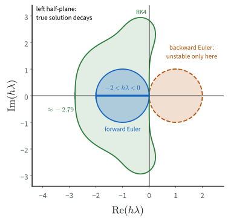

# Ordinary Differential Equations and Numerical Solvers
:label:`sec_mdl-odes-solvers`

A continuous-time model is not yet an executable model. The differential
equation specifies a trajectory, but generation requires a numerical method
that replaces this trajectory by finitely many updates. A stable continuous
system can therefore yield a poor computation if the step size is too large,
and a higher-order method can reduce error without changing the learned vector
field. For example, the exact solution of $\dot{x}=-50x$ decays, but forward
Euler with step $h=0.05$ grows because its update factor is $1-50h=-1.5$;
with $h=0.01$ it decays. Solver analysis explains this difference.

We first define vector fields and the conditions under which they generate a
unique flow. Linear systems then show how eigenvalues govern asymptotic
stability. This analysis supplies the test problems used to compare Euler,
Runge--Kutta, and implicit methods. Only after separating the exact flow from
its numerical approximation do we interpret residual updates as Euler steps,
derive continuous and discrete adjoints, and track densities in continuous
normalizing flows. The stochastic Euler method appears in
:numref:`sec_mdl-euler-maruyama`; the probability-flow ODE appears in
:numref:`sec_mdl-fokker-planck-probability-flow`.

We lean on :numref:`sec_mdl-eigendecompositions` (eigenvalues and
eigenvectors; that section already defined the matrix exponential, and here
we prove its properties), :numref:`sec_mdl-multivariable_calculus` (Jacobians,
Taylor expansion),
:numref:`sec_mdl-matrix-calculus-autodiff` (reverse-mode AD as vector--Jacobian
products), :numref:`sec_mdl-integral_calculus` (the integrals being
approximated), and :numref:`sec_mdl-random_variables` (the change-of-variables
formula for densities). The numerical demonstrations use NumPy until the
Neural ODE training example.

```{.python .input #odes-solvers-imports}
#@tab mxnet
%matplotlib inline
from d2l import mxnet as d2l
from mxnet import autograd, gluon, init, np as mnp, npx
from mxnet.gluon import nn
import numpy as np
npx.set_np()
```

```{.python .input #odes-solvers-imports}
#@tab pytorch
%matplotlib inline
from d2l import torch as d2l
import numpy as np
import torch
```

```{.python .input #odes-solvers-imports}
#@tab tensorflow
%matplotlib inline
from d2l import tensorflow as d2l
import numpy as np
import tensorflow as tf
```

```{.python .input #odes-solvers-imports}
#@tab jax
%matplotlib inline
from d2l import jax as d2l
import jax
from jax import numpy as jnp
import numpy as np
```

## Vector Fields, Trajectories, and Well-Posedness
:label:`sec_mdl-vector-fields-trajectories`

### Velocity Fields and Integral Curves

An **initial-value problem** specifies a velocity rule and a starting point:

$$
\dot{\mathbf{x}}(t) = \mathbf{f}(\mathbf{x}(t), t),
\qquad \mathbf{x}(0) = \mathbf{x}_0,
$$
:eqlabel:`eq_mdl-ode-ivp`

where $\mathbf{x}(t) \in \mathbb{R}^d$ is the state, the dot is the time
derivative, and $\mathbf{f} : \mathbb{R}^d \times \mathbb{R} \to \mathbb{R}^d$
is a **vector field**: a function that attaches an arrow to every point. A
**trajectory** (or *integral curve*) is a differentiable path whose tangent
matches the field everywhere: at each instant, the particle moves with
exactly the velocity the field prescribes at its current location. When
$\mathbf{f}$ does not depend on $t$ we call the system **autonomous**; the
arrows are frozen and only the particle moves. :numref:`fig_mdl-dyn-ode-field`
shows a grid of field vectors and trajectories tangent to them.


:label:`fig_mdl-dyn-ode-field`

Integrating both sides of :eqref:`eq_mdl-ode-ivp` from $0$ to $t$
(:numref:`sec_mdl-integral_calculus`) gives the equivalent **integral form**

$$
\mathbf{x}(t) = \mathbf{x}_0 + \int_0^t \mathbf{f}(\mathbf{x}(s), s)\,ds,
$$
:eqlabel:`eq_mdl-ode-integral-form`

which trades the derivative for an accumulation of velocities. This form serves two
purposes: it defines the fixed-point equation used in the existence theorem below, and
it is the expression approximated by numerical solvers; Euler's method is the
left-endpoint Riemann sum of this very integral.

Two examples establish the notation. For $\dot{x} = -x$, the rule "move
toward zero at a speed proportional to displacement" is solved by
$x(t) = e^{-t} x_0$: exponential decay, the prototype of a *contracting* mode.
For the rotational field
$\dot{\mathbf{x}} = \left(\begin{smallmatrix}0&-1\\1&0\end{smallmatrix}\right)\mathbf{x}$,
the velocity is always perpendicular to the position, so
$\tfrac{d}{dt}\|\mathbf{x}\|^2 = 2\,\mathbf{x}^\top\dot{\mathbf{x}} = 0$ and
trajectories are circles traversed at constant angular speed: pure rotation,
the prototype of an *oscillating* mode. The field of
:numref:`fig_mdl-dyn-ode-field` is exactly the sum of these two behaviors, and
its eigenvalues $-0.5 \pm i$ encode both behaviors.

### The Flow Map

Fix the field and vary the starting point: for an autonomous system, write
$\Phi_t(\mathbf{x}_0) = \mathbf{x}(t)$ for the solution at time $t$ started at
$\mathbf{x}_0$. This **flow map** $\Phi_t : \mathbb{R}^d \to \mathbb{R}^d$
moves *every* point of space forward $t$ seconds along its arrows, and it
composes the way time does:

$$
\Phi_0 = \mathrm{id},
\qquad
\Phi_{t+s} = \Phi_t \circ \Phi_s .
$$
:eqlabel:`eq_mdl-ode-flow-group`

Flowing for $s$ seconds and then $t$ more is the same as flowing for $t+s$, whenever all
three solutions exist. This holds because the field is frozen in time: the second leg
starts from $\Phi_s(\mathbf{x}_0)$ and follows the *same* rule. If solutions exist
uniquely both forward and backward over the relevant interval, taking $s=-t$ gives
$\Phi_t \circ \Phi_{-t}=\mathrm{id}$, so $\Phi_t$ is a bijection with inverse
$\Phi_{-t}$. A field whose solutions exist for every positive and negative time
therefore generates a one-parameter group of bijections. This provides the basis for an
invertible generative flow: push noise forward through a learned field to get data, and
integrate backward to recover the noise (and, as we will see in
:numref:`sec_mdl-continuous-normalizing-flows`, its likelihood). The next subsection
states sufficient conditions for existence and uniqueness.

### Existence and Uniqueness
:label:`sec_mdl-ode-existence-uniqueness`

Before building on this, we need to know that exactly one trajectory passes
through each starting point. The right hypothesis is that the field does not
change too abruptly from point to point.

**Proposition (Picard--Lindelöf).** *Let
$\mathbf{f}(\mathbf{x}, t)$ be continuous in $t$ and Lipschitz in
$\mathbf{x}$: there is an $L$ with*

$$
\|\mathbf{f}(\mathbf{x}, t) - \mathbf{f}(\mathbf{y}, t)\| \le L\,\|\mathbf{x} - \mathbf{y}\|
\qquad \textrm{for all } \mathbf{x}, \mathbf{y}, t.
$$

*Then the initial-value problem :eqref:`eq_mdl-ode-ivp` has exactly one
solution on $[0, T]$, for every $\mathbf{x}_0$ and every $T$*
:cite:`Coddington.Levinson.1955`.

**Proof sketch (the integral operator is a contraction).** A path
$\boldsymbol{\varphi}$ solves :eqref:`eq_mdl-ode-ivp` iff it is a fixed point
of the **Picard operator** built from the integral form
:eqref:`eq_mdl-ode-integral-form`,

$$
(P\boldsymbol{\varphi})(t) = \mathbf{x}_0 + \int_0^t \mathbf{f}(\boldsymbol{\varphi}(s), s)\,ds .
$$

For two candidate paths on a short interval $[0, \delta]$,

$$
\|(P\boldsymbol{\varphi})(t) - (P\boldsymbol{\psi})(t)\|
\le \int_0^t \|\mathbf{f}(\boldsymbol{\varphi}(s), s) - \mathbf{f}(\boldsymbol{\psi}(s), s)\|\,ds
\le L\,\delta \cdot \max_{s \le \delta}\|\boldsymbol{\varphi}(s) - \boldsymbol{\psi}(s)\| ,
$$

so once $\delta < 1/L$ the operator $P$ shrinks the distance between any two
paths by a fixed factor: it is a *contraction*, and by the Banach fixed-point
theorem a contraction on a complete space has exactly one fixed point
(iterate $P$ from anywhere; the iterates form a Cauchy sequence, and two
distinct fixed points would have to be strictly closer to each other than
they are). Completeness is what turns the Cauchy sequence into a solution:
the space $C([0, \delta])$ of continuous paths under the sup norm is
complete, so the iterates converge uniformly to a continuous fixed point.
That settles $[0, \delta]$; restart at $t = \delta$ and repeat to cover all
of $[0, T]$.

Iterating $P$ from the constant path is **Picard iteration**; here it is once
by hand. For $\dot{x} = x$, $x_0 = 1$: starting from
$\varphi_0 \equiv 1$,

$$
\varphi_1(t) = 1 + t,
\qquad
\varphi_2(t) = 1 + t + \tfrac{t^2}{2},
\qquad
\varphi_3(t) = 1 + t + \tfrac{t^2}{2} + \tfrac{t^3}{6},
\;\;\ldots
$$

These are the partial sums of $e^t$. Each Picard iteration adds one Taylor term.

These hypotheses are a convenient sufficient package, not individually
necessary conditions. Two standard counterexamples show the failures that
they are designed to rule out. **Uniqueness can fail without Lipschitz.** The
field $\dot{x} = \sqrt{|x|}$ has slope $\to \infty$ near $x = 0$ (no finite
$L$ works there), and the initial value $x_0 = 0$ admits *infinitely many*
solutions: $x(t) \equiv 0$ is one, and for every waiting time $c \ge 0$,

$$
x_c(t) =
\begin{cases}
0, & t \le c, \\
(t - c)^2/4, & t > c
\end{cases}
$$

is another: it remains at the origin for $c$ seconds and then becomes positive (check:
$\dot{x}_c = (t-c)/2 = \sqrt{x_c}$ for $t > c$). Each departure time gives a distinct
solution, so the initial-value problem is not unique
(:numref:`fig_mdl-dyn-uniqueness-fan`).


:label:`fig_mdl-dyn-uniqueness-fan`

**Global existence fails without a growth bound.** The
field $\dot{x} = x^2$ is Lipschitz on every bounded set but not globally, and
from $x_0 > 0$, separation of variables gives

$$
x(t) = \frac{x_0}{1 - x_0 t},
$$

which diverges at the finite time $t = 1/x_0$: the growth rate
itself grows superlinearly until a singularity forms. The
solution exists only *locally*, on $[0, 1/x_0)$, which is all that
local Lipschitz continuity can promise.

For deep learning the theorem supplies a well-posed continuous model. A neural field
$\mathbf{f}_\theta$ built from linear maps and Lipschitz activations
($\tanh$, ReLU, GELU) is *globally* Lipschitz (a composition of globally
Lipschitz maps is globally Lipschitz, with constant at most the product of
the weight norms and the activations' Lipschitz constants), which is
exactly the global-$L$ hypothesis of the proposition above. So a Neural ODE
(:numref:`sec_mdl-neural-odes`) is
well-posed: through every input there is exactly one trajectory, distinct
inputs can never collide (two trajectories meeting at time $t$ would be two
solutions of the same final-value problem run backward), and the exact map
$\Phi_T$ is a bijection whenever solutions exist uniquely in both time
directions over the interval. A finite numerical update, including a residual
block interpreted as an Euler step, need not be injective.

## Linear ODEs and Stability
:label:`sec_mdl-linear-odes-stability`

### The Matrix Exponential

One family of ODEs can be solved in closed form, and it is the family that
explains all the others locally: the linear system

$$
\dot{\mathbf{x}} = A\mathbf{x},
\qquad
\mathbf{x}(0) = \mathbf{x}_0,
\qquad A \in \mathbb{R}^{d \times d}.
$$

In one dimension, $\dot{x} = ax$ is solved by $e^{at} x_0$, which motivates defining a matrix
exponential with the analogous solution formula. Define, for
any square matrix $B$, the **matrix exponential** by the same power series
that defines $e^z$:

$$
e^{B} = \sum_{k=0}^{\infty} \frac{B^k}{k!}
= I + B + \frac{B^2}{2} + \frac{B^3}{6} + \cdots .
$$
:eqlabel:`eq_mdl-ode-matrix-exp-series`

The series converges for *every* matrix: term by term,
$\|B^k\| \le \|B\|^k$ (the operator norm is submultiplicative), so the series
is dominated by the scalar series for $e^{\|B\|}$, which converges absolutely.

**Proposition (the matrix exponential solves linear ODEs).**
*$\mathbf{x}(t) = e^{At}\mathbf{x}_0$ is the unique solution of
$\dot{\mathbf{x}} = A\mathbf{x}$, $\mathbf{x}(0) = \mathbf{x}_0$.*

**Proof.** Differentiate the series :eqref:`eq_mdl-ode-matrix-exp-series` with
$B = At$ term by term (legitimate: on any bounded $t$-interval the
differentiated series still converges uniformly, by the same domination):

$$
\frac{d}{dt} e^{At}
= \sum_{k=1}^{\infty} \frac{A^k\, t^{k-1}}{(k-1)!}
= A \sum_{j=0}^{\infty} \frac{(At)^j}{j!}
= A\, e^{At}.
$$

So $\mathbf{x}(t) = e^{At}\mathbf{x}_0$ satisfies the ODE, and at $t = 0$ the
series collapses to $I$, so $\mathbf{x}(0) = \mathbf{x}_0$. Uniqueness is
Picard--Lindelöf: the field $\mathbf{x} \mapsto A\mathbf{x}$ is Lipschitz with
$L = \|A\|$. $\blacksquare$

An infinite series of matrix powers sounds unwieldy, but the
eigendecomposition of :numref:`sec_mdl-eigendecompositions` collapses it to
$d$ scalar exponentials.

**Proposition (matrix exponential by eigendecomposition).** *If
$A = V \Lambda V^{-1}$ with $\Lambda = \mathrm{diag}(\lambda_1, \ldots, \lambda_d)$,
then*

$$
e^{At} = V e^{\Lambda t} V^{-1},
\qquad
e^{\Lambda t} = \mathrm{diag}\!\left(e^{\lambda_1 t}, \ldots, e^{\lambda_d t}\right).
$$
:eqlabel:`eq_mdl-ode-matrix-exp-eig`

**Proof.** Powers telescope: $(At)^k = V (\Lambda t)^k V^{-1}$, because each
adjacent $V^{-1} V$ cancels. Summing the series
:eqref:`eq_mdl-ode-matrix-exp-series` and pulling $V, V^{-1}$ out of the sum
gives $e^{At} = V\left(\sum_k (\Lambda t)^k / k!\right) V^{-1}$. The inner sum
is the exponential of a diagonal matrix, which is diagonal with entries
$\sum_k (\lambda_i t)^k / k! = e^{\lambda_i t}$. $\blacksquare$

The formula is a *decoupling* statement. Expand the start point in the
eigenbasis, $\mathbf{x}_0 = \sum_i c_i \mathbf{v}_i$; then

$$
\mathbf{x}(t) = \sum_{i=1}^{d} c_i\, e^{\lambda_i t}\, \mathbf{v}_i :
$$

along each eigendirection the system is the scalar equation
$\dot{x} = \lambda_i x$ we already solved, evolving independently of the
others. Eigenvectors are the directions in which a linear ODE is
one-dimensional; the $e^{\lambda_i t}$ are its **modes**.

### Stability from Eigenvalues

Each mode $e^{\lambda_i t}$ with $\lambda_i = a_i + i b_i$ has magnitude
$|e^{\lambda_i t}| = e^{a_i t}$: *the real part sets growth or decay, the
imaginary part sets rotation*. Reading :eqref:`eq_mdl-ode-matrix-exp-eig`
mode by mode gives the following classification:

* $\operatorname{Re}\lambda_i < 0$ for all $i$: every mode decays, and
  $\mathbf{x}(t) \to \mathbf{0}$ from every start: the origin is
  **asymptotically stable**, with decay rate set by the slowest mode,
  $\max_i \operatorname{Re}\lambda_i$.
* $\operatorname{Re}\lambda_i > 0$ for some $i$: that mode grows
  exponentially, and almost every trajectory escapes: **unstable**.
* $\operatorname{Im}\lambda_i \neq 0$: the conjugate pair contributes
  $e^{a t}(\cos bt, \sin bt)$ terms: **rotation**, decaying or growing
  with the sign of $a$.

The rotation case extends the eigenvalue analysis of
:numref:`subsec_mdl-complex-rotation` run in continuous time. On the invariant
plane of a conjugate pair $a \pm ib$, the matrix $A$ acts as the block
$\left(\begin{smallmatrix}a & -b\\ b & \phantom{-}a\end{smallmatrix}\right)$
of :eqref:`eq_mdl-rotation-scaling-block`. Write it as $aI + bJ$ with
$J = \left(\begin{smallmatrix}0 & -1\\ 1 & \phantom{-}0\end{smallmatrix}\right)$;
since $J^2 = -I$, the exponential series splits into cosine and sine parts,
$e^{(aI + bJ)t} = e^{at}(\cos bt \, I + \sin bt \, J)$, which is scaling by
$e^{at}$ composed with rotation by $bt$. Where the *iterated* matrix of
:numref:`subsec_mdl-complex-rotation` turned by a fixed angle $\theta$ per
step, the *flow* turns at angular velocity $b$: this is the spiral, and it is
exactly where the $e^{at}(\cos bt, \sin bt)$ terms above come from.

In two dimensions, these cases correspond to standard phase portraits
(:numref:`fig_mdl-dyn-phase-portraits`). For a saddle with real eigenvalues of opposite signs, trajectories approach
along the stable eigendirection and diverge along the unstable one. The stable spiral is the field of
:numref:`fig_mdl-dyn-ode-field` ($\lambda = -0.5 \pm i$: rotate while
decaying); the center is our rotation warm-up.

| eigenvalues of $A$ ($2\times 2$)              | portrait        | behavior                    |
|-----------------------------------------------|-----------------|-----------------------------|
| real, both negative                           | stable node     | monotone decay              |
| real, both positive                           | unstable node   | monotone growth             |
| real, opposite signs                          | saddle          | decay in, escape out        |
| complex pair, $\operatorname{Re}\lambda < 0$  | stable spiral   | decaying oscillation        |
| complex pair, $\operatorname{Re}\lambda > 0$  | unstable spiral | growing oscillation         |
| purely imaginary pair                         | center          | closed orbits               |


:label:`fig_mdl-dyn-phase-portraits`

(When $A$ is defective, i.e. not diagonalizable
(:numref:`sec_mdl-eigendecompositions`), generalized modes acquire polynomial
factors $t^k e^{\lambda t}$. For nonzero real parts the exponential still
determines the asymptotic verdict. On the imaginary axis, however, a nontrivial
Jordan block can cause polynomial growth and must be classified separately.)

### Linearization at Fixed Points
:label:`subsec_mdl-ode-linearization`

Nonlinear fields inherit all of this *locally*. A **fixed point** of an
autonomous system is a state $\mathbf{x}^\star$ with
$\mathbf{f}(\mathbf{x}^\star) = \mathbf{0}$: the particle parked there
never moves. For a small displacement
$\boldsymbol{\delta}(t) = \mathbf{x}(t) - \mathbf{x}^\star$, Taylor expansion
(:numref:`sec_mdl-multivariable_calculus`) gives

$$
\dot{\boldsymbol{\delta}}
= \mathbf{f}(\mathbf{x}^\star + \boldsymbol{\delta})
= J\,\boldsymbol{\delta} + O(\|\boldsymbol{\delta}\|^2),
\qquad
J = \frac{\partial \mathbf{f}}{\partial \mathbf{x}}(\mathbf{x}^\star),
$$

so near the fixed point the dynamics are the linear system
$\dot{\boldsymbol{\delta}} = J \boldsymbol{\delta}$, and the eigenvalues of
the *Jacobian at the fixed point* decides local stability by the same
classification. (This is rigorous whenever no eigenvalue lies on the
imaginary axis, by the Hartman--Grobman theorem
:cite:`Hartman.1960,Grobman.1959`; on the axis, the neglected
quadratic terms get a vote.) Write the damped pendulum
$\ddot{\theta} = -\sin\theta - \gamma\dot{\theta}$ as a first-order
system in $(\theta, \dot{\theta})$. It has Jacobian eigenvalues with negative
real part at the hanging rest point $(0, 0)$ (for light damping a stable
spiral, the ring-down of a released pendulum) and a saddle at the inverted
balance $(\pi, 0)$, analogous to balancing a pencil on its tip: only a measure-zero
set of initial conditions remains there. The same computation is the working
stability tool of this whole chapter, applied to a trained network's dynamics
or to the mean of the Ornstein--Uhlenbeck process
(:numref:`sec_mdl-ornstein-uhlenbeck`, whose deterministic skeleton is exactly
the contracting mode $\dot{x} = -\theta x$).

Let us compute all of this. The cell builds $e^{At}$ for the spiral field of
:numref:`fig_mdl-dyn-ode-field` three independent ways: the
eigendecomposition formula :eqref:`eq_mdl-ode-matrix-exp-eig`, the truncated
series :eqref:`eq_mdl-ode-matrix-exp-series`, and the compounding limit
$(I + tA/n)^n$, which is the forward-Euler approximation introduced in the
next section. It then checks the eigenvalue prediction that
$\|\mathbf{x}(t)\|$ decays exactly like $e^{-t/2}$ (the rotation part of this
particular $A$ is norm-preserving).

```{.python .input #odes-solvers-matrix-exponential}
A = np.array([[-0.5, -1.0], [1.0, -0.5]])      # spiral sink: eigenvalues -0.5 +- i
t = 2.0
lam, V = np.linalg.eig(A)                      # A = V diag(lam) V^{-1}
expAt_eig = (V @ np.diag(np.exp(lam * t)) @ np.linalg.inv(V)).real
term, expAt_series = np.eye(2), np.eye(2)      # partial sums of sum_k (At)^k / k!
for k in range(1, 30):
    term = term @ (A * t) / k
    expAt_series += term
n = 2 ** 24                                    # Euler compounding (I + tA/n)^n
expAt_euler = np.linalg.matrix_power(np.eye(2) + (t / n) * A, n)
x0 = np.array([2.0, 0.0])
print('eigenvalues of A:', lam.round(4))
print('|series - eigen formula| :', f'{np.abs(expAt_series - expAt_eig).max():.1e}')
print('|(I+tA/n)^n - eigen|     :', f'{np.abs(expAt_euler - expAt_eig).max():.1e}')
print('||e^{At} x0|| =', f'{np.linalg.norm(expAt_eig @ x0):.6f}',
      ' vs  e^{-t/2}||x0|| =', f'{np.exp(-0.5 * t) * np.linalg.norm(x0):.6f}')
```

Twenty-nine series terms already agree with the eigendecomposition formula to
machine precision, the compounded Euler product has error below $10^{-7}$, and
the trajectory norm matches $e^{-t/2}\|\mathbf{x}_0\|$ to six digits: the
spectrum ($-0.5 \pm i$) told us the decay rate before we integrated anything.

## Numerical Solvers: From Euler to Runge--Kutta
:label:`sec_mdl-euler-runge-kutta`

### Forward Euler and Its Global Error

Almost no ODE beyond the linear family has a closed-form solution, so we
update: replace the integral form :eqref:`eq_mdl-ode-integral-form` over one
short step by its left-endpoint approximation. With step size $h$ and
$t_n = nh$, **forward Euler** is

$$
\mathbf{x}_{n+1} = \mathbf{x}_n + h\, \mathbf{f}(\mathbf{x}_n, t_n)
$$
:eqlabel:`eq_mdl-ode-euler-update`

Forward Euler follows the field at the current point for time $h$, then
reevaluates the field.
Equivalently, the update is the Taylor expansion of the true solution truncated after
the linear term, and the truncation error of one step is the first term
dropped: if $\|\ddot{\mathbf{x}}(t)\| \le M$ along the solution, then

$$
\mathbf{x}(t_{n+1}) = \mathbf{x}(t_n) + h\,\mathbf{f}(\mathbf{x}(t_n), t_n) + \mathbf{r}_n,
\qquad
\|\mathbf{r}_n\| \le \tfrac{M h^2}{2}.
$$

A per-step error of $O(h^2)$ does not mean a final error of $O(h^2)$: to
reach a fixed horizon $T$ requires $n = T/h$ steps, and the per-step errors
*accumulate*; worse, each step also inherits and possibly amplifies the
error already made. One order of $h$ is lost to the accumulation, and the
bookkeeping is short enough to do in full.

**Proposition (Euler converges at order 1).** *Let $\mathbf{f}$ be
$L$-Lipschitz in $\mathbf{x}$, and let the solution of
:eqref:`eq_mdl-ode-ivp` on $[0, T]$ satisfy
$\|\ddot{\mathbf{x}}(t)\| \le M$. Then the Euler iterates
:eqref:`eq_mdl-ode-euler-update` obey*

$$
\max_{n \le T/h} \|\mathbf{x}_n - \mathbf{x}(t_n)\|
\;\le\; \frac{M h}{2L}\left(e^{LT} - 1\right)
\;=\; O(h).
$$

**Proof.** Let $e_n = \|\mathbf{x}_n - \mathbf{x}(t_n)\|$, and subtract the
Taylor identity above from the update :eqref:`eq_mdl-ode-euler-update`:

$$
e_{n+1}
\le \underbrace{\|\mathbf{x}_n - \mathbf{x}(t_n)\| + h\,\|\mathbf{f}(\mathbf{x}_n, t_n) - \mathbf{f}(\mathbf{x}(t_n), t_n)\|}_{\le\, (1 + hL)\, e_n \textrm{ by Lipschitz}}
\;+\; \underbrace{\|\mathbf{r}_n\|}_{\le\, Mh^2/2} .
$$

So each step multiplies the existing error by at most $(1 + hL)$ and adds at
most $Mh^2/2$. Unrolling the recursion from $e_0 = 0$ sums a geometric
series:

$$
e_n \le \frac{Mh^2}{2} \sum_{j=0}^{n-1} (1 + hL)^j
= \frac{Mh^2}{2} \cdot \frac{(1 + hL)^n - 1}{hL}
\le \frac{Mh}{2L}\left(e^{LT} - 1\right),
$$

using $(1 + hL)^n \le e^{nhL} \le e^{LT}$. $\blacksquare$

The structure of the bound recurs for
every solver: a *local* error of order $h^{p+1}$ per step becomes a *global*
error of order $h^p$ after $T/h$ steps, inflated by a stability factor
$e^{LT}$ that measures how strongly the dynamics can amplify old mistakes. We
say Euler is a method of **order** $p = 1$: halve the step, halve the error.

### Runge--Kutta Methods

Euler's weakness is that it commits to the slope at the *start* of the step,
while the trajectory is already curving away. Runge--Kutta methods instead
sample the slope *inside* the step and combine those field evaluations. The
simplest upgrade, the **midpoint method**, takes half an Euler step only to
*measure* the slope there, then takes the real step with that better slope:
$\mathbf{x}_{n+1} = \mathbf{x}_n + h\,\mathbf{f}\!\left(\mathbf{x}_n + \tfrac{h}{2}\mathbf{f}(\mathbf{x}_n)\right)$
(autonomous notation). One Taylor line shows why it helps: in one dimension,

$$
x + h f\!\left(x + \tfrac{h}{2} f(x)\right)
= x + h f + \tfrac{h^2}{2} f' f + O(h^3),
$$

which matches the true expansion
$x(t+h) = x + h\dot{x} + \tfrac{h^2}{2}\ddot{x} + O(h^3)$ because
$\ddot{x} = \tfrac{d}{dt} f(x(t)) = f' f$. The $h^2$ term is now *correct*
instead of *absent*: local error $O(h^3)$, global order $2$, at the price of
two field evaluations per step. Its trapezoid twin, **Heun's method**, takes
a full trial Euler step and averages the slopes at its two ends,
$\mathbf{x}_{n+1} = \mathbf{x}_n + \tfrac{h}{2}\left[\mathbf{f}(\mathbf{x}_n) + \mathbf{f}\!\left(\mathbf{x}_n + h\,\mathbf{f}(\mathbf{x}_n)\right)\right]$
(same order $2$, same two evaluations), and is the two-stage sampler of
choice for the learned dynamics of
:numref:`sec_mdl-score-matching-diffusion-flow`.

Pushing the same idea to four probe slopes gives the standard general-purpose
method of scientific computing, **classical Runge--Kutta (RK4)**:

$$
\begin{aligned}
\mathbf{k}_1 &= \mathbf{f}(\mathbf{x}_n,\, t_n), \\
\mathbf{k}_2 &= \mathbf{f}(\mathbf{x}_n + \tfrac{h}{2}\mathbf{k}_1,\, t_n + \tfrac{h}{2}), \\
\mathbf{k}_3 &= \mathbf{f}(\mathbf{x}_n + \tfrac{h}{2}\mathbf{k}_2,\, t_n + \tfrac{h}{2}), \\
\mathbf{k}_4 &= \mathbf{f}(\mathbf{x}_n + h\,\mathbf{k}_3,\, t_n + h), \\
\mathbf{x}_{n+1} &= \mathbf{x}_n + \tfrac{h}{6}\left(\mathbf{k}_1 + 2\mathbf{k}_2 + 2\mathbf{k}_3 + \mathbf{k}_4\right).
\end{aligned}
$$
:eqlabel:`eq_mdl-ode-rk4-update`

The weights $\tfrac16(1, 2, 2, 1)$ are Simpson's rule (the quadrature rule
$\int_a^b g \approx \tfrac{b-a}{6}\bigl(g(a) + 4g(\tfrac{a+b}{2}) + g(b)\bigr)$)
applied to the probe slopes at the beginning, middle (twice), and end of the
step, and they are chosen so that the
update's Taylor expansion matches the true solution's through the $h^4$ term.

**Proposition (RK4 converges at order 4).** *For $\mathbf{f}$ four times
continuously differentiable ($C^4$), the
RK4 iterates :eqref:`eq_mdl-ode-rk4-update` have local truncation error
$O(h^5)$ and global error $O(h^4)$ on a fixed interval $[0, T]$.*

The proof is the same accumulation argument as for Euler, fed with a long but
mechanical five-term Taylor match;
see :citet:`Hairer.Norsett.Wanner.1993`, the standard reference, for the
general order theory. What matters for practice is the scaling: *halving $h$
cuts RK4's error by a factor of 16*, so a method of order $p$ delivers error
$\varepsilon$ at cost proportional to $\varepsilon^{-1/p}$ field evaluations,
the difference between $10^6$ steps and $30$ steps for the same accuracy.
This is why solver *order* is the headline spec, and why few-step samplers
for diffusion models (:numref:`sec_mdl-score-matching-diffusion-flow`) rely
on higher-order integrators. Practical solvers often use *embedded* pairs. For example,
Dormand--Prince `RK45` computes solutions of orders $4$ and $5$ from the same
field evaluations and uses the gap between them as an error estimate without
a separate solve :cite:`Dormand.Prince.1980`. That estimate drives an adaptive step size,
shrinking $h$ where the field changes rapidly and enlarging it in smoother
regions.

Both claims, slope $1$ and slope $4$, are measurable. We integrate the
spiral field to $T = 2$, where we know the exact answer from
`#odes-solvers-matrix-exponential`, and sweep the step size across five
octaves. On log--log axes, $\textrm{error} \approx C h^p$ is a line of slope
$p$.

```{.python .input #odes-solvers-euler-rk4-order}
def euler(f, x0, T, n):
    """Forward Euler: n steps of size h = T/n."""
    x, h = np.asarray(x0, dtype=float), T / n
    for k in range(n):
        x = x + h * f(x)
    return x

def rk4(f, x0, T, n):
    """Classical Runge-Kutta: four probe slopes per step."""
    x, h = np.asarray(x0, dtype=float), T / n
    for k in range(n):
        k1 = f(x)
        k2 = f(x + 0.5 * h * k1)
        k3 = f(x + 0.5 * h * k2)
        k4 = f(x + h * k3)
        x = x + (h / 6) * (k1 + 2 * k2 + 2 * k3 + k4)
    return x

f = lambda x: A @ x                            # the spiral field from above
T = 2.0
x_true = expAt_eig @ x0                        # exact endpoint via e^{At}
ns = 2 ** np.arange(3, 10)                     # 8, 16, ..., 512 steps
hs = T / ns
err_eu = np.array([np.linalg.norm(euler(f, x0, T, n) - x_true) for n in ns])
err_rk = np.array([np.linalg.norm(rk4(f, x0, T, n) - x_true) for n in ns])
print('measured slope, Euler:', f'{np.polyfit(np.log(hs), np.log(err_eu), 1)[0]:.3f}')
print('measured slope, RK4  :', f'{np.polyfit(np.log(hs), np.log(err_rk), 1)[0]:.3f}')
d2l.plot(hs, [err_eu, err_rk, err_eu[-1] * (hs / hs[-1]),
              err_rk[-1] * (hs / hs[-1]) ** 4],
         'step size h', 'global error at T', xscale='log', yscale='log',
         legend=['Euler', 'RK4', 'slope 1', 'slope 4'])
```

The fitted slopes are within a few percent of the theoretical orders $1$ and
$4$, and the RK4 curve sits *nearly nine decades* below Euler at the smallest
step ($3.6 \times 10^{-3}$ versus $5.0 \times 10^{-12}$): same trajectory,
same horizon, four times the work per step, nearly a billion times the
accuracy.

### Stiffness and Implicit Methods
:label:`sec_mdl-stiffness-implicit`

Order alone does not determine performance. Accuracy measures how closely a
numerical path tracks the solution; **stability** asks whether errors decay or compound
into an explosion, and for *explicit* methods like Euler and RK4, stability
puts a hard ceiling on the step size. The phenomenon is already visible in one
dimension.

**Proposition (stability of Euler on the test equation).** *On
$\dot{x} = -\lambda x$ with $\lambda > 0$ (true solution: decay to zero):
forward Euler gives $x_n = (1 - h\lambda)^n x_0$, which decays iff
$|1 - h\lambda| < 1$, i.e.*

$$
h < \frac{2}{\lambda} .
$$

*Backward (implicit) Euler,
$\mathbf{x}_{n+1} = \mathbf{x}_n + h\,\mathbf{f}(\mathbf{x}_{n+1}, t_{n+1})$,
gives $x_n = (1 + h\lambda)^{-n} x_0$, which decays for* **every** *$h > 0$.*

**Proof.** Forward Euler: $x_{n+1} = x_n - h\lambda x_n = (1 - h\lambda)x_n$;
iterate. The factor has magnitude below $1$ iff $-1 < 1 - h\lambda < 1$, and
the left inequality is the binding one: $h\lambda < 2$. Backward Euler:
$x_{n+1} = x_n - h\lambda x_{n+1}$, so $x_{n+1} = x_n / (1 + h\lambda)$, and
$0 < (1 + h\lambda)^{-1} < 1$ for all $h > 0$. $\blacksquare$

Past the threshold, forward Euler *amplifies*: each step overshoots the
origin and has greater magnitude on the other side, producing oscillatory
divergence with growth factor $|1 - h\lambda|$. A
method that decays on the test equation for every $h > 0$ is called
**A-stable** :cite:`Dahlquist.1963`, and backward Euler is one. (Our
$\lambda$ is real, but the complete stability region is defined in the complex plane.
Write the test equation as
$\dot{y} = \lambda y$ with complex $\lambda$, so that a decaying, rotating
mode has $\operatorname{Re}\lambda < 0$. One step of a method multiplies
the mode by a factor $R(z)$ of $z = h\lambda$, the method's **stability
function**: $R(z) = 1 + z$ for forward Euler and $R(z) = 1/(1 - z)$ for
backward Euler. A method's
**stability region** is the set of $z$ with $|R(z)| < 1$, where its update
decays, and A-stability proper demands that this region contain the entire
left half-plane. :numref:`fig_mdl-dyn-stability-regions` draws the regions;
the computation above, $z = -h\lambda$ with $\lambda > 0$, is their slice
along the negative real axis.) The price of
implicitness is that each step
*defines* $\mathbf{x}_{n+1}$ only implicitly, requiring an equation solve per
step, a linear solve when $\mathbf{f}$ is linear and a few Newton iterations
(:numref:`sec_mdl-multivariable_calculus`) otherwise.

![Stability regions in the complex plane of $z = h\lambda$ for the test equation $\dot{y} = \lambda y$ (a decaying mode sits in the left half-plane; our real computation is the slice along the negative real axis). Forward Euler decays only inside the disc $\lvert 1 + z \rvert < 1$, whose real slice is $-2 < h\lambda < 0$; RK4 enlarges it to a lobed region reaching $\approx -2.79$ on the real axis; backward Euler is stable everywhere *except* the disc around $+1$, in particular on the entire left half-plane, which is A-stability.](../img/mdl-dyn-stability-regions.svg)
:label:`fig_mdl-dyn-stability-regions`

Why tolerate that price? **Stiffness.** A system is *stiff* when the step size that
*stability* forces on an explicit method is far smaller than the one *accuracy* would
need. The standard linear source is eigenvalues spread over wildly different scales, say
eigenvalues $-50$ and $-1$, i.e. decay rates $\lambda_{\textrm{fast}} = 50$ and
$\lambda_{\textrm{slow}} = 1$. The fast mode decays almost immediately, after which only
the slow smooth mode, for which a large step would be perfectly *accurate*. But forward
Euler's *stability* constraint $h < 2/\lambda_{\textrm{fast}}$ is set by the fastest
decay rate, including modes that have already decayed and contribute little to the
quantity being tracked. The fast mode still governs the explicit method's stability
budget; that mismatch is stiffness. An implicit method removes this particular
constraint and lets the step size follow the slower dynamics of interest. The sweep
below shows the forward-Euler threshold appear exactly at $h = 2/\lambda = 0.04$,
backward Euler decaying at every step size, and divergence of the two-scale system in
the fast component whose exact value had already decayed to $10^{-22}$.

```{.python .input #odes-solvers-stiffness-sweep}
lam_f = 50.0                                   # the test equation dx/dt = -50 x
T = 1.0
print('forward Euler is stable iff h < 2/lambda =', 2 / lam_f)
print(f'{"h":>8} {"|1-h*lam|":>10} {"forward x(T)":>14} {"backward x(T)":>14}')
for n in [10, 20, 26, 40, 100]:
    h = T / n
    fwd = (1 - h * lam_f) ** n                 # forward Euler after n steps
    bwd = (1 + h * lam_f) ** (-n)              # backward Euler after n steps
    print(f'{h:8.3f} {abs(1 - h * lam_f):10.2f} {fwd:14.2e} {bwd:14.2e}')
print('exact x(T) = e^{-50} =', f'{np.exp(-lam_f * T):.2e}')
A_stiff = np.diag([-50.0, -1.0])               # one fast mode, one slow mode
x_stiff = euler(lambda x: A_stiff @ x, np.array([1.0, 1.0]), T, 20)
print('stiff system, forward Euler with h=0.05 '
      '(the long-dead fast mode explodes):')
print('x(T) =', x_stiff.round(2))
```

Note what backward Euler's unconditional stability does and does not buy: at
$h = 0.1$ it returns $1.65 \times 10^{-8}$ where the truth is
$1.93 \times 10^{-22}$: *stable* (it decays, and further steps decay
further) but not *accurate*. Stability prevents the explosion; accuracy may
still require a smaller step or a higher-order method. The practical conclusion carries
to every learned ODE in :numref:`sec_mdl-score-matching-diffusion-flow`: use
explicit adaptive solvers by default, and reach for implicit methods when the
dynamics are stiff. For a nonlinear or learned field, stiff means that the
Jacobian's eigenvalues along the trajectory are spread over widely different
scales.

### Gradient Descent as Euler Discretization
:label:`sec_mdl-gd-as-solver`

The same numerical analysis applies to optimization. Infinitesimal descent on
a loss $L$ defines the **gradient flow**

$$
\dot{\mathbf{x}} = -\nabla L(\mathbf{x}),
$$

a vector field whose fixed points are exactly the critical points of $L$ and
along whose trajectories the loss can only fall:
$\tfrac{d}{dt} L(\mathbf{x}(t)) = \nabla L^\top \dot{\mathbf{x}} = -\|\nabla L\|^2 \le 0$.
Gradient descent with learning rate $\eta$ is *forward Euler* on this flow
($\mathbf{x}_{k+1} = \mathbf{x}_k - \eta\, \nabla L(\mathbf{x}_k)$ is
:eqref:`eq_mdl-ode-euler-update` with $h = \eta$). Solver stability therefore
gives the corresponding stability condition for gradient descent.
:numref:`sec_mdl-gradient-based-optimization` derived the learning-rate
ceiling $\eta < 2/\lambda_{\max}(H)$ from the quadratic analysis and ran
the experiment below; the ODE formulation provides a stability interpretation. Near a
minimum with Hessian $H$ the dynamics linearize, mode by eigenmode, onto the
test equation:

$$
\begin{aligned}
\dot{\mathbf{x}} = -\nabla L(\mathbf{x})
\;\;&\xrightarrow{\textrm{linearize}}\;\;
\dot{\boldsymbol{\delta}} = -H\boldsymbol{\delta}
\;\;\xrightarrow{\textrm{Euler}, \, h = \eta}\;\;
\boldsymbol{\delta}_{k+1} = (I - \eta H)\,\boldsymbol{\delta}_k \\
&\xrightarrow{\textrm{stability}}\;\;
\eta < \frac{2}{\lambda_{\max}(H)} .
\end{aligned}
$$

The solver bound $h < 2/\lambda$ *is* the learning-rate ceiling: a diverging
learning rate is a solver instability, and an ill-conditioned Hessian is a
*stiff* gradient flow, with the steep, already-converged curvature directions
setting the stability limit under which the shallow directions must then
crawl. Polyak's heavy-ball momentum, whose discrete recurrence
:numref:`sec_mdl-gradient-based-optimization` analyzes, discretizes the
second-order ODE
$m\, \ddot{\mathbf{x}} + \gamma\, \dot{\mathbf{x}} = -\nabla L(\mathbf{x})$
:cite:`Polyak.1964` (exercise :exref:`ex_mdl-odes-solvers-heavy-ball-ode`).
We rerun that section's experiment on a quadratic with
$\lambda_{\max} = 10$ and compare it with the stiffness sweep:
predicted flip at $\eta = 2/10 = 0.2$.

```{.python .input #mdl-odes-solvers-gradient-descent-is-a-solver}
H = np.diag([10.0, 1.0])                       # curvatures: lambda_max = 10
print('GD on this quadratic is stable iff eta < 2/lambda_max =', 2 / H[0, 0])
print(f'{"eta":>8} {"|1-eta*lam_max|":>16} {"||x|| after 100 GD steps":>25}')
for eta in [0.05, 0.15, 0.19, 0.201, 0.21, 0.25]:
    x = np.array([1.0, 1.0])
    for _ in range(100):
        x = x - eta * (H @ x)                  # gradient descent = forward Euler
    print(f'{eta:8.3f} {abs(1 - eta * H[0, 0]):16.2f} {np.linalg.norm(x):25.2e}')
```

The numerical behavior changes at the predicted threshold. At $\eta = 0.19$ the
fast coordinate contracts by $|1 - 1.9| = 0.9$ per step and a hundred steps
crush the iterate to $10^{-5}$; at $\eta = 0.201$ the factor is $-1.01$ and
the same hundred steps have *grown* it, oscillating in sign, past its
starting point; at $\eta = 0.25$ it has diverged by seventeen orders of
magnitude. Meanwhile the slow direction ($\lambda = 1$) was converging at
every one of these rates. The unstable behavior comes entirely from the loss
surface's stiffest mode.

## Neural ODEs and the Adjoint Method
:label:`sec_mdl-neural-odes`

### Residual Blocks as Euler Steps

A residual update has the same algebraic form as a forward-Euler step.

**Proposition (a residual block has the form of an Euler step).** *The residual update
:cite:`He.Zhang.Ren.ea.2016`*

$$
\mathbf{x}_{l+1} = \mathbf{x}_l + \mathbf{f}_\theta(\mathbf{x}_l)
$$

*is exactly one forward-Euler step :eqref:`eq_mdl-ode-euler-update` of the
ODE $\dot{\mathbf{x}} = \mathbf{f}_\theta(\mathbf{x})$ with step size
$h = 1$.*

**Proof.** Set $h = 1$ and $\mathbf{f} = \mathbf{f}_\theta$ in
:eqref:`eq_mdl-ode-euler-update`; the two updates are the same formula.
$\blacksquare$


:label:`fig_mdl-dyn-resnet-as-euler`

A residual update can therefore be read as one numerical step. A general
ResNet may use a different branch $\mathbf{f}_{\theta_l}$ at every layer; its
numerical interpretation is a time-dependent field sampled at the layer
times. The interpretation alone gives no invertibility guarantee. For
example, $\dot{x}=-x$ has the bijective exact flow $e^{-t}x$, whereas one Euler
step with $h=1$ maps every $x$ to zero.

A continuous-depth limit requires a consistent family of fields and shrinking
steps. For the shared field
$\mathbf{x}_{l+1}=\mathbf{x}_l+\tfrac{1}{N}\mathbf{f}_\theta(\mathbf{x}_l)$,
Euler convergence implies that the output approaches the exact time-one flow
$\Phi_1(\mathbf{x}_0)$ as $N\to\infty$, under the regularity assumptions of
:numref:`sec_mdl-euler-runge-kutta`. The limiting model is the **Neural ODE**
:cite:`Chen.Rubanova.Bettencourt.ea.2018`:

$$
\dot{\mathbf{x}} = \mathbf{f}_\theta(\mathbf{x}, t),
\qquad
\textrm{output} = \mathbf{x}(T) = \mathbf{x}_0 + \int_0^T \mathbf{f}_\theta(\mathbf{x}(t), t)\,dt .
$$

The exact Neural ODE map is well-posed and invertible when its field satisfies
the existence assumptions in both time directions. A numerical solver
approximates that map. Changing Euler to RK4 or an adaptive method leaves the
field parameters fixed but changes the computed map, its cost, and its error.

### Training Through the Solver

The direct training route is **discretize, then
differentiate**: unroll a fixed solver, say $N$ Euler steps, into the
computation graph, compute the loss on $\mathbf{x}_N$, and apply ordinary
backpropagation flow through the unrolled steps. The "network" this builds is
equivalent to a ResNet with $N$ blocks that share the same weights $\theta$, so
ordinary automatic differentiation already trains it.

Consider a task small enough to inspect directly: learn a planar field
$\mathbf{f}_\theta$ (one hidden layer, $32$ tanh
units) whose time-$1$ flow carries the unit circle onto a shifted, squashed
ellipse. We use $64$ paired points, mean-squared loss on the endpoints, $10$
unrolled Euler steps of size $h = 0.1$, and Adam
(:numref:`sec_mdl-adaptive-stochastic-methods`) as the optimizer. The
underlying ODE describes a smooth invertible deformation of
$\mathbb{R}^2$; the ten-step Euler program is its numerical approximation. We
supervise only the $64$ listed points.

```{.python .input #odes-solvers-neural-ode-train}
#@tab pytorch
theta = np.linspace(0, 2 * np.pi, 64, endpoint=False)
X0_ring = np.stack([np.cos(theta), np.sin(theta)], axis=1)
X1_ring = np.stack([1.5 + 1.2 * np.cos(theta), 0.4 * np.sin(theta)], axis=1)
torch.manual_seed(0)
X, Y = torch.tensor(X0_ring).float(), torch.tensor(X1_ring).float()
net = torch.nn.Sequential(torch.nn.Linear(2, 32), torch.nn.Tanh(),
                          torch.nn.Linear(32, 2))
N, h = 10, 0.1                                 # unrolled Euler: 10 steps to T = 1

def flow(X):
    for _ in range(N):                         # one Euler step = one residual block
        X = X + h * net(X)
    return X

opt = torch.optim.Adam(net.parameters(), lr=0.05)
for it in range(401):
    loss = ((flow(X) - Y) ** 2).mean()
    opt.zero_grad()
    loss.backward()
    opt.step()
    if it % 100 == 0:
        print(f'iter {it:3d}  loss {loss.item():.5f}')
print(f'mean endpoint error: {(flow(X) - Y).norm(dim=1).mean().item():.4f}')
```

```{.python .input #odes-solvers-neural-ode-train}
#@tab mxnet
theta = np.linspace(0, 2 * np.pi, 64, endpoint=False)
X0_ring = np.stack([np.cos(theta), np.sin(theta)], axis=1)
X1_ring = np.stack([1.5 + 1.2 * np.cos(theta), 0.4 * np.sin(theta)], axis=1)
npx.random.seed(0)
X, Y = mnp.array(X0_ring), mnp.array(X1_ring)
net = nn.Sequential()
net.add(nn.Dense(32, activation='tanh'), nn.Dense(2))
net.initialize(init.Xavier())
N, h = 10, 0.1                                 # unrolled Euler: 10 steps to T = 1

def flow(X):
    for _ in range(N):                         # one Euler step = one residual block
        X = X + h * net(X)
    return X

trainer = gluon.Trainer(net.collect_params(), 'adam', {'learning_rate': 0.05})
for it in range(401):
    with autograd.record():
        loss = ((flow(X) - Y) ** 2).mean()
    loss.backward()
    trainer.step(1)
    if it % 100 == 0:
        print(f'iter {it:3d}  loss {float(loss):.5f}')
err = mnp.sqrt(((flow(X) - Y) ** 2).sum(axis=1)).mean()
print(f'mean endpoint error: {float(err):.4f}')
```

```{.python .input #odes-solvers-neural-ode-train}
#@tab tensorflow
theta = np.linspace(0, 2 * np.pi, 64, endpoint=False)
X0_ring = np.stack([np.cos(theta), np.sin(theta)], axis=1)
X1_ring = np.stack([1.5 + 1.2 * np.cos(theta), 0.4 * np.sin(theta)], axis=1)
tf.random.set_seed(0)
X, Y = tf.constant(X0_ring, tf.float32), tf.constant(X1_ring, tf.float32)
net = tf.keras.Sequential([tf.keras.layers.Dense(32, activation='tanh'),
                           tf.keras.layers.Dense(2)])
N, h = 10, 0.1                                 # unrolled Euler: 10 steps to T = 1

def flow(X):
    for _ in range(N):                         # one Euler step = one residual block
        X = X + h * net(X)
    return X

opt = tf.keras.optimizers.Adam(learning_rate=0.05)

@tf.function
def train_step():
    with tf.GradientTape() as tape:
        loss = tf.reduce_mean((flow(X) - Y) ** 2)
    opt.apply_gradients(zip(tape.gradient(loss, net.trainable_variables),
                            net.trainable_variables))
    return loss

for it in range(401):
    loss = train_step()
    if it % 100 == 0:
        print(f'iter {it:3d}  loss {float(loss):.5f}')
err = tf.reduce_mean(tf.norm(flow(X) - Y, axis=1))
print(f'mean endpoint error: {float(err):.4f}')
```

```{.python .input #odes-solvers-neural-ode-train}
#@tab jax
theta = np.linspace(0, 2 * np.pi, 64, endpoint=False)
X0_ring = np.stack([np.cos(theta), np.sin(theta)], axis=1)
X1_ring = np.stack([1.5 + 1.2 * np.cos(theta), 0.4 * np.sin(theta)], axis=1)
k1, k2 = jax.random.split(jax.random.PRNGKey(0))
params = {'W1': 0.25 * jax.random.normal(k1, (2, 32)), 'b1': jnp.zeros(32),
          'W2': 0.25 * jax.random.normal(k2, (32, 2)), 'b2': jnp.zeros(2)}
X, Y = jnp.array(X0_ring), jnp.array(X1_ring)
N, h = 10, 0.1                                 # unrolled Euler: 10 steps to T = 1

def flow(params, X):
    field = lambda X: (jnp.tanh(X @ params['W1'] + params['b1'])
                       @ params['W2'] + params['b2'])
    return jax.lax.fori_loop(0, N, lambda i, X: X + h * field(X), X)

loss_fn = lambda params: ((flow(params, X) - Y) ** 2).mean()

@jax.jit
def adam_step(params, m, v, it):               # hand-rolled Adam, lr = 0.05
    loss, g = jax.value_and_grad(loss_fn)(params)
    m = jax.tree.map(lambda m, g: 0.9 * m + 0.1 * g, m, g)
    v = jax.tree.map(lambda v, g: 0.999 * v + 0.001 * g * g, v, g)
    upd = lambda p, m, v: p - 0.05 * (m / (1 - 0.9 ** it)) / (
        jnp.sqrt(v / (1 - 0.999 ** it)) + 1e-8)
    return jax.tree.map(upd, params, m, v), m, v, loss

m = jax.tree.map(jnp.zeros_like, params)
v = jax.tree.map(jnp.zeros_like, params)
for it in range(1, 402):
    params, m, v, loss = adam_step(params, m, v, jnp.float32(it))
    if it % 100 == 1:
        print(f'iter {it - 1:3d}  loss {float(loss):.5f}')
err = jnp.linalg.norm(flow(params, X) - Y, axis=1).mean()
print(f'mean endpoint error: {float(err):.4f}')
```

A few hundred full-batch Adam iterations drive the loss to $\sim 10^{-5}$ and
the mean endpoint error to $\sim 10^{-3}$: one tiny vector
field, integrated by ten shared-weight residual updates, learns the prescribed
endpoints. Integrating the learned continuous field backward approximates its
inverse flow. The forward and backward numerical maps agree only up to solver
error; the ten-step Euler map itself is not guaranteed to be invertible.

### The Adjoint Method: Backpropagation in Continuous Time
:label:`sec_mdl-adjoint-method`

Differentiating through the unrolled solver computes the exact gradient of the
discretized program, but ordinarily stores its intermediate states. The
**continuous adjoint method** instead differentiates the exact ODE problem and
integrates a second ODE backward in time. With recomputation it can reduce
stored solver states, at the cost of additional evaluations and possible
numerical mismatch. Its central
object is the **adjoint state**
$\mathbf{a}(t) = \partial L / \partial \mathbf{x}(t)$ ("how would the loss
change if the trajectory were nudged at time $t$?"), the continuous
analogue of the backprop delta of
:numref:`sec_mdl-matrix-calculus-autodiff`.

**Proposition (the adjoint equations).** *Let $\mathbf{f}$ be continuously
differentiable in $\mathbf{x}$ and $\theta$, let $\mathbf{x}(t)$ solve
$\dot{\mathbf{x}} = \mathbf{f}(\mathbf{x}, \theta, t)$ on $[0, T]$ from fixed
$\mathbf{x}(0)$, and let $L = \ell(\mathbf{x}(T))$ be a differentiable loss
on the endpoint.
Then the adjoint state satisfies the linear ODE*

$$
\dot{\mathbf{a}}(t) = -\left(\frac{\partial \mathbf{f}}{\partial \mathbf{x}}\right)^{\!\top}\! \mathbf{a}(t),
\qquad
\mathbf{a}(T) = \nabla \ell(\mathbf{x}(T)),
$$
:eqlabel:`eq_mdl-ode-adjoint`

*integrated backward from $T$, and the parameter gradient is the integral*

$$
\frac{\partial L}{\partial \theta}
= \int_0^T \left(\frac{\partial \mathbf{f}}{\partial \theta}\right)^{\!\top}\! \mathbf{a}(t)\, dt,
$$
:eqlabel:`eq_mdl-ode-adjoint-grad`

*with both partial derivatives evaluated along the trajectory
$(\mathbf{x}(t), \theta, t)$* :cite:`Chen.Rubanova.Bettencourt.ea.2018`.

**Proof (variational).** Perturb the parameters by an infinitesimal
$\delta\theta$ and analyze the resulting trajectory perturbation. Because $\mathbf{f}$ is
$C^1$, the flow is differentiable in $\theta$ and the first-order expansion
below is rigorous: the perturbation
$\delta\mathbf{x}(t)$ obeys the *linearization* of the dynamics (differentiate
the ODE in $\theta$ and use the chain rule):

$$
\delta\dot{\mathbf{x}}
= \frac{\partial \mathbf{f}}{\partial \mathbf{x}}\,\delta\mathbf{x}
+ \frac{\partial \mathbf{f}}{\partial \theta}\,\delta\theta,
\qquad
\delta\mathbf{x}(0) = \mathbf{0}.
$$

Define $\mathbf{a}(t)$ by the backward ODE
:eqref:`eq_mdl-ode-adjoint` and examine the pairing
$\mathbf{a}^\top \delta\mathbf{x}$ evolve; the derivative telescopes by
design:

$$
\frac{d}{dt}\left(\mathbf{a}^\top \delta\mathbf{x}\right)
= \dot{\mathbf{a}}^\top \delta\mathbf{x} + \mathbf{a}^\top \delta\dot{\mathbf{x}}
= -\mathbf{a}^\top \frac{\partial \mathbf{f}}{\partial \mathbf{x}}\,\delta\mathbf{x}
+ \mathbf{a}^\top \frac{\partial \mathbf{f}}{\partial \mathbf{x}}\,\delta\mathbf{x}
+ \mathbf{a}^\top \frac{\partial \mathbf{f}}{\partial \theta}\,\delta\theta
= \mathbf{a}^\top \frac{\partial \mathbf{f}}{\partial \theta}\,\delta\theta .
$$

The state-coupling terms cancel exactly; that cancellation is *why* the
adjoint ODE has the form it has. Integrate from $0$ to $T$, using
$\delta\mathbf{x}(0) = \mathbf{0}$ on the left endpoint:

$$
\mathbf{a}(T)^\top \delta\mathbf{x}(T)
= \int_0^T \mathbf{a}(t)^\top \frac{\partial \mathbf{f}}{\partial \theta}\, dt \;\delta\theta .
$$

The left side is $\nabla\ell(\mathbf{x}(T))^\top \delta\mathbf{x}(T) = \delta L$,
the first-order change of the loss; the right side is linear in
$\delta\theta$ with coefficient :eqref:`eq_mdl-ode-adjoint-grad`. (The same
telescoping, stopped at an intermediate time $s$, shows
$\delta L = \mathbf{a}(s)^\top \delta\mathbf{x}(s)$ for a nudge injected at
time $s$, so the solution of :eqref:`eq_mdl-ode-adjoint` really is
$\partial L/\partial \mathbf{x}(s)$, earning its name.) $\blacksquare$

One caveat connects back to :numref:`sec_mdl-ode-existence-uniqueness`: the
existence theorem tolerates ReLU fields, but the adjoint equations as stated
need a $C^1$ field. A ReLU field is differentiable only piecewise; in
practice autograd differentiates the unrolled solver piece by piece, and
smooth activations (tanh, GELU) remove the issue entirely.

The product
$-\mathbf{a}^\top \partial\mathbf{f}/\partial\mathbf{x}$ that each
backward-ODE step computes is a **vector--Jacobian product**, the very
primitive that reverse-mode AD is made of
(:numref:`sec_mdl-matrix-calculus-autodiff`). Discretize
:eqref:`eq_mdl-ode-adjoint` with the same Euler scheme as the forward pass
and the result is the backpropagation recursion through the unrolled
network, except that each Jacobian is evaluated at the other end of its
step: backprop **is** the discrete adjoint method, a lineage that runs
from optimal control :cite:`Pontryagin.Boltyanskii.Gamkrelidze.ea.1962`
straight to the backward pass of every deep-learning framework. The continuous formulation offers another implementation:
instead of storing the forward states for the VJPs, one may
*re-integrate* $\mathbf{x}(t)$ backward alongside $\mathbf{a}(t)$, so that
in an idealized implementation the memory does not grow with the number of
solver steps, at the cost of extra compute
and of numerical drift when the reversed dynamics are unstable (a strongly
contracting forward flow is, run backward, strongly expanding; in that regime
checkpointing or plain unrolling is the sturdier choice). The literature
names the two routes **discretize-then-optimize** (differentiate the
unrolled solver, exact for the executed program) versus
**optimize-then-discretize** (discretize the continuous adjoint, using less
trajectory storage but generally producing only an approximation to the
gradient of the discrete forward program)
:cite:`Kidger.2022`; Exercise :exref:`ex_mdl-odes-solvers-re-derive-adjoint-equations` probes exactly this fault line.

The preceding identities can be checked on the linear ODE
$\dot{\mathbf{x}} = A\mathbf{x}$, where every ingredient has a closed form:
the trajectory is $e^{At}\mathbf{x}_0$, the adjoint of
$L = \tfrac12\|\mathbf{x}(T)\|^2$ is
$\mathbf{a}(t) = e^{A^\top (T-t)}\,\mathbf{x}(T)$ (the adjoint ODE
$\dot{\mathbf{a}} = -A^\top\mathbf{a}$ run backward), and with $\theta$ the
entries of $A$ itself, $\partial\mathbf{f}/\partial A$ turns
:eqref:`eq_mdl-ode-adjoint-grad` into
$\partial L/\partial A = \int_0^T \mathbf{a}(t)\,\mathbf{x}(t)^\top dt$. The
cell computes the gradient three ways: hand-written reverse mode through the
unrolled Euler solver (the discrete adjoint: exactly what reverse-mode
autograd builds, written out in six lines), central finite differences on the
same unrolled program, and the continuous adjoint integral by quadrature.

```{.python .input #odes-solvers-adjoint-check}
def expm_eig(B, s):
    """e^{Bs} via the eigendecomposition formula."""
    mu, W = np.linalg.eig(B)
    return (W @ np.diag(np.exp(mu * s)) @ np.linalg.inv(W)).real

def loss_and_grad_unrolled(A, x0, T, n):
    """L = ||x_n||^2 / 2 through n unrolled Euler steps; dL/dA by hand-written
    reverse mode -- the discrete adjoint."""
    h, xs = T / n, [x0]
    for k in range(n):
        xs.append(xs[-1] + h * (A @ xs[-1]))   # forward sweep, tape the states
    a, gA = xs[-1].copy(), np.zeros_like(A)    # a_n = dL/dx_n = x_n
    for k in range(n - 1, -1, -1):             # backward sweep: one VJP per step
        gA += h * np.outer(a, xs[k])           # dL/dA  +=  h a_{k+1} x_k^T
        a = a + h * (A.T @ a)                  # a_k = (I + hA)^T a_{k+1}
    return 0.5 * xs[-1] @ xs[-1], gA

T, n = 2.0, 1000
L, g_disc = loss_and_grad_unrolled(A, x0, T, n)
g_fd = np.zeros_like(A)                        # central finite differences
for i in range(2):
    for j in range(2):
        E = np.zeros_like(A); E[i, j] = 1e-5
        g_fd[i, j] = (loss_and_grad_unrolled(A + E, x0, T, n)[0]
                      - loss_and_grad_unrolled(A - E, x0, T, n)[0]) / 2e-5
print('discrete adjoint vs finite differences:', f'{np.abs(g_disc - g_fd).max():.1e}')

m = 2000                                       # continuous adjoint, trapezoid rule
ts = np.linspace(0.0, T, m + 1)
xT = expm_eig(A, T) @ x0
F = np.stack([np.outer(expm_eig(A.T, T - s) @ xT, expm_eig(A, s) @ x0)
              for s in ts])
g_cont = (T / m) * (F[1:-1].sum(axis=0) + 0.5 * (F[0] + F[-1]))
for n_steps in [100, 1000, 10000]:
    gap = np.abs(loss_and_grad_unrolled(A, x0, T, n_steps)[1] - g_cont).max()
    print(f'n = {n_steps:6d} Euler steps: |discrete - continuous adjoint| = {gap:.1e}')
```

The discrete adjoint matches finite differences to $10^{-10}$ (it *is* the
exact gradient of the unrolled program), and as the solver is refined the
discrete gradient converges to the continuous adjoint integral at exactly the
solver's order, $O(h)$: ten times the steps, one-tenth the gap. Backprop
through a solver and the adjoint method are one algorithm, seen
at two resolutions.

## Continuous Normalizing Flows
:label:`sec_mdl-continuous-normalizing-flows`

### The Instantaneous Change of Variables

Pushing *samples* through a Neural ODE defines a generative model. Maximum-
likelihood training additionally requires the change in *density* along the
flow. The discrete answer we know from :numref:`sec_mdl-random_variables`:
for an invertible map $\mathbf{g}$ with Jacobian $J_{\mathbf{g}}$,

$$
\log p_{\textrm{out}}(\mathbf{g}(\mathbf{x}))
= \log p_{\textrm{in}}(\mathbf{x}) - \log \left|\det J_{\mathbf{g}}(\mathbf{x})\right| ,
$$

and a normalizing flow built from $K$ layers evaluates one log-determinant per
layer. The $O(d^3)$ determinant is the reason discrete flows constrain
their layers to triangular or low-rank Jacobians. In continuous time the
formula *simplifies*: over one infinitesimal step the flow map is
near-identity, and the determinant of a near-identity matrix is governed by
the trace.

**Lemma.** *For any square matrix $J$,
$\det(I + hJ) = 1 + h \operatorname{tr} J + O(h^2)$.*

**Proof.** In the Leibniz expansion of the determinant, any permutation other
than the identity uses at least two off-diagonal entries, each of size
$O(h)$, so contributes $O(h^2)$. The identity permutation contributes
$\prod_i (1 + h J_{ii}) = 1 + h \sum_i J_{ii} + O(h^2)$. $\blacksquare$

**Proposition (instantaneous change of variables).** *Let
$\dot{\mathbf{x}} = \mathbf{f}(\mathbf{x}, t)$ with $\mathbf{f}$ continuously
differentiable and $\mathbf{x}(0) \sim p_0$ for a differentiable density
$p_0$, and let $p_t$ denote the density of $\mathbf{x}(t)$, which then exists
and is differentiable along trajectories. Then along each
trajectory* :cite:`Chen.Rubanova.Bettencourt.ea.2018`

$$
\frac{d}{dt} \log p_t(\mathbf{x}(t))
= -\operatorname{tr}\!\left(\frac{\partial \mathbf{f}}{\partial \mathbf{x}}\right)\!(\mathbf{x}(t), t).
$$
:eqlabel:`eq_mdl-ode-instant-cov`

**Proof.** Over a short interval the flow advances by the near-identity map
$\Phi_h(\mathbf{x}) = \mathbf{x} + h\,\mathbf{f}(\mathbf{x}, t) + O(h^2)$,
whose Jacobian is $I + h J + O(h^2)$ with
$J = \partial\mathbf{f}/\partial\mathbf{x}$. Apply the discrete
change-of-variables formula to this one map and expand with the Lemma, which
tolerates the perturbed argument: replacing $J$ by $J + O(h)$ changes
$\det(I + hJ)$ only at order $h^2$. Thus:

$$
\log p_{t+h}(\mathbf{x}(t+h))
= \log p_t(\mathbf{x}(t)) - \log\det\!\left(I + hJ + O(h^2)\right)
= \log p_t(\mathbf{x}(t)) - h \operatorname{tr} J + O(h^2),
$$

using $\log(1 + u) = u + O(u^2)$ (for small $h$ the determinant is positive,
so the absolute value is moot). Subtract, divide by $h$, and let
$h \to 0$. $\blacksquare$

The trace of the Jacobian is the **divergence** of the field: the local
expansion rate of volume. Where the field spreads ($\operatorname{tr} J > 0$),
the cloud of samples dilutes and the log-density along each trajectory falls;
where it compresses, probability concentrates. Integrating
:eqref:`eq_mdl-ode-instant-cov` along the trajectory turns the per-layer
log-det *sum* of a discrete flow into a *trace integral*:

$$
\log p_T(\mathbf{x}(T))
= \log p_0(\mathbf{x}(0)) - \int_0^T \operatorname{tr}\!\left(\frac{\partial \mathbf{f}}{\partial \mathbf{x}}\right) dt .
$$
:eqlabel:`eq_mdl-ode-cnf-likelihood`

This yields the **continuous normalizing flow** (CNF). Augment the state with
its log-density and integrate $(\mathbf{x}, \log p)$ together. Under exact
integration, this gives the likelihood for an unconstrained architecture
without requiring triangular Jacobians.

### The Hutchinson Trace Estimator

Directly computing $\operatorname{tr}(\partial\mathbf{f}/\partial\mathbf{x})$
requires all $d$ diagonal entries of the Jacobian, or $d$ derivative passes.
Hutchinson's identity provides an unbiased stochastic estimator
:cite:`Hutchinson.1989`.

**Proposition (Hutchinson estimator).** *For any matrix
$M \in \mathbb{R}^{d \times d}$ and any random
$\boldsymbol{\epsilon} \in \mathbb{R}^d$ with
$\mathbb{E}[\boldsymbol{\epsilon}] = \mathbf{0}$ and
$\mathbb{E}[\boldsymbol{\epsilon}\boldsymbol{\epsilon}^\top] = I$ (Gaussian
or Rademacher, i.e. uniform $\pm 1$ entries),*

$$
\operatorname{tr}(M) = \mathbb{E}\!\left[\boldsymbol{\epsilon}^\top M \boldsymbol{\epsilon}\right].
$$
:eqlabel:`eq_mdl-ode-hutchinson`

**Proof.** $\mathbb{E}[\boldsymbol{\epsilon}^\top M \boldsymbol{\epsilon}]
= \mathbb{E}[\operatorname{tr}(M \boldsymbol{\epsilon}\boldsymbol{\epsilon}^\top)]
= \operatorname{tr}(M\, \mathbb{E}[\boldsymbol{\epsilon}\boldsymbol{\epsilon}^\top])
= \operatorname{tr}(M)$, using the cyclic property of the trace and its
linearity (which lets it commute with the expectation). $\blacksquare$

The point is *what the estimator touches*: $\boldsymbol{\epsilon}^\top J$ is
a single vector--Jacobian product followed by a dot product: one reverse-mode
pass through $\mathbf{f}$ with cost comparable to one evaluation/backward
pass, and no full Jacobian is ever materialized
(:numref:`sec_mdl-matrix-calculus-autodiff`).
The resulting stochastic likelihood estimate requires one additional backward
pass, as in FFJORD
:cite:`Grathwohl.Chen.Bettencourt.ea.2018`.

For a linear field, the result can be checked directly:
$\dot{\mathbf{x}} = A\mathbf{x}$ has constant Jacobian $A$, so
:eqref:`eq_mdl-ode-cnf-likelihood` says the log-density along every
trajectory falls at the constant rate $\operatorname{tr}(A)$:
$\log p_t(\mathbf{x}(t)) = \log p_0(\mathbf{x}_0) - t \operatorname{tr}(A)$.
The cell flows standard-normal samples through the spiral field and compares
the two answers, since the exact time-$t$ density is the Gaussian
$\mathcal{N}(\mathbf{0},\, e^{At} e^{A^\top t})$, computable in closed form.
Then it verifies the Hutchinson estimator on a random $6 \times 6$ matrix.

```{.python .input #odes-solvers-cnf-trace}
rng = np.random.default_rng(0)
t = 1.5
X0s = rng.standard_normal((4, 2))              # four samples from p_0 = N(0, I)
Et = expm_eig(A, t)
Xts = X0s @ Et.T                               # flow each sample to time t
Sig = Et @ Et.T                                # x(t) ~ N(0, E_t E_t^T)
logp0 = -0.5 * (X0s ** 2).sum(axis=1) - np.log(2 * np.pi)
logpt = (-0.5 * np.einsum('ki,ij,kj->k', Xts, np.linalg.inv(Sig), Xts)
         - 0.5 * np.log(np.linalg.det(Sig)) - np.log(2 * np.pi))
print('log p_t(x(t)), Gaussian formula  :', logpt.round(6))
print('log p_0(x_0) - t tr(A), our rule :', (logp0 - t * np.trace(A)).round(6))

J = rng.standard_normal((6, 6))                # Hutchinson on a bigger matrix
eps = rng.choice([-1.0, 1.0], size=(100000, 6))
est = np.einsum('ki,ij,kj->k', eps, J, eps)
print(f'Hutchinson: tr(J) = {np.trace(J):.4f},  estimate = {est.mean():.4f}'
      f' +- {est.std() / np.sqrt(len(est)):.4f}')
```

The two log-density computations agree digit for digit (the Gaussian formula
subtracts $\log\det e^{At}$ from $\log p_0(\mathbf{x}_0)$, and
$\log\det e^{At} = t\operatorname{tr}A$), and the Hutchinson
estimate brackets the true trace within its standard error. Finally,
:eqref:`eq_mdl-ode-instant-cov` is the
trajectory-wise form of the *continuity equation* governing how a whole
density field is transported;
:numref:`sec_mdl-fokker-planck-probability-flow` starts there and turns
a diffusion's noisy paths into a deterministic probability-flow ODE
integrated by exactly the solvers of this section.

## Summary

* An ODE $\dot{\mathbf{x}} = \mathbf{f}(\mathbf{x}, t)$ is a velocity field;
  a solution is everywhere tangent to it, and the flow map $\Phi_t$ moves all
  of space at once, composing as $\Phi_{t+s} = \Phi_t \circ \Phi_s$.
* **Picard--Lindelöf**: a globally Lipschitz field has exactly one trajectory
  through each point for every finite time (the Picard integral operator is a
  contraction). Existence and uniqueness in both time directions make its
  flow maps bijections, the well-posedness behind invertible generative flows.
  Without Lipschitz, uniqueness fails ($\dot{x} = \sqrt{|x|}$, a fan of
  solutions); without a growth bound, solutions can blow up in finite time
  ($\dot{x} = x^2$).
* Linear systems are solved by the **matrix exponential**
  $e^{At} = \sum_k (At)^k/k!$. If $A$ is diagonalizable, this becomes
  $V e^{\Lambda t}V^{-1}$ and separates the eigendirections. Eigenvalue real
  parts determine asymptotic modal growth, while nonnormal matrices can also
  exhibit transient growth. Jacobian eigenvalues classify a nonlinear fixed
  point directly only in the hyperbolic case.
* Explicit solvers have global error $O(h^p)$: forward **Euler** has
  order $1$ (local $O(h^2)$ errors, $T/h$ of them, times an $e^{LT}$
  stability factor), **RK4** order $4$; both slopes are measurable on a
  log--log plot. **Stiffness**: forward Euler is stable on
  $\dot{x} = -\lambda x$ only for $h < 2/\lambda$, so a rapidly decaying mode can
  dictate the step; **implicit (backward) Euler** is stable for every $h$, at
  the price of solving an equation per step, but a stable large step need not
  be accurate.
* **Gradient descent is forward Euler on the gradient flow**
  $\dot{\mathbf{x}} = -\nabla L$. For a positive-definite quadratic, or
  locally near such a minimum, the stability bound is
  $\eta < 2/\lambda_{\max}(H)$ and ill-conditioning produces the same
  two-scale restriction as stiffness. Momentum discretizes the heavy-ball ODE
  $m\ddot{\mathbf{x}} + \gamma\dot{\mathbf{x}} = -\nabla L$.
* A residual block has the algebraic form of an Euler step. A consistent
  family with shrinking step size can converge to a **Neural ODE**; a finite
  residual stack need not inherit the exact flow's invertibility. Backpropagation
  through the solver is the discrete adjoint and gives the discretized
  program's exact gradient. The continuous adjoint differentiates the ODE
  problem and trades saved states for recomputation, tolerance error, and
  possible reverse-time instability.
* Densities transported by a flow obey the **instantaneous change of
  variables** $\tfrac{d}{dt}\log p_t = -\operatorname{tr}(\partial\mathbf{f}/\partial\mathbf{x})$:
  the log-det-Jacobian becomes a trace integral, estimated unbiasedly by
  **Hutchinson's** estimator $\boldsymbol{\epsilon}^\top J \boldsymbol{\epsilon}$
  at the cost of one VJP per stochastic trace sample: the mathematics of
  continuous normalizing flows.

## Exercises

1. **Flow maps of a time-dependent field.** The group property
   :eqref:`eq_mdl-ode-flow-group` is stated for autonomous fields. A Neural
   ODE field $\mathbf{f}_\theta(\mathbf{x}, t)$ depends on time, and so does
   the probability-flow ODE of
   :numref:`sec_mdl-fokker-planck-probability-flow`. Let $\Phi_{t,s}(y)$
   denote the solution at time $t$ of $\dot{x} = 2tx$ started from
   $x(s) = y$.
    1. Compute $\Phi_{t,s}$ and show that
       $\Phi_{t,u} \circ \Phi_{u,s} = \Phi_{t,s}$ for all $s$, $u$, and $t$.
    1. Write $\Phi_t = \Phi_{t,0}$. Show that
       $\Phi_{t+s} \neq \Phi_t \circ \Phi_s$ for $s, t > 0$. Which step of
       the argument after :eqref:`eq_mdl-ode-flow-group` fails?
    1. Append the time to the state, $\mathbf{z} = (x, \tau)$ with
       $\dot{\tau} = 1$. Show that the flow of the resulting autonomous field
       on $\mathbb{R}^2$ has the group property, and express $\Phi_{t,s}$
       through it. Why is the map $\Phi_{T,0}$ of a time-dependent field a
       bijection under the hypotheses of Picard--Lindelöf?
   :exlabel:`ex_mdl-odes-solvers-nonautonomous-flows`

1. **Picard iteration.** The proof of Picard--Lindelöf in
   :numref:`sec_mdl-ode-existence-uniqueness` iterates the Picard operator
   $P$ from the constant path.
    1. For $\dot{\mathbf{x}} = A\mathbf{x}$ with
       $\mathbf{x}(0) = \mathbf{x}_0$, show by induction that the $k$-th
       Picard iterate is $\sum_{j=0}^{k} (At)^j \mathbf{x}_0 / j!$, a partial
       sum of :eqref:`eq_mdl-ode-matrix-exp-series`.
    1. For $\dot{x} = x^2$ with $x(0) = 1$, compute the first three iterates
       and compare them with the Taylor series of the solution $1/(1 - t)$.
       Through which power of $t$ does the $k$-th iterate agree with it?
    1. On the interval $|x| \le R$, the field $x^2$ is Lipschitz with
       constant $2R$. Why does the contraction argument guarantee a solution
       only on a short time interval? Restart the argument at time $t_k$ with
       $R = 2x(t_k)$. Show that the iterates stay in $|x| \le R$ and that $P$
       contracts on every interval of length $\delta < 1/(4x(t_k))$. With
       $\delta_k = 1/(8x(t_k))$, show that the restart times $t_k$ approach
       $1$ geometrically and never reach it. Why does a globally Lipschitz
       field not have this problem?
   :exlabel:`ex_mdl-odes-solvers-picard-iteration`

1. **Separation of trajectories.** The field of the
   `#odes-solvers-neural-ode-train` cell has the form
   $\mathbf{f}(\mathbf{x}) = W_2 \tanh(W_1\mathbf{x} + \mathbf{b}_1) + \mathbf{b}_2$.
    1. Show that $\mathbf{f}$ is Lipschitz with constant
       $L = \|W_2\|\,\|W_1\|$ in the operator norm. Which property of
       $\tanh$ does the proof use? Does the bound change when $\tanh$ is
       replaced by ReLU?
    1. Let $\mathbf{x}(t)$ and $\mathbf{y}(t)$ be two trajectories of an
       autonomous field with Lipschitz constant $L$. Differentiate
       $\|\mathbf{x}(t) - \mathbf{y}(t)\|^2$ and show that

       $$
       e^{-Lt}\|\mathbf{x}(0) - \mathbf{y}(0)\|
       \le \|\mathbf{x}(t) - \mathbf{y}(t)\|
       \le e^{Lt}\|\mathbf{x}(0) - \mathbf{y}(0)\| .
       $$

       What does the lower bound imply for two trajectories that start at
       distinct points? What do the two bounds imply for the Lipschitz
       constants of $\Phi_T$ and of its inverse?
   :exlabel:`ex_mdl-odes-solvers-trajectory-separation`

1. **Matrix exponential beyond diagonalizable matrices.** The
   eigendecomposition formula :eqref:`eq_mdl-ode-matrix-exp-eig` requires a
   diagonalizable matrix.
    1. Show from the series :eqref:`eq_mdl-ode-matrix-exp-series` that
       $e^{B + C} = e^B e^C$ whenever $BC = CB$. Then compute $e^B e^C$ and
       $e^{B + C}$ for
       $B = \left(\begin{smallmatrix}0&1\\0&0\end{smallmatrix}\right)$ and
       $C = \left(\begin{smallmatrix}0&0\\1&0\end{smallmatrix}\right)$. What
       does the result say about following the flow of
       $\dot{\mathbf{x}} = C\mathbf{x}$ for unit time and then the flow of
       $\dot{\mathbf{x}} = B\mathbf{x}$, compared with following the flow of
       their sum?
    1. Write the Jordan block
       $\left(\begin{smallmatrix}\lambda&1\\0&\lambda\end{smallmatrix}\right)$
       as $\lambda I + N$ with $N^2 = 0$ and compute its exponential. For
       $\lambda = 0$ the system is the free particle $\ddot{x} = 0$. Does
       every trajectory stay bounded?
    1. Show that $\det e^{At} = e^{t \operatorname{tr} A}$ for every square
       matrix $A$, diagonalizable or not. Write
       $e^{A(t + h)} = e^{Ah} e^{At}$ and apply the Lemma of
       :numref:`sec_mdl-continuous-normalizing-flows` to obtain an ODE for
       $\det e^{At}$.
   :exlabel:`ex_mdl-odes-solvers-matrix-exponential-algebra`

1. [code] **Transient growth.** The classification of
   :numref:`sec_mdl-linear-odes-stability` predicts how $\|\mathbf{x}(t)\|$
   behaves as $t \to \infty$. The Jacobian of a trained network's dynamics
   at a fixed point can have all its eigenvalues in the left half-plane
   without being normal, and the classification then says nothing about a
   finite horizon. Consider

   $$
   A = \begin{pmatrix} -1 & 25 \\ 0 & -2 \end{pmatrix},
   \qquad \mathbf{x}_0 = (0, 1)^\top .
   $$

    1. Compute $e^{At}$ in closed form. Find the maximum of the first
       coordinate of $\mathbf{x}(t) = e^{At}\mathbf{x}_0$ and the time at
       which it occurs.
    1. Evaluate the operator norm $\|e^{At}\|_2$ on a grid of
       $t \in [0, 8]$ with `expm_eig` of the `#odes-solvers-adjoint-check`
       cell. Find its maximum and the time after which it stays below $1$.
    1. For $A = V \Lambda V^{-1}$, show that
       $\|e^{At}\| \le \kappa(V)\, e^{t \max_i \operatorname{Re}\lambda_i}$
       with $\kappa(V) = \|V\|\,\|V^{-1}\|$, and compute $\kappa(V)$ for
       unit-norm eigenvectors of this $A$. A matrix is *normal* if
       $A^\top A = A A^\top$. Show that
       $\|e^{At}\|_2 = e^{t \max_i \operatorname{Re}\lambda_i}$ for every
       normal $A$.
   :exlabel:`ex_mdl-odes-solvers-transient-growth`

1. **Fixed points of the damped pendulum.**
   :numref:`subsec_mdl-ode-linearization` states the stability of the damped
   pendulum $\ddot{\theta} = -\sin\theta - \gamma\dot{\theta}$ at its two
   rest points without computing it.
    1. Write the pendulum as a first-order system in $(\theta, \omega)$ with
       $\omega = \dot{\theta}$. Compute the Jacobians at $(0, 0)$ and
       $(\pi, 0)$ and their eigenvalues as functions of $\gamma \ge 0$.
    1. For which $\gamma > 0$ is $(0, 0)$ a stable spiral, and for which a
       stable node? Show that $(\pi, 0)$ is a saddle for every
       $\gamma \ge 0$.
    1. For $\gamma = 0$ the linearization at $(0, 0)$ is a center, and
       Hartman--Grobman does not apply. Show that
       $E = \tfrac12\omega^2 - \cos\theta$ is constant along trajectories,
       and conclude that the trajectories near $(0, 0)$ are closed curves.
    1. The scalar fields $\dot{x} = -x^3$ and $\dot{x} = x^3$ have the same
       linearization at $0$. What is it, and how do the two fixed points
       differ?
   :exlabel:`ex_mdl-odes-solvers-pendulum-fixed-points`

1. [code] **Heun on the pendulum.** The orders measured by the
   `#odes-solvers-euler-rk4-order` cell belong to a linear field.
    1. Show that Heun's method matches the Taylor expansion of the true
       solution through the $h^2$ term for a vector field
       $\mathbf{f}(\mathbf{x})$. In the vector case, the product $f' f$ of
       the midpoint computation becomes the Jacobian--vector product
       $(\partial\mathbf{f}/\partial\mathbf{x})\,\mathbf{f}$.
    1. Implement `heun(f, x0, T, n)` with the signature of `euler` and
       `rk4`. Run the three methods on the damped pendulum of exercise
       :exref:`ex_mdl-odes-solvers-pendulum-fixed-points` with
       $\gamma = 0.5$, $(\theta, \omega)(0) = (2, 0)$, and $T = 10$, for
       $n = 32, 64, \ldots, 1024$ steps. Use `rk4` with $2^{16}$ steps as the
       reference solution and fit the log--log slopes.
    1. Plot the error of each method against its number of field
       evaluations, for budgets from $8$ to $128$ evaluations. Does RK4 beat
       Heun and Euler at every budget?
    1. One step of each method multiplies a mode of the linearized field
       with eigenvalue $\lambda$ by the value $R(h\lambda)$ of its stability
       function (:numref:`sec_mdl-stiffness-implicit`). Heun's method has
       $R(z) = 1 + z + z^2/2$, and RK4 has
       $R(z) = 1 + z + z^2/2 + z^3/6 + z^4/24$. At a budget of $8$
       evaluations, evaluate $|R(h\lambda)|$ of each method for the
       eigenvalues at $(0, 0)$ of exercise
       :exref:`ex_mdl-odes-solvers-pendulum-fixed-points`a. Which of the
       three methods are stable at this budget? How do the values explain
       the place of RK4 in the ranking?

   *Adapted from Simo Särkkä and Arno Solin,
   [Applied Stochastic Differential Equations](https://users.aalto.fi/~asolin/sde-book/sde-book.pdf),
   Exercise 2.10.*
   :exlabel:`ex_mdl-odes-solvers-heun-pendulum`

1. **Rotating modes.** The stability analysis of
   :numref:`sec_mdl-stiffness-implicit` treats a real decay rate. A complex
   eigenvalue $\lambda$ enters through $z = h\lambda$ in
   :numref:`fig_mdl-dyn-stability-regions`.
    1. For the spiral field of :numref:`fig_mdl-dyn-ode-field`, with
       eigenvalues $-0.5 \pm i$, find the largest step size for which forward
       Euler decays.
    1. For the rotational field
       $\dot{\mathbf{x}} = \left(\begin{smallmatrix}0&-b\\b&0\end{smallmatrix}\right)\mathbf{x}$,
       show that forward Euler multiplies $\|\mathbf{x}\|$ by
       $\sqrt{1 + h^2 b^2}$ per step and that backward Euler divides it by the
       same factor. By which factor does each method change $\|\mathbf{x}\|$
       over one revolution, that is $2\pi/(hb)$ steps, when $hb = 0.1$?
    1. RK4 multiplies each mode by its stability function
       $R(z) = 1 + z + z^2/2 + z^3/6 + z^4/24$. Show that
       $|R(iy)|^2 = 1 - y^6/72 + y^8/576$ for real $y$, and find the range of
       $hb$ for which RK4 does not amplify the rotation.
    1. An explicit Runge--Kutta method with $s$ stages computes
       $\mathbf{k}_i = \mathbf{f}\big(\mathbf{x}_n + h\sum_{j<i} a_{ij}\mathbf{k}_j\big)$
       for $i = 1, \ldots, s$ and
       $\mathbf{x}_{n+1} = \mathbf{x}_n + h\sum_{i} b_i\mathbf{k}_i$, as RK4
       does in :eqref:`eq_mdl-ode-rk4-update`. Show that its stability
       function is a polynomial in $z$ of degree at most $s$. Why does this
       rule out A-stability for explicit methods?
   :exlabel:`ex_mdl-odes-solvers-rotating-modes`

1. **Stiffness budget.** Consider $\dot{\mathbf{x}} = A\mathbf{x}$ with
   $A = \mathrm{diag}(-100, -1)$ and $\mathbf{x}(0) = (1, 1)$ on $[0, 5]$.
    1. How many forward-Euler steps does stability require? How many RK4
       steps does it require, given the real-axis reach $\approx -2.79$ of
       :numref:`fig_mdl-dyn-stability-regions`, and how many field
       evaluations are they?
    1. Measure accuracy by the relative error of the slow coordinate at
       $T = 5$. Show that both forward and backward Euler have relative error
       approximately $Th/2$ there, and compute the number of steps for a
       relative error of $1\%$. Is the system stiff at this accuracy?
    1. Repeat (a) and (b) with the fast eigenvalue moved to $-10^4$.
    1. For a nonlinear $\mathbf{f}$, write the equation that one
       backward-Euler step must solve for $\mathbf{x}_{n+1}$ and the Newton
       iteration for it in terms of the Jacobian $J$ of $\mathbf{f}$. How
       many Newton iterations does a linear $\mathbf{f}$ need?
   :exlabel:`ex_mdl-odes-solvers-stiffness-budget`

1. **Heavy ball as a discretized ODE.** :numref:`sec_mdl-gd-as-solver`
   states that heavy-ball momentum :eqref:`eq_mdl-opt-heavy-ball`
   discretizes $m\ddot{\mathbf{x}} + \gamma\dot{\mathbf{x}} = -\nabla L(\mathbf{x})$.
    1. Replace $\ddot{\mathbf{x}}(t_k)$ by the central difference
       $(\mathbf{x}_{k+1} - 2\mathbf{x}_k + \mathbf{x}_{k-1})/h^2$ and
       $\dot{\mathbf{x}}(t_k)$ by the backward difference
       $(\mathbf{x}_k - \mathbf{x}_{k-1})/h$. Show that the result is the
       heavy-ball update
       $\mathbf{x}_{k+1} = \mathbf{x}_k - \eta\nabla L(\mathbf{x}_k) + \beta(\mathbf{x}_k - \mathbf{x}_{k-1})$,
       and express $\eta$ and $\beta$ through $m$, $\gamma$, and $h$.
    1. For $L(x) = \tfrac{\lambda}{2}x^2$ the ODE is a damped oscillator,
       critically damped at $\gamma = 2\sqrt{m\lambda}$. Express this
       condition through $\eta$, $\beta$, and $\lambda$. The heavy-ball
       recurrence is critically damped when its characteristic polynomial
       $z^2 - (1 + \beta - \eta\lambda)z + \beta$ has a double root. Find the
       corresponding $\beta$ and compare the two conditions for small
       $\eta\lambda$.
    1. Exercise
       :exref:`ex_mdl-gradient-based-optimization-edge-of-stability-momentum`a
       of :numref:`sec_mdl-gradient-based-optimization` shows that the
       heavy-ball recurrence on this quadratic converges if and only if
       $0 < \eta\lambda < 2(1 + \beta)$ for $0 \le \beta < 1$. Translate this
       condition into a condition on $h$, $m$, $\gamma$, and $\lambda$. The
       ODE decays for every $\lambda > 0$, but its discretization does not.
       What is the largest stable step $h$ as $\gamma \to 0$, in terms of the
       angular frequency $\sqrt{\lambda/m}$ of the oscillator? Which
       eigenvalue of the Hessian of an ill-conditioned quadratic sets the
       step limit?
   :exlabel:`ex_mdl-odes-solvers-heavy-ball-ode`

1. [code] **The learned field at other step counts.** The
   `#odes-solvers-neural-ode-train` cell trains the field with $N = 10$ Euler
   steps of size $h = 0.1$. Integrating the trained field differently tests
   whether it defines a continuous flow or only a ten-step program.
    1. After training, set `N` and `h` with $Nh = 1$ for
       $N = 1, 2, 5, 10, 20, 100, 1000$, and compute the mean endpoint error
       of `flow` on `X` for each. Which quantity does the error at
       $N = 1000$ approximate?
    1. Integrate the learned field backward from `Y` with $N$ steps
       $\mathbf{x} \leftarrow \mathbf{x} - h\,\mathbf{f}_\theta(\mathbf{x})$
       for the same values of $N$, and compare the result with `X`. Why does
       the round trip not return `X` at $N = 10$?
    1. Retrain with $N = 1$ and with $N = 2$, and repeat (a). Which of the
       three trained models comes close to the time-one flow of its own
       field?
   :exlabel:`ex_mdl-odes-solvers-step-count-transfer`

1. [code] **Adaptive step size.** ● The embedded pairs of
   :numref:`sec_mdl-euler-runge-kutta` estimate the local error from two
   methods of different order. The simplest pair uses the stages
   $\mathbf{k}_1 = \mathbf{f}(\mathbf{x})$ and
   $\mathbf{k}_2 = \mathbf{f}(\mathbf{x} + h\mathbf{k}_1)$ of Heun's method:
   the Euler value $\mathbf{x} + h\mathbf{k}_1$ and the Heun value
   $\mathbf{x} + \tfrac{h}{2}(\mathbf{k}_1 + \mathbf{k}_2)$ differ by
   $e = \tfrac{h}{2}\|\mathbf{k}_2 - \mathbf{k}_1\|$. A controller accepts
   the step, keeping the Heun value, when $e \le \texttt{tol}$, and in
   either case continues with the step size

   $$
   h \leftarrow h \min\!\Big(2,\ \max\!\big(0.2,\ 0.9\sqrt{\texttt{tol}/e}\,\big)\Big).
   $$

    1. Which order of the local error does the exponent $1/2$ assume?
    1. Implement the controller, starting from $h = 0.1$ and shortening the
       last step so that it ends at $T$. Integrate the spiral field `f` from
       `x0` to $T = 2$ for $\texttt{tol} = 10^{-2}, 10^{-3}, \ldots, 10^{-6}$.
       Count the field evaluations, including those of rejected steps, and
       compare the error with the exact endpoint `x_true`. How does the
       number of evaluations scale with $\texttt{tol}$?
    1. Integrate the field of `A_stiff` from $(1, 1)$ to $T = 10$ with
       $\texttt{tol} = 10^{-3}$ and plot the accepted step sizes against
       time. At which value do they settle after the fast mode has decayed?
       Explain this value with the stability function $1 + z + z^2/2$ of
       Heun's method.
   :exlabel:`ex_mdl-odes-solvers-adaptive-steps`

1. [code] **What a flow cannot represent.** ● Trajectories of a Lipschitz
   field never meet (:numref:`sec_mdl-ode-existence-uniqueness`), and
   :citet:`Dupont.Doucet.Teh.2019` draw a consequence for Neural ODEs.
    1. Let $d = 1$. Use exercise
       :exref:`ex_mdl-odes-solvers-trajectory-separation`b to show that the
       time-$T$ map $\Phi_T$ of a Lipschitz field is strictly increasing.
       Conclude that no Neural ODE on $\mathbb{R}$ maps $-1$ to $1$ and $1$
       to $-1$.
    1. Show that the residual block $x + f(x)$ with $f(x) = -2x$ maps every
       $x$ to $-x$. Show that one Euler step $x + hf(x)$ of a field on
       $\mathbb{R}$ with Lipschitz constant $L$ is strictly increasing
       whenever $hL < 1$. Which condition does the block violate?
    1. Embed $\mathbb{R}$ in $\mathbb{R}^2$ as $x \mapsto (x, 0)$. Find a
       linear field on $\mathbb{R}^2$ whose time-one flow maps $(x, 0)$ to
       $(-x, 0)$ for every $x$.
    1. Change the `#odes-solvers-neural-ode-train` cell to fit the map
       $x \mapsto -x$ on $64$ evenly spaced points of $[-1, 1]$, with a field
       of input and output dimension $1$ and $N = 10$ steps. What does the
       trained model output? Repeat with input and output dimension $2$,
       inputs $(x, 0)$, and the loss on the first output coordinate.
    1. Train the one-dimensional model once more with $N = 1$ and $h = 1$,
       and evaluate it with $N = 1$ and with $N = 100$ steps of size
       $h = 0.01$. Relate the two results to (a) and (b).
   :exlabel:`ex_mdl-odes-solvers-flow-expressivity`

1. **Adjoint with a running loss.** ● The adjoint equations
   :eqref:`eq_mdl-ode-adjoint` and :eqref:`eq_mdl-ode-adjoint-grad` treat a
   loss on the endpoint. Regularizers such as the kinetic energy
   $\int_0^T \|\mathbf{f}(\mathbf{x}(t), \theta, t)\|^2\,dt$ of
   :citet:`Finlay.Jacobsen.Nurbekyan.ea.2020` accumulate a cost along the
   trajectory. Let

   $$
   L = \ell_T(\mathbf{x}(T)) + \int_0^T \ell(\mathbf{x}(t), \theta, t)\,dt .
   $$

    1. Extend the variational proof of :eqref:`eq_mdl-ode-adjoint` to show
       that the adjoint acquires a source term,
       $\dot{\mathbf{a}} = -(\partial\mathbf{f}/\partial\mathbf{x})^\top\mathbf{a} - \nabla_{\mathbf{x}}\ell$
       with $\mathbf{a}(T) = \nabla\ell_T(\mathbf{x}(T))$, and that
       $\partial L/\partial\theta = \int_0^T \big((\partial\mathbf{f}/\partial\theta)^\top\mathbf{a} + \nabla_\theta\ell\big)\,dt$.
    1. :citet:`Finlay.Jacobsen.Nurbekyan.ea.2020` instead append a
       coordinate $E$ with $\dot{E} = \ell$ and $E(0) = 0$ to the state, and
       add $E(T)$ to the endpoint loss. Apply :eqref:`eq_mdl-ode-adjoint` to
       the augmented state and show that it reproduces (a).
    1. For the kinetic energy, $\ell = \|\mathbf{f}\|^2$. Write
       $\nabla_{\mathbf{x}}\ell$ as a vector--Jacobian product. How many
       reverse-mode passes through $\mathbf{f}$ does one step of the adjoint
       ODE then require?
   :exlabel:`ex_mdl-odes-solvers-running-loss-adjoint`

1. [code] **Reconstructing the trajectory backward.** ● The continuous
   adjoint of :numref:`sec_mdl-adjoint-method` can avoid storing the forward
   states by integrating $\mathbf{x}(t)$ backward from $\mathbf{x}(T)$
   alongside $\mathbf{a}(t)$.
    1. For $\dot{x} = -\lambda x$ with $\lambda > 0$, an error $\delta$ in
       the stored $x(T)$ causes an error in the reconstructed $x(0)$. Find
       it.
    1. Let $R$ be the rotation by $0.6$ radians and
       $A = R\,\mathrm{diag}(-50, -1)\,R^\top$. Integrate
       $\dot{\mathbf{x}} = A\mathbf{x}$ from $(1, 1)$ to time $T$ with `rk4`
       and $2000$ steps, then integrate the field $-A\mathbf{x}$ from the
       result for the same time. Report the reconstruction error for
       $T = 0.25, 0.5, 1, 2$, and compare it with (a), taking $\delta$ to be
       the double-precision rounding error $\approx 10^{-16}$. Repeat with
       `A_stiff`. Why does the diagonal matrix reconstruct far more
       accurately?
    1. Activation checkpointing (:numref:`subsec_activation_checkpointing`)
       stores the state at the start of each segment of the trajectory. A
       hybrid scheme reconstructs the states within a segment by integrating
       backward from the checkpoint at its end. For the matrix $A$ of (b),
       what is the longest segment duration for which the error of (a)
       stays below $10^{-8}$?
   :exlabel:`ex_mdl-odes-solvers-backward-reconstruction`

1. **Log-determinant of a residual step.** ● The instantaneous change of
   variables :eqref:`eq_mdl-ode-instant-cov` is a limit of infinitesimal
   steps. A finite residual step $F(\mathbf{x}) = \mathbf{x} + \mathbf{g}(\mathbf{x})$
   needs its exact log-determinant, as in the invertible residual networks
   of :citet:`Behrmann.Grathwohl.Chen.ea.2019`.
    1. Let $\mathbf{g}$ be Lipschitz with constant $c < 1$. For $d = 1$ and
       $g = hf$, exercise :exref:`ex_mdl-odes-solvers-flow-expressivity`b
       shows that $F$ is strictly increasing, hence injective. For general
       $d$, write $F(\mathbf{x}) = \mathbf{y}$ as a fixed-point equation for
       $\mathbf{x}$ and use the Banach fixed-point theorem, as in the proof of
       Picard--Lindelöf, to show that $F$ is a bijection of $\mathbb{R}^d$.
       How fast does the fixed-point iteration converge?
    1. Show that $\|J_{\mathbf{g}}\| \le c$, where $J_{\mathbf{g}}$ is the
       Jacobian of $\mathbf{g}$, and use the eigenvalues of $J_{\mathbf{g}}$
       to show that

       $$
       \log\det(I + J_{\mathbf{g}})
       = \sum_{k=1}^\infty \frac{(-1)^{k+1}}{k}\operatorname{tr}\big(J_{\mathbf{g}}^k\big).
       $$

    1. An Euler step has $\mathbf{g} = h\mathbf{f}$ and
       $J_{\mathbf{g}} = hJ$. Compare $\log\det(I + hJ)$ with the term
       $h\operatorname{tr}J$ that :eqref:`eq_mdl-ode-cnf-likelihood`
       accumulates per step. How large is the difference per step, and how
       large is it in total over $T/h$ steps?
    1. The Hutchinson estimator :eqref:`eq_mdl-ode-hutchinson` estimates
       $\operatorname{tr}(J_{\mathbf{g}}^k)$ by
       $\boldsymbol{\epsilon}^\top J_{\mathbf{g}}^k \boldsymbol{\epsilon}$.
       How many vector--Jacobian products per probe does the series
       truncated after $n$ terms cost?
   :exlabel:`ex_mdl-odes-solvers-residual-logdet`

1. [code] **Variance of the Hutchinson estimator.** ● The estimator
   :eqref:`eq_mdl-ode-hutchinson` estimates $\operatorname{tr} M$ by
   $\boldsymbol{\epsilon}^\top M \boldsymbol{\epsilon}$ for a single probe
   $\boldsymbol{\epsilon}$. Let $S = (M + M^\top)/2$, so that
   $\boldsymbol{\epsilon}^\top M \boldsymbol{\epsilon} = \boldsymbol{\epsilon}^\top S \boldsymbol{\epsilon}$.
    1. Show that the variance of
       $\boldsymbol{\epsilon}^\top M \boldsymbol{\epsilon}$ is
       $2\|S\|_F^2$ for Gaussian probes and $2\sum_{i \neq j} S_{ij}^2$ for
       Rademacher probes. For which matrices is a single Rademacher probe
       exact?
    1. Evaluate both variances for the matrix `J` of the
       `#odes-solvers-cnf-trace` cell, and compare the Rademacher value with
       the standard error that the cell prints. How many probes does each
       distribution need for a standard error of $0.01$?
    1. In a CNF, $M$ is the Jacobian $\partial\mathbf{f}/\partial\mathbf{x}$
       in dimension $d$. Suppose that all entries have comparable magnitude.
       How does the relative standard error
       $\sqrt{\operatorname{Var}}/|\operatorname{tr} M|$ of one probe scale
       with $d$ when the diagonal entries share one sign, and when their
       signs are random?
   :exlabel:`ex_mdl-odes-solvers-hutchinson-variance`

1. [code] **Implicit gradient regularization.** ●● Gradient descent is
   forward Euler on the gradient flow (:numref:`sec_mdl-gd-as-solver`), so
   each step leaves the flow of $L$ by $O(\eta^2)$. Backward error analysis
   looks for a modified field $\tilde{\mathbf{f}} = \mathbf{f} + \eta\mathbf{f}_1$
   whose exact time-$\eta$ flow agrees with one Euler step up to
   $O(\eta^3)$. :citet:`Barrett.Dherin.2021` find that for gradient descent
   this field is again a gradient field, of the modified loss

   $$
   \tilde{L}(\mathbf{x}) = L(\mathbf{x}) + \frac{\eta}{4}\|\nabla L(\mathbf{x})\|^2 .
   $$

    1. Expand the exact flow of $\tilde{\mathbf{f}}$ over time $\eta$ to
       second order, and show that
       $\mathbf{f}_1 = -\tfrac12(\partial\mathbf{f}/\partial\mathbf{x})\,\mathbf{f}$.
       Derive $\tilde{L}$ for $\mathbf{f} = -\nabla L$. Which regions of
       parameter space does the added term penalize?
    1. For $L(x) = \tfrac{\lambda}{2}x^2$ with $0 < \eta\lambda < 1$, show
       that the iterates of gradient descent lie exactly on the gradient flow
       of $\tfrac{\tilde{\lambda}}{2}x^2$ with
       $\tilde{\lambda} = -\ln(1 - \eta\lambda)/\eta$. Expand
       $\tilde{\lambda}$ in $\eta$ and compare it with the curvature of
       $\tilde{L}$.
    1. Gradient descent on this quadratic still converges for
       $1 < \eta\lambda < 2$. Use exercise
       :exref:`ex_mdl-odes-solvers-flow-expressivity`a to show that no scalar
       autonomous ODE with a Lipschitz field takes the values of the iterates
       at the times $k\eta$.
       For a quadratic with Hessian $H$ in $d$ dimensions, show that the
       iterates lie on the flow of no gradient field
       $-\nabla\big(\tfrac12\mathbf{x}^\top\tilde{H}\mathbf{x}\big)$ once
       $\eta \ge 1/\lambda_{\max}(H)$.
    1. For $L(x) = x^4/4 + x^2/2$ and $x_0 = 1.5$, run gradient descent to
       $T = 1$ with $\eta = 0.1, 0.05, 0.025, 0.0125$. Compute the gradient
       flows of $L$ and of $\tilde{L}$ to $T = 1$ with `rk4` and many steps,
       the latter separately for each $\eta$. Fit the slopes of the two
       endpoint errors of gradient descent against $\eta$.
   :exlabel:`ex_mdl-odes-solvers-implicit-gradient-regularization`

1. [code] **Discrete and continuous adjoints.** ●● Backpropagation through
   a solver differentiates the executed program, whereas a solver applied to
   the adjoint ODE :eqref:`eq_mdl-ode-adjoint` approximates the gradient of
   the exact flow :cite:`Kidger.2022`. Compare the two recursions step by
   step for an autonomous field with Jacobian
   $J(\mathbf{x}) = \partial\mathbf{f}/\partial\mathbf{x}$ and forward
   states $\mathbf{x}_k$.
    1. For forward Euler, the backward sweep of `loss_and_grad_unrolled`
       computes $\mathbf{a}_k = (I + hJ(\mathbf{x}_k))^\top\mathbf{a}_{k+1}$.
       An explicit Euler step of the adjoint ODE from $t_{k+1}$ back to
       $t_k$ computes $\mathbf{a}_k = \mathbf{a}_{k+1} + hJ(\mathbf{x}_{k+1})^\top\mathbf{a}_{k+1}$.
       Bound the difference of the two updates for a smooth $\mathbf{f}$. For
       a linear field the two coincide. What then produces the gap that the
       `#odes-solvers-adjoint-check` cell prints?
    1. Differentiate one Heun step
       $\mathbf{x}_{k+1} = \mathbf{x}_k + \tfrac{h}{2}\big[\mathbf{f}(\mathbf{x}_k) + \mathbf{f}(\mathbf{u}_k)\big]$
       with $\mathbf{u}_k = \mathbf{x}_k + h\mathbf{f}(\mathbf{x}_k)$ to
       obtain its discrete adjoint recursion. Show that this recursion is a
       Heun step of the adjoint ODE from $t_{k+1}$ to $t_k$ in which
       $J(\mathbf{x}_{k+1})$ is replaced by $J(\mathbf{u}_k)$. At which order
       in $h$ do the two updates differ?
    1. For a linear field $\mathbf{f}(\mathbf{x}) = A\mathbf{x}$, one RK4
       step multiplies the state by $R(hA)$, with $R$ as in exercise
       :exref:`ex_mdl-odes-solvers-rotating-modes`c. Show that the discrete
       adjoint of RK4 is an RK4 step of the adjoint ODE.
    1. Replace the Euler step of `loss_and_grad_unrolled` by an RK4 step,
       and compute the gradient of the unrolled loss by central finite
       differences instead of a hand-written backward sweep. Measure its gap
       to the continuous-adjoint gradient `g_cont` for
       $n = 5, 10, 20, 40, 80$ steps. The trapezoid rule that computes
       `g_cont` in the `#odes-solvers-adjoint-check` cell uses $m = 2000$
       intervals and is accurate to only about $10^{-7}$, so refine it first.
       Which slope do you measure? Which order does the gradient computed
       through a solver of order $p$ inherit?
   :exlabel:`ex_mdl-odes-solvers-re-derive-adjoint-equations`

:begin_tab:`mxnet`
[Discussions](https://d2l.discourse.group/)
:end_tab:

:begin_tab:`pytorch`
[Discussions](https://d2l.discourse.group/)
:end_tab:

:begin_tab:`tensorflow`
[Discussions](https://d2l.discourse.group/)
:end_tab:

:begin_tab:`jax`
[Discussions](https://d2l.discourse.group/)
:end_tab:

<!-- slides -->

::: {.slide}
::: {.cover}
[Dive into Deep Learning · §27.1]{.kicker}

A velocity field and the curves it generates<br>**ODEs, numerical solvers, and Neural ODEs**.
:::
:::

::: {.slide title="Exact dynamics and numerical updates are different objects"}
[Motivation]{.kicker}

::: {.cols .vc}
::: {.col}
A velocity field assigns a velocity at every point and time, and its solution
is tangent to that field. Related constructions include:

- a residual update has the form of an Euler step,
- discrete backpropagation is a discrete adjoint,
- a continuous flow's log-density change is a trace integral.
:::

::: {.col .fig .big}
@fig:mdl-dyn-ode-field
:::
:::
:::

::: {.slide}
::: {.divider}
[01]{.dnum}

[Vector fields and well-posedness]{.dtitle}

[the IVP, the flow map, Picard–Lindelöf]{.dsub}
:::
:::

::: {.slide title="The initial-value problem"}
[The objects]{.kicker}

A velocity field $\mathbf f$ and a start $\mathbf x_0$ define

$$\dot{\mathbf x}(t) = \mathbf f(\mathbf x(t),t), \qquad \mathbf x(0)=\mathbf x_0,
\qquad \mathbf x(t) = \mathbf x_0 + \int_0^t \mathbf f(\mathbf x(s),s)\,ds.$$

. . .

Euler's method is just the left-endpoint Riemann sum of that integral.
:::

::: {.slide title="The flow map"}
[The objects]{.kicker}

Collect all solutions into the map $\Phi_t(\mathbf x_0) = \mathbf x(t)$:

$$\Phi_0 = \mathrm{id}, \qquad \Phi_{t+s} = \Phi_t\circ\Phi_s, \qquad
\Phi_t^{-1} = \Phi_{-t}.$$

::: {.d2l-note .rule}
This inverse exists when the solution exists uniquely in both time directions.
It is a property of the exact flow, not of an arbitrary Euler step.
:::
:::

::: {.slide title="Existence and uniqueness"}
[Well-posedness]{.kicker}

If $\mathbf f$ is continuous in $t$ and $L$-**Lipschitz** in $\mathbf x$, the
IVP has a unique solution.

. . .

*Proof.* The Picard operator
$(P\varphi)(t)=\mathbf x_0+\int_0^t\mathbf f(\varphi(s),s)\,ds$ is a
contraction on a short interval ($\delta < 1/L$); Banach's fixed point gives
existence + uniqueness, then patch intervals to cover $[0,T]$. $\blacksquare$
:::

::: {.slide title="When uniqueness fails"}
[Counterexamples]{.kicker}

Without the Lipschitz bound, the solution is not unique: $\dot x=\sqrt{|x|}$ from
$x(0)=0$ can wait any time $c$ then leave as $(t-c)^2/4$:

@fig:mdl-dyn-uniqueness-fan

Drop the growth bound and $\dot x = x^2$ blows up in finite time at
$t=1/x_0$.
:::

::: {.slide}
::: {.divider}
[02]{.dnum}

[Linear ODEs and stability]{.dtitle}

[the matrix exponential, eigenvalues, phase portraits]{.dsub}
:::
:::

::: {.slide title="The matrix exponential"}
[Linear systems]{.kicker}

For $\dot{\mathbf x}=A\mathbf x$ the solution is
$\mathbf x(t)=e^{At}\mathbf x_0$, where

$$e^{At} = \sum_{k=0}^{\infty}\frac{(At)^k}{k!}, \qquad
e^{At}=V e^{\Lambda t}V^{-1}\quad\text{if }A=V\Lambda V^{-1}.$$

. . .

The eigenbasis decouples the system into independent scalar modes
$e^{\lambda_i t}$, exactly the eigendecomposition machinery of the linear
algebra part at work.
:::

::: {.slide title="Three ways to the same map"}
[Linear systems]{.kicker}

Power series, eigendecomposition, and the Euler limit $(I+tA/n)^n$ all agree,
and the norm decays exactly as the theory predicts:

@!odes-solvers-matrix-exponential
:::

::: {.slide title="Stability from eigenvalues"}
[Linear systems]{.kicker}

Each mode's size is $|e^{\lambda_i t}| = e^{(\operatorname{Re}\lambda_i)t}$:

::: {.d2l-note .rule}
$\operatorname{Re}\lambda < 0$ → decay; $\operatorname{Re}\lambda > 0$ →
growth; $\operatorname{Im}\lambda \ne 0$ → oscillation. Eigenvalues determine
asymptotic stability of the linear system, although nonnormal systems can have
substantial transient growth.
:::
:::

::: {.slide title="Phase portraits"}
[Linear systems]{.kicker}

The eigenvalue signature names the picture (node, saddle, spiral, center):

@fig:mdl-dyn-phase-portraits

At a nonlinear fixed point the **Jacobian** $\partial\mathbf f/\partial\mathbf x$
gives the same local classification when the fixed point is hyperbolic
(Hartman–Grobman). Eigenvalues on the imaginary axis require a separate
analysis.
:::

::: {.slide}
::: {.divider}
[03]{.dnum}

[Numerical solvers]{.dtitle}

[Euler, Runge–Kutta, stiffness, and gradient descent]{.dsub}
:::
:::

::: {.slide title="Forward Euler, order one"}
[Solvers]{.kicker}

$$\mathbf x_{n+1} = \mathbf x_n + h\,\mathbf f(\mathbf x_n,t_n).$$

. . .

Local error $O(h^2)$ per step; unrolling $N=T/h$ steps and summing a geometric
series gives global error $O(h)$, amplified by the stability factor
$e^{LT}$. The general rule: local $O(h^{p+1})$ → global $O(h^p)$.
:::

::: {.slide title="Runge–Kutta: probe inside the step"}
[Solvers]{.kicker}

RK4 samples four slopes ($k_1$ at the start, two at the midpoint, one at the
end) and Simpson-weights them $\tfrac16(k_1+2k_2+2k_3+k_4)$: global order
$4$, so halving $h$ cuts error by $16$.

@!odes-solvers-euler-rk4-order
The measured slopes are $1.0$ (Euler) and $4.0$ (RK4), matching theory.
:::

::: {.slide title="Stiffness and implicit Euler"}
[Solvers]{.kicker}

On $\dot x=-\lambda x$, forward Euler is stable only for $h < 2/\lambda$; a
rapidly decaying mode can therefore force a small step. **Backward** Euler is stable for every
$h$ (A-stable) at the cost of one solve per step, but a stable large step need
not be accurate:

@odes-solvers-stiffness-sweep
:::

::: {.slide title="The stability picture"}
[Solvers]{.kicker}

::: {.cols .vc}
::: {.col}
In the complex plane of $z = h\lambda$:

- forward Euler decays only inside the disc $|1+z| < 1$;
- RK4's lobes stretch to $\approx -2.79$ on the real axis;
- backward Euler is stable everywhere *but* a disc, in particular on the
  entire left half-plane, which is **A-stability**.
:::

::: {.col .fig .big}

:::
:::
:::

::: {.slide title="Gradient descent is a solver"}
[Training as dynamics]{.kicker}

Gradient descent with learning rate $\eta$ is forward Euler on the **gradient
flow** $\dot{\mathbf x} = -\nabla L(\mathbf x)$; near a minimum with Hessian
$H$ it linearizes onto the test equation:

$$\dot{\boldsymbol\delta} = -H\boldsymbol\delta
\;\;\xrightarrow{\ \text{Euler},\ h=\eta\ }\;\;
\boldsymbol\delta_{k+1} = (I-\eta H)\,\boldsymbol\delta_k
\;\;\Longrightarrow\;\;
\eta < \frac{2}{\lambda_{\max}(H)}.$$

. . .

::: {.d2l-note .rule}
A diverging learning rate is a solver instability; an ill-conditioned Hessian
is a **stiff** gradient flow. Momentum is one derivative up: heavy-ball
discretizes $m\ddot{\mathbf x}+\gamma\dot{\mathbf x}=-\nabla L$.
:::
:::

::: {.slide title="The gradient-descent stability threshold"}
[Training as dynamics]{.kicker}

On a quadratic with $\lambda_{\max}=10$ the predicted flip is $\eta = 0.2$:
the sweep diverges already at $\eta = 0.201$, while the slow mode
($\lambda=1$) converges at every rate shown:

@!mdl-odes-solvers-gradient-descent-is-a-solver

The unstable coordinate is the high-curvature mode, even while the
low-curvature coordinate continues to contract.
:::

::: {.slide}
::: {.divider}
[04]{.dnum}

[Neural ODEs and continuous flows]{.dtitle}

[residual updates, discrete and continuous adjoints, density traces]{.dsub}
:::
:::

::: {.slide title="A residual update has Euler's algebraic form"}
[Architecture]{.kicker}

$\mathbf x_{l+1} = \mathbf x_l + \mathbf f_{\theta_l}(\mathbf x_l)$ is one
Euler-shaped update at $h=1$. A continuous-depth limit additionally requires a
consistent time-indexed field and shrinking steps:

@fig:mdl-dyn-resnet-as-euler
:::

::: {.slide title="The Neural ODE limit"}
[Architecture]{.kicker}

Shrink the step and the stack becomes
$\dot{\mathbf x}=\mathbf f_\theta(\mathbf x,t)$,
$\mathbf x(T)=\mathbf x_0+\int_0^T\mathbf f_\theta\,dt$. A 1-hidden-layer net
learns a circle→ellipse flow:

@!odes-solvers-neural-ode-train
::: {.d2l-note}
The exact flow of a Lipschitz field is invertible over intervals with unique
forward and backward solutions. Its finite numerical approximation need not be.
:::
:::

::: {.slide title="Continuous and discrete adjoints optimize different objects"}
[Adjoint]{.kicker}

Run an adjoint $\mathbf a(t)=\partial L/\partial\mathbf x(t)$ backward:

$$\dot{\mathbf a} = -\Bigl(\tfrac{\partial\mathbf f}{\partial\mathbf x}\Bigr)^{\!\top}\mathbf a,
\qquad \frac{\partial L}{\partial\theta} = \int_0^T
\Bigl(\tfrac{\partial\mathbf f}{\partial\theta}\Bigr)^{\!\top}\mathbf a\,dt.$$

@!odes-solvers-adjoint-check
::: {.d2l-note .rule}
Backpropagation through the solver is the exact discrete adjoint. Integrating
the continuous adjoint can save stored states through recomputation, but its
gradient depends on solver tolerances and can drift from the discrete one.
:::
:::

::: {.slide title="Densities along the flow"}
[Continuous flows]{.kicker}

A flow transports density by the **trace** of its Jacobian, replacing a
log-determinant:

$$\frac{d}{dt}\log p_t(\mathbf x(t)) = -\operatorname{tr}\Bigl(\tfrac{\partial\mathbf f}{\partial\mathbf x}\Bigr).$$

. . .

Hutchinson's estimator $\operatorname{tr}(M)=\mathbb E[\boldsymbol\epsilon^\top M\boldsymbol\epsilon]$
computes the trace with one vector–Jacobian product, as used by FFJORD:

@!odes-solvers-cnf-trace
:::

::: {.slide title="Recap"}
[Wrap-up]{.kicker}

::: {.cols}
::: {.col}
- A globally Lipschitz field gives a unique exact flow; invertibility additionally requires unique backward solutions.
- If $A$ is diagonalizable, $e^{At}=Ve^{\Lambda t}V^{-1}$; nonnormal systems can have transient growth.
- Euler is order 1 and RK4 order 4 under their regularity assumptions; stiff systems may favor implicit methods.
- On a positive-definite quadratic, GD is Euler on gradient flow and $\eta<2/\lambda_{\max}$ ensures stability.
:::

::: {.col}
- A residual update has Euler's form; a consistent shrinking-step family can converge to a Neural ODE.
- Discrete backprop differentiates the solver program; the continuous adjoint trades saved states for recomputation and numerical error.
- Density flows by $-\operatorname{tr}(\partial\mathbf f/\partial\mathbf x)$; each Hutchinson trace sample requires one VJP.
:::
:::

::: {.d2l-note}
Next we add **noise** to the velocity field: stochastic differential
equations.
:::
:::
