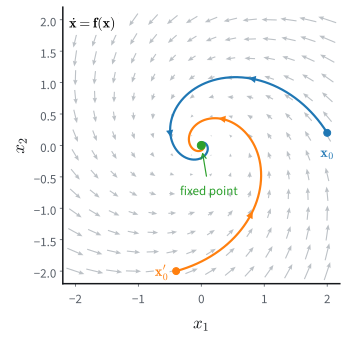
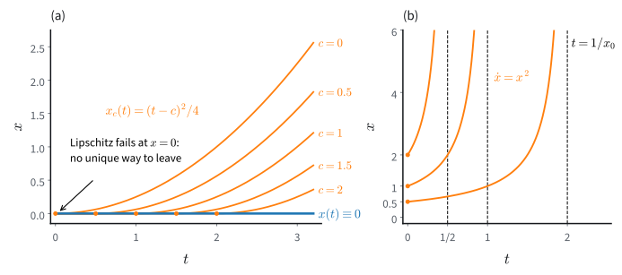
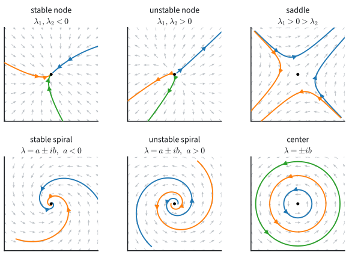

# Ordinary Differential Equations
:label:`sec_mdl-odes-solvers`

A gradient step, a residual block and one step of a diffusion sampler have
something in common, as the chapter introduction claimed: each is a short
move along an arrow that says how fast a state changes. The next section
asks how good such steps are. This one asks what they are steps *of*.
Suppose a velocity is prescribed at every point, as the wind is on a weather
map, and a balloon is released into it. Is its path determined? Could two
balloons released at the same spot part company? Can we tell where the
balloon was an hour ago? And where does it end up?

Newton's laws of 1687 are rules of this kind: they say how the state of a
body changes, not where it will be. That such a rule has exactly one
solution is not automatic. The theorem that secures it, proved by Picard and
Lindelöf in the 1890s, asks that the velocity not change too abruptly from
one point to the next, and we shall meet a harmless-looking rule that fails
the test.

Models need this theorem. When a network supplies the velocity and the
model's output is the place to which the motion carries its input,
uniqueness makes the output a function of the input, and running the motion
backward inverts that function, which a generative flow needs. For a linear
rule we can do more and write the solution down. The eigenvalues of its
matrix say whether the motion decays, grows or turns; the memory of a state
space model (:numref:`sec_ssm`) and the convergence of a training run are
read from them.

We begin with two motions that can be solved by hand, prove the theorem, and
then solve linear equations completely. Everything later rests on two
results: a velocity rule that changes gently has one trajectory through each
point, and the real parts of the eigenvalues of a linear rule decide whether
its motion decays. The last two subsections, on a decaying system that grows
before it decays and on the pendulum, can be skipped on a first reading.

```{.python .input #odes-solvers-imports}
#@tab mxnet
import math
import numpy as np
from mxnet import autograd, gluon, init, np as mnp, npx
from mxnet.gluon import nn
from d2l import mxnet as d2l
npx.set_np()
```

```{.python .input #odes-solvers-imports}
#@tab pytorch
import math
import numpy as np
import torch
from torch import nn
from torch.nn import functional as F
from d2l import torch as d2l
```

```{.python .input #odes-solvers-imports}
#@tab tensorflow
import math
import numpy as np
import tensorflow as tf
from d2l import tensorflow as d2l
```

```{.python .input #odes-solvers-imports}
#@tab jax
import math
import numpy as np
import jax
from jax import numpy as jnp
from flax import nnx
import optax
from d2l import jax as d2l
```

## Vector Fields and Flows
:label:`sec_mdl-vector-fields-trajectories`

### Decay, Rotation, and the Spiral

The simplest motion is *decay*. The rule "move toward zero at a speed
proportional to the distance" is the equation $\dot x=-x$, where the dot is
the derivative in time. Its solution from $x(0)=x_0$ is

$$
x(t)=e^{-t}x_0,
$$

as differentiating shows: $\dot x=-e^{-t}x_0=-x$. Each unit of time
multiplies the distance to the origin by $e^{-1}\approx0.37$.

Next comes *rotation*. In the plane, let the velocity be the position
turned by a right angle,

$$
\dot{\mathbf x}=\mathbf K\mathbf x,
\qquad
\mathbf K=\begin{pmatrix}0&-1\\1&0\end{pmatrix},
$$

that is $\dot x_1=-x_2$ and $\dot x_2=x_1$. The velocity is perpendicular to
the position, because $\mathbf x^\top\mathbf K\mathbf x=-x_1x_2+x_2x_1=0$, so
the length of $\mathbf x$ never changes:

$$
\frac{d}{dt}\|\mathbf x\|^2=2\,\mathbf x^\top\dot{\mathbf x}
=2\,\mathbf x^\top\mathbf K\mathbf x=0 .
$$

A point moves on a circle, and since its speed $\|\mathbf K\mathbf x\|$
equals its radius $\|\mathbf x\|$ it turns at one radian per unit of time:
one revolution takes $2\pi$.

Adding half of the decay to the rotation gives the equation that serves as
the running example of this section and the next two,

$$
\dot{\mathbf x}=\mathbf A\mathbf x,
\qquad
\mathbf A=-\tfrac12\mathbf I+\mathbf K
=\begin{pmatrix}-0.5&-1\\1&-0.5\end{pmatrix}.
$$

The rotation part does not change the length and the decay part shrinks it:
$\tfrac{d}{dt}\|\mathbf x\|^2=2\mathbf x^\top\mathbf A\mathbf x
=-\|\mathbf x\|^2$. This is the decay equation again, now for the squared
length, so $\|\mathbf x(t)\|^2=e^{-t}\|\mathbf x_0\|^2$ and
$\|\mathbf x(t)\|=e^{-t/2}\|\mathbf x_0\|$. A point loses length at rate
$\tfrac12$ while it turns at unit speed: it spirals into the origin
(:numref:`fig_mdl-dyn-ode-field`). The eigenvalues of $\mathbf A$ are
$-0.5\pm\mathrm i$. Their real part, $-\tfrac12$, gives the decay and their
imaginary part, $\pm1$, the angular speed. This is no accident:
:numref:`sec_mdl-linear-odes-stability` shows that every linear equation of
this kind is a sum of decays, growths and rotations, one for each eigenvalue.


:label:`fig_mdl-dyn-ode-field`

### The Initial-Value Problem

Most rules of motion are not linear, so we need a form that covers them all.
The general problem gives a velocity rule and a starting point:

$$
\dot{\mathbf{x}}(t) = \mathbf{f}(\mathbf{x}(t), t),
\qquad \mathbf{x}(0) = \mathbf{x}_0 .
$$
:eqlabel:`eq_mdl-ode-ivp`

Here $\mathbf x(t)\in\mathbb R^d$ is the state. The function
$\mathbf f:\mathbb R^d\times\mathbb R\to\mathbb R^d$ is a **vector field**:
it attaches an arrow to every point at every time. A **trajectory** is a
differentiable path whose tangent at each instant is the arrow at its current
position.

The vector $\mathbf x_0$ is the **initial value**, and :eqref:`eq_mdl-ode-ivp`
is called an **initial-value problem**. When $\mathbf f$ does not depend on
$t$, the system is **autonomous**: the arrows stay fixed and only the state
moves. Decay, rotation and the spiral are the autonomous fields
$\mathbf f(\mathbf x)=-\mathbf x$, $\mathbf K\mathbf x$ and
$\mathbf A\mathbf x$. A weather map is not autonomous, since the wind
changes while the balloon flies.

Integrating both sides from $0$ to $t$ (:numref:`sec_mdl-integral_calculus`)
gives the equivalent **integral form**

$$
\mathbf{x}(t) = \mathbf{x}_0 + \int_0^t \mathbf{f}(\mathbf{x}(s), s)\,ds .
$$
:eqlabel:`eq_mdl-ode-integral-form`

The solution is the start plus the accumulated velocity. The unknown path
appears on both sides, so this is still an equation and not a formula, but
the existence proof below works with it.

### Existence and Uniqueness
:label:`sec_mdl-ode-existence-uniqueness`

Does an initial-value problem have a solution, and only one? Not always.
Consider $\dot x=\sqrt{|x|}$ from $x_0=0$. The constant path $x\equiv0$
solves it. So does, for every waiting time $c\ge0$,

$$
x_c(t) =
\begin{cases}
0, & t \le c, \\
(t - c)^2/4, & t > c,
\end{cases}
$$

since $\dot x_c=(t-c)/2=\sqrt{x_c}$ for $t>c$. A particle at rest may leave
at any time. The solutions fan out from the axis, one for each departure
time (:numref:`fig_mdl-dyn-uniqueness-fan`), and we shall call this picture
the *fan*. A model defined by this field would not assign one output to its
input. The cause is the slope of $\sqrt{|x|}$, which is unbounded at $0$: a
small displacement $x$ produces the much larger velocity $\sqrt{|x|}$.


:label:`fig_mdl-dyn-uniqueness-fan`

For a well-behaved field a solution can be built by iterating the integral
form :eqref:`eq_mdl-ode-integral-form`: guess a path, read off the velocities
that the field prescribes along it, add them up from the start to obtain a
new path, and repeat. This is **Picard iteration**. For
$\dot x=x$ with $x_0=1$, start from the constant path $\varphi_0\equiv1$ and
set $\varphi_{k+1}(t)=1+\int_0^t\varphi_k(s)\,ds$:

$$
\varphi_1(t) = 1 + t,
\qquad
\varphi_2(t) = 1 + t + \tfrac{t^2}{2},
\qquad
\varphi_3(t) = 1 + t + \tfrac{t^2}{2} + \tfrac{t^3}{6} .
$$

The iterates converge to the solution $e^t$. Here each iteration adds one
Taylor term of $e^t$; for other fields the iterates look different, but they
still converge, provided the field does not change too abruptly from point to
point. The theorem makes "too abruptly" precise.

**Theorem (Picard--Lindelöf).** *Let $\mathbf{f}(\mathbf{x}, t)$ be
continuous in $t$ and globally Lipschitz in $\mathbf{x}$: there is an $L$
with*

$$
\|\mathbf{f}(\mathbf{x}, t) - \mathbf{f}(\mathbf{y}, t)\| \le L\,\|\mathbf{x} - \mathbf{y}\|
\qquad \textrm{for all } \mathbf{x}, \mathbf{y}, t.
$$

*Then the initial-value problem :eqref:`eq_mdl-ode-ivp` has exactly one
solution on $[0, T]$, for every $\mathbf{x}_0$ and every $T>0$*
:cite:`Coddington.Levinson.1955`.

This is the theorem that allows a model to be defined by a field. The
constant $L$ bounds how fast the arrows may change from point to point.
Decay has $L=1$, and a linear field $\mathbf A\mathbf x$ has
$L=\|\mathbf A\|$, where the norm of a matrix is, here and in the rest of
the section, its spectral norm: the largest factor by which the matrix
stretches a vector (:numref:`subsec_mdl-normal-matrices`). The fan is what
happens when no such $L$ exists near $0$. The proof shows that the Picard
iterates converge, and that they converge to the only solution.

**Proof.** A continuous path $\boldsymbol\varphi$ on $[0,\delta]$ solves the
problem if and only if it is a fixed point of the **Picard operator**

$$
(P\boldsymbol{\varphi})(t) = \mathbf{x}_0 + \int_0^t \mathbf{f}(\boldsymbol{\varphi}(s), s)\,ds .
$$

In words, $P$ is one round of Picard iteration: it reads the velocities along
a guessed path and adds them up from the start. (A solution satisfies the
integral form; conversely, a continuous fixed point is differentiable by the
fundamental theorem of calculus, with the right derivative and the right
start.)

The step that is not routine pulls the Lipschitz bound through the
integral. For two paths on $[0,\delta]$, write
$d(\boldsymbol\varphi,\boldsymbol\psi)=\max_{t\le\delta}\|\boldsymbol\varphi(t)-\boldsymbol\psi(t)\|$.
Then for $t\le\delta$,

$$
\|(P\boldsymbol{\varphi})(t) - (P\boldsymbol{\psi})(t)\|
\le \int_0^t L\,\|\boldsymbol{\varphi}(s) - \boldsymbol{\psi}(s)\|\,ds
\le L\,\delta\; d(\boldsymbol\varphi,\boldsymbol\psi) .
$$

With $\delta=1/(2L)$, every application of $P$ halves the distance between
two candidate paths.

Start from the constant path $\boldsymbol\varphi_0\equiv\mathbf x_0$ and set
$\boldsymbol\varphi_{k+1}=P\boldsymbol\varphi_k$. Consecutive iterates then
differ by at most $2^{-k}d(\boldsymbol\varphi_1,\boldsymbol\varphi_0)$, and
these differences add up like a geometric series. So the iterates converge
in the distance $d$, that is, uniformly on $[0,\delta]$, to a path
$\boldsymbol\varphi$. We take one fact from analysis on trust here: a uniform
limit of continuous paths is continuous. Since
$d(P\boldsymbol\varphi_k,P\boldsymbol\varphi)\le\tfrac12d(\boldsymbol\varphi_k,\boldsymbol\varphi)\to0$,
the paths $P\boldsymbol\varphi_k=\boldsymbol\varphi_{k+1}$ converge to
$P\boldsymbol\varphi$ as well as to $\boldsymbol\varphi$. Hence
$\boldsymbol\varphi=P\boldsymbol\varphi$: the limit is a solution. Two
solutions $\boldsymbol\varphi,\boldsymbol\psi$ would satisfy
$d(\boldsymbol\varphi,\boldsymbol\psi)=d(P\boldsymbol\varphi,P\boldsymbol\psi)\le\tfrac12d(\boldsymbol\varphi,\boldsymbol\psi)$,
so they coincide.

Finally restart at $t=\delta$ from $\boldsymbol\varphi(\delta)$. The step
length $1/(2L)$ does not depend on where the solution is, because $L$ is the
same everywhere, so $\lceil 2LT\rceil$ pieces of this length cover $[0,T]$,
with one solution on each. $\blacksquare$

The theorem asks for a Lipschitz bound and for that bound to hold globally,
and each requirement rules out a different failure. The fan shows what happens
without a Lipschitz bound. Without the global bound, the solution can blow up.
The field $\dot x=x^2$ is smooth, and we can solve it. Since
$\tfrac{d}{dt}(-1/x)=\dot x/x^2=1$, the quantity $-1/x$ grows at unit rate:
$-1/x(t)=t-1/x_0$, and so

$$
x(t) = \frac{x_0}{1 - x_0 t},
$$

which from a start $x_0>0$ reaches infinity at the finite time $t=1/x_0$.
The last step of the proof shows why the theorem does not cover it. On the
interval $|x|\le\rho$ the field is Lipschitz with $L=2\rho$, since
$|x^2-y^2|=|x+y|\,|x-y|$. The restart length $1/(2L)=1/(4\rho)$ therefore
shrinks as the solution grows, and the restarts can add up to a finite time.
A field that is Lipschitz only on bounded sets guarantees a solution only
for a while.

### The Flow Map
:label:`subsec_mdl-ode-flow-map`

A generative model moves a whole cloud of starting points at once, so we now
fix the field and vary the start. Let us take the simple case first, a field
that does not change in time; the wind returns at the end of the subsection.
For an autonomous, globally Lipschitz field, write

$$
\Phi_t(\mathbf x_0)=\mathbf x(t)
$$

for the state at time $t$ of the one trajectory started at $\mathbf x_0$.
This **flow map** $\Phi_t:\mathbb R^d\to\mathbb R^d$ moves all of space
forward by $t$ along the arrows.

For decay the flow map is $\Phi_t(x)=e^{-t}x$. Flowing for $s$ and then for
$t$ gives $\Phi_t(\Phi_s(x))=e^{-t}e^{-s}x=e^{-(t+s)}x=\Phi_{t+s}(x)$, and
$\Phi_{-t}(x)=e^{t}x$ undoes $\Phi_t$. The same law holds for every
autonomous field:

$$
\Phi_0 = \mathrm{id},
\qquad
\Phi_{t+s} = \Phi_t \circ \Phi_s .
$$
:eqlabel:`eq_mdl-ode-flow-group`

The reason is that the arrows do not change with time: the path
$\tau\mapsto\mathbf x(s+\tau)$ starts at $\Phi_s(\mathbf x_0)$ and follows
the same arrows, so by uniqueness it is the trajectory from that point. The
decay example suggests that the law also holds for negative times. It does,
because running a field backward is the same theorem applied to a second
field.

**Corollary (the flow map is a bijection).** *Let $\mathbf f(\mathbf x)$ be
autonomous and globally Lipschitz. Then $\Phi_t$ exists for every
$t\in\mathbb R$, and each $\Phi_t$ is a bijection of $\mathbb R^d$ with
inverse $\Phi_{-t}$. If instead $\mathbf f(\mathbf x,t)$ depends on time and
satisfies the hypotheses of the theorem, then for every $T>0$ the map that
carries the state at time $0$ to the state at time $T$ is a bijection of
$\mathbb R^d$.*

**Proof.** The field $\mathbf g(\mathbf y)=-\mathbf f(\mathbf y)$ is Lipschitz
with the same $L$. A path $\mathbf x(t)$ solves $\dot{\mathbf x}=\mathbf f$ on
$[-T,0]$ if and only if $\mathbf y(s)=\mathbf x(-s)$ solves
$\dot{\mathbf y}=\mathbf g$ on $[0,T]$, since
$\dot{\mathbf y}(s)=-\dot{\mathbf x}(-s)=-\mathbf f(\mathbf y(s))$. The
theorem applied to $\mathbf g$ gives a unique solution backward in time for
every start, so $\Phi_t$ is defined for all real $t$. The composition law
:eqref:`eq_mdl-ode-flow-group`, whose argument did not use the sign of $s$ or
$t$, then gives
$\Phi_{-t}\circ\Phi_t=\Phi_t\circ\Phi_{-t}=\Phi_0=\mathrm{id}$.

The reversal did not need the arrows to stand still. For a field that
depends on time, play the film backward from time $T$: a path $\mathbf x(t)$
solves $\dot{\mathbf x}=\mathbf f(\mathbf x,t)$ on $[0,T]$ if and only if
$\mathbf y(s)=\mathbf x(T-s)$ solves $\dot{\mathbf y}=\mathbf g(\mathbf y,s)$
with $\mathbf g(\mathbf y,s)=-\mathbf f(\mathbf y,T-s)$. This $\mathbf g$ is
again continuous in time and Lipschitz with the same $L$, so by the theorem
exactly one reversed path leaves each point $\mathbf z$. Read forward, it is
the one trajectory that ends at $\mathbf z$ at time $T$: every end state
comes from exactly one start. $\blacksquare$

A field that changes in time loses only the law
:eqref:`eq_mdl-ode-flow-group`. An hour of wind from noon and an hour from
midnight are different maps, so the map depends on the starting time as well
as on the duration (Exercise
:exref:`ex_mdl-odes-solvers-time-dependent-flow`). We keep the symbol
$\Phi_t$ for such a field, as the map from the state at time $0$ to the
state at time $t$.

One consequence is that two different trajectories are never at the same
point at the same time: run backward from such a meeting, the theorem allows
only one path. For a Lipschitz wind this answers the first three questions of
the opening. The balloon's path is determined, two balloons released together
stay together, and playing the weather map backward shows where they were an
hour ago.

An invertible map from noise to data whose inverse can be computed is what a
generative flow needs, and the fields of many neural networks qualify. A
field built from linear maps and Lipschitz activations, such as
$\mathbf f(\mathbf x)=\mathbf W_2\tanh(\mathbf W_1\mathbf x+\mathbf b_1)+\mathbf b_2$,
is globally Lipschitz, with $L$ at most the product of the weight norms and
the activations' constants ($\|\mathbf W_2\|\,\|\mathbf W_1\|$ here). The
model of :numref:`sec_mdl-neural-odes-cnf`, whose field may also depend on
time, is therefore well-posed, and by the corollary its map from input to
output is a bijection.

## Linear ODEs and Stability
:label:`sec_mdl-linear-odes-stability`

The last question of the opening, where the motion ends up, has a complete
answer for one family. Linear fields can be solved in closed form, and they
describe most other fields near a point where the field vanishes.

### The Matrix Exponential

The scalar equation $\dot x=ax$ is solved by $x(t)=e^{at}x_0$. For a linear
system

$$
\dot{\mathbf{x}} = \mathbf A\mathbf{x},
\qquad
\mathbf{x}(0) = \mathbf{x}_0,
\qquad \mathbf A \in \mathbb{R}^{d \times d},
$$

we look for the same form with a matrix in the exponent. For any square
matrix $\mathbf C$, define the **matrix exponential** by the power series that
defines $e^z$:

$$
e^{\mathbf C} = \sum_{k=0}^{\infty} \frac{\mathbf C^k}{k!}
= \mathbf I + \mathbf C + \frac{\mathbf C^2}{2} + \frac{\mathbf C^3}{6} + \cdots .
$$
:eqlabel:`eq_mdl-ode-matrix-exp-series`

The series converges for every matrix. Stretching by one matrix and then by
another stretches by at most the product of the two factors,
$\|\mathbf C\mathbf D\|\le\|\mathbf C\|\,\|\mathbf D\|$, so
$\|\mathbf C^k\| \le \|\mathbf C\|^k$, and term by term the series is
dominated by the scalar series for $e^{\|\mathbf C\|}$, which converges.

**Proposition (the matrix exponential solves linear ODEs).**
*$\mathbf{x}(t) = e^{\mathbf At}\mathbf{x}_0$ is the unique solution of
$\dot{\mathbf{x}} = \mathbf A\mathbf{x}$, $\mathbf{x}(0) = \mathbf{x}_0$.*

**Proof.** Differentiate the series :eqref:`eq_mdl-ode-matrix-exp-series` with
$\mathbf C = \mathbf At$ term by term (legitimate: on any bounded $t$-interval
the differentiated series still converges uniformly, by the same domination):

$$
\frac{d}{dt} e^{\mathbf At}
= \sum_{k=1}^{\infty} \frac{\mathbf A^k\, t^{k-1}}{(k-1)!}
= \mathbf A \sum_{j=0}^{\infty} \frac{(\mathbf At)^j}{j!}
= \mathbf A\, e^{\mathbf At}.
$$

So $\mathbf{x}(t) = e^{\mathbf At}\mathbf{x}_0$ satisfies the ODE, and at
$t = 0$ the series collapses to $\mathbf I$, so $\mathbf{x}(0) = \mathbf{x}_0$.
Uniqueness is Picard--Lindelöf: the field $\mathbf{x} \mapsto \mathbf A\mathbf{x}$
is Lipschitz with $L = \|\mathbf A\|$. $\blacksquare$

An infinite series of matrix powers is not yet a formula we can read. The
eigendecomposition turns it into $d$ scalar exponentials. Recall from
:numref:`sec_mdl-eigendecompositions` that if $\mathbf A$ has $d$
independent eigenvectors $\mathbf v_j$,
$\mathbf A\mathbf v_j=\lambda_j\mathbf v_j$, then with
$\mathbf V=(\mathbf v_1,\ldots,\mathbf v_d)$ and
$\boldsymbol\Lambda=\mathrm{diag}(\lambda_1,\ldots,\lambda_d)$ we have
$\mathbf A=\mathbf V\boldsymbol\Lambda\mathbf V^{-1}$.

Powers then telescope,
$(\mathbf At)^k = \mathbf V (\boldsymbol\Lambda t)^k \mathbf V^{-1}$, because
each adjacent $\mathbf V^{-1} \mathbf V$ cancels, and summing the series
:eqref:`eq_mdl-ode-matrix-exp-series` gives

$$
e^{\mathbf At} = \mathbf V e^{\boldsymbol\Lambda t} \mathbf V^{-1},
\qquad
e^{\boldsymbol\Lambda t} = \mathrm{diag}\!\left(e^{\lambda_1 t}, \ldots, e^{\lambda_d t}\right).
$$
:eqlabel:`eq_mdl-ode-matrix-exp-eig`

The eigenvalue section quoted this formula and left its development to us.
It says that the system decouples. Expand the start in the eigenbasis,
$\mathbf{x}_0 = \sum_j c_j \mathbf{v}_j$; then

$$
\mathbf{x}(t) = \sum_{j=1}^{d} c_j\, e^{\lambda_j t}\, \mathbf{v}_j .
$$

Along each eigendirection the system is the scalar equation
$\dot{x} = \lambda_j x$, evolving independently of the others.
Each term $c_je^{\lambda_jt}\mathbf v_j$ is called a **mode** of the system.

For the spiral we can do better than the general formula. Its matrix is a
sum, $\mathbf A=-\tfrac12\mathbf I+\mathbf K$, and we would like to split
the exponential as $e^{p+q}=e^pe^q$ splits for numbers. For matrices the rule
$e^{\mathbf P+\mathbf Q}=e^{\mathbf P}e^{\mathbf Q}$ holds when
$\mathbf P\mathbf Q=\mathbf Q\mathbf P$, since then
$(\mathbf P+\mathbf Q)^k$ expands by the binomial theorem as it does for
numbers. The identity commutes with every matrix, so
$e^{\mathbf At}=e^{-t/2}e^{\mathbf Kt}$. Because $\mathbf K^2=-\mathbf I$,
the powers of $\mathbf K$ cycle through
$\mathbf I,\mathbf K,-\mathbf I,-\mathbf K$, and the series for
$e^{\mathbf Kt}$ splits into even and odd terms, the series of $\cos t$ and
$\sin t$:

$$
e^{\mathbf At}
=e^{-t/2}\left(\cos t\,\mathbf I+\sin t\,\mathbf K\right)
=e^{-t/2}\begin{pmatrix}\cos t&-\sin t\\\sin t&\cos t\end{pmatrix}.
$$

The flow shrinks by $e^{-t/2}$ and turns by $t$ radians, as we found from the
field itself. From $\mathbf x_0=(2,0)$ at $t=2$ the state is
$e^{-1}(2\cos2,\,2\sin2)=(-0.306,\,0.669)$, with length $2e^{-1}=0.736$. For this $\mathbf A$ the eigenvectors and eigenvalues
$-0.5\pm\mathrm i$ are complex, but the product
$\mathbf Ve^{\boldsymbol\Lambda t}\mathbf V^{-1}$ is real.

A word of caution: when the two matrices do not commute, the split fails.
For $\mathbf P=\left(\begin{smallmatrix}0&1\\0&0\end{smallmatrix}\right)$ and
$\mathbf Q=\mathbf P^\top$, which both square to zero,
$e^{\mathbf P}e^{\mathbf Q}=(\mathbf I+\mathbf P)(\mathbf I+\mathbf Q)
=\left(\begin{smallmatrix}2&1\\1&1\end{smallmatrix}\right)$,
whereas $e^{\mathbf P+\mathbf Q}$ has $\cosh1\approx1.54$ in both diagonal
entries.

There is a third route to $e^{\mathbf At}$, which needs neither a series nor
eigenvectors: the compound-interest limit $(\mathbf I+t\mathbf A/n)^n$ as
$n\to\infty$. Each factor moves the state along the field for the short time
$t/n$. How fast does the limit arrive? In the eigenbasis the product is
$\mathbf V\,\mathrm{diag}\bigl((1+\lambda_jt/n)^n\bigr)\mathbf V^{-1}$, so
it is enough to ask one eigenvalue. Since $\log(1+z)=z-z^2/2+\cdots$,

$$
\left(1+\frac{\lambda t}{n}\right)^{n}
=\exp\Bigl(n\log\bigl(1+\tfrac{\lambda t}{n}\bigr)\Bigr)
\approx e^{\lambda t}\left(1-\frac{(\lambda t)^2}{2n}\right),
$$

so each $(1+\lambda_jt/n)^n$ tends to $e^{\lambda_jt}$ and misses it by the
fraction $|\lambda_jt|^2/(2n)$ of its size. For the spiral at $t=2$ this
fraction is $2.5/n$ for both eigenvalues, and $|e^{\lambda t}|=e^{-1}$, which
predicts an error of about $0.9/n$. The cell computes $e^{\mathbf At}$ from
the eigendecomposition and compares the compounding with it at three values
of $n$.

```{.python .input #odes-solvers-matrix-exponential}
A = np.array([[-0.5, -1.0], [1.0, -0.5]])      # spiral: eigenvalues -0.5 +- i
t, x0 = 2.0, np.array([2.0, 0.0])
lam, V = np.linalg.eig(A)                      # A = V diag(lam) V^{-1}
expAt = (V @ np.diag(np.exp(lam * t)) @ np.linalg.inv(V)).real
x = expAt @ x0
print('eigenvalues of A:', lam.round(4))
print('x(2) =', x.round(4), f' length {np.linalg.norm(x):.6f}')
for n in [2 ** 10, 2 ** 16, 2 ** 24]:          # compounding (I + tA/n)^n
    err = np.abs(np.linalg.matrix_power(np.eye(2) + (t / n) * A, n) - expAt).max()
    print(f'n = 2^{int(np.log2(n))}: error {err:.1e}, n * error = {n * err:.2f}')
```

The state $(-0.3062,\,0.6690)$ and its length $0.735759$ agree with the
values computed by hand. The compounding converges at the predicted rate and
no faster: the largest entry of its error, multiplied by $n$, stays at
$0.90$ from $n=2^{10}$ to $n=2^{24}$. This is compound interest with a matrix
interest rate. It defines the exponential well and computes it badly. After
nearly seventeen million compounding periods the error is still
$5\times10^{-8}$.

### Stability from Eigenvalues

The decoupled form tells us at a glance whether a linear system settles down.
Write each eigenvalue as $\lambda_j = a_j + \mathrm i\, b_j$. Its mode has
magnitude $|e^{\lambda_j t}| = e^{a_j t}$, since
$e^{\mathrm i b_jt}=\cos b_jt+\mathrm i\sin b_jt$ has modulus one. The real
part sets growth or decay; the imaginary part sets rotation. For a
diagonalizable $\mathbf A$ this gives the following classification.

* If $\operatorname{Re}\lambda_j < 0$ for all $j$, every mode decays, and
  $\mathbf{x}(t) \to \mathbf{0}$ from every start: the origin is
  **asymptotically stable**. The slowest mode sets the decay rate
  $-\max_j \operatorname{Re}\lambda_j$.
* If $\operatorname{Re}\lambda_j > 0$ for some $j$, that mode grows
  exponentially, and every start with a component along $\mathbf v_j$
  escapes: the origin is **unstable**.
* In between, a mode with $\operatorname{Re}\lambda_j=0$ neither grows nor
  decays. It stands still or circles forever, as the rotation did.

A complex pair $a\pm\mathrm ib$ is the spiral with general rates: a rotation
at angular speed $b$ that decays or grows with the sign of $a$. To see this,
write the eigenvector of $\lambda=a+\mathrm ib$ as
$\mathbf v=\mathbf p+\mathrm i\mathbf q$ with real $\mathbf p,\mathbf q$
(independent, since $b\ne0$). The real and imaginary parts of
$\mathbf A\mathbf v=(a+\mathrm ib)\mathbf v$ are

$$
\mathbf A\mathbf p=a\mathbf p-b\mathbf q,
\qquad
\mathbf A\mathbf q=b\mathbf p+a\mathbf q .
$$

So $\mathbf A$ maps the plane of $\mathbf p$ and $\mathbf q$ to itself, and
in the basis $(\mathbf q,\mathbf p)$ it is the matrix
$a\mathbf I+b\mathbf K$. The computation for the spiral then gives

$$
e^{(a\mathbf I+b\mathbf K)t}=e^{at}\left(\cos bt\,\mathbf I+\sin bt\,\mathbf K\right):
$$

scaling by $e^{at}$ composed with rotation by the angle $bt$. The same block,
iterated in discrete time instead of flowed, appears in
:numref:`subsec_mdl-complex-rotation`.

In two dimensions this leaves six pictures, and
:numref:`fig_mdl-dyn-phase-portraits` draws one field of each kind. With
real eigenvalues the origin is a **stable node** (both negative), an
**unstable node** (both positive) or a **saddle** (one of each sign). With a
complex pair it is a **stable spiral**, an **unstable spiral** or, when the
real part is zero, a **center**. (A zero eigenvalue is left out: it gives a
whole line of points at rest.) The stable spiral is our running example.


:label:`fig_mdl-dyn-phase-portraits`

In training we meet the top row most often. Gradient descent in continuous
time on a quadratic loss $\tfrac12\mathbf x^\top\mathbf H\mathbf x$ is the
linear field $\dot{\mathbf x}=-\mathbf H\mathbf x$, and a symmetric
$\mathbf H$ has real eigenvalues, so such a loss produces only nodes and
saddles. Rotation needs a field that is not a gradient, such as the two
players of the smallest GAN, who circle their equilibrium in a center
(:numref:`sec_gan_convergence`).

When $\mathbf A$ has too few eigenvectors to be diagonalized, the modes
acquire polynomial factors $t^ke^{\lambda t}$. They change the verdict only
for eigenvalues on the imaginary axis, and Exercise
:exref:`ex_mdl-odes-solvers-repeated-eigenvalue` works out the smallest case.

### Linear Systems with an Input
:label:`subsec_mdl-ode-driven-linear`

So far nothing pushed the system from outside. The state of a state space
model that reads a sequence (:numref:`sec_ssm`) obeys a linear equation with
an input $\mathbf u(t)$, which enters the state through a matrix $\mathbf B$:

$$
\dot{\mathbf x}=\mathbf A\mathbf x+\mathbf B\mathbf u(t),
\qquad \mathbf x(0)=\mathbf x_0 .
$$

The matrix exponential solves this equation as well, and one observation
finds the solution. Without the input, the quantity
$e^{-\mathbf At}\mathbf x(t)$ stands still at $\mathbf x_0$: it is the state
carried back to time $0$ along the free motion. With the input it can move
only as fast as the input pushes it. Indeed, since
$\tfrac{d}{dt}e^{-\mathbf At}=-e^{-\mathbf At}\mathbf A$, the product rule
gives
$\tfrac{d}{dt}\bigl(e^{-\mathbf At}\mathbf x\bigr)
=e^{-\mathbf At}(\dot{\mathbf x}-\mathbf A\mathbf x)
=e^{-\mathbf At}\mathbf B\mathbf u$,
and the right-hand side no longer contains $\mathbf x$. Integrating from $0$
to $t$ and multiplying by $e^{\mathbf At}$ yields

$$
\mathbf x(t)=e^{\mathbf At}\mathbf x_0
+\int_0^t e^{\mathbf A(t-s)}\,\mathbf B\mathbf u(s)\,ds .
$$
:eqlabel:`eq_mdl-ode-variation-of-constants`

This is the **variation of constants** formula, so called because the
constant $\mathbf x_0$ of the free solution $e^{\mathbf At}\mathbf x_0$ has
been allowed to vary in time. The state is the decayed start plus every past
input, each decayed for the time since it arrived.

A sequence model receives its input one sample per step, not at every
instant. So cut time into steps of length $h$, with grid times $t_n=nh$ and
grid states $\mathbf x_n=\mathbf x(t_n)$, and suppose that the input is constant during
each step, $\mathbf u(s)=\mathbf u_n$ for $s\in[t_n,t_n+h)$. This is called
a *zero-order hold*. Apply :eqref:`eq_mdl-ode-variation-of-constants` to one
step, which starts from $\mathbf x_n$ at time $t_n$. The constant
$\mathbf u_n$ comes out of the integral, and with $\tau=t_{n+1}-s$ what
remains is $\int_0^he^{\mathbf A\tau}d\tau$, the same matrix for every
step. The grid states therefore obey a linear recurrence, without any
approximation:

$$
\mathbf x_{n+1}=\bar{\mathbf A}\,\mathbf x_n+\bar{\mathbf B}\,\mathbf u_n,
\qquad
\bar{\mathbf A}=e^{\mathbf Ah},
\qquad
\bar{\mathbf B}=\int_0^h e^{\mathbf A\tau}\,d\tau\;\mathbf B
=\mathbf A^{-1}\bigl(e^{\mathbf Ah}-\mathbf I\bigr)\mathbf B ,
$$
:eqlabel:`eq_mdl-ode-zoh`

where the last form needs $\mathbf A$ to be invertible. In one dimension
these are $\bar a=e^{h\lambda}$ and $\bar b=(e^{h\lambda}-1)\,b/\lambda$, the
coefficients on which the state space models of :numref:`subsec_zoh` are
built (there the step is $\Delta$ and the state is $h$).

The point to remember is that
$|e^{h\lambda}|=e^{h\operatorname{Re}\lambda}<1$ for every step $h>0$
whenever $\operatorname{Re}\lambda<0$: the exact recurrence is stable
whenever the equation is. Compare the factor $1+h\lambda$ of one compounding
period, which follows the field for a time $h$ without looking again. On
$\dot x=-50x$ with $h=0.05$ the exact factor is $e^{-2.5}=0.08$, while
$1+h\lambda=-1.5$ flips the sign of the state and enlarges it. Stepping along
the field in this way is Euler's method, and
:numref:`sec_mdl-euler-runge-kutta` shows what the factor $-1.5$ does to a
training run.

The recurrence is exact only while the input is constant over each step, and
a sequence model reads samples of a signal that moves between them. What
does the hold cost then? The cell runs the scalar recurrence on
$\dot x=\lambda x+\sin t$ from $x(0)=1$ to $T=2$, with the input held at its
value at the start of each step, and compares the result with the closed-form
solution. It does so for a slow rate $\lambda=-1$ and a fast one
$\lambda=-50$, and prints $1+h\lambda$ beside the exact factor
$e^{h\lambda}$.

```{.python .input #mdl-odes-zero-order-hold}
def zoh(lam, h, u, x0=1.0, T=2.0):
    """Exact steps of dx/dt = lam x + u(t), u held at u(t_n) over each step."""
    a, b = np.exp(h * lam), np.expm1(h * lam) / lam
    x = x0
    for n in range(round(T / h)):
        x = a * x + b * u(n * h)
    return x

def exact_sin(lam, T=2.0):
    """Solution of dx/dt = lam x + sin t with x(0) = 1, at time T."""
    c = 1 + lam ** 2
    return np.exp(lam * T) * (1 + 1 / c) - (lam * np.sin(T) + np.cos(T)) / c

print(f'{"lam":>5} {"h":>5} {"e^(h lam)":>10} {"1 + h lam":>10}'
      f' {"error at T":>11}')
for lam in [-1.0, -50.0]:
    for h in [0.5, 0.1, 0.02]:
        err = abs(zoh(lam, h, np.sin) - exact_sin(lam))
        print(f'{lam:5.0f} {h:5.2f} {np.exp(h * lam):10.3g}'
              f' {1 + h * lam:10.2f} {err:11.1e}')
```

The recurrence itself approximates nothing, so the only error is that of
the hold, which pretends that the sine stands still during each step. It
shrinks about in proportion to the step: for $\lambda=-1$ it is $0.068$,
$0.0097$ and $0.0018$ at $h=0.5$, $0.1$ and $0.02$. The row to study is
$\lambda=-50$ with $h=0.5$, a step twenty-five times longer than the time
$1/|\lambda|$ in which the state forgets. There the exact factor is
$1.4\times10^{-11}$ and the error is $0.0016$, where the factor
$1+h\lambda=-24$ would have blown the state up. The models of
:numref:`subsec_zoh` rest on this fact. As long as the rates stay negative,
no step size that training might choose makes the recurrence grow.

### Transient Growth
:label:`subsec_mdl-ode-transient-growth`

One caveat to the verdict by eigenvalues is still owed. When every mode
decays, the state goes to zero, but its length $\|\mathbf x(t)\|$ need not
decrease on the way. A triangular matrix shows it:

$$
\dot{\mathbf x}=\begin{pmatrix}-1&10\\0&-2\end{pmatrix}\mathbf x,
\qquad \mathbf x_0=(0,1),
$$

with eigenvalues $-1$ and $-2$, both negative. The second row involves only
$x_2$, so $x_2(t)=e^{-2t}$. The first row is then $\dot x_1=-x_1+10e^{-2t}$,
a decay equation with an input, and :eqref:`eq_mdl-ode-variation-of-constants`
gives

$$
x_1(t)=10\int_0^te^{-(t-s)}e^{-2s}\,ds=10\left(e^{-t}-e^{-2t}\right).
$$

The first coordinate starts at $0$ and rises until its derivative
$10(2e^{-2t}-e^{-t})$ vanishes, at $e^{-t}=\tfrac12$. There, at
$t=\log2\approx0.69$, it equals $10(\tfrac12-\tfrac14)=2.5$, and
$x_2=\tfrac14$, so a state that started with length $1$ now has length
$\sqrt{2.5^2+0.25^2}\approx2.51$. From then on $x_1$ decays, in the long run
like $10e^{-t}$, the rate of the slower mode.

The reason is the one of :numref:`subsec_mdl-transient-growth`, which treats
the discrete-time case in full: the eigenvectors $\mathbf v_1=(1,0)$ and
$\mathbf v_2=(0.995,\,-0.0995)$ span lines only $5.7^\circ$ apart, so the
short vector $\mathbf x_0=10.0\,\mathbf v_1-10.05\,\mathbf v_2$ is the
difference of two long ones. They decay at different rates, and the
cancellation stops before both have died away. Eigenvalues give the
asymptotic rate of decay, not the size of the transient. This is worth
remembering in front of a training curve: a momentum run that converges can
grow for its first few steps (Exercise
:exref:`ex_mdl-odes-solvers-transient-growth`).

### Linearization at Fixed Points
:label:`subsec_mdl-ode-linearization`

Few nonlinear fields have a closed-form solution, but near a point where the
field vanishes they behave like a linear one. A **fixed point** of an
autonomous field is a state $\mathbf x^\star$ with
$\mathbf f(\mathbf x^\star)=\mathbf 0$: a particle placed there never moves.
For a continuously differentiable $\mathbf f$ and a small displacement
$\boldsymbol\delta(t)=\mathbf x(t)-\mathbf x^\star$, Taylor's theorem
(:numref:`sec_mdl-multivariable_calculus`) gives

$$
\dot{\boldsymbol{\delta}}
= \mathbf{f}(\mathbf{x}^\star + \boldsymbol{\delta})
= \mathbf J\,\boldsymbol{\delta} + o(\|\boldsymbol{\delta}\|),
\qquad
\mathbf J = \frac{\partial \mathbf{f}}{\partial \mathbf{x}}(\mathbf{x}^\star) .
$$

Near the fixed point the field is the linear field of its Jacobian
$\mathbf J$, up to a remainder that vanishes faster than the displacement.
May we ignore the remainder? In most cases, yes. A fixed point is
**hyperbolic** if no eigenvalue of $\mathbf J$ has zero real part. For a
hyperbolic fixed point, the Hartman--Grobman theorem
:cite:`Hartman.1960,Grobman.1959`, which we cite without proof, says that near $\mathbf x^\star$ the trajectories of the
nonlinear field are those of $\dot{\boldsymbol\delta}=\mathbf J\boldsymbol\delta$,
up to a continuous change of coordinates. The eigenvalues of the Jacobian
then decide local stability by the classification above.

For gradient descent in continuous time,
$\dot{\mathbf x}=-\nabla\mathcal L(\mathbf x)$, this is a familiar
statement in new words. The fixed points are the critical points of the
loss, and the Jacobian is $-\mathbf H$, minus the Hessian. A minimum with
positive curvature in every direction is therefore a stable node, and a
saddle point of the loss is a saddle of the flow.

The damped pendulum is the one nonlinear field we work out. In units of time
that make the ratio $g/\ell$ of gravity to length equal to one, its angle
$\phi$ from the bottom obeys $\ddot\phi=-\sin\phi-c\dot\phi$, with damping coefficient $c\ge0$. With the
angular velocity $\omega=\dot\phi$ it becomes a first-order system, written
here with its Jacobian:

$$
\dot\phi=\omega,\qquad \dot\omega=-\sin\phi-c\,\omega,
\qquad
\mathbf J(\phi,\omega)=\begin{pmatrix}0&1\\-\cos\phi&-c\end{pmatrix}.
$$

The fixed points have $\omega=0$ and $\sin\phi=0$: the pendulum hanging at
$\phi=0$ and balanced upright at $\phi=\pi$.

* At the bottom, $\mathbf J$ has characteristic polynomial
  $\lambda^2+c\lambda+1$, with roots
  $\lambda=-c/2\pm\mathrm i\sqrt{1-c^2/4}$ for $c<2$. At $c=0.5$ they are
  $-0.25\pm0.97\,\mathrm i$, a stable spiral. This is the ring-down of a
  released pendulum: it swings with period about $2\pi/0.97$ while its
  amplitude decays like $e^{-t/4}$.
* At the top, the polynomial is $\lambda^2+c\lambda-1$, whose roots
  $(-c\pm\sqrt{c^2+4})/2$ have product $-1$, so one is positive and one
  negative for every $c$. At $c=0.5$ they are $0.78$ and $-1.28$: a saddle.
  Only the starts on one curve approach the top. They are the pendulum swung
  up with just the right speed, which comes to rest balanced like a pencil on
  its tip.

The same computation, a Jacobian and its eigenvalues, classifies the fixed
points of any smooth field, with one exception. When no eigenvalue has
positive real part but one lies on the imaginary axis, the linearization
does not decide stability. The fields $\dot x=-x^3$ and $\dot x=x^3$ both
have Jacobian $0$ at the origin. The first is stable, with
$x(t)=x_0/\sqrt{1+2x_0^2t}\to0$; the second escapes to infinity at
$t=1/(2x_0^2)$.

So far a formula has done all the work. For a field given by a network there
is no formula at all, and a computer can only take steps: read the arrow,
move a little, read it again. How far do such steps stray from the
trajectory they imitate, and can they fail where the equation does not?

## Summary

An ordinary differential equation prescribes a velocity at every point, and
the first question is whether that determines a motion. When the field is
globally Lipschitz it does: one trajectory passes through each point,
forward and backward, so the flow map is a bijection and a model can be
defined by a field. Linear systems are solved by
$e^{\mathbf At}=\mathbf Ve^{\boldsymbol\Lambda t}\mathbf V^{-1}$: the real
parts of the eigenvalues decide decay, the imaginary parts rotation. An
input held constant over each step turns the equation into a recurrence that
is exact, and stable at every step size when the equation is stable.
Eigenvalues give the rate of decay in the long run, not the size of the
transient, and at a hyperbolic fixed point they classify a nonlinear field
through its Jacobian. None of this computes a trajectory when no formula
exists.

## Exercises

1. **One exponent, two failures.** Consider $\dot x=|x|^\alpha$ for
   $\alpha>0$.
    1. For $0<\alpha<1$, find every solution with $x(0)=0$, and check that
       $\alpha=\tfrac12$ gives the fan of :numref:`fig_mdl-dyn-uniqueness-fan`.
       Which hypothesis of the Picard--Lindelöf theorem fails, and at which
       point?
    1. For $\alpha=1$ the theorem applies. What is $L$, and what is the
       solution from $x(0)=0$?
    1. For $\alpha>1$ and $x_0>0$, solve the equation as the text solved
       $\dot x=x^2$ (differentiate $x^{1-\alpha}$) and find the time at which
       the solution reaches infinity. Which hypothesis fails now? Show that
       the solution from $x(0)=0$ is unique all the same. (Two solutions both
       stay in $|x|\le1$ for a short time, where the field is Lipschitz with
       constant $\alpha$; apply the uniqueness step of the proof on a short
       interval, then restart.)
    1. Reverse time in the case $\alpha=\tfrac12$. The equation
       $\dot x=-\sqrt x$ for $x\ge0$ describes, in suitable units, the level
       of water in a bucket that drains through a hole in its bottom
       (Torricelli's law). Show that every solution reaches $0$ in finite
       time and stays there. An empty bucket does not say when it ran dry:
       which statement of the corollary on the flow map fails?
   :exlabel:`ex_mdl-odes-solvers-uniqueness-exponent`

1. **Picard iteration on the rotation.** Apply Picard iteration to
   $\dot{\mathbf x}=\mathbf K\mathbf x$ from $\mathbf x_0=(1,0)$, starting
   from the constant path $\boldsymbol\varphi_0\equiv\mathbf x_0$.
    1. Compute $\boldsymbol\varphi_1,\ldots,\boldsymbol\varphi_4$. Which two
       functions are being built, one Taylor term per iteration?
    1. Show that
       $\|\boldsymbol\varphi_k(t)-\boldsymbol\varphi_{k-1}(t)\|=t^k/k!$.
       The proof in the text promises a factor $\tfrac12$ per iteration, and
       only on an interval of length $1/(2L)=\tfrac12$. For which $t$ do
       these iterates converge, and how fast?
    1. The rotation is not special. For a field that satisfies the hypotheses
       of the theorem, let $M=\max_{s\le T}\|\mathbf f(\mathbf x_0,s)\|$.
       Show by induction that
       $\|\boldsymbol\varphi_{k+1}(t)-\boldsymbol\varphi_k(t)\|\le ML^kt^{k+1}/(k+1)!$
       on $[0,T]$, and conclude that Picard iteration converges on all of
       $[0,T]$ without a restart. Which estimate in the proof of the text
       gave the factorial away?
   :exlabel:`ex_mdl-odes-solvers-picard-rotation`

1. **Separation of trajectories.** Consider a field of the form
   $\mathbf{f}(\mathbf{x}) = \mathbf W_2 \tanh(\mathbf W_1\mathbf{x} + \mathbf{b}_1) + \mathbf{b}_2$,
   the kind of field that a Neural ODE integrates
   (:numref:`sec_mdl-neural-odes-cnf`).
    1. Show that $\mathbf{f}$ is Lipschitz with constant
       $L = \|\mathbf W_2\|\,\|\mathbf W_1\|$ in the spectral norm. Which
       property of $\tanh$ does the proof use? Does the bound change when
       $\tanh$ is replaced by ReLU?
    1. Let $\mathbf{x}(t)$ and $\mathbf{y}(t)$ be two trajectories of an
       autonomous field with Lipschitz constant $L$. Differentiate
       $\|\mathbf{x}(t) - \mathbf{y}(t)\|^2$ and show that

       $$
       e^{-Lt}\|\mathbf{x}(0) - \mathbf{y}(0)\|
       \le \|\mathbf{x}(t) - \mathbf{y}(t)\|
       \le e^{Lt}\|\mathbf{x}(0) - \mathbf{y}(0)\| .
       $$

       What does the lower bound imply for two trajectories that start at
       distinct points? What do the two bounds imply for the Lipschitz
       constants of $\Phi_T$ and of its inverse?
   :exlabel:`ex_mdl-odes-solvers-trajectory-separation`

1. **A field that changes in time.** Consider $\dot x=-tx$, a decay whose
   rate grows with time.
    1. Solve the equation from the state $x$ at time $s$, and write down the
       map $\Phi_{s\to t}$ that carries the state at time $s$ to the state at
       time $t$.
    1. Show that $\Phi_{s\to t}\circ\Phi_{r\to s}=\Phi_{r\to t}$ and that
       $\Phi_{t\to s}$ inverts $\Phi_{s\to t}$. Then compare
       $\Phi_{0\to1}$ with $\Phi_{1\to2}$, which both flow for one unit of
       time. Why can no law $\Phi_{t+s}=\Phi_t\circ\Phi_s$ in the duration
       alone hold for this field?
    1. A field that depends on time becomes autonomous when time is made a
       coordinate of the state: $\mathbf z=(x,t)$ obeys
       $\dot{\mathbf z}=(f(x,t),\,1)$. Write this field down for
       $\dot x=-tx$. Is it globally Lipschitz in $\mathbf z$? Is $-tx$
       globally Lipschitz in $x$ for $t\in[0,T]$? Which route to the
       bijection asks less of the field, this one or the reversal of time in
       the proof of the corollary?
   :exlabel:`ex_mdl-odes-solvers-time-dependent-flow`

1. **A repeated eigenvalue.** The matrix
   $\mathbf A=\left(\begin{smallmatrix}\lambda&1\\0&\lambda\end{smallmatrix}\right)$
   with real $\lambda$ has a single eigenvalue and only one eigendirection,
   so :eqref:`eq_mdl-ode-matrix-exp-eig` does not apply to it.
    1. Write $\mathbf A=\lambda\mathbf I+\mathbf N$ and use
       $\mathbf N^2=\mathbf 0$ to show that
       $e^{\mathbf At}=e^{\lambda t}\left(\begin{smallmatrix}1&t\\0&1\end{smallmatrix}\right)$.
       Why may the exponential be split here?
    1. From $\mathbf x_0=(0,1)$ the first coordinate is $te^{\lambda t}$. For
       $\lambda<0$, find its peak and the time at which it occurs. For which
       $\lambda$ does the factor $t$ change the verdict that the sign of
       $\lambda$ alone would give?
    1. Let the two eigenvalues of the matrix of
       :numref:`subsec_mdl-ode-transient-growth` approach each other. For
       $\left(\begin{smallmatrix}-1&10\\0&-1-\varepsilon\end{smallmatrix}\right)$
       and $\mathbf x_0=(0,1)$, compute $x_1(t)$ and its limit as
       $\varepsilon\to0$. What happens to the angle between the two
       eigendirections in this limit, and what does that say about a matrix
       that cannot be diagonalized?
   :exlabel:`ex_mdl-odes-solvers-repeated-eigenvalue`

1. [code] **The zero-order hold.** Consider the scalar equation
   $\dot x=\lambda x+b\,u(t)$ with $\lambda<0$. (The exercise on
   discretization rules in :numref:`sec_ssm` compares the hold with three
   other ways to turn this equation into a recurrence.)
    1. Specialize :eqref:`eq_mdl-ode-zoh` to one dimension to obtain
       $\bar a=e^{h\lambda}$ and $\bar b=(e^{h\lambda}-1)\,b/\lambda$, and
       find the limit of $\bar b$ as $\lambda\to0$. Show that for a constant
       input the recurrence and the equation settle at the same value.
    1. On the samples $u(t_n)$ of a moving input, the recurrence solves the
       equation driven by a staircase. Argue that the staircase is, on
       average, the input delayed by $h/2$, and conclude that to first order
       in $h$ the error at time $T$ has size
       $\tfrac h2\bigl|\int_0^Te^{\lambda(T-s)}\,b\,u'(s)\,ds\bigr|$.
       Evaluate this for $\lambda=-1$, $b=1$, $u=\sin$ and $T=2$. How close
       is it to the three errors that the cell of
       :numref:`subsec_mdl-ode-driven-linear` prints for $\lambda=-1$?
    1. Change the cell of that subsection so that it samples the input at
       the middle of each step, $u(t_n+h/2)$. How does the error for
       $\lambda=-1$ fall with $h$ now, and why?
   :exlabel:`ex_mdl-odes-solvers-zero-order-hold`

1. [code] **Transient growth and nonnormality.** ● The text shows one matrix
   with transient growth. This exercise finds how the growth depends on the
   angle between the eigenvectors, and meets it again in momentum.
    1. For $\mathbf A_\nu=\left(\begin{smallmatrix}-1&\nu\\0&-2\end{smallmatrix}\right)$
       and $\mathbf x_0=(0,1)$, show that $x_1(t)=\nu(e^{-t}-e^{-2t})$ and find
       the peak of $x_1$ and the time at which it occurs. Find numerically the
       smallest $\nu$ for which $\|\mathbf x(t)\|$ ever exceeds
       $\|\mathbf x_0\|$.
    1. Compute the angle between the two eigenvectors of $\mathbf A_\nu$ as a
       function of $\nu$, express $\mathbf x_0$ in the eigenbasis, and explain
       the growth as the cancellation of two large components.
    1. Compute $\max_t\|e^{\mathbf A_\nu t}\|_2$ for $\nu=1,5,10,20$ numerically
       and compare it with the peak of the trajectory from $(0,1)$. Why can
       the first never be smaller than the second?
    1. Heavy-ball momentum on $\mathcal L(x)=\tfrac\lambda2x^2$ is the
       recurrence $x_{k+1}=(1+\beta-\eta\lambda)x_k-\beta x_{k-1}$, which
       Exercise :exref:`ex_mdl-odes-solvers-heavy-ball-ode` of
       :numref:`sec_mdl-euler-runge-kutta` derives from a damped oscillator.
       It is the linear map $(x_{k+1},x_k)=\mathbf M(x_k,x_{k-1})$ with
       $\mathbf M=\left(\begin{smallmatrix}1+\beta-\eta\lambda&-\beta\\1&0\end{smallmatrix}\right)$.
       Show that $\mathbf M$ is not normal, that is,
       $\mathbf M\mathbf M^\top\ne\mathbf M^\top\mathbf M$ (normal matrices
       have orthogonal eigenvectors and no transient growth,
       :numref:`subsec_mdl-transient-growth`). For $\beta=0.9$, compute its
       eigenvalues at $\eta\lambda=0.1$ and at $\eta\lambda=3$, and check
       that their modulus is $\sqrt\beta\approx0.95$ in both cases. Run both
       from rest, $x_0=x_{-1}=1$. In which run does $\|(x_{k+1},x_k)\|$ grow
       before it decays, for how many steps and to what peak, and what
       happens to the loss in its first step? What does this say about
       reading the first iterations of a momentum run as divergence?
   :exlabel:`ex_mdl-odes-solvers-transient-growth`

1. **A gradient flow cannot circle.** Let $\mathcal L$ be twice continuously
   differentiable and bounded below, and consider the gradient flow
   $\dot{\mathbf x}=-\nabla\mathcal L(\mathbf x)$.
    1. Show that
       $\tfrac{d}{dt}\mathcal L(\mathbf x(t))=-\|\nabla\mathcal L(\mathbf x(t))\|^2$.
       Conclude that no trajectory returns to a point it has left, so that a
       gradient flow has no closed orbit and no center.
    1. Integrate the identity from $0$ to $T$ and show that
       $\min_{t\le T}\|\nabla\mathcal L(\mathbf x(t))\|^2\le(\mathcal L(\mathbf x_0)-\inf\mathcal L)/T$.
       Which assumptions on the loss did this bound not need?
    1. The game $\min_{x_1}\max_{x_2}x_1x_2$, in which $x_1$ descends and
       $x_2$ ascends the value $x_1x_2$, has the field $\dot x_1=-x_2$,
       $\dot x_2=x_1$: the rotation $\mathbf K$. Show that this field is not
       the negative gradient of any function. (Compare
       $\partial f_1/\partial x_2$ with $\partial f_2/\partial x_1$.) What
       does part (a) then say about the difference between training one loss
       and training two players against each other?
   :exlabel:`ex_mdl-odes-solvers-gradient-flow-orbits`

1. **Limits of linearization.**
    1. The field $\dot x=x^2$ has Jacobian $0$ at the origin, like the two
       cubic fields of the text. Its solution in
       :numref:`sec_mdl-ode-existence-uniqueness` holds for every start
       $x_0$. Find the starts from which the state approaches the origin. Is
       the origin stable, unstable, or stable from one side only? What does
       the Hartman--Grobman theorem say about the three fields?
    1. For the damped pendulum, find the damping $c$ at which the bottom rest
       point changes from a spiral to a node. Sketch the portrait near the
       bottom for $c=0.5$, $c=2$ and $c=4$, and describe how a released
       pendulum moves in each case.
    1. The loss $\mathcal L(w_1,w_2)=\tfrac12(w_1w_2-1)^2$ is that of the
       smallest deep linear network, a product of two weights fitted to the
       target $1$. Write down its gradient flow
       $\dot{\mathbf w}=-\nabla\mathcal L(\mathbf w)$, find all fixed points,
       and classify the origin. Show that at every point of the curve
       $w_1w_2=1$ the Jacobian has the eigenvalues $0$ and
       $-(w_1^2+w_2^2)$. Why can no point of a curve of fixed points be
       hyperbolic, and what does the negative eigenvalue still tell you?
   :exlabel:`ex_mdl-odes-solvers-linearization-limits`

[Discussions](https://d2l.discourse.group/t/36837)

<!-- slides -->

::: {.slide}
::: {.cover}
[Dive into Deep Learning · §38.1]{.kicker}

A velocity at every point and the motion it determines<br>**one trajectory per point · the matrix exponential · eigenvalues and stability**
:::
:::

::: {.slide title="A Velocity at Every Point Does Not Always Fix the Motion"}
[The problem]{.kicker}

A state $x(t)$ follows a velocity rule $\dot x=f(x)$ from a start $x(0)$, where $\dot x=dx/dt$.

| rule | start | solutions |
|---|---|---|
| $\dot x=-x$ | $x(0)=1$ | one: $x=e^{-t}$ |
| $\dot x=\sqrt{\lvert x\rvert}$ | $x(0)=0$ | $x\equiv0$, $x=t^2/4$, and infinitely many more |

::: {.d2l-note .warn}
A model defined by a field needs one output per input. When is the motion
determined, can it be run backward, and where does it end up?
:::
:::

::: {.slide title="By the End of This Deck You Can"}
[Goals]{.kicker}

- decide whether a field has exactly one trajectory through each point;
- invert a flow by running the field backward;
- solve $\dot{\mathbf x}=\mathbf A\mathbf x$ and read decay and rotation from the eigenvalues of $\mathbf A$;
- turn a linear system with a held input into an exact recurrence;
- classify a fixed point of a nonlinear field by its Jacobian.

**Running example:** the spiral $\mathbf A=\left(\begin{smallmatrix}-0.5&-1\\1&-0.5\end{smallmatrix}\right)$, eigenvalues $-0.5\pm\mathrm i$.

**The idea:** a field that changes gently has one trajectory per point, and a linear field is solved by its eigenvalues.
:::

::: {.slide title="Exact Motion First, Steps Second"}
[Where this fits]{.kicker}

::: {.cols .vc}
::: {.col}
| section | adds |
|---|---|
| **Ordinary Differential Equations** | **exact motion: uniqueness, eigenvalues** |
| Numerical Solvers | steps: their order and stability |
| Neural ODEs | a learned field, its gradient, its density |
| Stochastic Differential Equations | noise, Itô calculus, the OU process |
| Fokker–Planck and Probability Flow | how the density moves; the score |
| Score Matching and Diffusion | learning the score, sampling with it |
| Flow Matching and Transport | learning a velocity; straight paths |
:::

::: {.col .narrow}
- **Uses:** eigenvalues, the spectral norm, Taylor expansion.
- **Skips:** every numerical method, nonlinear dynamics beyond fixed points.
:::
:::
:::

::: {.slide}
::: {.divider}
[01]{.dnum}

[Vector fields and flows]{.dtitle}

[one trajectory through each point]{.dsub}
:::
:::

::: {.slide title="Decay Plus Rotation Is a Spiral"}
[The running example]{.kicker}

::: {.cols .vc}
::: {.col}
- $\dot x=-x$: $x(t)=e^{-t}x_0$, decay.
- $\dot{\mathbf x}=\mathbf K\mathbf x$, $\mathbf K=\left(\begin{smallmatrix}0&-1\\1&0\end{smallmatrix}\right)$: $\mathbf x^\top\dot{\mathbf x}=\mathbf x^\top\mathbf K\mathbf x=0$, so the length is constant: circles.
- $\mathbf A=-\tfrac12\mathbf I+\mathbf K$: $\|\mathbf x(t)\|=e^{-t/2}\|\mathbf x_0\|$ while turning at unit speed.

::: {.d2l-note}
Eigenvalues of $\mathbf A$: $-0.5\pm\mathrm i$. Real part: decay. Imaginary part: angular speed.
:::
:::

::: {.col .fig}

:::
:::
:::

::: {.slide title="An Initial-Value Problem Is a Field Plus a Start"}
[Definitions]{.kicker}

$$\dot{\mathbf x}(t)=\mathbf f(\mathbf x(t),t),\qquad \mathbf x(0)=\mathbf x_0$$

- **Vector field** $\mathbf f$: an arrow at every point and time.
- **Trajectory** $\mathbf x(t)$: a path whose tangent is the arrow where it stands.
- **Autonomous:** $\mathbf f$ does not depend on $t$.

::: {.d2l-note .rule}
Integral form: $\mathbf x(t)=\mathbf x_0+\int_0^t\mathbf f(\mathbf x(s),s)\,ds$, the start plus the accumulated velocity.
:::
:::

::: {.slide title="Without a Lipschitz Bound a Particle at Rest May Leave Whenever It Likes"}
[Counterexample]{.kicker}

::: {.cols .vc}
::: {.col .fig}

:::

::: {.col}
- $\dot x=\sqrt{|x|}$, $x_0=0$: $x\equiv0$ solves it.
- So does $x_c(t)=(t-c)^2/4$ after any waiting time $c\ge0$.
- Cause: the slope of $\sqrt{|x|}$ is unbounded at $0$.

::: {.d2l-note .warn}
Lipschitz bound: $|f(x)-f(y)|\le L\,|x-y|$. Here no $L$ works near $0$, and a model defined by this field has no single output.
:::
:::
:::
:::

::: {.slide title="Existence, I: Picard Iteration Improves a Guessed Path"}
[Derivation]{.kicker}

Read the velocities along a guessed path $\varphi$ and add them up from the start:

$$(P\varphi)(t)=x_0+\int_0^tf(\varphi(s))\,ds$$

- A solution is a fixed point: $\varphi=P\varphi$.
- On $\dot x=x$, $x_0=1$: $\;1\to1+t\to1+t+\tfrac{t^2}2\to1+t+\tfrac{t^2}2+\tfrac{t^3}6\to\cdots$

::: {.d2l-note}
Each iteration adds one Taylor term of the solution $e^t$.
:::
:::

::: {.slide title="Existence, II: A Lipschitz Bound Makes the Iteration a Contraction"}
[Derivation]{.kicker}

Lipschitz: $\|\mathbf f(\mathbf x)-\mathbf f(\mathbf y)\|\le L\,\|\mathbf x-\mathbf y\|$ for all $\mathbf x,\mathbf y$. On $[0,\delta]$, with $d(\varphi,\psi)=\max_t\|\varphi(t)-\psi(t)\|$:

$$d(P\varphi,P\psi)\le\int_0^\delta L\,\|\varphi-\psi\|\,ds\le L\delta\,d(\varphi,\psi)$$

- $\delta=1/(2L)$ halves the distance: the iterates converge, and two solutions coincide.
- $\delta$ is the same everywhere, so restarts cover $[0,T]$.

::: {.d2l-note .rule}
**Picard–Lindelöf:** a globally Lipschitz field has exactly one solution from every start, on every $[0,T]$.
:::
:::

::: {.slide title="A Smooth Field Can Still Blow Up in Finite Time"}
[Limits of the theorem]{.kicker}

$$\dot x=x^2,\quad x_0>0:\qquad x(t)=\frac{x_0}{1-x_0t}\to\infty\ \textrm{ as }\ t\to1/x_0$$

- On $|x|\le\rho$ the field is Lipschitz with $L=2\rho$: $|x^2-y^2|=|x+y|\,|x-y|$.
- The restart length $1/(4\rho)$ shrinks as the solution grows; the restarts add up to a finite time.

::: {.d2l-note}
Lipschitz only on bounded sets: one solution, but only for a while.
:::
:::

::: {.slide title="The Flow Map Is a Bijection: Run the Field Backward"}
[Flow map]{.kicker}

$\Phi_t(\mathbf x_0)=\mathbf x(t)$ moves all of space forward by $t$ (autonomous, Lipschitz $\mathbf f$).

- $\Phi_0=\mathrm{id}$, $\Phi_{t+s}=\Phi_t\circ\Phi_s$. Decay: $e^{-t}e^{-s}=e^{-(t+s)}$.
- $-\mathbf f$ is Lipschitz with the same $L$, so $\Phi_t^{-1}=\Phi_{-t}$.
- $\mathbf f(\mathbf x,t)$ changing in time: reverse from $T$ with $-\mathbf f(\mathbf y,T-s)$. Start $\mapsto$ state at $T$ is still a bijection; only the composition law is lost.
- Two trajectories are never at the same point at the same time.

::: {.d2l-note .rule}
$\mathbf f(\mathbf x)=\mathbf W_2\tanh(\mathbf W_1\mathbf x+\mathbf b_1)+\mathbf b_2$ has $L\le\|\mathbf W_2\|\,\|\mathbf W_1\|$: a network field defines an invertible map.
:::
:::

::: {.slide title="Check: One Trajectory Through Every Point, for All Time?"}
[Check]{.kicker}

Which of these fields qualify?

$$\dot x=-x\qquad\dot x=\tanh x\qquad\dot x=x^2\qquad\dot x=\sqrt{|x|}$$

::: {.fragment .fade-up}
::: {.d2l-note}
**Answer.** $-x$ and $\tanh x$: Lipschitz with $L=1$, yes. $x^2$: unique, but from
$x_0>0$ it blows up at $t=1/x_0$. $\sqrt{|x|}$: not unique at $0$.
:::
:::
:::

::: {.slide}
::: {.divider}
[02]{.dnum}

[Linear systems and stability]{.dtitle}

[one exponential per eigenvalue]{.dsub}
:::
:::

::: {.slide title="The Matrix Exponential Solves dx/dt = Ax"}
[Linear systems]{.kicker}

Scalar: $\dot x=ax$ has $x=e^{at}x_0$. Keep the form, with the same series:

$$e^{\mathbf At}=\mathbf I+\mathbf At+\tfrac{(\mathbf At)^2}{2}+\tfrac{(\mathbf At)^3}{6}+\cdots$$

- Converges for every $\mathbf A$: dominated by the series of $e^{\|\mathbf A\|\,|t|}$, with $\|\mathbf A\|$ the largest stretch of a vector.
- Term by term, $\tfrac{d}{dt}e^{\mathbf At}=\mathbf A\,e^{\mathbf At}$, and $e^{\mathbf 0}=\mathbf I$.

::: {.d2l-note .rule}
$\mathbf x(t)=e^{\mathbf At}\mathbf x_0$ is the one solution: the field $\mathbf A\mathbf x$ is Lipschitz with $L=\|\mathbf A\|$.
:::
:::

::: {.slide title="Eigenvectors Split e^(At) into One Exponential per Eigenvalue"}
[Linear systems]{.kicker}

$\mathbf A=\mathbf V\boldsymbol\Lambda\mathbf V^{-1}$, eigenvectors $\mathbf v_j$ in $\mathbf V$, eigenvalues $\lambda_j$ in $\boldsymbol\Lambda$, start $\mathbf x_0=\sum_jc_j\mathbf v_j$:

$$e^{\mathbf At}=\mathbf Ve^{\boldsymbol\Lambda t}\mathbf V^{-1},\qquad\mathbf x(t)=\sum_jc_j\,e^{\lambda_jt}\,\mathbf v_j$$

- Spiral, using $\mathbf K^2=-\mathbf I$: $e^{\mathbf At}=e^{-t/2}\left(\begin{smallmatrix}\cos t&-\sin t\\\sin t&\cos t\end{smallmatrix}\right)$.
- From $(2,0)$ at $t=2$: $(-0.306,\,0.669)$, length $2e^{-1}=0.736$.
:::

::: {.slide title="Compounding (I + tA/n)^n Reaches e^(At) Only Like 1/n"}
[Compound interest]{.kicker}

One eigenvalue $\lambda$, $n$ compounding periods: $(1+\lambda t/n)^n\approx e^{\lambda t}\bigl(1-\tfrac{(\lambda t)^2}{2n}\bigr)$. Spiral, $t=2$: error $\approx2.5\,e^{-1}/n\approx0.9/n$.

@!odes-solvers-matrix-exponential

::: {.d2l-note}
A fine definition of the exponential, a poor way to compute it.
:::
:::

::: {.slide title="The Real Part of λ Decides Growth, the Imaginary Part Rotation"}
[Stability]{.kicker}

::: {.cols .vc}
::: {.col .fig .big}

:::

::: {.col}
- Eigenvalue $\lambda=a+\mathrm ib$ of $\mathbf A$: size $|e^{\lambda t}|=e^{at}$, turning at angular speed $b$.
- All $a<0$: stable; some $a>0$: unstable.
- A quadratic loss gives only the top row: $\dot{\mathbf x}=-\mathbf H\mathbf x$, and a symmetric Hessian $\mathbf H$ has real eigenvalues.
:::
:::
:::

::: {.slide title="With an Input, the State Is the Decayed Start Plus Every Past Input"}
[Driven systems]{.kicker}

An input $\mathbf u(t)$ enters through a matrix $\mathbf B$: $\;\dot{\mathbf x}=\mathbf A\mathbf x+\mathbf B\mathbf u(t)$.

Multiply by $e^{-\mathbf At}$: $\;\tfrac{d}{dt}\bigl(e^{-\mathbf At}\mathbf x\bigr)=e^{-\mathbf At}\mathbf B\mathbf u$. Integrate:

::: {.d2l-note .rule}
$$\mathbf x(t)=e^{\mathbf At}\mathbf x_0+\int_0^te^{\mathbf A(t-s)}\,\mathbf B\mathbf u(s)\,ds$$
:::

- Each past input is decayed for the time since it arrived.
:::

::: {.slide title="Holding the Input over a Step Gives an Exact Recurrence"}
[Zero-order hold]{.kicker}

Steps of length $h$, $t_n=nh$, $\mathbf x_n=\mathbf x(t_n)$. Input constant on each step, $\mathbf u=\mathbf u_n$ on $[t_n,t_n+h)$:

$$\mathbf x_{n+1}=e^{\mathbf Ah}\,\mathbf x_n+\mathbf A^{-1}\bigl(e^{\mathbf Ah}-\mathbf I\bigr)\mathbf B\,\mathbf u_n$$

- Scalar $\dot x=\lambda x+bu$: $\;x_{n+1}=\bar a\,x_n+\bar b\,u_n$ with $\bar a=e^{h\lambda}$, $\bar b=(e^{h\lambda}-1)\,b/\lambda$.
- $|\bar a|<1$ for every $h>0$ when $\operatorname{Re}\lambda<0$: the recurrence of a state space model is stable whenever the equation is.

**Check.** $\lambda=-50$, $h=0.05$: what is $\bar a$, and what is the factor $1+h\lambda$ of one step along the field?

::: {.fragment .fade-up}
::: {.d2l-note}
**Answer.** $\bar a=e^{-2.5}=0.08$, against $1+h\lambda=-1.5$: that step flips the sign and grows.
:::
:::
:::

::: {.slide title="Measured: The Hold Costs an Error of Order h and Never Stability"}
[Zero-order hold]{.kicker}

$\dot x=\lambda x+\sin t$ to $T=2$, input held at the start of each step; $1+h\lambda$ is one step along the field.

@!mdl-odes-zero-order-hold

- The only error is the hold's, about in proportion to $h$.
- $h|\lambda|=25$: exact factor $10^{-11}$, where $1+h\lambda=-24$ would blow up.
:::

::: {.slide title="Eigenvalues Give the Asymptotic Rate, Not the Size of the Transient"}
[Transient growth]{.kicker}

$\dot{\mathbf x}=\left(\begin{smallmatrix}-1&10\\0&-2\end{smallmatrix}\right)\mathbf x$ from $(0,1)$: eigenvalues $-1$ and $-2$, yet

$$x_1(t)=10\,(e^{-t}-e^{-2t}),\qquad\textrm{peak } 2.5 \textrm{ at } t=\log 2 .$$

- Eigenvectors $\mathbf v_1=(1,0)$, $\mathbf v_2=(0.995,-0.0995)$: lines $5.7^\circ$ apart.
- $\mathbf x_0=10\,\mathbf v_1-10.05\,\mathbf v_2$: two long vectors that cancel, then decay at different rates.

::: {.d2l-note}
A momentum run that converges can grow for its first few steps.
:::
:::

::: {.slide title="Near a Fixed Point the Jacobian's Eigenvalues Classify a Nonlinear Field"}
[Linearization]{.kicker}

Fixed point: $\mathbf f(\mathbf x^\star)=\mathbf 0$. Displacement $\boldsymbol\delta=\mathbf x-\mathbf x^\star$:

$$\dot{\boldsymbol\delta}=\mathbf J\boldsymbol\delta+o(\|\boldsymbol\delta\|),\qquad\mathbf J=\frac{\partial\mathbf f}{\partial\mathbf x}(\mathbf x^\star)$$

- No eigenvalue of $\mathbf J$ on the imaginary axis: locally the linear portrait.
- Gradient flow $\dot{\mathbf x}=-\nabla\mathcal L$: $\mathbf J=-\mathbf H$. A minimum is a stable node, a saddle point a saddle.
- On the axis the linearization does not decide stability: $\dot x=-x^3$ is stable, $\dot x=x^3$ escapes, and both have $\mathbf J=0$.

[Hartman–Grobman theorem (Hartman, 1960; Grobman, 1959), cited without proof.]{.small}
:::

::: {.slide title="Check: The Damped Pendulum's Two Rest Points"}
[Check]{.kicker}

Angle $\phi$ from the bottom, angular velocity $\omega$, damping $0.5$:
$\dot\phi=\omega$, $\dot\omega=-\sin\phi-0.5\,\omega$, Jacobian $\left(\begin{smallmatrix}0&1\\-\cos\phi&-0.5\end{smallmatrix}\right)$.
What are the eigenvalues at the bottom $(0,0)$ and at the top $(\pi,0)$?

::: {.fragment .fade-up}
::: {.d2l-note}
**Answer.** Bottom: $\lambda^2+0.5\lambda+1=0$, $\lambda=-0.25\pm0.97\,\mathrm i$, a stable spiral.
Top: $\lambda^2+0.5\lambda-1=0$, $\lambda=0.78$ and $-1.28$, a saddle.
:::
:::
:::

::: {.slide title="Recap"}
[Wrap-up]{.kicker}

- Lipschitz field: one trajectory per point; $\Phi_t^{-1}=\Phi_{-t}$.
- Spiral: $e^{\mathbf At}=e^{-t/2}\times$rotation; from $(2,0)$, $\|\mathbf x(2)\|=2e^{-1}=0.736$.
- Compounding $(\mathbf I+t\mathbf A/n)^n$: error $0.90/n$.
- Held input: exact recurrence with factor $e^{h\lambda}$, stable for every $h$.
- Eigenvalues $-1,-2$, yet $x_1$ peaks at $2.5$: eigenvalues miss the transient.

**Next:** all of this was exact. A computer has only steps: how accurate are they, and when are they stable?
:::
