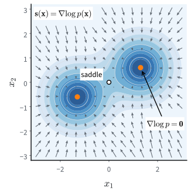
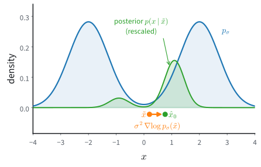
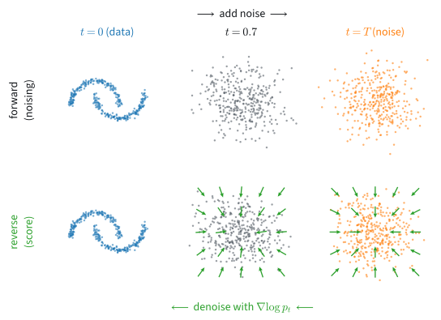
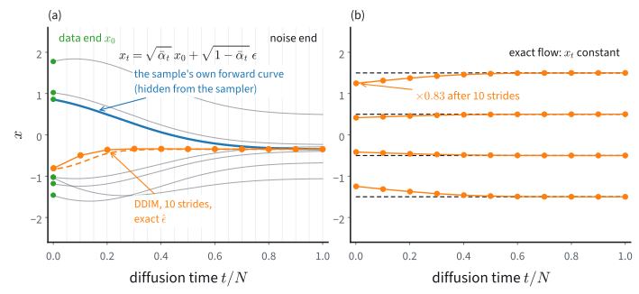

# Score Matching and Diffusion Models
:label:`sec_mdl-score-matching-diffusion-flow`

The previous section showed how to run noise back into data. Integrate the
reverse-time SDE, or the probability-flow ODE, from a Gaussian at the end of
the forward process down to time zero, and the Gaussian draws become samples
of the data distribution. Both equations need the score $\nabla\log p_t$ of
the noised data, the gradient of the log-density with respect to the point
rather than a parameter. For the two-mode mixture of that section we could
write the score down. In practice we have samples and no density. In this section the samples are
4,096 draws from the same mixture, standing in for the few million images of
:numref:`chap_diffusion`. How do we learn a field that we cannot evaluate at
even a single point?

Fitting a density by maximum likelihood and differentiating it does not help,
because a density built from a neural network needs a normalizing constant,
an integral over all of space. Aapo Hyvärinen observed in 2005 that the score
needs no normalizer, and that an integration by parts removes the unknown
data score from the objective :cite:`Hyvarinen.2005`. Pascal Vincent noticed
something simpler still :cite:`Vincent.2011`. The score of noised data is the
average, over the clean points that could have produced a noisy point, of
the direction back to the clean point. That direction is known for every
training pair, so ordinary least squares learns the score from samples alone.

Diffusion models are trained this way. The standard diffusion loss,
"predict the noise you added", is this regression with a particular
weighting, and the samplers of the previous section run unchanged once the
learned field replaces the exact score. A one-dimensional Gaussian turns
each claim into a number we can check by hand before the mixture tests it.

We first learn the score at one noise level, sample with it by the oldest
score-based method, and see why one level is not enough. We then learn it at
every noise level, identify the standard discrete-time diffusion model with
the variance-preserving SDE of :numref:`sec_mdl-sdes`, and ask how to sample
with fewer steps and how to sample a chosen class. The next section learns a
velocity instead of a score and asks which paths are cheapest to integrate.

```{.python .input #score-matching-diffusion-flow-imports}
#@tab mxnet
import math
import numpy as np
from mxnet import autograd, gluon, init, np as mnp, npx
from mxnet.gluon import nn
from d2l import mxnet as d2l
npx.set_np()
```

```{.python .input #score-matching-diffusion-flow-imports}
#@tab pytorch
import math
import numpy as np
import torch
from torch import nn
from torch.nn import functional as F
from d2l import torch as d2l
```

```{.python .input #score-matching-diffusion-flow-imports}
#@tab tensorflow
import math
import numpy as np
import tensorflow as tf
from d2l import tensorflow as d2l
```

```{.python .input #score-matching-diffusion-flow-imports}
#@tab jax
import math
import numpy as np
import jax
from jax import numpy as jnp
from flax import nnx
import optax
from d2l import jax as d2l
```

## Learning the Score
:label:`sec_mdl-score-matching`

We want a vector field $\mathbf{s}_{\boldsymbol{\theta}}$, a network with $d$
inputs and $d$ outputs, that approximates the score of the data, and we can
only draw samples. The first task is an objective that compares the model
with the true field and that we can evaluate from samples.

### A Normalizer-Free Objective

Why not fit a density and differentiate it? A neural network defines a
density most flexibly through an energy: an *energy-based model* is
$p_{\boldsymbol{\theta}}(\mathbf{x}) = e^{-E_{\boldsymbol{\theta}}(\mathbf{x})}/Z_{\boldsymbol{\theta}}$
with a network $E_{\boldsymbol{\theta}}$ and the normalizer
$Z_{\boldsymbol{\theta}} = \int e^{-E_{\boldsymbol{\theta}}(\mathbf{x})}\, d\mathbf{x}$
:cite:`LeCun.Chopra.Hadsell.ea.2006`. Maximum likelihood needs
$\nabla_{\boldsymbol{\theta}} \log p_{\boldsymbol{\theta}} = -\nabla_{\boldsymbol{\theta}} E_{\boldsymbol{\theta}} - \nabla_{\boldsymbol{\theta}} \log Z_{\boldsymbol{\theta}}$,
and the second term is a $d$-dimensional integral that changes with every
update of $\boldsymbol{\theta}$. The score in $\mathbf{x}$ does not see it:
$Z_{\boldsymbol{\theta}}$ is a constant in $\mathbf{x}$, so
$\nabla_{\mathbf{x}} \log p_{\boldsymbol{\theta}} = -\nabla_{\mathbf{x}} E_{\boldsymbol{\theta}}$
(:numref:`sec_mdl-score-function` draws this field for a mixture).

So we compare fields instead of densities. With $\nabla\log p$ the score of
the data, the **explicit score-matching** objective is the mean squared distance
between the two fields, weighted by where the data are:

$$
J_{\mathrm{ESM}}(\boldsymbol{\theta})
= \tfrac{1}{2}\, \mathbb{E}_{\mathbf{x} \sim p}
\left[\, \left\| \mathbf{s}_{\boldsymbol{\theta}}(\mathbf{x}) - \nabla \log p(\mathbf{x}) \right\|^2 \right].
$$
:eqlabel:`eq_mdl-esm-objective`

It is zero exactly when the model field equals the data score wherever the
data have mass. When $\mathbf{s}_{\boldsymbol{\theta}}$ is the score of a
density $q$, this is the Fisher divergence
$\tfrac12\mathbb{E}_p\|\nabla\log q - \nabla\log p\|^2$ of
:numref:`sec_mdl-fisher-divergence`; here $\mathbf{s}_{\boldsymbol{\theta}}$
may be any vector field, since a network with $d$ outputs need not be the
gradient of anything. The objective has removed the normalizer, but it still
contains $\nabla \log p$, the one field we do not know. Hyvärinen's
integration by parts removes it.

**Proposition (Hyvärinen's identity).** *Let $p$ be a smooth positive density
and $\mathbf{s}_{\boldsymbol{\theta}}$ a smooth vector field, with
$p(\mathbf{x})\, \mathbf{s}_{\boldsymbol{\theta}}(\mathbf{x}) \to \mathbf{0}$
as $\|\mathbf{x}\| \to \infty$ and all the expectations below finite. Then*

$$
J_{\mathrm{ESM}}(\boldsymbol{\theta})
= \mathbb{E}_{\mathbf{x} \sim p}
\left[\, \tfrac{1}{2} \| \mathbf{s}_{\boldsymbol{\theta}}(\mathbf{x}) \|^2
+ \nabla \cdot \mathbf{s}_{\boldsymbol{\theta}}(\mathbf{x}) \right] + C,
$$
:eqlabel:`eq_mdl-hyvarinen`

*where $\nabla \cdot \mathbf{s}_{\boldsymbol{\theta}} = \sum_i \partial s_i / \partial x_i$
is the divergence and $C = \tfrac12\mathbb{E}_p\|\nabla\log p\|^2$ does not
depend on $\boldsymbol{\theta}$.*

**Proof.** Expand the square in :eqref:`eq_mdl-esm-objective`. The term
$\tfrac12 \mathbb{E}\|\nabla \log p\|^2$ is the constant $C$, the term
$\tfrac12 \mathbb{E}\|\mathbf{s}_{\boldsymbol{\theta}}\|^2$ appears unchanged
in :eqref:`eq_mdl-hyvarinen`, and it remains to transform the cross term. In
one dimension,

$$
-\mathbb{E}_{x \sim p}\left[ s_{\boldsymbol{\theta}}(x)\, (\log p)'(x) \right]
= -\int s_{\boldsymbol{\theta}}(x)\, \frac{p'(x)}{p(x)}\, p(x)\, dx
= -\int s_{\boldsymbol{\theta}}(x)\, p'(x)\, dx,
$$

and integrating by parts with the boundary term
$\left[ s_{\boldsymbol{\theta}} \, p \right]_{-\infty}^{\infty} = 0$ leaves
$+\int s_{\boldsymbol{\theta}}'(x)\, p(x)\, dx = \mathbb{E}_p[s_{\boldsymbol{\theta}}']$.
The derivative has moved from the unknown density onto the model. In $d$
dimensions, apply the same step to each coordinate $i$,
with $s_i$ in place of $s_{\boldsymbol{\theta}}$ and $\partial_i p$ in place
of $p'$, integrating over $x_i$ first; Fubini's theorem allows this under the
stated integrability. Summed over $i$, the cross term becomes
$\mathbb{E}_p[\sum_i \partial_i s_i] = \mathbb{E}_p[\nabla \cdot \mathbf{s}_{\boldsymbol{\theta}}]$.
$\blacksquare$

Every term on the right of :eqref:`eq_mdl-hyvarinen` is an expectation under
$p$ of something we can evaluate for a given model, so a sample average
estimates it, with no $Z_{\boldsymbol{\theta}}$ and no $\nabla \log p$. The
right-hand side is called **implicit score matching**.

The smallest case shows that the identity works. Let the data be
$x \sim \mathcal{N}(0, v)$, whose score is $-x/v$, and take the
one-parameter model $s_w(x) = -x/w$. Then
$\tfrac12 s_w^2 + s_w' = x^2/(2w^2) - 1/w$, so the implicit objective is
$J(w) = v/(2w^2) - 1/w$. Its derivative $-v/w^3 + 1/w^2$ vanishes at $w = v$:
the objective never saw the data score and still returns the variance. The
constant agrees as well. At the minimum $J(v) = -1/(2v)$, and
$C = \tfrac12\mathbb{E}[x^2/v^2] = 1/(2v)$, so the explicit objective is
$J(v) + C = 0$ there, as it must be when the model matches the data. The
cell below asks whether a sample average finds the same answer: it evaluates
$J$ on 10,000 draws from $\mathcal{N}(0, 2)$ over a grid of $w$.

```{.python .input #mdl-score-matching-diffusion-flow-a-normalizer-free-objective}
rng = np.random.default_rng()
v = 2.0
x = rng.normal(0.0, np.sqrt(v), 10000)        # data x ~ N(0, v)
w = np.linspace(0.5, 4.0, 701)                # model s_w(x) = -x / w
J_ism = (x**2).mean() / (2 * w**2) - 1 / w    # E[s_w^2 / 2 + s_w']
print(f'implicit score matching picks w = {w[J_ism.argmin()]:.2f}  (v = {v})')
```

The sample objective is minimized at the sample mean of $x^2$, which lies
within a few hundredths of $v = 2$ for 10,000 draws. The two terms of
:eqref:`eq_mdl-hyvarinen` pull against each other, and the Gaussian shows
how. The divergence term $-1/w$ rewards a field that points inward at the
samples, a sink where the data are, and rewards it more the steeper the
sink. The squared norm $x^2/(2w^2)$ stops the field from growing without
bound. The balance sits at the true variance.

Implicit score matching has two limits. The proof needs the boundary term to
vanish. For data on a bounded interval it does not, and the implicit
objective then picks the wrong field (exercise
:exref:`ex_mdl-score-matching-diffusion-flow-boundary-terms`). The second
limit is cost. The divergence is the trace of the Jacobian,
$\nabla \cdot \mathbf{s}_{\boldsymbol{\theta}} = \operatorname{tr}\, (\partial \mathbf{s}_{\boldsymbol{\theta}} / \partial \mathbf{x})$.
Computing it exactly takes one reverse-mode pass per row of the Jacobian, $d$
passes in all, and $d$ is in the millions for images. Random projections
estimate the trace with one pass but add variance. Denoising score matching
avoids the trace altogether.

### Denoising Score Matching
:label:`sec_mdl-denoising-score-matching`

We want an objective without the trace, and we want the score where a sampler
will need it, which includes points near but not on the data. Matching the
score of *noised* data meets both requirements. Perturb each sample with
Gaussian noise of scale $\sigma$:

$$
\tilde{\mathbf{x}} = \mathbf{x} + \sigma \boldsymbol{\epsilon}, \qquad
\boldsymbol{\epsilon} \sim \mathcal{N}(\mathbf{0}, \mathbf{I}), \qquad
\textrm{so}\quad
p_\sigma(\tilde{\mathbf{x}} \mid \mathbf{x}) = \mathcal{N}(\tilde{\mathbf{x}};\, \mathbf{x},\, \sigma^2 \mathbf{I}).
$$

The noised marginal
$p_\sigma(\tilde{\mathbf{x}}) = \int p_\sigma(\tilde{\mathbf{x}} \mid \mathbf{x})\, p(\mathbf{x})\, d\mathbf{x}$
is the data density blurred by a Gaussian, and it approaches $p$ as $\sigma$
shrinks. Its score is as unknown as the data score. The score of the
*conditional*, however, follows from the logarithm of a Gaussian density:

$$
\nabla_{\tilde{\mathbf{x}}} \log p_\sigma(\tilde{\mathbf{x}} \mid \mathbf{x})
= \frac{\mathbf{x} - \tilde{\mathbf{x}}}{\sigma^2}
= -\frac{\boldsymbol{\epsilon}}{\sigma}.
$$
:eqlabel:`eq_mdl-dsm-target`

This vector points from the noisy observation back to the clean sample that
produced it, and we know it for every pair we generate. **Denoising score
matching** (DSM) uses it as a regression target:

$$
J_{\mathrm{DSM}}(\boldsymbol{\theta})
= \tfrac12\,\mathbb{E}_{\mathbf{x} \sim p,\ \tilde{\mathbf{x}} \sim p_\sigma(\cdot \mid \mathbf{x})}
\left[\, \left\| \mathbf{s}_{\boldsymbol{\theta}}(\tilde{\mathbf{x}})
- \nabla_{\tilde{\mathbf{x}}} \log p_\sigma(\tilde{\mathbf{x}} \mid \mathbf{x}) \right\|^2 \right].
$$
:eqlabel:`eq_mdl-dsm-loss`

The loss asks the network to predict, from the noisy point alone, the
direction back to a clean point that it cannot see. The target depends on the
clean point, while the score we want depends only on the noisy one. Least
squares connects the two, because it fits the target's conditional mean. The
following lemma states that fact; the next section uses it again with a
velocity in place of the score.

**Lemma (regression to the conditional mean).** *Let $(X, Y)$ be jointly
distributed with $\mathbb{E}\|Y\|^2 < \infty$, and let
$\mathbf{m}(X) = \mathbb{E}[Y \mid X]$. Then for every measurable
$\mathbf{v}$ with $\mathbb{E}\|\mathbf{v}(X)\|^2 < \infty$,*

$$
\mathbb{E} \left\| \mathbf{v}(X) - Y \right\|^2
= \mathbb{E} \left\| \mathbf{v}(X) - \mathbf{m}(X) \right\|^2
+ \mathbb{E} \left\| Y - \mathbf{m}(X) \right\|^2.
$$
:eqlabel:`eq_mdl-regression-lemma`

*The second term does not involve $\mathbf{v}$: minimizing a least-squares
loss against the noisy target $Y$ is the same problem as minimizing it
against the conditional mean $\mathbf{m}(X)$, up to an additive constant.*

**Proof.** Insert $\pm\mathbf{m}(X)$ and expand. The cross term is
$2\, \mathbb{E}\left[ (\mathbf{v}(X) - \mathbf{m}(X))^\top (\mathbf{m}(X) - Y) \right]$.
By the tower rule $\mathbb{E}[Z] = \mathbb{E}[\mathbb{E}[Z \mid X]]$
(:numref:`sec_mdl-random_variables`) we may first average over $Y$ with $X$
fixed, and $\mathbb{E}[\mathbf{m}(X) - Y \mid X] = \mathbf{0}$ makes the cross
term vanish. $\blacksquare$

**Proposition (Vincent's theorem).** *Let the noising kernel
$p_\sigma(\tilde{\mathbf{x}} \mid \mathbf{x})$ be differentiable in
$\tilde{\mathbf{x}}$, with gradient and integral over $\mathbf{x}$
interchangeable (both hold for the Gaussian kernel), and let the DSM target
and $\mathbf{s}_{\boldsymbol{\theta}}(\tilde{\mathbf{x}})$ have finite second
moments. Then*

$$
J_{\mathrm{DSM}}(\boldsymbol{\theta})
= \tfrac12\,\mathbb{E}_{\tilde{\mathbf{x}} \sim p_\sigma}
\left[\, \left\| \mathbf{s}_{\boldsymbol{\theta}}(\tilde{\mathbf{x}}) - \nabla \log p_\sigma(\tilde{\mathbf{x}}) \right\|^2 \right] + C,
$$

*with $C$ independent of $\boldsymbol{\theta}$. The right-hand side is the
explicit objective :eqref:`eq_mdl-esm-objective` for $p_\sigma$, so denoising
and explicit score matching on the noised data have the same minimizers and
the same gradients.*

**Proof.** Apply the lemma with $X = \tilde{\mathbf{x}}$ and
$Y = \nabla_{\tilde{\mathbf{x}}} \log p_\sigma(\tilde{\mathbf{x}} \mid \mathbf{x})$.
It remains to identify the conditional mean of $Y$, and the identification
is the content of the theorem: *the marginal score is the posterior mean of
the conditional scores*. Writing the posterior $p(\mathbf{x} \mid \tilde{\mathbf{x}})$ by
Bayes' rule and then exchanging gradient and integral,

$$
\mathbb{E}\left[ Y \mid \tilde{\mathbf{x}} \right]
= \int \frac{\nabla_{\tilde{\mathbf{x}}}\, p_\sigma(\tilde{\mathbf{x}} \mid \mathbf{x})}{p_\sigma(\tilde{\mathbf{x}} \mid \mathbf{x})}
\; \frac{p_\sigma(\tilde{\mathbf{x}} \mid \mathbf{x})\, p(\mathbf{x})}{p_\sigma(\tilde{\mathbf{x}})}\, d\mathbf{x}
= \frac{\nabla_{\tilde{\mathbf{x}}} \int p_\sigma(\tilde{\mathbf{x}} \mid \mathbf{x})\, p(\mathbf{x})\, d\mathbf{x}}{p_\sigma(\tilde{\mathbf{x}})}
= \nabla \log p_\sigma(\tilde{\mathbf{x}}).
$$

$\blacksquare$

The proof used no property of the Gaussian beyond differentiability. Gaussian
noise is chosen because its conditional score :eqref:`eq_mdl-dsm-target` is
the noise itself, scaled by $-1/\sigma$. Predicting the score and predicting
the noise $\boldsymbol{\epsilon}$ are therefore the same task, and a network
$\boldsymbol{\epsilon}_{\boldsymbol{\theta}}$ that predicts the noise defines
the score model $\mathbf{s}_{\boldsymbol{\theta}} = -\boldsymbol{\epsilon}_{\boldsymbol{\theta}}/\sigma$.
This *noise-prediction* form is the one diffusion models use.

**Example: the Gaussian.** Let the data be $x \sim \mathcal{N}(0, v)$
again, noised at level $\sigma$. The noised marginal is
$p_\sigma = \mathcal{N}(0, v + \sigma^2)$, with score
$-\tilde x/(v + \sigma^2)$. Bayes' rule for two Gaussians gives the posterior
of the clean point,

$$
x \mid \tilde x \;\sim\; \mathcal{N}\Big(\frac{v}{v + \sigma^2}\,\tilde x,\ \frac{v \sigma^2}{v + \sigma^2}\Big),
$$

a shrinkage of the noisy point toward the data mean, with a spread that does
not depend on $\tilde x$. Every claim of this subsection becomes a formula.
The conditional mean of the target $Y = (x - \tilde x)/\sigma^2$ is
$\big(\tfrac{v}{v + \sigma^2} - 1\big)\tilde x/\sigma^2 = -\tilde x/(v + \sigma^2)$,
the marginal score, as Vincent's theorem says. The best possible mean squared
error, the second term of :eqref:`eq_mdl-regression-lemma`, is the posterior
variance of the target, $\textrm{Var}(x \mid \tilde x)/\sigma^4 = \tfrac{1}{\sigma^2} - \tfrac{1}{v + \sigma^2}$.
With $v = 1$ and $\sigma = 0.5$ the floor is $4 - 0.8 = 3.2$, and the posterior
mean of the clean point is $0.8\,\tilde x$. The cell checks both numbers by
Monte Carlo on 100,000 pairs.

```{.python .input #mdl-score-matching-diffusion-flow-denoising-score-matching}
x, eps = rng.standard_normal((2, 100000))             # v = 1
xt, y = x + 0.5 * eps, -eps / 0.5                      # sigma = 0.5; DSM target y
print(f'mean squared error of the conditional mean -xt/1.25: {((y + xt / 1.25)**2).mean():.3f}'
      '  (floor 3.2)')
print(f'least-squares slope of x on xt: {(xt * x).mean() / (xt**2).mean():.3f}  (0.8)')
```

The best regression function has mean squared error $3.2$ on the targets,
not $0$, because many clean points explain one noisy point and the regression can
only return their average. The slope $0.80$ is the shrinkage factor
$v/(v+\sigma^2)$. Both observations hold for any data distribution and give
two corollaries.

* **Tweedie's formula** :cite:`Efron.2011`. Rearranging
  $\mathbb{E}[(\mathbf{x} - \tilde{\mathbf{x}})/\sigma^2 \mid \tilde{\mathbf{x}}] = \nabla \log p_\sigma(\tilde{\mathbf{x}})$
  gives
  $\mathbb{E}[\mathbf{x} \mid \tilde{\mathbf{x}}] = \tilde{\mathbf{x}} + \sigma^2\, \nabla \log p_\sigma(\tilde{\mathbf{x}})$.
  The best denoiser under squared error moves the noisy point one step of size
  $\sigma^2$ up the score of the noised data
  (:numref:`fig_mdl-dyn-tweedie`). For the Gaussian it reads
  $\tilde x - \sigma^2 \tilde x/(v + \sigma^2) = 0.8\,\tilde x$, the slope
  just measured.
* **The floor.** At the optimum the mean squared error $2J_{\mathrm{DSM}}$
  equals $\mathbb{E}\|Y - \mathbf{m}(X)\|^2$, the average posterior variance of the
  target, which is $3.2$ for the Gaussian above. An observed loss also contains
  the fit's own error, so it should be compared with this floor, not with zero.


:label:`fig_mdl-dyn-tweedie`

The floor also says what goes wrong at a very small noise level. As
$\sigma \to 0$ it grows like $1/\sigma^2$. The target
$-\boldsymbol{\epsilon}/\sigma$ becomes large, while the score it averages to
keeps a finite mean square. A single small noise level therefore gives a
poorly conditioned regression, whose targets are mostly noise.

### A Score Network in One Dimension

The Gaussian has a linear score, which a one-parameter model can represent.
We now ask whether least squares on noisy pairs recovers a curved score from
samples alone. The data are the mixture of the previous section,
$p = \tfrac12 \mathcal{N}(-2, 0.5^2) + \tfrac12 \mathcal{N}(2, 0.5^2)$,
noised at $\sigma = 0.5$. Noising adds $\sigma^2$ to each component's
variance, so $p_\sigma$ is again a mixture, with component variance
$0.25 + 0.25 = 0.5$. The previous section derived the score of a symmetric
mixture with means $\pm\mu$ and common component variance $v$,
$(\mu \tanh(\mu x/v) - x)/v$. With $\mu = 2$ and $v = 0.5$ the target curve is

$$
\nabla \log p_\sigma(\tilde x) = 4 \tanh(4 \tilde x) - 2 \tilde x .
$$

Near each mode it is close to $-(\tilde x \mp 2)/0.5$, the linear score of
a single component. Between
the modes it rises from about $-2.9$ at $\tilde x = -0.45$ to $+2.9$ at
$\tilde x = 0.45$, pushing points out of the valley toward the nearer mode.

The model is a fixed set of 17 features, sixteen Gaussian bumps of width
$0.6$ centered on $[-4.5, 4.5]$ plus the identity $x$, and a linear
combination of them. Fitting the DSM loss :eqref:`eq_mdl-dsm-loss` is then
ordinary least squares on the pairs $(\tilde x, -\epsilon/\sigma)$, which
`np.linalg.lstsq` solves in one call with no optimizer. Noise costs nothing
to draw, so each of the 4,096 clean points is noised four times, as training
with fresh noise at every step would do. The cell fits the model on these 16,384 pairs,
compares it with the analytic score, and evaluates both far outside the data
at $x = 8$. It prints mean squared errors, which are $2J_{\mathrm{DSM}}$ and
the quantity the regression lemma splits.

```{.python .input #score-matching-diffusion-flow-dsm-train}
n, sigma = 4096, 0.5
x = rng.normal(4.0 * rng.integers(0, 2, n) - 2.0, 0.5)         # x ~ p, the mixture
def mixture_score(q, var, means=(-2.0, 2.0)):                   # analytic score, any level
    logw = np.stack([-(q - m)**2 / (2 * var) for m in means])
    w = np.exp(logw - logw.max(0))                              # responsibilities, stable
    return (w * np.stack([(m - q) / var for m in means])).sum(0) / w.sum(0)
xx = np.repeat(x, 4)                                            # four noisy copies per point
eps = rng.standard_normal(xx.size)
xt, y = xx + sigma * eps, -eps / sigma                          # the (input, target) pairs
centers = np.linspace(-4.5, 4.5, 16)
def features(q):                                                # identity + 16 bumps, width 0.6
    return np.column_stack([q, np.exp(-(q[:, None] - centers)**2 / 0.72)])
w_ls = np.linalg.lstsq(features(xt), y, rcond=None)[0]         # least squares = the regression
s_hat = lambda q: features(q) @ w_ls
g = np.linspace(-8, 8, 16001); dg = g[1] - g[0]
p_sigma = 0.5 * (np.exp(-(g + 2)**2) + np.exp(-(g - 2)**2)) / np.sqrt(np.pi)  # var 0.5 each
floor = 1 / sigma**2 - (p_sigma * mixture_score(g, 0.5)**2).sum() * dg
excess = (p_sigma * (s_hat(g) - mixture_score(g, 0.5))**2).sum() * dg
print(f'mean squared error: fit {((s_hat(xt) - y)**2).mean():.2f}, exact score '
      f'{((mixture_score(xt, 0.5) - y)**2).mean():.2f}, population floor {floor:.2f}')
print(f'excess risk {excess:.3f}; fit at x = 8: {s_hat(np.array([8.0]))[0]:+.1f}, '
      f'exact score {4 * np.tanh(32) - 16:.0f} (no pairs there)')
grid = np.linspace(-4, 4, 201)
d2l.plot([xt[:600], grid, grid], [y[:600], 4 * np.tanh(4 * grid) - 2 * grid, s_hat(grid)],
         'noisy input', 'target and score', fmts=('.', '-', '--'),
         legend=['pairs', 'score of p_sigma', 'least-squares fit'], figsize=(5.5, 3))
```

The plot shows all that the regression sees: a cloud of targets
$-\epsilon/\sigma$ that spreads over several units at every $\tilde x$.
Through the cloud runs its conditional mean, the score of $p_\sigma$, and the
least-squares fit lies on it. The printout follows the regression lemma.
The fit and the exact score both have mean squared error about $2.1$ on
these pairs, and they agree to within a few hundredths. The population floor
$\tfrac{1}{\sigma^2} - \mathbb{E}_{p_\sigma}(\nabla\log p_\sigma)^2$,
computed by quadrature, is $2.11$; it is the mean squared vertical spread of
the cloud around the curve. The *excess risk*, the first term of the lemma,
measures how far the fit lies from the score. It is around $0.01$, under one
percent of the floor.

The last number shows the limit of the method. No noisy pair lands beyond
$|\tilde x| \approx 5$, so at $x = 8$ the fit is whatever the basis
extrapolates to. The printed value need not be near the exact $-12$. Across
fresh draws it moves by many units, and it can even be positive, pointing
away from the data. Least squares constrains the fit only where pairs fall,
so a sampler that starts far from the data meets an arbitrary field there.

## Sampling with a Score
:label:`sec_mdl-langevin-sampling`

The previous section's samplers need the score at every noise level of a
forward process. Suppose we have it at only one level, or have the exact score
of $p$ itself. Can we still draw samples? The oldest answer needs no forward
process at all.

### Langevin Dynamics

Picture a particle that drifts uphill on the log-density and is jostled by
noise. The drift pulls it toward high density, and the noise keeps it from
collapsing onto a mode. **Langevin dynamics** is the SDE

$$
d\mathbf{X} = \tfrac{1}{2} \nabla \log p(\mathbf{X})\, dt + d\mathbf{W},
$$
:eqlabel:`eq_mdl-langevin`

whose drift is half the score and whose noise is a standard Brownian motion
$\mathbf{W}$. The claim is that $p$ is its stationary law.

The smallest case is the Gaussian $p = \mathcal{N}(0, v)$, with score
$-x/v$. Then :eqref:`eq_mdl-langevin` reads $dX = -\tfrac{X}{2v}\, dt + dW$,
an Ornstein–Uhlenbeck process. An OU process $dX = -\theta X\, dt + g\, dW$
has the stationary law $\mathcal{N}(0, g^2/(2\theta))$
(:numref:`sec_mdl-ornstein-uhlenbeck`), and here $\theta = 1/(2v)$ and
$g = 1$ give the variance $v$. The proposition below extends this to smooth
targets whose score grows at most linearly.

**Proposition (stationarity).** *Let $p$ be a smooth positive density whose
score $\nabla \log p$ is locally Lipschitz and grows at most linearly, so
that :eqref:`eq_mdl-langevin` has a unique solution that does not explode and
its Fokker–Planck equation has a unique solution for each initial density.
If $\mathbf{X}_0 \sim p$, then $\mathbf{X}_t \sim p$ for all $t \ge 0$.*

**Proof.** For an SDE $d\mathbf{X} = \mathbf{b}\, dt + d\mathbf{W}$ with unit
diffusion, the density $q_t$ of $\mathbf{X}_t$ solves the Fokker–Planck
equation
$\partial_t q = -\nabla \cdot (q\, \mathbf{b}) + \tfrac12 \Delta q$
(:numref:`sec_mdl-fokker-planck`). Substitute $\mathbf{b} = \tfrac12 \nabla \log p$
and $q = p$, and use $p\, \nabla \log p = \nabla p$:

$$
-\nabla \cdot \left( \tfrac{1}{2}\, p\, \nabla \log p \right) + \tfrac{1}{2} \Delta p
= -\tfrac{1}{2} \nabla \cdot (\nabla p) + \tfrac{1}{2} \Delta p = 0.
$$

So $q_t \equiv p$ solves the equation with the initial density $p$.
Uniqueness turns "$p$ solves the equation" into "the law of $\mathbf{X}_t$ is
$p$". $\blacksquare$

The drift transports mass up the log-density at exactly the rate at which
the noise spreads it out. To sample, we discretize. The Euler–Maruyama step of
:eqref:`eq_mdl-langevin` with step $h$ is the **Langevin sampler**

$$
\mathbf{x} \leftarrow \mathbf{x} + \tfrac{h}{2}\, \mathbf{s}(\mathbf{x}) + \sqrt{h}\, \boldsymbol{\xi},
\qquad \boldsymbol{\xi} \sim \mathcal{N}(\mathbf{0}, \mathbf{I}),
$$

which needs only a score $\mathbf{s}$, exact or learned. The discretized
chain does not inherit the stationarity of the SDE. For the Gaussian the
step is the linear recursion
$x \leftarrow (1 - \tfrac{h}{2v})\, x + \sqrt{h}\, \xi$, whose stationary
variance $V$ solves $V = (1 - \tfrac{h}{2v})^2 V + h$. Hence
$V = v/(1 - h/(4v))$, and the sampler overstates the variance by about $h/4$
(exercise :exref:`ex_mdl-score-matching-diffusion-flow-langevin-stationarity`
measures this).

The cell runs the sampler on the mixture
$\tfrac12 \mathcal{N}(\pm 2, 0.5^2)$ with its exact score, $h = 0.01$ and
2,000 steps. It asks two questions. Do chains started from a broad
distribution reproduce $p$? And do chains started in the left mode ever
reach the right one?

```{.python .input #score-matching-diffusion-flow-langevin}
def langevin(q, h, steps, var=0.25):          # var: component variance of p
    for _ in range(steps):
        xi = rng.standard_normal(q.shape)
        q = q + 0.5 * h * mixture_score(q, var) + np.sqrt(h) * xi
    return q
warm = langevin(rng.normal(0.0, 3.0, 10000), 0.01, 2000)
print(f'spread-out start: P(X > 0) = {(warm > 0).mean():.3f}, '
      f'E[X^2] = {(warm**2).mean():.2f}  (truth 0.5, 4.25)')
cold = langevin(np.full(10000, -2.0), 0.01, 2000)
print(f'one-mode start:   P(X > 0) = {(cold > 0).mean():.3f}  (crossed)')
```

From the broad start, about half the chains end in each mode and the second
moment matches the true $\mathbb{E}X^2 = 4 + 0.25 = 4.25$ to within a few
hundredths, the sampling error of 10,000 chains (the step-size bias
$h/4 \approx 0.0025$ is far below it). From the left mode, only about one
chain in a hundred has crossed after 2,000 steps. In the
valley the density is tiny and the drift points back to the mode the chain
came from. Crossing needs a rare run of noise in one direction, and the
waiting time grows exponentially with the height of the barrier in
$-\log p$.

The time a chain needs to forget where it started is its *mixing time*.
Slow mixing is a property of the SDE itself, so a smaller step does not cure
it. A smaller step removes only the discretization bias. So does an
accept–reject test, as in the Metropolis-adjusted Langevin algorithm
:cite:`Roberts.Tweedie.1996`, but the test needs density ratios
$p(\mathbf{x}')/p(\mathbf{x})$, which a score network does not provide.

### Limits of a Single Noise Level

Two failures have now been shown. The learned score is arbitrary where no
noisy pair landed, so a sampler that starts far from the data meets a field
that may push it away. And Langevin dynamics with the correct score crosses
the valley between the modes only rarely.

Learning the score at a ladder of noise levels addresses both. At a large
$\sigma$ the noised density has no valley, and the noisy pairs cover the whole
region a sampler visits. For the mixture, $p_\sigma$ has component variance
$0.25 + \sigma^2$ and is unimodal once its component standard deviation
reaches the distance $2$ from the center to each mean, at $\sigma \ge 1.94$.
As $\sigma$ shrinks the detail returns, and a sampler that has already spread
its mass across both modes only needs to refine it.

*Annealed Langevin dynamics* :cite:`song2019generative` runs the sampler down such a ladder, a few hundred
steps per level, each level with its own score. On the mixture this moves
chains out of a single mode and gets the proportions approximately right, as
exercise :exref:`ex_mdl-score-matching-diffusion-flow-annealing` measures.
The same idea survives inside modern samplers as a few Langevin steps at each
noise level, a *corrector* that repairs the error of the main step.

A ladder of separately chosen levels leaves open how to space the levels and
how to move between them. A forward process answers both questions: it
supplies a continuum of noise levels, and its reverse is the sampler. Which
forward processes give a Gaussian kernel, and hence an explicit DSM target,
at every level?

## Scores Across Noise Levels
:label:`sec_mdl-score-based-generative-modeling`

We now learn one network $\mathbf{s}_{\boldsymbol{\theta}}(\mathbf{x}, t)$
that takes the noise level as a second input, train it at every level at
once, and generate with the samplers of the previous section.

### Forward Processes and the Noise-Conditional Loss

DSM needs the conditional law of the noised point given the clean one, and it
needs that law to be Gaussian so that the target is explicit. Both standard
forward processes of :numref:`sec_mdl-sdes` have a Gaussian conditional law
at every $t$, written once for both as

$$
p_t(\mathbf{x}_t \mid \mathbf{x}_0) = \mathcal{N}(\alpha_t \mathbf{x}_0,\ \sigma_t^2 \mathbf{I}),
\qquad\textrm{i.e.}\qquad
\mathbf{x}_t = \alpha_t \mathbf{x}_0 + \sigma_t \boldsymbol{\epsilon}.
$$

The coefficient $\alpha_t$ shrinks the signal and $\sigma_t$ scales the
noise. The two processes differ only in these two numbers.

* The **variance-exploding (VE)** SDE
  $d\mathbf{X} = \sqrt{\tfrac{d}{dt}\sigma^2(t)}\; d\mathbf{W}$, with
  $\sigma^2(t)$ increasing and $\sigma(0) = 0$, adds noise without shrinking
  the data: $\alpha_t = 1$ and $\sigma_t = \sigma(t)$. It is the continuous
  version of the ladder of the previous subsection.
* The **variance-preserving (VP)** SDE is an Ornstein–Uhlenbeck process with
  a time-dependent rate,

  $$
  d\mathbf{X} = -\tfrac12 \beta(t)\, \mathbf{X}\, dt + \sqrt{\beta(t)}\; d\mathbf{W},
  $$

  with $\alpha_t = e^{-\frac12 \int_0^t \beta(r)\, dr}$ and
  $\sigma_t^2 = 1 - \alpha_t^2$. It shrinks the signal as it adds noise, so
  that unit-variance data keep unit variance at every $t$.

The smallest case of the VP process is standard Gaussian data,
$\mathcal{N}(\mathbf{0}, \mathbf{I})$. Then
$\mathbf{x}_t \sim \mathcal{N}(\mathbf{0}, (\alpha_t^2 + \sigma_t^2)\mathbf{I}) = \mathcal{N}(\mathbf{0}, \mathbf{I})$
at every $t$, the score is $-\mathbf{x}$, and the probability-flow drift
(displayed below) is $-\tfrac12 \beta \mathbf{x} - \tfrac12 \beta (-\mathbf{x}) = \mathbf{0}$.
The deterministic flow does nothing: every sample sits still, because the
marginal never changes. This case returns when we sample with large steps.

With a Gaussian kernel at every $t$, the conditional score is
$-\boldsymbol{\epsilon}/\sigma_t$, and DSM applies at each level. Averaging
over levels with a weight $w(t) > 0$ gives the **noise-conditional DSM loss**

$$
\mathcal{L}(\boldsymbol{\theta})
= \tfrac12\, \mathbb{E}_{t}\, w(t)\; \mathbb{E}_{\mathbf{x}_0,\, \boldsymbol{\epsilon}}
\left[\, \left\| \mathbf{s}_{\boldsymbol{\theta}}(\alpha_t \mathbf{x}_0 + \sigma_t \boldsymbol{\epsilon}, t)
+ \frac{\boldsymbol{\epsilon}}{\sigma_t} \right\|^2 \right],
$$
:eqlabel:`eq_mdl-ncsm-loss`

with $t$ drawn uniformly from the training range. Each draw of $(t, \mathbf{x}_0, \boldsymbol{\epsilon})$
is one regression pair, and a sample of the noised data at any $t$ costs one
multiply and one add.

The weight decides which levels the network serves best, not what it learns.
For any positive $w$ the population minimizer is
$\mathbf{s}(\cdot, t) = \nabla \log p_t$ at every $t$, by Vincent's theorem at
each level, provided the network can represent it. The floor at level $t$, by
the same argument as for the Gaussian, is the mean squared error
$d/\sigma_t^2 - \mathbb{E}\|\nabla \log p_t\|^2$ (exercise
:exref:`ex_mdl-score-matching-diffusion-flow-bayes-risk-floor`), which
grows like $d/\sigma_t^2$ at small $\sigma_t$. An unweighted loss is
therefore dominated by its least noisy levels.

Two weights are standard. The discrete-time model of the next subsection
uses $w(t) = \sigma_t^2$, which removes the $1/\sigma_t^2$ growth. The
*likelihood weighting* $w = g^2$, the squared diffusion coefficient of the
forward SDE, ties the loss to the model's likelihood. With this weight, $T$
times the loss, plus the KL divergence from $p_T$ to the Gaussian the
sampler starts from, bounds the KL divergence from the data to the
reverse-SDE model (exercise
:exref:`ex_mdl-score-matching-diffusion-flow-likelihood-bound`). Here $T$ is
the length of the time range.

Generation then follows the previous section, with the learned field in place
of the exact score. For a forward SDE
$d\mathbf{X} = \mathbf{f}(\mathbf{X}, t)\, dt + g(t)\, d\mathbf{W}$ on
$[0, T]$, we start from the Gaussian that approximates $p_T$ and integrate
either the reverse-time SDE :cite:`Anderson.1982` or the probability-flow
ODE from $t = T$ down to $0$:

$$
d\mathbf{X} = \big[\mathbf{f} - g^2\, \mathbf{s}_{\boldsymbol{\theta}}(\mathbf{X}, t)\big]\, dt + g\, d\bar{\mathbf{W}},
\qquad
\frac{d\mathbf{x}}{dt} = \mathbf{f} - \tfrac12 g^2\, \mathbf{s}_{\boldsymbol{\theta}}(\mathbf{x}, t),
$$
:eqlabel:`eq_mdl-score-samplers`

where $\bar{\mathbf{W}}$ is a Brownian motion running backward in time. With
the exact score both have the marginals $p_t$ of the forward process. The
previous section's family of reverse SDEs with noise level $\lambda g$,
$\lambda \in [0, 1]$, interpolates between them. For VP,
$\mathbf{f} = -\tfrac12 \beta \mathbf{x}$ and $g^2 = \beta$. A generative
model is thus a triple: a forward process, a learned score, and a sampler.
The next section takes $T = 1$, so that the noise sits at $t = 1$ for scores
and velocities alike.
:numref:`fig_mdl-dyn-noising-denoising` shows the triple at work in two
dimensions, the companion of the forward and reverse densities of
:numref:`fig_mdl-dyn-forward-reverse`.


:label:`fig_mdl-dyn-noising-denoising`

### DDPM and the Variance-Preserving SDE
:label:`sec_mdl-ddpm-discretized-sde`

The Denoising Diffusion Probabilistic Model :cite:`ho2020denoising` is
written in discrete time and looks at first like a separate construction. It
is a Markov chain of $N = 1000$ noising steps with a schedule
$\beta_1, \ldots, \beta_N \in (0, 1)$,

$$
\mathbf{x}_t = \sqrt{1 - \beta_t}\; \mathbf{x}_{t-1} + \sqrt{\beta_t}\; \boldsymbol{\epsilon}_t,
\qquad \boldsymbol{\epsilon}_t \sim \mathcal{N}(\mathbf{0}, \mathbf{I})\ \textrm{i.i.d.},
$$
:eqlabel:`eq_mdl-ddpm-forward`

which shrinks the state slightly and adds a little noise at each step. With
the step $\Delta t = T/N$ and $\beta_t = \beta((t-1)\Delta t)\, \Delta t$, the
Euler–Maruyama step of the VP-SDE (:numref:`sec_mdl-euler-maruyama`) is
$(1 - \tfrac12 \beta_t)\, \mathbf{x}_{t-1} + \sqrt{\beta_t}\, \boldsymbol{\epsilon}_t$,
which agrees with :eqref:`eq_mdl-ddpm-forward` to first order in $\beta_t$,
as :numref:`sec_mdl-sdes` showed. Three short propositions go further and
identify the DDPM chain with the VP process observed at discrete times.

**Proposition (the DDPM step is an exact VP transition).** *Run the VP-SDE
over a time interval on which $\int \beta(r)\, dr = -\log(1 - \beta_t)$,
starting from $\mathbf{x}_{t-1}$. Its state at the end of the interval has
exactly the law of :eqref:`eq_mdl-ddpm-forward`.*

**Proof.** The VP kernel of the previous subsection, applied to this interval
instead of $[0, t]$, has mean coefficient
$e^{-\frac12 \int \beta} = \sqrt{1 - \beta_t}$ and variance
$1 - (1 - \beta_t) = \beta_t$. $\blacksquare$

For the largest step of the standard schedule, $\beta_t = 0.02$, the
interval has $\int \beta = 0.0202$ instead of $0.02$. Exactness has a
consequence that the Euler–Maruyama chain lacks: at every step the chain's
marginal is that of the VP-SDE, which the next proposition writes in closed
form.

**Proposition (the $\bar{\alpha}$-marginal).** *Let
$\bar{\alpha}_t = \prod_{s=1}^{t} (1 - \beta_s)$. Then conditionally on
$\mathbf{x}_0$,*

$$
\mathbf{x}_t = \sqrt{\bar{\alpha}_t}\; \mathbf{x}_0 + \sqrt{1 - \bar{\alpha}_t}\; \boldsymbol{\epsilon},
\qquad \boldsymbol{\epsilon} \sim \mathcal{N}(\mathbf{0}, \mathbf{I}).
$$
:eqlabel:`eq_mdl-ddpm-marginal`

**Proof.** Induction on $t$; the case $t = 0$ holds with $\bar\alpha_0 = 1$.
Assume :eqref:`eq_mdl-ddpm-marginal` at $t - 1$ and substitute it into
:eqref:`eq_mdl-ddpm-forward`:

$$
\mathbf{x}_t
= \sqrt{(1 - \beta_t) \bar{\alpha}_{t-1}}\; \mathbf{x}_0
+ \sqrt{(1 - \beta_t) (1 - \bar{\alpha}_{t-1})}\; \bar{\boldsymbol{\epsilon}}
+ \sqrt{\beta_t}\; \boldsymbol{\epsilon}_t,
$$

with $\bar{\boldsymbol{\epsilon}}$ and $\boldsymbol{\epsilon}_t$ independent
standard Gaussians. A sum of independent Gaussians is Gaussian with the sum
of the variances,
$(1 - \beta_t)(1 - \bar{\alpha}_{t-1}) + \beta_t = 1 - (1 - \beta_t)\bar{\alpha}_{t-1} = 1 - \bar{\alpha}_t$,
and $(1 - \beta_t)\bar{\alpha}_{t-1} = \bar{\alpha}_t$. $\blacksquare$

In the kernel notation of the previous subsection, DDPM has
$\alpha_t = \sqrt{\bar{\alpha}_t}$ and $\sigma_t = \sqrt{1 - \bar{\alpha}_t}$.
The name "variance-preserving" follows: for unit-variance data,
$\textrm{Var}(\mathbf{x}_t) = \bar{\alpha}_t + (1 - \bar{\alpha}_t) = 1$ at
every $t$, not only in the limit. And because the kernel is Gaussian, DSM
applies directly.

**Proposition (the DDPM loss is reweighted DSM).** *The conditional score of
:eqref:`eq_mdl-ddpm-marginal` is
$\nabla_{\mathbf{x}_t} \log p_t(\mathbf{x}_t \mid \mathbf{x}_0) = -\boldsymbol{\epsilon} / \sigma_t$
with $\sigma_t = \sqrt{1 - \bar{\alpha}_t}$. Parameterize the score model
through a noise-prediction network,
$\mathbf{s}_{\boldsymbol{\theta}}(\mathbf{x}_t, t) = -\boldsymbol{\epsilon}_{\boldsymbol{\theta}}(\mathbf{x}_t, t) / \sigma_t$.
Then the DDPM simple loss
$\tfrac12\mathbb{E}_{t, \mathbf{x}_0, \boldsymbol{\epsilon}} \| \boldsymbol{\epsilon} - \boldsymbol{\epsilon}_{\boldsymbol{\theta}}(\mathbf{x}_t, t) \|^2$
equals the noise-conditional DSM loss :eqref:`eq_mdl-ncsm-loss` with weight
$w(t) = \sigma_t^2 = 1 - \bar{\alpha}_t$.*

**Proof.** Differentiate
$\log p_t(\mathbf{x}_t \mid \mathbf{x}_0) = -\|\mathbf{x}_t - \sqrt{\bar{\alpha}_t}\, \mathbf{x}_0\|^2 / (2 \sigma_t^2) + \textrm{const}$
and substitute :eqref:`eq_mdl-ddpm-marginal` to get $-\boldsymbol{\epsilon}/\sigma_t$.
Then

$$
\left\| \mathbf{s}_{\boldsymbol{\theta}}(\mathbf{x}_t, t) + \frac{\boldsymbol{\epsilon}}{\sigma_t} \right\|^2
= \frac{1}{\sigma_t^2} \left\| \boldsymbol{\epsilon} - \boldsymbol{\epsilon}_{\boldsymbol{\theta}}(\mathbf{x}_t, t) \right\|^2,
$$

so the two losses differ by the factor $w(t) = \sigma_t^2$ inside the
expectation over $t$. $\blacksquare$

"Predict the noise you added" is thus denoising score matching with a weight
that cancels the $1/\sigma_t^2$ growth of the floor: every level contributes a
loss of order $d$. DDPM is the VP forward process, the DSM objective in
noise-prediction form, and ancestral sampling, which steps through the
learned reverse chain one level at a time. The model was first derived by a
different route :cite:`sohl2015deep,ho2020denoising`, as a bound on the
log-likelihood of a latent-variable model, the route that
:numref:`sec_diffusion-design-space` follows. That route yields a family
of weighted noise-prediction losses, with weights
$\beta_t/(2(1 - \beta_t)(1 - \bar\alpha_t))$ when the reverse step has
variance $\beta_t$; the simple loss sets every weight to one.

The cell checks the $\bar\alpha$-marginal on data that are not Gaussian. It
runs the chain :eqref:`eq_mdl-ddpm-forward` for $N = 1000$ steps under the
standard linear schedule $\beta_t$ from $10^{-4}$ to $0.02$, on our mixture
samples rescaled to unit variance, so that the modes sit at
$\pm 2/\sqrt{4.25} = \pm 0.970$ with component standard deviation $0.243$. At
three checkpoints it compares the chain's variance with the formula's $1$, and
the chain's samples with fresh one-shot samples from
:eqref:`eq_mdl-ddpm-marginal`, by the two-sample Kolmogorov–Smirnov statistic,
the largest gap between their empirical distribution functions.

```{.python .input #score-matching-diffusion-flow-ddpm-marginal}
N, n = 1000, len(x)
beta = np.linspace(1e-4, 0.02, N)                       # the DDPM schedule
alpha_bar = np.cumprod(1.0 - beta)
def ks(a, b):                                           # two-sample Kolmogorov-Smirnov statistic
    q = np.sort(np.concatenate([a, b]))
    return np.abs(np.searchsorted(np.sort(a), q, 'right') / len(a)
                  - np.searchsorted(np.sort(b), q, 'right') / len(b)).max()
x0 = x / x.std()                                        # standardized mixture: modes +-0.970
xt = x0.copy()
for t in range(1, N + 1):                               # the forward chain, one level at a time
    xt = np.sqrt(1 - beta[t-1]) * xt + np.sqrt(beta[t-1]) * rng.standard_normal(n)
    if t in (10, 100, 1000):
        one_shot = np.sqrt(alpha_bar[t-1]) * x0 + np.sqrt(1 - alpha_bar[t-1]) * rng.standard_normal(n)
        print(f't = {t:4d}: alpha_bar {alpha_bar[t-1]:.3f}, Var(x_t) {xt.var():.3f} '
              f'(formula 1.000), KS {ks(xt, one_shot):.3f}')
```

The variance stays at $1$ within the sampling error of a 4,096-point
estimate, at every checkpoint. The KS statistics stay below about $0.03$, no
larger than what two independent samples of 4,096 points from the same law
produce; at $t = 10$ they are smaller still, because both samples are built
from the same clean points. The informative row is $t = 100$. There
$\bar{\alpha} = 0.897$ and the noised law is still bimodal, with modes at
$\pm 0.92$ and component standard deviation $0.40$, so agreement checks the
formula on a law with structure. At $t = N$ both samples are standard
Gaussians whatever the data were, since $\bar\alpha_N \approx 4 \times 10^{-5}$,
and that row is a limit, not a test. Training therefore never simulates the
chain: it jumps to any $t$ in one step by :eqref:`eq_mdl-ddpm-marginal`.

## Deterministic Sampling and Guidance
:label:`sec_mdl-ddim-guidance`

Ancestral sampling calls the network once per level, $N = 1000$ times per
sample. Two questions remain for a trained model. Can the same network
produce samples with far fewer calls? And can it produce samples of a chosen
class without retraining?

### Denoising Diffusion Implicit Models

The probability-flow ODE is deterministic and smooth, so a coarse grid of
levels should suffice to integrate it. DDIM :cite:`Song.Meng.Ermon.2020`
realizes this with an update that reuses the trained noise-prediction network
and skips levels. At level $t$, the network's noise estimate gives a guess of
the clean sample by inverting the marginal :eqref:`eq_mdl-ddpm-marginal`,

$$
\hat{\mathbf{x}}_0
= \frac{\mathbf{x}_t - \sqrt{1 - \bar{\alpha}_t}\; \boldsymbol{\epsilon}_{\boldsymbol{\theta}}(\mathbf{x}_t, t)}{\sqrt{\bar{\alpha}_t}}.
$$

To move to any earlier level $t' < t$, DDIM rebuilds the sample from this
guess and the *same* noise estimate, with the coefficients of level $t'$:

$$
\mathbf{x}_{t'}
= \sqrt{\bar{\alpha}_{t'}}\; \hat{\mathbf{x}}_0
+ \sqrt{1 - \bar{\alpha}_{t'}}\; \boldsymbol{\epsilon}_{\boldsymbol{\theta}}(\mathbf{x}_t, t).
$$
:eqlabel:`eq_mdl-ddim-update`

The update is deterministic: no fresh noise enters. Read literally, it moves
a sample along the forward curve
$\sqrt{\bar\alpha_t}\,\mathbf{x}_0 + \sqrt{1 - \bar\alpha_t}\,\boldsymbol{\epsilon}$
of the pair $(\hat{\mathbf{x}}_0, \boldsymbol{\epsilon}_{\boldsymbol{\theta}})$.
But a network trained by least squares returns the conditional mean
$\mathbb{E}[\boldsymbol{\epsilon} \mid \mathbf{x}_t]$, not the noise that
produced this sample, and the estimate changes from level to level. What,
then, does DDIM integrate, and how large an error does a long stride make?

A change of coordinates answers both questions. Divide by
$\sqrt{\bar\alpha_t}$. The rescaled point
$\bar{\mathbf{x}}_t = \mathbf{x}_t/\sqrt{\bar{\alpha}_t}$ equals
$\mathbf{x}_0 + \bar\sigma_t \boldsymbol{\epsilon}$ with
$\bar\sigma_t = \sqrt{(1 - \bar{\alpha}_t)/\bar{\alpha}_t}$. In these
coordinates the VP process is a VE process, clean data plus noise of scale
$\bar\sigma$, which grows from $0.01$ at the first level to about $157$ at
the last under the standard schedule. The bar means "divided by
$\sqrt{\bar\alpha_t}$", and the schedule only decides which values of
$\bar\sigma$ the grid visits.

**Proposition (DDIM is Euler's method).** *In the coordinates
$(\bar\sigma, \bar{\mathbf{x}})$ the DDIM update
:eqref:`eq_mdl-ddim-update` reads*

$$
\bar{\mathbf{x}}_{t'} = \bar{\mathbf{x}}_t + (\bar\sigma_{t'} - \bar\sigma_t)\, \boldsymbol{\epsilon}_{\boldsymbol{\theta}}(\mathbf{x}_t, t),
$$
:eqlabel:`eq_mdl-ddim-euler`

*one Euler step of the ODE
$d\bar{\mathbf{x}}/d\bar\sigma = \boldsymbol{\epsilon}_{\boldsymbol{\theta}}$.
If $\boldsymbol{\epsilon}_{\boldsymbol{\theta}}$ is the exact noise prediction
$\hat{\boldsymbol{\epsilon}}(\mathbf{x}_t, t) = \mathbb{E}[\boldsymbol{\epsilon} \mid \mathbf{x}_t]$,
this ODE is the probability-flow ODE of the VP process, written in the
coordinates $(\bar\sigma, \bar{\mathbf{x}})$.*

**Proof.** The destination is the VP probability-flow ODE in the new
coordinates; we reach it in three steps.

(i) Divide :eqref:`eq_mdl-ddim-update` by $\sqrt{\bar\alpha_{t'}}$ and
substitute $\hat{\mathbf{x}}_0 = \bar{\mathbf{x}}_t - \bar\sigma_t \boldsymbol{\epsilon}_{\boldsymbol{\theta}}$:
$\bar{\mathbf{x}}_{t'} = \hat{\mathbf{x}}_0 + \bar\sigma_{t'}\boldsymbol{\epsilon}_{\boldsymbol{\theta}} = \bar{\mathbf{x}}_t + (\bar\sigma_{t'} - \bar\sigma_t)\boldsymbol{\epsilon}_{\boldsymbol{\theta}}$.

(ii) Change variables in the VP probability-flow ODE
$d\mathbf{x}/dt = -\tfrac12\beta\mathbf{x} - \tfrac12\beta\nabla_{\mathbf{x}}\log p_t$
of :eqref:`eq_mdl-score-samplers`, with $\alpha_t = \sqrt{\bar\alpha(t)}$ and
$\bar\alpha(t) = e^{-\int_0^t\beta}$. Let $\bar p_t$ be the density of
$\bar{\mathbf{x}}_t$; then $\nabla_{\mathbf{x}}\log p_t = \nabla_{\bar{\mathbf{x}}}\log\bar p_t/\sqrt{\bar\alpha}$.
Since $d\sqrt{\bar\alpha}/dt = -\tfrac12\beta\sqrt{\bar\alpha}$, the shrinkage
terms cancel and
$d\bar{\mathbf{x}}/dt = -\tfrac{\beta}{2\bar\alpha}\nabla\log\bar p_t$.
Since $\bar\sigma^2 = 1/\bar\alpha - 1$, we have
$d\bar\sigma/dt = \beta/(2\bar\alpha\bar\sigma)$, and dividing gives
$d\bar{\mathbf{x}}/d\bar\sigma = -\bar\sigma\, \nabla \log \bar p(\bar{\mathbf{x}})$.

(iii) Tweedie's formula for the kernel
$\mathcal{N}(\mathbf{x}_0, \bar\sigma^2\mathbf{I})$ reads
$\mathbb{E}[\mathbf{x}_0 \mid \bar{\mathbf{x}}] = \bar{\mathbf{x}} + \bar\sigma^2\nabla\log\bar p$,
so $\mathbb{E}[\boldsymbol{\epsilon} \mid \bar{\mathbf{x}}] = (\bar{\mathbf{x}} - \mathbb{E}[\mathbf{x}_0\mid\bar{\mathbf{x}}])/\bar\sigma = -\bar\sigma\nabla\log\bar p$,
the right-hand side of (ii). Conditioning on $\bar{\mathbf{x}}_t$ is the same
as conditioning on $\mathbf{x}_t$. $\blacksquare$

DDIM is therefore a first-order solver for the probability-flow ODE, in a
clock in which the noise level is the time. Its error is Euler's error: a
stride holds $\boldsymbol{\epsilon}_{\boldsymbol{\theta}}$ fixed while the
exact $\hat{\boldsymbol{\epsilon}}$ changes along the trajectory. The
same observation, that VE and VP are one family of kernels in two coordinate
systems, underlies later sampler designs
:cite:`Karras.Aittala.Aila.ea.2022`. Two corollaries mark the extremes of
the Euler error.

**Corollary (a point mass is integrated without error).** *If the data are a
single point $\mathbf{x}_0$, every DDIM stride with the exact
$\hat{\boldsymbol{\epsilon}}$ lands on the probability-flow trajectory,
whatever its length.* Here $\hat{\boldsymbol{\epsilon}} = (\bar{\mathbf{x}} - \mathbf{x}_0)/\bar\sigma$,
and along a solution of $d\bar{\mathbf{x}}/d\bar\sigma = (\bar{\mathbf{x}} - \mathbf{x}_0)/\bar\sigma$
the ratio $(\bar{\mathbf{x}} - \mathbf{x}_0)/\bar\sigma$ is constant. An
Euler step for a constant right-hand side is exact.

**Corollary (Gaussian data shrink).** *For data
$\mathbf{x}_0 \sim \mathcal{N}(\mathbf{0}, \mathbf{I})$ the exact flow is the
identity, but one DDIM stride with the exact noise prediction multiplies every
sample by*

$$
\sqrt{\bar\alpha_t \bar\alpha_{t'}} + \sqrt{(1 - \bar\alpha_t)(1 - \bar\alpha_{t'})}
= \cos(\phi_t - \phi_{t'}),
\qquad \bar\alpha_t = \cos^2\phi_t,
$$

*which is below $1$ for every stride of positive length.* The marginal is
$\mathcal{N}(\mathbf{0}, \mathbf{I})$ at every level, so
$\hat{\boldsymbol{\epsilon}}(\mathbf{x}_t, t) = \sqrt{1 - \bar\alpha_t}\, \mathbf{x}_t$
by Tweedie, and substituting into :eqref:`eq_mdl-ddim-update` gives the
factor. Writing $\bar\alpha_t = \cos^2\phi_t$ turns it into the cosine of the
angle advanced. In the bar coordinates the exact solution is
$\bar{\mathbf{x}} \propto \sqrt{1 + \bar\sigma^2}$, so
$\hat{\boldsymbol{\epsilon}} = \bar\sigma\bar{\mathbf{x}}/(1 + \bar\sigma^2)$
changes along it. Holding it fixed across a stride removes too much signal,
by the factor above.

The cell computes the Gaussian factor for 10, 50 and 1,000 equally spaced
strides of the DDPM schedule, and then runs DDIM on the standardized mixture
with its exact noise prediction
$\hat{\epsilon} = -\sqrt{1 - \bar\alpha_t}\, \nabla \log p_t$. The mixture's
noised law at level $t$ has modes $\pm\sqrt{\bar\alpha_t}\, m$ and component
variance $\bar\alpha_t v_0 + 1 - \bar\alpha_t$, where $m = 0.970$ and
$v_0 = 0.243^2$ are the clean values. It compares 10 and 50 strides with
1,000, from the same initial draws.

```{.python .input #mdl-score-matching-diffusion-flow-ddim-trading-noise-for-speed}
m, v0 = 2 / np.sqrt(4.25), 0.25 / 4.25                  # standardized mixture: modes +-m, variance v0
def strides(K):                                         # K equal strides from level N to level 1
    return np.linspace(N - 1, 0, K + 1).round().astype(int)
for K in (10, 50, 1000):                                # the Gaussian corollary
    a = alpha_bar[strides(K)]
    print(f'N(0,1) data, {K:4d} strides: every sample times '
          f'{np.prod(np.sqrt(a[:-1] * a[1:]) + np.sqrt((1 - a[:-1]) * (1 - a[1:]))):.3f}')
def eps_hat(xt, a):                                     # exact noise prediction of the mixture
    return -np.sqrt(1 - a) * mixture_score(xt, a * v0 + 1 - a, (-np.sqrt(a) * m, np.sqrt(a) * m))
def ddim(z, K, eps_fn):                                 # K DDIM strides from noise z
    xt, idx = z.copy(), strides(K)
    for t1, t2 in zip(idx[:-1], idx[1:]):
        a1, a2 = alpha_bar[t1], alpha_bar[t2]
        e = eps_fn(xt, a1)
        xt = np.sqrt(a2) * (xt - np.sqrt(1 - a1) * e) / np.sqrt(a1) + np.sqrt(1 - a2) * e
    return xt
z = rng.standard_normal(8000)                           # one draw, shared by every stride count
x_ref = ddim(z, 1000, eps_hat)
for K in (10, 50):
    x_K = ddim(z, K, eps_hat)
    print(f'mixture, {K:3d} strides vs 1000: mean |gap| {np.abs(x_K - x_ref).mean():.3f}, '
          f'KS {ks(x_K, x_ref):.3f}')
```

Ten strides shrink unit-variance Gaussian data by the factor $0.832$, fifty
by $0.964$, and a thousand by $0.998$. These factors are deterministic and
measure the Euler error alone, since the noise prediction is exact. The
mixture behaves the same way. Ten strides land on average $0.08$ from the
thousand-stride result, on a scale where the modes sit at $\pm 0.97$. Their
empirical distribution differs from it by a KS statistic of $0.08$, and
fifty strides reduce both numbers to about $0.02$. No sample changes mode at any
stride count: each stride map is odd and, for these strides, increasing, so
every sample keeps its sign. :numref:`fig_mdl-dyn-ddim-strides` shows both
experiments. A higher-order solver in the same coordinates spends two
network calls per stride and wins only once the strides are short (exercise
:exref:`ex_mdl-score-matching-diffusion-flow-ddim-heun`).

![(a) Each forward pair $(x_0,\epsilon)$ of the standardized mixture owns one curve; the blue pair crossed the valley. From the same noise end, DDIM with the exact noise prediction follows the probability-flow ODE (10 strides, dots; 1,000 strides, dashed) into the other mode: it never sees the sample's own curve. (b) For unit-variance Gaussian data the exact flow is the identity (dashed); ten DDIM strides with the exact noise prediction shrink every sample by $0.83$, the Euler error of the Gaussian corollary.](../img/mdl-dyn-ddim-strides.svg)
:label:`fig_mdl-dyn-ddim-strides`

Panel (a) answers the literal reading of the update. The sample travels
along the probability-flow trajectory through its noise end, not along the
forward curve that produced it. DDIM is the deterministic end of a family of
samplers that reinject a chosen amount of noise, with ancestral sampling at
the other end. All members share the single-time marginals of the forward
process, so one trained network serves them all.

### Guidance with Bayes' Rule

Suppose we want samples of one class only. On the mixture, let the class $y$
be "the right mode", so that we want samples from
$\mathcal{N}(0.970, 0.243^2)$ alone. For images, $y$ is a label or a text
prompt. Bayes' rule at noise level $t$,
$p_t(\mathbf{x} \mid y) \propto p_t(\mathbf{x})\, p_t(y \mid \mathbf{x})$,
becomes additive for scores, because the evidence $p(y)$ does not depend on
$\mathbf{x}$:

$$
\nabla_{\mathbf{x}} \log p_t(\mathbf{x} \mid y)
= \nabla_{\mathbf{x}} \log p_t(\mathbf{x})
+ \nabla_{\mathbf{x}} \log p_t(y \mid \mathbf{x}).
$$
:eqlabel:`eq_mdl-guidance-bayes`

The conditional score is the unconditional score plus the gradient of a
classifier's log-probability. Every sampler of this section runs unchanged
with it. **Classifier guidance** :cite:`Dhariwal.Nichol.2021` supplies the
second term with a separate classifier $p_{\boldsymbol{\phi}}(y \mid \mathbf{x}, t)$,
trained on *noisy* inputs because the sampler evaluates it at noisy points,
and scales it by a **guidance scale** $\gamma$:

$$
\tilde{\mathbf{s}}(\mathbf{x}, t)
= \nabla \log p_t(\mathbf{x}) + \gamma\, \nabla \log p_{\boldsymbol{\phi}}(y \mid \mathbf{x}, t),
\qquad
\tilde{\mathbf{s}} = \nabla \log \tilde p_t,\quad
\tilde p_t(\mathbf{x}) \propto p_t(\mathbf{x})\, p_{\boldsymbol{\phi}}(y \mid \mathbf{x}, t)^{\gamma}.
$$

With $\gamma = 1$ this is Bayes' rule. With $\gamma > 1$ the guided field is
the score of a *tilted* density that raises the classifier's probability to
a power, which favors points the classifier is most sure about.

**Classifier-free guidance (CFG)** :cite:`Ho.Salimans.2022` removes the
separate classifier by reading :eqref:`eq_mdl-guidance-bayes` from right to
left:
$\nabla \log p_t(y \mid \mathbf{x}) = \nabla \log p_t(\mathbf{x} \mid y) - \nabla \log p_t(\mathbf{x})$.
A single network is trained on labeled data, with the label replaced by an
empty token $\varnothing$ some fraction of the time, so that it learns both
$\mathbf{s}_{\boldsymbol{\theta}}(\mathbf{x}, t, y)$ and
$\mathbf{s}_{\boldsymbol{\theta}}(\mathbf{x}, t, \varnothing)$. Substituting
into the guided field gives

$$
\tilde{\mathbf{s}}(\mathbf{x}, t)
= \mathbf{s}_{\boldsymbol{\theta}}(\mathbf{x}, t, \varnothing)
+ \gamma \left[ \mathbf{s}_{\boldsymbol{\theta}}(\mathbf{x}, t, y)
- \mathbf{s}_{\boldsymbol{\theta}}(\mathbf{x}, t, \varnothing) \right],
$$
:eqlabel:`eq_mdl-cfg`

equivalently $(1 - \gamma)\, \mathbf{s}_\varnothing + \gamma\, \mathbf{s}_y$.
The value $\gamma = 0$ ignores the label, $\gamma = 1$ uses the conditional
score, and $\gamma > 1$ extrapolates past it, in the direction "more like
$y$". In noise-prediction form the same rule applies to
$\boldsymbol{\epsilon}_{\boldsymbol{\theta}}$, since the two differ by the
factor $-\sigma_t$, which is the same for both terms.

One fact limits the interpretation of $\gamma > 1$. The tilted density
$\tilde p_t$ is in general not the noised marginal of *any* clean
distribution. A noised marginal cannot curve more sharply than its own
noise: no eigenvalue of $-\nabla^2 \log p_t$ exceeds $1/\sigma_t^2$. Raising
the classifier to the power $\gamma$ breaks this bound, for the mixture as
soon as $\gamma$ exceeds $1.0625$ at the noisiest levels and $1.09$ at
$t = 100$ (exercise :exref:`ex_mdl-score-matching-diffusion-flow-guided-marginals`).
So at $\gamma = 3$ and $10$ the densities whose scores the guided sampler
follows are, at most noise levels, not noised marginals of any clean
distribution.

The cell asks what the guided sampler produces instead. It runs the ancestral chain on the standardized
mixture with the exact unconditional score and the exact class-conditional
score, the score of the single Gaussian
$\mathcal{N}(\sqrt{\bar\alpha_t}\, m,\ \bar\alpha_t v_0 + 1 - \bar\alpha_t)$,
combined by :eqref:`eq_mdl-cfg` at $\gamma \in \{1, 3, 10\}$.

```{.python .input #mdl-score-matching-diffusion-flow-guidance-steering-with-bayes-rule}
def cfg_sample(gamma, n=8000):                          # ancestral chain with the guided score
    xt = rng.standard_normal(n)
    for t in range(N - 1, -1, -1):
        a, b = alpha_bar[t], beta[t]
        v = a * v0 + 1 - a                              # noised component variance
        s_uncond = mixture_score(xt, v, (-np.sqrt(a) * m, np.sqrt(a) * m))
        s_cond = (np.sqrt(a) * m - xt) / v              # class y = the right mode
        xt = (xt + b * ((1 - gamma) * s_uncond + gamma * s_cond)) / np.sqrt(1 - b)
        if t > 0:
            xt = xt + np.sqrt(b) * rng.standard_normal(n)
    return xt
for gamma in (1.0, 3.0, 10.0):
    xs = cfg_sample(gamma)
    print(f'gamma = {gamma:4.1f}: mass right of 0 {(xs > 0).mean():.3f}, '
          f'mean {xs.mean():.3f}, std {xs.std():.3f}')
print(f'exact conditional: mean {m:.3f}, std {np.sqrt(v0):.3f}')
```

At $\gamma = 1$ the chain reproduces the class: all the mass lies right of
zero, where the unconditional mixture puts only half of it, and the mean and
standard deviation are within about $0.01$ of the exact $0.970$ and $0.243$.
At $\gamma = 3$ and $10$ there is no mass left to move between modes, so the
guidance moves the mode itself, to about $1.03$ and $1.07$, away from the
class boundary, and narrows it slightly, from $0.24$ to about $0.23$.

The tilt at the clean level alone cannot produce this shift. There the two
classes are eight standard deviations apart, the classifier is certain on
the whole right mode, and the tilted density has mean $0.970$ for every
$\gamma$. The shift is produced at intermediate levels, where the noised
classes overlap (exercise
:exref:`ex_mdl-score-matching-diffusion-flow-guidance-levels` locates them).
Guidance with $\gamma > 1$ thus yields samples that are more typical of their
class than the class itself, at the cost of diversity.

We can now learn a score from samples by least squares, at one noise level or
at all of them, and sample with it by Langevin dynamics, the reverse chain or
DDIM, steering the samples with Bayes' rule. Every sampler calls the network
many times, and the number of calls is set by how curved its paths are. The
forward process fixes those paths. We chose it because its kernels are
Gaussian, not because its trajectories are easy to integrate, and the
Gaussian corollary showed that even the simplest data give curved paths in
DDIM's clock. The next section regresses on a velocity instead of a score,
asks which noise-to-data paths are straight, and finds that the question is
one of optimal transport.

## Summary

A score needs no normalizing constant. For noised data it is the conditional
mean of a target we know for every training pair, $-\boldsymbol{\epsilon}/\sigma$,
so least squares on noisy pairs learns it from samples alone. The fit
reaches the posterior-variance floor, $3.2$ for a unit Gaussian at
$\sigma = 0.5$, rather than zero. For clean data, Hyvärinen's integration by
parts gives a normalizer-free objective that needs a Jacobian trace.
Samplers need nothing beyond the score, but a single noise level leaves the
field arbitrary far from the data and Langevin dynamics stuck in one mode, so
the score is learned at every level of a forward process. DDPM is the
variance-preserving SDE observed at discrete times. Its $\bar\alpha$-marginal
is exact, and its noise-prediction loss is DSM weighted by $\sigma_t^2$. DDIM
is Euler's method for the probability-flow ODE in the coordinates
$(\bar\sigma, \bar{\mathbf{x}})$. It is exact for a point mass and shrinks
Gaussian data by $0.83$ in ten strides. Guidance is Bayes' rule on scores,
and for $\gamma > 1$ it leaves the family of noised marginals.

## Exercises

1. **Boundary terms.** Hyvärinen's identity :eqref:`eq_mdl-hyvarinen` assumes
   that $p(x)\, s_{\boldsymbol{\theta}}(x)$ vanishes at the ends of the
   support. Let the data be uniform on $[0, 1]$, so that $\nabla \log p = 0$
   inside the interval, and fit the linear model $s_{a,b}(x) = a + b x$.
    1. Minimize the explicit objective :eqref:`eq_mdl-esm-objective` and the
       implicit objective, the right-hand side of :eqref:`eq_mdl-hyvarinen`,
       over $(a, b)$. Which density has the score that the implicit objective
       selects?
    1. Repeat the one-dimensional integration by parts of the proof on
       $[0, 1]$, keep the boundary term, and show that it accounts for the
       difference between the two objectives.
    1. Pixel intensities are bounded in the same way. Why does denoising score
       matching at a noise level $\sigma > 0$ not inherit the problem?
   :exlabel:`ex_mdl-score-matching-diffusion-flow-boundary-terms`

1. [code] **Langevin discretization bias.** For the Gaussian target
   $p = \mathcal{N}(0, v)$, the Langevin sampler of :eqref:`eq_mdl-langevin`
   with step $h$ is the linear recursion
   $x \leftarrow (1 - \tfrac{h}{2v})\, x + \sqrt{h}\, \xi$.
    1. Find the step sizes for which the recursion has a stationary
       distribution, compute its variance, and expand the bias to first order
       in $h$.
    1. Treat each mode of the mixture in
       `#score-matching-diffusion-flow-langevin` as a separate Gaussian with
       $v = 0.25$, and predict the stationary $\mathbb{E}[X^2]$ at
       $h \in \{0.01, 0.1, 0.25, 0.5\}$. Compare each predicted bias with the
       Monte Carlo standard error of an estimate from $10000$ chains. Then run
       `langevin` for $2000$ steps at each of these step sizes from the
       initial points `rng.normal(0.0, 3.0, 10000)` of `warm`. From which
       step size on does the experiment resolve the bias?
    1. The Metropolis-adjusted Langevin algorithm :cite:`Roberts.Tweedie.1996`
       removes the bias with an accept–reject test that needs the density
       ratio $p(\mathbf{x}') / p(\mathbf{x})$. Why can a sampler that has only
       a trained score network $\mathbf{s}_{\boldsymbol{\theta}}$ not apply
       this test directly?
   :exlabel:`ex_mdl-score-matching-diffusion-flow-langevin-stationarity`

1. [code] **Annealing out of one mode.** In
   `#score-matching-diffusion-flow-langevin`, chains started in the left mode
   stay there. Annealed Langevin dynamics first runs the sampler on smoothed
   densities $p_\sigma$, here the mixture with component variance
   $0.25 + \sigma^2$, for the decreasing ladder of noise levels
   $\sigma = 2, 1, 0.5, 0.25, 0.1, 0$.
    1. By exercise
       :exref:`ex_mdl-fokker-planck-probability-flow-mode-merging` of
       :numref:`sec_mdl-fokker-planck-probability-flow`, the mixture
       $\tfrac12 \mathcal{N}(-\mu, v_0) + \tfrac12 \mathcal{N}(\mu, v_0)$ is
       unimodal if and only if $\mu^2 \le v_0$. The means of `mixture_score` are
       $\pm 2$. For which $\sigma$ is $p_\sigma$ unimodal? Which levels of the
       ladder lie in this range?
    1. Start $10000$ chains at $-2$ and run $300$ steps of `langevin` at each
       level of the ladder, passing the component variance $0.25 + \sigma^2$
       as `var`. Do this once with the fixed step $h = 0.01$ and once with
       $h = 0.04\, (0.25 + \sigma^2)$, which equals $0.01$ at $\sigma = 0$.
       Report the fraction of chains with $X > 0$ at the end of each run.
    1. :citet:`song2019generative` scale the step size of each level with
       $\sigma^2$. Use the contraction factor of the linear recursion in
       exercise :exref:`ex_mdl-score-matching-diffusion-flow-langevin-stationarity`
       to explain why the fixed step fails at the large noise levels.
   :exlabel:`ex_mdl-score-matching-diffusion-flow-annealing`

1. [code] **The Bayes-risk floor.** ● The cell
   `#score-matching-diffusion-flow-dsm-train` prints the mean squared error of
   the fit and of the exact score, both averages over the same $16384$ noisy
   pairs, and the population floor by quadrature.
    1. Let $Y = -\boldsymbol{\epsilon}/\sigma$ be the DSM target
       :eqref:`eq_mdl-dsm-target` for data in $\mathbb{R}^d$. Use the
       regression lemma :eqref:`eq_mdl-regression-lemma` and Vincent's theorem
       to show that the population Bayes risk is

       $$\mathbb{E} \left\| Y - \nabla \log p_\sigma(\tilde{\mathbf{x}}) \right\|^2 = \frac{d}{\sigma^2} - \mathbb{E}_{\tilde{\mathbf{x}} \sim p_\sigma} \left\| \nabla \log p_\sigma(\tilde{\mathbf{x}}) \right\|^2.$$

    1. Compute the standard error of the printed exact-score average from its
       $16384$ per-pair terms. Is the printed value consistent with the
       population floor?
    1. The two printed averages differ by much less than that standard error.
       Explain why. Write their difference as a sample average of
       $(s_{\boldsymbol{\theta}} - s_\sigma)(s_{\boldsymbol{\theta}} + s_\sigma - 2y)$,
       with $s_\sigma = \nabla\log p_\sigma$, and say what makes the variance of
       this average small and why its mean can be slightly negative even though
       the excess risk is positive.
    1. Estimate the excess risk
       $\mathbb{E}_{p_\sigma} (s_{\boldsymbol{\theta}} - s_\sigma)^2$
       at the noisy inputs `xt` in two ways: as the difference of the two
       printed squared errors, and as the mean of
       $(s_{\boldsymbol{\theta}} - s_\sigma)^2$ at these points. Compare both
       with the printed quadrature value. Which is more precise, and why?
   :exlabel:`ex_mdl-score-matching-diffusion-flow-bayes-risk-floor`

1. **Weightings across noise levels.** ● Consider the VP-SDE with the linear
   schedule $\beta(t) = \beta_{\min} + t\, (\beta_{\max} - \beta_{\min})$ on
   $[0, 1]$, with $\beta_{\min} = 0.1$ and $\beta_{\max} = 20$, so that
   $\bar{\alpha}(t) = \exp\big(-\beta_{\min} t - \tfrac12 (\beta_{\max} - \beta_{\min}) t^2\big)$
   and $\sigma_t^2 = 1 - \bar{\alpha}(t)$. Let the data in $\mathbb{R}^d$
   have a smooth density, and assume that $\mathbb{E} \| \nabla \log p_t \|^2$
   stays bounded as $t \to 0$. Write $R(t)$ for the Bayes risk of the
   noise-conditional DSM loss :eqref:`eq_mdl-ncsm-loss` at level $t$, which
   exercise :exref:`ex_mdl-score-matching-diffusion-flow-bayes-risk-floor`
   gives with $\sigma_t$ in place of $\sigma$.
    1. Show that $R(t) \approx d / (\beta_{\min} t)$ as $t \to 0$.
    1. Find the behavior of $w(t)\, R(t)$ as $t \to 0$ for $w = 1$, for
       the DDPM weighting $w = \sigma_t^2$, and for the likelihood weighting
       $w = g^2 = \beta(t)$. For which weightings is
       $\int_0^1 w(t)\, R(t)\, dt$ finite, and which noise levels does
       each weighting emphasize?
    1. Training draws $t$ uniformly from $[\varepsilon, 1]$. For the likelihood
       weighting, show that the second moment of $w(t)\, R(t)$ under this
       draw grows like $1/\varepsilon$.
       :citet:`Song.Durkan.Murray.ea.2021` (Section 5.1) instead draw $t$ from
       the density proportional to $\beta(t) / \sigma_t^2$ on
       $[\varepsilon, 1]$ and multiply the DSM term at the drawn level by
       $c\, \sigma_t^2$, where $c$ normalizes that density. Show that this
       estimate is unbiased for the likelihood-weighted loss and that its
       value at the optimum, $c\, \sigma_t^2\, R(t)$, stays bounded as
       $t \to 0$.
   :exlabel:`ex_mdl-score-matching-diffusion-flow-weightings`

1. [code] **DDIM against a second-order stride.** ● By the proposition
   :eqref:`eq_mdl-ddim-euler`, DDIM is Euler's method for
   $d\bar{\mathbf{x}}/d\bar\sigma = \hat{\boldsymbol{\epsilon}}$ on the grid
   `strides(K)` of `#mdl-score-matching-diffusion-flow-ddim-trading-noise-for-speed`.
    1. Implement Heun's method in the coordinates $(\bar\sigma, \bar x)$ on the
       same grid: evaluate $\hat\epsilon$ at the start of a stride and at the
       Euler predictor, and step with their average, two evaluations per
       stride. Compare its endpoint error against `x_ref` with that of DDIM
       at equal numbers of evaluations: Heun with $5$, $10$, $20$ strides
       against DDIM with $10$, $20$, $40$. Which method wins at each budget?
    1. Show that for data concentrated at a single point $x_0$ every DDIM
       stride lands on the probability-flow trajectory, and verify it by
       passing to `ddim` the point-mass prediction $(\bar x - x_0)/\bar\sigma$,
       written in terms of $x_t$ and $\bar\alpha_t$. Which quantity does DDIM
       hold fixed across a stride, and which quantity does Euler's method in
       the original clock $t$ hold fixed?
    1. Repeat (a) with the component variance `v0` replaced by $0.01$ and by
       $10^{-4}$, and recompute `x_ref`. How does the ranking change? Explain
       it with the slope
       $\partial\hat\epsilon/\partial\bar x = \bar\sigma/(v_0 + \bar\sigma^2)$
       of the noise prediction near one narrow component, which peaks at
       $1/(2\sqrt{v_0})$ near $\bar\sigma = \sqrt{v_0}$, and with the
       stability region of Heun's method for the last stride.
    1. :citet:`Karras.Aittala.Aila.ea.2022` (Algorithm 1) skip the second
       evaluation on the stride that ends at the lowest noise level. Make this
       change and repeat (c). Why does the skip cost nothing for a point mass?

   The deliverable is a table of errors against evaluations for the three
   component variances.
   :exlabel:`ex_mdl-score-matching-diffusion-flow-ddim-heun`

1. [code] **Guidance by noise level.** ● In
   `#mdl-score-matching-diffusion-flow-guidance-steering-with-bayes-rule`,
   raising $\gamma$ from $1$ to $10$ moves the mean of the guided samples from
   about $0.97$ to about $1.07$.
    1. At the last level of the chain, $t = 0$ in `cfg_sample`, the class
       posterior of the right mode is a logistic function of $x$. Write it,
       and compute by quadrature the mean of the tilted density proportional
       to $p_t(x)\, p_t(y \mid x)^{\gamma}$ at that level for
       $\gamma \in \{1, 3, 10\}$. Can this tilt explain the printed shift?
       Where must the shift come from?
    1. Modify `cfg_sample` so that it uses $\gamma = 10$ only on the steps
       $t \ge 500$, only on $200 \le t < 500$, or only on $t < 200$, and
       $\gamma = 1$ on the others. Which band of noise levels produces the
       shift? Relate the answer to the separation
       $\sqrt{\bar{\alpha}_t}\, m / \sqrt{v_t}$ of the two noised classes,
       where $m$ and $v_0$ are the variables `m` and `v0`, and
       $v_t = \bar{\alpha}_t\, v_0 + 1 - \bar{\alpha}_t$ is the noised
       component variance, the variable `v` of `cfg_sample`.
    1. :citet:`Kynkaanniemi.Aittala.Karras.ea.2024` find on image models that
       guidance is harmful at high noise levels, largely unnecessary at low
       noise levels, and beneficial in between. Which parts of this pattern
       does the one-dimensional example reproduce, and which can it not
       exhibit?
   :exlabel:`ex_mdl-score-matching-diffusion-flow-guidance-levels`

1. **Guided densities and noised marginals.** ● The guided field
   :eqref:`eq_mdl-cfg` with $\gamma > 1$ is the score of the tilted density
   $\tilde{p}_t(\mathbf{x}) \propto p_t(\mathbf{x})\, p_t(y \mid \mathbf{x})^{\gamma}$.
   Call a density a noised marginal at level $t$ if it is the law of
   $\sqrt{\bar{\alpha}_t}\, \mathbf{x}_0 + \sigma_t \boldsymbol{\epsilon}$,
   with $\sigma_t^2 = 1 - \bar{\alpha}_t$, for some clean distribution of
   $\mathbf{x}_0$.
    1. For a noised marginal $p_t$, Tweedie's formula reads
       $\nabla \log p_t(\mathbf{x}) = (\sqrt{\bar{\alpha}_t}\, \mathbb{E}[\mathbf{x}_0 \mid \mathbf{x}_t = \mathbf{x}] - \mathbf{x}) / \sigma_t^2$.
       Differentiate it once more to show

       $$\nabla^2 \log p_t(\mathbf{x}) = -\frac{\mathbf{I}}{\sigma_t^2} + \frac{\bar{\alpha}_t}{\sigma_t^4} \textrm{Cov}\left[ \mathbf{x}_0 \mid \mathbf{x}_t = \mathbf{x} \right].$$

       Conclude that no eigenvalue of $-\nabla^2 \log p_t$ exceeds
       $1 / \sigma_t^2$, whatever the clean distribution.
    1. In `cfg_sample`, the two noised classes are
       $\mathcal{N}(\pm \sqrt{\bar{\alpha}_t}\, m, v_t)$, where $m$ and $v_0$
       are the variables `m` and `v0`, and
       $v_t = \bar{\alpha}_t\, v_0 + \sigma_t^2$ is the noised component
       variance. The label $y$ names the right class. Show that
       $-(\log \tilde{p}_t)''(x) = 1/v_t + (\gamma - 1)\, a_t^2\, \varsigma(a_t x)\, (1 - \varsigma(a_t x))$,
       where $a_t = 2 \sqrt{\bar{\alpha}_t}\, m / v_t$ and
       $\varsigma(u) = 1 / (1 + e^{-u})$ is the logistic function.
    1. Find the smallest $\gamma$ for which $\tilde{p}_t$ violates the bound of
       (a) at some $x$. Evaluate it at the levels $t = 0$, $100$, and $500$ of
       `alpha_bar`, and find its limit as $t \to N$. What do the values say
       about the densities that the chain of `cfg_sample` follows at
       $\gamma = 3$?
   :exlabel:`ex_mdl-score-matching-diffusion-flow-guided-marginals`

1. **Score error and likelihood.** ●● With the likelihood weighting
   $w = g^2$, the population score loss bounds the Kullback–Leibler
   divergence from the data to the model, by Theorem 1 of
   :citet:`Song.Durkan.Murray.ea.2021`. The paper proves the bound with path
   measures; this problem derives it from the Fokker–Planck equation of
   :numref:`sec_mdl-fokker-planck`, following
   :citet:`Lu.Zheng.Bao.ea.2022`, who take this route for the SDE (their
   Proposition C.1) and for the probability-flow ODE (their Theorem 3.1).
   Let the forward SDE
   $d\mathbf{x} = \mathbf{f}(\mathbf{x}, t)\, dt + g(t)\, d\mathbf{W}$ have
   marginals $p_t$ on $[0, T]$. In reverse time $\bar t = T - t$, the exact
   reversal and the model are

   $$d\mathbf{x} = \left[ -\mathbf{f} + g^2\, \nabla \log p_t \right] d\bar t + g\, d\mathbf{B}_{\bar t}, \qquad d\mathbf{x} = \left[ -\mathbf{f} + g^2\, \mathbf{s}_{\boldsymbol{\theta}}(\mathbf{x}, t) \right] d\bar t + g\, d\mathbf{B}_{\bar t},$$

   evaluated at $t = T - \bar t$. The first has marginals $p_t$; the second,
   started from a prior $\pi$ at $\bar t = 0$, has marginals $q_t$. Assume that
   all densities are smooth and positive and decay fast enough for every
   integration by parts.
    1. Write both Fokker–Planck equations in $\bar t$ in the form
       $\partial_{\bar t} \rho = -\nabla \cdot (\rho\, \mathbf{u})$, and identify
       the velocities $\mathbf{u}_p$ and $\mathbf{u}_q$.
    1. Show that
       $\frac{d}{d\bar t} D_{\textrm{KL}}(p_t \,\|\, q_t) = \mathbb{E}_{p_t}\left[ (\mathbf{u}_p - \mathbf{u}_q)^\top \nabla \log (p_t / q_t) \right]$.
    1. Bound the right-hand side by
       $\tfrac12 g^2\, \mathbb{E}_{p_t} \| \mathbf{s}_{\boldsymbol{\theta}} - \nabla \log p_t \|^2$,
       integrate over $\bar t$, and obtain

       $$D_{\textrm{KL}}(p_0 \,\|\, q_0) \le D_{\textrm{KL}}(p_T \,\|\, \pi) + \frac12 \int_0^T g(t)^2\, \mathbb{E}_{p_t} \left\| \mathbf{s}_{\boldsymbol{\theta}}(\mathbf{x}, t) - \nabla \log p_t(\mathbf{x}) \right\|^2 dt.$$

       Under which condition on $q_t$ is the bound of the derivative tight?
    1. Repeat (a) and (b) for the probability-flow ODE with
       $\mathbf{s}_{\boldsymbol{\theta}}$ in place of the score. Which term
       that made (c) possible is missing, and why does the score loss alone no
       longer bound $D_{\textrm{KL}}(p_0 \,\|\, q_0)$?
   :exlabel:`ex_mdl-score-matching-diffusion-flow-likelihood-bound`

1. [extended] **Learned noise prediction.** ●● The samplers `langevin`,
   `ddim`, and `cfg_sample` all use exact scores. Replace the exact score by a
   trained network for the standardized mixture `x / x.std()` under the DDPM
   schedule `beta` and `alpha_bar`.
    1. In the framework of your tab, train a noise-prediction network
       $\epsilon_{\boldsymbol{\theta}}(x_t, t)$ with input $(x_t, t/1000)$ and
       two hidden layers of $64$ tanh units, with Adam at learning rate
       $3\times10^{-3}$ for $4000$ steps on batches of $256$, on the simple
       loss with $t$ uniform over the $1000$ levels. Compute its
       root-mean-square error against the exact noise prediction `eps_hat`
       on samples of $p_t$ at several levels $t$. Where is the error largest?
    1. Sample with `ddim` at $K = 10$ and $K = 50$, and with the ancestral
       chain of `cfg_sample` in which the network's score replaces the guided
       score. Compare each set of samples with exact draws of the mixture by
       the fraction in the right mode, the standard deviation, and `ks`. Which
       sampler is most sensitive to the error of (a), and at which step of
       that sampler does the error enter?
    1. Retrain with the per-level weights that correspond to $w = 1$ and to
       the likelihood weighting $w = \beta$, that is, with the noise loss at
       level $t$ multiplied by $w(t) / (1 - \bar{\alpha}_t)$, and repeat (a)
       and (b). Relate the results to the exercise
       on weightings, :exref:`ex_mdl-score-matching-diffusion-flow-weightings`.

   The deliverable is a table of the statistics of (b) for each weighting and
   sampler, together with a plot of the error of (a) against $t$.
   :exlabel:`ex_mdl-score-matching-diffusion-flow-learned-noise`

[Discussions](https://d2l.discourse.group/t/36840)

<!-- slides -->

::: {.slide}
::: {.cover}
[Dive into Deep Learning · §29.5]{.kicker}

**Score Matching and Diffusion Models**<br>learning $\nabla\log p$ from samples, and sampling with it
:::
:::

::: {.slide title="The Samplers Need a Field We Can Only Sample"}
[The problem]{.kicker}

- Reverse SDE and probability-flow ODE both need the score
  $\nabla\log p_t(\mathbf x)$ at every point they visit.
- We have samples: 4,096 draws from $\tfrac12\mathcal N(-2,0.5^2)+\tfrac12\mathcal N(2,0.5^2)$, or a million images.
- A neural density $e^{-E_\theta}/Z_\theta$ needs
  $Z_\theta=\int e^{-E_\theta(\mathbf x)}d\mathbf x$, a $d$-dimensional integral.

::: {.d2l-note}
How do we learn a field we cannot evaluate at a single point?
:::
:::

::: {.slide title="By the End of This Deck You Can"}
[Goals]{.kicker}

- fit a score from samples with Hyvärinen's objective;
- derive the denoising target $-\boldsymbol\epsilon/\sigma$ and its floor;
- sample with Langevin dynamics, the reverse chain and DDIM;
- steer samples to a class with Bayes' rule.

**Running examples:** $x\sim\mathcal N(0,v)$; the mixture
$\tfrac12\mathcal N(\pm2,0.5^2)$. **Idea:** the noised score is the average
direction back to the clean points, so least squares learns it.
:::

::: {.slide title="From a Given Score to a Learned One"}
[Where this fits]{.kicker}

::: {.cols .vc}
::: {.col}
| section | adds |
|---|---|
| ODEs and Solvers | exact motion and its numerical steps |
| Neural ODEs | a learned field, its gradient, its density |
| Stochastic Differential Equations | noise, Itô calculus, the OU process |
| Fokker–Planck and Probability Flow | how the density moves; the score |
| **Score Matching and Diffusion** | **learning the score, sampling with it** |
| Flow Matching and Transport | learning a velocity; straight paths |
:::

::: {.col .narrow}
- **Uses:** the reverse SDE, the probability-flow ODE, OU.
- **Skips:** image models, discrete diffusion, velocities.
:::
:::
:::

::: {.slide title="The Score Does Not See the Normalizer"}
[Energy-based models]{.kicker}

::: {.cols .vc}
::: {.col}
$p_\theta=e^{-E_\theta}/Z_\theta$:

$$\nabla_{\mathbf x}\log p_\theta=-\nabla_{\mathbf x}E_\theta,\qquad \nabla_{\mathbf x}\log Z_\theta=0.$$

Maximum likelihood needs $\nabla_\theta\log Z_\theta$; the score in
$\mathbf x$ needs nothing of $Z_\theta$.
:::

::: {.col .fig}

:::
:::
:::

::: {.slide title="Integration by Parts Removes the Unknown Data Score"}
[Implicit score matching]{.kicker}

$$J_{\mathrm{ESM}}=\tfrac12\mathbb{E}_p\|\mathbf s_\theta-\nabla\log p\|^2
=\mathbb{E}_p\big[\tfrac12\|\mathbf s_\theta\|^2+\nabla\cdot\mathbf s_\theta\big]+C$$

- I. Expand the square; $\tfrac12\mathbb{E}\|\nabla\log p\|^2=C$.
- II. Cross term: $-\int s\,p'\,dx=+\int s'\,p\,dx$ (boundary term $sp\to0$).
- III. The derivative moves from the unknown $p$ onto the model.

::: {.d2l-note}
Cost: $\nabla\cdot\mathbf s_\theta=\operatorname{tr}(\partial\mathbf s_\theta/\partial\mathbf x)$, $d$ backward passes.
:::
:::

::: {.slide title="On a Gaussian, the Implicit Objective Returns the Variance"}
[Smallest case]{.kicker}

Data $\mathcal N(0,v)$, model $s_w(x)=-x/w$:
$J(w)=\dfrac{v}{2w^2}-\dfrac1w$, $J'(w)=0$ at $w=v$.

@mdl-score-matching-diffusion-flow-a-normalizer-free-objective

The objective never saw $-x/v$; $J(v)+C=0$.
:::

::: {.slide title="Least Squares Fits the Conditional Mean"}
[Regression lemma]{.kicker}

::: {.d2l-note .rule}
$\mathbb{E}\|\mathbf v(X)-Y\|^2 = \mathbb{E}\|\mathbf v(X)-\mathbf m(X)\|^2
+ \mathbb{E}\|Y-\mathbf m(X)\|^2$, with $\mathbf m(X)=\mathbb{E}[Y\mid X]$.
:::

*Proof.* Insert $\pm\mathbf m(X)$; the cross term has conditional mean
zero given $X$. $\blacksquare$

- A noisy target is as good as its conditional mean.
- The second term is a floor no model can beat.
:::

::: {.slide title="The Noised Score Is the Posterior Mean of $-\boldsymbol\epsilon/\sigma$"}
[Denoising score matching]{.kicker}

- Noise: $\tilde{\mathbf x}=\mathbf x+\sigma\boldsymbol\epsilon$; conditional score $-\boldsymbol\epsilon/\sigma$, known per pair.
- Vincent: $\mathbb{E}[-\boldsymbol\epsilon/\sigma\mid\tilde{\mathbf x}]=\nabla\log p_\sigma(\tilde{\mathbf x})$.
- So $\tfrac12\mathbb{E}\|\mathbf s_\theta(\tilde{\mathbf x})+\boldsymbol\epsilon/\sigma\|^2$ has the minimizer $\nabla\log p_\sigma$.
- Gaussian $\mathcal N(0,v)$, target $Y=-\epsilon/\sigma$: $\mathbb{E}[Y\mid\tilde x]=-\tilde x/(v+\sigma^2)$,
  floor $\tfrac1{\sigma^2}-\tfrac1{v+\sigma^2}$.
:::

::: {.slide title="Check: The Floor and the Denoiser for a Unit Gaussian"}
[Check]{.kicker}

Data $\mathcal N(0,1)$, noise $\sigma=0.5$. What mean squared error does the
best score model reach on the targets $-\epsilon/\sigma$? What is
$\mathbb{E}[x\mid\tilde x]$?

::: {.fragment .fade-up}
::: {.d2l-note}
**Answer.** Floor $1/0.25-1/1.25=4-0.8=3.2$, not $0$. Denoiser
$\tilde x\cdot1/1.25=0.8\,\tilde x$: shrink toward the mean.
:::
:::
:::

::: {.slide title="The Best Denoiser Is One Step Up the Noised Score"}
[Tweedie's formula]{.kicker}

::: {.cols .vc}
::: {.col}
$$\mathbb{E}[\mathbf x\mid\tilde{\mathbf x}]=\tilde{\mathbf x}+\sigma^2\nabla\log p_\sigma(\tilde{\mathbf x})$$

$\tilde{\mathbf x}$ plus the score correction equals the posterior mean.
:::

::: {.col .fig .big}

:::
:::
:::

::: {.slide title="Least Squares on 16,384 Noisy Pairs Reaches the Floor"}
[The mixture at $\sigma=0.5$]{.kicker}

Score of $p_\sigma$: $4\tanh4\tilde x-2\tilde x$. Fit: 17 fixed features, `lstsq`.

@!score-matching-diffusion-flow-dsm-train

Error $\approx2.1$ against the floor $2.11$; excess $\approx0.01$. At $x=8$ no pairs: arbitrary.
:::

::: {.slide title="Langevin Dynamics Keeps $p$ Stationary"}
[Sampling with one score]{.kicker}

- $d\mathbf X=\tfrac12\nabla\log p(\mathbf X)\,dt+d\mathbf W$.
- Fokker–Planck at the density $p$: $-\nabla\cdot(\tfrac12 p\nabla\log p)+\tfrac12\Delta p=0$.
- Step: $\mathbf x\leftarrow\mathbf x+\tfrac h2\mathbf s(\mathbf x)+\sqrt h\,\boldsymbol\xi$.
- $\mathcal N(0,v)$: an OU process with stationary variance $v$; the step
  gives $v/(1-h/(4v))$.
:::

::: {.slide title="But Chains Do Not Cross the Valley"}
[Slow mixing]{.kicker}

@score-matching-diffusion-flow-langevin

::: {.d2l-note}
About $1\%$ cross in 2,000 steps. Two failures: no pairs far out, no
crossing. One fix: a ladder of noise levels.
:::
:::

::: {.slide title="A Gaussian Kernel at Every Level Makes DSM Work at Every Level"}
[Noise-conditional loss]{.kicker}

::: {.cols .vc}
::: {.col}
- $\mathbf x_t=\alpha_t\mathbf x_0+\sigma_t\boldsymbol\epsilon$; VE: $\alpha_t=1$; VP: $\sigma_t^2=1-\alpha_t^2$.
- Loss with level weight $w(t)$: $\tfrac12\mathbb{E}_t\,w(t)\,\|\mathbf s_\theta(\mathbf x_t,t)+\boldsymbol\epsilon/\sigma_t\|^2$.
- Floor at level $t$ grows like $d/\sigma_t^2$.
:::

::: {.col .fig}

:::
:::
:::

::: {.slide title="DDPM Is the VP-SDE Discretized, with an Exact Marginal"}
[DDPM]{.kicker}

- Chain $\mathbf x_t=\sqrt{1-\beta_t}\,\mathbf x_{t-1}+\sqrt{\beta_t}\,\boldsymbol\epsilon_t$: an exact VP-SDE transition (Euler–Maruyama to first order).
- Marginal $\mathbf x_t=\sqrt{\bar\alpha_t}\,\mathbf x_0+\sqrt{1-\bar\alpha_t}\,\boldsymbol\epsilon$, $\bar\alpha_t=\prod_{s\le t}(1-\beta_s)$.
- $\tfrac12\|\boldsymbol\epsilon-\boldsymbol\epsilon_\theta\|^2$ = DSM with weight $w(t)=1-\bar\alpha_t$.

@!score-matching-diffusion-flow-ddpm-marginal
:::

::: {.slide title="DDIM Is Euler's Method in the Noise-Level Clock"}
[DDIM]{.kicker}

$\bar{\mathbf x}_t=\mathbf x_t/\sqrt{\bar\alpha_t}$, $\bar\sigma_t=\sqrt{(1-\bar\alpha_t)/\bar\alpha_t}$:

- I. $\hat{\mathbf x}_0=\bar{\mathbf x}_t-\bar\sigma_t\boldsymbol\epsilon_\theta$; DDIM: $\bar{\mathbf x}_{t'}=\hat{\mathbf x}_0+\bar\sigma_{t'}\boldsymbol\epsilon_\theta$.
- II. VP probability flow in these coordinates: $d\bar{\mathbf x}/d\bar\sigma=-\bar\sigma\nabla\log\bar p$.
- III. Tweedie: $-\bar\sigma\nabla\log\bar p=\mathbb{E}[\boldsymbol\epsilon\mid\bar{\mathbf x}]$.

::: {.d2l-note .rule}
$\bar{\mathbf x}_{t'}=\bar{\mathbf x}_t+(\bar\sigma_{t'}-\bar\sigma_t)\,\hat{\boldsymbol\epsilon}$: one Euler step.
:::
:::

::: {.slide title="Check: Ten DDIM Strides on Two Kinds of Data"}
[Check]{.kicker}

Exact noise prediction, 10 equal strides of the 1,000-level schedule. What
happens to unit-variance Gaussian data? To data at a single point?

::: {.fragment .fade-up}
::: {.d2l-note}
**Answer.** Gaussian: each stride multiplies by $\cos\Delta\phi<1$
($\bar\alpha=\cos^2\phi$), $0.83$ in all, though the exact flow is the identity.
Point mass: $\hat{\boldsymbol\epsilon}$ is constant along the flow, so every stride is exact.
:::
:::
:::

::: {.slide title="Ten Strides Shrink Gaussian Data by 0.83"}
[DDIM error]{.kicker}

{width=96%}

Mixture, exact $\hat\epsilon$: 10 strides land $0.08$ from 1,000 strides;
50 strides, $0.015$. No sample changes mode.
:::

::: {.slide title="Guidance Is Bayes' Rule on Scores"}
[Guidance]{.kicker}

$$\nabla\log p_t(\mathbf x\mid y)=\nabla\log p_t(\mathbf x)+\nabla\log p_t(y\mid\mathbf x)$$

- Classifier guidance: scale the classifier term by $\gamma$.
- Classifier-free: one network, label dropped at random;
  $\tilde{\mathbf s}=(1-\gamma)\,\mathbf s_\varnothing+\gamma\,\mathbf s_y$.
- Same rule for $\boldsymbol\epsilon_\theta=-\sigma_t\mathbf s_\theta$.
:::

::: {.slide title="Past $\gamma=1$ the Class Sharpens Beyond Itself"}
[Guidance on the mixture]{.kicker}

Class $y$ = right mode, $\mathcal N(0.970,0.243^2)$; exact scores, ancestral chain:

@!mdl-score-matching-diffusion-flow-guidance-steering-with-bayes-rule

::: {.d2l-note}
Mean $0.97\to1.03\to1.07$, all mass right. For $\gamma>1.09$ at $t=100$ the
tilt is no noised marginal.
:::
:::

::: {.slide title="Check: Which Score Does CFG Use at $\gamma=0$, 1, 2?"}
[Check]{.kicker}

$\tilde{\mathbf s}=(1-\gamma)\,\mathbf s_\varnothing+\gamma\,\mathbf s_y$.

::: {.fragment .fade-up}
::: {.d2l-note}
**Answer.** $\gamma=0$: unconditional $\mathbf s_\varnothing$. $\gamma=1$:
conditional $\mathbf s_y$. $\gamma=2$: $2\mathbf s_y-\mathbf s_\varnothing$,
an extrapolation past the class.
:::
:::
:::

::: {.slide title="Recap"}
[Wrap-up]{.kicker}

- Implicit score matching on $\mathcal N(0,2)$ returns $w=2$.
- DSM floor $3.2$ for $\mathcal N(0,1)$ at $\sigma=0.5$; mixture fit $\approx2.1$ vs floor $2.11$.
- Langevin: about $1\%$ of chains cross the valley.
- DDPM chain matches its marginal: KS below $0.03$ at $t=100$.
- DDIM is Euler: $\times0.83$ in 10 strides on Gaussian data.
- Guidance at $\gamma=10$: mean $0.97\to1.07$.

Next: learn a velocity instead of a score, and ask which path is straightest.
:::
