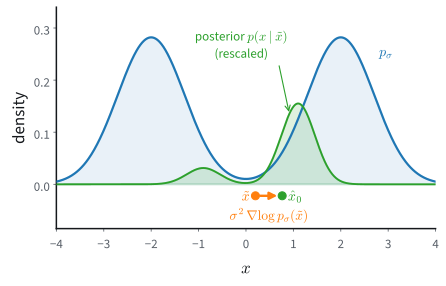
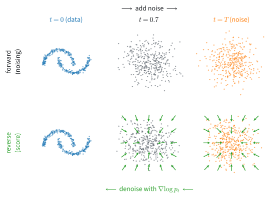
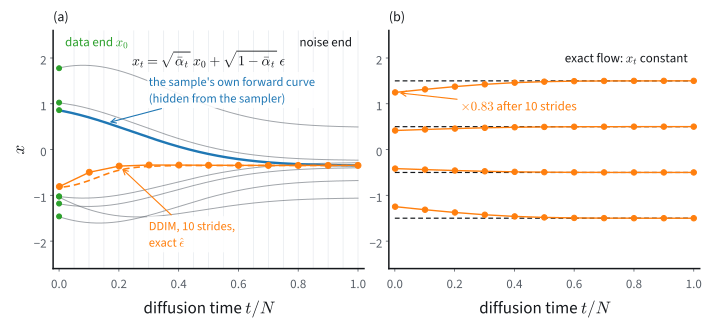

# Score Matching and Diffusion Models
:label:`sec_mdl-score-matching-diffusion-flow`

We know how to turn Gaussian noise into data: integrate the reverse-time SDE
or the probability-flow ODE. Both ask for one thing in return, the score
$\nabla\log p_t$ of the noised data at every point they visit. For the
two-mode mixture of the previous section a formula supplied it. Images come
with samples and no formula. Here the samples are 4,096 draws from that
mixture, standing in for a training set of images. We have to learn a field
that we cannot evaluate at even a single point.

Fitting a density by maximum likelihood and differentiating it does not help,
because a flexible density, the exponential of a network's output, needs a
normalizing constant, an integral over all of space. Aapo Hyvärinen observed
in 2005 that the score needs no normalizer, and that an integration by parts
removes the unknown data score from the objective :cite:`Hyvarinen.2005`.
Pascal Vincent noticed something simpler still :cite:`Vincent.2011`. The
score of noised data is the average, over the clean points that could have
produced a noisy point, of the direction back to the clean point. That
direction is known for every training pair, so ordinary least squares learns
the score from samples alone.

Diffusion models are trained this way: their standard loss, "predict the
noise you added", is this regression with a particular weighting. Their two
best-known samplers, DDPM and DDIM, bring no new equations either: each
discretizes one we already have. A one-dimensional Gaussian turns each claim
into a number we can check by hand before the mixture tests it.

No network is trained in this section. We learn the score at one noise level
by least squares, with a model small enough to be solved exactly. The
samplers are then analyzed on the exact score of the mixture, so that each
error we measure is the sampler's own: first at a single noise level, which
turns out not to be enough, then at all levels at once. Once, near the end,
a sampler runs on scores fitted by least squares at every level. Networks
and their errors are the business of :numref:`chap_diffusion`, which builds
on three results from here: Vincent's theorem, the identification of DDPM
with the variance-preserving SDE of :numref:`sec_mdl-sdes`, and that of DDIM
with Euler's method. The proof of Hyvärinen's identity and the subsection on
guidance can be skipped on a first reading.

```{.python .input #score-matching-diffusion-flow-imports}
#@tab mxnet
import math
import numpy as np
from mxnet import autograd, gluon, init, np as mnp, npx
from mxnet.gluon import nn
from d2l import mxnet as d2l
npx.set_np()
```

```{.python .input #score-matching-diffusion-flow-imports}
#@tab pytorch
import math
import numpy as np
import torch
from torch import nn
from torch.nn import functional as F
from d2l import torch as d2l
```

```{.python .input #score-matching-diffusion-flow-imports}
#@tab tensorflow
import math
import numpy as np
import tensorflow as tf
from d2l import tensorflow as d2l
```

```{.python .input #score-matching-diffusion-flow-imports}
#@tab jax
import math
import numpy as np
import jax
from jax import numpy as jnp
from flax import nnx
import optax
from d2l import jax as d2l
```

## Learning the Score
:label:`sec_mdl-score-matching`

We want a vector field $\mathbf{s}_{\boldsymbol{\theta}}$, in practice a
network with $d$ inputs and $d$ outputs, that approximates the score of the
data, and we can only draw samples. The first task is an objective that
compares the model with the true field and that we can evaluate from
samples.

### A Normalizer-Free Objective

A neural network defines a density most flexibly through an energy: an
*energy-based model* is
$p_{\boldsymbol{\theta}}(\mathbf{x}) = e^{-E_{\boldsymbol{\theta}}(\mathbf{x})}/Z_{\boldsymbol{\theta}}$
with a network $E_{\boldsymbol{\theta}}$ and the normalizer
$Z_{\boldsymbol{\theta}} = \int e^{-E_{\boldsymbol{\theta}}(\mathbf{x})}\, d\mathbf{x}$
:cite:`LeCun.Chopra.Hadsell.ea.2006`. Maximum likelihood needs
$\nabla_{\boldsymbol{\theta}} \log Z_{\boldsymbol{\theta}}$, a
$d$-dimensional integral that changes with every update of
$\boldsymbol{\theta}$. The score in $\mathbf{x}$ does not see it:
$Z_{\boldsymbol{\theta}}$ is a constant in $\mathbf{x}$, so
$\nabla_{\mathbf{x}} \log p_{\boldsymbol{\theta}} = -\nabla_{\mathbf{x}} E_{\boldsymbol{\theta}}$.

So we compare fields instead of densities. With $\nabla\log p$ the score of
the data, the **explicit score-matching** objective is the mean squared distance
between the two fields, weighted by where the data are:

$$
J_{\mathrm{ESM}}(\boldsymbol{\theta})
= \tfrac{1}{2}\, \mathbb{E}_{\mathbf{x} \sim p}
\left[\, \left\| \mathbf{s}_{\boldsymbol{\theta}}(\mathbf{x}) - \nabla \log p(\mathbf{x}) \right\|^2 \right].
$$
:eqlabel:`eq_mdl-esm-objective`

It is zero exactly when the model field equals the data score wherever the
data have mass. When $\mathbf{s}_{\boldsymbol{\theta}}$ is the score of a
density $q$, this is the Fisher divergence of
:numref:`sec_mdl-fisher-divergence`, which also discusses what such a
divergence can and cannot see. Here $\mathbf{s}_{\boldsymbol{\theta}}$ may
be any vector field, because a network with $d$ outputs need not be the
gradient of anything. The objective has removed the normalizer, but it still
contains $\nabla \log p$, the one field we do not know. Hyvärinen's
integration by parts removes it.

**Proposition (Hyvärinen's identity).** *Let $p$ be a smooth positive density
and $\mathbf{s}_{\boldsymbol{\theta}}$ a smooth vector field, with
$p(\mathbf{x})\, \mathbf{s}_{\boldsymbol{\theta}}(\mathbf{x}) \to \mathbf{0}$
as $\|\mathbf{x}\| \to \infty$ and all the expectations below finite. Then*

$$
J_{\mathrm{ESM}}(\boldsymbol{\theta})
= \mathbb{E}_{\mathbf{x} \sim p}
\left[\, \tfrac{1}{2} \| \mathbf{s}_{\boldsymbol{\theta}}(\mathbf{x}) \|^2
+ \nabla \cdot \mathbf{s}_{\boldsymbol{\theta}}(\mathbf{x}) \right] + C,
$$
:eqlabel:`eq_mdl-hyvarinen`

*where $\nabla \cdot \mathbf{s}_{\boldsymbol{\theta}} = \sum_i \partial s_i / \partial x_i$
is the divergence and $C = \tfrac12\mathbb{E}_p\|\nabla\log p\|^2$ does not
depend on $\boldsymbol{\theta}$.*

**Proof.** Expand the square in :eqref:`eq_mdl-esm-objective`. The term
$\tfrac12 \mathbb{E}\|\nabla \log p\|^2$ is the constant $C$, the term
$\tfrac12 \mathbb{E}\|\mathbf{s}_{\boldsymbol{\theta}}\|^2$ appears unchanged
in :eqref:`eq_mdl-hyvarinen`, and it remains to transform the cross term. In
one dimension,

$$
-\mathbb{E}_{x \sim p}\left[ s_{\boldsymbol{\theta}}(x)\, (\log p)'(x) \right]
= -\int s_{\boldsymbol{\theta}}(x)\, \frac{p'(x)}{p(x)}\, p(x)\, dx
= -\int s_{\boldsymbol{\theta}}(x)\, p'(x)\, dx,
$$

and integrating by parts with the boundary term
$\left[ s_{\boldsymbol{\theta}} \, p \right]_{-\infty}^{\infty} = 0$ leaves
$+\int s_{\boldsymbol{\theta}}'(x)\, p(x)\, dx = \mathbb{E}_p[s_{\boldsymbol{\theta}}']$.
This is Stein's identity
$\mathbb{E}_p[s_{\boldsymbol{\theta}}' + s_{\boldsymbol{\theta}}\, (\log p)'] = 0$
of :numref:`sec_mdl-stein-discrepancy`: the derivative has moved from the
unknown density onto the model. In $d$ dimensions, apply the same step to each
coordinate $i$, with $s_i$ in place of $s_{\boldsymbol{\theta}}$ and
$\partial_i p$ in place of $p'$, integrating over $x_i$ first; Fubini's
theorem allows this under the stated integrability. Summed over $i$, the
cross term becomes
$\mathbb{E}_p[\sum_i \partial_i s_i] = \mathbb{E}_p[\nabla \cdot \mathbf{s}_{\boldsymbol{\theta}}]$.
$\blacksquare$

Every term on the right of :eqref:`eq_mdl-hyvarinen` is an expectation under
$p$ of something we can evaluate for a given model, so a sample average
estimates it, with no $Z_{\boldsymbol{\theta}}$ and no $\nabla \log p$. The
right-hand side is called **implicit score matching**.

A Gaussian shows that the identity works. Let the data be
$x \sim \mathcal{N}(0, v)$, whose score is $-x/v$, and take the
one-parameter model $s_w(x) = -x/w$. Then
$\tfrac12 s_w^2 + s_w' = x^2/(2w^2) - 1/w$, so the implicit objective is
$J(w) = v/(2w^2) - 1/w$. Its derivative $-v/w^3 + 1/w^2$ vanishes at $w = v$:
the objective never saw the data score and still returns the variance. The
constant agrees as well. At the minimum $J(v) = -1/(2v)$, and
$C = \tfrac12\mathbb{E}[x^2/v^2] = 1/(2v)$, so the explicit objective is
$J(v) + C = 0$ there, as it must be when the model matches the data.

In practice the expectation is a sample average. Let us replace $v$ in
$J$ by the mean of $x^2$ over 10,000 draws from $\mathcal{N}(0, 2)$ and
minimize over a grid of $w$. The minimizer is then that sample mean, whose
standard error is $v\sqrt{2/10^4} \approx 0.03$, so we should see $2$ give
or take a few hundredths.

```{.python .input #mdl-score-matching-diffusion-flow-a-normalizer-free-objective}
rng = np.random.default_rng()
v = 2.0
x = rng.normal(0.0, np.sqrt(v), 10000)        # data x ~ N(0, v)
w = np.linspace(0.5, 4.0, 701)                # model s_w(x) = -x / w
J_ism = (x**2).mean() / (2 * w**2) - 1 / w    # E[s_w^2 / 2 + s_w']
print(f'implicit score matching picks w = {w[J_ism.argmin()]:.2f}  (v = {v})')
```

We do. The two terms of :eqref:`eq_mdl-hyvarinen` pull against each
other, and the Gaussian shows how. The divergence term $-1/w$ rewards a
field that points inward at the samples, a sink where the data are, and
rewards it more the steeper the sink. The squared norm $x^2/(2w^2)$ stops the
field from growing without bound. The balance sits at the true variance.

Implicit score matching has two limits. The proof needs the boundary term to
vanish. For data on a bounded interval it does not, and the implicit
objective then picks the wrong field. The second
limit is cost. The divergence is the trace of the Jacobian,
$\nabla \cdot \mathbf{s}_{\boldsymbol{\theta}} = \operatorname{tr}\, (\partial \mathbf{s}_{\boldsymbol{\theta}} / \partial \mathbf{x})$.
Computing it exactly takes one reverse-mode pass per row of the Jacobian, $d$
passes in all, and $d$ is in the millions for images. Hutchinson's estimator
(:numref:`sec_mdl-continuous-normalizing-flows`) replaces the trace by one
vector-Jacobian product per random direction, but it adds variance.
Denoising score matching avoids the trace altogether.

### Denoising Score Matching
:label:`sec_mdl-denoising-score-matching`

We want an objective without the trace, and we want the score where a sampler
will need it, which includes points near but not on the data. Matching the
score of *noised* data meets both requirements. Perturb each sample with
Gaussian noise of scale $\sigma$:

$$
\begin{aligned}
\tilde{\mathbf{x}} &= \mathbf{x} + \sigma \boldsymbol{\epsilon}, \qquad
\boldsymbol{\epsilon} \sim \mathcal{N}(\mathbf{0}, \mathbf{I}), \\
p_\sigma(\tilde{\mathbf{x}} \mid \mathbf{x}) &= \mathcal{N}(\tilde{\mathbf{x}};\, \mathbf{x},\, \sigma^2 \mathbf{I}).
\end{aligned}
$$

The noised marginal
$p_\sigma(\tilde{\mathbf{x}}) = \int p_\sigma(\tilde{\mathbf{x}} \mid \mathbf{x})\, p(\mathbf{x})\, d\mathbf{x}$
is the data density blurred by a Gaussian, and it approaches $p$ as $\sigma$
shrinks. Its score is as unknown as the data score. The score of the
*conditional*, however, follows from the logarithm of a Gaussian density:

$$
\nabla_{\tilde{\mathbf{x}}} \log p_\sigma(\tilde{\mathbf{x}} \mid \mathbf{x})
= \frac{\mathbf{x} - \tilde{\mathbf{x}}}{\sigma^2}
= -\frac{\boldsymbol{\epsilon}}{\sigma}.
$$
:eqlabel:`eq_mdl-dsm-target`

This vector points from the noisy observation back to the clean sample that
produced it, and we know it for every pair we generate. **Denoising score
matching** (DSM) uses it as a regression target:

$$
\begin{aligned}
J_{\mathrm{DSM}}(\boldsymbol{\theta})
&= \tfrac12\,\mathbb{E}_{\mathbf{x} \sim p,\ \tilde{\mathbf{x}} \sim p_\sigma(\cdot \mid \mathbf{x})} \\
&\quad \left[\, \left\| \mathbf{s}_{\boldsymbol{\theta}}(\tilde{\mathbf{x}})
- \nabla_{\tilde{\mathbf{x}}} \log p_\sigma(\tilde{\mathbf{x}} \mid \mathbf{x}) \right\|^2 \right].
\end{aligned}
$$
:eqlabel:`eq_mdl-dsm-loss`

The loss asks the network to predict, from the noisy point alone, the
direction back to a clean point that it cannot see. The target depends on the
clean point, while the score we want depends only on the noisy one. Least
squares connects the two, because it fits the target's conditional mean. The
following lemma states that fact. It is elementary, and this section and the
next both rest on it; the next applies it to a velocity.

**Lemma (regression to the conditional mean).** *Let $(X, Y)$ be jointly
distributed with $\mathbb{E}\|Y\|^2 < \infty$, and let
$\mathbf{m}(X) = \mathbb{E}[Y \mid X]$. Then for every measurable
$\mathbf{v}$ with $\mathbb{E}\|\mathbf{v}(X)\|^2 < \infty$,*

$$
\mathbb{E} \left\| \mathbf{v}(X) - Y \right\|^2
= \mathbb{E} \left\| \mathbf{v}(X) - \mathbf{m}(X) \right\|^2
+ \mathbb{E} \left\| Y - \mathbf{m}(X) \right\|^2.
$$
:eqlabel:`eq_mdl-regression-lemma`

*The second term does not involve $\mathbf{v}$: minimizing a least-squares
loss against the noisy target $Y$ is the same problem as minimizing it
against the conditional mean $\mathbf{m}(X)$, up to an additive constant.*

**Proof.** Insert $\pm\mathbf{m}(X)$ and expand. The cross term is
$2\, \mathbb{E}\left[ (\mathbf{v}(X) - \mathbf{m}(X))^\top (\mathbf{m}(X) - Y) \right]$.
By the tower rule $\mathbb{E}[Z] = \mathbb{E}[\mathbb{E}[Z \mid X]]$
(:numref:`sec_mdl-joint-distributions`) we may first average over $Y$ with $X$
fixed, and $\mathbb{E}[\mathbf{m}(X) - Y \mid X] = \mathbf{0}$ makes the cross
term vanish. $\blacksquare$

**Proposition (Vincent's theorem).** *Let the noising kernel
$p_\sigma(\tilde{\mathbf{x}} \mid \mathbf{x})$ be differentiable in
$\tilde{\mathbf{x}}$, with gradient and integral over $\mathbf{x}$
interchangeable (both hold for the Gaussian kernel), and let the DSM target
and $\mathbf{s}_{\boldsymbol{\theta}}(\tilde{\mathbf{x}})$ have finite second
moments. Then*

$$
J_{\mathrm{DSM}}(\boldsymbol{\theta})
= \tfrac12\,\mathbb{E}_{\tilde{\mathbf{x}} \sim p_\sigma}
\left[\, \left\| \mathbf{s}_{\boldsymbol{\theta}}(\tilde{\mathbf{x}}) - \nabla \log p_\sigma(\tilde{\mathbf{x}}) \right\|^2 \right] + C,
$$

*with $C$ independent of $\boldsymbol{\theta}$. The right-hand side is the
explicit objective :eqref:`eq_mdl-esm-objective` for $p_\sigma$, so denoising
and explicit score matching on the noised data have the same minimizers and
the same gradients.*

**Proof.** Apply the lemma with $X = \tilde{\mathbf{x}}$ and
$Y = \nabla_{\tilde{\mathbf{x}}} \log p_\sigma(\tilde{\mathbf{x}} \mid \mathbf{x})$.
It remains to identify the conditional mean of $Y$, and the identification
is the content of the theorem: *the marginal score is the posterior mean of
the conditional scores*. Writing the posterior $p(\mathbf{x} \mid \tilde{\mathbf{x}})$ by
Bayes' rule and then exchanging gradient and integral,

$$
\begin{aligned}
\mathbb{E}\left[ Y \mid \tilde{\mathbf{x}} \right]
&= \int \frac{\nabla_{\tilde{\mathbf{x}}}\, p_\sigma(\tilde{\mathbf{x}} \mid \mathbf{x})}{p_\sigma(\tilde{\mathbf{x}} \mid \mathbf{x})}
\; \frac{p_\sigma(\tilde{\mathbf{x}} \mid \mathbf{x})\, p(\mathbf{x})}{p_\sigma(\tilde{\mathbf{x}})}\, d\mathbf{x} \\
&= \frac{\nabla_{\tilde{\mathbf{x}}} \int p_\sigma(\tilde{\mathbf{x}} \mid \mathbf{x})\, p(\mathbf{x})\, d\mathbf{x}}{p_\sigma(\tilde{\mathbf{x}})}
= \nabla \log p_\sigma(\tilde{\mathbf{x}}).
\end{aligned}
$$

$\blacksquare$

The proof used no property of the Gaussian beyond differentiability, and
none of the data distribution: for a finite training set the integral is a
sum, and the theorem returns the score of the blurred training set. That has
a sobering consequence. A network that reached the minimum at every noise
level, and a sampler that followed its score without error, would return the
training points and nothing else (Exercise
:exref:`ex_mdl-score-matching-diffusion-flow-bayes-risk-floor` takes the
limit $\sigma\to0$). A model that produces new samples therefore owes them
to a regression that stops short of its minimum, not to the objective;
:numref:`sec_diffusion-further-reading` lists what is known about when it
does. Gaussian
noise is chosen because its conditional score :eqref:`eq_mdl-dsm-target` is
the noise itself, scaled by $-1/\sigma$. Predicting the score and predicting
the noise $\boldsymbol{\epsilon}$ are therefore the same task, and a network
$\boldsymbol{\epsilon}_{\boldsymbol{\theta}}$ that predicts the noise defines
the score model $\mathbf{s}_{\boldsymbol{\theta}} = -\boldsymbol{\epsilon}_{\boldsymbol{\theta}}/\sigma$.
This *noise-prediction* form is the one diffusion models use.

**Example: the Gaussian.** Let the data be $x \sim \mathcal{N}(0, v)$
again, noised at level $\sigma$. The noised marginal is
$p_\sigma = \mathcal{N}(0, v + \sigma^2)$, with score
$-\tilde x/(v + \sigma^2)$. Bayes' rule for two Gaussians gives the posterior
of the clean point,

$$
x \mid \tilde x \;\sim\; \mathcal{N}\Big(\frac{v}{v + \sigma^2}\,\tilde x,\ \frac{v \sigma^2}{v + \sigma^2}\Big),
$$

a shrinkage of the noisy point toward the data mean, with a spread that does
not depend on $\tilde x$. Every claim of this subsection becomes a formula.
The conditional mean of the target $Y = (x - \tilde x)/\sigma^2$ is
$\big(\tfrac{v}{v + \sigma^2} - 1\big)\tilde x/\sigma^2 = -\tilde x/(v + \sigma^2)$,
the marginal score, as Vincent's theorem says. The best possible mean squared
error, the second term of :eqref:`eq_mdl-regression-lemma`, is the posterior
variance of the target, $\textrm{Var}(x \mid \tilde x)/\sigma^4 = \tfrac{1}{\sigma^2} - \tfrac{1}{v + \sigma^2}$.
With $v = 1$ and $\sigma = 0.5$ the floor is $4 - 0.8 = 3.2$, and the posterior
mean of the clean point is $0.8\,\tilde x$. A Monte Carlo run on 100,000
pairs checks both numbers.

```{.python .input #mdl-score-matching-diffusion-flow-denoising-score-matching}
x, eps = rng.standard_normal((2, 100000))             # v = 1
xt, y = x + 0.5 * eps, -eps / 0.5                      # sigma = 0.5; DSM target y
print(f'mean squared error of the conditional mean -xt/1.25: {((y + xt / 1.25)**2).mean():.3f}'
      '  (floor 3.2)')
print(f'least-squares slope of x on xt: {(xt * x).mean() / (xt**2).mean():.3f}  (0.8)')
```

The best regression function has mean squared error $3.2$ on the targets,
not $0$, because many clean points explain one noisy point and the regression
can only return their average. Here a loss of $3.2$ is a perfect fit, and a
loss of zero is impossible. The slope $0.80$ is the shrinkage factor
$v/(v+\sigma^2)$. Neither observation is special to the Gaussian.

The slope is an instance of *Tweedie's formula*, which Robbins published
and credited to Tweedie :cite:`Robbins.1956,Efron.2011`.
Rearranging Vincent's identity
$\mathbb{E}[(\mathbf{x} - \tilde{\mathbf{x}})/\sigma^2 \mid \tilde{\mathbf{x}}] = \nabla \log p_\sigma(\tilde{\mathbf{x}})$
gives

$$
\mathbb{E}[\mathbf{x} \mid \tilde{\mathbf{x}}] = \tilde{\mathbf{x}} + \sigma^2\, \nabla \log p_\sigma(\tilde{\mathbf{x}}).
$$
:eqlabel:`eq_mdl-tweedie`

The best denoiser under squared error moves the noisy point one step of size
$\sigma^2$ up the score of the noised data (:numref:`fig_mdl-dyn-tweedie`).
For the Gaussian it reads
$\tilde x - \sigma^2 \tilde x/(v + \sigma^2) = 0.8\,\tilde x$, the slope
just measured.

![Tweedie's formula for the mixture $\tfrac12\mathcal{N}(-2, 0.5^2) + \tfrac12\mathcal{N}(2, 0.5^2)$ noised at $\sigma = 0.5$. A noisy observation $\tilde{x}$ lies in the low-density valley of the noised density $p_\sigma$. The posterior of the clean point is bimodal but asymmetric, and the step $\tilde{x} + \sigma^2 \nabla \log p_\sigma(\tilde{x})$ lands on its mean $\hat{x}_0 = \mathbb{E}[x \mid \tilde{x}]$, the optimal denoiser.](../img/mdl-dyn-tweedie.svg)
:label:`fig_mdl-dyn-tweedie`

The floor is general as well. At the optimum the mean squared error
$2J_{\mathrm{DSM}}$ equals $\mathbb{E}\|Y - \mathbf{m}(X)\|^2$, the average
posterior variance of the target and the *Bayes risk* of the regression. To
compute it, apply the lemma :eqref:`eq_mdl-regression-lemma` to the field
$\mathbf{v} = \mathbf{0}$, which gives
$\mathbb{E}\|Y\|^2 = \mathbb{E}\|\mathbf{m}(X)\|^2 + \mathbb{E}\|Y - \mathbf{m}(X)\|^2$.
The target $Y = -\boldsymbol{\epsilon}/\sigma$ has
$\mathbb{E}\|Y\|^2 = d/\sigma^2$ in $d$ dimensions, and its conditional mean
is the score, so

$$
\mathbb{E}\left\| Y - \nabla \log p_\sigma(\tilde{\mathbf{x}}) \right\|^2
= \frac{d}{\sigma^2} - \mathbb{E}_{\tilde{\mathbf{x}} \sim p_\sigma} \left\| \nabla \log p_\sigma(\tilde{\mathbf{x}}) \right\|^2 .
$$
:eqlabel:`eq_mdl-dsm-floor`

For the Gaussian this is $\tfrac{1}{\sigma^2} - \tfrac{1}{v + \sigma^2}$
again. An observed loss also contains the fit's own error, so it should be
compared with this floor, not with zero.

The floor also says what goes wrong at a very small noise level. For data
with a smooth density it grows like $d/\sigma^2$ as $\sigma \to 0$. The
target $-\boldsymbol{\epsilon}/\sigma$ becomes large, while the score it
averages to keeps a finite mean square. A single small noise level therefore
gives a poorly conditioned regression, whose targets are mostly noise.

Tweedie's formula says where the best denoiser sends a noisy point.
Differentiating it once more says how fast that answer changes with the
noisy point, and this turns out to limit how sharply a noised density can
curve. We need the bound only once, in the last subsection, where a sampler
is steered toward a class, but the proof takes a few lines here, while the
posterior is in front of us.

**Proposition (curvature of a noised density).** *For any data distribution
and any $\sigma > 0$,*

$$
\nabla^2 \log p_\sigma(\tilde{\mathbf{x}})
= -\frac{\mathbf{I}}{\sigma^2} + \frac{1}{\sigma^4}\, \textrm{Cov}\left[ \mathbf{x} \mid \tilde{\mathbf{x}} \right],
$$
:eqlabel:`eq_mdl-noised-curvature`

*so no eigenvalue of $-\nabla^2 \log p_\sigma$ exceeds $1/\sigma^2$.*

**Proof.** By Tweedie's formula :eqref:`eq_mdl-tweedie`,
$\nabla \log p_\sigma(\tilde{\mathbf{x}}) = (\mathbb{E}[\mathbf{x} \mid \tilde{\mathbf{x}}] - \tilde{\mathbf{x}})/\sigma^2$,
so it remains to differentiate the posterior mean
$\mathbb{E}[\mathbf{x} \mid \tilde{\mathbf{x}}] = \int \mathbf{x}\, p(\mathbf{x} \mid \tilde{\mathbf{x}})\, d\mathbf{x}$.
The posterior depends on $\tilde{\mathbf{x}}$ through Bayes' rule, which
gives
$\nabla_{\tilde{\mathbf{x}}} \log p(\mathbf{x} \mid \tilde{\mathbf{x}}) = \nabla_{\tilde{\mathbf{x}}} \log p_\sigma(\tilde{\mathbf{x}} \mid \mathbf{x}) - \nabla \log p_\sigma(\tilde{\mathbf{x}}) = (\mathbf{x} - \mathbb{E}[\mathbf{x} \mid \tilde{\mathbf{x}}])/\sigma^2$.
Differentiating under the integral with
$\nabla p = p\, \nabla \log p$, the Jacobian of the posterior mean is

$$
\int \mathbf{x}\, \frac{(\mathbf{x} - \mathbb{E}[\mathbf{x} \mid \tilde{\mathbf{x}}])^\top}{\sigma^2}\, p(\mathbf{x} \mid \tilde{\mathbf{x}})\, d\mathbf{x}
= \frac{1}{\sigma^2}\, \textrm{Cov}\left[ \mathbf{x} \mid \tilde{\mathbf{x}} \right].
$$

Subtracting the Jacobian $\mathbf{I}$ of $\tilde{\mathbf{x}}$ and dividing
by $\sigma^2$ gives :eqref:`eq_mdl-noised-curvature`. A covariance is
positive semidefinite, which gives the bound. $\blacksquare$

A noised density cannot curve more sharply than its own noise: none of its
peaks is narrower than the Gaussian that blurred it. For Gaussian data the
right-hand side of :eqref:`eq_mdl-noised-curvature` is
$-\tfrac{1}{\sigma^2} + \tfrac{v}{\sigma^2 (v + \sigma^2)} = -\tfrac{1}{v + \sigma^2}$,
the curvature of $\log \mathcal{N}(0, v + \sigma^2)$, as it should be.

### A Least-Squares Score in One Dimension

The Gaussian has a linear score, which a one-parameter model can represent.
Does least squares on noisy pairs also recover a curved score? The data are
the mixture of the previous section,
$p = \tfrac12 \mathcal{N}(-2, 0.5^2) + \tfrac12 \mathcal{N}(2, 0.5^2)$,
noised at $\sigma = 0.5$. Noising adds $\sigma^2$ to each component's
variance, so $p_\sigma$ is again a mixture, with component variance
$0.25 + 0.25 = 0.5$. As derived in :numref:`sec_mdl-score-function`, a symmetric mixture
with means $\pm\mu$ and common component variance $v$ has the score
$(\mu \tanh(\mu x/v) - x)/v$. With $\mu = 2$ and $v = 0.5$ the target curve is

$$
\nabla \log p_\sigma(\tilde x) = 4 \tanh(4 \tilde x) - 2 \tilde x .
$$

Near each mode it is close to $-(\tilde x \mp 2)/0.5$, the linear score of
a single component. Between the modes it rises from about $-2.9$ at
$\tilde x = -0.45$ to $+2.9$ at $\tilde x = 0.45$, pushing points out of the
valley.

The model is not a network. It is a linear combination of 17 fixed
features, sixteen Gaussian bumps of width $0.6$ centered on $[-4.5, 4.5]$
plus the identity $x$. We choose it because fitting the DSM loss
:eqref:`eq_mdl-dsm-loss` is then ordinary least squares on the pairs
$(\tilde x, -\epsilon/\sigma)$, which `np.linalg.lstsq` solves exactly: any
gap between the fit and the score is sampling error, with no optimizer to
blame. Noise costs nothing to draw, so each of the 4,096 clean points is
noised four times. We fit the model on these 16,384 pairs, compare it with
the analytic score, and evaluate both far outside the data, at $x = 8$. The
printed mean squared errors are $2J_{\mathrm{DSM}}$, the quantity the
regression lemma splits.

```{.python .input #score-matching-diffusion-flow-dsm-train}
n, sigma = 4096, 0.5
def mixture_score(q, var, means=(-2.0, 2.0), ws=(0.5, 0.5)):   # analytic score, any level
    logw = np.stack([np.log(w) - (q - mu)**2 / (2 * var) for mu, w in zip(means, ws)])
    r = np.exp(logw - logw.max(0))                              # responsibilities, stable softmax
    return (r * np.stack([(mu - q) / var for mu in means])).sum(0) / r.sum(0)
def noisy_pairs(n, rng):                                        # n points of p, four noisings each
    x = np.repeat(rng.normal(4.0 * rng.integers(0, 2, n) - 2.0, 0.5), 4)   # x ~ p, the mixture
    eps = rng.standard_normal(x.size)
    return x + sigma * eps, -eps / sigma                        # the (input, target) pairs
centers = np.linspace(-4.5, 4.5, 16)
def features(q):                                                # identity + 16 bumps, width 0.6
    return np.column_stack([q, np.exp(-(q[:, None] - centers)**2 / 0.72)])
def fit(xt, y):                                                 # least squares = the regression
    return np.linalg.lstsq(features(xt), y, rcond=None)[0]
xt, y = noisy_pairs(n, rng)
w_ls = fit(xt, y)
s_hat = lambda q: features(q) @ w_ls
g = np.linspace(-8, 8, 16001); dg = g[1] - g[0]
p_sigma = 0.5 * (np.exp(-(g + 2)**2) + np.exp(-(g - 2)**2)) / np.sqrt(np.pi)  # var 0.5 each
floor = 1 / sigma**2 - (p_sigma * mixture_score(g, 0.5)**2).sum() * dg
excess = (p_sigma * (s_hat(g) - mixture_score(g, 0.5))**2).sum() * dg
print(f'mean squared error: fit {((s_hat(xt) - y)**2).mean():.2f}, exact score '
      f'{((mixture_score(xt, 0.5) - y)**2).mean():.2f}, population floor {floor:.2f}')
print(f'excess risk {excess:.3f}; fit at x = 8: {s_hat(np.array([8.0]))[0]:+.1f}, '
      f'exact score {4 * np.tanh(32) - 16:.0f} (no pairs there)')
grid = np.linspace(-4, 4, 201)
d2l.plot([xt[:600], grid, grid], [y[:600], 4 * np.tanh(4 * grid) - 2 * grid, s_hat(grid)],
         'noisy input', 'target and score', fmts=('.', '-', '--'),
         legend=['pairs', 'score of p_sigma', 'least-squares fit'], figsize=(5.5, 3))
```

The plot shows all that the regression sees: a cloud of targets
$-\epsilon/\sigma$ that spreads over several units at every $\tilde x$.
Through the cloud runs its conditional mean, the score of $p_\sigma$, and the
least-squares fit lies on it. The printout follows the regression lemma. The
population floor :eqref:`eq_mdl-dsm-floor`, here
$\tfrac{1}{\sigma^2} - \mathbb{E}_{p_\sigma}(\nabla\log p_\sigma)^2$
computed by quadrature, is $2.11$. It is the mean squared vertical spread of
the cloud around the curve. The fit and the exact score both print a mean
squared error within a tenth of this floor, and they agree with each other
to about a hundredth. Neither need land on $2.11$, because each is an
average over one sample of pairs, and such an average moves from one sample
to the next. What separates the fit from the score is the *excess risk*, the
first term of the lemma. It is around $0.01$, under one percent of the
floor.

The last number shows the limit of the method. No noisy pair lands beyond
$|\tilde x| \approx 5$, so at $x = 8$ the fit is whatever the basis
extrapolates to. The printed value may fall near the exact $-12$ or far from
it, and one fit cannot tell us which to expect. Let us therefore repeat the
experiment twenty times, each time with fresh data and fresh noise. We
record the exact score's mean squared error, to see how far one sample moves
it, and the fit at two points: at $x = 1$, on the flank of the right mode,
where pairs are plentiful, and at $x = 8$, where there are none.

```{.python .input #mdl-score-matching-diffusion-flow-a-least-squares-score-in-one-dimension-1}
runs = [noisy_pairs(n, rng) for _ in range(20)]                 # 20 fresh draws of data and noise
errs = np.array([((mixture_score(xt_r, 0.5) - y_r)**2).mean() for xt_r, y_r in runs])
W = np.array([fit(xt_r, y_r) for xt_r, y_r in runs])            # (20, 17) fitted weights
print(f'exact score over 20 draws: mean squared error {errs.mean():.2f}, sd {errs.std():.3f}')
for q in (1.0, 8.0):
    s_q = W @ features(np.array([q]))[0]
    print(f'fit at x = {q:.0f} over 20 draws: from {s_q.min():+.1f} to {s_q.max():+.1f} '
          f'(exact score {4 * np.tanh(4 * q) - 2 * q:+.1f})')
```

Over the twenty draws the exact score's mean squared error has a standard
deviation of $0.03$ to $0.04$. One sample of pairs therefore gives the floor
to a few hundredths and no better (Exercise
:exref:`ex_mdl-score-matching-diffusion-flow-bayes-risk-floor` obtains the
same figure from a single sample). At $x = 1$ the twenty fits stay within
about two tenths of the exact score $+2.0$. At $x = 8$ they are spread over
tens of units and take both signs: in some draws the fitted score is
positive and points away from the data. The regression has no opinion about
a place where it saw no pairs, and it returns a number there all the same.
Least squares constrains the fit only where pairs fall, so a sampler that
starts far from the data meets an arbitrary field there.

## Sampling with a Score
:label:`sec_mdl-langevin-sampling`

The samplers of the previous section need the score at every noise level of
a forward process. With the score at one level only, or the exact score of
$p$ itself, we can still draw samples, by a method that needs no forward
process at all. It carries the name of Paul Langevin, who in 1908 described
a particle in a fluid by a force plus random kicks.

### Langevin Dynamics

Picture a particle that drifts uphill on the log-density and is jostled by
noise. The drift pulls it toward high density, and the noise keeps it from
collapsing onto a mode. **Langevin dynamics** is the SDE

$$
d\mathbf{X} = \tfrac{1}{2} \nabla \log p(\mathbf{X})\, dt + d\mathbf{W},
$$
:eqlabel:`eq_mdl-langevin`

whose drift is half the score and whose noise is a standard Brownian motion
$\mathbf{W}$. The claim is that $p$ is its stationary law.

For the Gaussian $p = \mathcal{N}(0, v)$, with score $-x/v$, we already
know this. Then :eqref:`eq_mdl-langevin` reads
$dX = -\tfrac{X}{2v}\, dt + dW$, an Ornstein–Uhlenbeck process. An OU
process $dX = -\theta X\, dt + g\, dW$ has the stationary law
$\mathcal{N}(0, g^2/(2\theta))$ (:numref:`sec_mdl-ornstein-uhlenbeck`), and
here $\theta = 1/(2v)$ and $g = 1$ give the variance $v$. The proposition
extends this to smooth targets whose score grows at most linearly.

**Proposition (stationarity).** *Let $p$ be a smooth positive density whose
score $\nabla \log p$ is locally Lipschitz and grows at most linearly, so
that :eqref:`eq_mdl-langevin` has a unique solution that does not explode and
its Fokker–Planck equation has a unique solution for each initial density.
If $\mathbf{X}_0 \sim p$, then $\mathbf{X}_t \sim p$ for all $t \ge 0$.*

**Proof.** For an SDE $d\mathbf{X} = \mathbf{b}\, dt + d\mathbf{W}$ with unit
diffusion, the density $q_t$ of $\mathbf{X}_t$ solves the Fokker–Planck
equation
$\partial_t q = -\nabla \cdot (q\, \mathbf{b}) + \tfrac12 \Delta q$
(:numref:`sec_mdl-fokker-planck`). Substitute $\mathbf{b} = \tfrac12 \nabla \log p$
and $q = p$, and use $p\, \nabla \log p = \nabla p$:

$$
-\nabla \cdot \left( \tfrac{1}{2}\, p\, \nabla \log p \right) + \tfrac{1}{2} \Delta p
= -\tfrac{1}{2} \nabla \cdot (\nabla p) + \tfrac{1}{2} \Delta p = 0.
$$

So $q_t \equiv p$ solves the equation with the initial density $p$.
Uniqueness turns "$p$ solves the equation" into "the law of $\mathbf{X}_t$ is
$p$". $\blacksquare$

The drift transports mass up the log-density at exactly the rate at which
the noise spreads it out. Stationarity says nothing yet about a chain
started elsewhere, and a sampler always starts elsewhere. For targets like
those of the proposition, smooth and positive with a score that grows at
most linearly, the law of $\mathbf{X}_t$ does converge to $p$ from every
starting point :cite:`Roberts.Tweedie.1996`. We do not prove it. How long
the convergence takes is another matter, and the experiment below measures
it.

To sample, we discretize. The Euler–Maruyama step of
:eqref:`eq_mdl-langevin` with step $h$ is the **Langevin sampler**

$$
\mathbf{x} \leftarrow \mathbf{x} + \tfrac{h}{2}\, \mathbf{s}(\mathbf{x}) + \sqrt{h}\, \boldsymbol{\xi},
\qquad \boldsymbol{\xi} \sim \mathcal{N}(\mathbf{0}, \mathbf{I}),
$$

which needs only a score $\mathbf{s}$, exact or learned. The discretized
chain does not inherit the stationarity of the SDE. For the Gaussian the
step is the linear recursion
$x \leftarrow (1 - \tfrac{h}{2v})\, x + \sqrt{h}\, \xi$, whose stationary
variance $V$ solves $V = (1 - \tfrac{h}{2v})^2 V + h$. Hence
$V = v/(1 - h/(4v))$, and the sampler overstates the variance by about $h/4$
(Exercise :exref:`ex_mdl-score-matching-diffusion-flow-langevin-stationarity`
measures this).

A Gaussian has one mode, and one mode hides the difficulty. Let us give the
sampler the lopsided mixture of :numref:`sec_mdl-time-reversal`,
$p = 0.8\, \mathcal{N}(-2, 0.5^2) + 0.2\, \mathcal{N}(2, 0.5^2)$, and let us
give it the exact score of $p$, not a fit, so that whatever goes wrong is
the sampler's doing. A fifth of the mass of $p$ lies right of zero, and
$\mathbb{E}X^2 = 4 + 0.25 = 4.25$ whatever the weights. We run 10,000 chains
for 2,000 steps of size $h = 0.01$, three times: from a broad start
$\mathcal{N}(0, 3^2)$, from the left mean, and from the right mean. Before
reading the output, guess what fraction of the broad start ends right of
zero, and how many chains started in one mode end in the other.

```{.python .input #score-matching-diffusion-flow-langevin}
def langevin(q, h, steps, var=0.25, ws=(0.8, 0.2)):   # var: component variance of p
    for _ in range(steps):
        xi = rng.standard_normal(q.shape)
        q = q + 0.5 * h * mixture_score(q, var, ws=ws) + np.sqrt(h) * xi
    return q
warm = langevin(rng.normal(0.0, 3.0, 10000), 0.01, 2000)
print(f'broad start: P(X > 0) = {(warm > 0).mean():.3f}, '
      f'E[X^2] = {(warm**2).mean():.2f}  (truth 0.2, 4.25)')
for start, w in ((-2.0, 0.8), (2.0, 0.2)):              # every chain in one mode
    q = langevin(np.full(10000, start), 0.01, 2000)
    print(f'all chains at {start:+.0f} (weight {w}): '
          f'{(np.sign(q) != np.sign(start)).mean():.3f} end on the other side')
```

Of the 10,000 chains started in the heavy mode, about one in two hundred
has ended on the other side. Of those started in the light mode, about one
in forty has. In the valley the density is tiny and the drift points back to
the mode the chain came from. Crossing needs a rare run of noise in one
direction, and the waiting time grows exponentially with the height of the
barrier in $-\log p$.

The two fractions differ, as they should. In equilibrium as much mass flows
from left to right as from right to left, so the light mode, with a quarter
of the heavy mode's mass, must give up its chains four times as readily. The
sampler has its rates in about the right ratio. They are far too small. A
system with two states forgets its initial proportions at the sum of its two
rates, and the two printed fractions add up to about $0.03$ per run. An
error in the proportions therefore shrinks by a factor $e$ only every
$2{,}000/0.03 \approx 67{,}000$ steps, more than thirty times the length of
our run.

This changes how the first line must be read. The second moment matches
$4.25$ to within a few hundredths, the sampling error of 10,000 chains (the
step-size bias $h/4 \approx 0.0025$ is far below it). Each chain has
equilibrated inside the mode it fell into. But almost half of the chains end
right of zero, where $p$ has a fifth of its mass. The start is symmetric,
each chain slides into the mode on its side of the valley, and hardly any
leaves. The proportions are those of the start, not of $p$
(:numref:`sec_diffusion-denoising` measures the same blindness with a
learned score on three modes).

The time a chain needs to forget where it started is its *mixing time*.
Slow mixing is a property of the SDE itself, so a smaller step does not cure
it. A smaller step removes only the discretization bias.

### Limits of a Single Noise Level

A score at one noise level has now failed in three ways. Where no noisy pair
landed, the learned score is arbitrary. With the correct score, Langevin
dynamics hardly ever crosses the valley between the modes. And its samples
have the proportions of its start: almost half of the mass in a mode that
holds a fifth. The third failure is not the sampler's alone. Where a mixture
of well-separated modes has mass, its score is almost that of the nearest
mode, whatever the weights (:numref:`sec_mdl-fisher-divergence`): at low
noise the score hardly records the proportions.

The reverse sampler of :numref:`sec_mdl-time-reversal` met the same lopsided
mixture from an equally symmetric start and returned four fifths of the mass
to the left. It had what Langevin dynamics lacks, the score at every noise
level. Its proportions were settled at intermediate noise, where the two
components still overlap and their pulls already differ, so that the weights
decide where a particle goes.

A decreasing sequence of noise levels addresses all three limits. At a
large $\sigma$ the noised density has no valley, and the noisy pairs cover
the whole region a sampler visits. For the symmetric mixture, $p_\sigma$ has
component variance $0.25 + \sigma^2$ and is unimodal once its component
standard deviation reaches the distance $2$ from the center to each mean
(Exercise :exref:`ex_mdl-fokker-planck-probability-flow-mode-merging` of the
previous section), that is, for $\sigma \ge 1.94$. Unequal weights close the
valley sooner. As $\sigma$ shrinks the detail returns, and a sampler that
has already spread its mass across both modes only needs to refine it.

*Annealed Langevin dynamics* :cite:`song2019generative` runs the sampler
down such a sequence, each level with its own score. Exercise
:exref:`ex_mdl-score-matching-diffusion-flow-annealing` frees chains from a
single mode this way, and :numref:`sec_diffusion-gaussian-paths` shows that
such a sequence recovers unequal weights. Levels chosen one by one leave two
questions open: how to space them, and how to move from one to the next. A
forward process settles both. It supplies a continuum of noise levels, and
its reverse is the sampler.

## Scores Across Noise Levels
:label:`sec_mdl-score-based-generative-modeling`

From here on the model is one field
$\mathbf{s}_{\boldsymbol{\theta}}(\mathbf{x}, t)$ that takes the noise level
as a second input and is trained at every level at once, by the loss of the
next subsection. The samplers are the two we started from, the reverse-time
SDE of :numref:`sec_mdl-time-reversal` and the probability-flow ODE of
:numref:`sec_mdl-probability-flow-ode`.

### Forward Processes and the Noise-Conditional Loss

DSM needs the conditional law of the noised point given the clean one, and it
needs that law to be Gaussian so that the target is explicit. Every SDE
whose drift is linear in $\mathbf{x}$ and whose noise amplitude does not
depend on $\mathbf{x}$ has Gaussian transition kernels, as
:numref:`sec_mdl-ornstein-uhlenbeck` showed for the OU process. The two standard
forward processes of :numref:`sec_mdl-sdes` are of this kind, and their
kernels can be written once for both as

$$
p_t(\mathbf{x}_t \mid \mathbf{x}_0) = \mathcal{N}(\alpha_t \mathbf{x}_0,\ \sigma_t^2 \mathbf{I}),
\qquad\textrm{i.e.}\qquad
\mathbf{x}_t = \alpha_t \mathbf{x}_0 + \sigma_t \boldsymbol{\epsilon}.
$$

The coefficient $\alpha_t$ shrinks the signal and $\sigma_t$ scales the
noise. The two processes differ only in these two numbers.

* The **variance-exploding (VE)** SDE
  $d\mathbf{X} = \sqrt{\tfrac{d}{dt}\sigma^2(t)}\; d\mathbf{W}$, with
  $\sigma^2(t)$ increasing and $\sigma(0) = 0$, adds noise without shrinking
  the data: $\alpha_t = 1$ and $\sigma_t = \sigma(t)$. It is the continuous
  version of the sequence of noise levels that annealed Langevin dynamics
  descends.
* The **variance-preserving (VP)** SDE is an Ornstein–Uhlenbeck process with
  a time-dependent rate,

  $$
  d\mathbf{X} = -\tfrac12 \beta(t)\, \mathbf{X}\, dt + \sqrt{\beta(t)}\; d\mathbf{W},
  $$

  with $\alpha_t = e^{-\frac12 \int_0^t \beta(r)\, dr}$ and
  $\sigma_t^2 = 1 - \alpha_t^2$, so that unit-variance data keep unit
  variance at every $t$ (:numref:`sec_mdl-sdes`).

The rest of the section works with the VP process. The VE process returns
once, as the coordinates in which DDIM turns out to be simple.

With a Gaussian kernel at every $t$, the conditional score is
$-\boldsymbol{\epsilon}/\sigma_t$, and DSM applies at each level. Averaging
over levels with a weight $w(t) > 0$ gives the **noise-conditional DSM loss**

$$
\mathcal{L}(\boldsymbol{\theta})
= \tfrac12\, \mathbb{E}_{t}\, w(t)\; \mathbb{E}_{\mathbf{x}_0,\, \boldsymbol{\epsilon}}
\left[\, \left\| \mathbf{s}_{\boldsymbol{\theta}}(\alpha_t \mathbf{x}_0 + \sigma_t \boldsymbol{\epsilon}, t)
+ \frac{\boldsymbol{\epsilon}}{\sigma_t} \right\|^2 \right],
$$
:eqlabel:`eq_mdl-ncsm-loss`

with $t$ drawn uniformly from the training range. Each draw of
$(t, \mathbf{x}_0, \boldsymbol{\epsilon})$ is one regression pair. This loss
is what the rest of the section uses. The choice of the weight, to which we
turn now, is a detail on a first reading.

The weight decides which levels the network serves best, not what it learns.
For any positive $w$ the population minimizer is
$\mathbf{s}(\cdot, t) = \nabla \log p_t$ at every $t$, by Vincent's theorem at
each level, provided the network can represent it. What the weight changes
is the size of each level's contribution. By :eqref:`eq_mdl-dsm-floor` the
floor at level $t$ is $d/\sigma_t^2 - \mathbb{E}\|\nabla \log p_t\|^2$,
which grows like $d/\sigma_t^2$ at small $\sigma_t$. An unweighted loss is
therefore dominated by its least noisy levels.

Two weights are standard. The discrete-time model of the next subsection
uses $w(t) = \sigma_t^2$, which cancels this growth, so that every level
contributes a loss of the same order.

The *likelihood weighting* $w = g^2$, the squared diffusion coefficient of
the forward SDE, is the weight under which the score error controls a
likelihood. The squared error of the score under this weight, integrated
over the levels, bounds the KL divergence from the data to the model that
the reverse-time SDE defines, apart from a term for the mismatch between
$p_T$ and the Gaussian the sampler starts from (Exercise
:exref:`ex_mdl-score-matching-diffusion-flow-likelihood-bound`). The loss
we can compute contains the floor on top of this error, and under the
likelihood weighting the floor is troublesome. For the VP process
$g^2 = \beta$, and the weighted floor grows like $d/t$ as $t \to 0$, so its
integral down to $t = 0$ is infinite. Training therefore starts at a small
time $\varepsilon > 0$ (Exercise
:exref:`ex_mdl-score-matching-diffusion-flow-weightings`).

Generation needs nothing new. The two samplers run with the learned field in
place of the exact score. For a forward SDE
$d\mathbf{X} = \mathbf{f}(\mathbf{X}, t)\, dt + g(t)\, d\mathbf{W}$ on
$[0, T]$, we start from the Gaussian that approximates $p_T$ and integrate
either the reverse-time SDE (:numref:`sec_mdl-time-reversal`) or the
probability-flow ODE (:numref:`sec_mdl-probability-flow-ode`) from $t = T$ down to $0$:

$$
d\mathbf{X} = \big[\mathbf{f} - g^2\, \mathbf{s}_{\boldsymbol{\theta}}(\mathbf{X}, t)\big]\, dt + g\, d\bar{\mathbf{W}},
\qquad
\frac{d\mathbf{x}}{dt} = \mathbf{f} - \tfrac12 g^2\, \mathbf{s}_{\boldsymbol{\theta}}(\mathbf{x}, t),
$$
:eqlabel:`eq_mdl-score-samplers`

where $\bar{\mathbf{W}}$ is a Brownian motion running backward in time. For
VP, $\mathbf{f} = -\tfrac12 \beta \mathbf{x}$ and $g^2 = \beta$.

A generative model is thus a triple: a forward process, a learned score, and
a sampler. :numref:`fig_mdl-dyn-noising-denoising` shows the three at work
in two dimensions, the companion of the forward and reverse densities of
:numref:`fig_mdl-dyn-forward-reverse`.


:label:`fig_mdl-dyn-noising-denoising`

### DDPM and the Variance-Preserving SDE
:label:`sec_mdl-ddpm-discretized-sde`

The Denoising Diffusion Probabilistic Model (DDPM)
:cite:`ho2020denoising` is written in discrete time and looks at first like
a separate construction. It has three parts, a noising chain, a loss and a
sampler, and each turns out to be something we already have. The chain is a
Markov chain of $N = 1000$ noising steps with a schedule
$\beta_1, \ldots, \beta_N \in (0, 1)$,

$$
\mathbf{x}_t = \sqrt{1 - \beta_t}\; \mathbf{x}_{t-1} + \sqrt{\beta_t}\; \boldsymbol{\epsilon}_t,
\qquad \boldsymbol{\epsilon}_t \sim \mathcal{N}(\mathbf{0}, \mathbf{I})\ \textrm{i.i.d.},
$$
:eqlabel:`eq_mdl-ddpm-forward`

which shrinks the state slightly and adds a little noise at each step. In
this subsection and the next, $t$ counts levels, $t = 0, 1, \ldots, N$, and
level $t$ stands for the time $t\, \Delta$ of the SDE, with $\Delta = T/N$.

How is the chain related to the VP-SDE? With
$\beta_t = \beta((t-1)\Delta)\, \Delta$ the step agrees to first order in
$\beta_t$ with the Euler–Maruyama step
$(1 - \tfrac12 \beta_t)\, \mathbf{x}_{t-1} + \sqrt{\beta_t}\, \boldsymbol{\epsilon}_t$
of the VP-SDE. More is true, and :numref:`sec_mdl-euler-maruyama` showed it
for a constant rate: the step is an *exact* transition of the VP process,
over an interval of almost the same length. Between any two times the VP kernel has the form we wrote from
time $0$, with the integral of $\beta$ taken between those times. Take an
interval on which $\int \beta(r)\, dr = -\log(1 - \beta_t)$. The mean
coefficient of its kernel is $e^{-\frac12 \int \beta} = \sqrt{1 - \beta_t}$
and the variance is $1 - (1 - \beta_t) = \beta_t$, the law of
:eqref:`eq_mdl-ddpm-forward` given $\mathbf{x}_{t-1}$. For the largest step
of the standard schedule, $\beta_t = 0.02$, such an interval has
$\int \beta = 0.0202$ instead of $0.02$. The DDPM chain is therefore the VP
process observed at discrete times, and the law of $\mathbf{x}_t$ given
$\mathbf{x}_0$ is a VP kernel from time $0$. This is the result of the
subsection to remember; the DDPM training loss follows from it in two lines.
In DDPM's own notation the marginal can also be verified directly on the
chain, without the SDE.

**Proposition (the $\bar{\alpha}$-marginal).** *Let
$\bar{\alpha}_t = \prod_{s=1}^{t} (1 - \beta_s)$. Then conditionally on
$\mathbf{x}_0$,*

$$
\mathbf{x}_t = \sqrt{\bar{\alpha}_t}\; \mathbf{x}_0 + \sqrt{1 - \bar{\alpha}_t}\; \boldsymbol{\epsilon},
\qquad \boldsymbol{\epsilon} \sim \mathcal{N}(\mathbf{0}, \mathbf{I}).
$$
:eqlabel:`eq_mdl-ddpm-marginal`

**Proof.** Induction on $t$; the case $t = 0$ holds with $\bar\alpha_0 = 1$.
Assume :eqref:`eq_mdl-ddpm-marginal` at $t - 1$ and substitute it into
:eqref:`eq_mdl-ddpm-forward`:

$$
\mathbf{x}_t
= \sqrt{(1 - \beta_t) \bar{\alpha}_{t-1}}\; \mathbf{x}_0
+ \sqrt{(1 - \beta_t) (1 - \bar{\alpha}_{t-1})}\; \boldsymbol{\epsilon}'
+ \sqrt{\beta_t}\; \boldsymbol{\epsilon}_t,
$$

with $\boldsymbol{\epsilon}'$ and $\boldsymbol{\epsilon}_t$ independent
standard Gaussians. A sum of independent Gaussians is Gaussian with the sum
of the variances,
$(1 - \beta_t)(1 - \bar{\alpha}_{t-1}) + \beta_t = 1 - (1 - \beta_t)\bar{\alpha}_{t-1} = 1 - \bar{\alpha}_t$,
and $(1 - \beta_t)\bar{\alpha}_{t-1} = \bar{\alpha}_t$. $\blacksquare$

In the kernel notation of the previous subsection, DDPM has
$\alpha_t = \sqrt{\bar{\alpha}_t}$ and $\sigma_t = \sqrt{1 - \bar{\alpha}_t}$.
Training therefore never simulates the chain. It jumps to any level in one
step by :eqref:`eq_mdl-ddpm-marginal`, and because the kernel is Gaussian,
DSM applies directly: the conditional score is
$-\boldsymbol{\epsilon}/\sigma_t$. Parameterize the score model through a
noise-prediction network,
$\mathbf{s}_{\boldsymbol{\theta}}(\mathbf{x}_t, t) = -\boldsymbol{\epsilon}_{\boldsymbol{\theta}}(\mathbf{x}_t, t) / \sigma_t$.
Then

$$
\left\| \mathbf{s}_{\boldsymbol{\theta}}(\mathbf{x}_t, t) + \frac{\boldsymbol{\epsilon}}{\sigma_t} \right\|^2
= \frac{1}{\sigma_t^2} \left\| \boldsymbol{\epsilon} - \boldsymbol{\epsilon}_{\boldsymbol{\theta}}(\mathbf{x}_t, t) \right\|^2,
$$

so the DDPM *simple loss*
$\tfrac12\mathbb{E}_{t, \mathbf{x}_0, \boldsymbol{\epsilon}} \| \boldsymbol{\epsilon} - \boldsymbol{\epsilon}_{\boldsymbol{\theta}}(\mathbf{x}_t, t) \|^2$
is the noise-conditional DSM loss :eqref:`eq_mdl-ncsm-loss` with weight
$w(t) = \sigma_t^2 = 1 - \bar{\alpha}_t$. "Predict the noise you added" is
denoising score matching with a weight that cancels the $1/\sigma_t^2$
growth of the floor: every level contributes a loss of order $d$. (A warning
for readers of :cite:`ho2020denoising`: the paper writes $\alpha_t$ for
$1 - \beta_t$, where our $\alpha_t$ is the signal coefficient
$\sqrt{\bar\alpha_t}$, and its simple loss lacks our factor $\tfrac12$.)

The third part is the sampler. *Ancestral sampling* steps through the levels
from $N$ down to $1$,

$$
\mathbf{x}_{t-1} = \frac{\mathbf{x}_t + \beta_t\, \mathbf{s}_{\boldsymbol{\theta}}(\mathbf{x}_t, t)}{\sqrt{1 - \beta_t}} + \sqrt{\beta_t}\; \boldsymbol{\xi},
\qquad \boldsymbol{\xi} \sim \mathcal{N}(\mathbf{0}, \mathbf{I}),
$$

without the noise in the last step. To first order in $\beta_t$ this is
$\mathbf{x}_t + \tfrac12 \beta_t \mathbf{x}_t + \beta_t \mathbf{s}_{\boldsymbol{\theta}} + \sqrt{\beta_t}\, \boldsymbol{\xi}$,
the Euler–Maruyama step of the reverse SDE in :eqref:`eq_mdl-score-samplers`
for the VP process. The model was first derived by a different route
:cite:`sohl2015deep,ho2020denoising`, as a bound on the log-likelihood of a
latent-variable model, the route that :numref:`sec_diffusion-design-space`
follows; it yields the same regression with a different weight on each
level.

The samplers below use the standard schedule, linear in $\beta_t$ from
$10^{-4}$ to $0.02$ over $N = 1000$ levels. The VP process is built for data
of unit variance, so from here on the mixture is *standardized*: divided by
$\sqrt{4.25}$, with modes at $\pm 2/\sqrt{4.25} = \pm 0.970$ and component
standard deviation $0.243$. Before any sampling, let us look at the schedule
itself. We print $\bar\alpha_t$ at three levels and, at the first and the
last level, the ratio $\sqrt{(1 - \bar\alpha_t)/\bar\alpha_t}$ of noise to
signal, which the next subsection uses as its time variable.

```{.python .input #score-matching-diffusion-flow-ddpm-marginal}
N = 1000
beta = np.linspace(1e-4, 0.02, N)                       # the DDPM schedule
alpha_bar = np.cumprod(1.0 - beta)
sigma_bar = np.sqrt((1 - alpha_bar) / alpha_bar)        # noise scale of x_t / sqrt(alpha_bar)
print(f'alpha_bar at t = 10, 100, 1000: {alpha_bar[9]:.3f}, {alpha_bar[99]:.3f}, '
      f'{alpha_bar[-1]:.0e}; sigma_bar from {sigma_bar[0]:.2f} to {sigma_bar[-1]:.0f}')
```

The signal fades slowly at first and completely in the end. At $t = 100$,
$\bar{\alpha} = 0.897$ and the noised law is still bimodal, with modes at
$\pm\sqrt{0.897} \cdot 0.970 = \pm 0.92$ and component standard deviation
$\sqrt{0.897 \cdot 0.243^2 + 0.103} = 0.39$. At $t = N$,
$\bar\alpha_N \approx 4 \times 10^{-5}$, and the sample is a standard
Gaussian whatever the data were. From the first level to the last the ratio
of noise to signal grows from $0.01$ to $157$, by four orders of magnitude.

## Deterministic Sampling and Guidance
:label:`sec_mdl-ddim-guidance`

Ancestral sampling calls the network once per level, $N = 1000$ times per
sample. Can the same network produce samples with far fewer calls? DDIM
does it, and the reason is a fact about ODE solvers. We prove it on exact
scores, then run DDIM once on fitted ones, and finally ask what a sampler
follows when it is steered toward a class.

### Denoising Diffusion Implicit Models

The probability-flow ODE is deterministic and smooth, so a coarse grid of
levels should suffice to integrate it. Denoising diffusion implicit models
(DDIM) :cite:`Song.Meng.Ermon.2020` realize this with an update that reuses
the trained noise-prediction network and skips levels. At level $t$, the
network's noise estimate gives a guess of the clean sample by inverting the
marginal :eqref:`eq_mdl-ddpm-marginal`,

$$
\hat{\mathbf{x}}_0
= \frac{\mathbf{x}_t - \sqrt{1 - \bar{\alpha}_t}\; \boldsymbol{\epsilon}_{\boldsymbol{\theta}}(\mathbf{x}_t, t)}{\sqrt{\bar{\alpha}_t}}.
$$

To move to any earlier level $t' < t$, DDIM rebuilds the sample from this
guess and the *same* noise estimate, with the coefficients of level $t'$:

$$
\mathbf{x}_{t'}
= \sqrt{\bar{\alpha}_{t'}}\; \hat{\mathbf{x}}_0
+ \sqrt{1 - \bar{\alpha}_{t'}}\; \boldsymbol{\epsilon}_{\boldsymbol{\theta}}(\mathbf{x}_t, t).
$$
:eqlabel:`eq_mdl-ddim-update`

The update is deterministic: no fresh noise enters. Read literally, it moves
a sample along the forward curve
$\sqrt{\bar\alpha_t}\,\mathbf{x}_0 + \sqrt{1 - \bar\alpha_t}\,\boldsymbol{\epsilon}$
of the pair $(\hat{\mathbf{x}}_0, \boldsymbol{\epsilon}_{\boldsymbol{\theta}})$.
But a network trained by least squares returns the conditional mean
$\mathbb{E}[\boldsymbol{\epsilon} \mid \mathbf{x}_t]$, not the noise that
produced this sample, and the estimate changes from level to level. What,
then, does DDIM integrate, and how large an error does a long stride make?

A change of coordinates answers both questions. Divide by
$\sqrt{\bar\alpha_t}$. The rescaled point
$\bar{\mathbf{x}}_t = \mathbf{x}_t/\sqrt{\bar{\alpha}_t}$ equals
$\mathbf{x}_0 + \bar\sigma_t \boldsymbol{\epsilon}$ with
$\bar\sigma_t = \sqrt{(1 - \bar{\alpha}_t)/\bar{\alpha}_t}$, the ratio of
noise to signal that we printed with the schedule. In these coordinates the
VP process is a VE process, clean data plus noise of scale $\bar\sigma$,
which grows from $0.01$ at the first level to $157$ at the last. The schedule only
decides which values of $\bar\sigma$ the grid visits. On
$\bar{\mathbf{x}}_t$ and $\bar\sigma_t$ the bar marks the rescaled point and
its noise level; the bar on $\bar\alpha_t$ is DDPM's and means something
else.

**Proposition (DDIM is Euler's method).** *In the coordinates
$(\bar\sigma, \bar{\mathbf{x}})$ the DDIM update
:eqref:`eq_mdl-ddim-update` reads*

$$
\bar{\mathbf{x}}_{t'} = \bar{\mathbf{x}}_t + (\bar\sigma_{t'} - \bar\sigma_t)\, \boldsymbol{\epsilon}_{\boldsymbol{\theta}}(\mathbf{x}_t, t),
$$
:eqlabel:`eq_mdl-ddim-euler`

*one Euler step of the ODE
$d\bar{\mathbf{x}}/d\bar\sigma = \boldsymbol{\epsilon}_{\boldsymbol{\theta}}$.
If $\boldsymbol{\epsilon}_{\boldsymbol{\theta}}$ is the exact noise prediction
$\hat{\boldsymbol{\epsilon}}(\mathbf{x}_t, t) = \mathbb{E}[\boldsymbol{\epsilon} \mid \mathbf{x}_t]$,
this ODE is the probability-flow ODE of the VP process, written in the
coordinates $(\bar\sigma, \bar{\mathbf{x}})$.*

**Proof.** Step (i) is algebra; the substance is in (ii) and (iii), which
show that the probability-flow ODE takes this form in the new coordinates.
In (ii), $t$ is the continuous time of the SDE.

(i) Divide :eqref:`eq_mdl-ddim-update` by $\sqrt{\bar\alpha_{t'}}$ and
substitute $\hat{\mathbf{x}}_0 = \bar{\mathbf{x}}_t - \bar\sigma_t \boldsymbol{\epsilon}_{\boldsymbol{\theta}}$:
$\bar{\mathbf{x}}_{t'} = \hat{\mathbf{x}}_0 + \bar\sigma_{t'}\boldsymbol{\epsilon}_{\boldsymbol{\theta}} = \bar{\mathbf{x}}_t + (\bar\sigma_{t'} - \bar\sigma_t)\boldsymbol{\epsilon}_{\boldsymbol{\theta}}$.

(ii) Change variables in the VP probability-flow ODE
$d\mathbf{x}/dt = -\tfrac12\beta\mathbf{x} - \tfrac12\beta\nabla_{\mathbf{x}}\log p_t$
of :eqref:`eq_mdl-score-samplers`, with $\alpha_t = \sqrt{\bar\alpha(t)}$ and
$\bar\alpha(t) = e^{-\int_0^t\beta}$. Let $\bar p_t$ be the density of
$\bar{\mathbf{x}}_t$; then $\nabla_{\mathbf{x}}\log p_t = \nabla_{\bar{\mathbf{x}}}\log\bar p_t/\sqrt{\bar\alpha}$.
Since $d\sqrt{\bar\alpha}/dt = -\tfrac12\beta\sqrt{\bar\alpha}$, the shrinkage
terms cancel and
$d\bar{\mathbf{x}}/dt = -\tfrac{\beta}{2\bar\alpha}\nabla\log\bar p_t$.
Since $\bar\sigma^2 = 1/\bar\alpha - 1$, we have
$d\bar\sigma/dt = \beta/(2\bar\alpha\bar\sigma)$, and dividing gives
$d\bar{\mathbf{x}}/d\bar\sigma = -\bar\sigma\, \nabla \log \bar p(\bar{\mathbf{x}})$.

(iii) Tweedie's formula for the kernel
$\mathcal{N}(\mathbf{x}_0, \bar\sigma^2\mathbf{I})$ reads
$\mathbb{E}[\mathbf{x}_0 \mid \bar{\mathbf{x}}] = \bar{\mathbf{x}} + \bar\sigma^2\nabla\log\bar p$,
so $\mathbb{E}[\boldsymbol{\epsilon} \mid \bar{\mathbf{x}}] = (\bar{\mathbf{x}} - \mathbb{E}[\mathbf{x}_0\mid\bar{\mathbf{x}}])/\bar\sigma = -\bar\sigma\nabla\log\bar p$,
the right-hand side of (ii). Conditioning on $\bar{\mathbf{x}}_t$ is the same
as conditioning on $\mathbf{x}_t$. $\blacksquare$

DDIM is therefore a first-order solver for the probability-flow ODE, in a
clock in which the noise level is the time. Its error is Euler's error: a
stride holds $\boldsymbol{\epsilon}_{\boldsymbol{\theta}}$ fixed while the
exact $\hat{\boldsymbol{\epsilon}}$ changes along the trajectory. Two
corollaries mark the extremes of this error.

**Corollary (a point mass is integrated without error).** *If the data are a
single point $\mathbf{x}_0$, every DDIM stride with the exact
$\hat{\boldsymbol{\epsilon}}$ lands on the probability-flow trajectory,
whatever its length.* Here $\hat{\boldsymbol{\epsilon}} = (\bar{\mathbf{x}} - \mathbf{x}_0)/\bar\sigma$,
and along a solution of $d\bar{\mathbf{x}}/d\bar\sigma = (\bar{\mathbf{x}} - \mathbf{x}_0)/\bar\sigma$
the ratio $(\bar{\mathbf{x}} - \mathbf{x}_0)/\bar\sigma$ is constant. An
Euler step for a constant right-hand side is exact.

**Corollary (Gaussian data shrink).** *For data
$\mathbf{x}_0 \sim \mathcal{N}(\mathbf{0}, \mathbf{I})$ the exact flow is the
identity, but one DDIM stride with the exact noise prediction multiplies every
sample by*

$$
\sqrt{\bar\alpha_t \bar\alpha_{t'}} + \sqrt{(1 - \bar\alpha_t)(1 - \bar\alpha_{t'})}
= \cos(\phi_t - \phi_{t'}),
\qquad \bar\alpha_t = \cos^2\phi_t,
$$

*which is below $1$ for every stride of positive length.* The VP process
leaves such data as they are: the marginal is
$\mathcal{N}(\mathbf{0}, \mathbf{I})$ at every level, the score is
$-\mathbf{x}$, and the probability-flow drift
$-\tfrac12 \beta \mathbf{x} - \tfrac12 \beta (-\mathbf{x})$ vanishes, so no
sample of the exact flow moves. By Tweedie,
$\hat{\boldsymbol{\epsilon}}(\mathbf{x}_t, t) = \sqrt{1 - \bar\alpha_t}\, \mathbf{x}_t$,
and substituting into :eqref:`eq_mdl-ddim-update` gives the factor. Writing
$\bar\alpha_t = \cos^2\phi_t$ turns it into the cosine of the angle advanced.
In the bar coordinates the exact solution is
$\bar{\mathbf{x}} \propto \sqrt{1 + \bar\sigma^2}$, so
$\hat{\boldsymbol{\epsilon}} = \bar\sigma\bar{\mathbf{x}}/(1 + \bar\sigma^2)$
changes along it. Holding it fixed across a stride removes too much signal,
by the factor above.

The corollary gives the factor of one stride. Over a sampling run the
factors multiply, and we compute the product for 10, 50 and 1,000 equally
spaced strides of the DDPM schedule. How much of this error survives on data
that are not Gaussian? To see, DDIM runs on the standardized mixture with
its exact noise prediction
$\hat{\epsilon} = -\sqrt{1 - \bar\alpha_t}\, \nabla \log p_t$, where the
noised law at level $t$ has modes $\pm\sqrt{\bar\alpha_t}\, m$ and component
variance $\bar\alpha_t v_0 + 1 - \bar\alpha_t$, with $m = 0.970$ and
$v_0 = 0.243^2$ the clean values. We compare 10 and 50 strides with 1,000
from the same initial draws in two ways: by the mean distance between paired
endpoints, and by the Kolmogorov–Smirnov (KS) statistic of the two samples,
the largest gap between their empirical distribution functions.

```{.python .input #mdl-score-matching-diffusion-flow-ddim-trading-noise-for-speed}
m, v0 = 2 / np.sqrt(4.25), 0.25 / 4.25                  # standardized: modes +-m, variance v0
def ks(a, b):                                           # two-sample Kolmogorov-Smirnov statistic
    q = np.sort(np.concatenate([a, b]))
    return np.abs(np.searchsorted(np.sort(a), q, 'right') / len(a)
                  - np.searchsorted(np.sort(b), q, 'right') / len(b)).max()
def strides(K):                                         # K equal strides from level N to level 1
    return np.linspace(N - 1, 0, K + 1).round().astype(int)
for K in (10, 50, 1000):                                # the Gaussian corollary
    a = alpha_bar[strides(K)]
    print(f'N(0,1) data, {K:4d} strides: every sample times '
          f'{np.prod(np.sqrt(a[:-1] * a[1:]) + np.sqrt((1 - a[:-1]) * (1 - a[1:]))):.3f}')
def eps_hat(xt, a, ws=(0.5, 0.5)):                      # exact noise prediction of the mixture
    means = (-np.sqrt(a) * m, np.sqrt(a) * m)
    return -np.sqrt(1 - a) * mixture_score(xt, a * v0 + 1 - a, means, ws)
def ddim(z, K, eps_fn):                                 # K DDIM strides from noise z
    xt, idx = z.copy(), strides(K)
    for t1, t2 in zip(idx[:-1], idx[1:]):
        a1, a2 = alpha_bar[t1], alpha_bar[t2]
        e = eps_fn(xt, a1)
        xt = np.sqrt(a2) * (xt - np.sqrt(1 - a1) * e) / np.sqrt(a1) + np.sqrt(1 - a2) * e
    return xt
z = rng.standard_normal(8000)                           # one draw, shared by every stride count
x_ref = ddim(z, 1000, eps_hat)
for K in (10, 50):
    x_K = ddim(z, K, eps_hat)
    print(f'mixture, {K:3d} strides vs 1000: mean |gap| {np.abs(x_K - x_ref).mean():.3f}, '
          f'KS {ks(x_K, x_ref):.3f}')
```

Ten strides shrink unit-variance Gaussian data by the factor $0.832$, fifty
by $0.964$, and a thousand by $0.998$. These factors are deterministic and
measure the Euler error alone, since the noise prediction is exact. Five
times as many strides cut the shortfall from $0.17$ to $0.04$, as a
first-order method should. The mixture behaves the same way. Ten strides
land on average $0.08$ from the thousand-stride result, on a scale where the
modes sit at $\pm 0.97$, and the KS statistic is $0.08$ as well. Fifty
strides reduce both numbers to about $0.02$.
:numref:`fig_mdl-dyn-ddim-strides` draws both experiments.

![(a) Each forward pair $(x_0,\epsilon)$ of the standardized mixture owns one curve; the blue pair crossed the valley. From the same noise end, DDIM with the exact noise prediction follows the probability-flow ODE (10 strides, dots; 1,000 strides, dashed) into the other mode: it never sees the sample's own curve. (b) For unit-variance Gaussian data the exact flow is the identity (dashed); ten DDIM strides with the exact noise prediction shrink every sample by $0.83$, the Euler error of the Gaussian corollary.](../img/mdl-dyn-ddim-strides.svg)
:label:`fig_mdl-dyn-ddim-strides`

Panel (a) answers the literal reading of the update. The sample travels
along the probability-flow trajectory through its noise end, not along the
forward curve that produced it. DDIM is the deterministic end of the family
of reverse processes (:numref:`sec_mdl-time-reversal`), whose members
reinject a chosen amount of noise and share the single-time marginals of the
forward process, so one trained network serves them all.
:numref:`sec_diffusion-samplers` chooses among them.

### DDIM on Fitted Scores

Every sampler so far was handed the exact score. We now learn one and sample
with it, on the data that defeated Langevin dynamics: the two standardized
modes at $-m$ and $+m$, reweighted so that the left one holds $0.8$ of the
mass and the right one $0.2$.

The model is the one that worked at a single level, the 17 fixed features,
now fitted separately at each of the 50 levels that a 50-stride DDIM run
visits. At each level we noise 4,096 clean draws four times and regress the
noise $\epsilon$ on the features of the noisy point, evaluated at
$\sqrt{4.25}\, x_t$ so that the bumps cover the standardized data as they
covered the original. A small weight decay
(:numref:`sec_weight_decay`) handles the bumps that no pair reaches at a
given level: least squares would leave their weights arbitrary, as it left
the fit at $x = 8$, and the penalty sets them to zero. DDIM then runs twice
from the noise of the previous cell, on the exact noise prediction of the
lopsided mixture and on the fitted one. If regression at every level learns
what a single level could not, both rows will show a light mode of mass
$0.2$.

```{.python .input #mdl-score-matching-diffusion-flow-denoising-diffusion-implicit-models-1}
ws = (0.8, 0.2)                                         # the right mode is the light one
def draw(size):                                         # standardized modes +-m, weights ws
    return rng.normal(np.where(rng.random(size) < ws[0], -m, m), np.sqrt(v0))
x_pairs = np.repeat(draw(4096), 4)                      # four noisy copies per clean point
def fit_eps(a, x_pairs):                                # ridge least squares for eps at one level
    e = rng.standard_normal(x_pairs.size)
    F = features(np.sqrt(4.25) * (np.sqrt(a) * x_pairs + np.sqrt(1 - a) * e))
    return np.linalg.solve(F.T @ F + 1e-6 * e.size * np.eye(17), F.T @ e)
coef = {a: fit_eps(a, x_pairs) for a in alpha_bar[strides(50)[:-1]]}   # the levels DDIM visits
x_exact = ddim(z, 50, lambda q, a: eps_hat(q, a, ws))
x_fit = ddim(z, 50, lambda q, a: features(np.sqrt(4.25) * q) @ coef[a])
x_true = draw(8000)
for name, xs in (('exact', x_exact), ('fitted', x_fit)):
    L, R = xs[xs < 0], xs[xs > 0]
    print(f'{name:6s} scores: light mode {(xs > 0).mean():.3f}, means {L.mean():+.2f} '
          f'{R.mean():+.2f}, widths {L.std():.3f} {R.std():.3f}, KS to p0 {ks(xs, x_true):.2f}')
print(f'truth: light mode 0.2, means {-m:+.2f} {m:+.2f}, widths {np.sqrt(v0):.3f}; '
      f'KS between the clouds {ks(x_exact, x_fit):.2f}')
```

They do. Both rows put a fifth of the samples in the light mode, to within
a hundredth or two, where Langevin dynamics with the exact score of one
level left almost half. The fitted sampler never saw a density, a score or
the number $0.2$. It saw noisy points and the noise that made them.

The two rows start from the same noise, so what they share is the sampler's
error and what separates them is the fit's. They share a light mode a few
hundredths short of $0.97$ and a heavy mode that is slightly too narrow,
about $0.23$ against $0.243$. With the exact noise prediction the only error
is Euler's, so this is the error of fifty strides. It has the size the
Gaussian corollary led us to expect, a shrinkage of a few percent, where
fifty strides multiplied Gaussian data by $0.964$. The fit adds one visible
error of its own, a light mode of width $0.26$ to $0.28$ where the exact row
has about $0.24$. The two modes differ in nothing but their share of the data, so the
excess comes from there. Least squares spends its 17 weights where the pairs
are, and only a fifth of the pairs fall in the light mode. The KS statistics
agree. Either row is a few hundredths from fresh draws of the data, and the
two rows are no further from each other.

A diffusion model does not fit each level separately. Its network takes the
level as an input and shares its weights across levels (Exercise
:exref:`ex_mdl-score-matching-diffusion-flow-learned-noise`). The
regression, the sampler and the two kinds of error stay the same.

### Guidance with Bayes' Rule

A sampler for $p$ returns samples of every kind that $p$ contains. Often we
want one kind only: images of one class, or images that fit a caption.
*Guidance* steers a sampler toward a class $y$ by changing the score it
follows.
:numref:`sec_diffusion-images` builds guided samplers and measures them on
images. Here we keep the two facts that the mixture lets us check by hand:
guidance is Bayes' rule on scores, and with a scale above one the sampler
follows densities that no noised data could have.

On the standardized mixture with equal weights, let $y$ be "the right mode",
so that we want samples from the class $\mathcal{N}(m, v_0)$ alone, with
$m = 0.970$ and $v_0 = 0.243^2$. Bayes' rule at noise level $t$,
$p_t(\mathbf{x} \mid y) \propto p_t(\mathbf{x})\, p_t(y \mid \mathbf{x})$,
becomes additive for scores, because the evidence $p(y)$ does not depend on
$\mathbf{x}$:

$$
\nabla_{\mathbf{x}} \log p_t(\mathbf{x} \mid y)
= \nabla_{\mathbf{x}} \log p_t(\mathbf{x})
+ \nabla_{\mathbf{x}} \log p_t(y \mid \mathbf{x}).
$$
:eqlabel:`eq_mdl-guidance-bayes`

The conditional score is the unconditional score plus the gradient of a
classifier's log-probability, and every sampler of this section runs
unchanged with it. **Classifier guidance** :cite:`Dhariwal.Nichol.2021`
takes the second term from a classifier
$p_{\boldsymbol{\phi}}(y \mid \mathbf{x}, t)$ of noisy inputs and scales it
by a **guidance scale** $\gamma$:

$$
\begin{aligned}
\tilde{\mathbf{s}}(\mathbf{x}, t)
&= \nabla \log p_t(\mathbf{x}) + \gamma\, \nabla \log p_{\boldsymbol{\phi}}(y \mid \mathbf{x}, t), \\
\tilde{\mathbf{s}} &= \nabla \log \tilde p_t,\qquad
\tilde p_t(\mathbf{x}) \propto p_t(\mathbf{x})\, p_{\boldsymbol{\phi}}(y \mid \mathbf{x}, t)^{\gamma}.
\end{aligned}
$$

With $\gamma = 1$ this is Bayes' rule. With $\gamma > 1$ the guided field is
the score of a *tilted* density that raises the classifier's probability to
a power. **Classifier-free guidance (CFG)** :cite:`Ho.Salimans.2022` reads
:eqref:`eq_mdl-guidance-bayes` from right to left,
$\nabla \log p_t(y \mid \mathbf{x}) = \nabla \log p_t(\mathbf{x} \mid y) - \nabla \log p_t(\mathbf{x})$,
and so needs no classifier, only a conditional and an unconditional score
model $\mathbf{s}_{\boldsymbol{\theta}}(\mathbf{x}, t, y)$ and
$\mathbf{s}_{\boldsymbol{\theta}}(\mathbf{x}, t, \varnothing)$, which one
network can supply (:numref:`subsec_diffusion-images-guided`):

$$
\tilde{\mathbf{s}}(\mathbf{x}, t)
= \mathbf{s}_{\boldsymbol{\theta}}(\mathbf{x}, t, \varnothing)
+ \gamma \left[ \mathbf{s}_{\boldsymbol{\theta}}(\mathbf{x}, t, y)
- \mathbf{s}_{\boldsymbol{\theta}}(\mathbf{x}, t, \varnothing) \right],
$$
:eqlabel:`eq_mdl-cfg`

equivalently $(1 - \gamma)\, \mathbf{s}_\varnothing + \gamma\, \mathbf{s}_y$,
which for $\gamma > 1$ extrapolates past the conditional score.

One fact limits the interpretation of $\gamma > 1$. The tilted density
$\tilde p_t$ is in general not the noised marginal of *any* clean
distribution. The marginal $p_t$ is the law of
$\sqrt{\bar\alpha_t}\, \mathbf{x}_0$ noised at scale $\sigma_t$, so by the
curvature bound :eqref:`eq_mdl-noised-curvature` no eigenvalue of
$-\nabla^2 \log p_t$ exceeds $1/\sigma_t^2$, whatever the data. Raising the
classifier to the power $\gamma$ adds curvature, most of it midway between
the classes. For the mixture the bound fails there once
$\gamma > 1 + v_0 v_t/(\sigma_t^2 m^2)$, where
$v_t = \bar\alpha_t v_0 + \sigma_t^2$ is the variance of a noised class
(Exercise :exref:`ex_mdl-score-matching-diffusion-flow-guided-marginals`).
This threshold is $1.0625$ at the noisiest levels and $1.09$ at $t = 100$.
At $\gamma = 3$ the bound holds only at about ten of the thousand levels,
the least noisy ones, and at $\gamma = 10$ at fewer still.

Why should we care? If the tilted densities were the noised marginals of one
clean distribution, a reverse chain run on their scores would end on that
distribution, as it did for $p$. They are not, so nothing tells us in
advance where a guided chain ends. Let us look. We run the ancestral chain
of :numref:`sec_mdl-ddpm-discretized-sde` on exact scores, the unconditional
score of the mixture and the class-conditional score, that of the single
Gaussian $\mathcal{N}(\sqrt{\bar\alpha_t}\, m,\ v_t)$, combined by
:eqref:`eq_mdl-cfg` at $\gamma \in \{1, 3, 10\}$.

```{.python .input #mdl-score-matching-diffusion-flow-guidance-steering-with-bayes-rule}
def cfg_sample(gamma, n=8000):                          # ancestral chain with the guided score
    xt = rng.standard_normal(n)
    for t in range(N - 1, -1, -1):
        a, b = alpha_bar[t], beta[t]
        v = a * v0 + 1 - a                              # noised component variance
        s_uncond = mixture_score(xt, v, (-np.sqrt(a) * m, np.sqrt(a) * m))
        s_cond = (np.sqrt(a) * m - xt) / v              # class y = the right mode
        xt = (xt + b * ((1 - gamma) * s_uncond + gamma * s_cond)) / np.sqrt(1 - b)
        if t > 0:
            xt = xt + np.sqrt(b) * rng.standard_normal(n)
    return xt
for gamma in (1.0, 3.0, 10.0):
    xs = cfg_sample(gamma)
    print(f'gamma = {gamma:4.1f}: mass right of 0 {(xs > 0).mean():.3f}, '
          f'mean {xs.mean():.3f}, std {xs.std():.3f}')
print(f'exact conditional: mean {m:.3f}, std {np.sqrt(v0):.3f}')
```

At $\gamma = 1$ the chain reproduces the class: all the mass lies right of
zero, where the unconditional mixture puts only half of it, and the mean and
standard deviation are within about $0.01$ of the exact $0.970$ and $0.243$.
At $\gamma = 3$ and $10$ there is no mass left to move between modes, so the
guidance moves the mode itself, to about $1.03$ and then to between $1.07$
and $1.08$, away from the class boundary. The width hardly changes and
stays within about $5\%$ of $0.24$.

This is where the broken bound shows. At the clean level the classes are
eight standard deviations apart and the classifier is certain, so the tilted
density there is the class itself, with mean $0.970$ for every $\gamma$. A
chain that followed the marginals of one forward process would end on it.
At $\gamma = 3$ and $10$ ours ends about $0.06$ and $0.1$ to its right,
because the densities whose scores it follows do not belong to one process.
The shift is produced at intermediate levels, where the noised classes
overlap (Exercise
:exref:`ex_mdl-score-matching-diffusion-flow-guidance-levels`). Guidance
with $\gamma > 1$ thus moves samples away from the other class, beyond where
the class itself sits. A class with a single Gaussian mode has little
diversity to lose; on images the loss is measurable
(:numref:`subsec_diffusion-images-guided`).

Guided or not, every sampler of this section evaluates the score many times,
because its paths curve. The Gaussian corollary showed that even the
simplest data bend them in DDIM's clock. We took the forward process for its
Gaussian kernels and never asked whether its paths are easy to follow. Which
paths from noise to data are straight?

## Summary

A score needs no normalizing constant, and for noised data it is the
conditional mean of a target we know for every training pair,
$-\boldsymbol{\epsilon}/\sigma$. Least squares on noisy pairs therefore
learns it from samples alone, and its loss ends at the posterior-variance
floor, not at zero. One noise level is not enough: far from the data the fit
is arbitrary, and Langevin dynamics keeps the proportions of its start, with
almost half of its samples in a mode that holds a fifth. With scores at
every level of a forward process, the two best-known samplers discretize
equations we already had. DDPM is the variance-preserving SDE observed at
discrete times, with denoising score matching weighted by $\sigma_t^2$ as
its loss. DDIM is Euler's method for the probability-flow ODE in the
coordinates $(\bar\sigma, \bar{\mathbf{x}})$, exact for a point mass and too
contractive for Gaussian data. Run on scores fitted by least squares at
every level, DDIM returned the weights $0.8$ and $0.2$ that a single level
could not. Guidance is Bayes' rule on scores, and for $\gamma > 1$ it
follows densities that curve more sharply than any noised density can.

## Exercises

1. [code] **Langevin discretization bias.** For the Gaussian target
   $p = \mathcal{N}(0, v)$, the Langevin sampler of :eqref:`eq_mdl-langevin`
   with step $h$ is the linear recursion
   $x \leftarrow (1 - \tfrac{h}{2v})\, x + \sqrt{h}\, \xi$.
    1. Find the step sizes for which the recursion has a stationary
       distribution, compute its variance, and expand the bias to first order
       in $h$.
    1. Treat each mode of the mixture in the cell that defines `langevin`
       as a separate Gaussian with
       $v = 0.25$, and predict the stationary $\mathbb{E}[X^2]$ at
       $h \in \{0.01, 0.1, 0.25, 0.5\}$. Compare each predicted bias with the
       Monte Carlo standard error of an estimate from 10,000 chains. Then run
       `langevin` for 2,000 steps at each of these step sizes from the
       initial points `rng.normal(0.0, 3.0, 10000)` of `warm`. From which
       step size on does the experiment resolve the bias?
    1. The Metropolis-adjusted Langevin algorithm :cite:`Roberts.Tweedie.1996`
       removes the bias with an accept–reject test that needs the density
       ratio $p(\mathbf{x}') / p(\mathbf{x})$. Why can a sampler that has only
       a trained score network $\mathbf{s}_{\boldsymbol{\theta}}$ not apply
       this test directly?
   :exlabel:`ex_mdl-score-matching-diffusion-flow-langevin-stationarity`

1. [code] **Annealing out of one mode.** In the cell that defines
   `langevin`, chains started in one mode of
   $0.8\, \mathcal{N}(-2, 0.5^2) + 0.2\, \mathcal{N}(2, 0.5^2)$ stay there,
   and the broad start leaves almost half of the mass on the right. Annealed
   Langevin dynamics first runs the sampler on smoothed densities $p_\sigma$,
   here the mixture with component variance $0.25 + \sigma^2$, for the
   decreasing sequence of noise levels $\sigma = 2, 1, 0.5, 0.25, 0.1, 0$.
    1. With equal weights, $p_\sigma$ has no valley for $\sigma \ge 1.94$, as
       the text found. With the weights $0.8$ and $0.2$ the valley closes
       sooner. Count the sign changes of `mixture_score` with
       `ws=(0.8, 0.2)` on a fine grid to find the smallest $\sigma$ without
       a valley. Which levels of the sequence have no valley?
    1. Run $300$ steps of `langevin` at each level of the sequence, passing
       the component variance $0.25 + \sigma^2$ as `var`, for 10,000 chains
       started at $-2$ and again for 10,000 chains started at $+2$. Do this
       once with the fixed step $h = 0.01$ and once with
       $h = 0.04\, (0.25 + \sigma^2)$, which equals $0.01$ at $\sigma = 0$.
       Report the fraction of chains with $X > 0$ at the end of each of the
       four runs. Which step rule forgets the start? Its fraction comes close
       to the target $0.2$ without reaching it. Compute the mass of
       $p_\sigma$ to the right of zero at each level, and say at which level
       the proportions were fixed.
    1. :citet:`song2019generative` scale the step size of each level with
       $\sigma^2$. Use the contraction factor of the linear recursion in
       Exercise :exref:`ex_mdl-score-matching-diffusion-flow-langevin-stationarity`
       to explain why the fixed step fails at the large noise levels.
   :exlabel:`ex_mdl-score-matching-diffusion-flow-annealing`

1. [code] **The Bayes-risk floor.** ● The cell that fits `w_ls` prints the
   mean squared error of the fit and of the exact score, both averages over
   the same 16,384 noisy pairs, and the population floor by quadrature.
    1. The text obtains the floor :eqref:`eq_mdl-dsm-floor`, the Bayes risk
       of the regression, from the lemma with $\mathbf{v} = \mathbf{0}$. Use
       Tweedie's formula :eqref:`eq_mdl-tweedie` to show that it also equals
       $\mathbb{E}\, \operatorname{tr} \textrm{Cov}[\mathbf{x} \mid \tilde{\mathbf{x}}] / \sigma^4$,
       and check that the two expressions agree for
       $\mathbf{x} \sim \mathcal{N}(\mathbf{0}, v \mathbf{I})$. What does the
       floor do as $\sigma \to 0$ for data with a smooth density, and what
       for a training set of $n$ distinct points? What does the optimal
       denoiser of the training set return in that limit?
    1. The printed exact-score average is not the floor. Compute its standard
       error twice: from the 16,384 per-pair squared errors as if they were
       independent, and from the 4,096 averages over the four noisy copies
       of each clean point. Why do the two differ, and which one agrees with
       `errs.std()`, the standard deviation over twenty fresh draws that
       the text prints? Is the printed value consistent with the population
       floor? Then explain why the fit and the exact score, evaluated on the
       same pairs, differ from each other by far less than this standard
       error.
   :exlabel:`ex_mdl-score-matching-diffusion-flow-bayes-risk-floor`

1. **Weightings across noise levels.** ● Consider the VP-SDE with the linear
   schedule $\beta(t) = \beta_{\min} + t\, (\beta_{\max} - \beta_{\min})$ on
   $[0, 1]$, with $\beta_{\min} = 0.1$ and $\beta_{\max} = 20$, so that
   $\bar{\alpha}(t) = \exp\big(-\beta_{\min} t - \tfrac12 (\beta_{\max} - \beta_{\min}) t^2\big)$
   and $\sigma_t^2 = 1 - \bar{\alpha}(t)$. Let the data in $\mathbb{R}^d$
   have a smooth density, and assume that $\mathbb{E} \| \nabla \log p_t \|^2$
   stays bounded as $t \to 0$. Write $R(t)$ for the Bayes risk of the
   noise-conditional DSM loss :eqref:`eq_mdl-ncsm-loss` at level $t$, the
   floor :eqref:`eq_mdl-dsm-floor` with $\sigma_t$ in place of $\sigma$.
    1. Show that $R(t) \approx d / (\beta_{\min} t)$ as $t \to 0$.
    1. Find the behavior of $w(t)\, R(t)$ as $t \to 0$ for $w = 1$, for
       the DDPM weighting $w = \sigma_t^2$, and for the likelihood weighting
       $w = g^2 = \beta(t)$. For which weightings is
       $\int_0^1 w(t)\, R(t)\, dt$ finite, and which noise levels does
       each weighting emphasize?
    1. Training draws $t$ uniformly from $[\varepsilon, 1]$. For the likelihood
       weighting, show that the second moment of $w(t)\, R(t)$ under this
       draw grows like $1/\varepsilon$.
       :citet:`Song.Durkan.Murray.ea.2021` (Section 5.1) instead draw $t$ from
       the density proportional to $\beta(t) / \sigma_t^2$ on
       $[\varepsilon, 1]$ and multiply the DSM term at the drawn level by
       $c\, \sigma_t^2$, with the constant
       $c = \tfrac{1}{1 - \varepsilon} \int_\varepsilon^1 \beta(r) / \sigma_r^2\, dr$.
       Show that this estimate is unbiased for the likelihood-weighted loss
       and that its value at the optimum, $c\, \sigma_t^2\, R(t)$, stays
       bounded as $t \to 0$.
   :exlabel:`ex_mdl-score-matching-diffusion-flow-weightings`

1. [code] **Guidance by noise level.** ● In the cell that defines
   `cfg_sample`, raising $\gamma$ from $1$ to $10$ moves the mean of the
   guided samples from about $0.97$ to between $1.07$ and $1.08$.
    1. The text claims that at the clean level the tilted density is the
       class itself. Check it. At the last level of the chain, $t = 0$ in
       `cfg_sample`, the class posterior of the right mode is a logistic
       function of $x$. Write it, and compute by quadrature the mean of the
       tilted density proportional to $p_t(x)\, p_t(y \mid x)^{\gamma}$ at
       that level for $\gamma \in \{1, 3, 10\}$. How far is each mean from
       $m$, and how far are the printed means?
    1. Modify `cfg_sample` so that it uses $\gamma = 10$ only on the steps
       $t \ge 500$, only on $200 \le t < 500$, or only on $t < 200$, and
       $\gamma = 1$ on the others. Which band of noise levels produces the
       shift? Relate the answer to the separation
       $\sqrt{\bar{\alpha}_t}\, m / \sqrt{v_t}$ of the two noised classes,
       where $m$ and $v_0$ are the variables `m` and `v0`, and
       $v_t = \bar{\alpha}_t\, v_0 + 1 - \bar{\alpha}_t$ is the noised
       component variance, the variable `v` of `cfg_sample`.
    1. :citet:`Kynkaanniemi.Aittala.Karras.ea.2024` find on image models that
       guidance is harmful at high noise levels, largely unnecessary at low
       noise levels, and beneficial in between. Which parts of this pattern
       does the one-dimensional example reproduce, and which can it not
       exhibit?
   :exlabel:`ex_mdl-score-matching-diffusion-flow-guidance-levels`

1. **Guided densities and noised marginals.** ● The guided field
   :eqref:`eq_mdl-cfg` with $\gamma > 1$ is the score of the tilted density
   $\tilde{p}_t(\mathbf{x}) \propto p_t(\mathbf{x})\, p_t(y \mid \mathbf{x})^{\gamma}$.
   Call a density a noised marginal at level $t$ if it is the law of
   $\sqrt{\bar{\alpha}_t}\, \mathbf{x}_0 + \sigma_t \boldsymbol{\epsilon}$,
   with $\sigma_t^2 = 1 - \bar{\alpha}_t$, for some clean distribution of
   $\mathbf{x}_0$.
    1. Apply :eqref:`eq_mdl-noised-curvature` to the clean variable
       $\sqrt{\bar{\alpha}_t}\, \mathbf{x}_0$ to show that a noised marginal
       $p_t$ has

       $$\nabla^2 \log p_t(\mathbf{x}) = -\frac{\mathbf{I}}{\sigma_t^2} + \frac{\bar{\alpha}_t}{\sigma_t^4} \textrm{Cov}\left[ \mathbf{x}_0 \mid \mathbf{x}_t = \mathbf{x} \right].$$

       Conclude that no eigenvalue of $-\nabla^2 \log p_t$ exceeds
       $1 / \sigma_t^2$, whatever the clean distribution.
    1. In `cfg_sample`, the two noised classes are
       $\mathcal{N}(\pm \sqrt{\bar{\alpha}_t}\, m, v_t)$, where $m$ and $v_0$
       are the variables `m` and `v0`, and
       $v_t = \bar{\alpha}_t\, v_0 + \sigma_t^2$ is the noised component
       variance. The label $y$ names the right class. Show that
       $-(\log \tilde{p}_t)''(x) = 1/v_t + (\gamma - 1)\, a_t^2\, \varsigma(a_t x)\, (1 - \varsigma(a_t x))$,
       where $a_t = 2 \sqrt{\bar{\alpha}_t}\, m / v_t$ and
       $\varsigma(u) = 1 / (1 + e^{-u})$ is the logistic function.
    1. Find the smallest $\gamma$ for which $\tilde{p}_t$ violates the bound of
       (a) at some $x$. Evaluate it at the levels $t = 0$, $100$, and $500$ of
       `alpha_bar`, and find its limit as $t \to N$. What do the values say
       about the densities that the chain of `cfg_sample` follows at
       $\gamma = 3$?
   :exlabel:`ex_mdl-score-matching-diffusion-flow-guided-marginals`

1. **Score error and likelihood.** ●● With the likelihood weighting
   $w = g^2$, the population score loss bounds the Kullback–Leibler
   divergence from the data to the model, by Theorem 1 of
   :citet:`Song.Durkan.Murray.ea.2021`. The paper proves the bound with path
   measures; this problem derives it from the Fokker–Planck equation of
   :numref:`sec_mdl-fokker-planck`, following
   :citet:`Lu.Zheng.Bao.ea.2022`, who take this route for the SDE (their
   Proposition C.1) and for the probability-flow ODE (their Theorem 3.1).
   Let the forward SDE
   $d\mathbf{x} = \mathbf{f}(\mathbf{x}, t)\, dt + g(t)\, d\mathbf{W}$ have
   marginals $p_t$ on $[0, T]$. In reverse time $\bar t = T - t$, the exact
   reversal and the model are

   $$\begin{aligned}d\mathbf{x} &= \left[ -\mathbf{f} + g^2\, \nabla \log p_t \right] d\bar t + g\, d\mathbf{B}_{\bar t}, \\ d\mathbf{x} &= \left[ -\mathbf{f} + g^2\, \mathbf{s}_{\boldsymbol{\theta}}(\mathbf{x}, t) \right] d\bar t + g\, d\mathbf{B}_{\bar t},\end{aligned}$$

   evaluated at $t = T - \bar t$. The first has marginals $p_t$; the second,
   started from a prior $\pi$ at $\bar t = 0$, has marginals $q_t$. Assume that
   all densities are smooth and positive and decay fast enough for every
   integration by parts.
    1. Write both Fokker–Planck equations in $\bar t$ in the form
       $\partial_{\bar t} \rho = -\nabla \cdot (\rho\, \mathbf{u})$, and identify
       the velocities $\mathbf{u}_p$ and $\mathbf{u}_q$.
    1. Show that
       $\frac{d}{d\bar t} D_{\textrm{KL}}(p_t \,\|\, q_t) = \mathbb{E}_{p_t}\left[ (\mathbf{u}_p - \mathbf{u}_q)^\top \nabla \log (p_t / q_t) \right]$.
    1. Bound the right-hand side by
       $\tfrac12 g^2\, \mathbb{E}_{p_t} \| \mathbf{s}_{\boldsymbol{\theta}} - \nabla \log p_t \|^2$,
       integrate over $\bar t$, and obtain

       $$\begin{aligned}D_{\textrm{KL}}(p_0 \,\|\, q_0) &\le D_{\textrm{KL}}(p_T \,\|\, \pi) \\ &\quad + \frac12 \int_0^T g(t)^2\, \mathbb{E}_{p_t} \left\| \mathbf{s}_{\boldsymbol{\theta}}(\mathbf{x}, t) - \nabla \log p_t(\mathbf{x}) \right\|^2 dt.\end{aligned}$$

       Under which condition on $q_t$ is the bound of the derivative tight?
    1. Repeat (a) and (b) for the probability-flow ODE with
       $\mathbf{s}_{\boldsymbol{\theta}}$ in place of the score. Which term
       that made (c) possible is missing, and why does the score loss alone no
       longer bound $D_{\textrm{KL}}(p_0 \,\|\, q_0)$?
   :exlabel:`ex_mdl-score-matching-diffusion-flow-likelihood-bound`

1. [extended] **Learned noise prediction.** ●● The cell that defines
   `fit_eps` learns the noise prediction with 17 fixed features and a
   separate fit at each of $50$ levels. A diffusion model has one network for
   all levels. Build it for the same data, the draws `draw(size)` of the
   lopsided standardized mixture, under the DDPM schedule `beta` and
   `alpha_bar`.
    1. In the framework of your tab, train a noise-prediction network
       $\epsilon_{\boldsymbol{\theta}}(x_t, t)$ with input $(x_t, t/1000)$ and
       two hidden layers of $64$ tanh units, with Adam at learning rate
       $3\times10^{-3}$ for 4,000 steps on batches of $256$ fresh draws, on
       the simple loss with $t$ uniform over the 1,000 levels. Compute its
       root-mean-square error against the exact noise prediction
       `eps_hat(xt, a, ws)` on samples of $p_t$ at several levels $t$, and do
       the same for the fitted features of the text at the levels they were
       fitted for. Where is each error largest?
    1. Sample with `ddim` from the noise `z` at $K = 10$ and $K = 50$, and
       with the ancestral step of :numref:`sec_mdl-ddpm-discretized-sde`,
       the loop of `cfg_sample` with the network's score in place of the
       guided one. Compare each set of samples with `x_exact`, `x_fit` and
       `x_true` by the mass of the light mode, the widths of the two modes,
       and `ks`. Which sampler is most sensitive to the error of (a), and at
       which step of that sampler does the error enter?
    1. Retrain with the per-level weights that correspond to $w = 1$ and to
       the likelihood weighting $w = \beta$, that is, with the noise loss at
       level $t$ multiplied by $w(t) / (1 - \bar{\alpha}_t)$, and repeat (a)
       and (b). Exercise :exref:`ex_mdl-score-matching-diffusion-flow-weightings`
       predicts which levels each weighting serves: do the errors agree?

   The deliverable is a table of the statistics of (b) for each weighting and
   sampler, together with a plot of the error of (a) against $t$.
   :exlabel:`ex_mdl-score-matching-diffusion-flow-learned-noise`

[Discussions](https://d2l.discourse.group/t/36840)

<!-- slides -->

::: {.slide}
::: {.cover}
[Dive into Deep Learning · §38.6]{.kicker}

Denoising Score Matching and Score-Based Diffusion Models<br>**Hyvärinen & Vincent theorems · Tweedie's formula · Langevin mixing · DDPM & DDIM · classifier-free guidance**
:::
:::

::: {.slide title="How Can We Learn a Score Field We Cannot Evaluate?"}
[Motivation]{.kicker}

Both generative reverse processes, Anderson's reverse-time SDE and the probability-flow ODE, require only one unknown quantity: the score $\nabla_{\mathbf{x}}\log p_t(\mathbf{x})$ of the noised data distribution.

- **Why Maximum Likelihood Stalls on Energy-Based Models:** Parameterizing a flexible density $p_{\boldsymbol{\theta}}(\mathbf{x}) = \frac{e^{-E_{\boldsymbol{\theta}}(\mathbf{x})}}{Z_{\boldsymbol{\theta}}}$ requires the normalizing constant $Z_{\boldsymbol{\theta}} = \int_{\mathbb{R}^d} e^{-E_{\boldsymbol{\theta}}(\mathbf{x})}\,d\mathbf{x}$, which is intractable in high dimensions.
- **Scores Eliminate the Normalizer:** Differentiating $\log p_{\boldsymbol{\theta}}(\mathbf{x})$ with respect to the **state $\mathbf{x}$** makes $\log Z_{\boldsymbol{\theta}}$ vanish:
  $$\mathbf{s}_{\boldsymbol{\theta}}(\mathbf{x}) = \nabla_{\mathbf{x}}\log p_{\boldsymbol{\theta}}(\mathbf{x}) = -\nabla_{\mathbf{x}}E_{\boldsymbol{\theta}}(\mathbf{x})$$
- **The Training Paradox:** We want to minimize the **Explicit Score Matching (ESM)** objective $J_{\text{ESM}}(\boldsymbol{\theta}) = \frac{1}{2}\mathbb{E}_{\mathbf{x}\sim p}\big[\|\mathbf{s}_{\boldsymbol{\theta}}(\mathbf{x}) - \nabla\log p(\mathbf{x})\|^2\big]$, but we only have $n = 4{,}096$ data samples $\mathbf{x}_i \sim p$ and cannot evaluate $\nabla\log p(\mathbf{x}_i)$ at even a single point.
:::

::: {.slide title="Implicit Score Matching: Integration by Parts"}
[Hyvärinen's Identity (2005)]{.kicker}

Expanding the square in $J_{\text{ESM}}(\boldsymbol{\theta})$ and integrating the cross term $-\int \mathbf{s}_{\boldsymbol{\theta}}(\mathbf{x}) \cdot (\nabla\log p(\mathbf{x}))\,p(\mathbf{x})\,d\mathbf{x} = -\int \mathbf{s}_{\boldsymbol{\theta}} \cdot \nabla p\,d\mathbf{x}$ by parts moves the derivative off the unknown data density $p$ and onto the network $\mathbf{s}_{\boldsymbol{\theta}}$:

$$J_{\text{ESM}}(\boldsymbol{\theta}) = \mathbb{E}_{\mathbf{x} \sim p}\!\left[\frac{1}{2}\|\mathbf{s}_{\boldsymbol{\theta}}(\mathbf{x})\|^2 + \nabla \cdot \mathbf{s}_{\boldsymbol{\theta}}(\mathbf{x})\right] + C, \qquad C = \frac{1}{2}\mathbb{E}_p\|\nabla\log p(\mathbf{x})\|^2$$

- **Geometric Mechanism:** Minimizing $\nabla \cdot \mathbf{s}_{\boldsymbol{\theta}}(\mathbf{x}) < 0$ creates an inward **sink** ($\nabla\cdot\mathbf{s}_{\boldsymbol{\theta}}$ negative) at the observed data samples, while the quadratic penalty $\frac{1}{2}\|\mathbf{s}_{\boldsymbol{\theta}}\|^2$ prevents the sink from growing infinitely steep.
- **The Computational Bottleneck:** Evaluating the divergence $\nabla \cdot \mathbf{s}_{\boldsymbol{\theta}} = \operatorname{tr}(\partial\mathbf{s}_{\boldsymbol{\theta}}/\partial\mathbf{x})$ requires $d$ backward passes per training example (millions of passes per image).
:::

::: {.slide title="Verifying Implicit Score Matching on a 1D Gaussian"}
[Sanity Check]{.kicker}

For data $x \sim \mathcal{N}(0, v)$ and linear score model $s_w(x) = -x/w$, the implicit objective is $J(w) = \mathbb{E}[\frac{1}{2}s_w^2 + s_w'] = \frac{v}{2w^2} - \frac{1}{w}$, whose derivative $-\frac{v}{w^3} + \frac{1}{w^2} = 0$ recovers $w = v$ from samples alone:

@!mdl-score-matching-diffusion-flow-a-normalizer-free-objective
:::

::: {.slide title="The Regression Lemma: Least Squares Fits E[Y | X]"}
[Foundational Identity]{.kicker}

::: {.cols .vc}
::: {.col}
For any pair $(X, Y)$ with conditional expectation $\mathbf{m}(X) = \mathbb{E}[Y \mid X]$, the tower rule eliminates the cross term:

$$\mathbb{E}\!\left[\|\mathbf{v}(X) - Y\|^2\right] = \mathbb{E}\!\left[\|\mathbf{v}(X) - \mathbf{m}(X)\|^2\right] + \mathbb{E}\!\left[\|Y - \mathbf{m}(X)\|^2\right]$$

- **Trace-free consequence:** Regressing $\mathbf{v}(X)$ onto a noisy per-sample target $Y$ has the **exact same gradients and minimizer** as regressing onto the intractable conditional mean $\mathbf{m}(X) = \mathbb{E}[Y \mid X]$.
:::

::: {.col .fig}
@fig:ch38-dyn-regression-lemma-floor
:::
:::
:::

::: {.slide title="Denoising Score Matching and Vincent's Theorem"}
[Trace-Free Score Learning]{.kicker}

Perturb each clean sample $\mathbf{x} \sim p$ with Gaussian noise of scale $\sigma$: $\tilde{\mathbf{x}} = \mathbf{x} + \sigma\boldsymbol{\epsilon}$ ($\boldsymbol{\epsilon} \sim \mathcal{N}(\mathbf{0}, \mathbf{I})$), so $p_\sigma(\tilde{\mathbf{x}} \mid \mathbf{x}) = \mathcal{N}(\tilde{\mathbf{x}}; \mathbf{x}, \sigma^2\mathbf{I})$. While the marginal score $\nabla\log p_\sigma(\tilde{\mathbf{x}})$ is unknown, the **conditional score** is known in closed form for every training pair:

$$\nabla_{\tilde{\mathbf{x}}}\log p_\sigma(\tilde{\mathbf{x}} \mid \mathbf{x}) = \frac{\mathbf{x} - \tilde{\mathbf{x}}}{\sigma^2} = -\frac{\boldsymbol{\epsilon}}{\sigma}$$

- **Vincent's Identity (Marginal Score = Posterior Mean of Conditional Scores):** By Bayes' rule,
  $$\mathbb{E}\!\left[\nabla_{\tilde{\mathbf{x}}}\log p_\sigma(\tilde{\mathbf{x}} \mid \mathbf{x}) \,\middle|\, \tilde{\mathbf{x}}\right] = \int \frac{\nabla_{\tilde{\mathbf{x}}}p_\sigma(\tilde{\mathbf{x}} \mid \mathbf{x})}{p_\sigma(\tilde{\mathbf{x}} \mid \mathbf{x})}\frac{p_\sigma(\tilde{\mathbf{x}} \mid \mathbf{x})p(\mathbf{x})}{p_\sigma(\tilde{\mathbf{x}})}\,d\mathbf{x} = \frac{\nabla_{\tilde{\mathbf{x}}}\int p_\sigma(\tilde{\mathbf{x}} \mid \mathbf{x})p(\mathbf{x})\,d\mathbf{x}}{p_\sigma(\tilde{\mathbf{x}})} = \nabla_{\tilde{\mathbf{x}}}\log p_\sigma(\tilde{\mathbf{x}})$$
- **Theorem (Vincent, 2011):** By the Regression Lemma, the **Denoising Score Matching (DSM)** loss
  $$J_{\text{DSM}}(\boldsymbol{\theta}) = \frac{1}{2}\mathbb{E}_{\mathbf{x}, \boldsymbol{\epsilon}}\!\left[\left\|\mathbf{s}_{\boldsymbol{\theta}}(\mathbf{x} + \sigma\boldsymbol{\epsilon}) + \frac{\boldsymbol{\epsilon}}{\sigma}\right\|^2\right] = \frac{1}{2}\mathbb{E}_{\tilde{\mathbf{x}} \sim p_\sigma}\!\left[\left\|\mathbf{s}_{\boldsymbol{\theta}}(\tilde{\mathbf{x}}) - \nabla\log p_\sigma(\tilde{\mathbf{x}})\right\|^2\right] + C$$
  learns $\nabla\log p_\sigma$ by ordinary least squares with **zero Jacobian traces**.
:::

::: {.slide title="Tweedie's Formula and the Non-Zero DSM Loss Floor"}
[Optimal Denoising]{.kicker}

Rearranging Vincent's identity $\nabla\log p_\sigma(\tilde{\mathbf{x}}) = \mathbb{E}\!\left[\frac{\mathbf{x} - \tilde{\mathbf{x}}}{\sigma^2} \,\middle|\, \tilde{\mathbf{x}}\right]$ gives **Tweedie's formula** for the MMSE clean-point estimator $\hat{\mathbf{x}}_0(\tilde{\mathbf{x}}) = \mathbb{E}[\mathbf{x} \mid \tilde{\mathbf{x}}]$:

::: {.cols .vc}
::: {.col}
- **Tweedie's Formula:**
  $$\mathbb{E}[\mathbf{x} \mid \tilde{\mathbf{x}}] = \tilde{\mathbf{x}} + \sigma^2\,\nabla_{\tilde{\mathbf{x}}}\log p_\sigma(\tilde{\mathbf{x}})$$
- **Noise Prediction ($\boldsymbol{\epsilon}_{\boldsymbol{\theta}}$):** Parameterizing $\mathbf{s}_{\boldsymbol{\theta}}(\tilde{\mathbf{x}}) = -\boldsymbol{\epsilon}_{\boldsymbol{\theta}}(\tilde{\mathbf{x}})/\sigma$ makes score matching identical to predicting the added noise $\boldsymbol{\epsilon}$.
- **Irreducible DSM Loss Floor ($2J_{\text{DSM}}^\star$):** Setting $\mathbf{v} = \mathbf{0}$ in the Regression Lemma gives:
  $$\mathbb{E}\!\left[\left\|-\frac{\boldsymbol{\epsilon}}{\sigma} - \nabla\log p_\sigma(\tilde{\mathbf{x}})\right\|^2\right] = \frac{d}{\sigma^2} - \mathbb{E}_{p_\sigma}\|\nabla\log p_\sigma\|^2$$
:::

::: {.col .fig}

:::
:::
:::

::: {.slide title="Verifying the DSM Floor and Curvature Bound"}
[Gaussian Check & Curvature]{.kicker}

For Gaussian data $x \sim \mathcal{N}(0, v)$ with $v = 1$ and noise $\sigma = 0.5$, the noised marginal is $p_\sigma = \mathcal{N}(0, 1.25)$, Tweedie's optimal denoiser shrinks by $\frac{v}{v+\sigma^2}\tilde{x} = 0.8\,\tilde{x}$, and the irreducible MSE floor is $\frac{1}{\sigma^2} - \frac{1}{v+\sigma^2} = 4 - 0.8 = 3.2 > 0$:

@!mdl-score-matching-diffusion-flow-denoising-score-matching

::: {.d2l-note .rule}
**Curvature Bound of Any Noised Density:** Differentiating Tweedie's formula once more with respect to $\tilde{\mathbf{x}}$ proves:
$$\nabla^2\log p_\sigma(\tilde{\mathbf{x}}) = -\frac{\mathbf{I}}{\sigma^2} + \frac{1}{\sigma^4}\operatorname{Cov}[\mathbf{x} \mid \tilde{\mathbf{x}}] \quad \Longrightarrow \quad -\nabla^2\log p_\sigma(\tilde{\mathbf{x}}) \preceq \frac{1}{\sigma^2}\mathbf{I}$$
No peak of a $\sigma$-blurred density can ever curve more sharply than the Gaussian kernel $\mathcal{N}(\mathbf{0}, \sigma^2\mathbf{I})$ that blurred it.
:::
:::

::: {.slide title="Fitting a Curved Bimodal Score by Least Squares"}
[1D Mixture Experiment]{.kicker}

On $4{,}096$ draws from $p = \frac{1}{2}\mathcal{N}(-2, 0.5^2) + \frac{1}{2}\mathcal{N}(2, 0.5^2)$ noised four times each at $\sigma = 0.5$ ($16{,}384$ pairs), fitting 17 fixed basis functions by `np.linalg.lstsq` against $y = -\epsilon/\sigma$ recovers the exact score $4\tanh(4\tilde{x}) - 2\tilde{x}$:

@!score-matching-diffusion-flow-dsm-train
:::

::: {.slide title="Fitting a Curved Bimodal Score by Least Squares (cont.)"}
[1D Mixture Experiment]{.kicker}

::: {.d2l-note}
Although the cloud of targets $-\epsilon/\sigma$ scatters vertically with variance $\approx 2.11$ (the population floor), its conditional mean is the exact score curve, and the least-squares fit achieves an excess risk of only $0.01$.
:::
:::

::: {.slide title="Extrapolation Hazard Where No Training Pairs Land"}
[Out-of-Support Variance]{.kicker}

Repeating the least-squares fit across 20 independent draws of data and noise reveals a fundamental limitation of single-level score matching:

@!mdl-score-matching-diffusion-flow-a-least-squares-score-in-one-dimension-1

- **Accurate Inside the Support ($x = 1$):** Where noisy pairs are plentiful, all 20 fits stay within $\pm 0.2$ of the true score $+2.0$.
- **Arbitrary in the Far Tails ($x = 8$):** Because no training pair lands beyond $|\tilde{x}| \approx 5$, the regression loss exercises zero control at $x = 8$—the fitted score swings wildly across tens of units and even flips sign (pointing *away* from the data).
:::

::: {.slide title="Sampling With One Score: Langevin Dynamics"}
[MCMC via the Score]{.kicker}

Given a score field $\nabla\log p(\mathbf{x})$ at a single noise level, **Langevin dynamics** climbs the log-density while injecting unit Brownian noise to prevent collapse onto a mode:

$$d\mathbf{X}_t = \frac{1}{2}\nabla\log p(\mathbf{X}_t)\,dt + d\mathbf{W}_t \;\xrightarrow{\text{Euler–Maruyama, step } h}\; \mathbf{x}_{k+1} = \mathbf{x}_k + \frac{h}{2}\mathbf{s}(\mathbf{x}_k) + \sqrt{h}\,\boldsymbol{\xi}_k$$

- **Proposition ($p$ Is the Stationary Distribution):** Substituting drift $\mathbf{b} = \frac{1}{2}\nabla\log p$, unit diffusion $g = 1$, and $q_t = p$ into the Fokker–Planck equation gives:
  $$\partial_t q_t = -\nabla \cdot \left(\frac{1}{2}p\,\nabla\log p\right) + \frac{1}{2}\Delta p = -\frac{1}{2}\nabla\cdot(\nabla p) + \frac{1}{2}\Delta p = 0$$
- **Step-Size Variance Bias:** On $p = \mathcal{N}(0, v)$, the discrete recursion $x_{k+1} = (1 - \frac{h}{2v})x_k + \sqrt{h}\xi_k$ has stationary variance $V = \frac{v}{1 - h/(4v)} \approx v + \frac{h}{4}$, overstating the true variance by $O(h)$.
:::

::: {.slide title="Why Single-Level Langevin Fails on Multimodal Data"}
[The Mode-Mixing Bottleneck]{.kicker}

What happens when we run $10{,}000$ Langevin chains for $2{,}000$ steps ($h = 0.01$) using the **exact score** of the lopsided mixture $p = 0.8\,\mathcal{N}(-2, 0.5^2) + 0.2\,\mathcal{N}(2, 0.5^2)$?

@!score-matching-diffusion-flow-langevin

- **Exponential Valley Trapping:** Crossing the low-density valley around $x = 0$ against the restoring pull requires an exponentially rare sequence of noise kicks ($0.5\%$ transition rate out of the heavy mode, $2.5\%$ out of the light mode; mixing relaxation takes $\sim 67{,}000$ steps).
- **Wrong Mode Proportions ($0.48$ vs. $0.20$):** Chains started from symmetric $\mathcal{N}(0, 3^2)$ simply slide into the nearest mode and stay trapped, preserving the $50/50$ proportions of the initialization instead of the $80/20$ data weights.
:::

::: {.slide title="How Multi-Scale Noise Solves All Three Failures"}
[Noise-Conditional Score Matching]{.kicker}

Training a single time-conditioned score network $\mathbf{s}_{\boldsymbol{\theta}}(\mathbf{x}_t, t)$ across a continuum of Gaussian noising levels $\mathbf{x}_t = \alpha_t\mathbf{x}_0 + \sigma_t\boldsymbol{\epsilon}$ cures all three defects of single-level score matching:

::: {.cols .vc}
::: {.col}
1. **No Empty Regions at High Noise:** At large $\sigma_t$, the noised density fills the entire space where the sampler starts.
2. **No Valley Barrier ($\sigma \ge 1.94$):** Once component variance $0.25 + \sigma^2 \ge \mu^2 = 4$, the bimodal valley disappears into a single unimodal bell curve.
3. **Correct Mode Proportions:** As noise decreases during reverse sampling, the score's watershed at intermediate $\sigma_t$ allocates particles in exact proportion to the mixture weights $(0.8, 0.2)$.
:::

::: {.col .fig}

:::
:::
:::

::: {.slide title="The Noise-Conditional DSM Loss and Level Weightings"}
[Training Across All Levels]{.kicker}

::: {.cols .vc}
::: {.col}
Averaging the DSM loss over noise levels $t \sim \mathcal{U}[\varepsilon, T]$ with weight schedule $w(t) > 0$:

$$\mathcal{L}(\boldsymbol{\theta}) = \frac{1}{2}\mathbb{E}_{t}\!\left[w(t)\,\mathbb{E}_{\mathbf{x}_0, \boldsymbol{\epsilon}}\!\left[\left\|\mathbf{s}_{\boldsymbol{\theta}}(\alpha_t\mathbf{x}_0 + \sigma_t\boldsymbol{\epsilon}, t) + \frac{\boldsymbol{\epsilon}}{\sigma_t}\right\|^2\right]\right]$$

- **Three weight schedules:** Unweighted $w(t) = 1$ explodes as $d/\sigma_t^2$; **DDPM Simple** $w(t) = \sigma_t^2$ equalizes the floor to $d = O(1)$ across all levels ($\tfrac12\|\boldsymbol{\epsilon} - \boldsymbol{\epsilon}_{\boldsymbol{\theta}}\|^2$); **Likelihood** $w(t) = g(t)^2$ bounds reverse-SDE KL.
:::

::: {.col .fig}
@fig:ch38-dyn-dsm-weight-schedules
:::
:::
:::

::: {.slide title="DDPM Is the Variance-Preserving SDE in Discrete Time"}
[Connecting Discrete & Continuous]{.kicker}

The **Denoising Diffusion Probabilistic Model (DDPM)** runs an $N = 1000$-step Markov chain with schedule $\beta_1, \ldots, \beta_N \in [10^{-4}, 0.02]$:

$$\mathbf{x}_t = \sqrt{1 - \beta_t}\,\mathbf{x}_{t-1} + \sqrt{\beta_t}\,\boldsymbol{\epsilon}_t \quad \Longrightarrow \quad \mathbf{x}_t = \sqrt{\bar{\alpha}_t}\,\mathbf{x}_0 + \sqrt{1 - \bar{\alpha}_t}\,\boldsymbol{\epsilon}, \qquad \bar{\alpha}_t = \prod_{s=1}^t (1 - \beta_s)$$

@!score-matching-diffusion-flow-ddpm-marginal

- **Exact VP-SDE Transition:** Each DDPM step is an *exact* transition of the VP-SDE $d\mathbf{X} = -\frac{1}{2}\beta(s)\mathbf{X}\,ds + \sqrt{\beta(s)}\,d\mathbf{W}$ over an interval with $\int \beta(s)\,ds = -\log(1 - \beta_t) \approx \beta_t$.
- **Jump to Any Level in One Draw:** Training never simulates the 1,000-step chain—it samples $\mathbf{x}_t$ directly from $\mathbf{x}_0$ in $O(1)$ time as noise-to-signal $\bar{\sigma}_t = \sqrt{(1-\bar{\alpha}_t)/\bar{\alpha}_t}$ grows from $0.01$ to $157$.
:::

::: {.slide title="DDPM Simple Loss and Ancestral Reverse-SDE Sampler"}
[Noise Prediction & Sampling]{.kicker}

Parameterizing the score model via a noise-prediction network $\mathbf{s}_{\boldsymbol{\theta}}(\mathbf{x}_t, t) = -\boldsymbol{\epsilon}_{\boldsymbol{\theta}}(\mathbf{x}_t, t) / \sigma_t$ ($\sigma_t = \sqrt{1 - \bar{\alpha}_t}$) unifies DDPM training and sampling with score-based SDEs:

- **DDPM "Predict the Noise" Loss:** Substituting $\mathbf{s}_{\boldsymbol{\theta}} = -\boldsymbol{\epsilon}_{\boldsymbol{\theta}}/\sigma_t$ into the noise-conditional DSM loss with weight $w(t) = \sigma_t^2 = 1 - \bar{\alpha}_t$ cancels the $1/\sigma_t^2$ factor:
  $$\frac{1}{2}\sigma_t^2\left\|\mathbf{s}_{\boldsymbol{\theta}}(\mathbf{x}_t, t) + \frac{\boldsymbol{\epsilon}}{\sigma_t}\right\|^2 = \frac{1}{2}\left\|\boldsymbol{\epsilon} - \boldsymbol{\epsilon}_{\boldsymbol{\theta}}(\mathbf{x}_t, t)\right\|^2$$
- **Ancestral Sampling as Reverse Euler–Maruyama:** Stepping from $t = N$ down to $1$ via
  $$\mathbf{x}_{t-1} = \frac{\mathbf{x}_t + \beta_t\,\mathbf{s}_{\boldsymbol{\theta}}(\mathbf{x}_t, t)}{\sqrt{1 - \beta_t}} + \sqrt{\beta_t}\,\boldsymbol{\xi}_t \approx \mathbf{x}_t + \left(\frac{1}{2}\beta_t\mathbf{x}_t + \beta_t\mathbf{s}_{\boldsymbol{\theta}}(\mathbf{x}_t, t)\right) + \sqrt{\beta_t}\,\boldsymbol{\xi}_t$$
  is to first order in $\beta_t$ the Euler–Maruyama discretization of Anderson's reverse VP-SDE ($1{,}000$ network evaluations per generated sample).
:::

::: {.slide title="DDIM: Fast Deterministic Sampling as Forward Euler"}
[Skipping Levels via the PF-ODE]{.kicker}

::: {.cols .vc}
::: {.col}
**DDIM** predicts $\hat{\mathbf{x}}_0 = (\mathbf{x}_t - \sqrt{1-\bar{\alpha}_t}\boldsymbol{\epsilon}_{\boldsymbol{\theta}})/\sqrt{\bar{\alpha}_t}$ and jumps directly to an earlier level $t' < t$. In rescaled coordinates $\bar{\mathbf{x}}_t = \mathbf{x}_t/\sqrt{\bar{\alpha}_t}$ and $\bar{\sigma}_t = \sqrt{(1-\bar{\alpha}_t)/\bar{\alpha}_t}$:

$$\bar{\mathbf{x}}_{t'} = \bar{\mathbf{x}}_t + (\bar{\sigma}_{t'} - \bar{\sigma}_t)\,\boldsymbol{\epsilon}_{\boldsymbol{\theta}}(\mathbf{x}_t, t)$$

- **Exact forward-Euler step:** DDIM is 1st-order forward Euler on the VP probability-flow ODE $\frac{d\bar{\mathbf{x}}}{d\bar{\sigma}} = \mathbb{E}[\boldsymbol{\epsilon} \mid \mathbf{x}_t]$, enabling 20–50 deterministic strides.
:::

::: {.col .fig}
@fig:ch38-dyn-ddpm-to-ddim-euler
:::
:::
:::

::: {.slide title="DDIM Stride Error: Point Masses vs. Gaussian Shrinkage"}
[Analyzing DDIM Truncation Error]{.kicker}

Because DDIM is a first-order Euler solver in the $\bar{\sigma}$ clock, its stride error depends on how much $\hat{\boldsymbol{\epsilon}}(\mathbf{x}_t, t) = \mathbb{E}[\boldsymbol{\epsilon} \mid \mathbf{x}_t]$ curves along the probability-flow trajectory:

::: {.cols .vc}
::: {.col}
- **Exact on a Single Point Mass:** When $p_0 = \delta_{\mathbf{x}_0}$, $\hat{\boldsymbol{\epsilon}} = (\bar{\mathbf{x}} - \mathbf{x}_0)/\bar{\sigma}$ is constant along the exact ray, so **one DDIM stride of any length is exact**.
- **Contractive on $\mathcal{N}(\mathbf{0}, \mathbf{I})$ Data:** The exact flow is the identity, but holding $\hat{\boldsymbol{\epsilon}} = \sqrt{1-\bar{\alpha}_t}\mathbf{x}_t$ fixed across a stride shrinks every sample by:
  $$\sqrt{\bar{\alpha}_t\bar{\alpha}_{t'}} + \sqrt{(1-\bar{\alpha}_t)(1-\bar{\alpha}_{t'})} = \cos(\phi_t - \phi_{t'}) < 1$$
  where $\bar{\alpha}_t = \cos^2\phi_t$ ($0.832\times$ over 10 strides, $0.964\times$ over 50 strides).
:::

::: {.col .fig}

:::
:::
:::

::: {.slide title="Measuring DDIM Stride Contraction and Convergence"}
[10 vs. 50 vs. 1,000 Strides]{.kicker}

Comparing 10, 50, and 1,000 equally spaced DDIM strides with the exact noise prediction $\hat{\epsilon} = -\sqrt{1-\bar{\alpha}_t}\nabla\log p_t$ on $\mathcal{N}(0, 1)$ data and on the standardized bimodal mixture:

@!mdl-score-matching-diffusion-flow-ddim-trading-noise-for-speed

- **First-Order Euler Convergence:** Increasing from $10$ to $50$ strides ($5\times$ finer step) cuts the Gaussian shrinkage error by $4.7\times$ ($1 - 0.832 = 0.168 \to 1 - 0.964 = 0.036$) and cuts the mixture endpoint gap from $0.080$ to $0.017$.
:::

::: {.slide title="DDIM on Least-Squares Scores Recovers Mode Weights"}
[End-to-End Multi-Level Learning]{.kicker}

Fitting our 17-feature linear model by ridge least squares at each of the $50$ noise levels visited by a 50-stride DDIM sampler on the lopsided $0.8 / 0.2$ mixture:

@!mdl-score-matching-diffusion-flow-denoising-diffusion-implicit-models-1

::: {.d2l-note .rule}
**Multi-Level Regression Solves Mode Weighting:** Where single-level Langevin with the *exact* score left $48\%$ of samples in the light mode, 50-stride DDIM on *least-squares fitted* scores recovers the true $20\%$ light-mode mass ($0.197$) and matches the exact-score DDIM trajectory to $\text{KS} = 0.02$.
:::
:::

::: {.slide title="Classifier and Classifier-Free Guidance via Bayes' Rule"}
[Conditional Steering]{.kicker}

::: {.cols .vc}
::: {.col}
By Bayes' rule, $\nabla\log p_t(y \mid \mathbf{x}) = \mathbf{s}_y - \mathbf{s}_\varnothing$. **Classifier-Free Guidance (CFG)** amplifies this class difference by guidance scale $\gamma \ge 1$:

$$\tilde{\mathbf{s}}_{\boldsymbol{\theta}}(\mathbf{x}, t, y) = \mathbf{s}_\varnothing + \gamma\big(\mathbf{s}_y - \mathbf{s}_\varnothing\big) = (1 - \gamma)\mathbf{s}_\varnothing + \gamma\mathbf{s}_y$$

- **Broken curvature bound ($\gamma > 1$):** Once $\gamma$ is large, $-\nabla^2\log\tilde{p}_t$ exceeds the universal $1/\sigma_t^2$ bound of any true noised density, sharpening and shifting the terminal mode outward.
:::

::: {.col .fig}
@fig:ch38-dyn-cfg-extrapolation
:::
:::
:::

::: {.slide title="Measuring Mode Shift Under High Guidance Scales"}
[Guidance Experiment]{.kicker}

Running the 1,000-step ancestral reverse chain toward the right mode ($y = \mathcal{N}(+0.970, 0.243^2)$) across guidance scales $\gamma \in \{1, 3, 10\}$:

@!mdl-score-matching-diffusion-flow-guidance-steering-with-bayes-rule

::: {.d2l-note}
At $\gamma = 1$ (exact Bayes' rule), the chain recovers the exact class mean $0.970$ and standard deviation $0.243$. At $\gamma = 3$ and $\gamma = 10$, linear extrapolation pushes samples *away* from the opposing left mode, shifting the terminal mean outward to $1.03$ and $1.08$.
:::
:::

::: {.slide title="Concept Check: Score Matching, DDIM, and Guidance"}
[Concept Check]{.kicker}

Test your understanding of score matching and diffusion samplers:

1. **Non-Zero DSM Loss:** You train a high-capacity score network on $d = 100$-dimensional data at noise level $\sigma = 0.1$, and the DSM loss $2J_{\text{DSM}}$ plateaus near $9{,}800$. Does this large loss indicate underfitting?
2. **Tweedie's Denoiser:** Given a noisy observation $\tilde{\mathbf{x}}$ at noise scale $\sigma = 0.5$ where the learned score evaluates to $\mathbf{s}_{\boldsymbol{\theta}}(\tilde{\mathbf{x}}) = (+4, -2)$, what is the MMSE estimate $\hat{\mathbf{x}}_0 = \mathbb{E}[\mathbf{x}_0 \mid \tilde{\mathbf{x}}]$?
3. **CFG Linear Combination:** In Classifier-Free Guidance with scale $\gamma = 7.5$, what weights are placed on the conditional score $\mathbf{s}_y$ and the unconditional score $\mathbf{s}_\varnothing$?

::: {.d2l-note .fragment .fade-up}
**Answers:**

1. **No.** By the Regression Lemma, the irreducible Bayes-risk floor is $\frac{d}{\sigma^2} - \mathbb{E}\|\nabla\log p_\sigma\|^2 = \frac{100}{0.01} - \mathbb{E}\|\nabla\log p_\sigma\|^2 = 10{,}000 - \mathbb{E}\|\nabla\log p_\sigma\|^2$. A loss of $9{,}800$ can be a globally optimal fit.
2. By Tweedie's formula, $\hat{\mathbf{x}}_0 = \tilde{\mathbf{x}} + \sigma^2 \mathbf{s}_{\boldsymbol{\theta}}(\tilde{\mathbf{x}}) = \tilde{\mathbf{x}} + 0.25\,(4, -2) = \tilde{\mathbf{x}} + (1, -0.5)$.
3. $\tilde{\mathbf{s}} = (1 - \gamma)\mathbf{s}_\varnothing + \gamma\mathbf{s}_y = -6.5\,\mathbf{s}_\varnothing + 7.5\,\mathbf{s}_y$ (a linear extrapolation beyond $\mathbf{s}_y$ away from $\mathbf{s}_\varnothing$).
:::
:::

::: {.slide title="Summary: Score Matching and Diffusion Samplers"}
[Key Takeaways]{.kicker}

| Method / Theorem | Mathematical Formula | Role & Practical Characteristics |
| :--- | :--- | :--- |
| **Hyvärinen's Identity (ISM)** | $\mathbb{E}_p\big[\frac{1}{2}\|\mathbf{s}_{\boldsymbol{\theta}}\|^2 + \nabla\cdot\mathbf{s}_{\boldsymbol{\theta}}\big] + C$ | Removes unknown $\nabla\log p$, but costs $O(d)$ backward passes for $\nabla\cdot\mathbf{s}_{\boldsymbol{\theta}}$ |
| **Vincent's Theorem (DSM)** | $\frac{1}{2}\mathbb{E}_{\mathbf{x}_0, \boldsymbol{\epsilon}}\big\|\mathbf{s}_{\boldsymbol{\theta}}(\mathbf{x}_t, t) + \boldsymbol{\epsilon}/\sigma_t\big\|^2$ | Trace-free regression onto $-\boldsymbol{\epsilon}/\sigma_t$; optimal floor is $\frac{d}{\sigma_t^2} - \mathbb{E}\|\nabla\log p_t\|^2$ |
| **Tweedie's Formula** | $\mathbb{E}[\mathbf{x}_0 \mid \tilde{\mathbf{x}}] = \tilde{\mathbf{x}} + \sigma^2\nabla\log p_\sigma(\tilde{\mathbf{x}})$ | Converts any score or noise predictor into the MMSE clean-point denoiser |
| **DDPM Forward & Loss** | $\mathbf{x}_t = \sqrt{\bar{\alpha}_t}\mathbf{x}_0 + \sqrt{1-\bar{\alpha}_t}\boldsymbol{\epsilon}$, $w(t) = \sigma_t^2$ | Exact discrete VP-SDE transitions; $\sigma_t^2$ weight cancels the $1/\sigma_t^2$ floor |
| **DDIM Deterministic Stride** | $\bar{\mathbf{x}}_{t'} = \bar{\mathbf{x}}_t + (\bar{\sigma}_{t'} - \bar{\sigma}_t)\boldsymbol{\epsilon}_{\boldsymbol{\theta}}(\mathbf{x}_t, t)$ | Forward Euler on the VP probability-flow ODE in $(\bar{\sigma}, \bar{\mathbf{x}})$ coordinates |
| **Classifier-Free Guidance** | $\tilde{\mathbf{s}} = (1 - \gamma)\mathbf{s}_\varnothing + \gamma\mathbf{s}_y$ | Amplifies class direction via Bayes' rule; $\gamma > 1$ breaks the $1/\sigma_t^2$ curvature bound |
:::

