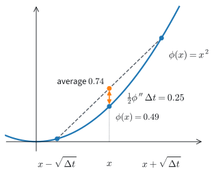
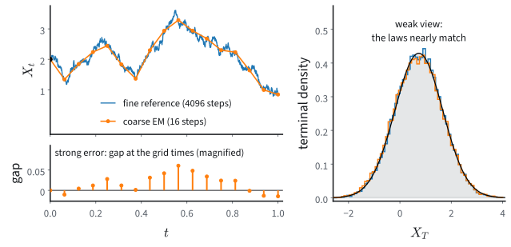

# Stochastic Differential Equations
:label:`sec_mdl-sdes`

The two previous sections integrated deterministic vector fields. From a given
start the trajectory is fixed, and a flow never forgets where it came from:
two different starting points always reach two different endpoints. A
continuous normalizing flow can still carry a data distribution to a
Gaussian, but only after it has been trained on that particular data. The
diffusion models of the main text work the other way round. Their forward
process adds fresh noise at every step until nothing of the starting point
remains, and this is what makes generation possible, because the reverse
process then has a known place to begin. What equation does such a process
solve, and how do we calculate with it when the noise is new at every instant?

A small example shows what is involved. Take one number, $x_0 = 2$. At each
step keep $99\%$ of it and add an independent Gaussian draw with standard
deviation $\sqrt{0.02} \approx 0.14$:

$$
x_{k+1} = 0.99\, x_k + \sqrt{0.02}\; \xi_k, \qquad \xi_k \sim \mathcal{N}(0, 1).
$$

After $400$ steps the mean is $2 \cdot 0.99^{400} \approx 0.036$ and the
variance is close to $1$ (its limit is $0.02/(1 - 0.99^2) \approx 1.005$).
Any other start ends in the same place, as a draw from a distribution very
close to $\mathcal{N}(0, 1)$. One feature of the recurrence looks odd. If it
describes a process in continuous time with time step $h = 0.01$, then the
decay $0.99 = 1 - h$ changes $x$ by an amount of order $h$, but the noise has
size $\sqrt{h}$, not $h$. This choice is forced. Noise of size $h$ would
vanish as $h \to 0$, while noise of size $\sqrt{h}$ survives, and its square is of
order $h$, the same order as the drift. Ordinary calculus discards squares of
small changes, so this one fact requires a new calculus.

The continuous-time limit of such noise is Brownian motion, named after the
botanist Robert Brown, who watched pollen grains jitter in water in 1827.
Norbert Wiener constructed it as a mathematical object in 1923, and Kiyoshi
Itô built the calculus for equations driven by it in the 1940s
:cite:`Ito.1944`. The central
idea of Itô's calculus is that along a Brownian path the square of a short
increment equals the elapsed time on average, so the chain rule gains a
second-derivative term.

The forward process of a diffusion model is such an equation. Its law at each
time, given the start, is Gaussian, which gives denoising score matching its
regression targets in closed form. Its simulation step, the recurrence above,
agrees with the forward step of DDPM to first order. We take the limit of
random walks, build the calculus, solve the process behind the recurrence in
closed form, and then simulate general equations and measure the error.
Throughout, $f$ is the drift, $g$ the noise amplitude, $W$ Brownian motion,
$\theta$ the decay rate of the running example, and $\alpha_t$, $\sigma_t$ the
mean factor and the standard deviation of its Gaussian marginals.

```{.python .input #sdes-imports}
#@tab mxnet
import math
import numpy as np
from mxnet import autograd, gluon, init, np as mnp, npx
from mxnet.gluon import nn
from d2l import mxnet as d2l
npx.set_np()
```

```{.python .input #sdes-imports}
#@tab pytorch
import math
import numpy as np
import torch
from torch import nn
from torch.nn import functional as F
from d2l import torch as d2l
```

```{.python .input #sdes-imports}
#@tab tensorflow
import math
import numpy as np
import tensorflow as tf
from d2l import tensorflow as d2l
```

```{.python .input #sdes-imports}
#@tab jax
import math
import numpy as np
import jax
from jax import numpy as jnp
from flax import nnx
import optax
from d2l import jax as d2l
```

## Brownian Motion

### Noise as a Forward Process
:label:`sec_mdl-why-randomness`

Before building any machinery we check what a forward process needs and why
neither a deterministic flow nor pure noise provides it. Starting from data
distributed as $p_0 = p_{\textrm{data}}$, the process must end at one known
distribution, whatever the data looked like,

$$
p_0 = p_{\textrm{data}} \;\longrightarrow\; p_T \approx \mathcal{N}(\mathbf{0}, \mathbf{I}),
$$

so that at generation time we always know where to start. A deterministic flow
cannot do this for every dataset at once. The flows of
:numref:`sec_mdl-odes-solvers` are invertible maps $\Phi$, and an invertible
map sends distinct laws to distinct laws: if $\Phi$ carried $p$ and $q$ to the
same distribution, applying $\Phi^{-1}$ would show $p = q$. So no single fixed
flow carries two different datasets to the same endpoint.

The smallest case shows what goes wrong and what works. Take two "datasets"
that are point masses at $x_0 = 2$ and at $x_0 = -2$, and try three processes.

- **Drift alone**, $\dot{x} = -x$. The solution is $x(t) = x_0 e^{-t}$, so at
  $t = 3$ the two starts sit at $\pm 2e^{-3} = \pm 0.0996$. Both datasets
  shrink toward the point mass at $0$, which is not a Gaussian, and at every
  finite time they are still two distinct points.
- **Noise alone**, $dX = \sqrt{2}\, dW$. Here $W$ is a noise whose variance
  grows linearly in time, constructed in the next subsection, and the equation
  means $X_t = x_0 + \sqrt{2}\, W_t$. The law at time $t$ is
  $\mathcal{N}(x_0, 2t)$: each cloud keeps its center at $\pm 2$ while its
  standard deviation $\sqrt{2t}$ grows without bound ($2.45$ at $t = 3$). The
  two clouds overlap more and more but never become the same.
- **Both together**, $dX = -X\,dt + \sqrt{2}\, dW$. From either start the law
  at $t = 3$ is $\mathcal{N}(\pm 0.0996,\, 0.9975)$, a formula proved later in
  this section. The two laws are nearly indistinguishable from each other and
  from $\mathcal{N}(0, 1)$.

![Two failures and the remedy, from the two starts $x_0=\pm2$. Drift alone ($\dot x=-x$) sends every start to the point $0$. Noise alone ($X_t=x_0+\sqrt2\,W_t$) keeps each start as the center of a cloud whose two-standard-deviation envelope $x_0\pm2\sqrt{2t}$ grows without bound. Both together ($dX=-X\,dt+\sqrt2\,dW$) carry every start into the same stationary law $\mathcal N(0,1)$, drawn sideways at the right. Green lines are the means; dashed lines are the analytic two-standard-deviation envelopes.](../img/mdl-dyn-sde-paths.svg)
:label:`fig_mdl-dyn-sde-paths`

:numref:`fig_mdl-dyn-sde-paths` draws the three processes. The third one is the
running example of this section, and the recurrence of the opening is its
simulation with time step $0.01$. The drift pulls each start toward zero while
the noise refills the variance that the drift removes, and the two balance at
variance $1$. :numref:`sec_mdl-ornstein-uhlenbeck` proves that this happens
from every start.

In general, a forward process of this kind is a deterministic vector field
plus a noise term. For data in $\mathbb{R}^d$ we write

$$
d\mathbf{X} \;=\; \underbrace{\mathbf{f}(\mathbf{X}, t)\,dt}_{\textrm{drift}}
\;+\; \underbrace{g(t)\,d\mathbf{W}}_{\textrm{diffusion}},
$$
:eqlabel:`eq_mdl-sde-template`

which reads: over a short time $dt$, the state moves by the velocity
$\mathbf{f}$ times $dt$ and receives a random kick whose size is set by the
noise amplitude $g$. The drift steers the mean, and the diffusion injects
variance. Such a process can also be run backward in distribution, which is
how a diffusion model generates; the next section shows how.

Noise alone also works as a forward process if it runs long enough: its endpoint
$\mathcal{N}(x_0, g^2 T)$ still depends on the data, but once $g^2 T$ is far
larger than the spread of the data the dependence no longer matters. This
family is called *variance-exploding*. It has no stationary law, so its
endpoint variance must be made huge. The drift of the third process, in
contrast, holds the variance at $1$.

### From Random Walks to the Wiener Process
:label:`sec_mdl-wiener-process`

The noise term $d\mathbf{W}$ needs a precise object behind it. We build it as
the limit of the simplest random process, a coin-flip walk, and the limit
explains the square root in the opening's recurrence.

Fix a step duration $\Delta t$ and let a walker take independent steps of size
$\pm\sqrt{\Delta t}$, each sign chosen by a fair coin. After $k$ steps, at time
$t = k\,\Delta t$, the position is a sum of $k$ independent mean-zero steps of
variance $\Delta t$ apiece. Variances of independent terms add
(:numref:`sec_mdl-random_variables`), so

$$
\mathbb{E}\!\left[W^{(\Delta t)}_t\right] = 0,
\qquad
\textrm{Var}\!\left(W^{(\Delta t)}_t\right) = k\,\Delta t = t,
$$

whatever the step size. With $\Delta t = 0.01$, for instance, $100$ steps of
$\pm 0.1$ give variance $100 \cdot 0.01 = 1$ at time $1$. Steps of $\pm 0.01$
would give variance $0.01$, and steps of $\pm 1$ would give $100$.

More generally, steps of size $c\,\Delta t^{a}$ give variance
$(t/\Delta t)\, c^2 \Delta t^{2a} = c^2\, t\, \Delta t^{2a - 1}$ at time $t$,
which tends to $0$ for $a > \tfrac12$ and to $\infty$ for $a < \tfrac12$.
Among such step sizes only $a = \tfrac12$ gives a finite nonzero variance in
the limit, and this square root returns in the noise term of every numerical
scheme below. As $\Delta t \to 0$ the number of steps before time $t$ grows
without bound, and the central limit theorem (a sum of many independent
mean-zero terms with total variance $t$ is approximately $\mathcal{N}(0, t)$)
makes the limiting position Gaussian.

The limit process is called **Brownian motion** or the **Wiener process**
:cite:`Wiener.1923`. It is defined by four properties:

1. $W_0 = 0$;
2. **independent increments**: for $s < t$, the increment $W_t - W_s$ is
   independent of the entire path up to time $s$;
3. **Gaussian increments**: $W_t - W_s \sim \mathcal{N}(0,\, t - s)$;
4. continuous sample paths.

That a process with these properties exists is Wiener's theorem, and that the
rescaled walks converge to it is Donsker's theorem; we take both as given. In
particular $\mathbb{E}[W_t] = 0$ and $\textrm{Var}(W_t) = t$: the process
spreads with standard deviation $\sqrt{t}$ forever
(:numref:`fig_mdl-dyn-brownian-paths`). The opening's recurrence with step
$h$ adds noise of variance $2h$ per step, so its noise is $\sqrt{2}$ times a
Brownian increment. Simulation uses the increment form

$$
\Delta W \;=\; W_{t + \Delta t} - W_t \;=\; \sqrt{\Delta t}\;\xi,
\qquad \xi \sim \mathcal{N}(0, 1),
$$
:eqlabel:`eq_mdl-sde-increment`

which says that a Brownian increment over a step of length $\Delta t$ is a
standard normal draw scaled by $\sqrt{\Delta t}$.


:label:`fig_mdl-dyn-brownian-paths`

The multivariate Brownian motion $\mathbf{W}_t$ runs one independent scalar
Brownian motion per coordinate. For the diagonal, state-independent noise
$g(t)\,d\mathbf{W}$ of the diffusion-model SDEs in this chapter, every
calculation below therefore applies coordinate by coordinate.

Independent increments determine how the values of $W$ at two times are
related. The resulting covariance is what we test to validate a simulator in
the next subsection.

**Proposition (covariance of Brownian motion).** *For all $s, t \ge 0$,
$\textrm{Cov}(W_s, W_t) = \min(s, t)$.*

**Proof.** Take $s \le t$ and split $W_t = W_s + (W_t - W_s)$. Then

$$
\mathbb{E}[W_s W_t]
= \mathbb{E}\!\left[W_s^2\right] + \mathbb{E}\!\left[W_s (W_t - W_s)\right]
= s + \mathbb{E}[W_s]\,\mathbb{E}[W_t - W_s] = s,
$$

where the cross term factorizes because the increment $W_t - W_s$ is
independent of $W_s$, and both factors have mean zero. Since the means vanish,
$\textrm{Cov}(W_s, W_t) = \mathbb{E}[W_s W_t] = \min(s, t)$.
$\blacksquare$

The formula says that $W_t$ is $W_s$ plus something new that is uncorrelated
with it: the walk carries its position at time $s$ forward unchanged and adds
fresh noise.

The same increments make the path rough. Brownian paths are continuous but
nowhere differentiable, a theorem of Paley, Wiener, and Zygmund
:cite:`Paley.Wiener.Zygmund.1933`. The increment scaling
:eqref:`eq_mdl-sde-increment` gives the heuristic reason:

$$
\left|\frac{\Delta W}{\Delta t}\right|
= \frac{|\xi|}{\sqrt{\Delta t}}
\;\longrightarrow\; \infty
\quad \textrm{in probability as } \Delta t \to 0,
$$

so a difference quotient grows without bound as the step shrinks. This is not
a proof (it rules out a derivative at each fixed time, while "nowhere"
concerns all times at once), but it shows the obstruction.

Rescaling time by a factor $c$ and space by $\sqrt{c}$ returns a Brownian
motion (problem :exref:`ex_mdl-sdes-brownian-scaling-exit-times`), so zooming
in on a path shows the same roughness at every scale, where a differentiable
curve would flatten into its tangent. Hence $dW/dt$ does not exist, and $dW$
has to be given a meaning inside integrals. The Itô calculus supplies that
meaning.

### Simulation of Brownian Paths

The increment form :eqref:`eq_mdl-sde-increment` is also a simulation recipe:
take cumulative sums of $\sqrt{\Delta t}\,\xi$ steps. Does the simulated walk
have variance $t$, and what fraction of the paths sits inside $\pm 2\sqrt{t}$
at a fixed time? We generate $20{,}000$ paths on $[0, 1]$ and check.

```{.python .input #sdes-brownian-paths}
rng = np.random.default_rng()
T_bm, n_bm, n_paths = 1.0, 500, 20000
dt_bm = T_bm / n_bm
dW_bm = np.sqrt(dt_bm) * rng.standard_normal((n_paths, n_bm))
W_bm = np.concatenate([np.zeros((n_paths, 1)), np.cumsum(dW_bm, axis=1)],
                      axis=1)
for t in [0.25, 0.5, 1.0]:
    k = round(t / dt_bm)
    print(f'Var(W_t) at t={t:.2f}: {W_bm[:, k].var():.4f}   (theory: {t:.2f})')
inside = np.abs(W_bm[:, -1]) < 2 * np.sqrt(T_bm)
print(f'fraction inside +-2 sqrt(t) at t=1: {inside.mean():.3f}'
      '   (Gaussian: 0.954)')
```

The variances lie within a few percent of $t$; the Monte Carlo standard
error of a variance from $20{,}000$ Gaussian samples is $t\sqrt{2/20000}$, or
$1\%$ of $t$. About $95\%$ of the paths lie inside $\pm 2\sqrt{t}$ at $t = 1$.
This is a statement about one fixed time: far fewer paths stay inside the
envelope over the whole interval. We check the covariance formula the same
way: the ensemble average of $W_s W_t$ over a grid of time pairs should
reproduce $\min(s, t)$ entry by entry.

```{.python .input #sdes-brownian-covariance}
ts = np.array([0.1, 0.25, 0.5, 0.75, 1.0])
idx = np.round(ts / dt_bm).astype(int)
emp = W_bm[:, idx].T @ W_bm[:, idx] / n_paths   # E[W_s W_t]; means are zero
print('empirical E[W_s W_t]:')
print(emp.round(3))
print('max |empirical - min(s,t)| = '
      f'{np.abs(emp - np.minimum.outer(ts, ts)).max():.4f}')
```

Every entry matches $\min(s, t)$ within one or two hundredths, the size of the
standard error of the largest entries ($0.01$ for the entry at $s = t = 1$).
Each row is nearly constant to the right of the diagonal: increments after
time $s$ are uncorrelated with $W_s$, consistent with property 2.

## Itô Calculus

### Quadratic Variation
:label:`sec_mdl-quadratic-variation`

Ordinary calculus stops its Taylor expansions at first order because the
square of a small change is negligible. We now check that this fails for
Brownian motion, and by how much.

Take a partition $0 = t_0 < t_1 < \cdots < t_n = t$ with increments
$\Delta t_i = t_{i+1} - t_i$ and mesh $h_{\max} = \max_i \Delta t_i$, and add
up the squared increments of a path along it. For a differentiable path $x$
with $|x'| \le M$, the mean value theorem gives
$|\Delta x_i| \le M\, \Delta t_i$, so

$$
\sum_{i} (\Delta x_i)^2
\;\le\; M^2 \sum_i \Delta t_i^2
\;\le\; M^2\, h_{\max}\, t
\;\longrightarrow\; 0
$$

as the mesh shrinks. This is why $(dx)^2$ is negligible against $dx$ in
ordinary calculus: a smooth increment squared is of order $\Delta t^2$. A
Brownian increment squared is of order $\Delta t$, since
$\mathbb{E}[(\Delta W_i)^2] = \Delta t_i$, and these add up to $t$ no matter how
fine the mesh (:numref:`fig_mdl-dyn-qv-convergence`). The sum is random, but
its fluctuations vanish in the limit.

**Proposition (quadratic variation of Brownian motion).** *As the mesh
$h_{\max} \to 0$,*

$$
Q_n \;=\; \sum_{i=0}^{n-1} \left(W_{t_{i+1}} - W_{t_i}\right)^2
\;\longrightarrow\; t
\quad \textrm{in mean square:} \quad
\mathbb{E}\!\left[(Q_n - t)^2\right] \to 0.
$$
:eqlabel:`eq_mdl-sde-qv`

**Proof.** Each increment is $\mathcal{N}(0, \Delta t_i)$, so
$\mathbb{E}[(\Delta W_i)^2] = \Delta t_i$ and
$\mathbb{E}[Q_n] = \sum_i \Delta t_i = t$ for every partition. For the
spread, a Gaussian has fourth moment $3\,\Delta t_i^2$, so
$\textrm{Var}\!\left((\Delta W_i)^2\right) = 3\Delta t_i^2 - \Delta t_i^2
= 2\Delta t_i^2$; the increments are independent, so their variances add:

$$
\mathbb{E}\!\left[(Q_n - t)^2\right] = \textrm{Var}(Q_n)
= \sum_i 2\,\Delta t_i^2
\;\le\; 2\,h_{\max} \sum_i \Delta t_i = 2\,h_{\max}\, t \;\longrightarrow\; 0,
$$

and mean-square convergence follows. $\blacksquare$

The sum of squared Brownian increments converges to the elapsed time, a
deterministic number. On a uniform grid with $n$ intervals of $[0, 1]$ the
proof gives the standard deviation $\sqrt{2/n}$: $0.35$ for $n = 16$
and $0.003$ for $n = 2^{18}$.


:label:`fig_mdl-dyn-qv-convergence`

The proposition is usually written as the **Itô multiplication table**, the
working rules for products of differentials:

$$
(dW)^2 = dt, \qquad dW\,dt = 0, \qquad (dt)^2 = 0.
$$
:eqlabel:`eq_mdl-sde-ito-table`

The first rule is :eqref:`eq_mdl-sde-qv` in shorthand: a squared Brownian
increment contributes at order $dt$. The other two record that
$dW\,dt$, of size $\Delta t^{3/2}$, and $(dt)^2 = \Delta t^2$ vanish faster
than $\Delta t$ and so contribute nothing in the limit.

Along one fixed Brownian path, do the squared increments add up to $t$ on
finer and finer grids, and do the squared increments of a smooth path shrink
to $0$? The next cell samples one path on $2^{18}$ intervals of $[0, 1]$,
views it on coarser subgrids, and prints the predicted standard deviation and
the predicted smooth sum next to the measured ones.

```{.python .input #sdes-quadratic-variation}
n_fine = 2**18
dW_qv = np.sqrt(1.0 / n_fine) * rng.standard_normal(n_fine)
W_qv = np.concatenate([[0.0], np.cumsum(dW_qv)])
print(f'{"n":>7} {"QV of W":>8} {"sqrt(2/n)":>10} {"QV of sin":>10}'
      f' {"2 pi^2/n":>9}')
for k in range(4, 19, 2):
    n = 2**k
    W_n = W_qv[::n_fine // n]                 # the same path on a coarser grid
    s_n = np.sin(2 * np.pi * np.linspace(0, 1, n + 1))
    print(f'{n:7d} {np.sum(np.diff(W_n)**2):8.4f} {np.sqrt(2 / n):10.4f} '
          f'{np.sum(np.diff(s_n)**2):10.6f} {2 * np.pi**2 / n:9.6f}')
```

The Brownian column scatters around $1$ with the standard deviation
$\sqrt{2/n}$ that the proof predicts. On $16$ intervals it typically lands
between about $0.5$ and $1.6$, and it settles to $t = 1$ within a few
thousandths at $n = 2^{18}$. The smooth column is large on coarse grids,
$1.22$ at $n = 16$, but it shrinks like $2\pi^2/n$ and agrees with that
prediction to three digits from $n = 256$ on.

### The Itô Integral
:label:`sec_mdl-ito-integral`

The rough path forces us to define integrals against $dW$ directly. We start
with the simplest one, $\int_0^t W\,dW$, and find that the usual Riemann-sum
definition does not single out an answer.

For a smooth integrator, Riemann sums with the integrand evaluated at the left
endpoint, the right endpoint, or the midpoint of each interval all converge to
the same limit. For the integrand $H = W$, the right-endpoint sum exceeds the
left-endpoint sum by

$$
\sum_i W_{t_{i+1}}\,\Delta W_i - \sum_i W_{t_i}\,\Delta W_i
= \sum_i \left(W_{t_{i+1}} - W_{t_i}\right)\Delta W_i = \sum_i (\Delta W_i)^2
\;\longrightarrow\; t,
$$

by the proposition just proved. The two discretizations of "the same"
integral disagree by a finite, deterministic amount. The next cell computes
both sums on one path with $1000$ steps.

```{.python .input #sdes-left-right-sums}
n_lr = 1000
dt_lr = 1.0 / n_lr
t_lr = np.linspace(0, 1, n_lr + 1)
dW_lr = np.sqrt(dt_lr) * rng.standard_normal(n_lr)
W_lr = np.concatenate([[0.0], np.cumsum(dW_lr)])
left = np.sum(W_lr[:-1] * dW_lr)              # integrand at the left endpoint
right = np.sum(W_lr[1:] * dW_lr)              # integrand at the right endpoint
print(f'left sum {left:.4f}   right sum {right:.4f}')
print(f'right - left {right - left:.4f}   sum of (dW)^2 {np.sum(dW_lr**2):.4f}')
```

The left sum is a random number that changes from run to run. The right sum
exceeds it by exactly the printed sum of squared increments, which usually
lies within about $0.1$ of $1$ (its standard deviation is
$\sqrt{2/1000} \approx 0.045$). We must choose an evaluation point, and the
choice changes the answer.

Itô's choice is the left endpoint, so that the integrand never sees the
coming increment. A fair game explains why. Think of
$\Delta W_i$ as the outcome of the $i$-th fair bet and of $H_i$ as the stake
placed on it. A gambler must choose the stake from what is known at time
$t_i$, before the bet is settled, and the total winnings are
$\sum_i H_i\,\Delta W_i$. Because the increment $\Delta W_i$ is independent of
everything known at $t_i$, including $H_i$, each bet has expected winnings
$\mathbb{E}[H_i\,\Delta W_i] = \mathbb{E}[H_i]\,\mathbb{E}[\Delta W_i] = 0$, so
no betting strategy has positive expected winnings. A stake that could peek at
the outcome, as the right-endpoint sum does, would make money on average.

The definition writes this rule down. A **simple predictable process** $H$ is
constant on each interval, $H_s = H_i$ for $s \in (t_i, t_{i+1}]$, where $H_i$
is determined by the path up to time $t_i$ and $\mathbb{E}[H_i^2] < \infty$.
Its **Itô integral** is the sum of the winnings,

$$
\int_0^t H_s \, dW_s
\;=\; \sum_i H_i\left(W_{t_{i+1}}-W_{t_i}\right).
$$
:eqlabel:`eq_mdl-sde-ito-integral`

For such $H$ the argument above shows
$\mathbb{E}\!\left[\int_0^t H\,dW\right] = 0$. A general integrand, such as
$H = W$ itself, is approximated by simple predictable processes, and the
integral is defined as the limit. The isometry below makes
$H \mapsto \int H\,dW$ continuous in the norm
$\|H\|^2 = \int_0^t \mathbb{E}[H_s^2]\,ds$. The integral therefore extends to
every $H$ that step processes approximate in this norm. In particular, the
left-endpoint sums of a continuous predictable integrand converge to it
:cite:`Oksendal.2003`. Mean-square limits preserve means, so the zero mean
holds for every such integrand. Beyond the zero mean, the variance of the
integral is computable.

**Proposition (Itô isometry).** *For predictable $H$ with
$\int_0^t \mathbb{E}[H_s^2]\,ds < \infty$,*

$$
\mathbb{E}\!\left[\left(\int_0^t H_s\,dW_s\right)^{\!2}\,\right]
\;=\; \int_0^t \mathbb{E}\!\left[H_s^2\right] ds.
$$
:eqlabel:`eq_mdl-sde-ito-isometry`

**Proof.** Take a simple predictable $H$ and expand the square of the sum in
:eqref:`eq_mdl-sde-ito-integral`. The step that needs care is the cross terms.
A cross term with $i < j$ contains the factor $\Delta W_j$, which is
independent of everything known at time $t_j$, including the product
$H_i\,\Delta W_i\,H_j$. So the expectation factorizes:
$\mathbb{E}\!\left[H_i\,\Delta W_i\, H_j\, \Delta W_j\right] =
\mathbb{E}\!\left[H_i\,\Delta W_i\, H_j\right]\mathbb{E}[\Delta W_j] = 0$.
A diagonal term factorizes the same way into
$\mathbb{E}\!\left[H_i^2\right]\mathbb{E}\!\left[(\Delta W_i)^2\right] =
\mathbb{E}\!\left[H_i^2\right]\Delta t_i$. Summing the diagonal gives
$\sum_i \mathbb{E}[H_i^2]\,\Delta t_i = \int_0^t \mathbb{E}[H_s^2]\,ds$.
For a general $H$, approximate it by simple predictable processes; both sides
converge, so the identity extends. $\blacksquare$

The isometry turns the variance of a noise integral into an ordinary integral
of a second moment. For the integral we started from,
$\mathbb{E}[W_s^2] = s$, so

$$
\textrm{Var}\!\left(\int_0^1 W_s\,dW_s\right) = \int_0^1 s\,ds = \tfrac12 .
$$

Is the variance of the left-endpoint sum really $\tfrac12$? The next cell
draws $20{,}000$ paths on the same $1000$-step grid and computes the sum on
each.

```{.python .input #sdes-isometry-check}
dW_iso = np.sqrt(dt_lr) * rng.standard_normal((20000, n_lr))
W_iso = np.cumsum(dW_iso, axis=1) - dW_iso    # W at the left end of each step
I_iso = np.sum(W_iso * dW_iso, axis=1)        # 20,000 draws of int_0^1 W dW
print(f'mean {I_iso.mean():.4f}   (theory 0)')
print(f'variance {I_iso.var():.4f}   (theory 1/2)')
```

The mean is within about $0.015$ of $0$ and the variance within a few
hundredths of $\tfrac12$. On this grid the discrete sum has variance
$\tfrac12(1 - 1/n) = 0.4995$, and the standard error of the sample variance is
$0.013$, larger than for a Gaussian because the integral has heavy tails. The
Itô lemma below gives a second route to the same $\tfrac12$.

The other evaluation points define other integrals. The midpoint choice, or
the average of the left and right sums, defines the *Stratonovich integral*
:cite:`Stratonovich.1966`. It obeys the ordinary chain rule but gives up the
zero mean, because its integrand sees half of the coming increment. A
simulation that moves forward in time cannot look ahead, so simulation and
this book use Itô's convention
(problem :exref:`ex_mdl-sdes-ito-versus-stratonovich`).

### Drift, Diffusion, and Solutions
:label:`sec_mdl-sde-definition`

With the integral in hand, the forward-process template
:eqref:`eq_mdl-sde-template` acquires a meaning. A **stochastic differential
equation** is written

$$
dX = f(X, t)\,dt + g(X, t)\,dW,
$$
:eqlabel:`eq_mdl-sde-general`

and the differential form is shorthand for the integral equation

$$
X_t = X_0 + \int_0^t f(X_s, s)\,ds + \int_0^t g(X_s, s)\,dW_s,
$$

an ordinary integral plus an Itô integral. The **drift** $f$ steers the
average motion and the **diffusion** coefficient $g$ sets the size of the
noise. Over a short step, with the coefficients frozen at the start of the
step, $\mathbb{E}[dX] = f\,dt$ and $\textrm{Var}(dX) = g^2\,dt$. So $f$ is the
conditional mean velocity and $g^2$ the rate at which variance is pumped in.
With $g \equiv 0$ the equation is the ODE of :numref:`sec_mdl-odes-solvers`.

The smallest case is $dX = g\,dW$ with a constant $g$: the drift integral
vanishes and the Itô integral of a constant is $g\,W_t$, so
$X_t = X_0 + g\,W_t$. This is the noise-only panel of
:numref:`fig_mdl-dyn-sde-paths` with $g = \sqrt{2}$.

As for ODEs, Lipschitz coefficients guarantee a solution. Suppose that $f$ and
$g$ are Lipschitz in $x$ and grow at most linearly,
$|f(x, t)| + |g(x, t)| \le C(1 + |x|)$, and that $X_0$ is independent of $W$
with $\mathbb{E}[X_0^2] < \infty$. Then the equation has a unique solution
(:citet:`Oksendal.2003`, Theorem 5.2.1). The proof is a stochastic version of
the Picard iteration of :numref:`sec_mdl-ode-existence-uniqueness`, with the
isometry in place of the integral bound.

We distinguish two kinds of noise. In **additive** noise the amplitude depends
on time only, $g = g(t)$, as in the template :eqref:`eq_mdl-sde-template`; in
**multiplicative** noise it depends on the state, $g = g(X, t)$. The
difference looks cosmetic, but it decides the accuracy of the simulation
scheme of the last part of this section. The diffusion-model SDEs of this
chapter have additive noise, in the two families of
:numref:`fig_mdl-dyn-sde-paths`: noise alone (variance-exploding) and noise
balanced by a restoring drift.

Unlike an ODE solution, a solution of an SDE is not one curve but a
distribution over paths. Running the equation many times from the same start
with fresh noise gives a cloud of paths like those of
:numref:`fig_mdl-dyn-sde-paths`, and what a generative model cares about is
the law of the cloud at each time.

### Itô's Lemma
:label:`sec_mdl-ito-lemma`

To compute with an SDE we need the chain rule: if $X$ solves an SDE, what
equation does a function $\phi(X_t, t)$ solve? The ordinary chain rule fails,
and the smallest example shows how. It gives $d(W^2) = 2W\,dW$, so it predicts
$W_t^2 = \int_0^t 2W\,dW$. The right-hand side is an Itô integral and has mean
zero, but $\mathbb{E}[W_t^2] = t$. Something is missing, and the
multiplication table supplies it.

One step of a walk shows the missing term. Take $\phi(x) = x^2$ and one step
$\pm\sqrt{\Delta t}$ from $x$, each sign with probability $\tfrac12$. The
average of $\phi$ after the step is

$$
\tfrac12\left[(x + \sqrt{\Delta t})^2 + (x - \sqrt{\Delta t})^2\right]
= x^2 + \Delta t
= \phi(x) + \tfrac12\phi''(x)\,\Delta t ,
$$

since $\phi'' = 2$. The rise comes from the square of the step,
$(\Delta W)^2 = \Delta t$, which the ordinary chain rule throws away.

With $x = 0.7$ and $\Delta t = 0.25$ the step lands at $0.2$ or $1.2$, where
$\phi$ is $0.04$ or $1.44$. The average $0.74$ lies above $\phi(0.7) = 0.49$
by $0.25 = \Delta t$ (:numref:`fig_mdl-dyn-ito-jensen`). A convex function
gains from symmetric noise, and because a squared Brownian increment is of
order $dt$, the gain per unit time, $\tfrac12\phi''g^2$, does not vanish in
the limit.


:label:`fig_mdl-dyn-ito-jensen`

The general formula comes from the same computation. Let $X$ solve
$dX = f\,dt + g\,dW$ and let $\phi(x, t)$ be once continuously differentiable
in time and twice in the state. A small change of $\phi$, expanded to second
order because first order is no longer enough, is

$$
d\phi = \phi_t\,dt + \phi_x\,dX + \tfrac12 \phi_{xx}\,(dX)^2 + \cdots.
$$

Substitute $dX = f\,dt + g\,dW$ and multiply out $(dX)^2$ with the table
:eqref:`eq_mdl-sde-ito-table`:

$$
(dX)^2 = f^2 (dt)^2 + 2 f g\, dt\, dW + g^2 (dW)^2 = g^2\,dt.
$$

The drift and cross terms vanish, and the noise term survives at first
order. Collecting terms gives the chain rule of stochastic calculus.

**Proposition (Itô's lemma).** *Let $X$ solve $dX = f\,dt + g\,dW$ under the
conditions of the previous subsection, and let $\phi \in C^{1,2}$, once
continuously differentiable in time and twice in the state. Then
$Y_t = \phi(X_t, t)$ satisfies*

$$
d\phi \;=\; \left(\phi_t + f\,\phi_x + \tfrac12 g^2\,\phi_{xx}\right) dt
\;+\; g\,\phi_x \, dW.
$$
:eqlabel:`eq_mdl-sde-ito-lemma`

Relative to the ordinary chain rule, the new term is
$\tfrac12 g^2 \phi_{xx}\,dt$, the **Itô correction**. The Taylor argument
above is a heuristic; the proof controls the remainder terms in mean square
(:citet:`Oksendal.2003`, chapter 4).

**Example 1: $W^2$.** Take $X = W$ (so $f = 0$, $g = 1$) and $\phi(x) = x^2$.
The lemma gives $d(W^2) = 2W\,dW + dt$, the $dt$ that the ordinary chain rule
dropped. In integrated form,

$$
W_t^2 = \int_0^t 2 W_s \, dW_s + t,
\qquad\textrm{that is,}\qquad
\int_0^t W_s\,dW_s = \tfrac12\left(W_t^2 - t\right).
$$
:eqlabel:`eq_mdl-sde-wdw`

The $-t$ restores the zero mean of the Itô integral, since
$\mathbb{E}[W_t^2] = t$. The formula also gives the variance of the integral
a second way: $W_1^2$ is a squared standard normal, with variance $2$, so
$\textrm{Var}\big(\tfrac12(W_1^2 - 1)\big) = \tfrac14 \cdot 2 = \tfrac12$, the
number the isometry gave.

Is the correction visible on a single path? On the path of
`#sdes-left-right-sums`, the next cell accumulates the left-endpoint sum
$\int_0^t 2W\,dW$ and compares its gap to $W_t^2$ with $t$. On any grid the gap
telescopes,
$W_t^2 - \sum_{t_i < t} 2W_{t_i}\Delta W_i = \sum_{t_i < t} (\Delta W_i)^2$, so it
is the running quadratic variation.

```{.python .input #sdes-ito-correction}
ito = np.concatenate([[0.0], np.cumsum(2 * W_lr[:-1] * dW_lr)])  # int 2W dW
gap = W_lr**2 - ito
print(f'final gap W_1^2 - int 2W dW = {gap[-1]:.4f}   (Ito correction: t = 1)')
print(f'max |gap_t - t| along the path = {np.abs(gap - t_lr).max():.4f}')
d2l.plot(t_lr, [W_lr**2, ito, ito + t_lr], 't', 'value',
         legend=['$W_t^2$', 'naive $\\int_0^t 2W\\,dW$',
                 '$\\int_0^t 2W\\,dW + t$'], figsize=(5, 3))
```

The final gap equals the sum of squared increments printed by the earlier
cell, so it usually lies within about $0.1$ of $1$. Along the whole path the
gap follows $t$ closely, typically within about $0.05$ and rarely by more than
$0.1$: by the proof of :eqref:`eq_mdl-sde-qv` its standard deviation at time
$t$ is $\sqrt{2t\,\Delta t}$, which is $0.045$ at $t = 1$ for $1000$ steps and
shrinks as the grid is refined. The naive curve sags below $W_t^2$, and adding
$t$ puts it back on top.

**Example 2: geometric Brownian motion.** The SDE
$dX = \mu X\,dt + \nu X\,dW$ with $X_0 > 0$ models a quantity that grows at
mean rate $\mu$ with noise proportional to its size, such as a stock price
:cite:`Black.Scholes.1973`. Its noise is multiplicative. Apply the lemma to
$\phi(x) = \log x$, with $\phi' = 1/x$, $\phi'' = -1/x^2$, and
$g^2 = \nu^2 x^2$:

$$
d\log X = \left(\mu - \tfrac12\nu^2\right) dt + \nu\, dW,
\qquad\textrm{so}\qquad
X_t = X_0 \exp\!\left(\left(\mu - \tfrac12\nu^2\right) t + \nu W_t\right).
$$
:eqlabel:`eq_mdl-sde-gbm`

The $-\tfrac12\nu^2$ is the correction with $\phi'' < 0$: a concave function
loses from symmetric noise. Noise therefore lowers the typical growth rate
$\mu - \tfrac12\nu^2$ below the mean growth rate $\mu$, and
problem :exref:`ex_mdl-sdes-geometric-brownian-motion-correction` shows how far the
mean and the median of $X_t$ drift apart. The simulation part of this section
measures errors against this exact solution.

The multivariate form follows the same pattern, and we take it as given
:cite:`Oksendal.2003`. For $d\mathbf{X} = \mathbf{f}\,dt + \mathbf{G}\,d\mathbf{W}$
with $\mathbf{X} \in \mathbb{R}^d$, a matrix $\mathbf{G}$, and multivariate
Brownian motion $\mathbf{W}$, the multiplication table reads
$dW_i\, dW_j = \delta_{ij}\,dt$, and a twice continuously differentiable $\phi$
satisfies

$$
d\phi(\mathbf{X}) \;=\; \nabla\phi \cdot d\mathbf{X}
\;+\; \tfrac12 \sum_{i,j} \left(\mathbf{G} \mathbf{G}^\top\right)_{ij}
\frac{\partial^2\phi}{\partial x_i\, \partial x_j} \; dt .
$$
:eqlabel:`eq_mdl-ito-multivariate`

The correction weights each second derivative by the covariance rate
$\mathbf{G}\mathbf{G}^\top$ of the noise. For the noise
$\mathbf{G} = g(t)\,\mathbf{I}$ of the diffusion-model SDEs it reduces to
$\tfrac12 g(t)^2 \sum_i \partial^2\phi/\partial x_i^2\; dt$, a multiple of the
Laplacian of $\phi$. This term becomes the diffusion term of the Fokker--Planck
equation in the next section.

The lemma needs $\phi$ to be twice differentiable. For $\phi(x) = |x|$ the
second derivative is a point mass at $0$, and the formula for $d|W|$ gains an
extra term, the local time of $W$ at zero, which this book never needs.

## The Ornstein--Uhlenbeck Process
:label:`sec_mdl-ornstein-uhlenbeck`

The running example now gets its name and its solution. The
Ornstein--Uhlenbeck (OU) process :cite:`Uhlenbeck.Ornstein.1930` is

$$
dX = -\theta X \, dt + g\,dW, \qquad \theta > 0,
$$
:eqlabel:`eq_mdl-sde-ou`

the decay ODE $\dot{x} = -\theta x$ of :numref:`sec_mdl-linear-odes-stability`
with noise of constant amplitude $g$ added. The drift pulls excursions back
toward zero at rate $\theta$, and the noise keeps producing new ones
(:numref:`fig_mdl-dyn-ou-mean-reversion`). The opening's recurrence is this
process with $\theta = 1$ and $g = \sqrt{2}$ on a grid with step $0.01$: one
step multiplies by $1 - \theta\cdot 0.01 = 0.99$ and adds noise of standard
deviation $g\sqrt{0.01} = \sqrt{0.02}$.


:label:`fig_mdl-dyn-ou-mean-reversion`

### The Transition Kernel

The OU process is one of the few SDEs whose law is known in closed form at
every time, and this is why diffusion models are built on it. The law given
the start is Gaussian.

**Proposition (OU transition kernel).** *For the OU process
:eqref:`eq_mdl-sde-ou`,*

$$
X_t \mid X_0 = x_0 \;\sim\; \mathcal{N}\!\left(
x_0\, e^{-\theta t},\;
\frac{g^2}{2\theta}\left(1 - e^{-2\theta t}\right)
\right).
$$
:eqlabel:`eq_mdl-sde-ou-kernel`

**Proof.** We use the integrating factor that solves the decay ODE. Apply
Itô's lemma :eqref:`eq_mdl-sde-ito-lemma` to $\phi(x, t) = e^{\theta t} x$,
for which $\phi_t = \theta e^{\theta t} x$, $\phi_x = e^{\theta t}$, and
$\phi_{xx} = 0$, so there is no correction:

$$
d\!\left(e^{\theta t} X_t\right)
= \left(\theta e^{\theta t} X_t - \theta e^{\theta t} X_t\right) dt
+ e^{\theta t} g\,dW_t
= g\, e^{\theta t}\,dW_t.
$$

The drift cancels, and integrating from $0$ to $t$ and multiplying by
$e^{-\theta t}$ gives

$$
X_t = X_0\, e^{-\theta t} + g \int_0^t e^{-\theta (t - s)}\, dW_s .
$$
:eqlabel:`eq_mdl-sde-ou-solution`

The remaining integral has a deterministic integrand, so it is a limit of
weighted sums of independent Gaussian increments and is Gaussian with mean
zero (we grant that mean-square limits of Gaussians are Gaussian). The Itô
isometry :eqref:`eq_mdl-sde-ito-isometry` gives its variance:

$$
\textrm{Var}(X_t \mid X_0)
= g^2 \int_0^t e^{-2\theta (t - s)}\, ds
= \frac{g^2}{2\theta}\left(1 - e^{-2\theta t}\right).
\qquad \blacksquare
$$

The solution :eqref:`eq_mdl-sde-ou-solution` reads as a fading memory. The
start decays at rate $\theta$, and a noise kick from time $s$ survives with
weight $e^{-\theta(t-s)}$: recent noise counts, old noise is forgotten. In the
recurrence the same thing happens step by step, since a kick from $k$ steps
ago survives with weight $0.99^k \approx e^{-0.01k}$. Every later section
writes the kernel with two coefficients, the mean factor and the standard
deviation,

$$
\alpha_t = e^{-\theta t}, \qquad
\sigma_t^2 = \frac{g^2}{2\theta}\left(1 - e^{-2\theta t}\right),
\qquad\textrm{so that}\qquad
X_t \mid X_0 = x_0 \sim \mathcal{N}\!\left(\alpha_t x_0,\, \sigma_t^2\right).
$$
:eqlabel:`eq_mdl-sde-kernel-coefficients`

The data enter only through the mean $\alpha_t x_0$, and the noise only
through the variance $\sigma_t^2$. For the running example ($\theta = 1$,
$g = \sqrt{2}$, $\sigma_t^2 = 1 - e^{-2t}$) started at $x_0 = 2$, the kernel is
$\mathcal{N}(1.213,\, 0.795^2)$ at $t = 0.5$, $\mathcal{N}(0.736,\, 0.930^2)$
at $t = 1$, and $\mathcal{N}(0.037,\, 1.000^2)$ at $t = 4$. Because the kernel is
Gaussian at every time and for every start, everything about the noised
state given its start is known in closed form, including the gradient of its
log-density, $-(x-\alpha_t x_0)/\sigma_t^2$.

Does the recurrence of the opening, run from $x_0 = 2$, follow this kernel?
The next cell runs it as a plain loop on $10{,}000$ copies, saves the cloud
at five times, and prints its mean and standard deviation next to
$2\alpha_t$ and $\sigma_t$, together with the fraction of the cloud inside
$2\alpha_t \pm 2\sigma_t$.

```{.python .input #sdes-ou-cloud}
theta_ou, g_ou, h_ou = 1.0, np.sqrt(2.0), 0.01
X_ou = np.full(10000, 2.0)                    # 10,000 copies of x_0 = 2
snap_steps = {round(t / h_ou): t for t in (0.5, 1.0, 1.5, 2.0, 4.0)}
X_ou_snap = {}
for k in range(1, 401):
    xi = rng.standard_normal(X_ou.size)
    X_ou = (1 - theta_ou * h_ou) * X_ou + g_ou * np.sqrt(h_ou) * xi
    if k in snap_steps:
        X_ou_snap[snap_steps[k]] = X_ou.copy()
print(f'{"t":>4} {"mean":>6} {"2alpha_t":>8} {"std":>6} {"sigma_t":>7}'
      f' {"inside":>7}')
for t, X in X_ou_snap.items():
    alpha_t = np.exp(-theta_ou * t)
    sigma_t = np.sqrt(g_ou**2 / (2 * theta_ou) * (1 - alpha_t**2))
    inside = np.mean(np.abs(X - 2 * alpha_t) < 2 * sigma_t)
    print(f'{t:4.1f} {X.mean():6.3f} {2 * alpha_t:8.3f} {X.std():6.3f} '
          f'{sigma_t:7.3f} {inside:7.3f}')
```

Means and standard deviations agree with the kernel within two or three
standard errors (the standard errors are about $0.01$ for a mean and $0.007$ for a standard
deviation from $10{,}000$ samples), and about $95\%$ of the cloud lies inside the band at
every time, as for any Gaussian. The cloud from the single point $2$ widens
quickly and then stops widening.

### The Stationary Distribution

A forward process must forget its start. Letting $t \to \infty$ in the kernel
:eqref:`eq_mdl-sde-ou-kernel` shows that the OU process does: the mean
$x_0 e^{-\theta t}$ decays to zero and the variance approaches
$g^2/(2\theta)$, so

$$
X_t \mid X_0 = x_0 \;\longrightarrow\; \mathcal{N}\!\left(0, \, \frac{g^2}{2\theta}\right)
\quad \textrm{in distribution, for every } x_0 .
$$

This is the distribution-independent endpoint that
:numref:`sec_mdl-why-randomness` asked for. The limit is also invariant: a
process started in it stays in it.

**Proposition (stationary law).** *If $X_0 \sim \mathcal{N}(0, g^2/2\theta)$
is independent of $W$, then $X_t \sim \mathcal{N}(0, g^2/2\theta)$ for every
$t \ge 0$.*

**Proof.** By :eqref:`eq_mdl-sde-ou-solution`, $X_t$ is the sum of
$X_0 e^{-\theta t}$ and an independent Gaussian with mean zero and variance
$\sigma_t^2$. Both terms are Gaussian with mean zero, so $X_t$ is Gaussian
with mean zero and variance

$$
e^{-2\theta t}\,\frac{g^2}{2\theta}
+ \frac{g^2}{2\theta}\left(1 - e^{-2\theta t}\right)
= \frac{g^2}{2\theta}.
\qquad \blacksquare
$$

The decay of the start removes as much variance as the noise adds. The
approach to the stationary law happens on the time scale $1/\theta$, the
relaxation time: after a few multiples of it, $e^{-\theta t}$ is negligible.
For the running example $g^2/2\theta = 1$, so the stationary law is
$\mathcal{N}(0, 1)$.

The recurrence has a stationary law of its own, and it is slightly different.
One step maps a variance $v$ to $(1 - \theta h)^2 v + g^2 h$. From $v = 1$ a
step of the running example gives $0.9801 + 0.02 = 1.0001$, slightly more than
$1$, and the fixed point of the map is

$$
v_\infty = \frac{g^2 h}{1 - (1 - \theta h)^2} = \frac{0.02}{0.0199} = 1.005
\qquad (h = 0.01).
$$

The recurrence therefore settles half a percent above the exact variance $1$.
This is the first sign of a discretization error, and the simulation part of
this section shows that it shrinks in proportion to $h$.

After four relaxation times, is the whole cloud from the point $2$ close to
$\mathcal{N}(0, 1)$, and not only its variance? The next cell compares five
quantiles of the saved cloud at $t = 4$ with those of the kernel, and its
variance with $1$ and with the recurrence's fixed point.

```{.python .input #sdes-ou-stationary}
X_4 = X_ou_snap[4.0]
z = np.array([-1.96, -0.674, 0.0, 0.674, 1.96])  # N(0, 1) quantiles
q_sim = np.percentile(X_4, [2.5, 25, 50, 75, 97.5])
print('simulated quantiles at t=4:', q_sim.round(2))
print('N(2 e^-4, 1) quantiles:    ', (2 * np.exp(-4) + z).round(2))
a = 1 - theta_ou * h_ou                       # the recurrence's decay factor
print(f'variance {X_4.var():.4f}   (stationary 1, '
      f'recurrence fixed point {g_ou**2 * h_ou / (1 - a**2):.4f})')
```

The five quantiles agree with those of the Gaussian, typically within a few
hundredths; the extreme quantiles scatter most.
The residual mean $2e^{-4} = 0.037$ is still visible in the median after four
relaxation times. The variance lies within a few standard errors ($0.014$
each) of both $1$ and $1.005$, so this experiment cannot tell the exact law
from the recurrence's. A point mass at $2$ has become, up to sampling error, the
stationary Gaussian.

### The Variance-Preserving Normalization

The stationary variance $g^2/2\theta$ is a free parameter, and diffusion
models fix it to $1$ by choosing

$$
g^2 = 2\theta
\qquad \Longrightarrow \qquad
X_t \mid X_0 = x_0 \;\longrightarrow\; \mathcal{N}(0, 1).
$$

The running example makes this choice. With it, $\sigma_t^2 = 1 - \alpha_t^2$,
and the coefficient $\bar{\alpha}_t = \alpha_t^2 = e^{-2\theta t}$ of DDPM
:cite:`ho2020denoising` lets us write the solution
:eqref:`eq_mdl-sde-ou-solution` in distribution as

$$
X_t \;=\; \sqrt{\bar{\alpha}_t}\; X_0 \;+\; \sqrt{1 - \bar{\alpha}_t}\;
\epsilon, \qquad \epsilon \sim \mathcal{N}(0, 1)
\textrm{ independent of } X_0 .
$$
:eqlabel:`eq_mdl-sde-vp-marginal`

The marginal is a weighted mix of data and fresh noise, with weights whose
squares add to one. Suppose the data have zero mean and unit variance. Taking
variances of the two independent terms gives

$$
\textrm{Var}(X_t)
= \bar{\alpha}_t \textrm{Var}(X_0) + (1 - \bar{\alpha}_t)
= \bar{\alpha}_t + (1 - \bar{\alpha}_t) = 1
\qquad \textrm{for all } t.
$$

This is what **variance-preserving** (VP) means: for unit-variance data the
marginal variance equals $1$ at every time, not only in the limit. The process
moves variance from the data to the noise, a fraction $\bar{\alpha}_t$ still
carried by the data and $1 - \bar{\alpha}_t$ already replaced by noise,
without changing the total. This is also why data are normalized to unit
variance before training a diffusion model.

The shape of the distribution still changes. A convenient measure is the
fourth moment, which is $3$ for every standard Gaussian. Expanding
:eqref:`eq_mdl-sde-vp-marginal` gives
$\mathbb{E}[X_t^4] = 3 + \bar{\alpha}_t^2\left(\mathbb{E}[X_0^4] - 3\right)$
(problem :exref:`ex_mdl-sdes-variance-preservation-exactly`). For data that are $\pm1$
with probability $\tfrac12$ each (the Rademacher distribution),
$\mathbb{E}[X_0^4] = 1$ and the prediction is $3 - 2\bar{\alpha}_t^2$:
$2.264$ at $t = 0.25$, $2.963$ at $t = 1$, and $3.000$ at $t = 3$. In this
moment, these data start as far from the Gaussian as unit-variance data can.
For any unit-variance law,
$\mathbb{E}[X^4] - (\mathbb{E}[X^2])^2 = \textrm{Var}(X^2) \ge 0$, so
$\mathbb{E}[X^4] \ge 1$, with equality only if $X^2 \equiv 1$. The Rademacher
law has the smallest fourth moment a unit-variance law can have.

With $g^2 = 2\theta$, does the variance of $\pm1$ data stay at $1$ while the
fourth moment climbs from $1$ to $3$? The recurrence is a Gaussian recursion
from each of the two starting points, so we can also compute its own variance
and fourth moment exactly: after $n$ steps $X = a^n X_0 + S$ with
$a = 1 - \theta h$ and $S \sim \mathcal{N}(0, s_n^2)$, where
$s_n^2 = g^2 h (1 - a^{2n})/(1 - a^2)$ sums a geometric series. The next cell
prints the simulated moments of $50{,}000$ paths next to the recurrence's
exact values (columns `rec`) and the continuous-time prediction.

```{.python .input #sdes-vp-normalization}
X_vp = rng.choice([-1.0, 1.0], size=50000)  # unit variance, far from Gaussian
X_vp_snap = {0: X_vp}
for k in range(1, 301):
    xi = rng.standard_normal(X_vp.size)
    X_vp = a * X_vp + g_ou * np.sqrt(h_ou) * xi
    if k in (25, 100, 300):
        X_vp_snap[k] = X_vp
print(f'{"t":>4} {"Var":>6} {"rec":>6} {"E X^4":>6} {"rec":>6}'
      f' {"3-2abar^2":>9}')
for k, X in X_vp_snap.items():
    s2 = g_ou**2 * h_ou * (1 - a**(2 * k)) / (1 - a**2)  # noise variance so far
    m4_rec = a**(4 * k) + 6 * a**(2 * k) * s2 + 3 * s2**2
    abar = np.exp(-2 * theta_ou * k * h_ou)
    print(f'{k * h_ou:4.2f} {X.var():6.3f} {a**(2 * k) + s2:6.3f} '
          f'{np.mean(X**4):6.3f} {m4_rec:6.3f} {3 - 2 * abar**2:9.3f}')
```

The simulated variance stays within two or three standard errors ($0.006$)
of $1$ and of the recurrence's own values, $1.002$ to $1.005$. The fourth
moment climbs from $1$ to about $3$ and matches the recurrence's prediction
within two or three of its standard errors, which reach about $0.044$ near
the Gaussian end. The recurrence's values sit slightly above the
continuous-time ones ($2.280$ against $2.264$ at $t = 0.25$, $3.030$
against $3.000$ at $t = 3$), the same discretization error as before.

Diffusion models usually let the rate vary with time. The **VP-SDE** of
score-based diffusion :cite:`song2021score`,

$$
dX = -\tfrac12 \beta(t)\, X \, dt + \sqrt{\beta(t)}\; dW,
$$
:eqlabel:`eq_mdl-sde-vp-sde`

is an OU process with time-dependent rate $\theta(t) = \beta(t)/2$ and noise
amplitude $g(t)^2 = \beta(t)$. It keeps $g^2 = 2\theta$ at every instant, so
the variance stays at $1$ along the whole schedule, and its marginal is
:eqref:`eq_mdl-sde-vp-marginal` with $\bar{\alpha}_t = e^{-\int_0^t \beta(s)\,ds}$
(problem :exref:`ex_mdl-sdes-exact-vp-discretization` proves that its transitions are
exact Gaussians). This is the forward process that score matching learns to
reverse.

## Simulation

### The Euler--Maruyama Scheme
:label:`sec_mdl-euler-maruyama`

Most SDEs have no closed-form solution, so we need to simulate them. The
recurrence of the opening already shows how, and we now write it down for a
general equation.

To simulate :eqref:`eq_mdl-sde-general` on a grid $t_n = n\,\Delta t$ we
freeze the coefficients over each step, as forward Euler does for ODEs
(:numref:`sec_mdl-euler-runge-kutta`), and add a Gaussian kick whose size the
increment form :eqref:`eq_mdl-sde-increment` dictates. The
**Euler--Maruyama** update :cite:`Maruyama.1955` is

$$
\hat{X}_{n+1} = \hat{X}_n + f(\hat{X}_n, t_n)\,\Delta t
+ g(\hat{X}_n, t_n)\,\sqrt{\Delta t}\;\xi_n,
\qquad \xi_n \sim \mathcal{N}(0, 1) \textrm{ i.i.d.},
$$
:eqlabel:`eq_mdl-sde-em`

where $\hat{X}_n$ approximates $X_{t_n}$ and $\hat X_0 = X_0$. The scheme is a
drift step plus a Brownian increment over the step. The kick scales as
$\sqrt{\Delta t}$, since any other exponent makes the noise vanish or explode
in the limit (:numref:`sec_mdl-wiener-process`), and with $g = 0$ the scheme is
forward Euler.

For the OU process the step reads

$$
\hat{X}_{n+1} = (1 - \theta\,\Delta t)\,\hat{X}_n + g\sqrt{\Delta t}\;\xi_n
= 0.99\,\hat{X}_n + 0.1414\,\xi_n ,
$$
:eqlabel:`eq_mdl-sde-em-ou`

where the second form is the running example at $\Delta t = 0.01$. This is
the opening's recurrence and the loop of `#sdes-ou-cloud` and
`#sdes-vp-normalization`. One step by hand,
from $\hat{X}_0 = 2$ with the draw $\xi_0 = -0.7$, gives
$0.99 \cdot 2 - 0.1414 \cdot 0.7 = 1.980 - 0.099 = 1.881$.

The same step, written with $\beta = 2\theta\,\Delta t$, is the forward step
of DDPM, $x_k = \sqrt{1 - \beta}\, x_{k-1} + \sqrt{\beta}\,\epsilon$, to first
order in $\beta$. Indeed $\sqrt{\beta} = g\sqrt{\Delta t}$ when $g^2 = 2\theta$,
and $\sqrt{1 - \beta} = 1 - \beta/2 + O(\beta^2) = 1 - \theta\Delta t + O(\Delta t^2)$.
At $\beta = 0.02$, $\sqrt{0.98} = 0.98995$ against $0.99$. DDPM's form of
the step is in fact exact, not only first-order correct: with $g^2 = 2\theta$
the kernel :eqref:`eq_mdl-sde-ou-kernel` over one interval is
$\mathcal{N}(e^{-\theta\Delta t}x, 1 - e^{-2\theta\Delta t})$, which is DDPM's
step with $1 - \beta = e^{-2\theta\Delta t}$.

The helper below implements :eqref:`eq_mdl-sde-em` for a batch of paths at
once. It takes the increments $\Delta W$ as an argument, so that two
simulations can be driven by the same noise.

```{.python .input #sdes-euler-maruyama}
def euler_maruyama(f, g, x0, t, dW):
    """Simulate dX = f dt + g dW on the grid t for a batch of paths."""
    X = np.empty((len(x0), len(t)))
    X[:, 0] = x0
    for k in range(len(t) - 1):
        h = t[k + 1] - t[k]
        X[:, k + 1] = (X[:, k] + f(X[:, k], t[k]) * h
                       + g(X[:, k], t[k]) * dW[:, k])
    return X
```

With the noise switched off, does the helper reproduce forward Euler on
$\dot{x} = -x$? The error of Euler at $h = 0.01$ over $[0, 2]$ is known,
and the next cell checks it.

```{.python .input #sdes-euler-check}
t_ode = np.linspace(0, 2.0, 201)
X_ode = euler_maruyama(lambda x, s: -x, lambda x, s: 0.0,
                       np.ones(1), t_ode, np.zeros((1, 200)))
print('g = 0 recovers Euler on dx/dt = -x: '
      f'max |X_t - e^(-t)| = {np.abs(X_ode[0] - np.exp(-t_ode)).max():.5f}')
```

The error is $1.85 \times 10^{-3}$, the first-order Euler error at
$h = 10^{-2}$; it is largest near $t = 1$, where it equals
$e^{-1} - 0.99^{100}$. With the noise switched on, "error" itself needs a
definition, and there are two.

### Strong and Weak Convergence
:label:`sec_mdl-sde-strong-weak`

A simulated path is random, so we must say what it means for it to be close
to the true solution. There are two answers, depending on whether we care
about paths or about laws.

Let $N = T/\Delta t$ be the number of steps, so that $\hat{X}_N$ approximates
$X_T$. Drive the scheme and the exact solution with the same Brownian
increments. The **strong error** $\mathbb{E}\,|\hat{X}_N - X_T|$ measures
pathwise tracking: does the simulated trajectory follow the true trajectory
driven by that noise? The **weak error**
$|\mathbb{E}\,\varphi(\hat{X}_N) - \mathbb{E}\,\varphi(X_T)|$, for smooth test
functions $\varphi$, measures only whether the law at time $T$ comes out
right. A generative model needs weak accuracy, since it only uses the samples
at the final time. Strong accuracy matters when paths are coupled across
resolutions, as in multilevel Monte Carlo, which uses cheap coarse paths to
correct expensive fine ones (problem :exref:`ex_mdl-sdes-multilevel-monte-carlo`).
:numref:`fig_mdl-dyn-strong-weak` shows the two notions side by side.

![Strong versus weak convergence of Euler--Maruyama on the running example $dX=-X\,dt+\sqrt2\,dW$ from $X_0=2$ on $[0,1]$. Left: one coarse path ($16$ steps, orange) against a fine reference ($4096$ steps, blue) driven by the same Brownian increments; the strip below magnifies their gap at the coarse grid times, whose size is what strong error measures. Right: terminal histograms of $20{,}000$ paths at the two step sizes nearly match each other and the analytic marginal (black), illustrating weak accuracy; at $16$ steps the terminal variance is about $4\%$ too large.](../img/mdl-dyn-strong-weak.svg)
:label:`fig_mdl-dyn-strong-weak`

The convergence rates are classical theorems, which we state without proof
:cite:`Kloeden.Platen.1992`. A scheme has strong order $p$ if its strong error
is at most $C\,\Delta t^{p}$, and weak order $p$ likewise.

**Proposition (orders of Euler--Maruyama).** *Let $\mathbb{E}[X_0^2] < \infty$.*

1. *If $f$ and $g$ are Lipschitz in $x$ with linear growth and Hölder
   continuous with exponent $\tfrac12$ in $t$, Euler--Maruyama has strong
   order $\tfrac12$: $\mathbb{E}\,|\hat{X}_N - X_T| \le C\,\Delta t^{1/2}$.*
2. *If the noise is additive, $g = g(t)$, with $f$ twice and $g$ once
   continuously differentiable and all these derivatives bounded, the strong
   order is $1$: $\mathbb{E}\,|\hat{X}_N - X_T| \le C\,\Delta t$.*
3. *If, in addition to the conditions of 1, $f$, $g$, and $\varphi$ are four
   times continuously differentiable with derivatives of polynomial growth and
   $X_0$ has finite moments of all orders, the weak order is $1$, for additive and
   multiplicative noise alike:
   $|\mathbb{E}\,\varphi(\hat{X}_N) - \mathbb{E}\,\varphi(X_T)| \le C\,\Delta t$.*

The orders follow from counting how the errors made in single steps add up.
The Euler--Maruyama step is the stochastic Taylor expansion of the solution
over one step, truncated after the $g\,\Delta W$ term. For multiplicative
noise the first omitted term is Milstein's
$\tfrac12 g\,\partial_x g\left((\Delta W)^2 - \Delta t\right)$
:cite:`Milstein.1975`. It has mean zero, and its typical size is
$\tfrac12 |g\,\partial_x g|\,\Delta t\; \mathbb{E}|\xi^2 - 1| \approx
0.97 \cdot \tfrac12 |g\,\partial_x g|\,\Delta t$. The $N = T/\Delta t$ steps
contribute independent mean-zero terms of this size, and such terms add like a
random walk, to $\sqrt{N}\,\Delta t = \sqrt{T\,\Delta t}$: order $\tfrac12$.

For additive noise $\partial_x g = 0$ removes this term. The next omitted
stochastic terms have per-step standard deviation of order $\Delta t^{3/2}$ and
add to $\sqrt{N}\,\Delta t^{3/2} = O(\Delta t)$, while the deterministic
remainders of order $\Delta t^2$ add to $N\,\Delta t^2 = O(\Delta t)$: order
$1$. For the weak error only means matter. Every omitted stochastic term has
mean zero, the bias of one step is of order $\Delta t^2$, and $N$ steps give
$O(\Delta t)$, whatever the noise.

Do the strong-error slopes come out as $1$ for additive and $\tfrac12$ for
multiplicative noise when both are driven by the same increments? The next
cell simulates the running example from $X_0 = 2$ against a reference on a
$4096$-step grid, and geometric Brownian motion ($\mu = \nu = 1$,
$X_0 = 1.5$) against its exact solution :eqref:`eq_mdl-sde-gbm`. Coarse
increments are sums of consecutive fine ones, so every resolution sees the
same Brownian path.

```{.python .input #sdes-em-strong-order}
T, n_ref, n_em = 1.0, 2**12, 2000
mu_g, nu_g = 1.0, 1.0                        # GBM: multiplicative noise
ou_f, ou_g = lambda x, s: -theta_ou * x, lambda x, s: g_ou
gbm_f, gbm_g = lambda x, s: mu_g * x, lambda x, s: nu_g * x
x0_ou, x0_gbm = np.full(n_em, 2.0), np.full(n_em, 1.5)
dW_f = np.sqrt(T / n_ref) * rng.standard_normal((n_em, n_ref))
t_f = np.linspace(0, T, n_ref + 1)
ou_ref = euler_maruyama(ou_f, ou_g, x0_ou, t_f, dW_f)[:, -1]
gbm_exact = 1.5 * np.exp((mu_g - nu_g**2 / 2) * T + nu_g * dW_f.sum(axis=1))
dts, errs_ou, errs_gbm = [], [], []
for n in [2**k for k in range(3, 9)]:        # 8 to 256 steps
    dW = dW_f.reshape(n_em, n, n_ref // n).sum(axis=2)
    t = np.linspace(0, T, n + 1)
    ou = euler_maruyama(ou_f, ou_g, x0_ou, t, dW)[:, -1]
    gbm = euler_maruyama(gbm_f, gbm_g, x0_gbm, t, dW)[:, -1]
    dts.append(T / n)
    errs_ou.append(np.abs(ou - ou_ref).mean())
    errs_gbm.append(np.abs(gbm - gbm_exact).mean())
print('strong-order slopes:  OU (additive) '
      f'{np.polyfit(np.log(dts), np.log(errs_ou), 1)[0]:.2f},'
      '  GBM (multiplicative) '
      f'{np.polyfit(np.log(dts), np.log(errs_gbm), 1)[0]:.2f}')
d2l.plot(dts, [errs_ou, errs_gbm, np.array(dts), 0.5 * np.sqrt(dts)],
         'step size', 'strong error', xscale='log', yscale='log',
         legend=['OU (additive)', 'GBM (multiplicative)',
                 'slope 1', 'slope 1/2'], figsize=(5, 3))
```

The measured slopes are close to $1$ for the additive-noise OU process and
close to $\tfrac12$ for the multiplicative-noise geometric Brownian motion,
the two strong orders of the proposition. The absolute errors of the two
processes are not comparable, since the processes have different scales, but
their ratio is: the gap between the two curves widens by about $\sqrt{2}$ each
time the step is halved.

For the weak order no sampling is needed. Euler--Maruyama applied to the OU
process is a linear Gaussian recursion: if $\hat{X}_n$ is Gaussian, so is
$\hat{X}_{n+1}$. So the simulated marginal is Gaussian at every step, with mean
and variance

$$
m_{n+1} = (1 - \theta\,\Delta t)\,m_n,
\qquad
v_{n+1} = (1 - \theta\,\Delta t)^2\, v_n + g^2\,\Delta t .
$$

The mean is multiplied by $1 - \theta\Delta t$ per step where the exact
solution multiplies by $e^{-\theta\Delta t}$ ($0.900$ against $0.905$ at
$\Delta t = 0.1$). The variance recursion sums a geometric series,
$v_n = g^2\Delta t\,(1 - a^{2n})/(1 - a^2)$ with $a = 1 - \theta\Delta t$
and $v_0 = 0$, whose limit is the fixed point $1.005$ of the OU subsection
when $\Delta t = 0.01$. With no sampling at all, what weak order do these
closed forms show? The next cell evaluates them at $T = 1$ from $X_0 = 2$ for
six step counts and fits the slopes of both errors.

```{.python .input #sdes-em-weak-order}
mean_T, var_T = 2 * np.exp(-1), 1 - np.exp(-2)  # exact OU kernel at T = 1
print(f'{"n":>4} {"EM mean":>8} {"EM var":>7}'
      f'   exact {mean_T:.4f}, {var_T:.4f}')
dts, errs = [], []
for n in [10, 20, 40, 80, 160, 320]:
    h = 1 / n
    a_h = 1 - theta_ou * h                   # one-step mean multiplier
    m = 2 * a_h**n                           # EM mean after n steps
    v = g_ou**2 * h * (1 - a_h**(2 * n)) / (1 - a_h**2)   # geometric series
    print(f'{n:4d} {m:8.4f} {v:7.4f}')
    dts.append(h)
    errs.append([abs(m - mean_T), abs(v - var_T)])
s_m, s_v = np.polyfit(np.log(dts), np.log(np.array(errs)), 1)[0]
print(f'weak-order slopes:  mean {s_m:.2f},  variance {s_v:.2f}')
```

At $10$ steps the simulated law is $\mathcal{N}(0.697, 0.925)$ against the
exact $\mathcal{N}(0.736, 0.865)$; at $320$ steps it is
$\mathcal{N}(0.735, 0.866)$. Both fitted slopes are $1.01$: halving the step
halves the error of the marginal, which is weak order $1$.

Multiplicative noise halves the strong
order, as the strong-order cell measured, but leaves the weak order at $1$
(problem :exref:`ex_mdl-sdes-weak-order-multiplicative`). A scheme that looks more
accurate can also converge to the wrong equation: Heun's method, which
averages the noise coefficient over the step, converges to the Stratonovich
solution instead of the Itô one
(problem :exref:`ex_mdl-sdes-ito-versus-stratonovich`).

We can now simulate any SDE with a $\sqrt{\Delta t}$ kick and predict the order
of its error, apply Itô's lemma, and write the marginals of the OU process in
closed form, in particular the Gaussian kernel
$\mathcal{N}(\alpha_t x_0, \sigma_t^2)$ and the variance-preserving marginal.
For non-Gaussian data, however, the marginal $p_t$ of the whole cloud has no
closed form, and generation needs it: to run the process backward, one must
know where the density is. The next section derives the equation that $p_t$
obeys (:numref:`sec_mdl-fokker-planck-probability-flow`).

## Summary

Brownian motion is the limit of the $\pm\sqrt{\Delta t}$ coin-flip walk. It has
independent $\mathcal{N}(0, t - s)$ increments, $\textrm{Var}(W_t) = t$,
$\textrm{Cov}(W_s, W_t) = \min(s, t)$, and quadratic variation
$\sum_i (\Delta W_i)^2 \to t$, and its paths are nowhere differentiable.
Because $(dW)^2 = dt$, the stochastic integral must fix its evaluation point.
Itô's left endpoint gives the zero mean and the isometry
$\mathbb{E}[(\int H\,dW)^2] = \int \mathbb{E}[H^2]\,ds$, and the chain rule
gains the correction $\tfrac12 g^2 \phi_{xx}\,dt$. The Ornstein--Uhlenbeck
process $dX = -\theta X\,dt + g\,dW$ has the Gaussian kernel
$\mathcal{N}\big(x_0 e^{-\theta t}, \tfrac{g^2}{2\theta}(1 - e^{-2\theta t})\big)$
and the stationary law $\mathcal{N}(0, g^2/2\theta)$, reached from every
start; with $g^2 = 2\theta$, unit-variance data keep variance $1$ at every
time. Euler--Maruyama is Euler plus a $\sqrt{\Delta t}$ kick, with strong order
$1$ for additive noise, $\tfrac12$ for multiplicative noise, and weak order
$1$ for both. What remains is the density of the cloud, which the next section
follows.

## Exercises

1. **Biased random walk.** A walker takes a step of size $\pm c\sqrt{\Delta t}$
   every $\Delta t$ time units, as in :numref:`sec_mdl-wiener-process`, but
   its coin is biased: the step is positive with probability
   $p = \tfrac12\left(1 + b\,\Delta t^{\delta}\right)$ for constants
   $b, c, \delta > 0$ and $\Delta t$ small enough that $p \le 1$. Let
   $X^{(\Delta t)}_t$ be the position after $k = t/\Delta t$ steps, starting
   from $0$.
    1. Compute $\mathbb{E}\big[X^{(\Delta t)}_t\big]$ and
       $\textrm{Var}\big(X^{(\Delta t)}_t\big)$. For which exponent
       $\delta$ does the mean have a finite nonzero limit as
       $\Delta t \to 0$? What happens to the mean for smaller and for larger
       $\delta$?
    1. For that exponent, find the limits of the mean and the variance.
       Which constant drift and diffusion coefficients give an SDE
       :eqref:`eq_mdl-sde-general` whose solution from $X_0 = 0$ has the
       same mean and variance at every $t$?
    1. Take $c = 1$ and $\Delta t = 10^{-3}$, and choose $b$ so that the
       drift in (b) equals $1$. Compute $p$. Compare the drift displacement
       with the standard deviation of the noise displacement, first over one
       step and then over the interval $[0, 1]$.
   :exlabel:`ex_mdl-sdes-biased-random-walk`

1. **Infinite total variation.** The total variation of a path $x$ along a
   partition $0 = t_0 < t_1 < \cdots < t_n = t$ is
   $V_n = \sum_i |x(t_{i+1}) - x(t_i)|$. Pathwise integrals
   $\int H\,dx$, defined as limits of sums $\sum_i H(s_i)\,\Delta x_i$ with
   arbitrary evaluation points $s_i \in [t_i, t_{i+1}]$, exist for every
   continuous $H$ when $V_n$ stays bounded as the mesh shrinks.
    1. Let $x = W$ and use the uniform partition with $\Delta t_i = t/n$.
       Compute $\mathbb{E}[V_n]$ and $\textrm{Var}(V_n)$, using
       $\mathbb{E}|\xi| = \sqrt{2/\pi}$ for $\xi \sim \mathcal{N}(0, 1)$, and
       conclude that $V_n \to \infty$ in probability as $n \to \infty$.
    1. Let $x$ be continuous with $V_n \le V$ for every partition. Show that
       $\max_i |\Delta x_i| \to 0$ as the mesh shrinks, and deduce
       $\sum_i (\Delta x_i)^2 \le \max_i |\Delta x_i| \cdot V \to 0$: such a
       path has quadratic variation zero. Why does :eqref:`eq_mdl-sde-qv`
       then give a second proof that Brownian paths have unbounded total
       variation?
    1. Let $x$ be continuous with bounded total variation. Show that the
       left-endpoint sums $\sum_i x(t_i)\,\Delta x_i$ and the right-endpoint
       sums $\sum_i x(t_{i+1})\,\Delta x_i$ both converge to
       $\tfrac12\left(x(t)^2 - x(0)^2\right)$. Apply the same algebra to
       $x = W$ to derive :eqref:`eq_mdl-sde-wdw` without Itô's lemma.
   :exlabel:`ex_mdl-sdes-infinite-total-variation`

1. [code] **Quadratic variation of an Itô process.** Let $X$ solve
   :eqref:`eq_mdl-sde-general`, and let $[X]_t$ be the limit in probability
   of $\sum_i (X_{t_{i+1}} - X_{t_i})^2$ over partitions of $[0, t]$ whose
   mesh tends to zero. The computation of $(dX)^2$ in
   :numref:`sec_mdl-ito-lemma` suggests
   $[X]_t = \int_0^t g(X_s, s)^2\, ds$.
    1. Write $X_t = X_0 + A_t + M_t$ with $A_t = \int_0^t f(X_s, s)\,ds$ and
       $M_t = \int_0^t g(X_s, s)\,dW_s$, and assume that $f(X_s, s)$ is
       bounded on $[0, t]$. Show that $\sum_i (\Delta A_i)^2$ and
       $\sum_i \Delta A_i\, \Delta M_i$ tend to zero along every path, so
       that $[X]_t = [M]_t$. Problem
       :exref:`ex_mdl-sdes-infinite-total-variation`b supplies the first
       limit; the second needs only the continuity of $M$.
    1. Reshape the increments `dW_qv` of `#sdes-quadratic-variation` to shape
       $(1, 2^{18})$ and pass them to `euler_maruyama` to simulate the OU
       process $dX = -X\,dt + \sqrt{2}\,dW$ from $X_0 = 2$ and the geometric
       Brownian motion $dX = X\,dt + X\,dW$ from $X_0 = 1.5$ on $[0, 1]$.
       For each path, print the sum of squared increments on the subsampled
       grids of that cell next to $\int_0^1 g(X_s, s)^2\,ds$ evaluated along
       the same path. For which of the two processes is $[X]_1$ random?
    1. Let $X_t = \mu t + g W_t$ with constants $\mu$ and $g$ be observed at
       $n + 1$ equally spaced times on $[0, T]$. Show that
       $\frac{1}{T}\sum_i (\Delta X_i)^2 \to g^2$ in mean square as
       $n \to \infty$ for every fixed $T$, whereas the estimator $X_T / T$
       of $\mu$ has variance $g^2 / T$ for every $n$. What does this
       imply for estimating the diffusion coefficient and the drift from
       one finely sampled trajectory?
   :exlabel:`ex_mdl-sdes-quadratic-variation-ito-process`

1. **Geometric Brownian motion and the $-\nu^2/2$ correction.** Consider
   $dX = \mu X\,dt + \nu X\,dW$ with $X_0 > 0$ and its solution, given
   by :eqref:`eq_mdl-sde-gbm`.
    1. Using $\mathbb{E}\big[e^{\lambda Z}\big] = e^{\lambda^2 v/2}$ for
       $Z \sim \mathcal{N}(0, v)$, show that
       $\mathbb{E}[X_t] = X_0 e^{\mu t}$ and
       $\mathbb{E}[X_t^2] = X_0^2 e^{(2\mu + \nu^2) t}$. Find the median
       of $X_t$.
    1. Take $\mu = 0.1$ and $\nu = 0.6$. What happens to the mean, to the
       median, and to a typical path as $t \to \infty$? How can these
       statements hold at the same time?
    1. For which $\nu$, at a fixed $\mu > 0$, does the median stop growing?
       Check the condition for the parameters of (b) on $100$ paths
       simulated with `euler_maruyama` to $t = 20$ at $\Delta t = 10^{-2}$:
       what fraction of the paths ends below $X_0$, and what fraction does
       the exact solution :eqref:`eq_mdl-sde-gbm` predict?

   *Adapted from Simo Särkkä and Arno Solin,
   [Applied Stochastic Differential Equations](https://users.aalto.fi/~asolin/sde-book/sde-book.pdf),
   Exercise 4.3.*
   :exlabel:`ex_mdl-sdes-geometric-brownian-motion-correction`

1. [code] **Strong order and Milstein's correction.** As
   :numref:`sec_mdl-sde-strong-weak` explains, Euler--Maruyama omits the
   Milstein term
   $\tfrac12 g\,\partial_x g\left((\Delta W)^2 - \Delta t\right)$, and its
   strong order is $\tfrac12$ unless that term vanishes.
    1. By :eqref:`eq_mdl-sde-gbm`, $Y = \log X$ satisfies an SDE with
       additive noise. Apply `euler_maruyama` to that SDE with the
       increments `dW_f` and the step sizes of `#sdes-em-strong-order`,
       exponentiate the endpoints, and measure the strong error against
       `gbm_exact`. Explain the result.
    1. Use Itô's lemma to show that for $dX = f(X)\,dt + g(X)\,dW$ with
       $g > 0$, the variable $Y = \psi(X)$ with $\psi' = 1/g$ has unit
       additive noise, and find its drift.
    1. Milstein's scheme :cite:`Milstein.1975` adds the first omitted term of
       the stochastic Taylor expansion to the Euler--Maruyama step,

       $$\hat X_{n+1} = \hat X_n + f\,\Delta t + g\,\Delta W_n + \tfrac12\, g\,\partial_x g\left((\Delta W_n)^2 - \Delta t\right),$$

       with $f$, $g$, and $\partial_x g$ evaluated at $(\hat X_n, t_n)$.
       Implement it for the geometric Brownian motion of
       `#sdes-em-strong-order`, and measure its strong-order slope on the
       same increments and step sizes. By what factor does it reduce the
       strong error at $\Delta t = 2^{-8}$?
   :exlabel:`ex_mdl-sdes-milstein-correction`

1. [code] **Weak order under multiplicative noise.** For geometric Brownian
   motion, the Euler--Maruyama step multiplies $\hat X_n$ by
   $1 + \mu\,\Delta t + \nu\,\Delta W_n$. Its strong order is
   $\tfrac12$, as `#sdes-em-strong-order` measures.
    1. Derive recursions for the mean and the second moment of the simulated
       $\hat X_n$, and solve them in closed form.
    1. As `#sdes-em-weak-order` does for the OU process, compute the errors
       of both moments at $T = 1$ against the exact moments of problem
       :exref:`ex_mdl-sdes-geometric-brownian-motion-correction`a, for
       $\mu = \nu = 1$, $X_0 = 1.5$, and
       $n \in \{20, 40, 80, 160, 320, 640\}$ steps, and fit the slopes.
       How do they compare with the strong-order slope of the same scheme?
   :exlabel:`ex_mdl-sdes-weak-order-multiplicative`

1. [code] **Covariance of the OU process.** Let $X$ be the OU
   process :eqref:`eq_mdl-sde-ou`.
    1. For $s \le t$, split the integral in :eqref:`eq_mdl-sde-ou-solution`
       at time $s$ and show that
       $\textrm{Cov}(X_s, X_t \mid X_0) = e^{-\theta(t - s)}\textrm{Var}(X_s \mid X_0)$.
       Write the result in closed form with :eqref:`eq_mdl-sde-ou-kernel`.
    1. Let $X_0 \sim \mathcal{N}(0, g^2/2\theta)$ be independent of $W$.
       Show that
       $\textrm{Cov}(X_s, X_t) = \frac{g^2}{2\theta}\, e^{-\theta |t - s|}$
       for all $s, t \ge 0$.
    1. Estimate $\textrm{Cov}(X_1, X_t)$ for $t \in \{1, 1.5, 2, 4\}$ from the
       saved clouds `X_ou_snap` of `#sdes-ou-cloud`, and compare the
       estimates with the formulas of (a) and (b). Which formula does the
       cloud follow, and why?
    1. A sampler stores the state of a stationary OU process every $\Delta$
       time units. How large must $\Delta$ be for the correlation between
       consecutive stored states to fall below $0.01$?
   :exlabel:`ex_mdl-sdes-ou-covariance`

1. **Variance preservation, exactly.** Let $X_t$ follow
   :eqref:`eq_mdl-sde-vp-marginal` with zero-mean data $X_0$.
    1. Assume unit-variance data and show that
       $\mathbb{E}[X_t^4] = 3 + \bar{\alpha}_t^2\left(\mathbb{E}[X_0^4] - 3\right)$.
       Specialize to Rademacher data $X_0 = \pm 1$ to obtain the prediction
       $3 - 2\bar{\alpha}_t^2$ that `#sdes-vp-normalization` prints.
    1. The excess kurtosis $\mathbb{E}[X^4]/\textrm{Var}(X)^2 - 3$ is
       zero for every Gaussian. At what rate in $t$ does it decay for
       $X_t$? Compare this rate with the rate at which the conditional mean
       $\mathbb{E}[X_t \mid X_0]$ forgets the data.
    1. Suppose instead that the data have variance $s^2$. Find
       $\textrm{Var}(X_t)$. For $s = 2$ and $\theta = 1$, how long must
       the process run before $\textrm{Var}(X_T)$ is within $1\%$ of
       the variance of the reference $\mathcal{N}(0, 1)$?
   :exlabel:`ex_mdl-sdes-variance-preservation-exactly`

1. [code] **Itô versus Stratonovich.** ● By problem
   :exref:`ex_mdl-sdes-infinite-total-variation`c, the average of the left-
   and right-endpoint sums for $\int_0^t W\,dW$ equals $\tfrac12 W_t^2$ for
   every partition. Sums of this kind define the Stratonovich integral
   :cite:`Stratonovich.1966`, which obeys the ordinary chain rule.
    1. Heun's method of :numref:`sec_mdl-euler-runge-kutta` carries over to
       SDEs if the noise term is treated like a second slope. The predictor
       is the Euler--Maruyama step
       $\tilde{X} = \hat X_n + f(\hat X_n)\,\Delta t + g(\hat X_n)\,\Delta W_n$,
       and the corrector averages both coefficients:

       $$\hat X_{n+1} = \hat X_n + \tfrac12\left[f(\hat X_n) + f(\tilde{X})\right]\Delta t + \tfrac12\left[g(\hat X_n) + g(\tilde{X})\right]\Delta W_n.$$

       Implement it for the geometric Brownian motion of
       `#sdes-em-strong-order`, on that cell's increments `dW_f` and step
       sizes. Compare its endpoints with the exact Itô solution
       :eqref:`eq_mdl-sde-gbm` and with $X_0 \exp(\mu T + \nu W_T)$. To which
       of the two does the scheme converge?
    1. Expand the corrector's noise term to first order in
       $\tilde{X} - \hat X_n$, and use $(\Delta W_n)^2 \approx \Delta t$ to
       show that the scheme behaves like Euler--Maruyama for an Itô SDE with
       a modified drift. Find that drift and check that it explains the limit
       in (a).
    1. Why do the two conventions give the same solution for every SDE of
       the form :eqref:`eq_mdl-sde-template`?
   :exlabel:`ex_mdl-sdes-ito-versus-stratonovich`

1. **Exact transitions of linear SDEs.** ● Consider the linear SDE
   $dX = -\theta(t) X\,dt + g(t)\,dW$ with continuous $\theta$ and
   $g$, and let $\Theta(t) = \int_0^t \theta(u)\,du$.
    1. Apply Itô's lemma to $\phi(x, t) = e^{\Theta(t)} x$ and show that,
       given $X_s$, the state $X_t$ at a later time $t$ is Gaussian with mean
       $e^{-(\Theta(t) - \Theta(s))} X_s$ and variance
       $\int_s^t e^{-2(\Theta(t) - \Theta(u))}\, g(u)^2\, du$.
    1. Specialize (a) to the VP-SDE :eqref:`eq_mdl-sde-vp-sde` and show that
       a transition of any length maps a unit-variance state to a
       unit-variance state. Conversely, assume for the linear SDE of (a) that
       $\textrm{Var}(X_t) = 1$ for every $t \ge 0$ whenever
       $\textrm{Var}(X_0) = 1$, and show that
       $g(t)^2 = 2\,\theta(t)$ at every $t$.
    1. Consider the semilinear SDE
       $dX = \left(-\theta X + q(X)\right)dt + g\,dW$ with constants
       $\theta, g > 0$ and a smooth function $q$. The exponential
       Euler--Maruyama step holds $q$ at the value $q(\hat X_n)$ over a step
       of length $\Delta t$ and solves the remaining linear SDE exactly, by
       the method of (a). Write the step. Show that it agrees with the
       Euler--Maruyama step :eqref:`eq_mdl-sde-em` to first order in
       $\Delta t$ and that it is exact when $q$ is constant. For
       $q \equiv 0$, Euler--Maruyama damps the mean only for
       $\Delta t < 2/\theta$ (:numref:`sec_mdl-stiffness-implicit`). What
       limits the step size of the exponential step?
    1. Exact steps have zero weak error at every step size. Which property
       of the drift and the diffusion of the VP-SDE makes them available?
       The generative sampler of a diffusion model simulates,
       backward in time, an SDE whose drift is
       $-\tfrac12\beta(t)\,x - \beta(t)\,\nabla \log p_t(x)$: the VP drift
       plus a multiple of the score of the forward marginals, which is a
       nonlinear function of $x$ for non-Gaussian data. Why can its steps not
       be made exact? Exponential integrators for diffusion samplers
       :cite:`Zhang.Chen.2023` apply the step of (c) to this drift. Which
       part of the drift does that step treat exactly, and which part does
       it approximate?
   :exlabel:`ex_mdl-sdes-exact-vp-discretization`

1. [extended] **Multilevel Monte Carlo.** ●● Estimating
   $\mathbb{E}[\varphi(X_T)]$ by averaging over Euler--Maruyama paths has two
   sources of error, the weak bias of the scheme and the sampling noise.
   Multilevel Monte Carlo :cite:`Giles.2008` reduces the cost by coupling
   paths across step sizes, which is one of the uses of strong accuracy named
   in :numref:`sec_mdl-sde-strong-weak`. Throughout, the mean-square strong
   error $\mathbb{E}\big[(\hat X_N - X_T)^2\big]^{1/2}$ has the same
   orders as the strong error of that section.
    1. Plain Monte Carlo averages $\varphi(\hat X_N)$ over $M$
       independent paths at a cost of $MT/\Delta t$ steps. Assume a weak
       bias $c_1\,\Delta t$ and a variance $v$ of $\varphi(\hat X_N)$.
       Show that a mean squared error below $\varepsilon^2$ costs order
       $\varepsilon^{-3}$ steps at the best choice of $M$ and $\Delta t$.
    1. Let $P_l$ be $\varphi$ of the Euler--Maruyama endpoint with step
       $h_l = T\,2^{-l}$, and write
       $\mathbb{E}[P_L] = \mathbb{E}[P_0] + \sum_{l=1}^{L}\mathbb{E}[P_l - P_{l-1}]$.
       Each term is estimated from $M_l$ independent pairs in which the coarse
       path uses the sums of consecutive pairs of fine increments, as in
       `#sdes-em-strong-order`. For Lipschitz $\varphi$, bound
       $V_l = \textrm{Var}(P_l - P_{l-1})$ by the mean-square strong
       error. Take $\varphi(x) = x$, and predict how $V_l$ scales with $h_l$
       for the OU process and the geometric Brownian motion of
       `#sdes-em-strong-order`, with that cell's parameters. Measure $V_l$
       for $l = 1, \ldots, 8$ with `euler_maruyama`, and fit the slopes on
       the finer levels.
    1. Minimize the total cost $\sum_l M_l / h_l$ subject to
       $\sum_l V_l / M_l \le \varepsilon^2 / 2$ with a Lagrange multiplier.
       Choose the finest level $L$ so that the bias stays below
       $\varepsilon / \sqrt{2}$. Assuming $V_l \propto h_l^{r}$, show that
       the cost is of order $\varepsilon^{-2}$ for $r = 2$ and of order
       $\varepsilon^{-2} (\log \varepsilon)^2$ for $r = 1$.
    1. Implement both estimators for $\mathbb{E}[X_T] = X_0 e^{\mu T}$ of the
       geometric Brownian motion of `#sdes-em-strong-order`, with $M_l$ from
       (c) and your measured $V_l$. For
       $\varepsilon \in \{0.2, 0.1, 0.05, 0.02\}$, record the total number of
       steps each estimator uses and check its error over a few repetitions.
       Plot $\varepsilon^2$ times the cost against $\varepsilon$. Repeat with
       the Milstein scheme of problem :exref:`ex_mdl-sdes-milstein-correction`c
       in place of Euler--Maruyama. `euler_maruyama` stores every path in
       full, so simulate large $M_l$ in batches.
    1. Repeat the measurement of (b) for the discontinuous
       $\varphi(x) = \mathbf{1}(x > X_0)$. Why does $V_l$ decay more slowly,
       and what does the slower decay do to the cost?
   :exlabel:`ex_mdl-sdes-multilevel-monte-carlo`

1. [code] **Brownian scaling and exit times.**
    1. For $c > 0$ let $\tilde{W}_t = W_{ct}/\sqrt{c}$. Check properties 1–4
       of :numref:`sec_mdl-wiener-process` and conclude that $\tilde{W}$ is a
       Brownian motion. Which property of the $\pm\sqrt{\Delta t}$ walk does
       this make exact?
    1. Let $\tau_a$ be the first time $|W_t|$ reaches a level $a > 0$. Use (a)
       to show that $\tau_a$ has the same distribution as $a^2 \tau_1$, so
       that $\mathbb{E}[\tau_a] = a^2\, \mathbb{E}[\tau_1]$.
    1. Granting $\mathbb{E}[\tau_1] = 1$ (it follows from
       $\mathbb{E}[W_{\tau}^2] = \mathbb{E}[\tau]$, a consequence of
       :eqref:`eq_mdl-sde-wdw` and the zero mean of the Itô integral up to a
       stopping time), simulate $4{,}000$ walks with Gaussian steps of
       variance $\Delta t = 10^{-3}$ and estimate $\mathbb{E}[\tau_a]$ for
       $a = 0.5, 1, 2$, with Monte Carlo standard errors. The estimates tend
       to run slightly above $a^2$, most clearly for small $a$. Explain the
       sign of the bias from the way a discrete walk crosses a level, and say
       how it scales with $a$ and $\Delta t$.
   :exlabel:`ex_mdl-sdes-brownian-scaling-exit-times`

[Discussions](https://d2l.discourse.group/t/36838)

<!-- slides -->

::: {.slide}
::: {.cover}
[Dive into Deep Learning · §29.3]{.kicker}

Stochastic Differential Equations<br>**noise of size $\sqrt{\Delta t}$, and the calculus it forces**
:::
:::

::: {.slide title="One Recurrence Carries Every Start to N(0, 1)"}
[The problem]{.kicker}

$x_0=2$, $x_{k+1}=0.99\,x_k+\sqrt{0.02}\,\xi_k$, $\xi_k\sim\mathcal N(0,1)$: after $400$ steps
mean $0.036$, variance $\approx1$. $10{,}000$ copies against $\mathcal N(2e^{-t},\,1-e^{-2t})$:

@!sdes-ou-cloud

::: {.d2l-note .warn}
Why noise of size $\sqrt{0.02}=\sqrt{2h}$ for step $h=0.01$, and not of size $h$?
:::
:::

::: {.slide title="By the End of This Deck You Can"}
[Goals]{.kicker}

- compute $\textrm{Var}$ and $\textrm{Cov}$ of Brownian motion;
- explain why $\int_0^t W\,dW\ne\tfrac12W_t^2$;
- apply Itô's lemma (the OU process, geometric Brownian motion);
- write the OU kernel and the variance-preserving marginal;
- simulate any SDE with Euler–Maruyama and predict its error order.

**Running example:** $dX=-X\,dt+\sqrt2\,dW$, stationary law $\mathcal N(0,1)$.

**The idea:** squared increments add up like time, so the chain rule gains $\tfrac12\phi''\,dt$.
:::

::: {.slide title="Paths Are Random; the Cloud's Density Comes Next"}
[Where this fits]{.kicker}

::: {.cols .vc}
::: {.col}
| section | adds |
|---|---|
| ODEs and Solvers | exact motion and its numerical steps |
| Neural ODEs | a learned field, its gradient, its density |
| **Stochastic Differential Equations** | **noise, Itô calculus, the OU process** |
| Fokker–Planck and Probability Flow | how the density moves; the score |
| Score Matching and Diffusion | learning the score, sampling with it |
| Flow Matching and Transport | learning a velocity; straight paths |
:::

::: {.col .narrow}
- **Uses:** Gaussians, variance of sums, Euler's method.
- **Skips:** theory of multiplicative noise beyond one example; vector SDEs beyond the formula.
:::
:::
:::

::: {.slide title="Drift Alone Collapses, Noise Alone Spreads, Both Settle"}
[Noise as a forward process]{.kicker}

::: {.cols .vc}
::: {.col}
- Drift $\dot x=-x$: both starts $\pm2$ go to the point $0$.
- Noise $X_t=x_0+\sqrt2W_t$: centers stay at $\pm2$, envelope $\pm2\sqrt{2t}$ grows forever.
- Both: the same $\mathcal N(0,1)$ from every start.
:::

::: {.col .fig .big}
@fig:mdl-dyn-sde-paths
:::
:::
:::

::: {.slide title="Only Steps of Size √Δt Give a Walk with a Limit"}
[Brownian motion]{.kicker}

Steps $\pm\sqrt{\Delta t}$: after $t/\Delta t$ steps, $\textrm{Var}=t$ for every $\Delta t$.

- $100$ steps of $\pm0.1$: variance $1$; of $\pm0.01$: $0.01$; of $\pm1$: $100$.
- Steps $c\,\Delta t^{a}$: variance $c^2t\,\Delta t^{2a-1}$, finite and nonzero only for $a=\tfrac12$.

The limit $W$: $W_0=0$; independent increments; $W_t-W_s\sim\mathcal N(0,t-s)$; continuous paths.

::: {.d2l-note .rule}
Simulate with $\Delta W=\sqrt{\Delta t}\,\xi$, $\xi\sim\mathcal N(0,1)$.
:::
:::

::: {.slide title="Independent Increments Give Cov(W_s, W_t) = min(s, t)"}
[Brownian motion]{.kicker}

$s\le t$: $\mathbb{E}[W_sW_t]=\mathbb{E}[W_s^2]+\mathbb{E}[W_s]\,\mathbb{E}[W_t-W_s]=s$. $\blacksquare$ Simulated, $t\in\{0.1,\dots,1\}$:

@!sdes-brownian-covariance

::: {.d2l-note}
$W_t$ is $W_s$ plus something new and uncorrelated with it.
:::
:::

::: {.slide title="Check: Variance After 25 Steps"}
[Check]{.kicker}

A walk takes $25$ steps of $\pm0.1$ (step time $0.01$). What is $\textrm{Var}(W_{0.25})$?
And for $2{,}500$ steps of $\pm0.01$ (step time $10^{-4}$)?

::: {.fragment .fade-up}
::: {.d2l-note}
**Answer.** $25\cdot0.01=0.25$, and $2500\cdot10^{-4}=0.25$ again: the variance is the elapsed time.
:::
:::
:::

::: {.slide title="Squared Brownian Increments Add Up to Elapsed Time"}
[Quadratic variation]{.kicker}

::: {.cols .vc}
::: {.col}
- Smooth, $|x'|\le M$: $\sum(\Delta x_i)^2\le M^2h_{\max}t\to0$.
- Brownian: $\mathbb{E}\sum(\Delta W_i)^2=t$ on every grid.
- $\textrm{Var}\sum(\Delta W_i)^2=2\sum\Delta t_i^2\le2h_{\max}t\to0$.

::: {.d2l-note .rule}
$(dW)^2=dt,\quad dW\,dt=0,\quad (dt)^2=0$
:::
:::

::: {.col .fig}
@fig:mdl-dyn-qv-convergence
:::
:::
:::

::: {.slide title="Left and Right Sums of ∫W dW Differ by Σ(ΔW)²"}
[The Itô integral]{.kicker}

$\sum_i W_{t_{i+1}}\Delta W_i-\sum_i W_{t_i}\Delta W_i=\sum_i(\Delta W_i)^2\to t$. One path, $1000$ steps:

@!sdes-left-right-sums

::: {.d2l-note .rule}
Itô: the stake $H_i$ is chosen before the toss $\Delta W_i$ (left endpoint), so
$\mathbb{E}[H_i\,\Delta W_i]=0$: a fair game has zero mean.
:::
:::

::: {.slide title="The Itô Isometry Turns a Variance into an Ordinary Integral"}
[The Itô integral]{.kicker}

$\Delta W_j$ is independent of everything known at $t_j$, so cross terms vanish:

$$\mathbb{E}\Big[\Big(\int_0^t H\,dW\Big)^2\Big]=\int_0^t\mathbb{E}[H_s^2]\,ds.$$

Instance: $\textrm{Var}\int_0^1W\,dW=\int_0^1s\,ds=\tfrac12$. Over $20{,}000$ paths:

@!sdes-isometry-check
:::

::: {.slide title="An SDE Is an ODE Plus an Itô Integral"}
[Drift and diffusion]{.kicker}

$dX=f\,dt+g\,dW$ means $X_t=X_0+\int_0^tf\,ds+\int_0^tg\,dW_s$.

- $f$: mean velocity, $\mathbb{E}[dX]=f\,dt$.
- $g^2$: variance rate, $\textrm{Var}(dX)=g^2\,dt$.
- Additive noise $g(t)$ or multiplicative noise $g(X,t)$.
- $dX=g\,dW$ with constant $g$: $X_t=X_0+gW_t$.

[Unique solution if $f,g$ are Lipschitz in $x$ with linear growth, and $X_0$ is independent of $W$ with $\mathbb{E} X_0^2<\infty$.]{.small}
:::

::: {.slide title="The Ordinary Chain Rule Fails on W²"}
[Itô's lemma I]{.kicker}

::: {.cols .vc}
::: {.col}
Chain rule: $d(W^2)=2W\,dW$, mean zero. But $\mathbb{E}[W_t^2]=t$.

One step $\pm\sqrt{\Delta t}$ from $x$:
$\tfrac12[(x+\sqrt{\Delta t})^2+(x-\sqrt{\Delta t})^2]=x^2+\Delta t$.

::: {.d2l-note}
A convex $\phi$ gains $\tfrac12\phi''\Delta t$ from symmetric noise.
:::
:::

::: {.col .fig}
@fig:mdl-dyn-ito-jensen
:::
:::
:::

::: {.slide title="Itô's Lemma Is the Chain Rule Plus ½g²φ_xx dt"}
[Itô's lemma II]{.kicker}

Expand to second order: $d\phi=\phi_t\,dt+\phi_x\,dX+\tfrac12\phi_{xx}(dX)^2$.

Multiply out with the table: $(dX)^2=f^2dt^2+2fg\,dt\,dW+g^2dW^2=g^2\,dt$.

::: {.d2l-note .rule}
$$d\phi=\big(\phi_t+f\phi_x+\tfrac12g^2\phi_{xx}\big)dt+g\,\phi_x\,dW$$
:::

[Needs $\phi\in C^{1,2}$ and $X$ a solution of $dX=f\,dt+g\,dW$.]{.small}
:::

::: {.slide title="Two Corrections You Can See: +t on W², −ν²/2 on log X"}
[Itô's lemma III]{.kicker}

$\int_0^tW\,dW=\tfrac12(W_t^2-t)$; on one path the gap $W_t^2-\int_0^t2W\,dW$ tracks $t$:

@!sdes-ito-correction

GBM $dX=\mu X\,dt+\nu X\,dW$: $d\log X=(\mu-\tfrac12\nu^2)\,dt+\nu\,dW$.
:::

::: {.slide title="Check: Two Quick Itô Computations"}
[Check]{.kicker}

What is $d(W^3)$? Which functions $\phi(x,t)$ have no Itô correction?

::: {.fragment .fade-up}
::: {.d2l-note}
**Answer.** $d(W^3)=3W^2\,dW+3W\,dt$. Functions linear in $x$, such as $e^{\theta t}x$, since $\phi_{xx}=0$; the OU solution uses this one.
:::
:::
:::

::: {.slide title="OU Forgets Its Start on the Time Scale 1/θ"}
[The OU process]{.kicker}

$dX=-\theta X\,dt+g\,dW$. Itô on $e^{\theta t}X$: no correction, drift cancels:
$X_t=x_0e^{-\theta t}+g\int_0^te^{-\theta(t-s)}\,dW_s$.

::: {.d2l-note .rule}
$X_t\mid x_0\sim\mathcal N(\alpha_tx_0,\sigma_t^2)$, with mean factor $\alpha_t=e^{-\theta t}$ and
variance $\sigma_t^2=\tfrac{g^2}{2\theta}(1-e^{-2\theta t})$ by the isometry.
:::

Running example from $x_0=2$: $\mathcal N(1.21,\,0.80^2)$ at $t=0.5$, $\mathcal N(0.74,\,0.93^2)$ at $t=1$.
:::

::: {.slide title="The Stationary Law N(0, g²/2θ) Is Invariant"}
[The OU process]{.kicker}

::: {.cols .vc}
::: {.col}
Start in $\mathcal N(0,\tfrac{g^2}{2\theta})$; the variance at time $t$ is
$e^{-2\theta t}\tfrac{g^2}{2\theta}+\tfrac{g^2}{2\theta}(1-e^{-2\theta t})=\tfrac{g^2}{2\theta}$.

- Relaxation time $1/\theta$.
- Running example: $\mathcal N(0,1)$; the cloud from $2$ at $t=4$ matches its quantiles within a few hundredths.
:::

::: {.col .fig}
@fig:mdl-dyn-ou-mean-reversion
:::
:::
:::

::: {.slide title="g² = 2θ Keeps the Variance at 1 at Every Time"}
[Variance preserving]{.kicker}

With $\bar\alpha_t=e^{-2\theta t}$: $X_t=\sqrt{\bar\alpha_t}\,X_0+\sqrt{1-\bar\alpha_t}\,\epsilon$, so
$\textrm{Var}(X_t)=\bar\alpha_t+(1-\bar\alpha_t)=1$.
Data $\pm1$: $\mathbb{E}[X_t^4]=3-2\bar\alpha_t^2$ climbs from $1$ to $3$.

@!sdes-vp-normalization
:::

::: {.slide title="Euler–Maruyama Is Euler Plus a √Δt Kick"}
[Simulation]{.kicker}

$\hat X_{n+1}=\hat X_n+f(\hat X_n,t_n)\,\Delta t+g(\hat X_n,t_n)\sqrt{\Delta t}\,\xi_n$.
OU at $\Delta t=0.01$: $0.99\,\hat X_n+0.1414\,\xi_n$, the opening's recurrence and
DDPM's step with $\beta=2\theta\Delta t=0.02$.

@-sdes-euler-maruyama
:::

::: {.slide title="Strong Error Tracks a Path, Weak Error Tracks a Law"}
[Convergence]{.kicker}



Same increments for both. Strong: $\mathbb{E}|\hat X_N-X_T|$, needed to couple paths.
Weak: $|\mathbb{E}\varphi(\hat X_N)-\mathbb{E}\varphi(X_T)|$, all that generation needs.
:::

::: {.slide title="Strong Order Is 1 for Additive Noise and ½ for Multiplicative"}
[Convergence]{.kicker}

Omitted Milstein term: mean zero, size $\propto\Delta t$; $N$ of them add to $\sqrt N\Delta t=\sqrt{T\Delta t}$.

@!sdes-em-strong-order

::: {.d2l-note}
Weak error of OU from closed forms, no sampling: slopes $1.01$ and $1.01$.
:::
:::

::: {.slide title="Check: A Second OU Process"}
[Check]{.kicker}

For $dX=-2X\,dt+dW$: what is the stationary variance? What is the Euler–Maruyama step at $\Delta t=0.01$?

::: {.fragment .fade-up}
::: {.d2l-note}
**Answer.** $g^2/2\theta=1/4$. $\hat X_{n+1}=0.98\,\hat X_n+0.1\,\xi_n$.
:::
:::
:::

::: {.slide title="Recap"}
[Wrap-up]{.kicker}

- Brownian motion: $\textrm{Var}(W_t)=t$, $\textrm{Cov}=\min(s,t)$, $\sum(\Delta W_i)^2\to t$.
- Itô integral: left endpoint, zero mean, isometry; $\textrm{Var}\int_0^1W\,dW=\tfrac12$.
- Itô's lemma adds $\tfrac12g^2\phi_{xx}\,dt$: $+t$ on $W^2$, $-\tfrac12\nu^2$ on $\log X$.
- OU from $2$: $\mathcal N(0.74,0.93^2)$ at $t=1$, stationary $\mathcal N(0,1)$.
- $g^2=2\theta$: variance $1$ at every time, fourth moment $1\to3$.
- Euler–Maruyama: strong slopes $\approx1$ and $\approx\tfrac12$, weak slope $1.01$.

::: {.d2l-note}
Next: the cloud of paths has a density, and it moves deterministically.
:::
:::
