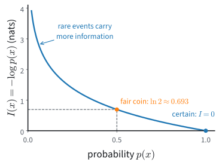

# Entropy, Cross-Entropy, and KL Divergence
:label:`sec_mdl-information_theory`

Almost every classifier in this book was trained by pushing a cross-entropy
loss down, and we have grown used to watching that number fall. We have not yet
asked what it measures, and without knowing that, a loss curve cannot be
read. Its starting value already means something. A freshly initialized
classifier with ten classes reports a loss of about $2.30$, and
:numref:`sec_mlp-implementation` used this value to check that an untrained
network is set up correctly. The value is $\ln 10$, the cost in nats of
naming one of ten labels when the model still finds all ten equally likely.
The end of the curve raises harder questions. Is a final loss of $0.6$ good?
Is a plateau a bug or a property of the data? If some of the labels are
wrong, how low can any model go?

The loss is the average of $-\log q(y)$, the model's surprise at the label
$y$ that occurred. That average splits into two parts. The first is the
average surprise of someone who knows the true distribution of the labels. It
is called the *entropy*. The data fix it, and no model can reduce it. On a
finite set of outcomes, entropy also has a concrete meaning that we use
throughout: the average number of yes/no questions needed to identify the
outcome.

The second part is the extra surprise of using the wrong distribution. It is
called the *Kullback--Leibler (KL) divergence*. It is never negative, and it is
zero only for the right model. The previous chapter has used both parts:
:numref:`subsec_mdl-nll-crossentropy` showed that the average negative
log-likelihood of a model is a cross-entropy from the empirical distribution of
the data to the model, and :numref:`subsec_mdl-max-entropy-derivation` defined
the KL divergence and proved Gibbs' inequality
:eqref:`eq_mdl-exp_family_gibbs`, that it is never negative. There the
inequality was a tool. Here it is the subject.

Three results carry the section: the decomposition :eqref:`eq_mdl-ce_decomp` of
the cross-entropy, Gibbs' inequality, and the floor
:eqref:`eq_mdl-irreducible-loss` of the classification loss. The subsections on
differential entropy and on maximum entropy can be skipped on a first reading.

The logarithm base is a choice of unit: base $2$ gives *bits*, base $e$ gives
*nats*. **We work in nats throughout**, matching deep-learning practice: the
library `log` is natural, so reported training losses are already in nats.
Base $2$ suits yes/no questions, and we say so when we use it,
writing $H_2$ for an entropy in bits. Since $\log_2 x = \ln x / \ln 2$,
converting is a fixed rescaling: $1\textrm{ bit} = \ln 2 \approx 0.693$ nats
and $1\textrm{ nat} = 1/\ln 2 \approx 1.443$ bits. Changing the base leaves
every argmin unchanged.

The chapter uses the symbols of :numref:`tab_mdl-it-notation`; each later
section restates the few it needs.

:Symbols of the information theory chapter. The binary entropy $H_b(p)$ is the entropy of a coin with heads probability $p$, a function of a number rather than of a random variable. The last six rows belong to later sections, which define them where they are first used.
:label:`tab_mdl-it-notation`

| Symbol | Meaning | Unit |
|:--|:--|:--|
| $I(x) = -\log p(x)$ | self-information (surprisal) of the outcome $x$ (by convention the letter is shared with the mutual information $I(X;Y)$) | nats |
| $H(X)$, $H(P)$ | entropy of a discrete random variable or distribution; $H_2$ in bits | nats |
| $H_b(p)$ | binary entropy of a coin with heads probability $p$ | nats |
| $h(X)$ | differential entropy of a continuous random variable | nats, depends on the units of $X$ |
| $D_{\textrm{KL}}(P \Vert Q)$ | KL divergence from $P$ to $Q$ | nats |
| $\textrm{CE}(P, Q)$ | cross-entropy from $P$ to $Q$ | nats |
| $k$ | number of classes (size of the set of outcomes) | |
| $n$ | number of examples | |
| $\mathbf{p}$, $\mathbf{q}$ | probability vectors on $k$ classes (truth, model) | |
| $\mathbf{z}$ | logits, with $\mathbf{q} = \mathrm{softmax}(\mathbf{z})$ | |
| $\epsilon$ | label-smoothing mass (in later sections, a noise variable) | |
| $\tau$ | temperature | |
| $H(X \mid Y)$, $I(X;Y)$ | conditional entropy, mutual information | nats |
| $D_f(P \Vert Q)$ | f-divergence with convex generator $f$ | |
| $T$ | critic: a function whose averages under two distributions bound a divergence | |
| $g$ | test function of an integral probability metric | |
| $\gamma$ | coupling (transport plan) of two distributions | |
| $N$ | number of candidates in a contrastive batch | |

We use the following imports throughout the section.
<!-- WRITER: the imports cell is now the canonical preamble in all four tabs, which the book hides; this sentence introduces a cell the reader does not see. -->

```{.python .input #information-theory-imports}
#@tab mxnet
import math
import numpy as np
from mxnet import autograd, gluon, init, np as mnp, npx
from mxnet.gluon import nn
from d2l import mxnet as d2l
npx.set_np()
```

```{.python .input #information-theory-imports}
#@tab pytorch
import math
import numpy as np
import torch
from torch import nn
from torch.nn import functional as F
from d2l import torch as d2l
```

```{.python .input #information-theory-imports}
#@tab tensorflow
import math
import numpy as np
import tensorflow as tf
from d2l import tensorflow as d2l
```

```{.python .input #information-theory-imports}
#@tab jax
import math
import numpy as np
import jax
from jax import numpy as jnp
from flax import nnx
import optax
from d2l import jax as d2l
```

## Information and Entropy

### Self-Information

Consider reports about a shuffled deck of cards. "I see a card" conveys
nothing, because the event is certain. "I see a heart" picks one of four
equally likely suits, "It is the three of spades" one of $52$ equally likely
cards, and the order of the whole deck one of $52!$ orderings. The less
probable an event, the more we learn by observing it. Shannon
:cite:`Shannon.1948` measured this by the *self-information* of an outcome $x$
with probability $p(x)$,

$$
I(x) = -\log p(x).
$$

The main text calls it the *surprisal* of the outcome, and we also speak simply
of its surprise. A certain event carries no information, and halving the
probability of an outcome adds $\ln 2$ nats, one bit, to its surprisal. The
first three card reports carry $0$, $\ln 4 \approx 1.39$ and $\ln 52 \approx
3.95$ nats. In bits, where one bit is the information of one fair coin flip,
they carry $0$, $2$ and $5.70$.

Why a logarithm? We want three properties: a certain event carries zero
information, rarer events carry more, and the information of two independent
events adds up. Since independent probabilities multiply, the third property
says $I(p_1 p_2) = I(p_1) + I(p_2)$, and the only decreasing functions with
this property are multiples of $-\log p$ (:citet:`Csiszar.2008`;
Exercise :exref:`ex_mdl-information-theory-show-that-self-information` gives
the argument). The choice of multiple is the choice of unit. Surprise depends
on the model that assigns the probabilities, so a confidently wrong model
finds ordinary events surprising.


:label:`fig_mdl-self-info-curve`

:numref:`fig_mdl-self-info-curve` plots the curve: decreasing, convex, zero at
$p = 1$, and diverging as $p \to 0$. The fourth card report, the order of the
deck, needs $\ln 52!$. We compute it through the log-gamma function, $\ln 52! =
\ln \Gamma(53)$, without ever forming the 68-digit number $52!$.

```{.python .input #information-theory-self-information}
deck_order = math.lgamma(53)          # ln 52! without forming 52!
print(f'the order of the deck: {deck_order:.2f} nats '
      f'= {deck_order / math.log(2):.1f} bits')
```

Naming the order of a shuffled deck carries $156$ nats, as much information as
$226$ fair coin flips.

### Entropy

How surprised should we expect to be before the outcome arrives? We average
the surprise over the outcomes. Let $X$ be a discrete random variable that
takes the value $x_i$ with probability $p_i$. Its *entropy* is the expected
self-information of its outcome,

$$
H(X) = -\mathbb{E}_{x \sim P}[\log p(x)] = -\sum_i p_i \log p_i,
$$
:eqlabel:`eq_mdl-ent_def`

with the convention $0 \log 0 = 0$, justified by continuity ($t \log t \to 0$
as $t \to 0$): an impossible outcome contributes nothing. Since the entropy
depends only on the distribution $P$ of $X$, we write $H(P)$ as well as $H(X)$.

On a finite set, entropy in bits has a concrete meaning: to within one
question, it is the average number of yes/no questions that a good
questioner needs to identify the outcome. Take the distribution $P = (\tfrac12, \tfrac14, \tfrac18,
\tfrac18)$ on four symbols $a, b, c, d$. We carry it through the section and
call it the *dyadic source*, since all its probabilities are powers of
$\tfrac12$. A good questioner first asks "Is it $a$?", which settles the
matter half the time. If not, they ask "Is it $b$?", and then "Is it $c$?",
where "no" means $d$. The expected number of questions is

$$
\tfrac12 \cdot 1 + \tfrac14 \cdot 2 + \tfrac18 \cdot 3 + \tfrac18 \cdot 3
= 1.75,
$$

and the entropy in bits is the same number,
$H_2(P) = \tfrac12 \log_2 2 + \tfrac14 \log_2 4 + 2 \cdot \tfrac18 \log_2 8
= 1.75$ bits, or $1.213$ nats. Each outcome is identified with
$\log_2(1/p_i)$ questions, its self-information in bits.

A questioner who ignores the probabilities asks "Is it $a$ or $b$?" and then
"Which of the two?", and always needs $2$ questions. A questioning strategy is
a binary code in disguise: write $1$ for yes and $0$ for no, and the answers
that identify an outcome form its codeword, here $1$, $01$, $001$ and $000$ for
$a$, $b$, $c$ and $d$. In that language :numref:`sec_mdl-coding-compression`
proves that, for every distribution on a finite set, the best strategy needs
between $H_2$ and $H_2 + 1$ questions on average.

In code, the entropy masks the zero probabilities, which implements $0 \log 0 =
0$. We use this function for the rest of the section, first on the dyadic
source.

```{.python .input #information-theory-definition}
def entropy(p):
    """Entropy of a probability vector, in nats (0 log 0 = 0 by masking)."""
    p = np.asarray(p, dtype=float)
    p = p[p > 0]
    return float(-np.dot(p, np.log(p)))

p_dyadic = np.array([1 / 2, 1 / 4, 1 / 8, 1 / 8])
h = entropy(p_dyadic)
print(f'H = {h:.3f} nats = {h / math.log(2):.2f} bits')
```

It returns the $1.75$ bits that we counted in questions.

Every term $-p_i \log p_i$ is non-negative because $0 \le p_i \le 1$, so $H(X)
\ge 0$, with equality only for a point mass, a variable whose value is certain.
The entropy also depends only on the list of probabilities, not on the values
or names of the outcomes. A variable that takes the values $1$, $100$, $10^6$,
and $10^9$ with the dyadic probabilities also has $1.75$ bits.

### Joint and Conditional Entropy
:label:`subsec_mdl-joint-conditional-entropy`

A pair $(X, Y)$ with joint mass function $p(x, y)$ is a single random variable
whose outcomes are pairs, and the entropy of the pair is the *joint entropy*
$H(X, Y) = -\mathbb{E}[\log p(X, Y)]$. The *conditional entropy* is the
surprisal left in $Y$ once $X$ is known, averaged over both,

$$
H(Y \mid X) = -\mathbb{E}[\log p(Y \mid X)] = \sum_x p(x)\, H(Y \mid X = x),
$$

where $H(Y \mid X = x)$ is the entropy of the conditional distribution $p(\cdot
\mid x)$. Since $\log p(x, y) = \log p(x) + \log p(y \mid x)$, taking
expectations gives the *chain rule*

$$
H(X, Y) = H(X) + H(Y \mid X).
$$
:eqlabel:`eq_mdl-entropy-chain-rule`

Applied repeatedly, it reads $H(X_1, \ldots, X_n) = \sum_{i=1}^n H(X_i \mid
X_1, \ldots, X_{i-1})$: the entropy of a sequence is the sum of the entropies
of its symbols, each given the symbols before it. This is the form that
:numref:`sec_mdl-coding-compression` and every language model use.

The questions game is an instance. Let $Y$ be the answer to the first question,
"Is it $a$?", about the dyadic source $X$. The answer is a fair coin, so
$H_2(Y) = 1$ bit. After "yes" nothing is left to ask. After "no" the outcome is
$b$, $c$ or $d$ with probabilities $(\tfrac12, \tfrac14, \tfrac14)$, a
distribution with $1.5$ bits, so $H_2(X \mid Y) = \tfrac12 \cdot 0 + \tfrac12
\cdot 1.5 = 0.75$ bits. Because $Y$ is a function of $X$, the pair carries no
more than $X$ alone, and the chain rule, with the roles of $X$ and $Y$
exchanged, reads $1.75 = 1 + 0.75$: the first answer supplies one bit and the
later questions the rest. :numref:`sec_mdl-mutual-information` treats both
quantities at length.

### Maximum Entropy on a Finite Set

How large can the entropy of a variable with $k$ outcomes be? We start with the
smallest case, a coin. A Bernoulli variable with heads probability $p$ has the
*binary entropy*

$$
H_b(p) = -p \log p - (1-p) \log(1-p),
$$

a function of the number $p$ rather than of a random variable.
:numref:`fig_mdl-bernoulli-entropy` plots it. The entropy is zero at
$p \in \{0, 1\}$, where the outcome is certain, and largest at the fair coin,
$H_b(\tfrac12) = \ln 2 \approx 0.693$ nats, one bit. A coin with $p = 0.1$
has $H_b(0.1) \approx 0.325$ nats, because its outcome is easy to guess.


:label:`fig_mdl-bernoulli-entropy`

The curve is concave: the chord joining any two of its points lies below it. It
peaks at the fair coin, and the same holds for any number of outcomes. If $X$
takes at most $k$ values, then

$$
H(X) \leq \log k,
$$

with equality if and only if $X$ is uniform on $k$ values. The uniform
distribution hedges the most, so it is the hardest to guess. For four outcomes
the bound is $\log_2 4 = 2$ bits, $0.25$ bits above the $1.75$ bits of the
dyadic source. We postpone the proof until Gibbs' inequality is available,
where it takes one line. That inequality compares two distributions, and so we
turn to the comparison first.

## KL Divergence and Cross-Entropy

### The Kullback--Leibler Divergence

We now want to measure how badly a model $Q$ misrepresents a truth $P$.
Information theory answers with the *Kullback--Leibler (KL) divergence*, also
called *relative entropy* :cite:`Kullback.Leibler.1951`: the average extra
surprise of someone who believes $Q$ when the outcomes are drawn from $P$. In
the questions game, the KL divergence in bits is the average number of extra
questions that a strategy designed for $Q$ needs on outcomes drawn from $P$,
up to rounding to whole questions. Let $P$ and $Q$ have mass functions (or
densities) $p$ and $q$. The KL divergence from $P$ to $Q$ is

$$
D_{\textrm{KL}}(P\|Q) = \mathbb{E}_{x \sim P} \left[ \log \frac{p(x)}{q(x)} \right].
$$
:eqlabel:`eq_mdl-kl_def`

The term inside the expectation is
$\log p(x) - \log q(x) = (-\log q(x)) - (-\log p(x))$: the surprise of the
believer in $Q$ minus the surprise of the believer in $P$. It is positive
where $Q$ underestimates the outcome ($q(x) < p(x)$) and negative where $Q$
overestimates it. KL averages this relative surprise over outcomes drawn from
the truth.

The definition is asymmetric. $P$ supplies both the samples and the numerator,
so in general $D_{\textrm{KL}}(P\|Q) \neq D_{\textrm{KL}}(Q\|P)$. Outcomes
with $p(x) = 0$ contribute nothing, by the convention $0 \log(0/q) = 0$. If
some outcome has $p(x) > 0$ but $q(x) = 0$, however, then
$D_{\textrm{KL}}(P\|Q) = +\infty$.

A small pair makes the definition concrete, and we carry it through the
section. Let $P = (0.6, 0.3, 0.1)$ be the truth and $Q = (0.2, 0.5, 0.3)$ a
model on three outcomes. Then

$$
D_{\textrm{KL}}(P\|Q)
= 0.6 \ln\frac{0.6}{0.2} + 0.3 \ln\frac{0.3}{0.5} + 0.1 \ln\frac{0.1}{0.3}
= 0.659 - 0.153 - 0.110 = 0.396 \textrm{ nats},
$$

and the reverse direction gives $D_{\textrm{KL}}(Q\|P) = 0.365$ nats. In bits
the two directions are $0.571$ and $0.527$. They differ, and the first says
that a questioner who believes $Q$ asks $0.57$ more questions per outcome than
necessary, on average over long runs of outcomes drawn from $P$.

Here is the discrete case in code, with $0 \log 0 = 0$ implemented by masking
the zero probabilities of $P$, as in `entropy`. We call it on the running pair
in both directions, and on a model $Q' = (0.5, 0.5, 0)$ that declares the third
outcome impossible.

```{.python .input #information-theory-definition-2}
def kl_divergence(p, q):
    """KL(P || Q) for two probability vectors, in nats; inf where q = 0 < p."""
    p, q = np.asarray(p, dtype=float), np.asarray(q, dtype=float)
    m = p > 0
    if np.any(q[m] == 0):
        return float('inf')
    return float(np.dot(p[m], np.log(p[m] / q[m])))

p = np.array([0.6, 0.3, 0.1])
q = np.array([0.2, 0.5, 0.3])
print(f'KL(P||Q) = {kl_divergence(p, q):.4f} nats, '
      f'KL(Q||P) = {kl_divergence(q, p):.4f} nats')
print(f"KL(P||Q') = {kl_divergence(p, [0.5, 0.5, 0.0])}")
```

The second line is the one to remember. The model $Q'$ gives zero probability
to an outcome that occurs one time in ten, and its divergence is infinite: a
model that declares an event impossible is infinitely surprised when it
happens.

### Gibbs' Inequality

Can the extra surprise be negative? That would mean a wrong model is less
surprised, on average, than the truth itself. Gibbs' inequality
:cite:`Gibbs.1902` says that it cannot: no model beats the truth on average.
Everything that follows rests on it, so we prove it in full, as a statement
about averaging a concave function. For a concave function $f$ and a random
variable $X$ with finite mean, *Jensen's inequality* states that

$$
\mathbb{E}[f(X)] \le f(\mathbb{E}[X]).
$$

Averaging first and applying $f$ second gives the larger value. For an $X$ with
two values, this is the chord below the curve of
:numref:`fig_mdl-bernoulli-entropy`. For strictly concave $f$, equality holds
only when $X$ is constant with probability one. :numref:`subsec_mdl-jensen`
proves the general case.

**Proposition (Gibbs' inequality).** *For any distributions $P$ and $Q$ on
the same space,*

$$
D_{\textrm{KL}}(P\|Q) \geq 0,
$$

*with equality if and only if $P = Q$.*

**Proof.** If $q(x) = 0$ for some $x$ with $p(x) > 0$, the divergence is
$+\infty$ and there is nothing to prove, so assume otherwise. Jensen's
inequality for the convex function $-\log$ reads
$\mathbb{E}[-\log Z] \ge -\log \mathbb{E}[Z]$, and with
$Z = q(x)/p(x)$ it gives

$$
\begin{aligned}
D_{\textrm{KL}}(P\|Q)
&= \mathbb{E}_{x\sim P}\!\left[-\log\frac{q(x)}{p(x)}\right]
\geq -\log \mathbb{E}_{x\sim P}\!\left[\frac{q(x)}{p(x)}\right] \\
&= -\log \!\!\sum_{x\,:\,p(x)>0}\!\! q(x)
= -\log Q(\textrm{supp}\,P)
\geq 0.
\end{aligned}
$$

Everything happens in the second line. The expectation runs over the support of
$P$, the factors $p(x)$ cancel, and what remains is the $Q$-mass of that
support, a number at most $1$, whose negative logarithm is non-negative. For
densities, the same computation runs with integrals. For equality, both
inequalities must be tight. Because $-\log$ is strictly convex, the first is an
equality only when $q(x)/p(x)$ equals a constant $c$ for $P$-almost every $x$,
and the second requires $Q(\textrm{supp}\,P) = 1$. Summing (or integrating) $q
= c\,p$ over the support of $P$ then gives $c = 1$, so $q = p$, almost
everywhere in the case of densities. $\blacksquare$

For the concave logarithm, the log of an average is at least the average of the
logs, with equality only when there is nothing to average. A model incurs no
extra surprise only when it is right. Exercise
:exref:`ex_mdl-information-theory-gibbs-tangent` compares this proof with the
tangent-line proof.

The inequality settles the uniform bound that we left unproved. For a
distribution $P$ on $k$ outcomes and the uniform distribution $U$ on the same
outcomes, $D_{\textrm{KL}}(P\|U) = \sum_i p_i \log(k\,p_i) = \log k - H(P)$,
which is non-negative and zero only for $P = U$. It also shows that
conditioning cannot increase entropy: $H(Y) - H(Y \mid X) =
D_{\textrm{KL}}(p_{X,Y} \,\|\, p_X\, p_Y) \ge 0$, with equality only when $X$
and $Y$ are independent. This holds on average; a particular observation $X =
x$ can leave $Y$ more uncertain than before.

### Cross-Entropy

Classifiers are trained with a close relative of the KL divergence. The
*cross-entropy* from $P$ to $Q$ is the average surprise of the
believer in $Q$ on outcomes drawn from $P$,

$$
\textrm{CE}(P, Q) = -\mathbb{E}_{x \sim P} [\log q(x)].
$$
:eqlabel:`eq_mdl-ce_def`

Adding and subtracting $\log p(x)$ inside the expectation, which is
legitimate whenever $H(P)$ is finite, splits the model's surprise into the
truth's own surprise plus the relative surprise:

$$
\textrm{CE}(P, Q) = H(P) + D_{\textrm{KL}}(P\|Q).
$$
:eqlabel:`eq_mdl-ce_decomp`

The cross-entropy is an entropy floor plus a never-negative excess: by Gibbs'
inequality, $\textrm{CE}(P,Q) \ge H(P)$ with equality if and only if $Q = P$.
Since $H(P)$ does not depend on $Q$, minimizing cross-entropy in $Q$ is
minimizing KL. For the running pair, $\textrm{CE}(P, Q) = -(0.6 \ln 0.2 + 0.3
\ln 0.5 + 0.1 \ln 0.3) = 1.294$ nats and $H(P) = 0.898$ nats; their difference,
$0.396$ nats, is the KL divergence computed above.

:numref:`fig_mdl-code-length-bars` draws the decomposition in the questions
game, for the dyadic source and the uniform model $U = (\tfrac14, \tfrac14,
\tfrac14, \tfrac14)$. Asking adaptively takes $H_2(P) = 1.75$ questions on
average. The two fixed questions of the uniform questioner take
$\textrm{CE}_2(P, U) = 2$, and the difference, $D_{\textrm{KL}}(P\|U) = 0.25$
bits, is the waste. For this pair the reverse divergence $D_{\textrm{KL}}(U\|P)$
also happens to be $0.25$ bits, which is why we showed the asymmetry of KL on
the other pair.


:label:`fig_mdl-code-length-bars`

For discrete data, the average negative log-likelihood of a model
$q_{\boldsymbol\theta}$ is the cross-entropy from the empirical distribution
$\hat p_{\textrm{data}}$ to the model (:numref:`subsec_mdl-nll-crossentropy`),
so maximum likelihood minimizes $D_{\textrm{KL}}(\hat
p_{\textrm{data}}\|q_{\boldsymbol\theta})$.

## The Classification Loss

### Cross-Entropy Loss from Logits

In a $k$-class classification problem, the truth for one example is the
one-hot distribution that puts all its mass on the correct label $y$, and the
model supplies a predicted distribution $\mathbf{q} = (q_1, \ldots, q_k)$.
The cross-entropy :eqref:`eq_mdl-ce_def` between them collapses to a single
term, $-\log q_y$, the model's surprise at the correct class. Averaged over
$n$ examples with labels $y_i$ and predictions $\mathbf{q}_i$, the
*cross-entropy loss* is

$$
\textrm{CE} = -\frac{1}{n} \sum_{i=1}^n \log q_{i, y_i},
$$

in nats, the quantity a built-in classification loss computes. A built-in
loss does not take probabilities. It takes the *logits* $\mathbf{z}$, the
unnormalized scores whose softmax is $\mathbf{q}$, and applies a stable
log-softmax itself, for the reasons given in
:numref:`subsec_softmax-implementation-revisited`
(:numref:`subsec_mdl-stable-softmax` derives the stable form).
<!-- WRITER: the cells cross_entropy (formal-definition-1/-2, the toy 0.949) and the four-tab built-in-loss cell are cut; their narration sentences were removed here. Make this subsection the one logits paragraph at the head of "The Classification Loss" (worklist B5). -->

### The Irreducible Loss
:label:`subsec_mdl-irreducible-loss`

One question of the opening is still unanswered: how low can the loss go when
some labels are wrong? In real data the label is not a function of the input:
the same image can carry different labels, from ambiguity or from annotation
errors.

Let the input $\mathbf{x}$ and the label $y \in \{1, \ldots, k\}$ have a
joint distribution, let $p(\cdot \mid \mathbf{x})$ be the true conditional
distribution of the label, and let $q(\cdot \mid \mathbf{x})$ be any model's.

**Proposition (the irreducible classification loss).** *The population
cross-entropy loss of any model satisfies*

$$
\mathbb{E}_{(\mathbf{x}, y)}\big[-\log q(y \mid \mathbf{x})\big]
= \mathbb{E}_{\mathbf{x}}\big[H(p(\cdot \mid \mathbf{x}))\big]
+ \mathbb{E}_{\mathbf{x}}\big[D_{\textrm{KL}}\big(p(\cdot \mid \mathbf{x}) \,\|\, q(\cdot \mid \mathbf{x})\big)\big]
\ge \mathbb{E}_{\mathbf{x}}\big[H(p(\cdot \mid \mathbf{x}))\big],
$$
:eqlabel:`eq_mdl-irreducible-loss`

*with equality if and only if $q(\cdot \mid \mathbf{x}) = p(\cdot \mid
\mathbf{x})$ for almost every $\mathbf{x}$ (with respect to the distribution
of the inputs).*

**Proof.** Condition on $\mathbf{x}$. The inner expectation over $y$ is the
cross-entropy $\textrm{CE}(p(\cdot \mid \mathbf{x}), q(\cdot \mid
\mathbf{x}))$, and the decomposition :eqref:`eq_mdl-ce_decomp` applies at each
$\mathbf{x}$; the entropies are finite, at most $\log k$. Averaging over
$\mathbf{x}$ gives the identity. Gibbs' inequality makes every KL term
non-negative, and an average of non-negative terms is zero only when almost
all of them vanish. $\blacksquare$

The floor is the conditional entropy of the label given the input
(:numref:`subsec_mdl-joint-conditional-entropy`). It is a property of the data:
no architecture, data volume, or training time lowers it. Of the results of
this section, it is the one to have in mind when reading a loss curve. Three
cases show what it means.

* A model that predicts the uniform distribution has cross-entropy $\ln k$ at
  every input, whatever the labels are: the $2.30$ of the opening for $k = 10$.
* If the label is a function of the input, every $H(p(\cdot \mid \mathbf{x}))$
  is zero, and a perfect model reports $0$.
* Under symmetric label noise, the clean class is determined by the input,
  and the observed label is the clean class with probability $1 - \rho$ and
  each of the other $k - 1$ classes with probability $\rho/(k-1)$. Then
  $H = -(1-\rho)\log(1-\rho) - \rho\log\tfrac{\rho}{k-1} = H_b(\rho) + \rho\log(k-1)$
  at every input, which for $\rho = 0.1$ and $k = 10$ is
  $0.325 + 0.220 = 0.545$ nats. As long as $1 - \rho > \rho/(k-1)$, the best
  prediction of the class is the clean one, so the best accuracy is
  $1 - \rho$, here $90\%$.

Before running the next cell, guess the loss of a predictor that puts $0.99$ on
the clean class in the noisy case. It is right nine times in ten, and nearly
certain each time. The cell compares it with the uniform predictor and with the
Bayes predictor $q = p$.

```{.python .input #mdl-information-theory-the-irreducible-loss}
k, rho = 10, 0.1
p_noisy = np.array([1 - rho] + [rho / (k - 1)] * (k - 1))  # clean class first
predictors = {'uniform': np.full(k, 1 / k),
              'confident 0.99': np.array([0.99] + [0.01 / (k - 1)] * (k - 1)),
              'Bayes q = p': p_noisy}
print(f'floor = H(p) = {entropy(p_noisy):.3f} nats')
for name, q_hat in predictors.items():
    ce = float(-np.dot(p_noisy, np.log(q_hat)))
    print(f'{name:15s} CE = {ce:.3f} nats')
```

The confident predictor reports $0.689$, well above the floor: every flipped
label surprises it, and its confidence costs more on the tenth of the labels
that are flipped than it saves on the rest. Only the Bayes predictor reaches
the floor. A validation loss below the floor on such data cannot come from a
better model; Exercise :exref:`ex_mdl-information-theory-label-noise-floor`
asks what it signals instead.

### Proper Scoring Rules

The cross-entropy loss also has a decision-theoretic justification. A *scoring
rule* assigns a penalty $S(\mathbf{q}, y)$ for having reported the probability
vector $\mathbf{q}$ when class $y$ then occurs. The rule is *proper* if
truthful reporting is optimal: when the labels follow $\mathbf{p}$, the
expected penalty $\mathbb{E}_{y \sim \mathbf{p}}[S(\mathbf{q}, y)]$ is
minimized by reporting $\mathbf{q} = \mathbf{p}$. It is *strictly proper* if
this report is the unique optimum. The cross-entropy loss is the *log score*
$S(\mathbf{q}, y) = -\log q_y$, and it is strictly proper, since its expected
penalty is the cross-entropy $\textrm{CE}(\mathbf{p}, \mathbf{q})$, which is
smallest only at $\mathbf{q} = \mathbf{p}$.

At the population optimum over a model class that contains the truth, the
predicted probabilities are therefore the true conditional probabilities. In
particular they are *calibrated*: among the inputs that receive probability
$0.8$ for a class, that class occurs $80\%$ of the time. A finite sample or a
restricted model class can still leave a trained model miscalibrated.

Other strictly proper rules exist. The *Brier score*
$S(\mathbf{q}, y) = \sum_j (q_j - \mathbf{1}(j = y))^2$ is strictly proper
too, with a bounded penalty on confident errors where the log score's
penalty diverges :cite:`Gneiting.Raftery.2007`. Exercise
:exref:`ex_mdl-information-theory-scoring-rule-is-strictly` computes its
excess penalty and tests an improper rule.

## Label Smoothing and Distillation

Label smoothing and knowledge distillation both train against a target other
than the one-hot label. In both, the optimum is the target itself, by
:eqref:`eq_mdl-ce_decomp`. What remains to ask is what the softened target
demands of the logits and, in distillation, how the loss should be scaled.

### Label Smoothing

A classifier trained on one-hot targets is asked to assign probability $1$ to
the true class, which a softmax can approach only by driving the true class's
logit infinitely far above the rest. The result is overconfident models and
ever-growing weights. *Label smoothing* :cite:`Szegedy.Vanhoucke.Ioffe.ea.2016`
replaces the one-hot target $\mathbf{e}_y$ by a mixture with a fraction
$\epsilon$ of the uniform distribution over all $k$ classes,

$$
\mathbf{p}^\epsilon = (1 - \epsilon)\, \mathbf{e}_y + \frac{\epsilon}{k}\, \mathbf{1}.
$$
:eqlabel:`eq_mdl-label-smoothing-target`

The true class gets target probability $1 - \epsilon + \epsilon/k$ and each
other class $\epsilon/k$. The training loss is the ordinary cross-entropy
$\textrm{CE}(\mathbf{p}^\epsilon, \mathbf{q})$ to this softened target.
:numref:`sec_training_recipes` writes the same loss as $-(1-\epsilon)\log q_y -
\tfrac{\epsilon}{K}\sum_j \log q_j$, with $K$ for our $k$. It is smallest at
$\mathbf{q} = \mathbf{p}^\epsilon$, where it equals $H(\mathbf{p}^\epsilon)$,
and two things have changed relative to one-hot targets. First, the optimum is
no longer at infinity. A softmax reaches $1 - \epsilon + \epsilon/k$ on the
true class with the finite logit gap

$$
z_y - z_j = \log\frac{1 - \epsilon + \epsilon/k}{\epsilon/k}
= \log\!\Big(1 + \frac{k(1-\epsilon)}{\epsilon}\Big)
$$

between the true class and each other class. For $k = 10$ classes and $\epsilon
= 0.1$, the gap is $\ln 91 \approx 4.51$. Second, the loss at the optimum is
not zero, so a label-smoothed loss curve levels off above zero even when the
model predicts the softened target exactly. The next cell prints both numbers
and, for contrast, the loss of an overconfident prediction with logit gap $10$.
<!-- WRITER: the cell is now a run: gradient descent (step size 1, gradient q - p_eps) on the logits of one example, k = 10, zero start, eps in {0, 0.1}, printing the logit gap and the loss after 10, 100, 1,000, 10,000 steps, then the optimum. It no longer evaluates an overconfident prediction (the 0.900 nats below is no longer printed). -->

```{.python .input #information-theory-label-smoothing}
k, checkpoints = 10, (10, 100, 1000, 10000)
for eps in (0.0, 0.1):
    p_eps = np.full(k, eps / k)
    p_eps[0] += 1 - eps                   # the true class first
    z = np.zeros(k)                       # the logits of one example
    for step in range(1, checkpoints[-1] + 1):
        q = np.exp(z - z.max())
        z -= q / q.sum() - p_eps          # gradient step, step size 1
        if step in checkpoints:
            log_q = z - z.max() - np.log(np.exp(z - z.max()).sum())
            print(f'eps = {eps}  step {step:5d}  gap = {z[0] - z[1]:5.2f}  '
                  f'loss = {-p_eps @ log_q:.4f}')
print(f'optimum for eps = 0.1: gap = ln 91 = {math.log(91):.2f}, '
      f'loss = H(p_eps) = {entropy(p_eps):.4f}')
```

<!-- WRITER: measured, identical in all four tabs (NumPy, deterministic): eps = 0: gap 4.29, 6.87, 9.21, 11.51 after 10, 100, 1,000, 10,000 steps (grows by ln 10 = 2.3 per decade, like the log of the step count), loss 0.1158, 0.0093, 0.0009, 0.0001; eps = 0.1: gap 3.81 after 10 steps, then 4.51 = ln 91 from step 100 on, loss 0.5243, then 0.5003 = H(p_eps). The 0.900-nat overconfident reading below is gone (worklist B6). -->

The floor is $0.500$ nats. The overconfident prediction, which one-hot targets
would score as nearly perfect, has loss $0.900$ nats: label smoothing penalizes
the behavior that one-hot targets demand. Exercise
:exref:`ex_mdl-information-theory-label-smoothing` asks what smoothing does to
the logits of the wrong classes, and why teachers trained with it distill
poorly.

### Knowledge Distillation
:label:`subsec_mdl-distillation`

*Knowledge distillation* :cite:`Hinton.Vinyals.Dean.2015` trains a small
*student* network to imitate a large *teacher*. The student learns the
teacher's whole distribution over the classes, not only its most probable
class. That a "2" looks somewhat like a "7" is information a one-hot label
does not carry. A trained teacher's softmax is nearly one-hot, so both
distributions are first *softened*: the logits are divided by a
*temperature* $\tau > 0$ before the softmax,

$$
p_j^{(\tau)} = \mathrm{softmax}(\mathbf{z}^{\textrm{tea}}/\tau)_j, \qquad
q_j^{(\tau)} = \mathrm{softmax}(\mathbf{z}^{\textrm{stu}}/\tau)_j.
$$

A temperature above one shrinks the gaps between logits and moves
probability toward the wrong classes. The distillation loss is the KL divergence between the softened distributions,
scaled by $\tau^2$:

$$
\mathcal{L}_{\textrm{distill}}
= \tau^2\, D_{\textrm{KL}}\big(\mathbf{p}^{(\tau)} \,\|\, \mathbf{q}^{(\tau)}\big).
$$
:eqlabel:`eq_mdl-distill-loss`

The loss is zero only when the student matches the softened teacher
(:numref:`sec_lm_distillation` returns to its use). The factor $\tau^2$ needs
an explanation. Differentiate the KL term with respect to a student logit. Only
$-\sum_j p_j^{(\tau)} \log q_j^{(\tau)}$ depends on the student, and the
derivative of a log-softmax at temperature $\tau$ is the usual
softmax-minus-target expression scaled by $1/\tau$:

$$
\frac{\partial}{\partial z^{\textrm{stu}}_j}
D_{\textrm{KL}}\big(\mathbf{p}^{(\tau)} \| \mathbf{q}^{(\tau)}\big)
= \frac{1}{\tau}\big(q_j^{(\tau)} - p_j^{(\tau)}\big).
$$

Each student logit is pushed by the gap between the two softened
probabilities of its class, divided by $\tau$.

For large $\tau$ the softened distributions flatten toward uniform. Subtract
the mean logit $\bar z$, which leaves the softmax unchanged, and expand
$e^{(z_j - \bar z)/\tau} \approx 1 + (z_j - \bar z)/\tau$ to first order. The
denominator becomes $k$ because the deviations sum to zero, so
$\mathrm{softmax}(\mathbf{z}/\tau)_j \approx \tfrac{1}{k}\big(1 + (z_j - \bar
z)/\tau\big)$. The difference $q_j^{(\tau)} - p_j^{(\tau)}$ therefore shrinks
like $1/\tau$, and the gradient like $1/\tau^2$:

$$
\frac{1}{\tau}\big(q_j^{(\tau)} - p_j^{(\tau)}\big)
\;\approx\; \frac{1}{k\,\tau^2}\Big(\big(z^{\textrm{stu}}_j - \bar z^{\textrm{stu}}\big)
- \big(z^{\textrm{tea}}_j - \bar z^{\textrm{tea}}\big)\Big).
$$

Multiplying the loss by $\tau^2$ therefore keeps the size of the gradient
roughly constant as the temperature is tuned. The temperature can then be
chosen for the quality of the soft targets without changing the loss's weight
relative to any hard-label loss it is mixed with. The next cell
checks both claims for teacher logits $(5, 2, -1)$ and student logits
$(3, 3, 0)$: the closed-form gradient matches autograd, and $\tau^2$ times the
gradient approaches the limit above instead of vanishing.

```{.python .input #information-theory-distillation}
#@tab mxnet
z_tea = mnp.array([5.0, 2.0, -1.0])
z_stu = mnp.array([3.0, 3.0, 0.0])
z_stu.attach_grad()                   # every backward() overwrites the grad
print(' tau  |grad|  |tau^2 grad|  tau^2 grad')
for tau in (1.0, 2.0, 5.0, 10.0, 20.0):
    with autograd.record():
        p_tau = npx.softmax(z_tea / tau)
        kl = (p_tau * (mnp.log(p_tau) - npx.log_softmax(z_stu / tau))).sum()
    kl.backward()
    g = z_stu.grad.asnumpy()
    print(f'{tau:4.0f}  {np.linalg.norm(g):.4f}  '
          f'{np.linalg.norm(tau**2 * g):12.3f}  {np.round(tau**2 * g, 3)}')
limit = (z_stu - z_stu.mean()) - (z_tea - z_tea.mean())
limit = limit.asnumpy() / len(limit)
print(f'limit {"":6s}  {np.linalg.norm(limit):12.3f}  {np.round(limit, 3)}')
```

```{.python .input #information-theory-distillation}
#@tab pytorch
z_tea = torch.tensor([5.0, 2.0, -1.0])
z_stu = torch.tensor([3.0, 3.0, 0.0], requires_grad=True)
print(' tau  |grad|  |tau^2 grad|  tau^2 grad')
for tau in (1.0, 2.0, 5.0, 10.0, 20.0):
    p_tau = torch.softmax(z_tea / tau, 0)
    kl = (p_tau * (torch.log(p_tau) - torch.log_softmax(z_stu / tau, 0))).sum()
    g = torch.autograd.grad(kl, z_stu)[0].numpy()
    print(f'{tau:4.0f}  {np.linalg.norm(g):.4f}  '
          f'{np.linalg.norm(tau**2 * g):12.3f}  {np.round(tau**2 * g, 3)}')
limit = (z_stu - z_stu.mean()) - (z_tea - z_tea.mean())
limit = limit.detach().numpy() / len(limit)
print(f'limit {"":6s}  {np.linalg.norm(limit):12.3f}  {np.round(limit, 3)}')
```

```{.python .input #information-theory-distillation}
#@tab tensorflow
z_tea = tf.constant([5.0, 2.0, -1.0])
z_stu = tf.Variable([3.0, 3.0, 0.0])
print(' tau  |grad|  |tau^2 grad|  tau^2 grad')
for tau in (1.0, 2.0, 5.0, 10.0, 20.0):
    with tf.GradientTape() as tape:
        p_tau = tf.nn.softmax(z_tea / tau)
        kl = tf.reduce_sum(
            p_tau * (tf.math.log(p_tau) - tf.nn.log_softmax(z_stu / tau)))
    g = tape.gradient(kl, z_stu).numpy()
    print(f'{tau:4.0f}  {np.linalg.norm(g):.4f}  '
          f'{np.linalg.norm(tau**2 * g):12.3f}  {np.round(tau**2 * g, 3)}')
limit = (z_stu - tf.reduce_mean(z_stu)) - (z_tea - tf.reduce_mean(z_tea))
limit = limit.numpy() / len(limit)
print(f'limit {"":6s}  {np.linalg.norm(limit):12.3f}  {np.round(limit, 3)}')
```

```{.python .input #information-theory-distillation}
#@tab jax
z_tea = jnp.array([5.0, 2.0, -1.0])
z_stu = jnp.array([3.0, 3.0, 0.0])

def distill_kl(z_stu, z_tea, tau):
    p_tau = jax.nn.softmax(z_tea / tau)
    return (p_tau * (jnp.log(p_tau) - jax.nn.log_softmax(z_stu / tau))).sum()

print(' tau  |grad|  |tau^2 grad|  tau^2 grad')
for tau in (1.0, 2.0, 5.0, 10.0, 20.0):
    g = np.asarray(jax.grad(distill_kl)(z_stu, z_tea, tau))
    print(f'{tau:4.0f}  {np.linalg.norm(g):.4f}  '
          f'{np.linalg.norm(tau**2 * g):12.3f}  {np.round(tau**2 * g, 3)}')
limit = (z_stu - z_stu.mean()) - (z_tea - z_tea.mean())
limit = np.asarray(limit) / len(limit)
print(f'limit {"":6s}  {np.linalg.norm(limit):12.3f}  {np.round(limit, 3)}')
```

<!-- WRITER: the cell no longer compares autograd with the closed form (the check could not fail: 0 to 6e-8 in all tabs); "The next cell checks both claims ... the closed-form gradient matches autograd" above and "The closed form matches autograd to floating-point precision" below are now false. It prints per temperature (1, 2, 5, 10, 20) the norm of the unscaled gradient, the norm of the tau^2-scaled gradient and the scaled vector, and a last row with the limit. Measured, identical to 3 decimals in all four tabs: unscaled norm 0.6391, 0.2190, 0.0368, 0.0088, 0.0021 for tau = 1, 2, 5, 10, 20 (it falls like 1/tau^2: 0.64 to 0.0021, three hundred times smaller at tau = 20); scaled norm 0.639, 0.876, 0.920, 0.884, 0.854, approaching the limit 0.816; scaled vector at tau = 5 (-0.741, 0.478, 0.263) overshoots the limit -0.667 in the first component, tau = 10 (-0.719, 0.413, 0.306), tau = 20 (-0.697, 0.374, 0.322); limit row (-0.667, 0.333, 0.333). Replace "the unscaled gradient is the printed row divided by tau^2, a hundred times smaller" by a reading of the printed norms (worklist B7). -->

The closed form matches autograd to floating-point precision at every
temperature, and the $\tau^2$-scaled gradient stays of order one (the unscaled
gradient is the printed row divided by $\tau^2$, a hundred times smaller at
$\tau = 10$). Its limit as $\tau \to \infty$ is
$\tfrac{1}{k}\big((\mathbf{z}^{\textrm{stu}} - \bar z^{\textrm{stu}}) -
(\mathbf{z}^{\textrm{tea}} - \bar z^{\textrm{tea}})\big) = (-0.667, 0.333,
0.333)$ here. The convergence is $O(1/\tau)$ and still incomplete in the table:
the $\tau = 10$ row reads $(-0.719, 0.413, 0.306)$, and the first component
overshoots its limit on the way. At $\tau = 1$ the loss is the ordinary KL
divergence, and with a one-hot teacher, which has zero entropy, it is the
ordinary cross-entropy loss, so standard training is a special case.

## Entropy and KL Divergence for Densities
<!-- WRITER: this group (differential entropy, KL between Gaussians, maximum entropy and the Gaussian, with cells example-1 and example-2) was moved here verbatim from the end of "KL Divergence and Cross-Entropy" (structure.md order, group 4); add its lead, and connect the closing paragraph below to the narrow model's 1.05 nats in the tails (worklist B2-B3). -->

### Differential Entropy
:label:`subsec_mdl-differential-entropy`

For a continuous random variable $X$ with density $p$, the sum in the entropy
becomes an integral. The result is called the *differential entropy*,

$$
h(X) = -\int p(x) \log p(x) \,dx.
$$
:eqlabel:`eq_mdl-diff-ent-def`

It is the average surprise of a density value, and density values are not
probabilities: they carry the units of $1/x$, and they can exceed one. We
write a lowercase $h$ to keep it apart from the discrete $H$, because the two
behave differently.

The smallest case shows how. The uniform density on $[0, a]$ equals $1/a$
there, so $h = -\int_0^a \tfrac1a \log \tfrac1a \,dx = \log a$. For
$a = \tfrac12$ this is $-\ln 2 \approx -0.693$ nats, a negative entropy, which
no discrete distribution can have. Measuring the same variable in centimetres
instead of metres multiplies $a$ by $100$ and adds $\ln 100 \approx 4.61$
nats, although the uncertainty has not changed.

A shift of this kind occurs under any smooth change of variables. If $y = g(x)$
is invertible with Jacobian $\partial g/\partial x$, the density of $Y$ at
$g(x)$ is $p_X(x)/|\det \partial g/\partial x|$, and so

$$
h(Y) = h(X) + \mathbb{E}\big[\log\lvert\det \partial g/\partial x\rvert\big].
$$

Stretching a variable raises its differential entropy, and squeezing it lowers
the entropy without limit. A Gaussian with standard deviation $\sigma$ has $h =
\tfrac12 \log(2\pi e \sigma^2)$, as we compute in
:numref:`subsec_mdl-gaussian-max-entropy`, which is negative once $\sigma <
(2\pi e)^{-1/2} \approx 0.24$.

The KL divergence does not share this defect. Transport a model density $q$
along with the data: both densities are divided by the same factor, which
cancels in the ratio $p/q$, so the KL divergence does not change. For two
uniform densities $p_1$ on $[0, a_1]$ and $p_2$ on $[0, a_2]$ with $a_1 \le
a_2$, for instance, it is $\int p_1 \log(p_1/p_2)\,dx = \log(a_2/a_1)$, which
for $a_1 = \tfrac12$ and $a_2 = 1$ is $\ln 2 \approx 0.693$ nats in metres and
in centimetres alike. The cross-entropy $-\mathbb{E}_P[\log q]$, on which a
continuous model is trained, shifts by the same constant as $h$. The constant
does not depend on the model, so the gradients and the minimizer of the
cross-entropy are unchanged. When $h(p)$ is finite, the decomposition
:eqref:`eq_mdl-ce_decomp` holds with $h$ in place of $H$, and maximum
likelihood for densities minimizes $D_{\textrm{KL}}(p\|q_{\boldsymbol\theta})$
at the population level.

Differential entropy is not the limit of discrete entropy. Divide the line
into cells of width $\Delta$, and let $X_\Delta$ record which cell contains
$X$. Then $P(X_\Delta = i) \approx p(x_i) \Delta$ for a point $x_i$ in cell
$i$, and

$$
H(X_\Delta) + \log \Delta \to h(X) \quad \textrm{as } \Delta \to 0
$$

for densities regular enough that the sums converge to the integrals (for
example, when $p$ is continuous and $p$ and $p \log p$ are Riemann-integrable).
The discrete entropy itself grows like $\log(1/\Delta)$, since a finer grid
takes more questions, and $h$ is what remains after that growth is subtracted.
For the uniform density on $[0, 1]$ with $\Delta = \tfrac18$, the eight cells
are equally likely, $H_2(X_\Delta) = 3$ bits and $\log_2 \Delta = -3$, which
sum to $0 = h$. Exercise :exref:`ex_mdl-information-theory-quantized-entropy`
proves the limit and checks it on a Gaussian.

### KL Divergence Between Gaussians

Gaussians are the continuous distributions we meet most often, and
comparing two of them is a common task. A variational autoencoder, for
instance, penalizes the KL divergence between the Gaussian distribution of
its code and a standard normal prior. For two univariate Gaussians the KL
divergence has a closed form. For
$P = \mathcal{N}(\mu_1, \sigma_1^2)$ and $Q = \mathcal{N}(\mu_2, \sigma_2^2)$,

$$
D_{\textrm{KL}}\!\left(\mathcal{N}(\mu_1,\sigma_1^2) \,\big\|\, \mathcal{N}(\mu_2,\sigma_2^2)\right)
= \log\frac{\sigma_2}{\sigma_1} + \frac{\sigma_1^2 + (\mu_1 - \mu_2)^2}{2\sigma_2^2} - \frac{1}{2}.
$$
:eqlabel:`eq_mdl-gaussian_kl`

The divergence is a log ratio of standard deviations plus the variance and the
squared mean gap of $P$, both measured in units of the model's variance. It is
non-negative and zero only when $\mu_1 = \mu_2$ and $\sigma_1 = \sigma_2$, as
Gibbs' inequality requires. It is not symmetric, because $\sigma_1$ and
$\sigma_2$ enter differently. Exercise
:exref:`ex_mdl-information-theory-gaussian-kl` derives the formula from the
definition.

The smallest case is a unit mean shift with equal variances, $P =
\mathcal{N}(0, 1)$ and $Q = \mathcal{N}(1, 1)$, where the formula gives
$(\mu_1 - \mu_2)^2/(2\sigma^2) = \tfrac12$ nat. The definition suggests a
second way to compute it: draw samples from $P$ and average $\log p(x) - \log
q(x)$. Such sample averages are how a KL divergence is estimated when no
closed form exists (:numref:`sec_mdl-mi-estimation`), so their accuracy is
worth seeing once. The next cell defines the closed form and the Monte Carlo
estimate.

```{.python .input #information-theory-example-1}
def gaussian_kl(mu1, sigma1, mu2, sigma2):
    """Closed-form KL(N(mu1, sigma1^2) || N(mu2, sigma2^2)), in nats."""
    return (math.log(sigma2 / sigma1)
            + (sigma1 ** 2 + (mu1 - mu2) ** 2) / (2 * sigma2 ** 2)
            - 0.5)

def gaussian_log_pdf(x, mu, sigma):
    """Log-density of N(mu, sigma^2) at x."""
    return (-0.5 * math.log(2 * math.pi * sigma ** 2)
            - (x - mu) ** 2 / (2 * sigma ** 2))

def mc_kl(mu1, sigma1, mu2, sigma2, n=200000):
    """Monte Carlo estimate of the same KL from n samples x ~ P, with its
    standard error."""
    x = np.random.default_rng().normal(loc=mu1, scale=sigma1, size=n)
    r = gaussian_log_pdf(x, mu1, sigma1) - gaussian_log_pdf(x, mu2, sigma2)
    return float(r.mean()), float(r.std() / math.sqrt(n))
```

We run both on the unit mean shift. How far from $\tfrac12$ should an average
of $2 \cdot 10^5$ samples land?
<!-- WRITER: cell information-theory-example-2 moved below the N(0,4) paragraph and now prints one table (closed form, estimate, standard error) for all three pairs; the questions here and in the next paragraph no longer sit directly before a cell. The SE 0.0022 quoted next is now printed. -->

For this pair $\log p(x) - \log q(x) = \tfrac12 - x$ has variance one, so the
average of $2 \cdot 10^5$ samples has standard error $0.0022$. The estimate
usually falls within about $\pm 0.005$ (two standard errors) of $\tfrac12$ and
almost never beyond $\pm 0.01$.

Now let the variances differ: $P = \mathcal{N}(0,1)$ and $Q =
\mathcal{N}(0,4)$, so $\sigma_2 = 2$. Which direction gives the larger
divergence?

```{.python .input #information-theory-example-2}
pairs = {'N(0,1) || N(1,1)': (0.0, 1.0, 1.0, 1.0),
         'N(0,1) || N(0,4)': (0.0, 1.0, 0.0, 2.0),
         'N(0,4) || N(0,1)': (0.0, 2.0, 0.0, 1.0)}
print(f'{"P || Q":18s} {"closed":>7s} {"sampled":>8s} {"std err":>8s}')
for name, args in pairs.items():
    estimate, std_err = mc_kl(*args)
    print(f'{name:18s} {gaussian_kl(*args):7.4f} {estimate:8.4f} {std_err:8.4f}')
```

<!-- WRITER: measured (pytorch/tf/jax/mxnet dev runs, unseeded, n = 2e5): closed forms 0.5000 / 0.3181 / 0.8069; standard errors 0.0022 (mean shift), 0.0012 (N(0,1)||N(0,4)), 0.0047-0.0048 (N(0,4)||N(0,1)); estimates fall within about 2 SE of the closed form. The reverse direction, whose integrand lives in the tails, is four times noisier than the forward one (0.0047 vs 0.0012), about twice the mean shift. Replace "usually within about +-0.005 ... almost never beyond +-0.01" by a reading of the printed SEs (worklist B8). -->

The formula gives $D_{\textrm{KL}}(P\|Q) = \ln 2 + \tfrac18 - \tfrac12 \approx
0.318$ and $D_{\textrm{KL}}(Q\|P) = -\ln 2 + 2 - \tfrac12 \approx 0.807$ nats,
a factor of $2.5$ apart. :numref:`fig_mdl-kl-integrand` shows where each number
comes from. In both directions the integrand changes sign at $|x| = (8 \ln
2/3)^{1/2} \approx 1.36$, where the two densities cross. In panel (a) the wide
model explains narrow data. It is too surprised in the core $|x| < 1.36$, which
contributes $+0.424$, and less surprised than the truth in the tails, which
contribute $-0.106$. In panel (b) the narrow model has to explain wide data.
The core contributes $-0.240$, and the tails, where the narrow model gives
almost no probability to outcomes that occur, contribute $+1.046$. What this
asymmetry does to a model that is fitted in one direction or the other is the
subject of :numref:`sec_mdl-fwd-vs-rev-kl`.


:label:`fig_mdl-kl-integrand`

### Maximum Entropy and the Gaussian
:label:`subsec_mdl-gaussian-max-entropy`

On a finite set the uniform distribution has the largest entropy, and the proof
took one line because $-\log u(x)$ is the same for every outcome. That is the
whole mechanism of maximum entropy. Let $r$ belong to a set $\mathcal{C}$ of
distributions, and suppose that the cross-entropy $\textrm{CE}(P, r)$ takes the
same finite value for every $P$ in $\mathcal{C}$. Taking $P = r$ shows that
this value is $H(r)$, and :eqref:`eq_mdl-ce_decomp` with Gibbs' inequality
gives

$$
H(P) = \textrm{CE}(P, r) - D_{\textrm{KL}}(P\|r) = H(r) - D_{\textrm{KL}}(P\|r) \le H(r),
$$

with equality only for $P = r$; for densities, read $h$ for $H$. The condition
holds whenever $-\log r$ is, up to a constant, a linear combination of the
statistics whose expectations define $\mathcal{C}$. This is the maximum-entropy
proposition of :numref:`subsec_mdl-max-entropy-derivation`, told there from the
side of the exponential family.

On $\mathbb{R}$ there is no uniform density, and with no constraint the
differential entropy is unbounded. Fix the mean $\mu$ and the variance
$\sigma^2$, and let $\varphi$ be the Gaussian density with these moments. Then
$-\log \varphi(x) = \tfrac{1}{2}\log(2\pi\sigma^2) +
\tfrac{(x-\mu)^2}{2\sigma^2}$ is a quadratic in $x$, so for every density $P$
with the same two moments

$$
\textrm{CE}(P, \varphi)
= \tfrac{1}{2}\log(2\pi\sigma^2) + \frac{\mathbb{E}_P\big[(x-\mu)^2\big]}{2\sigma^2}
= \tfrac{1}{2}\log(2\pi\sigma^2) + \tfrac{1}{2}
= \tfrac{1}{2}\log(2\pi e \sigma^2),
$$

the same value for every such $P$. For $P = \varphi$ it is the Gaussian's own
differential entropy, the closed form quoted whenever a Gaussian entropy is
needed. For every other such $P$, the argument above gives

$$
h(P) \leq \tfrac{1}{2}\log(2\pi e \sigma^2) = h(\mathcal{N}(\mu, \sigma^2)),
$$
:eqlabel:`eq_mdl-gaussian-max-entropy`

with equality if and only if $P = \mathcal{N}(\mu, \sigma^2)$. With only the
mean fixed, on the outcomes $\{0, 1, 2, \ldots\}$, the same argument gives the
geometric distribution (Exercise
:exref:`ex_mdl-information-theory-geometric-max-entropy`). On $\mathbb{R}$ with
only the mean fixed there is no maximum: $\mathcal{N}(\mu, \sigma^2)$ has the
right mean for every $\sigma$, and its entropy grows without limit.

Two matters are left unsettled. The KL divergence is infinite as soon as the
model gives zero probability to an outcome that the data can produce, as
happens for a generator whose samples lie on a thin surface;
:numref:`sec_mdl-divergences-distances` builds comparisons that stay finite in
that case. And we have counted questions and called the loss a code length
without ever building a code. :numref:`sec_mdl-coding-compression` builds one
and asks how close a real compressor gets to the entropy.

## Summary

A cross-entropy loss is an average surprisal, the mean of $-\log q(y)$ over the
data. It is the entropy of the truth, which no model can change, plus the KL
divergence from the truth to the model, which by Gibbs' inequality is never
negative and vanishes only for the right model. The floor of a classification
loss is therefore the conditional entropy of the label given the input: zero
when the input determines the label, $H_b(\rho) + \rho \log(k-1)$ under
symmetric label noise, and reached only by a model that predicts the true
conditional probabilities. On a set of $k$ outcomes, entropy is at most $\log
k$, and in bits it is the average number of yes/no questions needed to identify
the outcome, to within one question. For densities, differential entropy
depends on the units of the data; the KL divergence and the minimizer of the
cross-entropy do not. A smoothed target moves the optimum to a finite logit gap
and raises the floor, and the $\tau^2$ factor in distillation keeps the
gradient scale fixed as the temperature changes.

## Exercises

1. **Gaussian KL divergence.** Let $P = \mathcal{N}(\mu_1, \sigma_1^2)$.
    1. Derive the closed form :eqref:`eq_mdl-gaussian_kl` by writing out
       $\mathbb{E}_{x\sim P}[\log p(x) - \log q(x)]$ and using
       $\mathbb{E}_{x \sim P}[x] = \mu_1$ and
       $\mathbb{E}_{x\sim P}[(x-\mu_1)^2] = \sigma_1^2$.
    1. Let $Q$ have mean $\mu_1 + \delta$ and standard deviation
       $\sigma_1 e^{\eta}$. Expand both $D_{\textrm{KL}}(P\|Q)$ and
       $D_{\textrm{KL}}(Q\|P)$ to second order in $\delta$ and $\eta$. At
       which order do the two directions first differ?
    1. Evaluate the second-order approximation for $P = \mathcal{N}(0, 1)$
       and $Q = \mathcal{N}(0, 4)$, and compare it with the exact values
       $0.318$ and $0.807$ nats of the two directions.
   :exlabel:`ex_mdl-information-theory-gaussian-kl`

1. **Other scoring rules.** A scoring rule $S(\mathbf{q}, y)$ is strictly
   proper if the expected penalty
   $\mathbb{E}_{y \sim \mathbf{p}}[S(\mathbf{q}, y)]$ is uniquely minimized
   at $\mathbf{q} = \mathbf{p}$. For the log score, this property is Gibbs'
   inequality.
    1. Show that the expected Brier score, with
       $S(\mathbf{q}, y) = \sum_j (q_j - \mathbf{1}(j = y))^2$, exceeds the
       expected Brier score of the truthful report by
       $\|\mathbf{q} - \mathbf{p}\|^2$, so that the Brier score is strictly
       proper :cite:`Gneiting.Raftery.2007`.
    1. The linear score $S(\mathbf{q}, y) = -q_y$ rewards the probability
       placed on the observed class. Which report minimizes its expected
       penalty? Is the linear score proper? What does a classifier trained
       with it report for an input whose label is class $1$ with probability
       $0.6$ and class $2$ with probability $0.4$?
   :exlabel:`ex_mdl-information-theory-scoring-rule-is-strictly`

1. **Uniqueness of self-information.** ● Show that self-information is
   unique up to scale: if a strictly decreasing function $I(p)$ on $(0, 1]$
   satisfies $I(1) = 0$ and $I(p_1 p_2) = I(p_1) + I(p_2)$ for all
   $p_1, p_2 \in (0, 1]$, then $I(p) = -c \log p$ for some constant
   $c > 0$. Work with the function $g(t) = I(e^{-t})$ for $t \geq 0$.
   :exlabel:`ex_mdl-information-theory-show-that-self-information`

1. **Two proofs of Gibbs' inequality.** The text proves Gibbs' inequality
   with Jensen's inequality. :numref:`subsec_mdl-max-entropy-derivation`
   proves it from the tangent line $\ln u \le u - 1$
   (:eqref:`eq_mdl-exp_family_gibbs`).
    1. Show that the tangent-line proof, with $u = q(x)/p(x)$ on the support
       of $P$, gives $D_{\textrm{KL}}(P\|Q) \ge 1 - Q(\textrm{supp}\,P)$,
       where the text obtains $-\log Q(\textrm{supp}\,P)$. Which bound is
       larger?
    1. Find a pair $P \neq Q$ for which the bound of the text holds with
       equality. Can the tangent-line bound hold with equality for
       $P \neq Q$?
    1. Why are the two proofs nevertheless the same argument? Hint: the standard proof of Jensen's inequality
       for a concave $f$ bounds $f$ by its tangent line at $\mathbb{E}[X]$.
   :exlabel:`ex_mdl-information-theory-gibbs-tangent`

1. **Maximum entropy with a fixed mean.**
   :numref:`subsec_mdl-max-entropy-derivation` lists the geometric
   distribution $g(j) = (1-r)r^j$ with $r = \mu/(1+\mu)$ as the distribution
   of largest entropy on $\{0, 1, 2, \ldots\}$ with mean $\mu > 0$.
    1. Check the condition of :numref:`subsec_mdl-gaussian-max-entropy`
       directly: show that $-\log g(j)$ is affine in $j$, so that
       $\textrm{CE}(P, g)$ is the same for every $P$ with mean $\mu$.
    1. For $\mu = 2$, compute $H(g) = -\log(1-r) - \mu \log r$, and compare
       it with the entropy of the distribution that puts probability
       $\tfrac12$ on $0$ and $\tfrac12$ on $4$, which has the same mean.
    1. Why is there no maximum-entropy density on $\mathbb{R}$ with only the
       mean fixed? Why does the argument of (a) fail there?
   :exlabel:`ex_mdl-information-theory-geometric-max-entropy`

1. [code] **Quantized entropy against differential entropy.** Let $X$ have
   density $p$, and let $X_\Delta$ record which cell
   $[i\Delta, (i+1)\Delta)$ contains $X$.
    1. Show that $H(X_\Delta) + \log \Delta \to h(X)$ as $\Delta \to 0$ when
       $p$ is continuous and $p$ and $p \log p$ are Riemann-integrable. Write
       $P(X_\Delta = i) = p(x_i)\Delta$ for some $x_i$ in the cell, by the
       mean value theorem for integrals.
    1. Check the limit by hand for the uniform density on $[0, 1]$ with
       $\Delta = \tfrac18$. What happens for a cell width that does not
       divide $1$, such as $\Delta = 0.3$?
    1. Compute $H(X_\Delta) + \log \Delta$ numerically for
       $X \sim \mathcal{N}(0, 1)$ with $\Delta = 0.5, 0.1, 0.01$, using the
       Gaussian distribution function for the cell probabilities, and compare
       it with $h = \tfrac12\log(2\pi e) \approx 1.4189$ nats. (At
       $\Delta = 0.5$ you should find $1.4292$.)
    1. Why does $H(X_\Delta)$ itself diverge as $\Delta \to 0$? A regression
       target is binned into cells of width $\Delta$ and predicted with a
       softmax classifier. Which quantity does its loss approach at best,
       and what must be added to it before it can be compared with the
       negative log-density of a continuous model?
   :exlabel:`ex_mdl-information-theory-quantized-entropy`

1. [code] **The label-noise floor.** Labels on $k$ classes are correct with
   probability $1-\rho$ and otherwise uniform over the other $k-1$ classes,
   independently of the input.
    1. Assume that the clean label is a function of the input. Show that the
       population cross-entropy of any classifier is at least
       $H_b(\rho) + \rho\log(k-1)$, that the optimal prediction is the noisy
       conditional distribution itself, and that the optimal accuracy is
       $1-\rho$ whenever $1 - \rho > \rho/(k-1)$.
    1. Evaluate the floor for $k = 10$ and $\rho = 0.05, 0.1, 0.2$.
    1. A colleague reports a validation loss of $0.40$ nats on a 10-class
       data set known to have $10\%$ such noise in every split. List possible
       explanations, such as label leakage, a different noise model, or
       evaluation on cleaned labels, and say which of them the floor rules
       out and which it does not.
    1. Train the softmax regression of :numref:`sec_softmax_scratch` on
       Fashion-MNIST with $10\%$ of the training and test labels flipped in
       this way. Compare the test loss with $0.545$ and the test accuracy with
       $90\%$. The gap is large. Which assumption of (a) does Fashion-MNIST
       violate, what does the linear model's own error add, and how could
       you estimate the floor that does apply?
   :exlabel:`ex_mdl-information-theory-label-noise-floor`

1. [code] **The initial-loss check.** A freshly initialized network produces
   small, random logits.
    1. Let the $k$ logits be independent with mean $0$ and variance $s^2$.
       Expand $\log \sum_j e^{z_j}$ to second order in the $z_j$ to show
       $\mathbb{E}[\textrm{CE}] \approx \ln k + \tfrac{s^2}{2}\big(1 -
       \tfrac1k\big)$.
    1. Check the formula by sampling Gaussian logits for $k = 10$ and
       $s = 0.1, 0.5, 1$. Where does the second-order approximation start to
       fail, and in which direction?
    1. A 10-class model reports a loss of $4.1$ at initialization. What does
       the formula say about the scale of its logits, and what would you
       change in the initialization? Given what you found in (b), is the
       formula still trustworthy at that scale?
   :exlabel:`ex_mdl-information-theory-initial-loss`

1. **Label smoothing on ambiguous inputs.** ● Label smoothing trains with
   the target :eqref:`eq_mdl-label-smoothing-target`.
    1. In the training distribution, an input $\mathbf{x}$ carries the
       label $y$ with probability $p(y \mid \mathbf{x})$. Show that the
       expected smoothed loss for this input is minimized by
       $\mathbf{q}^*(\cdot \mid \mathbf{x}) = (1 - \epsilon)\,
       p(\cdot \mid \mathbf{x}) + \tfrac{\epsilon}{k}\mathbf{1}$. How can
       $p(\cdot \mid \mathbf{x})$ be recovered from $\mathbf{q}^*$? What is
       the largest probability that the minimizer can assign to a class?
    1. For one example with logits $\mathbf{z}$ and
       $\mathbf{q} = \mathrm{softmax}(\mathbf{z})$, the gradient of
       $\textrm{CE}(\mathbf{p}^\epsilon, \mathbf{q})$ with respect to $z_j$
       is $q_j - p^\epsilon_j$. For $\epsilon > 0$, show that all
       wrong-class logits are equal at every stationary point.
    1. With one-hot targets ($\epsilon = 0$), the gradient with respect to a
       wrong-class logit is $q_j$, and the loss has no stationary point.
       Show that gradient descent on the logits of one example still shrinks
       the gap between two wrong-class logits, and explain why this
       shrinkage stalls as $q_y \to 1$. In a network, the logits of all
       examples are computed from shared features. Which differences between
       wrong-class logits can therefore survive training with
       $\epsilon = 0$? Why does training with $\epsilon > 0$ remove them?
    1. :citet:`Muller.Kornblith.Hinton.2019` observe that teachers trained
       with label smoothing produce worse students under the distillation
       loss :eqref:`eq_mdl-distill-loss`. Explain this observation with the
       results of (b) and (c).
   :exlabel:`ex_mdl-information-theory-label-smoothing`

1. [code] **Distillation at high temperature.** ●
   :citet:`Hinton.Vinyals.Dean.2015` state in their Section 2.1 that, at
   high temperature, distillation reduces to matching zero-mean logits by
   squared error.
    1. Write $q_j = p_j(1 + u_j)$, so that $\sum_j p_j u_j = 0$, and expand
       $D_{\textrm{KL}}(\mathbf{p} \| \mathbf{q}) = -\sum_j p_j \log(1 + u_j)$
       to second order to obtain

       $$
       D_{\textrm{KL}}(\mathbf{p} \| \mathbf{q}) =
       \frac{1}{2}\sum_j \frac{(q_j - p_j)^2}{p_j}
       + O\big(\|\mathbf{q} - \mathbf{p}\|^3\big).
       $$

       Combine this expansion with the large-$\tau$ approximation of
       $\mathrm{softmax}(\mathbf{z}/\tau)$ in
       :numref:`subsec_mdl-distillation` to show that, as $\tau \to \infty$,

       $$
       \tau^2 D_{\textrm{KL}}\big(\mathbf{p}^{(\tau)} \,\|\, \mathbf{q}^{(\tau)}\big)
       \to \frac{1}{2k} \sum_{j=1}^k
       \Big(\big(z^{\textrm{stu}}_j - \bar z^{\textrm{stu}}\big)
       - \big(z^{\textrm{tea}}_j - \bar z^{\textrm{tea}}\big)\Big)^2.
       $$

    1. Evaluate $\tau^2 D_{\textrm{KL}}(\mathbf{p}^{(\tau)} \| \mathbf{q}^{(\tau)})$
       for $\tau = 1, 2, 5, 10, 100$ with the logits `z_tea` $= (5, 2, -1)$
       and `z_stu` $= (3, 3, 0)$ of :numref:`subsec_mdl-distillation`, and
       compare it with the limit.
    1. At low temperature, which teacher logits have almost no influence on
       the loss? :citet:`Hinton.Vinyals.Dean.2015` argue that this can be an
       advantage and also a drawback. Give one argument for each side,
       based on what the teacher's own cross-entropy training does to these
       logits.
   :exlabel:`ex_mdl-information-theory-distillation-high-temperature`

[Discussions](https://d2l.discourse.group/t/1104)

<!-- slides -->

::: {.slide}
::: {.cover}
[Dive into Deep Learning · §26.1]{.kicker}

The loss you report is an average surprise<br>**entropy, cross-entropy, and KL divergence**
:::
:::

::: {.slide title="A Fresh 10-Class Model Reports 2.30, a Perfect One 0, a Noisy One at Best 0.545"}
[The problem]{.kicker}

- An untrained classifier, nearly uniform predictions: $\ln 10 \approx 2.30$ nats.
- Clean labels and a perfect model: $0$.
- $10\%$ of the labels flipped to one of the other nine classes: no model,
  however large, gets below $0.545$.

::: {.d2l-note .warn}
What does the number measure, and where is its floor?
:::
:::

::: {.slide title="By the End of This Deck You Can"}
[Goals]{.kicker}

- compute entropy and KL divergence of small distributions by hand;
- prove that KL is never negative (Gibbs' inequality);
- split any log-loss into a floor plus a never-negative excess;
- compute the floor of a noisy classification problem;
- say what label smoothing and distillation ask the model to predict.

**Running examples:** the dyadic source $(\tfrac12, \tfrac14, \tfrac18, \tfrac18)$;
the pair $P = (0.6, 0.3, 0.1)$, $Q = (0.2, 0.5, 0.3)$.
**Idea:** loss $=$ average surprise $=$ entropy $+$ KL.
:::

::: {.slide title="Losses First, Codes and Comparisons Later"}
[Where this fits]{.kicker}

::: {.cols .vc}
::: {.col}
| section | adds |
|---|---|
| **Entropy, Cross-Entropy, and KL** | **surprise, KL, the loss floor** |
| Codes, Compression, and Perplexity | the code behind the log-loss |
| Divergences and Distances | four ways to compare two laws |
| Mutual Information | dependence and what it limits |
| Estimating Mutual Information | lower bounds from samples |
:::

::: {.col .narrow}
- **Uses:** softmax regression, Jensen's inequality.
- **Skips:** building a code, comparing distributions by samples.
:::
:::
:::

::: {.slide title="Surprise Is $-\log p$, and Independent Surprises Add"}
[Self-information]{.kicker}

::: {.cols .vc}
::: {.col}
$I(x) = -\log p(x)$, in nats. A card, a heart, the three of spades, the
order of the deck: $0$, $1.39$, $3.95$, $156.4$ nats ($0$, $2$, $5.70$,
$225.6$ bits).

Independent probabilities multiply, so a logarithm makes surprises add.
:::

::: {.col .fig}
@fig:mdl-it-self-info-curve
:::
:::
:::

::: {.slide title="Entropy Is the Average Number of Yes/No Questions"}
[Entropy]{.kicker}

$H(P) = -\sum_i p_i \log p_i$, with $0 \log 0 = 0$. Dyadic source: ask
"$a$?", then "$b$?", then "$c$?":
$\tfrac12 \cdot 1 + \tfrac14 \cdot 2 + \tfrac18 \cdot 3 + \tfrac18 \cdot 3 = 1.75$.

@information-theory-definition

Two fixed questions would always take $2$.
:::

::: {.slide title="On $k$ Outcomes, Entropy Peaks at $\log k$, at the Uniform Law"}
[The maximum]{.kicker}

::: {.cols .vc}
::: {.col}
Jensen, for concave $f$: $\mathbb{E}[f(X)] \le f(\mathbb{E}[X])$; the chord
lies below the curve.

::: {.d2l-note .rule}
$H = \mathbb{E}[\log\tfrac{1}{p(X)}] \le \log\mathbb{E}[\tfrac{1}{p(X)}]
= \log m \le \log k$, with $m$ the number of outcomes with $p_i > 0$.
Equality: $1/p$ constant and $m = k$, the uniform law. $\blacksquare$
:::
:::

::: {.col .fig}
@fig:mdl-it-bernoulli-entropy
:::
:::
:::

::: {.slide title="Differential Entropy Moves with the Units"}
[Differential entropy]{.kicker}

$h(X) = -\int p(x) \log p(x)\,dx$: density values are not probabilities.

- Uniform on $[0, a]$: $h = \log a$; for $a = \tfrac12$, $h = -0.69$ nats.
- Metres to centimetres: $a \to 100a$, and $h$ gains $\ln 100 = 4.6$ nats.
- A ratio of densities does not move:
  $\int p_1 \log(p_1/p_2)\,dx = \log(a_2/a_1)$ in any unit.
- Cells of width $\Delta$: $H(X_\Delta) + \log \Delta \to h(X)$, while
  $H(X_\Delta)$ itself diverges.
:::

::: {.slide title="Check: What Does an Untrained 3-Class Model Report? A 10-Class One, in Bits?"}
[Check]{.kicker}

An untrained model predicts nearly uniform probabilities. What loss does it
report with $3$ classes, in nats? With $10$ classes, in bits?

::: {.fragment .fade-up}
::: {.d2l-note}
**Answer.** $\ln 3 \approx 1.10$ nats. $\log_2 10 \approx 3.32$ bits, which
is the familiar $2.30$ nats.
:::
:::
:::

::: {.slide title="KL Averages the Extra Surprise of Believing Q When the Truth Is P"}
[KL divergence]{.kicker}

$D_{\textrm{KL}}(P\|Q) = \mathbb{E}_{x \sim P}[\log p(x)/q(x)]$: surprise
under $Q$ minus surprise under $P$, averaged over $P$.

~~~python
def kl(p, q):
    m = p > 0
    return np.dot(p[m], np.log(p[m] / q[m]))
~~~

@!information-theory-definition-2

Asymmetric ($0.396$ against $0.365$), and $+\infty$ where $q = 0 < p$.
:::

::: {.slide title="KL Is Never Negative, and Zero Only at P = Q"}
[Gibbs' inequality]{.kicker}

::: {.d2l-note .rule}
$D_{\textrm{KL}}(P\|Q) \ge 0$, with equality if and only if $P = Q$.
:::

$$
D_{\textrm{KL}}(P\|Q) = \mathbb{E}_P\Big[-\log\frac{q}{p}\Big]
\ge -\log \mathbb{E}_P\Big[\frac{q}{p}\Big] = -\log Q(\mathrm{supp}\,P) \ge 0
$$

- Jensen for the convex $-\log$; the factors $p$ cancel.
- Equality: $q/p$ constant on the support, and $Q(\mathrm{supp}\,P) = 1$, so $q = p$.
- No model beats the truth on average.
:::

::: {.slide title="Cross-Entropy = Entropy + KL, So the Loss Has a Floor"}
[Cross-entropy]{.kicker}

::: {.cols .vc}
::: {.col}
$\textrm{CE}(P, Q) = -\mathbb{E}_P[\log q] = H(P) + D_{\textrm{KL}}(P\|Q)$

- the pair: $1.294 = 0.898 + 0.396$ nats;
- dyadic source, uniform model: $2.0 = 1.75 + 0.25$ bits;
- $H(P)$ does not depend on $Q$: minimizing CE is minimizing KL.
:::

::: {.col .fig}
@fig:mdl-it-code-length-bars
:::
:::
:::

::: {.slide title="A Narrow Model Is Far More Surprised by Wide Data Than the Reverse"}
[Gaussians]{.kicker}

$D_{\textrm{KL}} = \log\frac{\sigma_2}{\sigma_1} + \frac{\sigma_1^2 + (\mu_1 - \mu_2)^2}{2\sigma_2^2} - \frac12$

::: {.cols .vc}
::: {.col .narrow}
$\mathcal{N}(0,1)$ against $\mathcal{N}(0,4)$: $0.318$ one way, $0.807$
the other. The wide tails, where the narrow model is very surprised, carry
the $0.807$.
:::

::: {.col .fig}
@fig:mdl-it-kl-integrand
:::
:::
:::

::: {.slide title="With Mean and Variance Fixed, the Gaussian Has the Largest Entropy"}
[Maximum entropy]{.kicker}

Gaussian density $\varphi$ with mean $\mu$, variance $\sigma^2$; any density
$P$ with the same two moments.

I. $-\log \varphi(x) = \tfrac12\log(2\pi\sigma^2) + \tfrac{(x-\mu)^2}{2\sigma^2}$
is quadratic, so $\textrm{CE}(P, \varphi) = \tfrac12 \log(2\pi e \sigma^2)$
for every such $P$.

II. $\textrm{CE}(P, \varphi) = h(P) + D_{\textrm{KL}}(P\|\varphi) \ge h(P)$,
with equality if and only if $P = \varphi$. $\blacksquare$

::: {.d2l-note}
The same trick with only the mean fixed on $\{0, 1, 2, \ldots\}$ gives the
geometric distribution.
:::
:::

::: {.slide title="Check: KL from P to Q′ = (0.5, 0.5, 0)? And CE(P, P)?"}
[Check]{.kicker}

For the truth $P = (0.6, 0.3, 0.1)$, compute $D_{\textrm{KL}}(P\|Q')$ for
the model $Q' = (0.5, 0.5, 0)$, and the cross-entropy $\textrm{CE}(P, P)$.

::: {.fragment .fade-up}
::: {.d2l-note}
**Answer.** $D_{\textrm{KL}}(P\|Q') = +\infty$: the third outcome happens
one time in ten, and $Q'$ calls it impossible.
$\textrm{CE}(P, P) = H(P) = 0.898$ nats, the floor.
:::
:::
:::

::: {.slide title="The One-Hot Cross-Entropy Is the Model's Surprise at the Label"}
[Classification]{.kicker}

- One-hot target on the label $y$: $\textrm{CE} = -\log q_y$.
- Two examples, true classes predicted with $0.3$ and $0.5$:
  $\tfrac12(-\ln 0.3 - \ln 0.5) = 0.949$ nats.
- Built-in losses take logits $\mathbf{z}$ and apply a stable log-softmax
  inside.

<!-- SLIDES: the cell information-theory-cross-entropy-as-an-objective-function-of-multi-class-classification and the toy 0.949 cells are cut; restate this slide without code (worklist slides). -->
:::

::: {.slide title="No Classifier Beats the Label Noise: 10% Noise on 10 Classes Floors the Loss at 0.545"}
[The floor]{.kicker}

$$
\mathbb{E}[-\log q(y \mid \mathbf{x})] = \mathbb{E}_{\mathbf{x}}[H(p(\cdot\mid\mathbf{x}))]
+ \mathbb{E}_{\mathbf{x}}[D_{\textrm{KL}}(p \,\|\, q)] \ge \mathbb{E}_{\mathbf{x}}[H(p(\cdot\mid\mathbf{x}))]
$$

Noise $\rho = 0.1$, $k = 10$:
$H_b(0.1) + 0.1 \ln 9 = 0.325 + 0.220 = 0.545$ nats. Three predictors:

@!mdl-information-theory-the-irreducible-loss
:::

::: {.slide title="Truthful Reporting Is the Unique Optimum of the Log Score"}
[Scoring rules]{.kicker}

- A scoring rule charges $S(\mathbf{q}, y)$ for reporting $\mathbf{q}$ when
  $y$ occurs.
- Strictly proper: $\mathbf{q} = \mathbf{p}$ is the unique minimizer of
  $\mathbb{E}_{y \sim \mathbf{p}}[S(\mathbf{q}, y)]$.
- Log score $-\log q_y$: expected penalty $H(\mathbf{p}) +
  D_{\textrm{KL}}(\mathbf{p}\|\mathbf{q})$, strictly proper by Gibbs.
- Brier score $\sum_j (q_j - \mathbf{1}(j = y))^2$: also strictly proper,
  with a bounded penalty on confident errors.
:::

::: {.slide title="A Smoothed Target Makes the Optimum a Finite Logit Gap: ln 91 = 4.51"}
[Label smoothing]{.kicker}

Target $\mathbf{p}^\epsilon = (1-\epsilon)\,\mathbf{e}_y + \tfrac{\epsilon}{k}\mathbf{1}$.
Since $\textrm{CE}(\mathbf{p}^\epsilon, \mathbf{q}) = H(\mathbf{p}^\epsilon)
+ D_{\textrm{KL}}(\mathbf{p}^\epsilon\|\mathbf{q})$, the optimum is
$\mathbf{q} = \mathbf{p}^\epsilon$, with logit gap
$\log\frac{1-\epsilon+\epsilon/k}{\epsilon/k}$. For $k = 10$, $\epsilon = 0.1$:

@!information-theory-label-smoothing

The loss levels off at $0.500$ nats, not at $0$.
:::

::: {.slide title="The τ² Factor Keeps Distillation Gradients of Order One"}
[Distillation]{.kicker}

$\mathbf{p}^{(\tau)} = \mathrm{softmax}(\mathbf{z}^{\mathrm{tea}}/\tau)$,
$\mathbf{q}^{(\tau)} = \mathrm{softmax}(\mathbf{z}^{\mathrm{stu}}/\tau)$; loss
$\tau^2 D_{\textrm{KL}}(\mathbf{p}^{(\tau)}\|\mathbf{q}^{(\tau)})$.
The gradient $\tfrac1\tau(\mathbf{q}^{(\tau)} - \mathbf{p}^{(\tau)})$ shrinks like $1/\tau^2$:

@!information-theory-distillation

Limit as $\tau \to \infty$: centered logit differences over $k$,
$(-0.667, 0.333, 0.333)$.
:::

::: {.slide title="Check: With ε = 0.1 on 10 Classes, What Loss Does a Perfect Student Report?"}
[Check]{.kicker}

A student trained with label smoothing, $\epsilon = 0.1$ and $k = 10$,
predicts the smoothed target exactly. What loss does it report, and what is
its logit gap?

::: {.fragment .fade-up}
::: {.d2l-note}
**Answer.** The entropy of the smoothed target, $H(\mathbf{p}^\epsilon) =
0.500$ nats, not $0$. The gap between the true class and every other class
is $\ln 91 \approx 4.51$.
:::
:::
:::

::: {.slide title="Every Log-Loss Is a Floor Plus a Never-Negative Excess"}
[Wrap-up]{.kicker}

- Dyadic source: $H_2 = 1.75$ bits, the average number of questions.
- The pair: $D_{\textrm{KL}} = 0.396$ one way, $0.365$ the other.
- Gaussians $\mathcal{N}(0,1)$, $\mathcal{N}(0,4)$: $0.318$ against $0.807$.
- $\textrm{CE} = H + D_{\textrm{KL}} \ge H$; on 10 classes with $10\%$
  noise the floor is $0.545$ nats.
- Label smoothing: optimum at a logit gap of $\ln 91$; distillation: the
  $\tau^2$ factor fixes the gradient scale.

::: {.d2l-note}
Next: build the code whose length is this loss, and compare distributions
when KL is infinite.
:::
:::
