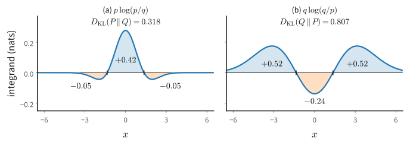

# Entropy, Cross-Entropy, and KL Divergence
:label:`sec_mdl-information_theory`

A loss curve is the first thing we inspect when a classifier trains, and we
quickly learn to read its shape: a falling curve is good news, while a flat one
is suspicious. The numbers on its vertical axis are harder to interpret. So far
we can explain only one of them. A freshly initialized classifier with ten
classes reports a loss of about $2.30$, a value that
:numref:`sec_mlp-implementation` used as a sanity check on an untrained network.
That number is $\ln 10$, the cost of naming one of ten labels when the model
still considers all ten equally likely. The other end of the curve raises deeper
questions. Is a final loss of $0.6$ good? When a curve levels off, is the
plateau a bug in training or an unavoidable property of the data? And if some of
the labels are wrong, how low can any model hope to go?

The cross-entropy loss is the average of $-\log q(y)$, which measures how
surprised the model is by the label $y$ that actually occurred. This average
splits naturally into two pieces. The first is the *entropy*: the average
surprise experienced by someone who already knows the true distribution of the
labels. Because entropy is fixed by the data themselves, no model can reduce it.
The second piece is the *Kullback--Leibler (KL) divergence*: the extra surprise
incurred by using an imperfect model instead of the truth. It is never negative,
and it vanishes only when the model matches the true distribution. A loss value
can therefore be judged only against this irreducible floor.

We already encountered two of these ideas in the previous chapter: maximum
likelihood minimizes a cross-entropy (:numref:`subsec_mdl-nll-crossentropy`),
and the KL divergence is never negative
(:numref:`subsec_mdl-max-entropy-derivation`), a result known as Gibbs'
inequality. Whereas those facts served as tools there, here they are our main
subject. We begin with a deck of cards and a four-symbol source, where entropy
simply counts yes/no questions. From there we compare pairs of distributions,
return to our classifier to find its loss floor, and finally examine what
changes when targets are softened or when outcomes are continuous real numbers.

The base of the logarithm is merely a choice of unit: base $2$ measures
information in *bits*, while base $e$ measures it in *nats*. **We work in nats
throughout**, matching the natural logarithm `log` used in numerical libraries
and in reported training losses. Bits are more convenient when counting yes/no
questions, so we mark quantities in bits with a subscript $2$, as in $H_2$ for
entropy. One bit equals $\ln 2 \approx 0.693$ nats.
:numref:`tab_mdl-it-notation` collects the symbols used across this chapter.

:Symbols of the information theory chapter. The binary entropy $H_b(p)$ is a function of a number, not of a random variable. The mutual information $I(X;Y)$ and the last five rows are defined in later sections.
:label:`tab_mdl-it-notation`

| Symbol | Meaning | Unit |
|:--|:--|:--|
| $I(x) = -\log p(x)$ | self-information (surprisal) of the outcome $x$ (by convention the letter is shared with the mutual information $I(X;Y)$) | nats |
| $H(X)$, $H(P)$ | entropy of a discrete random variable or distribution; a subscript $2$, as in $H_2$ and $\textrm{CE}_2$, marks bits | nats |
| $H_b(p)$ | binary entropy of a coin with heads probability $p$ | nats |
| $h(X)$ | differential entropy of a continuous random variable | nats, depends on the units of $X$ |
| $D_{\textrm{KL}}(P \Vert Q)$ | KL divergence from $P$ to $Q$ | nats |
| $\textrm{CE}(P, Q)$ | cross-entropy from $P$ to $Q$ | nats |
| $k$ | number of classes (size of the set of outcomes) | |
| $n$ | number of examples, or of symbols in a message; the dimension in $\mathbb{R}^n$ | |
| $\mathbf{p}$, $\mathbf{q}$ | probability vectors on $k$ classes (truth, model) | |
| $\mathbf{z}$ | logits, with $\mathbf{q} = \mathrm{softmax}(\mathbf{z})$ | |
| $\epsilon$ | label-smoothing mass (in later sections, a noise variable) | |
| $\tau$ | temperature | |
| $\rho$ | label-noise rate: the probability that a recorded label is not the clean class | |
| $H(X \mid Y)$, $I(X;Y)$ | conditional entropy, mutual information | nats |
| $D_f(P \Vert Q)$ | f-divergence with divergence function $f$ | |
| $T$ | critic: a function whose averages under two distributions bound a divergence | |
| $g$ | test function of an integral probability metric | |
| $\gamma$ | coupling (transport plan) of two distributions | |
| $N$ | number of points in each of two samples that are compared; number of candidates in a contrastive batch | |

```{.python .input #information-theory-imports}
#@tab mxnet
import math
import numpy as np
from mxnet import autograd, gluon, init, np as mnp, npx
from mxnet.gluon import nn
from d2l import mxnet as d2l
npx.set_np()
```

```{.python .input #information-theory-imports}
#@tab pytorch
import math
import numpy as np
import torch
from torch import nn
from torch.nn import functional as F
from d2l import torch as d2l
```

```{.python .input #information-theory-imports}
#@tab tensorflow
import math
import numpy as np
import tensorflow as tf
from d2l import tensorflow as d2l
```

```{.python .input #information-theory-imports}
#@tab jax
import math
import numpy as np
import jax
from jax import numpy as jnp
from flax import nnx
import optax
from d2l import jax as d2l
```

## Information and Entropy

### Self-Information

Consider four reports about a freshly shuffled deck of cards. "I see a card"
conveys nothing, because the event is certain. "I see a heart" narrows the
outcome to one of four equally likely suits, "It is the three of spades" singles
out one of $52$ equally likely cards, and reporting the order of the entire deck
identifies one of $52!$ possible orderings. The less probable an event is, the
more we learn by observing it. Shannon :cite:`Shannon.1948` quantified this
idea with the *self-information* of an outcome $x$ that occurs with probability
$p(x)$,

$$
I(x) = -\log p(x).
$$

This quantity is also called the *surprisal* of the outcome, the term used in
:numref:`subsec_info_theory_basics`: the less we expected an outcome, the more
it surprises us. Importantly, the surprise belongs to whoever assigned the
probability, so a confidently wrong model finds ordinary events deeply
surprising. A certain event carries zero information, and halving an outcome's
probability adds $\ln 2$ nats (one bit) to its surprisal. The first three card
reports carry $0$, $\ln 4 \approx 1.39$, and $\ln 52 \approx 3.95$ nats. In
bits, where one bit is the information gained from a single fair coin flip, they
carry $0$, $2$, and $5.70$.

Why choose a logarithm? We want three properties: a certain event carries zero
information, rarer events carry more information, and the information of two
independent events adds up. Because independent probabilities multiply, the
third requirement reads $I(p_1 p_2) = I(p_1) + I(p_2)$. The only decreasing
functions satisfying this identity are positive multiples of $-\log p$
(:citet:`Csiszar.2008`; Exercise
:exref:`ex_mdl-information-theory-show-that-self-information` works through the
proof). Choosing the constant multiple simply chooses the unit.


:label:`fig_mdl-self-info-curve`

:numref:`fig_mdl-self-info-curve` plots the curve: it is decreasing and convex,
hits zero at $p = 1$, and diverges as $p \to 0$. The fourth card report, the
order of the entire deck, sits far out on this curve at $\ln 52!$. We can
compute its value via the log-gamma function, $\ln 52! = \ln \Gamma(53)$,
without ever forming the 68-digit integer $52!$.

```{.python .input #information-theory-self-information}
deck_order = math.lgamma(53)          # ln 52! without forming 52!
print(f'the order of the deck: {deck_order:.2f} nats '
      f'= {deck_order / math.log(2):.1f} bits')
```

Naming the order of a shuffled deck carries $156$ nats, roughly as much
information as $226$ fair coin flips.

### Entropy

We can compute a surprisal only after an outcome arrives. Beforehand, we can ask
how surprised we expect to be on average. Let $X$ be a discrete random variable
taking the value $x_i$ with probability $p_i$. Its *entropy* is the expected
self-information of its outcome,

$$
H(X) = -\mathbb{E}_{x \sim P}[\log p(x)] = -\sum_i p_i \log p_i,
$$
:eqlabel:`eq_mdl-ent_def`

with the convention $0 \log 0 = 0$, justified by continuity ($t \log t \to 0$
as $t \to 0$): an impossible outcome contributes nothing. Because the entropy
depends only on the distribution $P$ of $X$, we write $H(P)$ and $H(X)$
interchangeably.

On a finite set, entropy in bits has a concrete operational meaning: it counts
the average number of yes/no questions a good questioner needs to identify the
outcome. Take the distribution $P = (\tfrac12, \tfrac14, \tfrac18, \tfrac18)$ on
four symbols $a, b, c, d$. We will carry this example through the section and
call it the *dyadic source*, since all of its probabilities are powers of
$\tfrac12$. A good questioner first asks "Is it $a$?", settling the matter half
the time. If not, they ask "Is it $b$?", and then "Is it $c$?", where "no"
leaves only $d$. The expected number of questions is

$$
\tfrac12 \cdot 1 + \tfrac14 \cdot 2 + \tfrac18 \cdot 3 + \tfrac18 \cdot 3
= 1.75,
$$

which matches the entropy in bits:
$H_2(P) = \tfrac12 \log_2 2 + \tfrac14 \log_2 4 + 2 \cdot \tfrac18 \log_2 8
= 1.75$ bits, or $1.213$ nats. Each outcome is identified in $\log_2(1/p_i)$
questions, which is its self-information in bits.

By contrast, a questioner who ignores the probabilities asks "Is it $a$ or $b$?"
and then "Which of the two?", always needing $2$ questions. Notice that a
questioning strategy is a binary code in disguise: write $1$ for yes and $0$ for
no, and the sequence of answers that identifies an outcome becomes its codeword,
here $1$, $01$, $001$, and $000$ for $a$, $b$, $c$, and $d$. The average
question count matched the entropy here because every probability was a power of
$\tfrac12$. In the language of codes, :numref:`sec_mdl-coding-compression`
proves that the count is never far off: for any distribution on a finite set,
the best strategy needs between $H_2$ and $H_2 + 1$ questions on average.

In code, the function `entropy` masks out zero probabilities, implementing
$0 \log 0 = 0$. We will reuse it throughout the section, starting with the
dyadic source.

```{.python .input #information-theory-definition}
def entropy(p):
    """Entropy of a probability vector, in nats (0 log 0 = 0 by masking)."""
    p = np.asarray(p, dtype=float)
    p = p[p > 0]
    return float(-np.dot(p, np.log(p)))

p_dyadic = np.array([1 / 2, 1 / 4, 1 / 8, 1 / 8])
h = entropy(p_dyadic)
print(f'H = {h:.3f} nats = {h / math.log(2):.2f} bits')
```

It returns the $1.75$ bits that we counted in questions.

Because $0 \le p_i \le 1$, every term $-p_i \log p_i$ is non-negative, so
$H(X) \ge 0$, with equality only for a point mass (a variable whose outcome is
certain). Notice also that entropy depends only on the list of probabilities,
not on the numerical values or names of the outcomes. A variable taking the
values $1$, $100$, $10^6$, and $10^9$ with the dyadic probabilities still has an
entropy of $1.75$ bits.

### Joint and Conditional Entropy
:label:`subsec_mdl-joint-conditional-entropy`

In machine learning, a label always comes paired with an input, and a character
comes after the text preceding it. We therefore need both the entropy of two
variables taken together and the entropy remaining in one variable once the
other is known. The first requires nothing new: a pair $(X, Y)$ with joint
probability mass function $p(x, y)$ is simply a single random variable whose
outcomes are pairs, so its *joint entropy* is
$H(X, Y) = -\mathbb{E}[\log p(X, Y)]$. The *conditional entropy* is the average
surprisal left in $Y$ once $X$ is observed,

$$
H(Y \mid X) = -\mathbb{E}[\log p(Y \mid X)] = \sum_x p(x)\, H(Y \mid X = x),
$$

where $H(Y \mid X = x)$ is the entropy of the conditional distribution
$p(\cdot \mid x)$. Because $\log p(x, y) = \log p(x) + \log p(y \mid x)$, taking
expectations on both sides yields the *chain rule* for entropy:

$$
H(X, Y) = H(X) + H(Y \mid X).
$$
:eqlabel:`eq_mdl-entropy-chain-rule`

In words, the entropy of a pair is the entropy of the first variable plus the
uncertainty that remains in the second once the first is known. Applied
repeatedly, the chain rule gives
$H(X_1, \ldots, X_n) = \sum_{i=1}^n H(X_i \mid X_1, \ldots, X_{i-1})$: the
entropy of a sequence is the sum of the entropies of its symbols, each
conditioned on all preceding symbols. A language model predicts text in this
same left-to-right order, one symbol at a time.

The questions game illustrates this identity directly. Let $X$ be the answer to
the first question, "Is it $a$?", and let $Y$ be the outcome of the dyadic
source. Because the answer is a fair coin, $H_2(X) = 1$ bit. After "yes",
nothing remains to ask ($0$ bits). After "no", the outcome is $b$, $c$, or $d$
with probabilities $(\tfrac12, \tfrac14, \tfrac14)$, whose entropy is $1.5$
bits. Averaging over the two answers gives
$H_2(Y \mid X) = \tfrac12 \cdot 0 + \tfrac12 \cdot 1.5 = 0.75$ bits. By the
chain rule, $H_2(X, Y) = 1 + 0.75 = 1.75$ bits: the first answer supplies one
bit and the remaining questions supply the rest. This sum equals $H_2(Y)$, as it
must: knowing the outcome $Y$ completely determines the answer $X$, so
$H(X \mid Y) = 0$, and the chain rule in the reverse order reads
$H(X, Y) = H(Y) + 0$.

### Maximum Entropy on a Finite Set

How large can the entropy of a variable with $k$ outcomes be? Let us start with
the smallest case, a single coin flip. A Bernoulli variable with heads
probability $p$ has the *binary entropy*

$$
H_b(p) = -p \log p - (1-p) \log(1-p),
$$

which is a function of the scalar $p$ rather than of a random variable.
:numref:`fig_mdl-bernoulli-entropy` plots this curve. The entropy vanishes at
$p \in \{0, 1\}$, where the outcome is certain, and reaches its peak at the fair
coin, $H_b(\tfrac12) = \ln 2 \approx 0.693$ nats (one bit). A biased coin with
$p = 0.1$ has $H_b(0.1) \approx 0.325$ nats, because its outcome is much easier
to guess.


:label:`fig_mdl-bernoulli-entropy`

Notice that the curve is concave: the chord joining any two of its points lies
below the curve. It peaks at the uniform coin, and the same principle holds for
any finite number of outcomes. If $X$ takes at most $k$ values, then

$$
H(X) \leq \log k,
$$

with equality if and only if $X$ is uniform over all $k$ values. The uniform
distribution spreads its probability mass as evenly as possible, making the
outcome maximally hard to guess. For four outcomes, the upper bound is
$\log_2 4 = 2$ bits, which sits $0.25$ bits above the $1.75$ bits of the dyadic
source. We postpone the proof for a moment until Gibbs' inequality is in place,
at which point it takes just a single line. Since that inequality compares two
distributions, we turn to comparing distributions next.

## KL Divergence and Cross-Entropy

### The Kullback--Leibler Divergence

Suppose we want to measure how badly a model $Q$ misrepresents a true
distribution $P$. Information theory answers this with the *Kullback--Leibler
(KL) divergence*, also known as *relative entropy* :cite:`Kullback.Leibler.1951`:
the average extra surprisal incurred by someone who believes $Q$ when outcomes
are actually drawn from $P$. In the questions game, the KL divergence in bits is
the average number of extra questions that a strategy designed for $Q$ needs on
outcomes drawn from $P$, up to rounding to whole questions. Let $P$ and $Q$ have
probability mass functions (or densities) $p$ and $q$. The KL divergence from
$P$ to $Q$ is

$$
D_{\textrm{KL}}(P\|Q) = \mathbb{E}_{x \sim P} \left[ \log \frac{p(x)}{q(x)} \right].
$$
:eqlabel:`eq_mdl-kl_def`

The quantity inside the expectation is
$\log p(x) - \log q(x) = (-\log q(x)) - (-\log p(x))$, which is the surprisal of
the believer in $Q$ minus the surprisal of the believer in $P$. It is positive
where $Q$ underestimates an outcome ($q(x) < p(x)$) and negative where $Q$
overestimates it. The KL divergence averages this difference under the true
distribution $P$.

Because $P$ supplies both the samples and the numerator, the definition is
asymmetric: in general, $D_{\textrm{KL}}(P\|Q) \neq D_{\textrm{KL}}(Q\|P)$.
Outcomes with $p(x) = 0$ contribute nothing, following the convention
$0 \log(0/q) = 0$. If any outcome has $p(x) > 0$ while $q(x) = 0$, however, then
$D_{\textrm{KL}}(P\|Q) = +\infty$.

A small numerical example makes the definition concrete, and we will carry it
through the rest of the section. Let $P = (0.6, 0.3, 0.1)$ be the truth and
$Q = (0.2, 0.5, 0.3)$ a model on three outcomes. Then

$$
D_{\textrm{KL}}(P\|Q)
= 0.6 \ln\frac{0.6}{0.2} + 0.3 \ln\frac{0.3}{0.5} + 0.1 \ln\frac{0.1}{0.3}
= 0.659 - 0.153 - 0.110 = 0.396 \textrm{ nats},
$$

whereas the reverse direction gives $D_{\textrm{KL}}(Q\|P) = 0.365$ nats. In
bits, the two directions are $0.571$ and $0.527$. Not only do they differ, but
the first value tells us that a questioner who believes $Q$ asks $0.57$ more
questions per outcome than necessary, averaged over long runs of outcomes drawn
from $P$.

Here is the discrete KL divergence in code, implementing $0 \log 0 = 0$ by
masking out the zero probabilities of $P$, just as we did in `entropy`. We
evaluate it on our running pair in both directions, as well as on a model
$Q' = (0.5, 0.5, 0)$ that declares the third outcome impossible.

```{.python .input #information-theory-definition-2}
def kl_divergence(p, q):
    """KL(P || Q) for two probability vectors, in nats; inf where q = 0 < p."""
    p, q = np.asarray(p, dtype=float), np.asarray(q, dtype=float)
    m = p > 0
    if np.any(q[m] == 0):
        return float('inf')
    return float(np.dot(p[m], np.log(p[m] / q[m])))

p = np.array([0.6, 0.3, 0.1])
q = np.array([0.2, 0.5, 0.3])
print(f'KL(P||Q) = {kl_divergence(p, q):.4f} nats, '
      f'KL(Q||P) = {kl_divergence(q, p):.4f} nats')
print(f"KL(P||Q') = {kl_divergence(p, [0.5, 0.5, 0.0])}")
```

The second line is the one to remember. The model $Q'$ assigns zero probability
to an outcome that occurs one time in ten, and its KL divergence is infinite: a
model that declares an event impossible is infinitely surprised when that event
happens.

### Gibbs' Inequality

Could the average extra surprisal ever be negative? If it could, a wrong model
would be less surprised on average than the truth itself. Gibbs' inequality
:cite:`Gibbs.1902` rules that out: no model beats the truth on average. Because
everything that follows rests on this result, we prove it in full as a
consequence of averaging a concave function. For any concave function $f$ and any
random variable $X$ with finite mean, *Jensen's inequality* states that

$$
\mathbb{E}[f(X)] \le f(\mathbb{E}[X]).
$$

In words, averaging first and applying $f$ second yields the larger value. When
$X$ takes two values, this is simply the statement that the chord lies below the
curve in :numref:`fig_mdl-bernoulli-entropy`. If $f$ is strictly concave,
equality holds only when $X$ is constant with probability one
(:numref:`subsec_mdl-jensen` proves the general case). We need Jensen's
inequality for just one function, the logarithm, which is strictly concave: the
logarithm of an average is at least the average of the logarithms.

**Proposition (Gibbs' inequality).** *For any distributions $P$ and $Q$ on
the same space,*

$$
D_{\textrm{KL}}(P\|Q) \geq 0,
$$

*with equality if and only if $P = Q$.*

**Proof.** If $q(x) = 0$ for some $x$ with $p(x) > 0$, then the divergence is
$+\infty$ and there is nothing to prove, so assume otherwise. Rewrite the
divergence as minus the average of $\log(q(x)/p(x))$ under $x \sim P$, and apply
Jensen's inequality to the logarithm:

$$
\begin{aligned}
D_{\textrm{KL}}(P\|Q)
&= -\mathbb{E}_{x\sim P}\!\left[\log\frac{q(x)}{p(x)}\right]
\geq -\log \mathbb{E}_{x\sim P}\!\left[\frac{q(x)}{p(x)}\right] \\
&= -\log \!\!\sum_{x\,:\,p(x)>0}\!\! q(x)
= -\log Q(\textrm{supp}\,P)
\geq 0.
\end{aligned}
$$

The leading minus sign flips Jensen's "at most" into "at least". The rest of the
proof happens in the second line. The expectation runs over the support of $P$,
the set of outcomes with $p(x) > 0$. The factors $p(x)$ cancel, leaving the
total $Q$-probability of that support, a number at most $1$, whose negative
logarithm is therefore non-negative. For continuous densities, the same steps
hold with integrals in place of sums. For equality to hold, both inequalities
must be tight. Because the logarithm is strictly concave, the first is an
equality only when $q(x)/p(x)$ equals a constant $c$ for $P$-almost every $x$
(that is, outside a set of $P$-probability zero), and the second requires
$Q(\textrm{supp}\,P) = 1$. Summing (or integrating) $q = c\,p$ over the support
of $P$ then forces $c = 1$, so $q = p$ (again outside a set of probability zero
for densities). $\blacksquare$

The proof rests on a single idea. Averaged over the truth, the ratio $q/p$ is at
most $1$, so its logarithm averages to at most $0$, with equality only when
$q/p$ does not vary at all (meaning $q = p$). A model incurs no extra surprisal
only when it is right.

Gibbs' inequality immediately settles the uniform upper bound we left unproved.
For any distribution $P$ on $k$ outcomes and the uniform distribution $U$ on the
same set, $D_{\textrm{KL}}(P\|U) = \sum_i p_i \log(k\,p_i) = \log k - H(P)$,
which is non-negative and vanishes only when $P = U$.

It also proves that conditioning cannot increase entropy on average. Compare the
joint distribution of a pair $(X, Y)$ with the product of its marginals. The
log-ratio is $\log \frac{p(x, y)}{p(x)\,p(y)} = \log p(y \mid x) - \log p(y)$,
whose expectation under the joint distribution is $H(Y) - H(Y \mid X)$. Because
that expectation is a KL divergence,

$$
H(Y) - H(Y \mid X) = D_{\textrm{KL}}(p_{X,Y} \,\|\, p_X\, p_Y) \ge 0,
$$

with equality if and only if $X$ and $Y$ are independent. On average, knowing
$X$ never makes $Y$ more uncertain. A *particular* observation, however, can.
Suppose $Y$ is tails for certain when $X = 0$, and a fair coin when $X = 1$,
where $X = 1$ occurs one time in five. Overall, $Y$ lands heads with probability
$0.1$, so $H(Y) = H_b(0.1) \approx 0.325$ nats. Observing $X = 1$ raises our
uncertainty about $Y$ to $\ln 2 \approx 0.693$ nats, yet the conditional entropy
averages over both outcomes of $X$, giving
$H(Y \mid X) = 0.2 \cdot 0.693 \approx 0.139$ nats, less than half of $H(Y)$.

### Cross-Entropy

Classifiers are trained with a close relative of the KL divergence. The
*cross-entropy* from $P$ to $Q$ is the average surprisal of a believer in $Q$ on
outcomes drawn from $P$,

$$
\textrm{CE}(P, Q) = -\mathbb{E}_{x \sim P} [\log q(x)].
$$
:eqlabel:`eq_mdl-ce_def`

Adding and subtracting $\log p(x)$ inside the expectation, which is valid
whenever $H(P)$ is finite, splits the model's surprisal into the truth's own
entropy plus the excess divergence:

$$
\textrm{CE}(P, Q) = H(P) + D_{\textrm{KL}}(P\|Q).
$$
:eqlabel:`eq_mdl-ce_decomp`

Cross-entropy is therefore an irreducible entropy floor plus a non-negative
excess: by Gibbs' inequality, $\textrm{CE}(P, Q) \ge H(P)$, with equality if and
only if $Q = P$. For our running pair,
$\textrm{CE}(P, Q) = -(0.6 \ln 0.2 + 0.3 \ln 0.5 + 0.1 \ln 0.3) = 1.294$ nats
and $H(P) = 0.898$ nats; their difference, $0.396$ nats, is the KL divergence we
computed earlier. Because $H(P)$ does not depend on $Q$, minimizing the
cross-entropy with respect to $Q$ is equivalent to minimizing the KL divergence.
Maximum likelihood on discrete data does precisely this: its average negative
log-likelihood is the cross-entropy from the empirical data distribution to the
model (:numref:`subsec_mdl-nll-crossentropy`).

:numref:`fig_mdl-code-length-bars` illustrates this decomposition in the
questions game for the dyadic source $P$ and the uniform model
$U = (\tfrac14, \tfrac14, \tfrac14, \tfrac14)$. Asking questions adapted to $P$
takes $H_2(P) = 1.75$ questions on average. Asking two fixed questions under the
uniform strategy takes $\textrm{CE}_2(P, U) = 2$ questions, so the waste is
$D_{\textrm{KL}}(P\|U) = 0.25$ bits. Since a questioning strategy is a binary
code, these same numbers are average codeword lengths in bits per symbol. (For
this particular pair, the reverse divergence $D_{\textrm{KL}}(U\|P)$ also
happens to equal $0.25$ bits, which is why we used a different pair earlier to
show that KL divergence is asymmetric.)


:label:`fig_mdl-code-length-bars`

### The Chain Rule for KL Divergence
:label:`subsec_mdl-kl-chain-rule`

Entropy splits along a pair: the surprise in $(X, Y)$ is the surprise in $X$
plus the remaining surprise in $Y$
(:numref:`subsec_mdl-joint-conditional-entropy`). The KL divergence splits the
same way, and for the same reason. Let $P_{X,Y}$ and $Q_{X,Y}$ be two joint
distributions, factored as $p(x, y) = p(x)\,p(y \mid x)$ and
$q(x, y) = q(x)\,q(y \mid x)$. The logarithm of the ratio $p(x, y)/q(x, y)$ is
then a sum of two terms, and taking expectations under $P_{X,Y}$ yields the
*chain rule* for KL divergence:

$$
D_{\textrm{KL}}(P_{X,Y}\|Q_{X,Y}) = D_{\textrm{KL}}(P_X\|Q_X) + \mathbb{E}_{x \sim P_X}\big[D_{\textrm{KL}}(P_{Y \mid x}\|Q_{Y \mid x})\big].
$$
:eqlabel:`eq_mdl-kl-chain`

A wrong model of the pair pays for its error about $X$, and then, on average,
for its error about $Y$ once $X$ is known. Note that the average runs over the
truth $P_X$, not over the model. The identity is one line of algebra, yet the
rest of the book leans on three of its consequences.

First, KL divergence adds over independent coordinates. If $X$ and $Y$ are
independent under both $P$ and $Q$, the conditional term no longer depends on
$x$, and the divergence of the pair is the sum of the two divergences. Ten
independent draws from our running pair thus separate $P$ from $Q$ by
$10 \cdot 0.396 = 3.96$ nats, which is why long samples tell two
distributions apart so much better than short ones. Second, the divergence
between two joint distributions is at least the divergence between their
marginals, because the conditional term is non-negative by Gibbs' inequality.
Throwing a variable away can only make two distributions harder to tell apart.
Latent variable models rely on this: the joint divergence over data and latents
is, up to a constant, the objective they can compute, and it exceeds the
divergence over the data alone by the conditional term, the gap of the evidence
lower bound (:numref:`sec_mdl-latent-em-elbo`). Third, applying the rule repeatedly to a
sequence gives

$$
D_{\textrm{KL}}(P_{X_1, \ldots, X_n}\|Q_{X_1, \ldots, X_n}) = \sum_{i=1}^n \mathbb{E}_{x_{<i} \sim P}\big[D_{\textrm{KL}}(P_{X_i \mid x_{<i}}\|Q_{X_i \mid x_{<i}})\big],
$$

so the excess loss of an autoregressive model on a whole sequence is the sum
of its excess losses at the individual steps. Predicting each next token well
is therefore the same task as modeling the entire sequence well, and
:numref:`subsec_mdl-perplexity` uses this decomposition to bound the loss of
every language model from below.

## The Classification Loss

In a $k$-class classification problem, the target for a single example is the
one-hot distribution placing all its mass on the recorded label $y$, while the
model outputs a predicted distribution $\mathbf{q} = (q_1, \ldots, q_k)$. The
cross-entropy :eqref:`eq_mdl-ce_def` between them collapses to a single term,
$-\log q_y$, which is simply the model's surprisal at the observed label.
Averaged over $n$ examples with labels $y_i$ and predictions $\mathbf{q}_i$,
this gives the *cross-entropy loss*

$$
\textrm{CE} = -\frac{1}{n} \sum_{i=1}^n \log q_{i, y_i},
$$

measured in nats. Deep learning frameworks compute this loss directly from the
*logits* $\mathbf{z}$, the unnormalized scores whose softmax is $\mathbf{q}$.
They apply a numerically stable log-softmax internally, because forming the
probabilities first can overflow for large logits and underflow to $\log 0$ for
very negative ones (:numref:`subsec_softmax-implementation-revisited`;
:numref:`subsec_mdl-stable-softmax` derives the stable form). In the
subsections that follow, we unpack what this loss tells us about noise in the
data, probability calibration, and softened targets.

### The Irreducible Loss
:label:`subsec_mdl-irreducible-loss`

At the start of the section, we asked how low the loss can go when some labels
are wrong. On a fixed training set, the answer is uninformative: a network large
enough to memorize the dataset can fit every recorded label, the wrong ones
included, and drive the training loss toward zero. The question has real content
only on fresh examples that the model has not seen, and there the one-hot target
is not the full truth. In real data, the label is rarely a deterministic
function of the input: the same image may receive different labels due to
genuine ambiguity or annotation errors. The truth for an input $\mathbf{x}$ is
the conditional distribution from which its label is drawn, and the recorded
label is a single sample from it.

Suppose the input $\mathbf{x}$ and label $y \in \{1, \ldots, k\}$ follow a joint
distribution, where $p(\cdot \mid \mathbf{x})$ is the true conditional
distribution of the label and $q(\cdot \mid \mathbf{x})$ is any model's
prediction. As the number of fresh examples grows, their average loss converges
to its expectation over $(\mathbf{x}, y)$, which we call the *population loss*.
No model can push this population loss below the average entropy of the label
given the input.

**Proposition (the irreducible classification loss).** *The population
cross-entropy loss of any model satisfies*

$$
\begin{aligned}
\mathbb{E}_{(\mathbf{x}, y)}\big[-\log q(y \mid \mathbf{x})\big]
&= \mathbb{E}_{\mathbf{x}}\big[H(p(\cdot \mid \mathbf{x}))\big]
+ \mathbb{E}_{\mathbf{x}}\big[D_{\textrm{KL}}\big(p(\cdot \mid \mathbf{x}) \,\|\, q(\cdot \mid \mathbf{x})\big)\big] \\
&\ge \mathbb{E}_{\mathbf{x}}\big[H(p(\cdot \mid \mathbf{x}))\big],
\end{aligned}
$$
:eqlabel:`eq_mdl-irreducible-loss`

*with equality if and only if $q(\cdot \mid \mathbf{x}) = p(\cdot \mid
\mathbf{x})$ for almost every $\mathbf{x}$ (that is, for all inputs outside a
set of probability zero).*

**Proof.** Condition on $\mathbf{x}$. The inner expectation over $y$ is the
cross-entropy $\textrm{CE}(p(\cdot \mid \mathbf{x}), q(\cdot \mid \mathbf{x}))$,
so the decomposition :eqref:`eq_mdl-ce_decomp` applies pointwise at every
$\mathbf{x}$ (all entropies are finite, at most $\log k$). Taking the outer
expectation over $\mathbf{x}$ gives the identity. By Gibbs' inequality, every
KL term is non-negative, and an average of non-negative terms vanishes if and
only if almost all of them are zero. $\blacksquare$

This floor is the conditional entropy of the label given the input
(:numref:`subsec_mdl-joint-conditional-entropy`). It is an intrinsic property of
the data: no architecture, extra training data, or longer training schedule can
lower it. Of all the results in this section, this is the one to keep in mind
whenever you read a loss curve. Three cases illustrate what it implies:

* A model that predicts the uniform distribution suffers a cross-entropy of
  $\ln k$ on every input regardless of the labels, giving the familiar $2.30$
  nats for $k = 10$.
* When the label is a deterministic function of the input, every
  $H(p(\cdot \mid \mathbf{x}))$ is zero, and a perfect model achieves a loss of
  $0$.
* Under symmetric label noise, the clean class is determined by the input, while
  the recorded label matches the clean class with probability $1 - \rho$ and
  each of the remaining $k - 1$ classes with probability $\rho/(k-1)$. At every
  input, the conditional entropy is
  $H = -(1-\rho)\log(1-\rho) - \rho\log\tfrac{\rho}{k-1} = H_b(\rho) + \rho\log(k-1)$.
  For $\rho = 0.1$ and $k = 10$, this floor is $0.325 + 0.220 = 0.545$ nats. As
  long as $1 - \rho > \rho/(k-1)$, predicting the clean class remains optimal,
  so the highest achievable accuracy is $1 - \rho$ (here $90\%$).

Before running the next cell, pause and guess the loss of a confident predictor
that assigns probability $0.99$ to the clean class in this noisy setting. It is
right nine times out of ten, and nearly certain every time. The code compares it
against the uniform predictor and the *Bayes predictor*, which reports the true
conditional distribution $q = p$.

```{.python .input #mdl-information-theory-the-irreducible-loss}
k, rho = 10, 0.1
p_noisy = np.array([1 - rho] + [rho / (k - 1)] * (k - 1))  # clean class first
predictors = {'uniform': np.full(k, 1 / k),
              'confident 0.99': np.array([0.99] + [0.01 / (k - 1)] * (k - 1)),
              'Bayes q = p': p_noisy}
print(f'floor = H(p) = {entropy(p_noisy):.3f} nats')
for name, q_hat in predictors.items():
    ce = float(-np.dot(p_noisy, np.log(q_hat)))
    print(f'{name:15s} CE = {ce:.3f} nats')
```

The overconfident predictor suffers a loss of $0.689$, well above the floor:
every flipped label catches it by surprise, and its high confidence costs far
more on the tenth of labels that are flipped than it gains on the rest. Only the
Bayes predictor reaches the floor.

We can now answer the question from the opening: is a final loss of $0.6$ good?
On clean labels, where the floor is zero, $0.6$ still leaves plenty of room for
a better model. On these noisy labels, however, it sits within $0.06$ nats of
the floor and leaves almost none. A plateau at the floor is simply a property of
the data; only a plateau above the floor points to a limitation of the model or
its training. Bear in mind that all of this applies to fresh data. On a
held-out split, a loss *below* the floor cannot come from a better model, and
Exercise :exref:`ex_mdl-information-theory-label-noise-floor` asks what it
signals instead.

So far we derived the loss floor for a single penalty ($-\log q_y$), for
unmodified one-hot labels, and for countable outcomes. In the remainder of this
section we relax each of these three assumptions in turn, examining other
penalties, softened targets, and continuous real-valued outcomes.

### Proper Scoring Rules

The loss floor is achieved only by the true conditional probabilities, which is
just the property we want if we intend to interpret a classifier's outputs as
probabilities. Decision theory gives this property a name. A *scoring rule*
assigns a penalty $S(\mathbf{q}, y)$ for reporting the probability vector
$\mathbf{q}$ when class $y$ actually occurs. The rule is *proper* if truthful
reporting is optimal: when labels follow $\mathbf{p}$, the expected
penalty $\mathbb{E}_{y \sim \mathbf{p}}[S(\mathbf{q}, y)]$ is minimized by
reporting $\mathbf{q} = \mathbf{p}$. It is *strictly proper* if this truthful
report is the unique minimizer. The cross-entropy loss is the *log score*
$S(\mathbf{q}, y) = -\log q_y$, and Gibbs' inequality shows that it is strictly
proper: its expected penalty is $\textrm{CE}(\mathbf{p}, \mathbf{q})$, which is
uniquely minimized at $\mathbf{q} = \mathbf{p}$.

Consequently, at the population optimum over a model class rich enough to
contain the truth, a classifier trained with cross-entropy outputs the true
conditional probabilities. In particular, its predictions are *calibrated*:
among all inputs for which the model predicts probability $0.8$ for a given
class, that class actually occurs $80\%$ of the time. (A finite training set or
a restricted model class can still leave a trained network miscalibrated in
practice.)

The log score is not the only strictly proper scoring rule. The *Brier score*,
$S(\mathbf{q}, y) = \sum_j (q_j - \mathbf{1}(j = y))^2$, is strictly proper as
well, and unlike the log score it imposes a bounded penalty on confident errors
where $-\log q_y$ diverges :cite:`Gneiting.Raftery.2007`. Exercise
:exref:`ex_mdl-information-theory-scoring-rule-is-strictly` computes its excess
penalty and examines a seemingly reasonable rule that turns out to be improper.

### Label Smoothing

Until now, our training target has been the one-hot label. Replacing it with a
softer target changes both what the loss asks of the logits and where its floor
lies, and there is a practical reason to do so. One-hot targets demand something
a softmax layer cannot actually produce: assigning probability $1$ to the true
class requires its logit to be infinitely larger than all the others. As a
result, the loss has no finite minimizer, and gradient descent keeps pushing the
logits further apart for as long as training runs. *Label smoothing*
:cite:`Szegedy.Vanhoucke.Ioffe.ea.2016` fixes this by mixing the one-hot target
$\mathbf{e}_y$ with a fraction $\epsilon$ of the uniform distribution over all
$k$ classes:

$$
\mathbf{p}^\epsilon = (1 - \epsilon)\, \mathbf{e}_y + \frac{\epsilon}{k}\, \mathbf{1}.
$$
:eqlabel:`eq_mdl-label-smoothing-target`

Under this target, the true class receives probability $1 - \epsilon +
\epsilon/k$ and every other class receives $\epsilon/k$. The training objective
is the ordinary cross-entropy $\textrm{CE}(\mathbf{p}^\epsilon, \mathbf{q})$
against this smoothed target (the same loss used in
:numref:`sec_training_recipes`). It is minimized at
$\mathbf{q} = \mathbf{p}^\epsilon$, which a softmax achieves with a finite gap
between the logit of the true class and each competing logit:

$$
z_y - z_j = \log\frac{1 - \epsilon + \epsilon/k}{\epsilon/k}
= \log\!\Big(1 + \frac{k(1-\epsilon)}{\epsilon}\Big).
$$

For $k = 10$ classes and $\epsilon = 0.1$, this optimal logit gap is
$\ln 91 \approx 4.51$, and the loss at the optimum equals the entropy of the
smoothed target, $H(\mathbf{p}^\epsilon) = 0.500$ nats.

It is instructive to see how quickly the logits drift without smoothing.
Consider a single example whose logits start at zero, updated by gradient
descent with step size $1$. The gradient of the cross-entropy with respect to
the logits is $\mathbf{q} - \mathbf{p}^\epsilon$. With a one-hot target, all
wrong classes stay tied, and each step widens the gap $g$ between the true
class and the rest by $(1 - q_y) + q_j = k/(e^g + k - 1)$, which is
approximately $k e^{-g}$ once $g$ is large. Incrementing $g$ by $k e^{-g}$
multiplies $e^g$ by $e^{k e^{-g}} \approx 1 + k e^{-g}$, thereby adding roughly
$k$ to $e^g$ on each step. After $t$ steps we therefore expect $e^g \approx kt$,
or $g \approx \ln(kt)$. The gap never stops growing, though its growth is
logarithmic: ten times as many steps add only $\ln 10 \approx 2.30$. After
$10{,}000$ steps, we expect $g \approx \ln 10^5 \approx 11.51$. The next cell
runs this gradient descent both without and with smoothing.

```{.python .input #information-theory-label-smoothing}
k, checkpoints = 10, (10, 100, 1000, 10000)
for eps in (0.0, 0.1):
    p_eps = np.full(k, eps / k)
    p_eps[0] += 1 - eps                   # the true class first
    z = np.zeros(k)                       # the logits of one example
    for step in range(1, checkpoints[-1] + 1):
        q = np.exp(z - z.max())
        z -= q / q.sum() - p_eps          # gradient step, step size 1
        if step in checkpoints:
            log_q = z - z.max() - np.log(np.exp(z - z.max()).sum())
            print(f'eps = {eps}  step {step:5d}  gap = {z[0] - z[1]:5.2f}  '
                  f'loss = {-p_eps @ log_q:.4f}')
print(f'optimum for eps = 0.1: gap = ln 91 = {math.log(91):.2f}, '
      f'loss = H(p_eps) = {entropy(p_eps):.4f}')
```

With one-hot targets, the logit gap reaches $4.29$, $6.87$, $9.21$, and $11.51$.
Our approximation $\ln(kt)$ predicts $4.61$, $6.91$, $9.21$, and $11.51$: the
actual gap starts slightly below the estimate (where $k e^{-g}$ is still rough)
and agrees to two decimal places from $1{,}000$ steps onward. Meanwhile, the
loss keeps inching downward without ever reaching zero. In a neural network
large enough to fit its training set, this unbounded drift manifests as weights
that keep growing and predicted probabilities near $1$ on every training
example, mislabeled ones included. With $\epsilon = 0.1$, by contrast, the gap
settles at $4.51$ by step $100$ and stays there, while the loss comes to rest at
$0.500$.

Training now has a finite optimum, though a smoothed model must be interpreted
with care. Even when it predicts the smoothed target without error, its training
loss plateaus at $H(\mathbf{p}^\epsilon)$ rather than zero. Moreover, its
outputs are no longer the true conditional probabilities: no class can receive
probability greater than $1 - \epsilon + \epsilon/k$ (here $0.91$). In practice,
$\epsilon = 0.1$ is the standard choice, and the training recipe of
:numref:`sec_training_recipes` adopts it. Exercise
:exref:`ex_mdl-information-theory-label-smoothing` explores what label smoothing
does to the logits of the incorrect classes.

### Knowledge Distillation
:label:`subsec_mdl-distillation`

Soft targets can also come from another trained model. *Knowledge distillation*
:cite:`Hinton.Vinyals.Dean.2015` trains a compact *student* network to imitate a
larger *teacher* network, an approach applied to language models in
:numref:`sec_lm_distillation`. Instead of training on a one-hot label, the
student trains on the teacher's full probability distribution over classes. The
fact that a handwritten "2" resembles a "7" much more than it resembles a "0" is
information a one-hot label discards; it lives in the teacher's logits for the
wrong classes. (Exercise :exref:`ex_mdl-information-theory-label-smoothing`
asks why a teacher trained with label smoothing passes on less of this
information.)

As with any fixed target distribution, the loss is minimized when the student
reproduces the target itself, so the decomposition :eqref:`eq_mdl-ce_decomp`
adds nothing new here. What does call for explanation is the scale of the loss,
which carries a factor that looks arbitrary at first glance.

Because a well-trained teacher's softmax outputs are nearly one-hot, the
probabilities it assigns to wrong classes are usually too tiny to exert much
pull on the student. We therefore *soften* both distributions first by dividing
the logits by a *temperature* $\tau > 0$ before applying the softmax:

$$
p_j^{(\tau)} = \mathrm{softmax}(\mathbf{z}^{\textrm{tea}}/\tau)_j, \qquad
q_j^{(\tau)} = \mathrm{softmax}(\mathbf{z}^{\textrm{stu}}/\tau)_j.
$$

Setting $\tau > 1$ compresses the gaps between logits and shifts probability
mass toward the wrong classes. The distillation loss is the KL divergence
between these softened distributions, multiplied by $\tau^2$:

$$
\mathcal{L}_{\textrm{distill}}
= \tau^2\, D_{\textrm{KL}}\big(\mathbf{p}^{(\tau)} \,\|\, \mathbf{q}^{(\tau)}\big).
$$
:eqlabel:`eq_mdl-distill-loss`

This loss vanishes if and only if the student matches the softened teacher. To
see why the factor $\tau^2$ is needed, let us differentiate the unscaled KL term
with respect to a student logit. Only the cross-entropy part
$-\sum_j p_j^{(\tau)} \log q_j^{(\tau)}$ depends on the student, and the
derivative of a log-softmax at temperature $\tau$ is the familiar
softmax-minus-target expression scaled by $1/\tau$:

$$
\frac{\partial}{\partial z^{\textrm{stu}}_j}
D_{\textrm{KL}}\big(\mathbf{p}^{(\tau)} \| \mathbf{q}^{(\tau)}\big)
= \frac{1}{\tau}\big(q_j^{(\tau)} - p_j^{(\tau)}\big).
$$

Each student logit is thus nudged by the difference between the student's and
teacher's softened probabilities for that class, divided by $\tau$.

At high temperatures, that probability difference shrinks too. Subtracting the
mean logit $\bar z$ leaves the softmax unchanged, and for large $\tau$ we can
expand $e^{(z_j - \bar z)/\tau} \approx 1 + (z_j - \bar z)/\tau$ to first order.
Because the centered deviations $z_j - \bar z$ sum to zero, the softmax
denominator is approximately $k$, giving
$\mathrm{softmax}(\mathbf{z}/\tau)_j \approx \tfrac{1}{k}\big(1 + (z_j - \bar z)/\tau\big)$.
Consequently, $q_j^{(\tau)} - p_j^{(\tau)}$ shrinks like $1/\tau$, and the
unscaled gradient shrinks like $1/\tau^2$:

$$
\frac{1}{\tau}\big(q_j^{(\tau)} - p_j^{(\tau)}\big)
\;\approx\; \frac{1}{k\,\tau^2}\Big(\big(z^{\textrm{stu}}_j - \bar z^{\textrm{stu}}\big)
- \big(z^{\textrm{tea}}_j - \bar z^{\textrm{tea}}\big)\Big).
$$

Multiplying the loss by $\tau^2$ cancels this decay and keeps the gradient
magnitude roughly constant as $\tau$ varies. That stability is essential in
practice because the distillation loss is rarely used in isolation: it is
typically added, with a fixed weight, to the standard cross-entropy loss on the
hard labels. Without the $\tau^2$ factor, tuning $\tau$ would inadvertently
change the relative weight of the two losses. With it, the temperature controls
only how much of the teacher's small wrong-class probabilities the student sees.

Let us verify this scaling numerically using teacher logits $(5, 2, -1)$ and
student logits $(3, 3, 0)$. Both vectors have mean $2$, so $\tau^2$ times the
gradient should converge to
$\tfrac13\big((1, 1, -2) - (3, 0, -3)\big) = (-0.667, 0.333, 0.333)$, which has
norm $0.816$. In the cell below, we use automatic differentiation to compute the
gradient of the unscaled KL term across five temperatures and compare its norm
before and after multiplying by $\tau^2$.

```{.python .input #information-theory-distillation}
#@tab mxnet
z_tea = mnp.array([5.0, 2.0, -1.0])
z_stu = mnp.array([3.0, 3.0, 0.0])
z_stu.attach_grad()                   # every backward() overwrites the grad
print(' tau  |grad|  |tau^2 grad|  tau^2 grad')
for tau in (1.0, 2.0, 5.0, 10.0, 20.0):
    with autograd.record():
        p_tau = npx.softmax(z_tea / tau)
        kl = (p_tau * (mnp.log(p_tau) - npx.log_softmax(z_stu / tau))).sum()
    kl.backward()
    g = z_stu.grad.asnumpy()
    print(f'{tau:4.0f}  {np.linalg.norm(g):.4f}  '
          f'{np.linalg.norm(tau**2 * g):12.3f}  {np.round(tau**2 * g, 3)}')
limit = (z_stu - z_stu.mean()) - (z_tea - z_tea.mean())
limit = limit.asnumpy() / len(limit)
print(f'limit {"":6s}  {np.linalg.norm(limit):12.3f}  {np.round(limit, 3)}')
```

```{.python .input #information-theory-distillation}
#@tab pytorch
z_tea = torch.tensor([5.0, 2.0, -1.0])
z_stu = torch.tensor([3.0, 3.0, 0.0], requires_grad=True)
print(' tau  |grad|  |tau^2 grad|  tau^2 grad')
for tau in (1.0, 2.0, 5.0, 10.0, 20.0):
    p_tau = torch.softmax(z_tea / tau, 0)
    kl = (p_tau * (torch.log(p_tau) - torch.log_softmax(z_stu / tau, 0))).sum()
    g = torch.autograd.grad(kl, z_stu)[0].numpy()
    print(f'{tau:4.0f}  {np.linalg.norm(g):.4f}  '
          f'{np.linalg.norm(tau**2 * g):12.3f}  {np.round(tau**2 * g, 3)}')
limit = (z_stu - z_stu.mean()) - (z_tea - z_tea.mean())
limit = limit.detach().numpy() / len(limit)
print(f'limit {"":6s}  {np.linalg.norm(limit):12.3f}  {np.round(limit, 3)}')
```

```{.python .input #information-theory-distillation}
#@tab tensorflow
z_tea = tf.constant([5.0, 2.0, -1.0])
z_stu = tf.Variable([3.0, 3.0, 0.0])
print(' tau  |grad|  |tau^2 grad|  tau^2 grad')
for tau in (1.0, 2.0, 5.0, 10.0, 20.0):
    with tf.GradientTape() as tape:
        p_tau = tf.nn.softmax(z_tea / tau)
        kl = tf.reduce_sum(
            p_tau * (tf.math.log(p_tau) - tf.nn.log_softmax(z_stu / tau)))
    g = tape.gradient(kl, z_stu).numpy()
    print(f'{tau:4.0f}  {np.linalg.norm(g):.4f}  '
          f'{np.linalg.norm(tau**2 * g):12.3f}  {np.round(tau**2 * g, 3)}')
limit = (z_stu - tf.reduce_mean(z_stu)) - (z_tea - tf.reduce_mean(z_tea))
limit = limit.numpy() / len(limit)
print(f'limit {"":6s}  {np.linalg.norm(limit):12.3f}  {np.round(limit, 3)}')
```

```{.python .input #information-theory-distillation}
#@tab jax
z_tea = jnp.array([5.0, 2.0, -1.0])
z_stu = jnp.array([3.0, 3.0, 0.0])

def distill_kl(z_stu, z_tea, tau):
    p_tau = jax.nn.softmax(z_tea / tau)
    return (p_tau * (jnp.log(p_tau) - jax.nn.log_softmax(z_stu / tau))).sum()

print(' tau  |grad|  |tau^2 grad|  tau^2 grad')
for tau in (1.0, 2.0, 5.0, 10.0, 20.0):
    g = np.asarray(jax.grad(distill_kl)(z_stu, z_tea, tau))
    print(f'{tau:4.0f}  {np.linalg.norm(g):.4f}  '
          f'{np.linalg.norm(tau**2 * g):12.3f}  {np.round(tau**2 * g, 3)}')
limit = (z_stu - z_stu.mean()) - (z_tea - z_tea.mean())
limit = np.asarray(limit) / len(limit)
print(f'limit {"":6s}  {np.linalg.norm(limit):12.3f}  {np.round(limit, 3)}')
```

Without the $\tau^2$ factor, the gradient collapses: its norm drops from $0.64$
at $\tau = 1$ to $0.0021$ at $\tau = 20$, roughly three hundred times smaller,
and the final doubling of $\tau$ divides it by about four, just as $1/\tau^2$
predicts. With the factor included, the norm stays between $0.64$ and $0.92$. It
slightly overshoots the asymptotic limit $0.816$, peaks near $\tau = 5$, and
then settles back slowly at a rate of order $1/\tau$ (still reading $0.854$ at
$\tau = 20$). Notice also that at $\tau = 1$ the loss reduces to the ordinary KL
divergence, and for a one-hot teacher (whose entropy is zero) it becomes the
ordinary cross-entropy loss, so standard supervised training is a special case.

## Entropy and KL Divergence for Densities

So far every outcome has been discrete and countable. A regression target, by
contrast, is a real number described by a probability density, so sums become
integrals. The KL divergence survives this transition intact, whereas entropy
does not: continuous entropy can become negative and depends on the units in
which the variable is measured. Consequently, the negative log-likelihood loss
of a continuous model can fall below zero, and its floor shifts whenever we
rescale the data. What retains its absolute meaning is the excess above the
floor, and with it the difference in loss between any two models evaluated on
the same data. (On a first reading, you may skip these three subsections and
resume at the final paragraph of the section.)

### Differential Entropy
:label:`subsec_mdl-differential-entropy`

For a continuous random variable $X$ with density $p$, replacing the sum in the
discrete entropy with an integral gives the *differential entropy*:

$$
h(X) = -\int p(x) \log p(x) \,dx.
$$
:eqlabel:`eq_mdl-diff-ent-def`

This is the expected negative log-density, and density values are not
probabilities: they carry units of $1/x$ and can easily exceed $1$. We use a
lowercase $h$ to distinguish differential entropy from the discrete $H$, because
the two behave quite differently.

The simplest example already shows why. The uniform density on $[0, a]$ equals
$1/a$ throughout the interval, so
$h = -\int_0^a \tfrac1a \log \tfrac1a \,dx = \log a$. When $a = \tfrac12$, this
gives $-\ln 2 \approx -0.693$ nats, a negative entropy that no discrete
distribution can ever have. Worse yet, measuring the very same length in
centimetres instead of metres multiplies $a$ by $100$ and adds
$\ln 100 \approx 4.61$ nats to $h$, even though the underlying uncertainty has
not changed at all.

The same kind of shift happens under any smooth change of variables. If
$y = g(x)$ is invertible with derivative $g'$, then the density of $Y$ at $g(x)$
is $p_X(x)/\lvert g'(x)\rvert$, and therefore

$$
h(Y) = h(X) + \mathbb{E}\big[\log\lvert g'(X)\rvert\big].
$$

For a random vector $\mathbf{x} \in \mathbb{R}^n$, both the definition and this
transformation rule keep the exact same form, with an integral over
$\mathbb{R}^n$ and the Jacobian determinant
$\lvert\det \partial g/\partial \mathbf{x}\rvert$ replacing $\lvert g'\rvert$.
Stretching a variable increases its differential entropy, while compressing it
drives the entropy down without bound. As we will derive in
:numref:`subsec_mdl-gaussian-max-entropy`, a Gaussian with standard deviation
$\sigma$ has differential entropy $h = \tfrac12 \log(2\pi e \sigma^2)$, which
turns negative as soon as $\sigma < (2\pi e)^{-1/2} \approx 0.24$.

Fortunately, the KL divergence does not share this sensitivity to units. If we
apply the same change of variables to both the data density $p$ and a model
density $q$, both are divided by the same Jacobian factor, which cancels inside
the ratio $p/q$. The KL divergence is therefore invariant to invertible
reparameterizations. For two uniform densities $p_1$ on $[0, a_1]$ and $p_2$ on
$[0, a_2]$ with $a_1 \le a_2$, for example,
$\int p_1 \log(p_1/p_2)\,dx = \log(a_2/a_1)$: for $a_1 = \tfrac12$ and
$a_2 = 1$, this is $\ln 2 \approx 0.693$ nats whether measured in metres or in
centimetres. The cross-entropy $-\mathbb{E}_P[\log q]$ used to train a
continuous model shifts by the same constant as $h$, and since that constant
does not depend on the model, both the gradients and the minimizer remain
unchanged. Whenever $h(p)$ is finite, the decomposition
:eqref:`eq_mdl-ce_decomp` still holds with $h$ in place of $H$, so maximum
likelihood for densities minimizes $D_{\textrm{KL}}(p\|q_{\boldsymbol\theta})$
at the population level.

Note also that differential entropy is not simply the limit of discrete entropy
under fine binning. Partition the real line into cells of width $\Delta$, and
let $X_\Delta$ record which cell contains $X$. For a point $x_i$ inside cell
$i$, $P(X_\Delta = i) \approx p(x_i)\Delta$, and

$$
H(X_\Delta) + \log \Delta \to h(X) \quad \textrm{as } \Delta \to 0
$$

whenever $p$ is regular enough for the Riemann sums to converge to the integrals
(for instance, when $p$ is continuous and both $p$ and $p \log p$ are
Riemann-integrable). The discrete entropy $H(X_\Delta)$ itself diverges like
$\log(1/\Delta)$, because a finer grid always demands more yes/no questions,
and $h(X)$ is the finite offset that remains after subtracting that growth. For
the uniform
density on $[0, 1]$ with $\Delta = \tfrac18$, all eight cells are equally
likely, so $H_2(X_\Delta) = 3$ bits and $\log_2 \Delta = -3$, which sum to
$0 = h$. Exercise :exref:`ex_mdl-information-theory-quantized-entropy` proves
this limit and tests it numerically on a Gaussian.

### KL Divergence Between Gaussians

When a regression model predicts a real number along with its uncertainty, it
most often outputs a Gaussian: a mean and a variance. Comparing such a model
with
the data, or comparing two Gaussian models against each other, requires the KL
divergence between two Gaussians, which has a clean closed form. For
$P = \mathcal{N}(\mu_1, \sigma_1^2)$ and $Q = \mathcal{N}(\mu_2, \sigma_2^2)$,

$$
D_{\textrm{KL}}\!\left(\mathcal{N}(\mu_1,\sigma_1^2) \,\big\|\, \mathcal{N}(\mu_2,\sigma_2^2)\right)
= \log\frac{\sigma_2}{\sigma_1} + \frac{\sigma_1^2 + (\mu_1 - \mu_2)^2}{2\sigma_2^2} - \frac{1}{2}.
$$
:eqlabel:`eq_mdl-gaussian_kl`

The formula combines a log ratio of standard deviations with the variance and
squared mean error of $P$, both measured relative to the model's variance
$\sigma_2^2$. As Gibbs' inequality guarantees, it is non-negative and vanishes
only when $\mu_1 = \mu_2$ and $\sigma_1 = \sigma_2$. It is also visibly
asymmetric, because $\sigma_1$ and $\sigma_2$ enter in different ways. Exercise
:exref:`ex_mdl-information-theory-gaussian-kl` derives this expression directly
from the definition.

Start with the simplest case: a unit mean shift with equal variances,
$P = \mathcal{N}(0, 1)$ and $Q = \mathcal{N}(1, 1)$. Here the formula reduces to
$(\mu_1 - \mu_2)^2/(2\sigma^2) = \tfrac12$ nat in either direction. Now let the
variances differ instead: take $P = \mathcal{N}(0, 1)$ and
$Q = \mathcal{N}(0, 4)$, so $\sigma_2 = 2$. Plugging in gives
$D_{\textrm{KL}}(P\|Q) = \ln 2 + \tfrac18 - \tfrac12 \approx 0.318$ nats,
whereas the reverse direction gives
$D_{\textrm{KL}}(Q\|P) = -\ln 2 + 2 - \tfrac12 \approx 0.807$ nats, more than
$2.5$ times larger.

:numref:`fig_mdl-kl-integrand` reveals where each divergence comes from. In both
directions, the integrand changes sign at $|x| = (8 \ln 2/3)^{1/2} \approx 1.36$,
where the two densities cross. In panel (a), the wide model explains narrow
data: it is too surprised in the core ($|x| < 1.36$, contributing $+0.424$) and
slightly less surprised than the truth in the tails (contributing $-0.106$). In
panel (b), the narrow model must explain wide data: the core contributes
$-0.240$, while the tails, where the narrow model assigns tiny probability to
outcomes that actually occur, contribute a hefty $+1.046$.


:label:`fig_mdl-kl-integrand`

A narrow model is far more surprised by wide data than a wide model is by narrow
data. In general, KL divergence penalizes a model severely whenever outcomes
occur that it had nearly ruled out, but stays mild when the model merely spreads
extra probability over regions where no data appear. What this asymmetry means
for fitting generative models in one direction versus the other is the subject
of :numref:`sec_mdl-fwd-vs-rev-kl`.

The definition also suggests a general way to estimate a KL divergence when no
closed form exists: draw samples from $P$ and average $\log p(x) - \log q(x)$.
Because we will rely on sample-based estimates later, it is worth checking how
accurate they are on this Gaussian pair. The next cell implements both the
closed form and the Monte Carlo estimator together with its standard error.

```{.python .input #information-theory-example-1}
def gaussian_kl(mu1, sigma1, mu2, sigma2):
    """Closed-form KL(N(mu1, sigma1^2) || N(mu2, sigma2^2)), in nats."""
    return (math.log(sigma2 / sigma1)
            + (sigma1 ** 2 + (mu1 - mu2) ** 2) / (2 * sigma2 ** 2)
            - 0.5)

def gaussian_log_pdf(x, mu, sigma):
    """Log-density of N(mu, sigma^2) at x."""
    return (-0.5 * math.log(2 * math.pi * sigma ** 2)
            - (x - mu) ** 2 / (2 * sigma ** 2))

def mc_kl(mu1, sigma1, mu2, sigma2, n=200000):
    """Monte Carlo estimate of the same KL from n samples x ~ P, with its
    standard error."""
    x = np.random.default_rng().normal(loc=mu1, scale=sigma1, size=n)
    r = gaussian_log_pdf(x, mu1, sigma1) - gaussian_log_pdf(x, mu2, sigma2)
    return float(r.mean()), float(r.std() / math.sqrt(n))
```

For the mean shift, we can predict the estimator's accuracy in advance. The
log-ratio is $\log p(x) - \log q(x) = \tfrac12 - x$, which has variance $1$
under $P$, so the average of $n = 2 \cdot 10^5$ samples has standard error
$1/\sqrt{n} = 0.0022$.

For the pair with different variances, however, the two directions are not
equally easy to estimate. Up to sign, both average the same function,
$\ln 2 - \tfrac38 x^2$, but one samples from the narrow Gaussian while the other
samples from the wide one, where $x^2$ fluctuates four times as much. Let us
estimate all three divergences and check.

```{.python .input #information-theory-example-2}
pairs = {'N(0,1) || N(1,1)': (0.0, 1.0, 1.0, 1.0),
         'N(0,1) || N(0,4)': (0.0, 1.0, 0.0, 2.0),
         'N(0,4) || N(0,1)': (0.0, 2.0, 0.0, 1.0)}
print(f'{"P || Q":18s} {"closed":>7s} {"sampled":>8s} {"std err":>8s}')
for name, args in pairs.items():
    estimate, std_err = mc_kl(*args)
    print(f'{name:18s} {gaussian_kl(*args):7.4f} {estimate:8.4f} {std_err:8.4f}')
```

The standard errors come out to $0.0022$, $0.0012$, and $0.0047$, and every
estimate lands within a few standard errors of the closed form. Notice that the
direction sampling from the wide Gaussian is four times noisier than its
reverse, meaning it requires sixteen times as many samples to reach the same
accuracy. Panel (b) of :numref:`fig_mdl-kl-integrand` explains why: most of
this divergence comes from the tails, where the log-ratio is large and samples
are sparse. We will encounter this same sampling difficulty at a much larger
scale in :numref:`sec_mdl-mi-estimation`.

### Maximum Entropy and the Gaussian
:label:`subsec_mdl-gaussian-max-entropy`

On a finite set, the uniform distribution maximizes uncertainty. Which density
on the real line plays the same role? Without any constraint, none does: no
density can be uniform on all of $\mathbb{R}$, and stretching a density raises
its differential entropy without limit. Suppose instead that we fix the two
moments a Gaussian model reports, the mean $\mu$ and variance $\sigma^2$. Among
all densities with those two moments, the Gaussian has the largest differential
entropy. In this precise sense, a Gaussian noise model makes the fewest
assumptions: it commits to a mean and a variance, and to nothing else.

The proof mirrors our one-line argument for the uniform bound, with a single
twist. In the discrete case, $-\log u(x) = \log k$ was constant across all
outcomes, so every distribution $P$ had the same cross-entropy $\log k$ to the
uniform model. Here, let $\varphi$ denote the Gaussian density with mean $\mu$
and variance $\sigma^2$. Its surprisal
$-\log \varphi(x) = \tfrac{1}{2}\log(2\pi\sigma^2) + \tfrac{(x-\mu)^2}{2\sigma^2}$
is no longer constant, but it is a quadratic function of $x$, and the
expectation of a quadratic depends on $P$ solely through the two moments we
fixed. For every density $P$ with mean $\mu$ and variance $\sigma^2$,

$$
\textrm{CE}(P, \varphi)
= \tfrac{1}{2}\log(2\pi\sigma^2) + \frac{\mathbb{E}_P\big[(x-\mu)^2\big]}{2\sigma^2}
= \tfrac{1}{2}\log(2\pi\sigma^2) + \tfrac{1}{2}
= \tfrac{1}{2}\log(2\pi e \sigma^2).
$$

Remarkably, the cross-entropy to $\varphi$ does not depend on which such $P$
generated the data. Setting $P = \varphi$ reduces cross-entropy to entropy, so
this constant is the Gaussian's own differential entropy, the closed form we
quoted earlier. For any other density $P$ with the same moments, the
decomposition :eqref:`eq_mdl-ce_decomp` (with $h$ in place of $H$) and Gibbs'
inequality yield

$$
h(P) = \textrm{CE}(P, \varphi) - D_{\textrm{KL}}(P\|\varphi)
\leq \tfrac{1}{2}\log(2\pi e \sigma^2) = h(\mathcal{N}(\mu, \sigma^2)),
$$
:eqlabel:`eq_mdl-gaussian-max-entropy`

with equality if and only if $P = \mathcal{N}(\mu, \sigma^2)$. (If
$h(P) = -\infty$, the inequality holds trivially.) The gap in this bound,
$D_{\textrm{KL}}(P\|\varphi)$, also has a direct interpretation: it is the
excess loss incurred by the best possible Gaussian model when the data are not
Gaussian (Exercise :exref:`ex_mdl-information-theory-gaussian-excess`).

The uniform and Gaussian distributions are two instances of a single principle.
Whenever a candidate density's surprisal averages to the same constant under
every distribution satisfying the constraints, that candidate maximizes entropy
among all of them. :numref:`subsec_mdl-max-entropy-derivation` establishes this
result in full generality for constraints on the expectations of arbitrary
statistics, where the maximizing distributions form an exponential family. The
geometric distribution on the non-negative integers $\{0, 1, 2, \ldots\}$ is a
third example: its surprisal is affine in the outcome, so it maximizes entropy
among all distributions on the non-negative integers with a given mean.

Let us step back and see what remains open. Earlier, the discrete model $Q'$
assigned zero probability to an outcome that actually occurred, making its KL
divergence infinite; the narrow Gaussian of :numref:`fig_mdl-kl-integrand` came
close, accumulating most of its divergence in tails it had nearly ruled out. A
generative model that maps a few random numbers into an image places all of its
probability mass on a thin surface inside pixel space. If real data do not lie
on that exact surface, the KL divergence is infinite regardless of whether the
surface passes right next to the data or miles away.
:numref:`sec_mdl-divergences-distances` shows that every divergence built from
the density ratio $p/q$ shares this blindness, and
:numref:`sec_mdl-test-functions-transport` develops comparison measures that can
still tell near from far. A second question lies even closer at hand. Earlier we
counted yes/no questions and read them as binary codewords, but only for a
dyadic source whose surprisals were whole numbers of bits.
:numref:`sec_mdl-coding-compression` constructs codes for arbitrary sources and
asks how close a real compressor can get to the entropy.

## Summary

A cross-entropy loss measures a model's average surprisal on the data. It
decomposes into the entropy of the data, which no model can lower, plus the KL
divergence from the data to the model, which by Gibbs' inequality is never
negative and vanishes only for the true distribution. Any loss value must
therefore be judged against its irreducible floor, the conditional entropy of
the label given the input, which on fresh data only the true conditional
probabilities can reach. That floor is zero when the input uniquely determines
the label, and $H_b(\rho) + \rho \log(k-1)$ under symmetric label noise at rate
$\rho$.

In bits, the entropy of a finite source equals the average number of yes/no
questions needed to identify an outcome (to within one question) and is at most
$\log_2 k$ for $k$ outcomes. Softening the targets shifts the optimum: label
smoothing creates a finite optimal logit gap with a positive loss floor, while
knowledge distillation matches a softened teacher, with the factor $\tau^2$
keeping the gradient scale steady as the temperature changes. For continuous
densities, differential entropy can be negative and shifts with the units of
measurement, whereas both the KL divergence and the minimizer of the
cross-entropy remain invariant.

## Exercises

1. **Uniqueness of self-information.** ● Show that self-information is
   unique up to scale: if a strictly decreasing function $I(p)$ on $(0, 1]$
   satisfies $I(1) = 0$ and $I(p_1 p_2) = I(p_1) + I(p_2)$ for all
   $p_1, p_2 \in (0, 1]$, then $I(p) = -c \log p$ for some constant
   $c > 0$. Work with the function $g(t) = I(e^{-t})$ for $t \geq 0$.
   :exlabel:`ex_mdl-information-theory-show-that-self-information`

1. [code] **The label-noise floor.** Labels on $k$ classes are correct with
   probability $1-\rho$ and otherwise uniform over the other $k-1$ classes,
   independently of the input.
    1. Assume that the clean label is a function of the input. Show that the
       population cross-entropy of any classifier is at least
       $H_b(\rho) + \rho\log(k-1)$, that the optimal prediction is the noisy
       conditional distribution itself, and that the optimal accuracy is
       $1-\rho$ whenever $1 - \rho > \rho/(k-1)$.
    1. Evaluate the floor for $k = 10$ and $\rho = 0.05, 0.1, 0.2$.
    1. A colleague reports a validation loss of $0.40$ nats on a 10-class
       data set known to have $10\%$ such noise in every split. List
       possible explanations, and say which of them the floor rules out and
       which it does not.
    1. Train the softmax regression of :numref:`sec_softmax_scratch` on
       Fashion-MNIST with $10\%$ of the training and test labels flipped in
       this way. Compare the test loss with $0.545$ and the test accuracy with
       $90\%$. The gap is large. Which assumption of (a) does Fashion-MNIST
       violate, what does the linear model's own error add, and how could
       you estimate the floor that does apply?
   :exlabel:`ex_mdl-information-theory-label-noise-floor`

1. **Other scoring rules.** A scoring rule $S(\mathbf{q}, y)$ is strictly
   proper if the expected penalty
   $\mathbb{E}_{y \sim \mathbf{p}}[S(\mathbf{q}, y)]$ is uniquely minimized
   at $\mathbf{q} = \mathbf{p}$. For the log score, this property is Gibbs'
   inequality.
    1. Show that the expected Brier score, with
       $S(\mathbf{q}, y) = \sum_j (q_j - \mathbf{1}(j = y))^2$, exceeds the
       expected Brier score of the truthful report by
       $\|\mathbf{q} - \mathbf{p}\|^2$, so that the Brier score is strictly
       proper :cite:`Gneiting.Raftery.2007`.
    1. The linear score $S(\mathbf{q}, y) = -q_y$ rewards the probability
       placed on the observed class. Which report minimizes its expected
       penalty? Is the linear score proper? What does a classifier trained
       with it report for an input whose label is class $1$ with probability
       $0.6$ and class $2$ with probability $0.4$?
   :exlabel:`ex_mdl-information-theory-scoring-rule-is-strictly`

1. **Label smoothing on ambiguous inputs.** ● Label smoothing trains with
   the target :eqref:`eq_mdl-label-smoothing-target`.
    1. In the training distribution, an input $\mathbf{x}$ carries the
       label $y$ with probability $p(y \mid \mathbf{x})$. Show that the
       expected smoothed loss for this input is minimized by
       $\mathbf{q}^*(\cdot \mid \mathbf{x}) = (1 - \epsilon)\,
       p(\cdot \mid \mathbf{x}) + \tfrac{\epsilon}{k}\mathbf{1}$. How can
       $p(\cdot \mid \mathbf{x})$ be recovered from $\mathbf{q}^*$? What is
       the largest probability that the minimizer can assign to a class?
    1. For one example with logits $\mathbf{z}$ and
       $\mathbf{q} = \mathrm{softmax}(\mathbf{z})$, the gradient of
       $\textrm{CE}(\mathbf{p}^\epsilon, \mathbf{q})$ with respect to $z_j$
       is $q_j - p^\epsilon_j$. For $\epsilon > 0$, show that all
       wrong-class logits are equal at every stationary point.
    1. With one-hot targets ($\epsilon = 0$), the gradient with respect to a
       wrong-class logit is $q_j$, and the loss has no stationary point.
       Show that gradient descent on the logits of one example still shrinks
       the gap between two wrong-class logits, and explain why this
       shrinkage stalls as $q_y \to 1$. In a network, the logits of all
       examples are computed from shared features. Which differences between
       wrong-class logits can therefore survive training with
       $\epsilon = 0$? Why does training with $\epsilon > 0$ remove them?
    1. :citet:`Muller.Kornblith.Hinton.2019` observe that teachers trained
       with label smoothing produce worse students under the distillation
       loss :eqref:`eq_mdl-distill-loss`. Explain this observation with the
       results of (b) and (c).
   :exlabel:`ex_mdl-information-theory-label-smoothing`

1. [code] **Distillation at high temperature.** ●
   :citet:`Hinton.Vinyals.Dean.2015` state in their Section 2.1 that, at
   high temperature, distillation reduces to matching zero-mean logits by
   squared error.
    1. Write $q_j = p_j(1 + u_j)$, so that $\sum_j p_j u_j = 0$, and expand
       $D_{\textrm{KL}}(\mathbf{p} \| \mathbf{q}) = -\sum_j p_j \log(1 + u_j)$
       to second order to obtain

       $$
       D_{\textrm{KL}}(\mathbf{p} \| \mathbf{q}) =
       \frac{1}{2}\sum_j \frac{(q_j - p_j)^2}{p_j}
       + O\big(\|\mathbf{q} - \mathbf{p}\|^3\big).
       $$

       Combine this expansion with the large-$\tau$ approximation of
       $\mathrm{softmax}(\mathbf{z}/\tau)$ in
       :numref:`subsec_mdl-distillation` to show that, as $\tau \to \infty$,

       $$
       \tau^2 D_{\textrm{KL}}\big(\mathbf{p}^{(\tau)} \,\|\, \mathbf{q}^{(\tau)}\big)
       \to \frac{1}{2k} \sum_{j=1}^k
       \Big(\big(z^{\textrm{stu}}_j - \bar z^{\textrm{stu}}\big)
       - \big(z^{\textrm{tea}}_j - \bar z^{\textrm{tea}}\big)\Big)^2.
       $$

    1. Evaluate $\tau^2 D_{\textrm{KL}}(\mathbf{p}^{(\tau)} \| \mathbf{q}^{(\tau)})$
       for $\tau = 1, 2, 5, 10, 100$ with the logits `z_tea` $= (5, 2, -1)$
       and `z_stu` $= (3, 3, 0)$ of :numref:`subsec_mdl-distillation`, and
       compare it with the limit.
    1. At low temperature, which teacher logits have almost no influence on
       the loss? :citet:`Hinton.Vinyals.Dean.2015` argue that this can be an
       advantage and also a drawback. Give one argument for each side,
       based on what the teacher's own cross-entropy training does to these
       logits.
   :exlabel:`ex_mdl-information-theory-distillation-high-temperature`

1. [code] **Quantized entropy against differential entropy.** Let $X$ have
   density $p$, and let $X_\Delta$ record which cell
   $[i\Delta, (i+1)\Delta)$ contains $X$.
    1. Show that $H(X_\Delta) + \log \Delta \to h(X)$ as $\Delta \to 0$ when
       $p$ is continuous and $p$ and $p \log p$ are Riemann-integrable. Write
       $P(X_\Delta = i) = p(x_i)\Delta$ for some $x_i$ in the cell, by the
       mean value theorem for integrals.
    1. Check the limit by hand for the uniform density on $[0, 1]$ with
       $\Delta = \tfrac18$. What happens for a cell width that does not
       divide $1$, such as $\Delta = 0.3$?
    1. Compute $H(X_\Delta) + \log \Delta$ numerically for
       $X \sim \mathcal{N}(0, 1)$ with $\Delta = 0.5, 0.1, 0.01$, using the
       Gaussian distribution function for the cell probabilities, and compare
       it with $h = \tfrac12\log(2\pi e) \approx 1.4189$ nats. (At
       $\Delta = 0.5$ you should find $1.4292$.)
    1. Why does $H(X_\Delta)$ itself diverge as $\Delta \to 0$? A regression
       target is binned into cells of width $\Delta$ and predicted with a
       softmax classifier. Which quantity does its loss approach at best,
       and what must be added to it before it can be compared with the
       negative log-density of a continuous model?
   :exlabel:`ex_mdl-information-theory-quantized-entropy`

1. **Gaussian KL divergence.** Let $P = \mathcal{N}(\mu_1, \sigma_1^2)$.
    1. Derive the closed form :eqref:`eq_mdl-gaussian_kl` by writing out
       $\mathbb{E}_{x\sim P}[\log p(x) - \log q(x)]$ and using
       $\mathbb{E}_{x \sim P}[x] = \mu_1$ and
       $\mathbb{E}_{x\sim P}[(x-\mu_1)^2] = \sigma_1^2$.
    1. Let $Q$ have mean $\mu_1 + \delta$ and standard deviation
       $\sigma_1 e^{\eta}$. Expand both $D_{\textrm{KL}}(P\|Q)$ and
       $D_{\textrm{KL}}(Q\|P)$ to second order in $\delta$ and $\eta$. At
       which order do the two directions first differ?
    1. Evaluate the second-order approximation for $P = \mathcal{N}(0, 1)$
       and $Q = \mathcal{N}(0, 4)$, and compare it with the exact values
       $0.318$ and $0.807$ nats of the two directions.
   :exlabel:`ex_mdl-information-theory-gaussian-kl`

1. **The excess loss of a Gaussian model.** A regression model reports a
   Gaussian $\mathcal{N}(m, s^2)$ for a target whose density $P$ has mean
   $\mu$, variance $\sigma^2$ and a finite differential entropy.
    1. Show that $\textrm{CE}(P, \mathcal{N}(m, s^2))$ is smallest at
       $m = \mu$ and $s^2 = \sigma^2$, and that this best Gaussian model
       exceeds the floor $h(P)$ by
       $D_{\textrm{KL}}(P\|\varphi) = h(\varphi) - h(P)$, where $\varphi$ is
       the density of $\mathcal{N}(\mu, \sigma^2)$.
    1. Evaluate the excess for the uniform density on $[0, a]$, which has
       variance $a^2/12$, and for the Laplace density
       $\tfrac{1}{2b} e^{-|x|/b}$, which has variance $2b^2$ and
       differential entropy $1 + \log(2b)$. (You should find about $0.176$
       and $0.072$ nats.)
    1. Neither answer depends on the scale $a$ or $b$. Explain why without
       computing, from what :numref:`subsec_mdl-differential-entropy` says
       about a change of units.
    1. The Gaussian has the largest entropy for a given variance, so no
       density has a higher floor. Is there also a largest excess? Consider
       densities that concentrate near the two points $\mu \pm \sigma$.
       What does your answer say about a Gaussian model for a target with
       two well-separated modes?
   :exlabel:`ex_mdl-information-theory-gaussian-excess`

[Discussions](https://d2l.discourse.group/t/1104)

<!-- slides -->

::: {.slide}
::: {.cover}
[Dive into Deep Learning · §37.1]{.kicker}

Entropy, Cross-Entropy, and KL Divergence<br>**self-information · Shannon entropy · Gibbs' inequality · irreducible loss · label smoothing · distillation**
:::
:::

::: {.slide title="What Do Numbers on a Loss Curve Actually Mean?"}
[Motivation & Core Question]{.kicker}

::: {.cols .vc}
::: {.col}
- **Untrained 10-class baseline ($\ln 10 \approx 2.30$ nats):** Uniform guessing ($q_j = 1/10$) incurs $2.30$ nats of surprise per example.
- **Clean vs. noisy floors ($0$ vs. $0.545$ nats):** Clean deterministic labels have floor $0$, whereas $10\%$ symmetric label noise creates an irreducible floor $H(Y \mid X) = 0.545$ nats.
- **Diagnosing plateaus:** A plateau at $0.60$ nats is poor on clean labels, but within $0.055$ nats of Bayes-optimal under $10\%$ label noise.
:::

::: {.col .fig .big}
@fig:ch37-info-loss-curve-landmarks
:::
:::
:::

::: {.slide title="Self-Information Quantifies Event Surprisal"}
[Self-Information]{.kicker}

How much information do we gain by observing an outcome $x$ of probability $p(x)$?

::: {.cols .vc}
::: {.col}
- **Shannon's three requirements:**
  1. A certain event ($p = 1$) carries zero surprise: $I(1) = 0$.
  2. Rarer events carry strictly more surprise: $I(p)$ decreases with $p$.
  3. Independent events have additive surprise: $I(p_1 p_2) = I(p_1) + I(p_2)$.
- **Unique mathematical solution:** Up to a choice of scale (the logarithm base), the only function satisfying these axioms is the **self-information** (or *surprisal*):
  $$I(x) = -\log p(x)$$
- **Units:** Base $e$ measures information in **nats**; base $2$ measures it in **bits** ($1\text{ bit} = \ln 2 \approx 0.693\text{ nats}$).
:::

::: {.col .fig}
@fig:mdl-it-self-info-curve
:::
:::
:::

::: {.slide title="Computing Surprisal Across Scales: 52! Cards"}
[Self-Information in Practice]{.kicker}

Surprisal scales logarithmically from single coin flips to vast combinatorial spaces without numerical overflow:

| Observation from a Shuffled Deck | Probability $p(x)$ | Surprisal in Nats ($-\ln p$) | Surprisal in Bits ($-\log_2 p$) |
|:--|:---|---:|---:|
| "I see a card" (certain event) | $1$ | $0.00$ | $0.00$ |
| "I see a heart" (1 of 4 suits) | $1/4$ | $\ln 4 \approx 1.39$ | $2.00$ |
| "It is the three of spades" (1 of 52) | $1/52$ | $\ln 52 \approx 3.95$ | $5.70$ |
| Full ordering of the entire 52-card deck | $1/52!$ | $\ln \Gamma(53) \approx 156.36$ | $225.58$ |

@information-theory-self-information
:::

::: {.slide title="Shannon Entropy Is Expected Self-Information"}
[Discrete Entropy]{.kicker}

::: {.cols .vc}
::: {.col}
For a discrete random variable $X \sim P$ with probabilities $p_i$, **Shannon entropy** is the expected surprisal:

$$H(X) = H(P) = -\mathbb{E}_{x \sim P}[\log p(x)] = -\sum_i p_i \log p_i$$

- **Zero-probability rule ($0\log 0 = 0$):** Impossible events contribute zero expected surprise.
- **Range & invariance:** $0 \le H(P) \le \log k$ ($0$ iff deterministic, $\log k$ iff uniform), depending only on $\mathbf{p}$ and never on outcome values.
:::

::: {.col .fig}
@fig:ch37-info-shannon-entropy-axioms
:::
:::
:::

::: {.slide title="Operational Meaning: Optimal Yes/No Questions"}
[Entropy & Binary Codes]{.kicker}

On a finite set, $H_2(P)$ in bits counts the average number of yes/no questions an optimal strategy needs to identify an outcome:

- **The dyadic source:** Take $P = (\tfrac12, \tfrac14, \tfrac18, \tfrac18)$ over four symbols $\{a, b, c, d\}$, whose surprisals are $(1, 2, 3, 3)$ bits.
- **Adaptive questioning strategy:** Ask *"Is it $a$?"* first (settling the game $50\%$ of the time in $1$ question), then *"Is it $b$?"*, then *"Is it $c$?"* (yielding codewords `1`, `01`, `001`, `000`):
  $$\mathbb{E}[\text{questions}] = \tfrac12 \cdot 1 + \tfrac14 \cdot 2 + \tfrac18 \cdot 3 + \tfrac18 \cdot 3 = 1.75\text{ bits} = H_2(P)$$

@information-theory-definition
:::

::: {.slide title="Joint Entropy, Conditional Entropy, Chain Rule"}
[Pairs & Sequences]{.kicker}

::: {.cols .vc}
::: {.col}
Because $\log p(x, y) = \log p(x) + \log p(y \mid x)$, taking expectations decomposes joint uncertainty additively:

$$H(X, Y) = H(X) + H(Y \mid X)$$

- **Autoregressive sequence chain rule:** $H(X_1, \ldots, X_n) = \sum_{i=1}^n H(X_i \mid X_{<i})$.
- **Dyadic check:** Asking *"Is it $a$?"* uses $H_2(X) = 1.00$ bit and leaves $H_2(Y \mid X) = \tfrac12(0) + \tfrac12(1.5) = 0.75$ bits, totaling $1.75$ bits.
:::

::: {.col .fig}
@fig:ch37-info-entropy-chain-rule
:::
:::
:::

::: {.slide title="Binary Entropy and the Uniform Upper Bound"}
[Maximum Discrete Entropy]{.kicker}

How uncertain can a discrete random variable over $k$ outcomes possibly be?

::: {.cols .vc}
::: {.col}
- **Binary entropy function:** For a Bernoulli coin with heads probability $p \in [0, 1]$:
  $$H_b(p) = -p \log p - (1-p)\log(1-p)$$
- **Strict concavity and peak:** $H_b(p)$ vanishes at the deterministic endpoints $p \in \{0, 1\}$ and peaks uniquely at a fair coin $p = \tfrac12$, where $H_b(\tfrac12) = \ln 2 \approx 0.693$ nats ($1$ bit).
- **General $k$-outcome ceiling:** Any distribution $P$ on $k$ outcomes satisfies $H(P) \le \log k$, with equality if and only if $P$ is uniform ($p_i = 1/k$).
:::

::: {.col .fig}
@fig:mdl-it-bernoulli-entropy
:::
:::
:::

::: {.slide title="KL Divergence Measures Average Extra Surprisal"}
[Kullback–Leibler Divergence]{.kicker}

Suppose data are drawn from the true distribution $P$, but we evaluate probabilities using a model $Q$. The **KL divergence** (or *relative entropy*) averages our extra surprisal under $P$:

$$D_{\textrm{KL}}(P \| Q) = \mathbb{E}_{x \sim P}\!\left[\log \frac{p(x)}{q(x)}\right] = \mathbb{E}_{x \sim P}\big[(-\log q(x)) - (-\log p(x))\big]$$

- **Operational meaning in bits:** $D_{\textrm{KL}}^{(2)}(P \| Q)$ is the expected number of *extra* yes/no questions per symbol incurred by designing a questioning strategy for $Q$ when outcomes actually follow $P$.
- **Worked calculation on the running pair:** For $P = (0.6, 0.3, 0.1)$ and $Q = (0.2, 0.5, 0.3)$:
  $$D_{\textrm{KL}}(P \| Q) = 0.6 \ln\frac{0.6}{0.2} + 0.3 \ln\frac{0.3}{0.5} + 0.1 \ln\frac{0.1}{0.3} = 0.659 - 0.153 - 0.110 = 0.396\text{ nats}$$
- **Inherent asymmetry:** Reversing the roles of truth and model yields $D_{\textrm{KL}}(Q \| P) = 0.365\text{ nats} \neq D_{\textrm{KL}}(P \| Q)$.
:::

::: {.slide title="KL Asymmetry and the Zero-Probability Penalty"}
[KL Divergence in Code]{.kicker}

If $q'(x) = 0$ where $p(x) > 0$, the surprisal $-\log q'(x)$ is infinite and $D_{\textrm{KL}}(P \| Q') = +\infty$:

@information-theory-definition-2

::: {.d2l-note .warn}
**Why Softmax Never Outputs Zero:** Because $e^{z_j} > 0$ for all finite logits $z_j$, a softmax classifier guarantees $q_j > 0$ everywhere and avoids infinite KL loss.
:::
:::

::: {.slide title="Gibbs' Inequality: No Model Beats the Truth"}
[Fundamental Theorem]{.kicker}

::: {.cols .vc}
::: {.col}
For any distributions $P$ and $Q$, **Gibbs' inequality** states $D_{\textrm{KL}}(P \| Q) \ge 0$, with equality iff $P = Q$:

$$D_{\textrm{KL}}(P \| Q) = -\mathbb{E}_{P}\!\left[\log\frac{q(x)}{p(x)}\right] \ge -\log Q(\textrm{supp}\,P) \ge 0$$

- **Jensen step:** Strictly concave $\log$ bounds $-\mathbb{E}_P[\log(q/p)] \ge -\log\mathbb{E}_P[q/p] = -\log Q(\textrm{supp}\,P) \ge 0$.
- **Equality certificate:** Strict concavity forces $q(x)/p(x) = 1$ across $\textrm{supp}\,P$, so $P = Q$.
:::

::: {.col .fig}
@fig:ch37-info-gibbs-jensen-proof
:::
:::
:::

::: {.slide title="Two Immediate Corollaries of Gibbs' Inequality"}
[Uniform Bound & Conditioning]{.kicker}

Gibbs' inequality settles two foundational properties of entropy in a single line each:

- **1. The uniform distribution maximizes discrete entropy ($H(P) \le \log k$):**
  Compare any distribution $P$ on $k$ outcomes against the uniform distribution $U = (1/k, \ldots, 1/k)$:
  $$0 \le D_{\textrm{KL}}(P \| U) = \sum_{i=1}^k p_i \log\frac{p_i}{1/k} = \log k - H(P) \implies H(P) \le \log k$$
- **2. Conditioning never increases entropy on average ($H(Y \mid X) \le H(Y)$):**
  Compare the joint distribution $p_{X,Y}$ against the independent product of marginals $p_X p_Y$:
  $$H(Y) - H(Y \mid X) = \mathbb{E}_{p_{X,Y}}\!\left[\log\frac{p(x, y)}{p(x)p(y)}\right] = D_{\textrm{KL}}(p_{X,Y} \,\|\, p_X p_Y) \ge 0$$
  *(Note: A single realization $X = x$ can still have $H(Y \mid X = x) > H(Y)$, as when a rare indicator $X=1$ reveals that an otherwise deterministic coin is fair.)*
:::

::: {.slide title="Cross-Entropy Decomposes into Entropy Plus KL"}
[The Loss Decomposition]{.kicker}

The **cross-entropy** from $P$ to $Q$ is the average surprisal experienced by $Q$ on data drawn from $P$:

::: {.cols .vc}
::: {.col}
- **Exact additive split:** Adding and subtracting $\log p(x)$ inside $\textrm{CE}(P, Q) = -\mathbb{E}_P[\log q(x)]$ yields:
  $$\textrm{CE}(P, Q) = H(P) + D_{\textrm{KL}}(P \| Q)$$
- **Why MLE minimizes KL:** Because data entropy $H(P)$ does not depend on model parameters $\boldsymbol{\theta}$, minimizing $\textrm{CE}(P, Q_{\boldsymbol{\theta}})$ is identical to minimizing $D_{\textrm{KL}}(P \| Q_{\boldsymbol{\theta}})$.
- **Running examples:** On $(P, Q)$, $1.294 = 0.898 + 0.396$ nats; on the dyadic source vs. uniform $U$, $2.00 = 1.75 + 0.25$ bits.
:::

::: {.col .fig}
@fig:mdl-it-code-length-bars
:::
:::
:::

::: {.slide title="One-Hot Classification and Stable Log-Softmax"}
[Supervised Classification Loss]{.kicker}

In $k$-class classification, how does the general cross-entropy formula become our training loss?

- **Single-example loss:** For a recorded label $y \in \{1, \ldots, k\}$, the empirical target is the one-hot vector $\mathbf{e}_y$, so $\textrm{CE}(\mathbf{e}_y, \mathbf{q}) = -\sum_{j=1}^k \mathbf{1}(j = y)\log q_j = -\log q_y$.
- **Dataset empirical NLL:** Averaging over $n$ training examples $\{(\mathbf{x}_i, y_i)\}_{i=1}^n$ gives:
  $$\mathcal{L}_{\textrm{CE}} = -\frac{1}{n}\sum_{i=1}^n \log q_{i, y_i}$$
- **Numerical stability via LogSumExp:** Forming $q_j = e^{z_j}/\sum_\ell e^{z_\ell}$ first overflows for large logits and underflows to $\log 0 = -\infty$ for negative logits. Frameworks shift by $m = \max_\ell z_\ell$ directly inside log-space:
  $$\log q_y = (z_y - m) - \log \sum_{\ell=1}^k e^{z_\ell - m}$$
:::

::: {.slide title="The Irreducible Classification Loss Floor"}
[Population Loss Decomposition]{.kicker}

::: {.cols .vc}
::: {.col}
On fresh test examples $(\mathbf{x}, y) \sim P$, population cross-entropy splits into conditional label entropy plus expected KL:

$$\mathbb{E}_{(\mathbf{x}, y)}\big[-\log q(y \mid \mathbf{x})\big] = H(Y \mid X) + \mathbb{E}_{\mathbf{x}}\big[D_{\textrm{KL}}\big(p(\cdot \mid \mathbf{x}) \,\|\, q(\cdot \mid \mathbf{x})\big)\big]$$

- **Unique global optimum:** Attains $H(Y \mid X)$ iff $q(\cdot \mid \mathbf{x}) = p(\cdot \mid \mathbf{x})$ almost everywhere.
- **Symmetric noise floor (rate $\rho$, $k$ classes):** $H(Y \mid X) = H_b(\rho) + \rho\log(k - 1)$.
:::

::: {.col .fig}
@fig:ch37-info-irreducible-floor-split
:::
:::
:::

::: {.slide title="Symmetric Label Noise and Overconfidence Cost"}
[Worked Example: 10% Label Noise]{.kicker}

With $k = 10$ classes and $\rho = 0.1$ label noise, the floor is $H_b(0.1) + 0.1 \ln 9 = 0.325 + 0.220 = 0.545$ nats. Compare three predictors on this noisy test distribution:

@!mdl-information-theory-the-irreducible-loss

::: {.d2l-note .warn}
**Why Overconfidence Hurts:** A classifier predicting $0.99$ on the clean class achieves the maximum possible $90\%$ accuracy, yet suffers $0.689$ nats loss because each $10\%$ flipped label inflicts $-\ln(0.01/9) = 6.80$ nats of surprise.
:::
:::

::: {.slide title="Strictly Proper Scoring Rules and Calibration"}
[Decision Theory & Calibration]{.kicker}

::: {.cols .vc}
::: {.col}
- **Strictly proper scoring rule:** A penalty $S(\mathbf{q}, y)$ whose expected score $\mathbb{E}_{y \sim \mathbf{p}}[S(\mathbf{q}, y)]$ is uniquely minimized by reporting $\mathbf{q} = \mathbf{p}$ (guaranteeing calibrated probabilities).
- **Log score ($-\log q_y$):** Excess over truth is $D_{\textrm{KL}}(\mathbf{p} \| \mathbf{q}) \ge 0$; diverges as $q_y \to 0$, heavily punishing confident errors.
- **Brier score ($\sum_j(q_j - \mathbf{1}_{j=y})^2$):** Excess over truth is $\|\mathbf{q} - \mathbf{p}\|_2^2 \ge 0$; bounded by $2$ even when $q_y = 0$.
:::

::: {.col .fig .big}
@fig:ch37-info-proper-scoring-calibration
:::
:::
:::

::: {.slide title="Label Smoothing Creates a Finite Optimal Gap"}
[Softened Targets]{.kicker}

With one-hot targets ($\mathbf{e}_y$), reaching $q_y = 1$ requires an infinite logit gap $z_y - z_j \to \infty$, causing unbounded weight growth and overconfidence. **Label smoothing** mixes $\mathbf{e}_y$ with uniform mass $\epsilon \in (0, 1)$:

$$\mathbf{p}^\epsilon = (1 - \epsilon)\mathbf{e}_y + \frac{\epsilon}{k}\mathbf{1}$$

- **Finite optimal logit gap:** Minimizing $\textrm{CE}(\mathbf{p}^\epsilon, \mathbf{q})$ sets $q_y = 1 - \epsilon + \epsilon/k$ and $q_j = \epsilon/k$ ($j \neq y$), which softmax achieves at a finite gap:
  $$z_y - z_j = \log\frac{1 - \epsilon + \epsilon/k}{\epsilon/k} = \log\!\left(1 + \frac{k(1 - \epsilon)}{\epsilon}\right)$$
- **Concrete numbers ($k = 10, \epsilon = 0.1$):** The optimal logit gap is $\ln 91 \approx 4.51$, the maximum predicted probability is capped at $0.91$, and training loss plateaus at $H(\mathbf{p}^\epsilon) = 0.500$ nats instead of $0$.
:::

::: {.slide title="Logit Drift Under One-Hot vs. Smoothed Targets"}
[Gradient Dynamics]{.kicker}

Under gradient descent on one example ($\nabla_{\mathbf{z}} \textrm{CE} = \mathbf{q} - \mathbf{p}^\epsilon$), a one-hot target ($\epsilon = 0$) widens the logit gap $g_t$ by $\approx k e^{-g_t}$ per step, causing logarithmic drift $g_t \approx \ln(kt)$, whereas $\epsilon = 0.1$ arrests the gap at $\ln 91 = 4.51$:

@!information-theory-label-smoothing
:::

::: {.slide title="Knowledge Distillation and Temperature Scaling"}
[Teacher-Student Distillation]{.kicker}

In **knowledge distillation**, a compact student network $\mathbf{z}^{\textrm{stu}}$ trains to match the dark knowledge in a teacher's wrong-class probabilities by softening both with temperature $\tau > 0$:

$$p_j^{(\tau)} = \mathrm{softmax}(\mathbf{z}^{\textrm{tea}}/\tau)_j, \qquad q_j^{(\tau)} = \mathrm{softmax}(\mathbf{z}^{\textrm{stu}}/\tau)_j, \qquad \mathcal{L}_{\textrm{distill}} = \tau^2 D_{\textrm{KL}}\!\left(\mathbf{p}^{(\tau)} \,\|\, \mathbf{q}^{(\tau)}\right)$$

- **Why multiply by $\tau^2$?** The gradient of unscaled $D_{\textrm{KL}}(\mathbf{p}^{(\tau)} \| \mathbf{q}^{(\tau)})$ with respect to student logit $z_j^{\textrm{stu}}$ is $\frac{1}{\tau}(q_j^{(\tau)} - p_j^{(\tau)})$.
- **High-temperature Taylor expansion ($\tau \gg 1$):** Expanding $\mathrm{softmax}(\mathbf{z}/\tau)_j \approx \frac{1}{k}(1 + \frac{z_j - \bar{z}}{\tau})$ shows that the probability gap shrinks like $1/\tau$, so the unscaled gradient decays like $1/\tau^2$:
  $$\frac{\partial}{\partial z_j^{\textrm{stu}}} D_{\textrm{KL}}\!\left(\mathbf{p}^{(\tau)} \,\|\, \mathbf{q}^{(\tau)}\right) \approx \frac{1}{k\tau^2}\Big(\big(z_j^{\textrm{stu}} - \bar{z}^{\textrm{stu}}\big) - \big(z_j^{\textrm{tea}} - \bar{z}^{\textrm{tea}}\big)\Big)$$
:::

::: {.slide title="Verifying the τ² Gradient Scaling in Code"}
[Distillation Numerics]{.kicker}

Without the $\tau^2$ factor, raising $\tau$ from $1$ to $20$ shrinks the distillation gradient norm $300\times$ (from $0.64$ to $0.0021$); multiplying by $\tau^2$ keeps the gradient magnitude steady near the zero-mean logit-matching limit:

@!information-theory-distillation
:::

::: {.slide title="Differential Entropy Shifts with Coordinate Units"}
[Continuous Random Variables]{.kicker}

For a continuous random variable $X$ with density $p(x)$, the **differential entropy** is $h(X) = -\int p(x)\log p(x)\,dx$. Unlike discrete entropy $H(X)$, differential entropy is neither non-negative nor scale-invariant:

- **Negative values and unit sensitivity:** For $X \sim \mathrm{Unif}[0, a]$, $p(x) = 1/a$ gives $h(X) = \log a$. At $a = \tfrac12\text{ m}$, $h(X) = -\ln 2 \approx -0.693$ nats; recording the same length in centimetres ($a = 50\text{ cm}$) adds $\ln 100 \approx 4.61$ nats.
- **Change-of-variables law:** Under any smooth bijection $\mathbf{y} = g(\mathbf{x})$, the Jacobian shifts $h$:
  $$h(g(\mathbf{X})) = h(\mathbf{X}) + \mathbb{E}\big[\log |\det Dg(\mathbf{X})|\big]$$
- **Quantization limit and KL invariance:** Binning $X$ into cells of width $\Delta$ gives $H(X_\Delta) + \log \Delta \to h(X)$ as $\Delta \to 0$. In $D_{\textrm{KL}}(P \| Q) = \int p(x)\log\frac{p(x)}{q(x)}\,dx$, the Jacobian factors cancel in the ratio $p/q$, so **KL divergence is completely invariant to coordinate rescaling**.
:::

::: {.slide title="KL Divergence Between Univariate Gaussians"}
[Closed Form & Tail Asymmetry]{.kicker}

Comparing two Gaussian distributions $P = \mathcal{N}(\mu_1, \sigma_1^2)$ and $Q = \mathcal{N}(\mu_2, \sigma_2^2)$ yields an exact closed form:

::: {.cols .vc}
::: {.col}
- **Exact Gaussian KL formula:**
  $$D_{\textrm{KL}}(P \| Q) = \log\frac{\sigma_2}{\sigma_1} + \frac{\sigma_1^2 + (\mu_1 - \mu_2)^2}{2\sigma_2^2} - \frac{1}{2}$$
- **Wide model vs. narrow data:** $D_{\textrm{KL}}(\mathcal{N}(0, 1) \| \mathcal{N}(0, 4)) = \ln 2 + \tfrac18 - \tfrac12 \approx 0.318$ nats.
- **Narrow model vs. wide data:** $D_{\textrm{KL}}(\mathcal{N}(0, 4) \| \mathcal{N}(0, 1)) = -\ln 2 + 2 - \tfrac12 \approx 0.807$ nats ($2.5\times$ larger due to heavy tail surprisal for $|x| > 1.36$).
:::

::: {.col .fig}
{width=100%}
:::
:::
:::

::: {.slide title="Monte Carlo KL Estimation and Maximum Entropy"}
[Sampling Variance & Gaussian Optimality]{.kicker}

Estimating $D_{\textrm{KL}}(P \| Q)$ from $n = 2 \times 10^5$ samples is $4\times$ noisier when sampling the wide Gaussian ($16\times$ more samples needed for equal precision) because the divergence lives in the sparse tails:

@!information-theory-example-2

::: {.d2l-note .rule}
**Gaussian Maximum Entropy Theorem:** Because the Gaussian surprisal $-\log \varphi(x) = \tfrac12\log(2\pi\sigma^2) + \frac{(x-\mu)^2}{2\sigma^2}$ is quadratic, $\textrm{CE}(P, \varphi) = \tfrac12\log(2\pi e\sigma^2) = h(\varphi)$ for *every* density $P$ with mean $\mu$ and variance $\sigma^2$. Thus $h(P) = h(\varphi) - D_{\textrm{KL}}(P \| \varphi) \le \tfrac12\log(2\pi e\sigma^2)$, with equality if and only if $P = \mathcal{N}(\mu, \sigma^2)$.
:::
:::

::: {.slide title="Concept Check: Entropy, Noise Floors, Units"}
[Check Your Understanding]{.kicker}

Work through these three diagnostic calculations:

1. **Untrained baseline:** What cross-entropy loss does a freshly initialized uniform classifier report on $3$ classes in nats, and on $10$ classes in bits?
2. **Suspicious validation loss:** On a 10-class dataset where every split has $20\%$ symmetric label noise, what is the irreducible population loss floor? What must you conclude if a colleague reports a validation loss of $0.40$ nats?
3. **Rescaling continuous targets:** Adult heights are roughly Gaussian with standard deviation $\sigma = 0.07\text{ m}$. What happens to their differential entropy $h(X)$ and to $D_{\textrm{KL}}(P \| Q)$ when heights are converted to centimetres?

::: {.d2l-note .fragment .fade-up}
**Answers:**

1. **Untrained baseline:** $\ln 3 \approx 1.10\text{ nats}$ for $3$ classes; $\log_2 10 = \frac{\ln 10}{\ln 2} \approx 3.32\text{ bits}$ ($2.30\text{ nats}$) for $10$ classes.
2. **Noise floor:** $H_b(0.2) + 0.2\ln 9 = 0.500 + 0.439 = 0.940\text{ nats}$ (max accuracy $80\%$). A validation loss of $0.40 < 0.940$ cannot come from a better model—it signals data leakage or cleaned validation labels.
3. **Units:** In metres, $h = \tfrac12\ln(2\pi e) + \ln 0.07 = 1.42 - 2.66 = -1.24\text{ nats}$. Converting to centimetres multiplies $\sigma$ by $100$, adding $\ln 100 = 4.61\text{ nats}$ to give $+3.36\text{ nats}$, while $D_{\textrm{KL}}(P \| Q)$ is completely unchanged.
:::
:::

::: {.slide title="Summary: Information-Theoretic Quantities"}
[Key Takeaways]{.kicker}

| Quantity | Mathematical Definition | Range & Invariance | Deep Learning Role |
|:--|:---|:---|:---|
| **Self-Information** | $I(x) = -\log p(x)$ | $[0, \infty]$; additive on independent events | Single-example negative log-likelihood loss |
| **Discrete Entropy** | $H(P) = -\sum_{i=1}^k p_i \log p_i$ | $[0, \log k]$; peaks at uniform $U$ | Irreducible loss floor $H(Y \mid X)$; expected questions |
| **Differential Entropy** | $h(P) = -\int p(x)\log p(x)\,dx$ | $(-\infty, \infty)$; shifts by $\mathbb{E}[\log|\det Dg|]$ | Gaussian max-entropy $\tfrac12\log(2\pi e\sigma^2)$ at fixed variance |
| **KL Divergence** | $D_{\textrm{KL}}(P \| Q) = \mathbb{E}_P[\log(p/q)]$ | $[0, \infty]$; $0 \iff P = Q$; scale-invariant | Extra surprisal; penalty for model mismatch |
| **Cross-Entropy** | $\textrm{CE}(P, Q) = H(P) + D_{\textrm{KL}}(P \| Q)$ | $[H(P), \infty]$; strictly proper log score | Standard training objective for classifiers & LLMs |
| **Label Smoothing** | $\mathbf{p}^\epsilon = (1-\epsilon)\mathbf{e}_y + (\epsilon/k)\mathbf{1}$ | Optimal logit gap $\log(1 + k(1-\epsilon)/\epsilon)$ | Prevents unbounded logit drift and overconfidence |
| **Distillation Loss** | $\tau^2 D_{\textrm{KL}}(\mathbf{p}^{(\tau)} \| \mathbf{q}^{(\tau)})$ | $\mathcal{O}(1)$ gradient scale across all $\tau > 0$ | Transfers wrong-class dark knowledge from teacher |
:::

