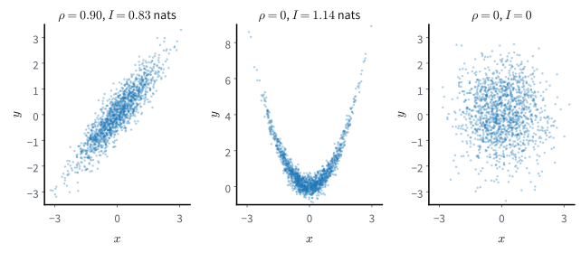
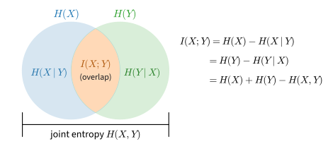
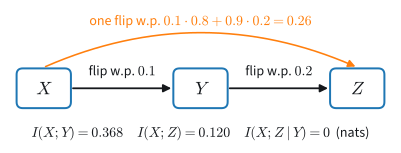
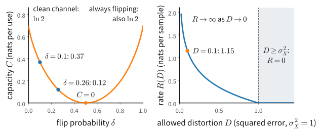
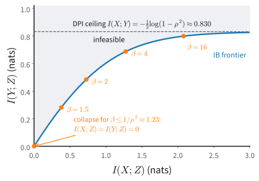

# Mutual Information
:label:`sec_mdl-mutual-information`

The previous sections compared two distributions over the same variable,
such as the data and a model. Many questions in deep learning concern a pair
of variables instead. An image and its caption share content; so do two
crops of one photograph, and a sentence and its translation. How much does
one of them tell us about the other?

The measure of dependence we already have, the correlation coefficient, answers
only for straight-line relations. Take $X\sim\mathcal N(0,1)$ and let $Y$ be
its square plus a little noise, $Y=X^2+0.3\,\epsilon$ with independent
$\epsilon\sim\mathcal N(0,1)$. Their correlation is zero, because
$\textrm{Cov}(X,Y)=\mathbb{E}[X^3]=0$ by symmetry. Yet knowing $X$ pins $Y$
down up to noise of standard deviation $0.3$, while $Y$ on its own spreads
from about $0$ to $9$, and the correlation sees none of this. The quantity this
section defines sees it: it credits this pair with more shared information
than a Gaussian pair with correlation $0.9$.

We want a number that is zero exactly when two variables are independent,
that grows with their dependence, and that does not change when either
variable is measured in other coordinates. We already have what we need to
build it: the KL divergence $D_{\textrm{KL}}(P\|Q)$ of
:numref:`sec_mdl-information_theory`, which is never negative and is zero
only when $P=Q$. Take for $P$ the joint distribution of the pair and for $Q$
the distribution the pair would have if its members were independent. The
result is the *mutual information* $I(X;Y)$.

The definition is the easy part, and three results are what the section is
for. Processing cannot increase mutual information, so no layer of a network
knows more about the input than the layer below it. A classifier cannot reach
a given error rate unless its input carries a minimum of information about the
label. And the test loss of any model yields a lower bound on that
information. Two more results are Shannon's: the most a noisy channel can
carry and the least a compressor must keep are the same quantity, maximized
and minimized. Give the compressor a label that decides what matters, and its
problem becomes the question of what a representation should keep. Throughout
this section the distributions are known. Estimating mutual information from
samples alone is a different and harder problem, which
:numref:`sec_mdl-mi-estimation` takes up.

We work in nats, so $1$ bit $=\ln 2\approx0.693$ nats. Both $\log$ and $\ln$
denote the natural logarithm, and $H_b(p)=-p\log p-(1-p)\log(1-p)$ is the
binary entropy.

```{.python .input #mutual-information-imports}
#@tab mxnet
import math
import numpy as np
from mxnet import autograd, gluon, init, np as mnp, npx
from mxnet.gluon import nn
from d2l import mxnet as d2l
npx.set_np()
```

```{.python .input #mutual-information-imports}
#@tab pytorch
import math
import numpy as np
import torch
from torch import nn
from torch.nn import functional as F
from d2l import torch as d2l
```

```{.python .input #mutual-information-imports}
#@tab tensorflow
import math
import numpy as np
import tensorflow as tf
from d2l import tensorflow as d2l
```

```{.python .input #mutual-information-imports}
#@tab jax
import math
import numpy as np
import jax
from jax import numpy as jnp
from flax import nnx
import optax
from d2l import jax as d2l
```

## The Calculus of Dependence
:label:`sec_mdl-mi-recap`

Every definition of this section is computed first on one table of four
numbers, and the same table returns in each later part.

### Joint and Conditional Entropy

Let $X$ be a fair bit, and let $Y$ be a copy of it that is flipped with
probability $\delta=0.1$. Read $X$ as a bit sent over a noisy line and $Y$ as
the bit received, or read $Y$ as a binary label and $X$ as a feature that
agrees with it $90\%$ of the time. The table is symmetric, so nothing below
depends on the reading. With rows indexing $x\in\{0,1\}$ and columns
$y\in\{0,1\}$, the joint distribution is

$$
p_{X,Y}=\begin{pmatrix}0.45&0.05\\0.05&0.45\end{pmatrix},
$$

and summing rows and columns gives the marginals $p_X=p_Y=(\tfrac12,\tfrac12)$.

A pair has two entropies beyond those of its members, both defined in
:numref:`subsec_mdl-joint-conditional-entropy`. The *joint entropy* is the
entropy of the pair viewed as a single variable, here one with four outcomes:

$$H(X, Y) = -\mathbb{E}_{(x, y) \sim P_{X,Y}} [\log p_{X, Y}(x, y)].$$
:eqlabel:`eq_mdl-joint_ent_def`

On the table, $H(X,Y)=-2(0.45\ln0.45)-2(0.05\ln0.05)=1.018$ nats. That is more
than the $0.693$ nats of one fair bit and less than the $1.386$ nats of two
independent ones.

The *conditional entropy* is the surprise left in $Y$ once $X$ is known, which
is the average entropy of the rows of the table
$p(y\mid x)=p_{X,Y}(x,y)/p_X(x)$:

$$H(Y \mid X) = - \mathbb{E}_{(x, y) \sim P_{X,Y}} [\log p(y \mid x)] = \sum_x p_X(x)\, H(Y \mid X = x).$$
:eqlabel:`eq_mdl-cond_ent_def`

In the running example the rows are $(0.9,0.1)$ and $(0.1,0.9)$, each with
entropy $H_b(0.1)=0.325$ nats, so $H(Y\mid X)=0.325$. After $X$ has been seen,
$Y$ keeps $0.325$ of its $0.693$ nats of surprise.

The three numbers satisfy $1.018=0.693+0.325$. This is the chain rule
$H(X,Y)=H(X)+H(Y\mid X)$ of the same subsection: the surprise in the pair is
the surprise in $X$ plus what $Y$ adds once $X$ is known.

### Mutual Information

Conditional entropy is the part of the surprise in $Y$ that $X$ cannot explain.
We want the part the two variables share. If $X$ and $Y$ were independent,
their joint distribution would be the product of the marginals,
$P_X \otimes P_Y$, with $p_X(x)\,p_Y(y)$ in every cell. The *mutual
information* measures with the KL divergence how far the actual joint
distribution is from that product:

$$I(X; Y) = D_{\textrm{KL}}\big(P_{X,Y} \,\|\, P_X \otimes P_Y\big) = \mathbb{E}_{(x, y) \sim P_{X,Y}} \left[ \log\frac{p_{X, Y}(x, y)}{p_X(x)\, p_Y(y)} \right].$$
:eqlabel:`eq_mdl-mut_ent_def`

In the running example the product of the marginals puts $0.25$ in every cell.
The ratio of the joint to the product is therefore $0.45/0.25=1.8$ on the
diagonal, where $X$ and $Y$ agree, and $0.05/0.25=0.2$ off it, so

$$
I(X;Y)=0.9\ln1.8+0.1\ln0.2=0.529-0.161=0.368\textrm{ nats}.
$$

Agreements occur $1.8$ times as often as independence predicts, and
disagreements one fifth as often. Mutual information averages the logarithms of
these factors under the joint distribution. A KL divergence is also the extra
length of a code built from the wrong model
(:numref:`sec_mdl-coding-compression`), so $I(X;Y)$ is the number of nats per
pair that a code wastes when it treats $X$ and $Y$ as independent.
:numref:`sec_diffusion-discrete` meets this penalty when a network predicts two
masked tokens independently.

The definition can also be read one row of the table at a time. Dividing the
joint and the product by $p_X(x)$ turns the ratio into $p(y\mid x)/p_Y(y)$,
and the expectation over the pair into an expectation over $x$ of a divergence
between two distributions of $y$:

$$I(X;Y)=\mathbb{E}_{x\sim P_X}\Big[D_{\textrm{KL}}\big(p(y\mid x)\,\|\,p_Y(y)\big)\Big].$$
:eqlabel:`eq_mdl-mi-conditional-form`

Mutual information is how far, on average, learning $x$ moves the distribution
of $Y$ away from its marginal. In the running example each row, $(0.9,0.1)$ or
$(0.1,0.9)$, lies $0.9\ln1.8+0.1\ln0.2=0.368$ nats from the marginal
$(0.5,0.5)$. This form suits a pair whose members play different roles, such
as an input and what a noisy encoder makes of it, and we return to it in
:numref:`sec_mdl-information-bottleneck`.

**Proposition (properties of mutual information).** *For any pair $(X,Y)$,
$I(X;Y)=I(Y;X)\ge0$, with equality if and only if $X$ and $Y$ are
independent. When the entropies involved are finite,*

$$
I(X;Y)=H(X)+H(Y)-H(X,Y)=H(X)-H(X\mid Y)=H(Y)-H(Y\mid X).
$$

**Proof.** The ratio in :eqref:`eq_mdl-mut_ent_def` is unchanged when $X$ and
$Y$ trade places, which gives symmetry. Nonnegativity and the equality case
are Gibbs' inequality for the two distributions $P_{X,Y}$ and
$P_X \otimes P_Y$: the divergence is nonnegative, and it is zero exactly when
$p_{X,Y}(x,y) = p_X(x)\,p_Y(y)$ almost everywhere, which is the definition
of independence. For the identities, split the logarithm of the ratio into
three terms and take expectations:

$$
I(X; Y) = \mathbb{E}\left[\log p_{X,Y}(x,y)\right] - \mathbb{E}\left[\log p_X(x)\right] - \mathbb{E}\left[\log p_Y(y)\right] = -H(X,Y) + H(X) + H(Y).
$$

Substituting the chain rule in its two orders,
$H(X,Y) = H(Y) + H(X \mid Y)=H(X)+H(Y\mid X)$, gives the other two forms.
$\blacksquare$

So $X$ says as much about $Y$ as $Y$ says about $X$. The last form reads mutual
information as a reduction in surprise: seeing $X$ lowers the surprise in $Y$
from $H(Y)$ to $H(Y\mid X)$, in the running example from $0.693$ to $0.325$
nats. Nonnegativity adds that $H(X,Y)\le H(X)+H(Y)$, with equality exactly at
independence: a pair never carries more surprise than its members taken
separately. :numref:`fig_mdl-mi-overlap` draws the identities. Each identity
of the proposition is one way of reading off the area of the overlap.


:label:`fig_mdl-mi-overlap`

The function `mutual_information` implements the divergence form for any
table, and we reuse it throughout. The cell also evaluates the last identity,
with $H(Y\mid X)$ as the average entropy of the rows.

```{.python .input #mutual-information-joint-conditional}
p_xy = np.array([[0.45, 0.05],    # rows x, columns y: a fair bit X and
                 [0.05, 0.45]])   # its copy Y, flipped with probability 0.1

def entropy(p):
    """Entropy of a p.m.f. of any shape, in nats (0 log 0 = 0)."""
    p = p[p > 0]
    return float(-(p * np.log(p)).sum())

def mutual_information(p_xy):
    """I(X;Y) of a discrete joint p.m.f. (rows x, columns y), in nats."""
    p_x = p_xy.sum(axis=1, keepdims=True)
    p_y = p_xy.sum(axis=0, keepdims=True)
    m = p_xy > 0                                  # 0 log 0 = 0
    return float((p_xy[m] * np.log(p_xy[m] / (p_x * p_y)[m])).sum())

p_x, p_y = p_xy.sum(axis=1), p_xy.sum(axis=0)     # marginals from the joint
H_rows = sum(p_x[i] * entropy(p_xy[i] / p_x[i]) for i in range(2))   # H(Y|X)
I = mutual_information(p_xy)
print(f'I(X;Y) = {I:.4f} nats (KL form) = {entropy(p_y) - H_rows:.4f} '
      f'(H(Y) - H(Y|X)) = {I / np.log(2):.3f} bits')
```

Both forms return $0.3681$ nats, or $0.531$ bits: a copy that is wrong one
time in ten carries about half a bit about the original.

### The Gaussian Pair
:label:`subsec_mdl-mi-gaussian`

For one continuous pair the mutual information has a closed form, and
:numref:`sec_mdl-mi-estimation` will test every estimator against it. For
densities, the entropies become the differential entropies $h$ of
:numref:`subsec_mdl-differential-entropy`, which can be negative and which
change with the units of measurement. The KL form of $I$ does neither. The
chain-rule algebra never used discreteness, so
$I(X;Y)=h(X)+h(Y)-h(X,Y)=h(Y)-h(Y\mid X)$ whenever these are finite.

**Proposition (Gaussian mutual information).** *If $(X, Y)$ is bivariate
Gaussian with variances $\sigma_X^2,\sigma_Y^2>0$ and correlation coefficient
$\rho$, $\rho^2<1$, then*

$$I(X; Y) = -\tfrac{1}{2} \log\left(1 - \rho^2\right).$$
:eqlabel:`eq_mdl-gaussian_mi`

**Proof.** Use $I(X;Y)=h(Y)-h(Y\mid X)$. A Gaussian with variance $\sigma^2$
has differential entropy $\tfrac12\log(2\pi e\sigma^2)$, as computed in
:numref:`subsec_mdl-gaussian-max-entropy`, so
$h(Y)=\tfrac12\log(2\pi e\sigma_Y^2)$. Given $X=x$, the variable $Y$ is
Gaussian with variance $\sigma_Y^2(1-\rho^2)$, whatever $x$ is, so $h(Y\mid
X)=\tfrac12\log\big(2\pi e\sigma_Y^2(1-\rho^2)\big)$. The difference is
$-\tfrac12\log(1-\rho^2)$. $\blacksquare$

The answer depends only on $1-\rho^2$, the fraction of the variance of $Y$ that
$X$ leaves unexplained. The units of $Y$ have cancelled, a first instance of
the invariance proved in :numref:`sec_mdl-mi-nonlinear-correlation`.

At $\rho = 0$ the variables are independent and $I = 0$. In between,
$\rho = 0.5$ gives $0.144$ nats, $\rho = 0.9$ gives $0.830$ nats and
$\rho = 0.99$ gives $1.959$ nats. The standard pair at $\rho=0.9$ is the
continuous running example of this section. As $\rho \to \pm 1$ the joint
density collapses onto a line and $I \to \infty$.

Mutual information can indeed be infinite, and this matters twice below. If
$Y=X$ for a continuous $X$, knowing $X$ fixes $Y$ to infinitely many digits,
and the same happens whenever $Y$ is a function of $X$ that still takes a
continuum of values (more exactly, whose distribution has no atoms). It cannot
happen when $Y$ is discrete with finite entropy: then
$I(X;Y)=H(Y)-H(Y\mid X)\le H(Y)$ whatever $X$ is, where $H(Y\mid X)$ averages
the entropy of $p(\cdot\mid x)$ over $x$. For a standard normal $X$, the sign
of $X$ carries $\ln 2$ nats. The same bound caps the Jensen–Shannon divergence
of :numref:`sec_basic_gan`, the mutual information between a sample and the
binary label of its source, at $\ln 2$.

### Pointwise Mutual Information
:label:`subsec_mdl-pmi`

Mutual information is an average over all pairs of outcomes, and the
average hides which pairs contribute. Often a single pair is what we care
about: does seeing the word *new* make the next word *york* more likely than
chance? The summand of :eqref:`eq_mdl-mut_ent_def` answers this. It is the
*pointwise mutual information*

$$\textrm{pmi}(x, y) = \log\frac{p_{X, Y}(x, y)}{p_X(x)\, p_Y(y)},$$
:eqlabel:`eq_mdl-pmi_def`

which compares how often the particular pair $(x, y)$ occurs with how often it
would occur if $X$ and $Y$ were independent. Positive pmi means that the two
outcomes attract (they co-occur more often than chance predicts), negative pmi
means that they repel, and $I(X;Y) = \mathbb{E}_{(x,y) \sim
P_{X,Y}}[\textrm{pmi}(x,y)]$ is the average attraction. In the running example
the pmi is $\ln1.8=+0.588$ on the two agreements and $\ln0.2=-1.609$ on the two
disagreements, the two logarithms we averaged above.

Pointwise mutual information is widely used in natural language
processing :cite:`Church.Hanks.1990`, where it separates *collocations*,
word pairs that belong together, from words that merely co-occur because
both are common. Suppose we count consecutive word pairs (bigrams) in a small
corpus and tally how often each of the first words *new*, *machine*, *the* is
followed by each of *york*, *learning*, *day*:

| count | york | learning | day |
| :-- | --: | --: | --: |
| **new** | 38 | 3 | 9 |
| **machine** | 1 | 46 | 3 |
| **the** | 11 | 21 | 168 |

The raw counts are misleading. "The day" is by far the most frequent pair
($168$ occurrences against $38$ for "new york") because *the* and *day* are
both frequent words. Which pairs are collocations once the frequencies of the
single words are removed?

```{.python .input #mutual-information-pmi-corpus}
counts = np.array([[38., 3., 9.],      # new york / new learning / new day
                   [1., 46., 3.],      # machine ...
                   [11., 21., 168.]])  # the ...
first, second = ['new', 'machine', 'the'], ['york', 'learning', 'day']

p = counts / counts.sum()
pmi = np.log(p / (p.sum(axis=1, keepdims=True) * p.sum(axis=0, keepdims=True)))
for (i, j) in [(0, 0), (1, 1), (2, 2), (2, 0)]:
    print(f'pmi({first[i]}, {second[j]}) = {pmi[i, j]:6.3f} nats '
          f'(count {counts[i, j]:.0f})')
print(f'I(first; second) = {float((p * pmi).sum()):.4f} nats')
```

After the correction for the marginals, the collocations receive the higher
scores: "new york" scores $1.52$ nats and "machine learning" $1.37$, while the
frequent "the day" reaches only $0.34$. The pair "the york" comes out negative,
$-1.11$ nats: it occurs three times less often than independence would predict.
The mutual information of the table, $0.41$ nats, summarizes how strongly first
words constrain second words on average. The same correction survives in
learned word vectors (:numref:`sec_lm_word_embeddings`): skip-gram training
with $K$ negative samples per pair implicitly factorizes the matrix of shifted
pointwise mutual informations, $\textrm{pmi}(x,y)-\log K$
:cite:`Levy.Goldberg.2014`, as Exercise
:exref:`ex_mdl-mutual-information-negative-sampling-pmi` of
:numref:`sec_mdl-mi-estimation` derives.

### Mutual Information as Nonlinear Correlation
:label:`sec_mdl-mi-nonlinear-correlation`

The correlation coefficient $\rho(X,Y)=\textrm{Cov}(X,Y)/(\sigma_X\sigma_Y)$ of
:numref:`sec_mdl-joint-distributions` detects linear dependence only:
$\rho(X,Y)=0$ does not imply independence. Mutual information is zero only at
independence. The pair of the opening shows the difference in numbers.

Let $X \sim \mathcal{N}(0, 1)$ and $Y = X^2 + 0.3\,\epsilon$ with independent
$\epsilon \sim \mathcal{N}(0,1)$, a pair with $\rho=0$. The identity
$I(X;Y)=h(Y)-h(Y\mid X)$ makes $I$ computable from one-dimensional integrals.
Given $X=x$, the only randomness in $Y$ is the noise, and shifting by the known
constant $x^2$ does not change differential entropy, so
$h(Y\mid X)=h(0.3\,\epsilon)=\tfrac12\log(2\pi e\cdot0.09)=0.215$ nats. For
$h(Y)$ a bound comes before the value. $Y$ has variance
$\textrm{Var}(X^2)+0.09=2.09$, and no density with that variance has more
differential entropy than the Gaussian's $\tfrac12\log(2\pi e\cdot2.09)=1.79$
nats (:numref:`subsec_mdl-gaussian-max-entropy`), so
$I(X;Y)\le1.79-0.215=1.57$ nats. The density of $Y$ is a mixture over $x$,
$p_Y(y)=\int\mathcal N(x;0,1)\,\mathcal N(y;x^2,0.09)\,dx$, which has no closed
form, so we integrate it numerically to obtain $h(Y)$.

```{.python .input #mdl-mutual-information-mutual-information-as-nonlinear-correlation-1}
normal = lambda t, var: np.exp(-t**2 / (2 * var)) / np.sqrt(2 * np.pi * var)
xs = np.linspace(-6, 6, 6001)              # quadrature grid for X
ys = np.linspace(-2.5, 30, 6501)           # grid for Y = X^2 + 0.3 eps
dx, dy = xs[1] - xs[0], ys[1] - ys[0]
p_Y = np.concatenate([                     # p_Y(y) = int N(x;0,1) N(y;x^2,0.09) dx
    (normal(xs, 1) * normal(c[:, None] - xs**2, 0.09)).sum(axis=1) * dx
    for c in np.array_split(ys, 13)])      # 13 chunks keep memory small
h_Y = float(-(p_Y[p_Y > 0] * np.log(p_Y[p_Y > 0])).sum() * dy)
h_noise = 0.5 * np.log(2 * np.pi * np.e * 0.09)   # h(Y|X) = h(0.3 eps)
print(f'h(Y) = {h_Y:.3f}, h(Y|X) = {h_noise:.3f}, '
      f'I(X;Y) = h(Y) - h(Y|X) = {h_Y - h_noise:.3f} nats')
```

The pair shares $1.141$ nats. That is below the bound of $1.57$, because the
density of $Y$, piled up near zero with a long tail to the right, is far from
Gaussian. It is also more than the $0.830$ nats of the Gaussian pair at
$\rho=0.9$, and this from a pair whose correlation is zero.
:numref:`fig_mdl-mi-corr-vs-mi` shows the three cases side by side.


:label:`fig_mdl-mi-corr-vs-mi`

Correlation and mutual information differ in a second way, which concerns
coordinates. Recording a temperature in Fahrenheit instead of Celsius, or a
price as its logarithm, leaves what it tells about anything else as it was, and
a measure of dependence should not notice the change.

**Proposition (reparameterization invariance).** *Let $\phi$ and $\psi$ be
invertible maps of the values of $X$ and of $Y$. Then
$I(\phi(X);\psi(Y))=I(X;Y)$.*

**Proof.** For discrete variables, invertible maps only relabel the outcomes:
the joint distribution of $(\phi(X), \psi(Y))$ takes the same values as that of
$(X, Y)$, at different labels, and the sum in :eqref:`eq_mdl-mut_ent_def` is
unchanged. For continuous variables we prove the smooth case, which shows the
mechanism; :numref:`subsec_mdl-dpi` removes the assumption. Let $\phi$ and
$\psi$ be continuously differentiable with continuously differentiable
inverses, and change variables $(x, y) \mapsto (\phi(x), \psi(y))$. The joint
density of the new pair at $(\phi(x),\psi(y))$ is $p_{X,Y}(x,y)\,|\det
D\phi(x)|^{-1}|\det D\psi(y)|^{-1}$, and the two marginal densities pick up the
factors $|\det D\phi(x)|^{-1}$ and $|\det D\psi(y)|^{-1}$. The factors cancel
in the ratio, so the integrand of :eqref:`eq_mdl-mut_ent_def` takes the same
value at corresponding points, and its expectation is the same. A set of
exceptional points of probability zero, such as the origin for $x\mapsto x^3$,
does not matter. $\blacksquare$

Differential entropy has no such invariance: there the Jacobian factor does not
cancel, which is why $h$ changes with the units. Correlation is preserved only
by affine maps, up to sign. Apply the invertible map $x\mapsto x^3$ to the
first coordinate of the running Gaussian pair. The mutual information stays at
$0.830$ nats, while the correlation falls from $0.9$ to
$3\rho/\sqrt{15}=0.697$, because $\mathbb{E}[X^3Y]=3\rho$ and
$\textrm{Var}(X^3)=15$ for a standard $X$. Mutual information asks whether two
variables are informative about each other in any coordinates, not whether
they line up.

## Processing and Prediction

The two guarantees of this part are the main results of the section:
processing cannot increase information, and accurate prediction needs a minimum
amount of it. Both rest on one identity, a chain rule for mutual information.
The part ends with the bound that the loss of any model places on the
information in its input.

### Conditional Mutual Information and the Chain Rule

We extend the running example by one step. Let $Z$ be $Y$ flipped once more,
independently, with probability $0.2$: a fair bit sent over two noisy lines in
series, or a label, a noisy feature and a noisy copy of the feature
(:numref:`fig_mdl-it-bsc-chain`). Two flips in series are one flip. The bit
arrives flipped if exactly one of the two lines flips it, with probability
$0.1\cdot0.8+0.9\cdot0.2=0.26$, so the pair $(X,Z)$ is the running pair with
$\delta=0.26$, and $I(X;Z)=\ln2-H_b(0.26)=0.120$ nats. The second line has
removed two thirds of the $0.368$ nats that $Y$ carried.


:label:`fig_mdl-it-bsc-chain`

Three variables raise a question that two do not: how much do $X$ and $Y$
share once $Z$ is known? Like entropy, mutual information has a conditional
version for this,

$$I(X; Y \mid Z) = H(X \mid Z) - H(X \mid Y, Z),$$
:eqlabel:`eq_mdl-cond_mi_def`

where $H(X\mid Y,Z)$ is the conditional entropy given the pair $(Y,Z)$. Writing
each conditional entropy as an expectation and collecting the logarithms gives
the divergence form $I(X; Y \mid Z) = \mathbb{E}_{z}\big[D_{\textrm{KL}}(P_{X,Y
\mid z}\,\|\, P_{X \mid z} \otimes P_{Y \mid z})\big]$, the definition of
mutual information applied under each conditional distribution. As an average
of divergences it is nonnegative, and it is zero exactly when $X$ and $Y$ are
conditionally independent given $Z$.

The information that the pair $(Y,Z)$ carries about $X$ now splits in two.
Subtract and add $H(X\mid Z)$ in $I(X;Y,Z)=H(X)-H(X\mid Y,Z)$:

$$
I(X; Y, Z) = \underbrace{H(X) - H(X \mid Z)}_{I(X;\, Z)}
+ \underbrace{H(X \mid Z) - H(X \mid Y, Z)}_{I(X;\, Y \mid Z)}.
$$

This is the *chain rule for mutual information*, and it holds in general when
each term is written in its KL form. What $(Y,Z)$ tells about $X$ is what $Z$
tells plus what $Y$ adds once $Z$ is known. The rule can take $Y$ first just as
well, and on the running chain the two orders split one number in two ways.
$Z$ was made from $Y$ and fresh noise, so once $Y$ is known it says nothing
more about $X$: $I(X;Z\mid Y)=0$, and with $Y$ first,
$I(X;Y,Z)=I(X;Y)+0=0.368$ nats. With $Z$ first the same $0.368$ nats are
$I(X;Z)+I(X;Y\mid Z)=0.120+I(X;Y\mid Z)$, so $I(X;Y\mid Z)=0.248$ nats.
Conditioning on $Z$ has lowered what $Y$ says about $X$, because here $Z$
already holds part of it. Conditioning does not always do so, and the next
subsection has a case where it raises information.

### The Data-Processing Inequality
:label:`subsec_mdl-dpi`

A hidden layer is computed from the layer below it, and that layer from the
input. Can processing of this kind create information about the input that the
earlier layer did not already carry? On the two noisy lines it could not, and
the calculation used nothing that is special to bits.

Random variables $X, Y, Z$ form a *Markov chain*, written $X \to Y \to Z$,
when $Z$ depends on $(X, Y)$ only through $Y$:
$p(z \mid x, y) = p(z \mid y)$. This is the structure of processing: $Y$ is
computed from $X$ (a measurement, a feature map, a hidden layer), then $Z$ is
computed from $Y$ alone, possibly with fresh randomness. Equivalently, $X$
and $Z$ are conditionally independent given $Y$, so $I(X; Z \mid Y) = 0$.

**Proposition (data-processing inequality).** *If $X \to Y \to Z$ is a
Markov chain and the entropies involved are finite, then*

$$
I(X; Z) \leq I(X; Y),
$$

*with equality if and only if $I(X; Y \mid Z) = 0$, that is, if and only if
$X \to Z \to Y$ is also a Markov chain* :cite:`Cover.Thomas.1999`.

**Proof.** Expand $I(X; Y, Z)$ by the chain rule in both orders:

$$
I(X; Z) + I(X; Y \mid Z) = I(X; Y, Z) = I(X; Y) + I(X; Z \mid Y).
$$

The Markov property makes the last term zero, which leaves
$I(X; Z) = I(X; Y) - I(X; Y \mid Z) \leq I(X; Y)$, since conditional mutual
information is nonnegative. Equality holds exactly when
$I(X; Y \mid Z) = 0$. $\blacksquare$

No processing of $Y$, deterministic or random, can increase the information it
carries about $X$. On the running chain the inequality reads $0.120\le0.368$.

The inequality is a statement about Markov chains, not about conditioning in
general, and conditioning can create dependence. Let $X$ and $Y$ be independent
fair bits and $Z=X\oplus Y$ their exclusive or. Then $X$ and $Y$ share nothing,
but once $Z$ is known, $Y$ determines $X$. The cell computes the informations
of the running chain from its three-way table, and then those of this triple.

```{.python .input #mutual-information-dpi-check}
def cond_mi(p_abc):
    """I(A;B|C) of a joint p.m.f. indexed [a, b, c], in nats."""
    p_ac, p_bc, p_c = p_abc.sum(1), p_abc.sum(0), p_abc.sum((0, 1))
    m = p_abc > 0                                  # 0 log 0 = 0
    ratio = ((p_abc * p_c[None, None, :])[m]
             / (p_ac[:, None, :] * p_bc[None, :, :])[m])
    return float((p_abc[m] * np.log(ratio)).sum())

flip = lambda d: np.array([[1 - d, d], [d, 1 - d]])   # p(output | input)
p_xyz = 0.5 * flip(0.1)[:, :, None] * flip(0.2)[None, :, :]   # X -> Y -> Z
I_xy, I_xz = mutual_information(p_xyz.sum(2)), mutual_information(p_xyz.sum(1))
I_xz_y, I_xy_z = cond_mi(p_xyz.transpose(0, 2, 1)), cond_mi(p_xyz)
print(f'I(X;Y) = {I_xy:.4f}, I(X;Z) = {I_xz:.4f}, '
      f'I(X;Z|Y) = {I_xz_y:.4f}, I(X;Y|Z) = {I_xy_z:.4f}')
print(f'I(X;Y,Z) by the chain rule: {I_xz + I_xy_z:.4f} = {I_xy + I_xz_y:.4f}')
p_xor = np.zeros((2, 2, 2))
for a, b in np.ndindex(2, 2):
    p_xor[a, b, a ^ b] = 0.25          # independent fair bits, Z = X xor Y
print(f'XOR: I(X;Y) = {mutual_information(p_xor.sum(2)):.4f}, '
      f'I(X;Y|Z) = {cond_mi(p_xor):.4f} nats')
```

For the chain, $I(X; Z \mid Y) = 0$ is the Markov property in numbers, and both
expansions of $I(X; Y, Z)$ give $0.3681$ nats. For the exclusive or,
conditioning on $Z$ raises the information between $X$ and $Y$ from $0$ to the
full $\ln2=0.693$ nats of a bit.

When does processing lose nothing? By the proposition, exactly when
$X\to Z\to Y$ is also a Markov chain: $Z$ must hold everything that $Y$ says
about $X$. An invertible map $Z=g(Y)$ does, since $Y$ can be recomputed from
$Z$. A map that discards part of $Y$ loses nothing either, provided that what
it discards is unrelated to $X$. The number of heads in a sequence of coin
flips keeps everything the sequence says about the bias of the coin, because
the order of the flips says nothing about it. A summary $T(Y)$ of this kind,
for which $p(x \mid y)$ depends on $y$ only through $T(y)$ and therefore
$I(X;T(Y))=I(X;Y)$, is called a *sufficient statistic*. The sufficient
statistics of an exponential family (:numref:`sec_mdl-exponential-family`) are
summaries of this kind: there $Y$ is the data and $X$ the parameter $\theta$,
with a prior on $\theta$ so that $I(\theta;Y)$ is defined.

The inequality itself needs neither finite entropies nor densities. Mutual
information is a KL divergence, and no map of the data, random or
deterministic, increases a KL divergence.
:numref:`subsec_mdl-f-div-data-processing` proves this for countable sets, and
it holds in general; Exercise
:exref:`ex_mdl-mutual-information-dpi-from-f-divergence` turns it into a proof
of the inequality. Applied to an invertible map and then to its inverse, the
inequality gives the invariance proposition of
:numref:`sec_mdl-mi-nonlinear-correlation` without the smoothness assumed
there.

Applied to a network, the inequality is easy to over-read. The layers form a
Markov chain $X \to Z_1 \to Z_2 \to \cdots$, so $I(X; Z_\ell)$ cannot
increase with $\ell$. From here to the end of this part, $Y$ no longer stands
for the middle of a chain but for a label. Whatever the network knows of the
label it knows through the input, so $Y \to X \to Z_1 \to Z_2 \to \cdots$
is a Markov chain too, and $I(Y; Z_\ell)$ cannot increase with $\ell$ either.
No architecture can create label information that the input lacks, and no
later layer can recover what an earlier layer discarded.

This does not make depth harmful. Layers do not add information about the
label; they rearrange it so that a simple final layer can read it. Let the
label be a fair bit, and let the input be uniform on the circle of radius $1$
around the origin when $Y=0$ and on the circle of radius $2$ when $Y=1$. The
input determines the label, so $I(Y;X)=\ln2$, yet no line separates a circle
from the one inside it: the best linear classifier, with its boundary tangent
to the inner circle, is right two times in three. The layer $Z=\|X\|^2$ takes
the values $1$ and $4$, and a threshold between them is always right. It
carries $I(Y;Z)=\ln2$ nats, no more than the input did. The layer added
nothing and made everything readable, and Exercise
:exref:`ex_mdl-mutual-information-usable-information` defines a kind of
information that counts only what a given family of classifiers can read.

The chain that starts from the input, $X \to Z_1 \to Z_2 \to \cdots$, needs a
caution. A deterministic layer has $H(Z_\ell\mid X)=0$, so for a discrete or
quantized representation $I(X;Z_\ell)$ is just the entropy $H(Z_\ell)$ of the
layer, and for a continuous one it is typically infinite
(:numref:`subsec_mdl-mi-gaussian`).
As a measure of what a layer keeps of its input, $I(X;Z_\ell)$ therefore says
something only when the layer is noisy or its output is discrete.

### Fano's Inequality
:label:`subsec_mdl-fano`

Accurate prediction needs mutual information. A classifier that reaches
$5\%$ error on $1{,}000$ classes must see an input that carries most of the
label's information, and Fano's inequality says how much.

**Proposition (Fano's inequality).** *Let $Y$ take values in a set of $k$
elements, let $\hat Y=g(X)$ be any estimate of $Y$ computed from $X$ and
taking values in the same set, and let $P_e=P(\hat Y\ne Y)$ be its error
probability. Then*

$$H_b(P_e) + P_e \log(k - 1) \geq H(Y \mid X) = H(Y) - I(X; Y).$$
:eqlabel:`eq_mdl-fano`

The left side is the cost of repairing the estimate: $H_b(P_e)$ nats to say
whether it is wrong and, when it is, at most $\log(k-1)$ nats to say which of
the other labels is right. Whoever holds the estimate and the repair knows
$Y$, so the repair cannot cost less than the uncertainty about $Y$ that the
estimate leaves, and an estimate computed from $X$ leaves at least as much as
$X$ does. The count of $k-1$ other labels requires the estimate to stay inside
the label set. If it may answer "abstain", $\log k$ replaces $\log(k-1)$, and
the inequality as stated fails: for a fair bit $Y$ independent of $X$ and an
estimator that always abstains, $P_e=1$ and the left side is
$H_b(1)+\log1=0$, below $H(Y\mid X)=\ln2$.

The proof makes this argument exact with one device, an indicator of the
error. The rest is the chain rule.

**Proof.** Let $W = \mathbf{1}\{\hat Y \neq Y\}$ indicate an error. We expand
$H(W, Y \mid \hat Y)$, the uncertainty about the error and the label that
remains once the estimate is known, in two orders. First, $W$ is a function
of $(Y,\hat Y)$ and adds nothing, so
$H(W, Y \mid \hat Y) = H(Y \mid \hat Y)$. Second,
$H(W, Y \mid \hat Y) = H(W \mid \hat Y) + H(Y \mid W, \hat Y)$, and we bound
both terms.

* Conditioning cannot raise entropy, because
  $H(W)-H(W\mid\hat Y)=I(W;\hat Y)\ge0$. So
  $H(W \mid \hat Y) \leq H(W) = H_b(P_e)$.
* Given $W=0$ the label equals the estimate and has no uncertainty. Given
  $W=1$, which has probability $P_e$, the label is one of the $k-1$ values
  other than $\hat Y$. So $H(Y \mid W, \hat Y) \leq P_e \log(k-1)$.

Together, $H(Y\mid\hat Y)\le H_b(P_e)+P_e\log(k-1)$. Finally,
$Y \to X \to \hat Y$ is a Markov chain because $\hat Y$ is computed from $X$
alone, and the data-processing inequality gives
$I(Y; \hat Y) \leq I(Y; X)$, that is, $H(Y \mid \hat Y) \geq H(Y \mid X)$.
$\blacksquare$

In the smallest case the bound is tight. In the running pair, estimate the
label $Y$ by the feature, $\hat Y=X$. Then $P_e=0.1$ and $k=2$, and the left
side is $H_b(0.1)+0.1\log1=0.325$, which equals $H(Y\mid X)$. Exercise
:exref:`ex_mdl-mutual-information-fano-tightness` shows when equality holds in
general.

No classifier, however it is trained, beats the bound. On $1{,}000$ balanced
classes, $H(Y)=\ln1000=6.91$ nats, and solving :eqref:`eq_mdl-fano` for
$I(X;Y)$ gives the information that each error rate needs.

```{.python .input #mutual-information-fano}
H_b = lambda p: -p * np.log(p) - (1 - p) * np.log(1 - p)   # binary entropy
k = 1000
for p_e in (0.01, 0.05, 0.2, 0.5):
    need = np.log(k) - H_b(p_e) - p_e * np.log(k - 1)
    print(f'P_e = {p_e:4.2f}: I(X;Y) >= {need:.3f} of log k = {np.log(k):.3f} nats')
```

Five percent error requires at least $6.36$ of the $6.91$ nats of label
entropy, $92\%$ of it, and even a classifier that is wrong half the time needs
$2.76$ nats, two fifths of it.

### The Loss Certificate
:label:`subsec_mdl-loss-certificate`

Fano turns an error rate into a floor on information. A language model is not
judged by how often it guesses the next word, and like every model trained by
maximum likelihood it reports a loss instead. The loss gives a floor too, and
the proof takes three lines.

**Proposition (a loss certifies information).** *Let $q(y\mid x)$ be any
model of the label given the input, with cross-entropy loss
$L=\mathbb{E}[-\log q(Y\mid X)]$ under $P_{X,Y}$. Then*

$$I(X;Y)\;\ge\;H(Y)-L,$$
:eqlabel:`eq_mdl-info-certificate`

*and for $k$ balanced classes, $I(X;Y)\ge\log k-L$.*

**Proof.** We have $I(X;Y)=H(Y)-H(Y\mid X)$. For each $x$, the cross-entropy
of $q(\cdot\mid x)$ under $p(\cdot\mid x)$ exceeds the entropy of
$p(\cdot\mid x)$ by $D_{\textrm{KL}}(p(\cdot\mid x)\,\|\,q(\cdot\mid x))\ge0$
(:numref:`sec_mdl-information_theory`). Averaging over $x$ gives
$H(Y\mid X)\le L$. $\blacksquare$

The loss on held-out data estimates $L$, so the test loss of any classifier or
language model is a statement about the information its input carries. A
classifier of ten balanced classes with a test loss of $0.3$ nats certifies
that its input holds at least $\ln10-0.3=2.0$ of the $2.30$ nats of the label.
The model need not be good, or even sensible, for the bound to be valid; a bad
model only certifies less. This is the bound of :citet:`Barber.Agakov.2003`
with a classifier as the decoder, and :numref:`sec_mdl-mi-variational-bounds`
develops it into a family of estimators.

The certificate is tight when the model is the true conditional, and only
then. On the running pair a model that predicts $\hat Y=X$ with confidence $c$
has loss $L=-0.9\log c-0.1\log(1-c)$, which we evaluate at four confidences.

```{.python .input #mdl-mutual-information-fano-s-inequality-1}
for c in (0.6, 0.8, 0.9, 0.99):
    L = -(0.9 * np.log(c) + 0.1 * np.log(1 - c))   # cross-entropy of q
    print(f'confidence {c:4.2f}: loss {L:.4f}, '
          f'certifies I(X;Y) >= {np.log(2) - L:.4f} nats')
```

Only the calibrated model, with $c=0.9$, certifies the full $0.368$ nats. An
overconfident model ($c=0.99$) incurs a large loss on its errors and certifies
only $0.22$; a hesitant one ($c=0.6$) certifies $0.14$. Yet the four models
make the same decisions and are wrong $10\%$ of the time, so Fano's
inequality, which sees only the error rate, certifies the full $0.368$ nats
for every one of them. The loss also sees the confidences, and it penalizes
wrong ones. Both results bound the one quantity $H(Y\mid X)$ from above, Fano
through an error rate and the certificate through a loss, and each bound
becomes a lower bound on $I(X;Y)$.

## Communication and Compression

Shannon asked two engineering questions, and their answers are a maximum and a
minimum of mutual information: how much a noisy channel can carry, and how
little a compressor may keep. Channel capacity can be skimmed on a first
reading. Rate–distortion cannot, because the last part of the section is built
on it.

### Channel Capacity
:label:`subsec_mdl-channel-capacity`

How many nats per use survive a line that flips each bit with probability
$\delta$? A memoryless *channel* is a conditional distribution $p(y\mid x)$
applied independently to each input symbol. The running pair is one, with input
$X$ and output $Y$. The channel is fixed, but the sender chooses how often to
send each input, and the *capacity* is the largest mutual information any
choice achieves:

$$
C=\max_{p(x)} I(X;Y).
$$
:eqlabel:`eq_mdl-channel-capacity`

A sender who transmits mostly zeros wastes the channel, since such an input has
little entropy to convey. Shannon's channel coding theorem gives the number its
meaning. By coding long blocks of symbols, one can transmit at any rate below
$C$ nats per use with an error probability as small as desired, and at no rate
above $C$ :cite:`Shannon.1948,Cover.Thomas.1999`. We state the theorem without
proof.

For the flip channel, the *binary symmetric channel*, the capacity takes one
line. Write $I(X;Y)=H(Y)-H(Y\mid X)$. Every row of $p(y\mid x)$ is
$(1-\delta,\delta)$ up to order, so $H(Y\mid X)=H_b(\delta)$ whatever the input
distribution, and $H(Y)\le\ln2$ with equality if and only if $Y$ is uniform.
Since $P(Y=1)=\delta+P(X=1)(1-2\delta)$, for $\delta\ne\tfrac12$ the output is
uniform if and only if the input is. Hence

$$C=\ln 2-H_b(\delta)\quad\textrm{nats per use},$$
:eqlabel:`eq_mdl-bsc-capacity`

attained by the uniform input. At $\delta=0.1$ this is the $0.368$ nats of the
running pair, whose input was uniform, and the two lines in series,
$\delta=0.26$, carry $0.120$. At $\delta=\tfrac12$ the output is independent of
the input and the capacity is zero. At $\delta=1$ it is $\ln2$ again, because a
receiver who knows that every bit is flipped flips it back. Flips destroy
information only to the extent that the receiver cannot predict them. The cell
sweeps the input distribution for the $0.1$ channel, then the flip probability
at the uniform input.

```{.python .input #mdl-mutual-information-channel-capacity}
inputs = (0.1, 0.3, 0.5, 0.7, 0.9)
I_in = [mutual_information(np.array([[1 - a], [a]]) * flip(0.1)) for a in inputs]
print('P(X=1):', '  '.join(f'{a:6.2f}' for a in inputs))
print('I(X;Y):', '  '.join(f'{v:6.4f}' for v in I_in))
deltas = (0.0, 0.1, 0.26, 0.5, 1.0)
C = [np.log(2) - entropy(np.array([d, 1 - d])) for d in deltas]
print('delta: ', '  '.join(f'{d:6.2f}' for d in deltas))
print('C:     ', '  '.join(f'{c:6.4f}' for c in C))
```

An input that sends a $1$ only $10\%$ of the time has $H_b(0.1)=0.325$ nats to
offer and gets $0.146$ of them through, well under half of what the uniform
input achieves. The left panel of :numref:`fig_mdl-it-capacity-rd` draws the
capacity as a function of $\delta$. Networks contain channels of their own:
dropout erases a feature with probability $\alpha$ and passes it on otherwise,
and Exercise :exref:`ex_mdl-information-theory-binary-channels` finds that a
binary feature gets at most $(1-\alpha)\ln2$ nats through it.


:label:`fig_mdl-it-capacity-rd`

### Rate–Distortion
:label:`subsec_mdl-rate-distortion`

Lossless coding needs $H(X)$ nats per symbol
(:numref:`sec_mdl-coding-compression`), and a continuous source would need
infinitely many. Often an approximate reconstruction is enough: an image codec
may change pixels slightly, and a learned representation may discard detail on
purpose. Choose a *distortion* $d(x,\hat x)\ge0$ that scores a reconstruction
$\hat x$ of $x$, and allow an average distortion of at most $D$. How few nats
per symbol suffice? The *rate–distortion function* is the least mutual
information an encoder $p(\hat x\mid x)$ must keep to meet the budget:

$$
R(D)=\inf_{p(\hat x\mid x):\;\mathbb{E}[d(X,\hat X)]\le D} I(X;\hat X).
$$
:eqlabel:`eq_mdl-rate-distortion`

A stricter budget costs more information. The operational theorem mirrors the
channel coding theorem: block codes at any rate above $R(D)$ achieve average
distortion $D$, and codes below it cannot :cite:`Shannon.1959`.

In practice the constraint is usually replaced by a penalty. Minimizing
$I(X;\hat X)+\lambda\,\mathbb{E}[d(X,\hat X)]$ over all encoders, with a
multiplier $\lambda>0$, finds the point of the curve $R(D)$ at which the slope
is $-\lambda$: a large $\lambda$ selects a low distortion at a high rate. The
last part of this section states its problem in this Lagrangian form.

**Proposition (Gaussian rate–distortion).** *For a source
$X\sim\mathcal N(0,\sigma_X^2)$ under squared error
$d(x,\hat x)=(x-\hat x)^2$,*

$$
R(D)=\frac12\log\frac{\sigma_X^2}{D}
\quad (0<D<\sigma_X^2),
\qquad R(D)=0\quad(D\ge\sigma_X^2).
$$
:eqlabel:`eq_mdl-gaussian-rd`

Solved for the distortion, the formula reads $D=\sigma_X^2e^{-2R}$: every
additional bit of rate, $\ln2$ nats, divides the squared error by four.

**Proof.** The lower bound is the harder half. It needs one fact from
:numref:`subsec_mdl-gaussian-max-entropy`: among densities with variance $s^2$,
the Gaussian has the largest differential entropy, $\tfrac12\log(2\pi e s^2)$,
and this bound grows with $s^2$. Take any encoder with
$\mathbb{E}[(X-\hat X)^2]\le D$. Then

$$
I(X;\hat X)=h(X)-h(X\mid\hat X)=h(X)-h(X-\hat X\mid\hat X)\ge h(X)-h(X-\hat X)\ge \tfrac12\log(2\pi e\sigma_X^2)-\tfrac12\log(2\pi eD)=\tfrac12\log\frac{\sigma_X^2}{D}.
$$

The second equality holds because subtracting the known $\hat X$ shifts the
conditional density without changing its entropy. The first inequality holds
because conditioning cannot raise entropy. The second is the maximum-entropy
fact, since the error $X-\hat X$ has variance at most
$\mathbb{E}[(X-\hat X)^2]\le D$. For $D\ge\sigma_X^2$ the encoder that sends
nothing and reconstructs the mean $0$ already meets the budget, so $R(D)=0$.

It remains to exhibit an encoder that attains the bound when $D<\sigma_X^2$.
Take $\sigma_X^2=1$ and add noise, $Z=X+\sigma\epsilon$ with
$\epsilon\sim\mathcal N(0,1)$ independent of $X$ and $\sigma>0$. Then
$\textrm{Cov}(X,Z)=1$ and $\textrm{Var}(Z)=1+\sigma^2$, so the squared
correlation is $\rho_{XZ}^2=1/(1+\sigma^2)$, and :eqref:`eq_mdl-gaussian_mi`
gives the information this encoder keeps:

$$I(X;X+\sigma\epsilon)=\tfrac12\log\left(1+\sigma^{-2}\right).$$
:eqlabel:`eq_mdl-gaussian-channel`

Reconstruct with the conditional mean,
$\hat X=\mathbb{E}[X\mid Z]=Z/(1+\sigma^2)$, the regression of $X$ on $Z$ with
slope $\textrm{Cov}(X,Z)/\textrm{Var}(Z)$. Its mean squared error is the
conditional variance, $D=1-1/(1+\sigma^2)=\sigma^2/(1+\sigma^2)$, which takes
every value in $(0,1)$ as $\sigma$ varies. Since $\hat X$ is an invertible
function of $Z$, $I(X;\hat X)=\tfrac12\log(1+\sigma^{-2})=\tfrac12\log(1/D)$.
For a general $\sigma_X^2$, rescale. $\blacksquare$

Formula :eqref:`eq_mdl-gaussian-channel` is the capacity of a *Gaussian
channel* with signal-to-noise ratio $\sigma^{-2}$ (Exercise
:exref:`ex_mdl-mutual-information-gaussian-channel`). A signal plus independent
Gaussian noise is also what the noising step of a diffusion model produces
(:numref:`chap_diffusion`). The cell simulates the encoder of the proof on a
million samples at $\sigma^2=1/9$, $1$ and $3$, for which $D=0.1$, $0.5$ and
$0.75$, and measures its squared error.

```{.python .input #mdl-mutual-information-rate-distortion}
rng = np.random.default_rng()
x = rng.standard_normal(1_000_000)
for s2 in (1 / 9, 1.0, 3.0):                              # sigma^2
    z = x + np.sqrt(s2) * rng.standard_normal(x.size)     # encoder
    x_hat = z / (1 + s2)                                  # E[X | Z]
    D = s2 / (1 + s2)
    mse = np.mean((x - x_hat)**2)
    print(f'sigma^2 = {s2:5.3f}: D = {D:.3f}, MSE {mse:.3f}, '
          f'I(X;Z) = R(D) = {0.5 * np.log(1 + 1 / s2):.3f} nats')
```

The measured squared error agrees with $D$ to within a few thousandths. A
distortion of $D=0.1$ costs $1.15$ nats per sample, $D=0.5$ costs $0.35$, half
a bit, and $D=0.75$ costs $0.14$. The rate grows without bound as $D\to0$,
because an exact copy of a continuous variable has infinite information, and it
reaches $0$ at $D=\sigma_X^2$. The right panel of
:numref:`fig_mdl-it-capacity-rd` draws the curve. Its steep end explains why
image generators compress before they model: the last, imperceptible details
of an image cost most of the nats, and :numref:`sec_diffusion-latent` leaves
them to an autoencoder.

## The Information Bottleneck
:label:`sec_mdl-information-bottleneck`

A representation should keep what predicts the label and drop the rest.
Dropping needs a reason, since the data-processing inequality says that
discarding information never improves the best possible prediction. The reason
is that the rest has a cost. A photograph of a dog also records the lighting,
the lawn and where in the frame the dog stands. A representation that carries
all of this takes more nats to store, and a classifier trained on finitely many
photographs can mistake any of it for a sign of the label. The information
bottleneck states the goal with two mutual informations. It is a
rate–distortion problem in which the label supplies the distortion.

### The Bottleneck Objective

Let $Z$ be a representation of an input $X$ produced by a stochastic encoder
$p(z\mid x)$, and let $Y$ be the label. The encoder has to be stochastic if its
output is continuous: a deterministic one would typically have $I(X;Z)=\infty$
(:numref:`subsec_mdl-mi-gaussian`). The *information bottleneck*
:cite:`Tishby.Pereira.Bialek.1999` asks for a $Z$ that keeps little of $X$ and
much of $Y$:

$$\min_{p(z \mid x)}\; I(X; Z) - \beta\, I(Y; Z).$$
:eqlabel:`eq_mdl-ib_lagrangian`

The first term is the rate, the information the representation keeps about the
input; the second, weighted by $\beta>0$, is the information it keeps about the
label. The encoder sees only $X$, so $Y\to X\to Z$ is a Markov chain and the
data-processing inequality gives $I(Y; Z) \leq \min\{I(X; Y),\, I(X; Z)\}$. A
representation cannot know more about the label than the input does, and it
cannot predict well without keeping input information.

The multiplier sets the trade-off, and its two extremes are simple. For
$\beta\le1$, keeping nothing is optimal: by the inequality above,
$I(X;Z)-\beta I(Y;Z)\ge(1-\beta)\,I(X;Z)\ge0$, and the constant encoder, which
ignores its input and has $I(X;Z)=I(Y;Z)=0$, attains $0$. A bottleneck whose
optimum is the constant encoder is said to *collapse*. For large $\beta$ the
label term dominates, and the optimum keeps whatever predicts $Y$. As $\beta$
grows, $I(Y;Z)$ approaches its ceiling $I(X;Y)$, and the encoder approaches a
minimal sufficient statistic: the coarsest function of $X$ that still predicts
$Y$ as well as $X$ does. An encoder restricted to a family, as every network
is, may stop short of the ceiling.

**Proposition (the bottleneck as a rate–distortion problem).** *If
$Y\to X\to Z$ is a Markov chain, then*

$$
I(Y;Z)=I(X;Y)-\mathbb{E}_{(x,z)\sim P_{X,Z}}\Big[D_{\textrm{KL}}\big(p(y\mid x)\,\|\,p(y\mid z)\big)\Big].
$$
:eqlabel:`eq_mdl-ib-as-rd`

**Proof.** Expand $I(Y;X,Z)$ by the chain rule in both orders:
$I(Y;Z)+I(Y;X\mid Z)=I(Y;X)+I(Y;Z\mid X)$. The Markov property makes
$I(Y;Z\mid X)=0$. In its divergence form,
$I(Y;X\mid Z)=\mathbb{E}_{(x,z)}\big[D_{\textrm{KL}}(p(y\mid x,z)\,\|\,p(y\mid z))\big]$,
and the Markov property gives $p(y\mid x,z)=p(y\mid x)$. $\blacksquare$

Substituting this identity into the objective gives
$I(X;Z)+\beta\,\mathbb{E}[d(X,Z)]-\beta I(X;Y)$ with the distortion
$d(x,z)=D_{\textrm{KL}}(p(y\mid x)\,\|\,p(y\mid z))$. The last term does not
depend on the encoder, so the bottleneck is the Lagrangian form of a
rate–distortion problem. Its distortion is supplied by the label rather than
chosen by a designer: a representation $z$ is a good reconstruction of $x$
when it predicts the label as well as $x$ does. Unlike a fixed distortion
$d$ in ordinary rate–distortion, this one depends on the encoder through
$p(y\mid z)$, which makes the problem harder.

### The Gaussian Information Bottleneck
:label:`subsec_mdl-gaussian-bottleneck`

In one model every quantity of the bottleneck has a closed form
:cite:`Chechik.Globerson.Tishby.ea.2005`. Let $(X, Y)$ be the standard
Gaussian pair with $\rho = 0.9$, so $I(X; Y) = 0.830$ nats, and let the
encoder be the rate–distortion encoder of
:numref:`subsec_mdl-rate-distortion`,

$$
Z = X + \sigma\, \epsilon, \qquad \epsilon \sim \mathcal{N}(0, 1),
$$

with the noise scale $\sigma$ as its only parameter. The information kept about
the input is :eqref:`eq_mdl-gaussian-channel`. For the label,
$\textrm{Cov}(Y,Z)=\textrm{Cov}(Y,X)=\rho$ and $\textrm{Var}(Z)=1+\sigma^2$,
so $\rho_{YZ}^2=\rho^2/(1+\sigma^2)$, and :eqref:`eq_mdl-gaussian_mi` gives
both informations:

$$
I(X; Z) = \tfrac{1}{2}\log\left(1 + \sigma^{-2}\right), \qquad
I(Y; Z) = -\tfrac{1}{2}\log\left(1 - \frac{\rho^2}{1 + \sigma^2}\right).
$$
:eqlabel:`eq_mdl-gaussian-ib-info`

As $\sigma$ falls from $\infty$ to $0$, the representation moves from
knowing nothing to knowing $X$ exactly, and its label information rises from
$0$ to the ceiling $0.830$.

To see the shape of the trade-off, write $u=I(X;Z)$ for the rate. Then
$\sigma^{-2}=e^{2u}-1$, so $1/(1+\sigma^2)=1-e^{-2u}$, and the label
information as a function of the rate is

$$
I(Y;Z)=-\tfrac12\log\big(1-\rho^2(1-e^{-2u})\big),\qquad
\frac{d\,I(Y;Z)}{du}=\frac{\rho^2}{\rho^2+(1-\rho^2)\,e^{2u}}.
$$

The derivative falls from $\rho^2$ at $u=0$ toward $0$, so the curve is
concave. It leaves the origin with slope $\rho^2=0.81$: the first nat of
input information yields at most $0.81$ nats of label information, and later
nats yield less. It approaches the ceiling $I(X;Y)$ as $u\to\infty$.
:citet:`Chechik.Globerson.Tishby.ea.2005` prove that for a Gaussian pair no
encoder does better, so this curve is the frontier of the bottleneck; we use
that result without proof. The multiplier $\beta$ selects one point of the
frontier, the minimizer of the Lagrangian, which we call the *operating
point*.

**Proposition (operating point and collapse).** *In the Gaussian bottleneck
with $\rho^2<1$, the Lagrangian $u-\beta\,I(Y;Z)$ is convex in $u$, with
derivative $1-\beta\rho^2$ at $u=0$. For $\beta\le1/\rho^2$ its minimum is
$u=0$, the constant encoder. For $\beta>1/\rho^2$ the minimizer and its label
information are*

$$
u^*=\frac12\log\frac{\rho^2(\beta-1)}{1-\rho^2},\qquad I(Y;Z)^*=\frac12\log\frac{\beta-1}{\beta(1-\rho^2)}.
$$
:eqlabel:`eq_mdl-ib-threshold`

**Proof.** The label information is concave in $u$, so the Lagrangian is
convex, and its derivative is $1-\beta\rho^2/(\rho^2+(1-\rho^2)e^{2u})$. At
$u=0$ this is $1-\beta\rho^2$. If $\beta\rho^2\le1$, the derivative is
nonnegative at $0$ and increases, so the minimum over $u\ge0$ is at $u=0$.
Otherwise set it to zero: $\rho^2+(1-\rho^2)e^{2u}=\beta\rho^2$, so
$e^{2u}=\rho^2(\beta-1)/(1-\rho^2)$. Substituting
$\rho^2e^{-2u}=(1-\rho^2)/(\beta-1)$ into
$I(Y;Z)=-\tfrac12\log(1-\rho^2+\rho^2e^{-2u})$ gives the second formula.
$\blacksquare$

The general argument gave collapse for $\beta\le1$. For this pair, at
$\rho=0.9$, it extends to $\beta\le1/\rho^2=1.235$. Below the threshold, a nat
of rate adds $1$ to the objective but removes at most $\beta\rho^2\le1$,
because the slope of the frontier never exceeds its value $\rho^2$ at the
origin. Above it, rising $\beta$ moves the operating point up the curve toward
the ceiling: $\beta=2$ gives $u^*=\tfrac12\log(0.81/0.19)=0.725$ nats of rate
and $0.484$ nats of label information, and $\beta=16$ gives $2.079$ and
$0.798$. :numref:`fig_mdl-ib-tradeoff` draws the frontier and the operating
points in the *information plane*, which has the rate $I(X;Z)$ on its
horizontal axis and the label information $I(Y;Z)$ on its vertical one.


:label:`fig_mdl-ib-tradeoff`

A threshold this sharp invites a test: the proposition predicts that the
encoder keeps nothing at $\beta=1.2$ and something at $\beta=1.25$. We minimize
the Lagrangian directly on a grid of $4{,}001$ noise scales, without using the
closed form.

```{.python .input #mutual-information-ib-plane}
rho = 0.9
sigma = np.logspace(-2, 2, 4001)                  # encoder Z = X + sigma eps
I_xz = 0.5 * np.log(1 + sigma**-2)
I_yz = -0.5 * np.log(1 - rho**2 / (1 + sigma**2))
for beta in (1.2, 1.25, 1.5, 2, 4, 16):
    i = np.argmin(I_xz - beta * I_yz)             # Lagrangian on the grid
    u = (0.5 * np.log(rho**2 * (beta - 1) / (1 - rho**2))
         if beta * rho**2 > 1 else 0.0)           # closed-form optimum
    print(f'beta = {beta:5.2f}: I(X;Z) grid {I_xz[i]:.3f}, closed form {u:.3f};'
          f' I(Y;Z) = {I_yz[i]:.3f}')
```

The grid and the closed form agree to a thousandth of a nat, and the collapse
is where the proposition puts it: at $\beta=1.2$ the optimum is the constant
encoder, and at $\beta=1.25$ the encoder already keeps $0.032$ nats. The same
encoder with the same $\sigma$ attains $R(D)$ for squared error with
$D=\sigma^2/(1+\sigma^2)$. Rate–distortion scores it by how well it
reconstructs $X$; the bottleneck scores it by how well it predicts $Y$.

### The Variational Information Bottleneck
:label:`subsec_mdl-variational-bottleneck`

For the Gaussian pair we could evaluate both mutual informations of the
objective. On real data we can evaluate neither, because the distributions are
unknown: all we have is samples $(x,y)$ and an encoder $p(z\mid x)$ of our own
design. The *variational information bottleneck*
:cite:`Alemi.Fischer.Dillon.ea.2017` replaces each term by a bound that samples
can estimate.

For the label term the bound is already at hand. A decoder $q(y\mid z)$, a
classifier that reads the representation, has a cross-entropy loss
$L_Z=\mathbb{E}[-\log q(Y\mid Z)]$, and the loss certificate
:eqref:`eq_mdl-info-certificate` for the pair $(Z,Y)$ reads
$I(Y;Z)\ge H(Y)-L_Z$.

The rate is to be made small, so it needs a bound from above. Write it in the
row form :eqref:`eq_mdl-mi-conditional-form`,
$I(X;Z)=\mathbb{E}_x\big[D_{\textrm{KL}}(p(z\mid x)\,\|\,p(z))\big]$. The
encoder $p(z\mid x)$ is known. The marginal $p(z)$ is not, because it is the
average of the encoder over all inputs. Replace it by a fixed density $r(z)$ of
our choice, such as a standard normal. Since
$\log\frac{p(z\mid x)}{r(z)}=\log\frac{p(z\mid x)}{p(z)}+\log\frac{p(z)}{r(z)}$,
taking expectations over $x$ and $z$ gives

$$\mathbb{E}_x\Big[D_{\textrm{KL}}\big(p(z\mid x)\,\|\,r(z)\big)\Big]=I(X;Z)+D_{\textrm{KL}}\big(p(z)\,\|\,r(z)\big)\;\ge\;I(X;Z).$$
:eqlabel:`eq_mdl-vib-rate-bound`

A wrong guess $r$ for the marginal can only overstate the rate. Put together,
the two bounds say that the KL term on the left plus $\beta L_Z$ is an upper
bound on the objective :eqref:`eq_mdl-ib_lagrangian`, up to the constant
$\beta H(Y)$. A network can minimize this bound, because both of its terms are
averages over samples.

Anyone who has trained a variational autoencoder has met the left side of
:eqref:`eq_mdl-vib-rate-bound` as a term of the loss. A variational
autoencoder (:numref:`sec_diffusion-latent`) is this construction with the
input as its own label: an encoder $p(z\mid x)$, a fixed prior $r(z)$, and in
place of the classifier a decoder that reconstructs $x$ from $z$. Its loss is
the reconstruction error plus a weight times the KL term. That KL penalty is
therefore an upper bound on a rate. It limits the nats that the latent code
keeps about its input, and the reconstruction error is the distortion. Only
the placement of the weight differs: in :eqref:`eq_mdl-ib_lagrangian` the
multiplier sits on the term to be kept and in an autoencoder on the rate, so a
large weight there corresponds to a small $\beta$ here.

The decoder's loss and the KL term to a prior are the only quantities of this
section that can be computed from samples, a lower bound on one mutual
information and an upper bound on another. Every other number used the joint
density, which nobody has for images or text.
:numref:`sec_mdl-mi-estimation` asks how much samples alone can show.

## Summary

Mutual information is the KL divergence of a joint distribution from the
product of its marginals, $I(X;Y)=D_{\textrm{KL}}(P_{X,Y}\,\|\,P_X\otimes
P_Y)$; it is zero only at independence and unchanged by invertible maps of
either variable. Unlike correlation, it sees nonlinear dependence: $1.14$ nats
between $X$ and $Y=X^2+0.3\epsilon$, where the correlation is zero. Processing
cannot increase it, although a layer can make the information easier to read.
An error rate requires a minimum of it (Fano's inequality), and the
cross-entropy loss $L$ of any model certifies $I(X;Y)\ge H(Y)-L$. Channel
capacity and the rate–distortion function are its maximum over inputs and its
minimum over encoders. The information bottleneck $\min I(X;Z)-\beta I(Y;Z)$ is
a rate–distortion problem whose distortion is supplied by the label: for a
Gaussian pair it keeps nothing until $\beta$ exceeds $1/\rho^2$, and in its
computable form the rate is bounded by the KL penalty of a variational
autoencoder.

## Exercises

1. **Gaussian pointwise mutual information.** Let $(X, Y)$ be the
   Gaussian pair of :numref:`subsec_mdl-mi-gaussian` with standard normal
   marginals and correlation $\rho$.
    1. Show that
       $\textrm{pmi}(x,y)=-\tfrac12\log(1-\rho^2)-\frac{\rho^2x^2-2\rho xy+\rho^2y^2}{2(1-\rho^2)}$.
    1. Average it over $P_{X,Y}$ and recover :eqref:`eq_mdl-gaussian_mi`
       without the entropy identities. Use $\mathbb{E}[X^2]=\mathbb{E}[Y^2]=1$
       and $\mathbb{E}[XY]=\rho$.
    1. Average it over $P_X \otimes P_Y$ instead, where $\mathbb{E}[XY]=0$.
       Show that the result is
       $-\tfrac12\log(1-\rho^2)-\rho^2/(1-\rho^2)
       =-D_{\textrm{KL}}(P_X \otimes P_Y \,\|\, P_{X,Y})$, and evaluate the
       reverse divergence at $\rho = 0.99$. Compare it with $I(X;Y)$.
    1. Let $(X_i,Y_i)$, $i=1,\ldots,m$, be independent copies of the pair.
       Show from the KL form that
       $I(\mathbf X;\mathbf Y)=\sum_iI(X_i;Y_i)=-\tfrac m2\log(1-\rho^2)$,
       and evaluate it for $\rho=0.9$ and $m=16$.
   :exlabel:`ex_mdl-mutual-information-gaussian-pmi`

1. [code] **Rare pairs and PMI.** Pointwise mutual information
   :eqref:`eq_mdl-pmi_def` corrects co-occurrence counts for the frequencies
   of the two words (:numref:`subsec_mdl-pmi`).
    1. Show that
       $\textrm{pmi}(x, y) \leq \min\{-\log p_X(x), -\log p_Y(y)\}$. When is
       each of the two bounds attained?
    1. Extend `counts` by a fourth first word *sri* and a fourth second word
       *lanka* that occur only in the bigram "sri lanka", with count $2$.
       Recompute the pmi of "new york", "machine learning", "the day", and
       "sri lanka", and repeat with count $1$. Zero counts give
       $\textrm{pmi} = -\infty$ and make `(p * pmi).sum()` return `nan`, so
       restrict sums to the nonzero cells, as `mutual_information` does.
    1. Compare the contributions $p_{X,Y}(x, y)\,\textrm{pmi}(x, y)$ of "new
       york" and "sri lanka" to $I(X;Y)$. Then add $1$ to every count and
       recompute both pmi values. Which of these scores would you use to rank
       collocations, and why?
   :exlabel:`ex_mdl-mutual-information-rare-pairs`

1. **Information versus usable information.** A label $Y$ is a fair bit.
   Given $Y = 0$ the input $X \in \mathbb{R}^2$ is uniform on the circle of
   radius $1$, and given $Y = 1$ it is uniform on the circle of radius $2$.
   A representation computes $Z = \|X\|^2$.
    1. Show that $I(Y;Z) = I(Y;X) = \ln 2$, although $x \mapsto \|x\|^2$ is
       not invertible. Which condition for equality in the data-processing
       inequality of :numref:`subsec_mdl-dpi` holds?
    1. Show that no linear classifier
       $\hat y = \mathbf{1}(\mathbf{w}^\top \mathbf{x} + b > 0)$ classifies
       every input correctly, whereas a threshold on $Z$ does.
    1. The layers of a network form a Markov chain
       $X \to Z_1 \to Z_2 \to \cdots$. Show that the error of the best
       classifier of any kind that reads $Z_\ell$ cannot fall as $\ell$
       grows. The accuracy of a linear classifier fit to $Z_\ell$ often
       rises with $\ell$ all the same. Why is there no contradiction?
    1. :citet:`Xu.Zhao.Song.ea.2020` measure the information that a family
       $\mathcal{V}$ of predictors $q(y \mid x)$ can extract. Let
       $H_{\mathcal{V}}(Y \mid X) = \inf_{q \in \mathcal{V}} \mathbb{E}[-\log q(Y \mid X)]$,
       and let $H_{\mathcal{V}}(Y)$ be the same infimum over the predictors
       in $\mathcal{V}$ that ignore their input. The *usable information* is

       $$I_{\mathcal{V}}(X \to Y) = H_{\mathcal{V}}(Y) - H_{\mathcal{V}}(Y \mid X).$$

       Let $\mathcal{V}$ be logistic regression on the given input. Show that
       $I_{\mathcal{V}}(X \to Y) = 0$ and $I_{\mathcal{V}}(Z \to Y) = \ln 2$.
       For $X$, use that the expected logistic loss is convex in
       $(\mathbf{w}, b)$ and unchanged when $\mathbf{w}$ is rotated. Which
       inequality of :numref:`subsec_mdl-dpi` does $I_{\mathcal{V}}$ violate?
   :exlabel:`ex_mdl-mutual-information-usable-information`

1. **Synergy and the Venn diagram.** Let $X$ and $Y$ be independent fair
   bits and $Z = X \oplus Y$ their exclusive or, for which the section
   computed $I(X;Y) = 0$ and $I(X;Y \mid Z) = \ln 2$.
    1. Which of the Markov chains $X \to Z \to Y$, $X \to Y \to Z$, and
       $Y \to X \to Z$ hold? What does the data-processing inequality
       therefore say about this triple?
    1. In a three-variable version of :numref:`fig_mdl-mi-overlap`, the
       area common to all three disks would be the *interaction information*
       $I(X;Y;Z) = I(X;Y) - I(X;Y \mid Z)$. Prove that
       $I(X;Y;Z) = H(X) + H(Y) + H(Z) - H(X,Y) - H(X,Z) - H(Y,Z) + H(X,Y,Z)$,
       and conclude that $I(X;Y;Z)$ is symmetric in its three arguments.
    1. Evaluate $I(X;Y;Z)$ for the triple of (a) and for three copies
       $X = Y = Z$ of one fair bit. What do the two values imply for a
       three-disk diagram of entropies?

   *Adapted from Thomas M. Cover and Joy A. Thomas,
   [Elements of Information Theory, 2nd ed.](https://www.wiley.com/en-us/Elements+of+Information+Theory%2C+2nd+Edition-p-9780471241959),
   Exercise 2.25, and David J. C. MacKay,
   [Information Theory, Inference, and Learning Algorithms](https://www.inference.org.uk/itprnn/book.pdf),
   Exercise 8.8.*
   :exlabel:`ex_mdl-mutual-information-synergy-conditioning-can-create`

1. [code] **Data processing from $f$-divergences.** For any channel
   $\kappa$ that maps an input to a random output, and any two
   distributions $P$ and $Q$ of the input, the output distributions satisfy
   $D_f(P\kappa\,\|\,Q\kappa)\le D_f(P\,\|\,Q)$ for every $f$-divergence
   (:numref:`subsec_mdl-f-div-data-processing`). The KL divergence and
   $\chi^2(P\|Q)=\sum_x p(x)^2/q(x)-1$ are two of them.
    1. Let $X\to Y\to Z$ be a Markov chain. Take $P=P_{X,Y}$,
       $Q=P_X\otimes P_Y$, and the channel $\kappa$ that maps $(x,y)$ to
       $(x,z)$ with $z\sim p(z\mid y)$. Show that $P\kappa=P_{X,Z}$ and
       $Q\kappa=P_X\otimes P_Z$, and conclude that $I(X;Z)\le I(X;Y)$.
    1. Which part of the section's data-processing proposition does this
       route not deliver?
    1. On the running chain, compute the KL divergence and the $\chi^2$
       divergence of each joint table from the product of its marginals,
       before and after the second flip.
    1. Show that for a fair input through the flip channel with probability
       $\delta$, $\chi^2(P_{X,Y}\,\|\,P_X\otimes P_Y)=(1-2\delta)^2$, and
       check your numbers from (c). Conclude that a further flip with
       probability $\delta'$ multiplies this divergence by
       $(1-2\delta')^2$, here by $0.36$. Is the ratio $I(X;Z)/I(X;Y)$ from
       (c) the same factor?
   :exlabel:`ex_mdl-mutual-information-dpi-from-f-divergence`

1. **Fano's tightness.** ● The proof of :eqref:`eq_mdl-fano` uses three
   inequalities.
    1. On the running pair with $\hat Y=X$, verify that all three are
       equalities: the error event $W$ is independent of $\hat Y$ (the error
       probability is $\delta$ for both values of $X$), given an error the
       label is uniform over the $k-1=1$ wrong values, and
       $Y\to\hat Y\to X$ is a Markov chain.
    1. Show that Fano's inequality is an equality if and only if all three
       conditions hold: the error event is independent of the estimate, given
       an error and the estimate the label is uniform over the $k-1$ wrong
       values, and $\hat Y$ is a sufficient statistic of $X$ for $Y$.
    1. Let $Y$ be uniform on $\{0,1,2\}$, let $X=Y$, and let $g(0)=0$,
       $g(1)=1$, $g(2)=0$. Compute both sides of :eqref:`eq_mdl-fano` and say
       which of the three conditions fail.
   :exlabel:`ex_mdl-mutual-information-fano-tightness`

1. **Fano and a converse.** ● Fano's inequality :eqref:`eq_mdl-fano` bounds
   from below the error of any estimate $\hat Y = g(X)$ of a label $Y$ with
   $k$ values.
    1. Let $\hat Y(x) = \arg\max_y p(y \mid x)$ be the most probable label.
       Show that its error satisfies $P_e \leq 1 - e^{-H(Y \mid X)}$. Bound
       $\max_y p(y \mid x)$ from below by
       $\sum_y p(y \mid x)^2=\mathbb{E}[p(Y\mid X)\mid X=x]$, then apply
       Jensen's inequality once, to
       $\mathbb{E}[p(Y\mid X)]=\mathbb{E}\big[e^{\log p(Y\mid X)}\big]$.
    1. An observation $X$ carries $I(X;Y) = 9$ nats about a balanced
       $10{,}000$-class label $Y$. Use :eqref:`eq_mdl-fano` and (a) to
       bracket the error of the best classifier. The inequality
       :eqref:`eq_mdl-fano` has no closed-form solution for $P_e$, so solve
       it numerically. What does the width of this interval say about
       predicting a downstream error rate from a mutual information?
   :exlabel:`ex_mdl-mutual-information-fano-converse`

1. **Binary channels.** ● Work in nats with the binary entropy $H_b$.
    1. Let the input of the binary symmetric channel with flip probability
       $\delta$ satisfy $P(X=1)=a$. Compute $I(X;Y)=H(Y)-H(Y\mid X)$ as a
       function of $a$ and show directly, by differentiating in $a$, that the
       maximum over $a$ is at $a=\tfrac12$ for every $\delta\ne\tfrac12$.
    1. A feature takes the values $\pm 1$ and passes through dropout with
       rate $\alpha$, which replaces it by $0$ with probability $\alpha$
       and rescales it otherwise. Show that this *binary erasure channel*
       has capacity $(1 - \alpha)\ln2$ nats.
    1. Find the flip probability $\delta$ at which the binary symmetric
       channel has the same capacity as dropout with $\alpha = 0.5$. Why
       does a flipped bit cost more capacity than an erased one?
   :exlabel:`ex_mdl-information-theory-binary-channels`

1. **The Gaussian channel.** Let $Y=X+N$ with noise
   $N\sim\mathcal N(0,\sigma_N^2)$ independent of $X$, and let the input
   obey the power constraint $\mathbb{E}[X^2]\le P$.
    1. Show that $I(X;Y)=h(Y)-h(N)$ for any input with a density.
    1. Among densities with variance $s^2$, the Gaussian has the largest
       differential entropy, $\tfrac12\log(2\pi e s^2)$. Use this to show
       $h(Y)\le\tfrac12\log\big(2\pi e(P+\sigma_N^2)\big)$, and conclude that
       the capacity is $C=\tfrac12\log(1+P/\sigma_N^2)$, attained by a
       Gaussian input.
    1. Evaluate $C$ at signal-to-noise ratios $P/\sigma_N^2=1,10,100$, in
       nats and in bits. Show that at high signal-to-noise ratio each
       doubling of $P$ adds about $\tfrac12\ln2$ nats, half a bit.
    1. Identify the bottleneck encoder $Z=X+\sigma\epsilon$ with this
       channel for $P=1$ and $\sigma_N=\sigma$. Which formula of the section
       is its capacity?
   :exlabel:`ex_mdl-mutual-information-gaussian-channel`

1. [code] **Scalar quantization and rate–distortion.** ● A uniform scalar
   quantizer with step $\Delta$ replaces $X$ by the nearest multiple of
   $\Delta$, the center of its bin, and an entropy coder then spends about
   $H(X_\Delta)$ nats per sample on the index $X_\Delta$ of the bin. For a
   continuous density, $H(X_\Delta) + \log \Delta \to h(X)$ as
   $\Delta \to 0$ (:numref:`sec_mdl-information_theory`); use this fact.
    1. Let $X \sim \mathcal{N}(0, \sigma_X^2)$. For small $\Delta$ the mean
       squared error is approximately $\Delta^2/12$. Combine this
       approximation with the limit above to show that the rate exceeds the
       Gaussian rate–distortion function :eqref:`eq_mdl-gaussian-rd` at the
       same distortion by $\tfrac{1}{2}\log(2\pi e/12)$ nats
       ($\approx 0.255$ bits) per sample, independently of $\sigma_X$ and
       $\Delta$.
    1. Check the gap numerically for $\sigma_X = 1$ and
       $\Delta = 2, 1, 0.5, 0.25, 0.1$, computing the bin probabilities and
       the distortion by numerical integration. Part (a) uses two
       approximations, $D \approx \Delta^2/12$ and
       $H(X_\Delta) \approx h(X) - \log \Delta$. Which of them accounts for
       the deviation of the gap from its limit at $\Delta = 1$ and
       $\Delta = 0.5$?
    1. A learned codec rounds each coordinate of its latent vector to the
       nearest integer and entropy-codes the result. What does the gap of
       (a) imply for such a codec at high rate? Which kind of quantizer can
       close the gap?
   :exlabel:`ex_mdl-information-theory-scalar-quantization`

[Discussions](https://d2l.discourse.group/t/36836)

<!-- slides -->

::: {.slide}
::: {.cover}
[Dive into Deep Learning · §37.6]{.kicker}

How much does one variable tell about another?<br>**dependence · processing · Fano · capacity · rate–distortion · the bottleneck**
:::
:::

::: {.slide title="Correlation Says 0, Yet the Pair Shares 1.14 Nats"}
[The problem]{.kicker}

{width=100%}

::: {.d2l-note}
Middle: $Y=X^2+0.3\epsilon$ has correlation $\rho=0$, since
$\textrm{Cov}(X,Y)=\mathbb{E}[X^3]=0$. Yet $X$ fixes $Y$ up to noise of
s.d. $0.3$, and the pair shares more nats than the Gaussian pair on the left.
:::
:::

::: {.slide title="By the End of This Deck You Can"}
[Goals]{.kicker}

- compute $I(X;Y)$ for a table and for a Gaussian pair;
- prove that processing can only lose information;
- turn an error rate, or a test loss, into a floor on information;
- compute a channel's capacity and a source's rate at distortion $D$;
- solve the Gaussian information bottleneck in closed form.

**Running examples:** a fair bit and its copy flipped with probability
$0.1$; the Gaussian pair at $\rho=0.9$. Units: nats, $1$ bit $=\ln2=0.693$.

**The idea:** dependence is the KL divergence of the joint distribution
from the product of its marginals.
:::

::: {.slide title="From Two Distributions to Two Variables"}
[Where this fits]{.kicker}

::: {.cols .vc}
::: {.col}
| section | adds |
|---|---|
| Entropy, Cross-Entropy, and KL | surprise, KL, the loss floor |
| Codes, Compression, and Perplexity | the code behind the log-loss |
| f-Divergences | one convex function of the ratio |
| Test Functions and Transport | averages and moving mass |
| Score-Based Comparisons | slopes, no normalizer |
| **Mutual Information** | **dependence and what it limits** |
| Estimating Mutual Information | what samples can show |
:::

::: {.col .narrow}
- **Uses:** entropy $H$, KL $\ge0$ with equality only for equal
  distributions; all distributions known.
- **Skips:** estimation from samples; proofs of the coding theorems.
:::
:::
:::

::: {.slide title="A Noisy Copy Keeps 0.33 of Its 0.69 Nats of Surprise"}
[Joint and conditional entropy]{.kicker}

$X$ a fair bit, $Y$ its copy flipped w.p. $0.1$ (rows $x$, columns $y$):
$$p_{X,Y}=\begin{pmatrix}0.45&0.05\\0.05&0.45\end{pmatrix}$$

- Joint entropy, the pair as one variable:
  $H(X,Y)=-2(0.45\ln0.45)-2(0.05\ln0.05)=1.018$.
- Conditional entropy $H(Y\mid X)$, the average row entropy: rows
  $(0.9,0.1)$, so $H_b(0.1)=0.325$.
- Chain rule $H(X,Y)=H(X)+H(Y\mid X)$: $1.018=0.693+0.325$.

[$H_b(p)=-p\ln p-(1-p)\ln(1-p)$, the entropy of a coin with bias $p$]{.small}
:::

::: {.slide title="Mutual Information Is the KL Divergence from Independence"}
[Definition]{.kicker}

$$I(X;Y)=D_{\textrm{KL}}(P_{X,Y}\,\|\,P_X\otimes P_Y)=\mathbb{E}\Big[\log\tfrac{p(x,y)}{p(x)\,p(y)}\Big]$$

::: {.cols .vc}
::: {.col}
- Independent: $0.25$ per cell. Ratios $1.8$, $0.2$.
- $I=0.9\ln1.8+0.1\ln0.2=0.368$.
- Symmetric, $\ge0$, zero iff independent.
- By rows: $I=\mathbb{E}_x D_{\textrm{KL}}(p(y\mid x)\,\|\,p(y))$; each row
  $(0.9,0.1)$ is $0.368$ from $(0.5,0.5)$.
:::

::: {.col .fig}
{width=85%}
:::
:::

::: {.d2l-note}
$0.368=0.693-0.325=H(Y)-H(Y\mid X)$ nats: a copy that is wrong one time in
ten carries about half a bit.
:::
:::

::: {.slide title="A Gaussian Pair Shares $-\tfrac12\log(1-\rho^2)$ Nats"}
[The Gaussian pair]{.kicker}

For densities, $I(X;Y)=h(Y)-h(Y\mid X)$ with differential entropies $h$.

**I.** $h(Y)=\tfrac12\log(2\pi e\,\sigma_Y^2)$.

**II.** Given $X=x$, $Y$ is Gaussian with variance $\sigma_Y^2(1-\rho^2)$,
whatever $x$ is.

$$\boxed{I(X;Y)=-\tfrac12\log(1-\rho^2)}$$

| $\rho$ | $0$ | $0.5$ | $0.9$ | $0.99$ | $\to\pm1$ |
|---|---|---|---|---|---|
| $I$ (nats) | $0$ | $0.144$ | $0.830$ | $1.959$ | $\infty$ |

::: {.d2l-note}
Only $1-\rho^2$ matters: the fraction of the variance of $Y$ that $X$
leaves unexplained.
:::
:::

::: {.slide title="Pointwise MI Ranks Collocations; Counts Do Not"}
[Pointwise mutual information]{.kicker}

$\textrm{pmi}(x,y)=\log\dfrac{p(x,y)}{p(x)\,p(y)}$, and $I=\mathbb{E}[\textrm{pmi}]$.

| count | york | learning | day |
| :-- | --: | --: | --: |
| **new** | 38 | 3 | 9 |
| **machine** | 1 | 46 | 3 |
| **the** | 11 | 21 | 168 |

@!mutual-information-pmi-corpus

::: {.d2l-note}
"The day" is the most frequent pair; "new york" and "machine learning"
outscore it.
:::
:::

::: {.slide title="The Parabola Pair: 1.14 Nats from One-Dimensional Integrals"}
[Nonlinear dependence]{.kicker}

$Y=X^2+0.3\epsilon$, correlation $0$. Use $I=h(Y)-h(Y\mid X)$:

- $h(Y\mid X)=h(0.3\epsilon)=\tfrac12\log(2\pi e\cdot0.09)=0.215$.
- Bound: $\textrm{Var}(Y)=2.09$, and a Gaussian has the most entropy at a
  given variance, so $h(Y)\le1.79$ and $I\le1.57$.
- Value: integrate $p_Y(y)=\int\mathcal N(x;0,1)\,\mathcal N(y;x^2,0.09)\,dx$.

@!mdl-mutual-information-mutual-information-as-nonlinear-correlation-1
:::

::: {.slide title="An Invertible Map Leaves $I$ Unchanged but Moves Correlation"}
[Invariance]{.kicker}

$I(\phi(X);\psi(Y))=I(X;Y)$ for invertible $\phi,\psi$: the joint density
and both marginals pick up the same Jacobian factors, which cancel in the
ratio.

Gaussian pair at $\rho=0.9$, then $x\mapsto x^3$:

- $I$ stays $0.830$ nats.
- Correlation $0.90\to3\rho/\sqrt{15}=0.697$, since
  $\mathbb{E}[X^3Y]=3\rho$ and $\textrm{Var}(X^3)=15$.

::: {.d2l-note}
Differential entropy $h$ is not invariant: there the factor does not cancel.
:::
:::

::: {.slide title="Check: A Fair Bit Is Flipped w.p. 0.1, Then w.p. 0.2"}
[Check]{.kicker}

One flip w.p. $\delta$ leaves $I=\ln2-H_b(\delta)$. How much information
about the original bit survives both flips?

::: {.fragment .fade-up}
::: {.d2l-note}
**Answer.** Two flips compose to one flip with probability
$0.1\cdot0.8+0.9\cdot0.2=0.26$, so $I=\ln2-H_b(0.26)=0.120$ nats: two
thirds of the $0.368$ nats are lost.
:::
:::
:::

::: {.slide title="Chain Rule: $I(X;Y,Z)=I(X;Z)+I(X;Y\mid Z)$"}
[Conditional mutual information]{.kicker}

- $I(X;Y\mid Z)=H(X\mid Z)-H(X\mid Y,Z)$: what $X,Y$ share once $Z$ is known.
- $H(X)-H(X\mid Y,Z)=\big[H(X)-H(X\mid Z)\big]+\big[H(X\mid Z)-H(X\mid Y,Z)\big]$.

{width=66%}

- $Y$ first: $0.368+0$. $Z$ first: $0.120+I(X;Y\mid Z)$, so
  $I(X;Y\mid Z)=0.248$.
:::

::: {.slide title="Processing Cannot Increase Information"}
[Data-processing inequality]{.kicker}

Markov chain $X\to Y\to Z$: $Z$ is computed from $Y$ alone, so
$I(X;Z\mid Y)=0$.

$$I(X;Z)+I(X;Y\mid Z)=I(X;Y,Z)=I(X;Y)+\underbrace{I(X;Z\mid Y)}_{=0}$$

::: {.d2l-note .rule}
$I(X;Z)\le I(X;Y)$, with equality iff $X\to Z\to Y$ is also Markov.
:::

- Two flips: $0.120\le0.368$.
- Equality: an invertible map loses nothing. Nor does a *sufficient
  statistic*, a summary that keeps all $Y$ says about $X$: the number of
  heads, for the bias of a coin.
:::

::: {.slide title="Conditioning Is Not Processing"}
[Counterexample]{.kicker}

$X,Y$ independent fair bits, $Z=X\oplus Y$. Given $Z$, $Y$ determines $X$.

@!mutual-information-dpi-check

- Lines 1 and 2: the two flips; $I(X;Z\mid Y)=0$ is the Markov property.
- Line 3: conditioning raises $I$ from $0$ to $\ln2$. No Markov chain holds
  among $X,Y,Z$, so the inequality is silent.
:::

::: {.slide title="Layers Cannot Add Information; They Make It Readable"}
[Depth]{.kicker}

Layers $X\to Z_1\to Z_2$ and label $Y$: $I(Y;Z_2)\le I(Y;Z_1)\le I(Y;X)$.

- $Y$ a fair bit; $X$ uniform on the circle of radius $1$ ($Y=0$) or $2$
  ($Y=1$); $Z=\|X\|^2$.
- $I(Y;Z)=I(Y;X)=\ln2$: nothing gained, nothing lost.
- Linear classifier on $X$: at best $2/3$ correct. Threshold on $Z$: all
  correct.

::: {.d2l-note .warn}
Deterministic layer of a continuous input: $I(X;Z_\ell)$ is infinite, or
$H(Z_\ell)$ after quantization.
:::
:::

::: {.slide title="Fano: Low Error Needs Information"}
[Fano's inequality]{.kicker}

$Y$ with $k$ values, estimate $\hat Y=g(X)$ in the same set, $P_e=P(\hat Y\ne Y)$:
$$\underbrace{H_b(P_e)}_{\text{wrong or not}}+\underbrace{P_e\log(k-1)}_{\text{which other label}}\ \ge\ H(Y\mid X)=H(Y)-I(X;Y)$$

- Running pair, $\hat Y=X$: $H_b(0.1)=0.325=H(Y\mid X)$, tight.
- $k=1{,}000$ balanced classes, $H(Y)=6.91$ nats:

@!mutual-information-fano
:::

::: {.slide title="A Loss Certifies Information: $I\ge H(Y)-L$"}
[Loss certificate]{.kicker}

- Any model $q(y\mid x)$ with loss $L=\mathbb{E}[-\log q(Y\mid X)]$.
- Cross-entropy $\ge$ entropy, for each $x$: $H(Y\mid X)\le L$, so
  $I(X;Y)\ge H(Y)-L$.
- Running pair, $\hat Y=X$ with confidence $c$:

@!mdl-mutual-information-fano-s-inequality-1

::: {.d2l-note}
Only the calibrated model ($c=0.9$) certifies the full $0.368$ nats. Fano
sees only the $10\%$ error and certifies $0.368$ for all four.
:::

[Barber and Agakov 2003]{.small}
:::

::: {.slide title="Check: Which Input Gets the Most Through a 0.1-Flip Channel?"}
[Check]{.kicker}

The sender chooses $P(X=1)$. Which choice maximizes $I(X;Y)$, and how much
gets through?

::: {.fragment .fade-up}
::: {.d2l-note}
**Answer.** $H(Y\mid X)=H_b(0.1)$ for every input, so maximize $H(Y)$: the
uniform input, $\ln2-H_b(0.1)=0.368$ nats. Rows 1 and 2 sweep the input,
rows 3 and 4 the flip probability $\delta$ at the uniform input:
:::

@!mdl-mutual-information-channel-capacity
:::
:::

::: {.slide title="Capacity Is a Maximum of $I$, Rate–Distortion a Minimum"}
[Shannon's two curves]{.kicker}

$C=\max_{p(x)}I(X;Y)$ $\;\cdot\;$ $R(D)=\min I(X;\hat X)$ at distortion $\le D$

{width=100%}

::: {.d2l-note}
Flip channel: $C=\ln2-H_b(\delta)$. Block codes reach any rate below $C$
with vanishing error, and distortion $D$ at any rate above $R(D)$
(Shannon 1948, 1959).
:::
:::

::: {.slide title="A Gaussian Source Costs $\tfrac12\log(\sigma_X^2/D)$ Nats"}
[Rate–distortion]{.kicker}

Source $\mathcal N(0,\sigma_X^2)$, squared error
$\mathbb{E}(X-\hat X)^2\le D<\sigma_X^2$.

**I.** Lower bound: $I\ge h(X)-h(X-\hat X)\ge\tfrac12\log\frac{\sigma_X^2}{D}$
(a Gaussian has the most entropy at a given variance).

**II.** Attained ($\sigma_X=1$) by $Z=X+\sigma\epsilon$,
$\hat X=\mathbb{E}[X\mid Z]$, with $D=\frac{\sigma^2}{1+\sigma^2}$:

@!mdl-mutual-information-rate-distortion

::: {.d2l-note}
$D=\sigma_X^2e^{-2R}$: one more bit divides the squared error by four.
:::

[Shannon 1959]{.small}
:::

::: {.slide title="The Bottleneck Is Rate–Distortion with the Label as Distortion"}
[Information bottleneck]{.kicker}

Stochastic encoder $p(z\mid x)$, label $Y$, Markov chain $Y\to X\to Z$:
$$\min\ I(X;Z)-\beta\,I(Y;Z)$$

- Ceiling: $I(Y;Z)\le\min\{I(X;Y),\,I(X;Z)\}$.
- $\beta\le1$: $I(X;Z)-\beta I(Y;Z)\ge(1-\beta)I(X;Z)\ge0$, keep nothing.
- $I(Y;Z)=I(X;Y)-\mathbb{E}\,D_{\textrm{KL}}\big(p(y\mid x)\,\|\,p(y\mid z)\big)$.

::: {.d2l-note}
The distortion is how much worse $z$ predicts $Y$ than $x$ does.
:::

[Tishby, Pereira and Bialek 1999]{.small}
:::

::: {.slide title="The Gaussian Bottleneck Keeps Nothing Until $\beta$ Exceeds $1/\rho^2$"}
[Gaussian bottleneck]{.kicker}

$Z=X+\sigma\epsilon$, rate $u=I(X;Z)$:
$\;I(Y;Z)=-\tfrac12\log\big(1-\rho^2(1-e^{-2u})\big)$.

::: {.cols .vc}
::: {.col .fig .big}
{width=100%}
:::

::: {.col}
- Slope $\rho^2$ at $u=0$, then falling.
- One nat of rate: $+1$, and at most $-\beta\rho^2$.
- $\beta>1/\rho^2$: operating point
  $u^*=\tfrac12\log\frac{\rho^2(\beta-1)}{1-\rho^2}$.
- $\rho=0.9$: threshold $1.23$.

[Chechik et al. 2005]{.small}
:::
:::
:::

::: {.slide title="A VAE's KL Penalty Is an Upper Bound on a Rate"}
[Variational information bottleneck]{.kicker}

The marginal $p(z)$ is unknown. Replace it by a fixed prior $r(z)$:

$$\mathbb{E}_x D_{\textrm{KL}}\big(p(z\mid x)\,\|\,r(z)\big)=I(X;Z)+D_{\textrm{KL}}\big(p(z)\,\|\,r(z)\big)\ge I(X;Z)$$

- Label term: a decoder $q(y\mid z)$ with loss $L_Z$ certifies
  $I(Y;Z)\ge H(Y)-L_Z$.
- VAE: encoder $p(z\mid x)$, prior $r(z)$, decoder for $x$. Loss:
  reconstruction error plus a weight times the left side.

::: {.d2l-note}
The KL penalty caps the nats the latent code keeps about its input. The
reconstruction error is the distortion.
:::

[Alemi et al. 2017]{.small}
:::

::: {.slide title="Check: Where Is the Operating Point at $\rho=0.9$, $\beta=2$?"}
[Check]{.kicker}

Use $u^*=\tfrac12\log\frac{\rho^2(\beta-1)}{1-\rho^2}$ and
$I(Y;Z)^*=\tfrac12\log\frac{\beta-1}{\beta(1-\rho^2)}$.

::: {.fragment .fade-up}
::: {.d2l-note}
**Answer.** $u^*=\tfrac12\log(0.81/0.19)=0.73$ nats of rate and
$\tfrac12\log(1/0.38)=0.48$ nats of label information. A grid search agrees:
:::

@!mutual-information-ib-plane
:::
:::

::: {.slide title="One Number Bounds Processing, Prediction, Transmission, Compression"}
[Wrap-up]{.kicker}

- $I=D_{\textrm{KL}}(P_{X,Y}\|P_X\otimes P_Y)$: $0.368$ nats for the
  flipped bit, $0.830$ for the Gaussian pair at $\rho=0.9$, $1.14$ for the
  parabola.
- Processing only loses: a second flip leaves $0.120$ nats.
- Fano: $5\%$ error on $1{,}000$ classes needs $6.36$ of $6.91$ nats; a
  loss $L$ certifies $I\ge H(Y)-L$.
- Capacity $\ln2-H_b(\delta)$; rate $\tfrac12\log(\sigma_X^2/D)$, $1.15$
  nats at $D=0.1$.
- Bottleneck: keeps nothing for $\beta\le1/\rho^2=1.23$; a VAE's KL penalty
  is an upper bound on its rate.

**Next:** every number here used the densities. What can samples show?
:::
