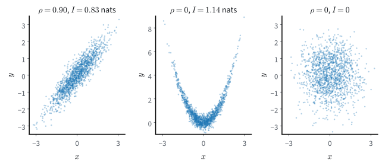
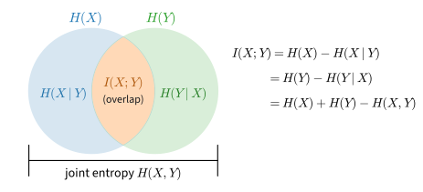
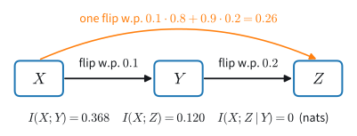
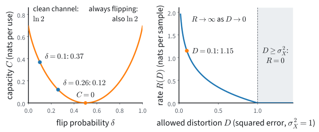
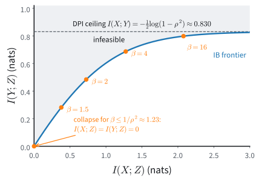

# Mutual Information
:label:`sec_mdl-mutual-information`

The previous sections compared two distributions over the same variable,
such as a data distribution and a model. Many questions in deep learning
concern a pair of variables instead: an image and its caption, two crops of
the same photograph, or a sentence and its translation. How much does one
variable tell us about the other?

The standard measure of dependence, the correlation coefficient, detects only
linear relationships. Consider $X\sim\mathcal N(0,1)$ and let
$Y=X^2+0.3\,\epsilon$, where $\epsilon\sim\mathcal N(0,1)$ is independent
noise. Because $X^3$ is symmetric around zero,
$\textrm{Cov}(X,Y)=\mathbb{E}[X^3]=0$, so the correlation between $X$ and $Y$
is zero. Yet $X$ nearly determines $Y$: once we know $X$, $Y$ varies only by
noise of standard deviation $0.3$, whereas on its own $Y$ spreads roughly from
$0$ to $9$. The quantity we define in this section captures this dependence
readily—in fact, it credits this pair with more shared information than a
bivariate Gaussian with correlation $0.9$.

What we want is a measure that equals zero if and only if two variables are
independent, grows as their dependence strengthens, and remains unchanged when
either variable is re-expressed in different coordinates. We already have the
exact tool needed to build it: the KL divergence $D_{\textrm{KL}}(P\|Q)$ from
:numref:`sec_mdl-information_theory`, which by Gibbs' inequality is always
nonnegative and vanishes only when $P=Q$. Taking $P$ to be the true joint
distribution of the pair and $Q$ to be the product distribution the pair would
follow if its components were independent gives the *mutual information*
$I(X;Y)$.

Defining mutual information is the easy part; the real payoff lies in what
follows from it. We establish three fundamental results. First, processing a
variable cannot increase its mutual information with anything else, so no layer
of a neural network carries more information about the input than the layer
below it. Second, a classifier cannot reach a given error rate unless its input
carries a minimum amount of information about the label. Third, the test loss
of any probabilistic model directly certifies a lower bound on that
information. We then turn to Shannon's two foundational questions—how much
information a noisy channel can carry and how little a lossy compressor must
keep—and a third question that grows out of compression: what should a learned
representation keep? Throughout this section we assume the underlying
distributions are known; estimating mutual information from samples alone is a
harder problem that we take up in :numref:`sec_mdl-mi-estimation`.

As before, we work in nats, where $1$ bit $=\ln 2\approx0.693$ nats. All
logarithms are natural; we write $\log$ in general formulas and $\ln$ when
evaluating numerical values. We denote the binary entropy by
$H_b(p)=-p\log p-(1-p)\log(1-p)$.

```{.python .input #mutual-information-imports}
#@tab mxnet
import math
import numpy as np
from mxnet import autograd, gluon, init, np as mnp, npx
from mxnet.gluon import nn
from d2l import mxnet as d2l
npx.set_np()
```

```{.python .input #mutual-information-imports}
#@tab pytorch
import math
import numpy as np
import torch
from torch import nn
from torch.nn import functional as F
from d2l import torch as d2l
```

```{.python .input #mutual-information-imports}
#@tab tensorflow
import math
import numpy as np
import tensorflow as tf
from d2l import tensorflow as d2l
```

```{.python .input #mutual-information-imports}
#@tab jax
import math
import numpy as np
import jax
from jax import numpy as jnp
from flax import nnx
import optax
from d2l import jax as d2l
```

## Measures of Dependence
:label:`sec_mdl-mi-recap`

To keep every definition concrete, we evaluate each one first on a single
$2 \times 2$ probability table, which will return as a running example
throughout the section.

### Joint and Conditional Entropy

Let $X$ be a fair bit, and let $Y$ be a copy of $X$ that is flipped with
probability $\delta=0.1$. We can read $X$ as a bit sent over a noisy line and
$Y$ as the bit received, or read $Y$ as a binary label and $X$ as a noisy
feature that agrees with it $90\%$ of the time. Because the table is symmetric,
nothing below depends on which interpretation we choose. With rows indexing
$x\in\{0,1\}$ and columns indexing $y\in\{0,1\}$, the joint distribution is

$$
p_{X,Y}=\begin{pmatrix}0.45&0.05\\0.05&0.45\end{pmatrix},
$$

and summing rows and columns gives the marginals $p_X=p_Y=(\tfrac12,\tfrac12)$.
We call this pair the *flipped bit*. Throughout, subscripts name the variables
of a distribution, and we drop them when the arguments already make the
distribution clear, as in the conditional $p(y\mid x)$.

Beyond the individual entropies $H(X)$ and $H(Y)$, a pair of random variables
has two natural entropies, both introduced in
:numref:`subsec_mdl-joint-conditional-entropy`. The *joint entropy* is the
entropy of the pair viewed as a single random variable—here one with four
outcomes:

$$H(X, Y) = -\mathbb{E}_{(x, y) \sim P_{X,Y}} [\log p_{X, Y}(x, y)].$$
:eqlabel:`eq_mdl-joint_ent_def`

For our table, $H(X,Y)=-2(0.45\ln0.45)-2(0.05\ln0.05)=1.018$ nats. That is
larger than the $0.693$ nats of a single fair bit, but smaller than the $1.386$
nats of two independent fair bits.

The *conditional entropy* measures the surprise remaining in $Y$ once $X$ is
known. It is the average entropy of the conditional rows
$p(y\mid x)=p_{X,Y}(x,y)/p_X(x)$:

$$H(Y \mid X) = - \mathbb{E}_{(x, y) \sim P_{X,Y}} [\log p(y \mid x)] = \sum_x p_X(x)\, H(Y \mid X = x).$$
:eqlabel:`eq_mdl-cond_ent_def`

For the flipped bit, the two rows are $(0.9,0.1)$ and $(0.1,0.9)$, each with
entropy $H_b(0.1)=0.325$ nats, so $H(Y\mid X)=0.325$ nats. Even after observing
$X$, $Y$ still retains $0.325$ of its original $0.693$ nats of surprise.

Notice that the three numbers satisfy $1.018=0.693+0.325$. This is the chain
rule $H(X,Y)=H(X)+H(Y\mid X)$ from
:numref:`subsec_mdl-joint-conditional-entropy`: the surprise in the pair equals
the surprise in $X$ plus the additional surprise in $Y$ once $X$ is known.

### Mutual Information

Conditional entropy captures the part of the surprise in $Y$ that $X$ cannot
explain. What we want now is the part the two variables share. If $X$ and $Y$
were independent, their joint distribution would be the product of their
marginals, $P_X \otimes P_Y$, placing $p_X(x)\,p_Y(y)$ in every cell. The
*mutual information* is the KL divergence from that independent product to the
actual joint distribution:

$$I(X; Y) = D_{\textrm{KL}}\big(P_{X,Y} \,\|\, P_X \otimes P_Y\big) = \mathbb{E}_{(x, y) \sim P_{X,Y}} \left[ \log\frac{p_{X, Y}(x, y)}{p_X(x)\, p_Y(y)} \right].$$
:eqlabel:`eq_mdl-mut_ent_def`

For the flipped bit, the product of the marginals puts $0.25$ in every cell.
The ratio of the joint probability to the independent product is therefore
$0.45/0.25=1.8$ on the diagonal, where $X$ and $Y$ agree, and $0.05/0.25=0.2$
off the diagonal, where they disagree. Averaging the log-ratios under the joint
distribution gives

$$
I(X;Y)=0.9\ln1.8+0.1\ln0.2=0.529-0.161=0.368\textrm{ nats}.
$$

Agreements occur $1.8$ times as often as independence predicts, and
disagreements one fifth as often; mutual information is simply the expected
logarithm of this factor. Because a KL divergence also measures the extra code
length incurred by using the wrong model (:numref:`sec_mdl-coding-compression`),
$I(X;Y)$ is the number of nats per pair wasted by a code that treats $X$ and
$Y$ as independent. We encounter this exact penalty in
:numref:`sec_diffusion-discrete`, when a network predicts two masked tokens
independently.

We can also read :eqref:`eq_mdl-mut_ent_def` one row of the table at a time.
Dividing numerator and denominator by $p_X(x)$ turns the ratio into
$p(y\mid x)/p_Y(y)$, rewriting the expectation over pairs as an average over
$x$ of the KL divergence between the conditional and marginal distributions of
$Y$:

$$I(X;Y)=\mathbb{E}_{x\sim P_X}\Big[D_{\textrm{KL}}\big(p(y\mid x)\,\|\,p_Y(y)\big)\Big].$$
:eqlabel:`eq_mdl-mi-conditional-form`

In this form, mutual information measures how far, on average, observing $x$
shifts the distribution of $Y$ away from its marginal. For the flipped bit,
each conditional row—$(0.9,0.1)$ or $(0.1,0.9)$—lies
$0.9\ln1.8+0.1\ln0.2=0.368$ nats from the marginal $(0.5,0.5)$. This
asymmetric perspective is especially natural when the two variables play
different roles, such as an input and the output of a noisy encoder, and we
will return to it in :numref:`sec_mdl-information-bottleneck`.

**Proposition (properties of mutual information).** *For any pair $(X,Y)$,
$I(X;Y)=I(Y;X)\ge0$, with equality if and only if $X$ and $Y$ are
independent. When the entropies involved are finite,*

$$
I(X;Y)=H(X)+H(Y)-H(X,Y)=H(X)-H(X\mid Y)=H(Y)-H(Y\mid X).
$$

**Proof.** Swapping $X$ and $Y$ leaves the ratio in :eqref:`eq_mdl-mut_ent_def`
unchanged, which proves symmetry. Nonnegativity and the equality condition
follow immediately from Gibbs' inequality applied to $P_{X,Y}$ and
$P_X \otimes P_Y$: the KL divergence is nonnegative and vanishes if and only if
$p_{X,Y}(x,y) = p_X(x)\,p_Y(y)$ everywhere, which is the definition of
independence. To obtain the entropy identities, split the logarithm of the
ratio into three terms and take expectations:

$$
I(X; Y) = \mathbb{E}\left[\log p_{X,Y}(x,y)\right] - \mathbb{E}\left[\log p_X(x)\right] - \mathbb{E}\left[\log p_Y(y)\right] = -H(X,Y) + H(X) + H(Y).
$$

Substituting the chain rule in its two orders,
$H(X,Y) = H(Y) + H(X \mid Y)=H(X)+H(Y\mid X)$, yields the remaining two forms.
$\blacksquare$

Thus $X$ says exactly as much about $Y$ as $Y$ says about $X$. The final
identity interprets mutual information as a reduction in uncertainty: observing
$X$ lowers the surprise in $Y$ from $H(Y)$ to $H(Y\mid X)$—for the flipped bit,
from $0.693$ down to $0.325$ nats. Nonnegativity also implies the
subadditivity bound $H(X,Y)\le H(X)+H(Y)$, with equality only at independence:
a pair never carries more surprise than its components taken separately.
:numref:`fig_mdl-mi-overlap` illustrates these relationships visually; each
identity in the proposition is simply a different way of reading off the area
of the overlap.


:label:`fig_mdl-mi-overlap`

The function `mutual_information` below implements the divergence form for any
discrete joint table, and we will reuse it throughout the section. The cell
also checks the identity $I(X;Y) = H(Y) - H(Y\mid X)$ by averaging the row
entropies.

```{.python .input #mutual-information-joint-conditional}
p_xy = np.array([[0.45, 0.05],    # rows x, columns y: a fair bit X and
                 [0.05, 0.45]])   # its copy Y, flipped with probability 0.1

def entropy(p):
    """Entropy of a p.m.f. of any shape, in nats (0 log 0 = 0)."""
    p = p[p > 0]
    return float(-(p * np.log(p)).sum())

def mutual_information(p_xy):
    """I(X;Y) of a discrete joint p.m.f. (rows x, columns y), in nats."""
    p_x = p_xy.sum(axis=1, keepdims=True)
    p_y = p_xy.sum(axis=0, keepdims=True)
    m = p_xy > 0                                  # 0 log 0 = 0
    return float((p_xy[m] * np.log(p_xy[m] / (p_x * p_y)[m])).sum())

p_x, p_y = p_xy.sum(axis=1), p_xy.sum(axis=0)     # marginals from the joint
H_rows = sum(p_x[i] * entropy(p_xy[i] / p_x[i]) for i in range(2))   # H(Y|X)
I = mutual_information(p_xy)
print(f'I(X;Y) = {I:.4f} nats (KL form) = {entropy(p_y) - H_rows:.4f} '
      f'(H(Y) - H(Y|X)) = {I / np.log(2):.3f} bits')
```

Both expressions return $0.3681$ nats, or $0.531$ bits: a copy that flips one
time in ten still conveys just over half a bit about the original.

### The Gaussian Pair
:label:`subsec_mdl-mi-gaussian`

So far we have worked with discrete tables, whereas most variables in deep
learning—activations, gradients, and embeddings—are continuous. One continuous
case can be computed completely by hand: the bivariate Gaussian. It will serve
as our second running example and form the foundation for both the
rate–distortion curve and the information bottleneck later in this section. For
continuous densities, discrete entropies are replaced by the differential
entropies $h$ of :numref:`subsec_mdl-differential-entropy`, which can be
negative and depend on the units of measurement. The KL definition of mutual
information suffers from neither drawback. Because the chain-rule algebra never
relied on discreteness, $I(X;Y)=h(X)+h(Y)-h(X,Y)=h(Y)-h(Y\mid X)$ whenever
these quantities are finite, where $h(Y\mid X)$ denotes the differential
entropy of the conditional density $p(y\mid x)$, averaged over $x$.

**Proposition (Gaussian mutual information).** *If $(X, Y)$ is bivariate
Gaussian with variances $\sigma_X^2,\sigma_Y^2>0$ and correlation coefficient
$\rho$, $\rho^2<1$, then*

$$I(X; Y) = -\tfrac{1}{2} \log\left(1 - \rho^2\right).$$
:eqlabel:`eq_mdl-gaussian_mi`

**Proof.** We use $I(X;Y)=h(Y)-h(Y\mid X)$. A Gaussian variable with variance
$\sigma^2$ has differential entropy $\tfrac12\log(2\pi e\sigma^2)$
(:numref:`subsec_mdl-gaussian-max-entropy`), so
$h(Y)=\tfrac12\log(2\pi e\sigma_Y^2)$. Conditioned on $X=x$, $Y$ remains
Gaussian with variance $\sigma_Y^2(1-\rho^2)$, regardless of $x$. This is the
variance of the residual left after subtracting the best linear prediction of
$Y$ from $X$, and for a bivariate Gaussian that residual is independent of $X$
(:numref:`subsec_mdl-mvn-conditioning`). Hence
$h(Y\mid X)=\tfrac12\log\big(2\pi e\sigma_Y^2(1-\rho^2)\big)$, and subtracting
gives $-\tfrac12\log(1-\rho^2)$. $\blacksquare$

The result depends solely on $1-\rho^2$, the fraction of $Y$'s variance left
unexplained by $X$. Notice that the units of $Y$ have cancelled out—our first
glimpse of the coordinate invariance proved in
:numref:`sec_mdl-mi-nonlinear-correlation`.

When $\rho = 0$, the variables are independent and $I(X;Y) = 0$. As
$\rho \to \pm 1$, the joint density collapses onto a straight line and
$I(X;Y) \to \infty$. Between those extremes, $\rho = 0.5$ yields $0.144$ nats,
$\rho = 0.9$ yields $0.830$ nats, and $\rho = 0.99$ yields $1.959$ nats. The
bivariate Gaussian with standard normal marginals and $\rho=0.9$ will reappear
throughout this section; we refer to it as the *Gaussian pair at $\rho=0.9$*.

As the limit $\rho \to \pm 1$ shows, mutual information can indeed be infinite.
This phenomenon will come up twice later—for deterministic layers of a neural
network and for the encoder of the information bottleneck. If $Y=X$ for a
continuous random variable $X$, knowing $X$ pins down $Y$ to infinitely many
decimal places, and the same holds whenever $Y$ is a deterministic function of
$X$ that takes no single value with positive probability. By contrast, infinite
mutual information is impossible when $Y$ is discrete with finite entropy: then
$I(X;Y)=H(Y)-H(Y\mid X)\le H(Y)$ regardless of $X$, where $H(Y\mid X)$ averages
the entropy of $p(\cdot\mid x)$ over $x$. For a standard normal $X$, for
instance, the sign of $X$ carries exactly $\ln 2$ nats. This same ceiling caps
the Jensen–Shannon divergence of :numref:`sec_basic_gan` at $\ln 2$: as shown
there, it equals the mutual information between a sample and the binary label
identifying its source.

### Pointwise Mutual Information
:label:`subsec_mdl-pmi`

Mutual information averages over all pairs of outcomes, which hides which
specific pairs drive the dependence. Often a single pair is what we care about:
does seeing the word *new* make the next word *york* much more likely than
chance? The summand inside :eqref:`eq_mdl-mut_ent_def` answers this directly.
It is the *pointwise mutual information*,

$$\textrm{pmi}(x, y) = \log\frac{p_{X, Y}(x, y)}{p_X(x)\, p_Y(y)},$$
:eqlabel:`eq_mdl-pmi_def`

which compares how often the specific pair $(x, y)$ occurs with how often it
would occur if $X$ and $Y$ were independent. A positive pmi indicates that the
two outcomes attract (they co-occur more often than chance predicts), a
negative pmi indicates that they repel, and
$I(X;Y) = \mathbb{E}_{(x,y) \sim P_{X,Y}}[\textrm{pmi}(x,y)]$ is their average
attraction. For the flipped bit, the pmi is $\ln1.8=+0.588$ on the two agreeing
cells and $\ln0.2=-1.609$ on the two disagreeing cells—the exact logarithms we
averaged earlier.

Pointwise mutual information is a classic tool in natural language processing
:cite:`Church.Hanks.1990`, where it separates *collocations*—word pairs that
genuinely belong together—from words that co-occur simply because both are
common. Suppose we count consecutive word pairs (bigrams) in a small corpus and
tally how often each of *new*, *machine*, and *the* is followed by *york*,
*learning*, or *day*:

| count | york | learning | day |
| :-- | --: | --: | --: |
| **new** | 38 | 3 | 9 |
| **machine** | 1 | 46 | 3 |
| **the** | 11 | 21 | 168 |

Raw counts are misleading here. "The day" is by far the most frequent pair
($168$ occurrences versus $38$ for "new york") simply because *the* and *day*
are both high-frequency words. The code below divides each joint frequency by
the product of its two marginal word frequencies, prints the resulting pmi for
four pairs, and reports the mutual information of the full table.

```{.python .input #mutual-information-pmi-corpus}
counts = np.array([[38., 3., 9.],      # new york / new learning / new day
                   [1., 46., 3.],      # machine ...
                   [11., 21., 168.]])  # the ...
first, second = ['new', 'machine', 'the'], ['york', 'learning', 'day']

p = counts / counts.sum()
pmi = np.log(p / (p.sum(axis=1, keepdims=True) * p.sum(axis=0, keepdims=True)))
for (i, j) in [(0, 0), (1, 1), (2, 2), (2, 0)]:
    print(f'pmi({first[i]}, {second[j]}) = {pmi[i, j]:6.3f} nats '
          f'(count {counts[i, j]:.0f})')
print(f'I(first; second) = {float((p * pmi).sum()):.4f} nats')
```

Once we correct for the marginals, the true collocations rise to the top:
"new york" scores $1.52$ nats and "machine learning" scores $1.37$, whereas the
frequent pair "the day" reaches only $0.34$. Meanwhile, "the york" is negative
at $-1.11$ nats, occurring roughly three times less often than independence
would predict. The mutual information of the table, $0.41$ nats, summarizes how
strongly the first word constrains the second on average. This same marginal
correction reappears in learned word embeddings
(:numref:`sec_lm_word_embeddings`): by training a skip-gram model to
distinguish observed pairs of neighboring words from $K$ random pairs, we
implicitly factorize the matrix of shifted pointwise mutual informations,
$\textrm{pmi}(x,y)-\log K$ :cite:`Levy.Goldberg.2014`, as we will derive in
:numref:`sec_mdl-mi-estimation` (Exercise
:exref:`ex_mdl-mutual-information-negative-sampling-pmi`).

### Mutual Information and Correlation
:label:`sec_mdl-mi-nonlinear-correlation`

The correlation coefficient $\rho(X,Y)=\textrm{Cov}(X,Y)/(\sigma_X\sigma_Y)$ of
:numref:`sec_mdl-joint-distributions` detects only linear dependence: having
$\rho(X,Y)=0$ does not imply independence. Mutual information, by contrast,
vanishes if and only if the variables are independent. Returning to our opening
example makes this difference concrete.

Let $X \sim \mathcal{N}(0, 1)$ and $Y = X^2 + 0.3\,\epsilon$ with independent
$\epsilon \sim \mathcal{N}(0,1)$, a pair whose correlation is $\rho=0$. Writing
$I(X;Y)=h(Y)-h(Y\mid X)$ lets us evaluate the mutual information using
one-dimensional integrals. Conditioned on $X=x$, the only randomness left in
$Y$ is the additive noise, and shifting a distribution by the known constant
$x^2$ leaves differential entropy unchanged, so
$h(Y\mid X)=h(0.3\,\epsilon)=\tfrac12\ln(2\pi e\cdot0.09)=0.215$ nats. Before
computing $h(Y)$ numerically, we can bound it analytically: $Y$ has variance
$\textrm{Var}(X^2)+0.09=2.09$, and among all densities with a given variance
the Gaussian maximizes differential entropy
(:numref:`subsec_mdl-gaussian-max-entropy`), giving
$h(Y)\le\tfrac12\ln(2\pi e\cdot2.09)=1.79$ nats and thus
$I(X;Y)\le1.79-0.215=1.57$ nats. Because the marginal density of $Y$ is a
continuous mixture over $x$,
$p_Y(y)=\int\mathcal N(x;0,1)\,\mathcal N(y;x^2,0.09)\,dx$, with no closed
form, we integrate it numerically to obtain $h(Y)$.

```{.python .input #mdl-mutual-information-mutual-information-as-nonlinear-correlation-1}
normal = lambda t, var: np.exp(-t**2 / (2 * var)) / np.sqrt(2 * np.pi * var)
xs = np.linspace(-6, 6, 6001)              # quadrature grid for X
ys = np.linspace(-2.5, 30, 6501)           # grid for Y = X^2 + 0.3 eps
dx, dy = xs[1] - xs[0], ys[1] - ys[0]
p_Y = np.concatenate([                     # p_Y(y) = int N(x;0,1) N(y;x^2,0.09) dx
    (normal(xs, 1) * normal(c[:, None] - xs**2, 0.09)).sum(axis=1) * dx
    for c in np.array_split(ys, 13)])      # 13 chunks keep memory small
h_Y = float(-(p_Y[p_Y > 0] * np.log(p_Y[p_Y > 0])).sum() * dy)
h_noise = 0.5 * np.log(2 * np.pi * np.e * 0.09)   # h(Y|X) = h(0.3 eps)
print(f'h(Y) = {h_Y:.3f}, h(Y|X) = {h_noise:.3f}, '
      f'I(X;Y) = h(Y) - h(Y|X) = {h_Y - h_noise:.3f} nats')
```

The pair shares $1.141$ nats. This sits well below our Gaussian upper bound of
$1.57$ nats because the density of $Y$—concentrated near zero with a long right
tail—is far from Gaussian. At the same time, it exceeds the $0.830$ nats of the
Gaussian pair at $\rho=0.9$, even though its linear correlation is zero.
:numref:`fig_mdl-mi-corr-vs-mi` compares all three cases side by side.


:label:`fig_mdl-mi-corr-vs-mi`

Correlation and mutual information differ in a second fundamental way: their
behavior under changes of coordinates. Measuring temperature in Fahrenheit
instead of Celsius, or recording a price on a logarithmic scale, changes
nothing about how informative that variable is about anything else, so a
principled measure of dependence should remain invariant.

**Proposition (reparameterization invariance).** *Let $\phi$ and $\psi$ be
invertible maps of the values of $X$ and of $Y$. Then
$I(\phi(X);\psi(Y))=I(X;Y)$.*

**Proof.** For discrete variables, invertible maps simply relabel the outcomes:
the joint distribution of $(\phi(X), \psi(Y))$ assigns the same probabilities
as that of $(X, Y)$ to the relabeled outcomes, leaving the sum in
:eqref:`eq_mdl-mut_ent_def` unchanged. For continuous variables, we prove the
smooth case here to show the mechanism; :numref:`subsec_mdl-dpi` removes the
smoothness assumption. Suppose $\phi$ and $\psi$ are continuously
differentiable with continuously differentiable inverses, and change variables
via $(x, y) \mapsto (\phi(x), \psi(y))$. The joint density of the transformed
pair at $(\phi(x),\psi(y))$ is
$p_{X,Y}(x,y)\,|\det D\phi(x)|^{-1}|\det D\psi(y)|^{-1}$, while the two
marginal densities pick up the factors $|\det D\phi(x)|^{-1}$ and
$|\det D\psi(y)|^{-1}$. Those Jacobian factors cancel in the density ratio, so
the integrand of :eqref:`eq_mdl-mut_ent_def` takes the same value at
corresponding points, and its expectation is unchanged. A set of exceptional
points of probability zero, such as the origin for $x\mapsto x^3$, does not
affect the integral. $\blacksquare$

Differential entropy lacks this invariance because its Jacobian factor has
nothing to cancel against, which is why $h$ depends on units. Correlation is
preserved only by affine transformations (up to sign). Applying the invertible
map $x\mapsto x^3$ to the first coordinate of the Gaussian pair at $\rho=0.9$,
for example, leaves mutual information fixed at $0.830$ nats, while the
correlation drops from $0.9$ to $3\rho/\sqrt{15}=0.697$ (since
$\mathbb{E}[X^3Y]=3\rho$ and $\textrm{Var}(X^3)=15$ for standard normal $X$).
Mutual information asks whether two variables carry information about each
other in *any* coordinates, not whether they happen to lie along a straight
line.

## Processing and Prediction

We now establish the three results promised in the introduction. The first two
are fundamental limits: processing data cannot create information, and
accurate prediction requires a minimum amount of it. Both follow from a single
identity, the chain rule for mutual information. The third result turns the
cross-entropy loss of any probabilistic model into a direct lower bound on the
information carried by its input.

### Conditional Mutual Information and the Chain Rule

Let us extend the flipped bit by one step. Suppose $Z$ is produced by flipping
$Y$ once more, independently, with probability $0.2$—a fair bit sent over two
noisy lines in series, or a label followed by a noisy feature and a noisy copy
of that feature (:numref:`fig_mdl-it-bsc-chain`). Two flips in series act as a
single flip: the bit arrives inverted if and only if exactly one of the two
lines flips it, which happens with probability $0.1\cdot0.8+0.9\cdot0.2=0.26$.
The pair $(X,Z)$ is therefore a flipped bit with $\delta=0.26$, giving
$I(X;Z)=\ln2-H_b(0.26)=0.120$ nats. The second noisy line has wiped out two
thirds of the $0.368$ nats that $Y$ carried.


:label:`fig_mdl-it-bsc-chain`

With three variables, a new question arises: how much information do $X$ and
$Y$ share once $Z$ is already known? Just as entropy has a conditional version,
so does mutual information:

$$I(X; Y \mid Z) = H(X \mid Z) - H(X \mid Y, Z),$$
:eqlabel:`eq_mdl-cond_mi_def`

where $H(X\mid Y,Z)$ is the conditional entropy of $X$ given the pair $(Y,Z)$.
Writing each conditional entropy as an expectation and combining the logarithms
yields the divergence form
$I(X; Y \mid Z) = \mathbb{E}_{z}\big[D_{\textrm{KL}}(P_{X,Y \mid z}\,\|\, P_{X \mid z} \otimes P_{Y \mid z})\big]$,
which is simply the ordinary mutual information averaged over the conditional
distributions for each value of $z$. Because it is an expectation of KL
divergences, $I(X; Y \mid Z)$ is always nonnegative, and it equals zero if and
only if $X$ and $Y$ are conditionally independent given $Z$.

This definition lets us split the information that the pair $(Y,Z)$ carries
about $X$ into two pieces. Subtracting and adding $H(X\mid Z)$ inside
$I(X;Y,Z)=H(X)-H(X\mid Y,Z)$ gives

$$
I(X; Y, Z) = \underbrace{H(X) - H(X \mid Z)}_{I(X;\, Z)}
+ \underbrace{H(X \mid Z) - H(X \mid Y, Z)}_{I(X;\, Y \mid Z)}.
$$

This identity is the *chain rule for mutual information*, and it holds in full
generality when each term is written in KL form. In words, what $(Y,Z)$ tells
us about $X$ equals what $Z$ tells us plus what $Y$ adds once $Z$ is known. We
can equally well condition on $Y$ first. For our two flips in series, the two
orderings decompose the same total in two ways. Because $Z$ is generated from
$Y$ and independent noise, once $Y$ is known $Z$ adds nothing further about
$X$: $I(X;Z\mid Y)=0$, so putting $Y$ first gives
$I(X;Y,Z)=I(X;Y)+0=0.368$ nats. Putting $Z$ first splits the same $0.368$ nats
as $I(X;Z)+I(X;Y\mid Z)=0.120+I(X;Y\mid Z)$, leaving $I(X;Y\mid Z)=0.248$ nats.
Here conditioning on $Z$ reduced what $Y$ reveals about $X$, because $Z$
already holds part of that information. As we will see in the next subsection,
however, conditioning can also *increase* mutual information.

### The Data-Processing Inequality
:label:`subsec_mdl-dpi`

In a neural network, each hidden layer is computed from the layer below it,
which in turn is computed from the input. Can such processing ever create
information about the input that the earlier layer did not already contain? For
the two noisy lines the answer was no, and the reason has nothing to do with
bits in particular.

Three random variables $X, Y, Z$ form a *Markov chain*, written $X \to Y \to Z$,
when $Z$ depends on $(X, Y)$ solely through $Y$, meaning
$p(z \mid x, y) = p(z \mid y)$. This captures the exact structure of sequential
processing: $Y$ is produced from $X$ (a measurement, feature map, or hidden
layer), and $Z$ is then computed from $Y$ alone, possibly with fresh
randomness. Equivalently, $X$ and $Z$ are conditionally independent given $Y$,
so $I(X; Z \mid Y) = 0$.

**Proposition (data-processing inequality).** *If $X \to Y \to Z$ is a
Markov chain and the entropies involved are finite, then*

$$
I(X; Z) \leq I(X; Y),
$$

*with equality if and only if $I(X; Y \mid Z) = 0$, that is, if and only if
$X \to Z \to Y$ is also a Markov chain* :cite:`Cover.Thomas.1999`.

**Proof.** Expand $I(X; Y, Z)$ by the chain rule in both orders:

$$
I(X; Z) + I(X; Y \mid Z) = I(X; Y, Z) = I(X; Y) + I(X; Z \mid Y).
$$

By the Markov property the last term vanishes, leaving
$I(X; Z) = I(X; Y) - I(X; Y \mid Z) \leq I(X; Y)$, since conditional mutual
information is nonnegative. Equality holds if and only if
$I(X; Y \mid Z) = 0$. $\blacksquare$

No processing of $Y$—whether deterministic or randomized—can increase the
information it carries about $X$. For our two flips in series, the inequality
simply reads $0.120 \le 0.368$.

Notice that this inequality relies strictly on the Markov chain structure, not
on conditioning in general: outside a Markov chain, conditioning can create
dependence where none existed. Suppose $X$ and $Y$ are independent fair bits
and $Z = X \oplus Y$ is their exclusive or. Marginally $X$ and $Y$ share zero
information, yet once $Z$ is revealed, $Y$ determines $X$ completely. The
code below computes the mutual informations for both the two flips in series
and this XOR triple.

```{.python .input #mutual-information-dpi-check}
def cond_mi(p_abc):
    """I(A;B|C) of a joint p.m.f. indexed [a, b, c], in nats."""
    p_ac, p_bc, p_c = p_abc.sum(1), p_abc.sum(0), p_abc.sum((0, 1))
    m = p_abc > 0                                  # 0 log 0 = 0
    ratio = ((p_abc * p_c[None, None, :])[m]
             / (p_ac[:, None, :] * p_bc[None, :, :])[m])
    return float((p_abc[m] * np.log(ratio)).sum())

flip = lambda d: np.array([[1 - d, d], [d, 1 - d]])   # p(output | input)
p_xyz = 0.5 * flip(0.1)[:, :, None] * flip(0.2)[None, :, :]   # X -> Y -> Z
I_xy, I_xz = mutual_information(p_xyz.sum(2)), mutual_information(p_xyz.sum(1))
I_xz_y, I_xy_z = cond_mi(p_xyz.transpose(0, 2, 1)), cond_mi(p_xyz)
print(f'I(X;Y) = {I_xy:.4f}, I(X;Z) = {I_xz:.4f}, '
      f'I(X;Z|Y) = {I_xz_y:.4f}, I(X;Y|Z) = {I_xy_z:.4f}')
print(f'I(X;Y,Z) by the chain rule: {I_xz + I_xy_z:.4f} = {I_xy + I_xz_y:.4f}')
p_xor = np.zeros((2, 2, 2))
for a, b in np.ndindex(2, 2):
    p_xor[a, b, a ^ b] = 0.25          # independent fair bits, Z = X xor Y
print(f'XOR: I(X;Y) = {mutual_information(p_xor.sum(2)):.4f}, '
      f'I(X;Y|Z) = {cond_mi(p_xor):.4f} nats')
```

For the two flips, $I(X; Z \mid Y) = 0$ confirms the Markov property
numerically, and both chain-rule decompositions of $I(X; Y, Z)$ yield $0.3681$
nats. For the exclusive or, conditioning on $Z$ boosts the mutual information
between $X$ and $Y$ from $0$ to the full $\ln2=0.693$ nats of a bit.

When does processing lose no information at all? By the proposition, equality
holds if and only if $X\to Z\to Y$ is also a Markov chain—that is, $Z$ retains
everything $Y$ tells us about $X$. An invertible transformation $Z=g(Y)$
certainly achieves this, since $Y$ can be recovered from $Z$. Yet a map can
also discard part of $Y$ without losing information about $X$, as long as
whatever it discards is unrelated to $X$. For example, the total number of
heads in a sequence of coin flips preserves everything the sequence says about
the coin's bias, because the order of the flips carries no information about
that bias. Any summary $T(Y)$ with this property—so that $p(x \mid y)$ depends
on $y$ only through $T(y)$, and therefore $I(X;T(Y))=I(X;Y)$—is called a
*sufficient statistic*. The sufficient statistics of an exponential family
(:numref:`sec_mdl-exponential-family`) are precisely summaries of this kind,
with $Y$ playing the role of the data and $X$ the parameter $\theta$ (equipped
with a prior so that $I(\theta;Y)$ is well defined).

The data-processing inequality itself requires neither finite entropies nor
densities. Because mutual information is a KL divergence, and no map of the
data—random or deterministic—can increase a KL divergence
(:numref:`subsec_mdl-f-div-data-processing` proves this for countable sets, and
it holds in full generality), Exercise
:exref:`ex_mdl-mutual-information-dpi-from-f-divergence` turns that fact into a
general proof of the inequality. Applying the inequality once to an invertible
map and once to its inverse also yields the reparameterization invariance of
:numref:`sec_mdl-mi-nonlinear-correlation` without needing smoothness.

When applied to deep networks, the data-processing inequality is easy to
misread. The layers of a network form a Markov chain
$X \to Z_1 \to Z_2 \to \cdots$, so $I(X; Z_\ell)$ cannot increase with depth
$\ell$. From here to the end of this part, let $Y$ denote a prediction label
rather than the middle variable of a chain. Whatever a network knows about the
label must pass through the input, so $Y \to X \to Z_1 \to Z_2 \to \cdots$ is
also a Markov chain, and $I(Y; Z_\ell)$ cannot increase with $\ell$ either. No
architecture can conjure up label information that was absent from the input,
and no later layer can recover information that an earlier layer threw away.

This does *not* mean depth is unhelpful. Hidden layers do not add information
about the label; rather, they reorganize existing information so that a simple
final layer can read it out. Suppose the label $Y$ is a fair bit, and the input
$X \in \mathbb{R}^2$ is uniform on the circle of radius $1$ when $Y=0$ and on
the circle of radius $2$ when $Y=1$. The input determines the label exactly, so
$I(Y;X)=\ln2$, yet no straight line separates two concentric circles. The best
linear classifier places its decision boundary tangent to the inner circle: it
classifies the entire inner circle correctly, along with the one third of the
outer circle that lies beyond the line, achieving an accuracy of $2/3$. Now
apply a single nonlinear feature $Z=\|X\|^2$, which takes only the values $1$
and $4$. A simple threshold between them classifies every point perfectly, even
though $I(Y;Z)=\ln2$ is no larger than $I(Y;X)$. The transformation added no
information, yet made all of it linearly readable. Exercise
:exref:`ex_mdl-mutual-information-usable-information` formalizes a notion of
usable information that counts only what a restricted family of classifiers can
extract.

One final caution applies to the input chain $X \to Z_1 \to Z_2 \to \cdots$.
For a deterministic layer, $H(Z_\ell\mid X)=0$. If the representation is
discrete or quantized, $I(X;Z_\ell)$ simply reduces to the entropy
$H(Z_\ell)$; if it is continuous, $I(X;Z_\ell)$ is typically infinite
(:numref:`subsec_mdl-mi-gaussian`). As a measure of how much a layer retains
about its input, $I(X;Z_\ell)$ is therefore meaningful only when the layer
injects noise or produces a discrete output.

### Fano's Inequality
:label:`subsec_mdl-fano`

Accurate prediction demands mutual information. A classifier that achieves
$5\%$ error across $1{,}000$ classes must receive an input carrying most of the
label's entropy, and Fano's inequality tells us exactly how much.

**Proposition (Fano's inequality).** *Let $Y$ take values in a set of $k$
elements, let $\hat Y=g(X)$ be any estimate of $Y$ computed from $X$ and
taking values in the same set, and let $P_e=P(\hat Y\ne Y)$ be its error
probability. Then*

$$H_b(P_e) + P_e \log(k - 1) \geq H(Y \mid X) = H(Y) - I(X; Y).$$
:eqlabel:`eq_mdl-fano`

The left-hand side has a clean coding interpretation as the cost of repairing
the estimate $\hat Y$: it takes $H_b(P_e)$ nats to specify whether $\hat Y$ is
wrong, and whenever it is wrong (with probability $P_e$), at most $\log(k-1)$
nats to specify which of the remaining $k-1$ labels is correct. Anyone who has
both the estimate and the repair knows $Y$ exactly, so the repair cannot cost
less than the uncertainty about $Y$ left by $\hat Y$—which, by data
processing, is at least the uncertainty left by $X$.

The proof turns this intuition into an exact bound using a single device: an
indicator variable for whether an error occurred. The rest is just the chain
rule.

**Proof.** Let $W = \mathbf{1}\{\hat Y \neq Y\}$ be the error indicator. We
expand $H(W, Y \mid \hat Y)$, the remaining uncertainty about both the error and
the true label given the estimate, in two ways. First, $W$ is completely
determined by $(Y,\hat Y)$ and therefore adds no entropy, so
$H(W, Y \mid \hat Y) = H(Y \mid \hat Y)$. Second, the chain rule gives
$H(W, Y \mid \hat Y) = H(W \mid \hat Y) + H(Y \mid W, \hat Y)$, and we bound
each term separately:

* Conditioning cannot increase entropy, since
  $H(W)-H(W\mid\hat Y)=I(W;\hat Y)\ge0$. Therefore
  $H(W \mid \hat Y) \leq H(W) = H_b(P_e)$.
* When $W=0$, the label equals $\hat Y$ and has zero uncertainty. When $W=1$
  (which happens with probability $P_e$), the label must be one of the $k-1$
  values other than $\hat Y$, so its entropy is at most $\log(k-1)$. Averaging
  over $W$ gives $H(Y \mid W, \hat Y) \leq P_e \log(k-1)$.

Combining both bounds yields $H(Y\mid\hat Y)\le H_b(P_e)+P_e\log(k-1)$.
Finally, because $\hat Y$ is computed solely from $X$, the triple
$Y \to X \to \hat Y$ forms a Markov chain, and the data-processing inequality
gives $I(Y; \hat Y) \leq I(Y; X)$, or equivalently
$H(Y \mid \hat Y) \geq H(Y \mid X)$. $\blacksquare$

Notice that the count of $k-1$ remaining labels in the second step relies on
$\hat Y$ taking values inside the same label set. If the classifier is allowed
to answer "abstain", then $\log k$ must replace $\log(k-1)$, and the stated
inequality breaks down: for a fair bit $Y$ independent of $X$ and a classifier
that always abstains, $P_e=1$ and the left-hand side becomes $H_b(1)+\ln1=0$,
which lies below $H(Y\mid X)=\ln2$.

In the simplest case, Fano's bound is exact. For the flipped bit with the
estimate $\hat Y=X$, we have $P_e=0.1$ and $k=2$, so the left-hand side equals
$H_b(0.1)+0.1\ln1=0.325$, matching $H(Y\mid X)$ exactly.

No classifier, regardless of architecture or training procedure, can beat
Fano's bound. For $1{,}000$ balanced classes, $H(Y)=\ln1000=6.91$ nats;
rearranging :eqref:`eq_mdl-fano` for $I(X;Y)$ shows the minimum mutual
information required to achieve each target error rate.

```{.python .input #mutual-information-fano}
H_b = lambda p: -p * np.log(p) - (1 - p) * np.log(1 - p)   # binary entropy
k = 1000
for p_e in (0.01, 0.05, 0.2, 0.5):
    need = np.log(k) - H_b(p_e) - p_e * np.log(k - 1)
    print(f'P_e = {p_e:4.2f}: I(X;Y) >= {need:.3f} of log k = {np.log(k):.3f} nats')
```

Reaching $5\%$ error requires at least $6.36$ of the $6.91$ nats of label
entropy—$92\%$ of the total—and even a classifier that is wrong half the time
needs $2.76$ nats, or two fifths of the total.

### The Loss Certificate
:label:`subsec_mdl-loss-certificate`

Fano's inequality turns a classification error rate into a lower bound on
mutual information. A language model, however, is not evaluated by hard error
rate; like almost every model trained by maximum likelihood, it reports a
cross-entropy loss instead. That loss yields a lower bound on mutual
information as well, and the proof takes only three lines.

**Proposition (a loss certifies information).** *Let $q(y\mid x)$ be any
model of the label given the input, with cross-entropy loss
$L=\mathbb{E}[-\log q(Y\mid X)]$ under $P_{X,Y}$. Then*

$$I(X;Y)\;\ge\;H(Y)-L,$$
:eqlabel:`eq_mdl-info-certificate`

*and for $k$ balanced classes, $I(X;Y)\ge\log k-L$.*

**Proof.** By definition, $I(X;Y)=H(Y)-H(Y\mid X)$. For each $x$, the
cross-entropy of $q(\cdot\mid x)$ under $p(\cdot\mid x)$ exceeds the true
conditional entropy of $p(\cdot\mid x)$ by
$D_{\textrm{KL}}(p(\cdot\mid x)\,\|\,q(\cdot\mid x))\ge0$
(:numref:`sec_mdl-information_theory`). Averaging over $x$ yields
$H(Y\mid X)\le L$, and subtracting from $H(Y)$ completes the proof.
$\blacksquare$

Because held-out test loss estimates $L$, the test loss of any classifier or
language model directly certifies a lower bound on the information its input
carries. For example, a $10$-class classifier on balanced labels with a test
loss of $0.3$ nats certifies that its input carries at least
$\ln10-0.3=2.0$ of the label's $2.30$ nats. The bound holds even if the model
is poorly calibrated or badly trained; a weaker model simply certifies a
smaller lower bound. This inline derivation is the variational bound of
:citet:`Barber.Agakov.2003` previewed here with a classifier acting as the
decoder; we will study it alongside neural mutual-information estimators in
:numref:`sec_mdl-mi-estimation` (:numref:`sec_mdl-mi-variational-bounds`).

The certificate is tight if and only if $q(y\mid x)$ matches the true
conditional distribution $p(y\mid x)$. On the flipped bit, a model that
predicts $\hat Y=X$ with confidence $c$ has expected loss
$L=-0.9\log c-0.1\log(1-c)$, which we evaluate below across four confidence
levels.

```{.python .input #mdl-mutual-information-fano-s-inequality-1}
for c in (0.6, 0.8, 0.9, 0.99):
    L = -(0.9 * np.log(c) + 0.1 * np.log(1 - c))   # cross-entropy of q
    print(f'confidence {c:4.2f}: loss {L:.4f}, '
          f'certifies I(X;Y) >= {np.log(2) - L:.4f} nats')
```

Only the calibrated model ($c=0.9$) certifies the full $0.368$ nats. An
overconfident model ($c=0.99$) pays a steep penalty whenever it errs and
certifies only $0.22$ nats, while an underconfident one ($c=0.6$) certifies
$0.14$ nats. Yet all four models make identical hard predictions and err $10\%$
of the time, so Fano's inequality—which sees only the error rate—certifies the
full $0.368$ nats for every one of them. Cross-entropy loss sees the predicted
probabilities as well, and penalizes miscalibration. Both results upper-bound
the same conditional entropy $H(Y\mid X)$—Fano via an error rate and the
certificate via a loss—turning each upper bound into a lower bound on $I(X;Y)$.
In fact, the two are even more closely connected than they appear: Exercise
:exref:`ex_mdl-mutual-information-certificate-and-fano` shows that Fano's bound
is itself the loss certificate of one specific model, and that a well-calibrated
classifier that knows when it is uncertain can certify strictly more.

## Communication and Compression

Shannon posed two foundational engineering questions whose answers turn out to
be a maximum and a minimum of mutual information: how much information a noisy
channel can reliably carry, and how little information a lossy compressor must
keep. Readers focused on representation learning may skim channel capacity on a
first pass, whereas rate–distortion theory is essential because the final part
of this section builds directly on it.

### Channel Capacity
:label:`subsec_mdl-channel-capacity`

How much information can survive a communication line that flips each bit
independently with probability $\delta$? A memoryless *channel* is specified by
a conditional distribution $p(y\mid x)$ applied independently to each input
symbol, with each transmitted symbol counting as one use of the channel. Our
flipped bit is exactly such a channel, with input $X$ and output $Y$. Although
the channel noise is fixed, the sender is free to choose the input distribution
$p(x)$. The *capacity* of the channel is the maximum mutual information
achievable over all choices of input distribution, measured in nats per use:

$$
C=\max_{p(x)} I(X;Y).
$$
:eqlabel:`eq_mdl-channel-capacity`

A sender who transmits mostly zeros underuses the channel, since such an input
carries little entropy to begin with. Shannon's channel coding theorem gives
this quantity its operational meaning. Defining the *rate* of a code as the
number of nats of message it delivers per channel use, Shannon showed that by
encoding long blocks of symbols one can transmit reliably—with error
probability as small as desired—at any rate below $C$, whereas reliable
communication is impossible at any rate above $C$
:cite:`Shannon.1948,Cover.Thomas.1999`. We state this theorem without proof.

For the bit-flipping channel, known as the *binary symmetric channel*,
computing the capacity takes a single line. Write $I(X;Y)=H(Y)-H(Y\mid X)$.
Every row of $p(y\mid x)$ is $(1-\delta,\delta)$ up to ordering, so
$H(Y\mid X)=H_b(\delta)$ regardless of the input distribution. Meanwhile,
$H(Y)\le\ln2$, with equality if and only if $Y$ is uniform. Because
$P(Y=1)=\delta+P(X=1)(1-2\delta)$, whenever $\delta\ne\tfrac12$ the output is
uniform if and only if the input is uniform. Hence

$$C=\ln 2-H_b(\delta)\quad\textrm{nats per use},$$
:eqlabel:`eq_mdl-bsc-capacity`

achieved by the uniform input. At $\delta=0.1$, this recovers the $0.368$ nats
of our flipped bit (whose input was already uniform); for the two lines in
series ($\delta=0.26$), capacity drops to $0.120$ nats. At $\delta=\tfrac12$,
the output is independent of the input and capacity vanishes. At $\delta=1$,
capacity returns to the full $\ln2$ nats, since a receiver who knows every bit
is inverted can simply flip it back: noise destroys information only to the
extent that the receiver cannot predict it. The code below first sweeps the
input distribution for the $\delta=0.1$ channel, and then sweeps the flip
probability $\delta$ under a uniform input.

```{.python .input #mdl-mutual-information-channel-capacity}
inputs = (0.1, 0.3, 0.5, 0.7, 0.9)
I_in = [mutual_information(np.array([[1 - a], [a]]) * flip(0.1)) for a in inputs]
print('P(X=1):', '  '.join(f'{a:6.2f}' for a in inputs))
print('I(X;Y):', '  '.join(f'{v:6.4f}' for v in I_in))
deltas = (0.0, 0.1, 0.26, 0.5, 1.0)
C = [np.log(2) - entropy(np.array([d, 1 - d])) for d in deltas]
print('delta: ', '  '.join(f'{d:6.2f}' for d in deltas))
print('C:     ', '  '.join(f'{c:6.4f}' for c in C))
```

An input that sends a $1$ only $10\%$ of the time has only $H_b(0.1)=0.325$
nats to offer and gets $0.146$ of them through—two fifths of what the uniform
input achieves. The left panel of :numref:`fig_mdl-it-capacity-rd` plots the
capacity as a function of $\delta$. Neural networks contain channels of their
own: dropout erases a feature with probability $\alpha$ and passes it through
otherwise, and Exercise :exref:`ex_mdl-information-theory-binary-channels`
shows that a binary feature can push at most $(1-\alpha)\ln2$ nats through it.


:label:`fig_mdl-it-capacity-rd`

### Rate–Distortion
:label:`subsec_mdl-rate-distortion`

Lossless compression requires $H(X)$ nats per symbol
(:numref:`sec_mdl-coding-compression`), which means an exact lossless code for
a continuous source would require infinitely many nats. In practice, an
approximate reconstruction is usually all we need: an image codec may perturb
pixels slightly, and a learned representation may deliberately discard
irrelevant detail. Suppose we choose a nonnegative *distortion* measure
$d(x,\hat x)\ge0$ scoring how well $\hat x$ reconstructs $x$, and allow an
average distortion of at most $D$. How few nats per sample are required? The
*rate–distortion function* answers this as the minimum mutual information an
encoder $p(\hat x\mid x)$ must retain to stay within the distortion budget:

$$
R(D)=\inf_{p(\hat x\mid x):\;\mathbb{E}[d(X,\hat X)]\le D} I(X;\hat X).
$$
:eqlabel:`eq_mdl-rate-distortion`

A tighter distortion budget demands more information. Shannon's rate–distortion
theorem mirrors the channel coding theorem, with the rate now measuring the
nats a code spends per source sample: block codes operating at any rate above
$R(D)$ can achieve average distortion $D$, whereas no code below $R(D)$ can
:cite:`Shannon.1959`.

In practice, it is usually easier to replace the hard distortion constraint
with a penalty, minimizing $I(X;\hat X)+\lambda\,\mathbb{E}[d(X,\hat X)]$ over
all encoders for a multiplier $\lambda>0$. Every encoder corresponds to a point
in the distortion–rate plane lying on or above the curve $R(D)$, and the
penalized objective is constant along straight lines of slope $-\lambda$.
Because $R(D)$ is convex, the minimum occurs where a line of slope $-\lambda$
touches the curve from below: larger $\lambda$ selects lower distortion at a
higher rate. The information bottleneck of
:numref:`sec_mdl-information-bottleneck` is formulated in exactly this
Lagrangian form.

**Proposition (Gaussian rate–distortion).** *For a source
$X\sim\mathcal N(0,\sigma_X^2)$ under squared error
$d(x,\hat x)=(x-\hat x)^2$,*

$$
R(D)=\frac12\log\frac{\sigma_X^2}{D}
\quad (0<D<\sigma_X^2),
\qquad R(D)=0\quad(D\ge\sigma_X^2).
$$
:eqlabel:`eq_mdl-gaussian-rd`

Inverting this formula for distortion gives $D=\sigma_X^2 e^{-2R}$: every
additional bit of rate ($\ln2$ nats) cuts the squared error by a factor of
four.

**Proof.** The lower bound is the main step, and it rests on a single fact from
:numref:`subsec_mdl-gaussian-max-entropy`: among all densities with variance
$s^2$, the Gaussian maximizes differential entropy at $\tfrac12\log(2\pi e s^2)$,
which increases with $s^2$. Take any encoder satisfying
$\mathbb{E}[(X-\hat X)^2]\le D$. Then

$$
\begin{aligned}
I(X;\hat X)&=h(X)-h(X\mid\hat X)=h(X)-h(X-\hat X\mid\hat X)\\
&\ge h(X)-h(X-\hat X)\\
&\ge \tfrac12\log(2\pi e\sigma_X^2)-\tfrac12\log(2\pi eD)=\tfrac12\log\frac{\sigma_X^2}{D}.
\end{aligned}
$$

The second equality holds because subtracting the known value $\hat X$ merely
shifts the conditional density without changing its entropy. The first
inequality uses the fact that conditioning cannot increase entropy, and the
second applies the Gaussian maximum-entropy bound, since the reconstruction
error $X-\hat X$ has variance at most $\mathbb{E}[(X-\hat X)^2]\le D$. When
$D\ge\sigma_X^2$, a constant encoder that transmits nothing and always outputs
the mean $0$ already meets the budget, so $R(D)=0$.

It remains to construct an encoder that achieves this bound for $D<\sigma_X^2$.
Set $\sigma_X^2=1$ and add independent Gaussian noise: $Z=X+\sigma\epsilon$
with $\epsilon\sim\mathcal N(0,1)$ and $\sigma>0$. Then
$\textrm{Cov}(X,Z)=1$ and $\textrm{Var}(Z)=1+\sigma^2$, giving squared
correlation $\rho_{XZ}^2=1/(1+\sigma^2)$. Applying :eqref:`eq_mdl-gaussian_mi`
gives the mutual information retained by this encoder:

$$I(X;X+\sigma\epsilon)=\tfrac12\log\left(1+\sigma^{-2}\right).$$
:eqlabel:`eq_mdl-gaussian-channel`

Now reconstruct $X$ using the conditional mean
$\hat X=\mathbb{E}[X\mid Z]=Z/(1+\sigma^2)$, the optimal linear regression of
$X$ on $Z$ with slope $\textrm{Cov}(X,Z)/\textrm{Var}(Z)$. Its mean squared
error is the conditional variance $D=1-1/(1+\sigma^2)=\sigma^2/(1+\sigma^2)$,
which sweeps across the entire interval $(0,1)$ as $\sigma$ varies. Because
$\hat X$ is an invertible rescaling of $Z$, we have
$I(X;\hat X)=\tfrac12\log(1+\sigma^{-2})=\tfrac12\log(1/D)$. For a general
variance $\sigma_X^2$, simply rescale $X$ and $\hat X$. $\blacksquare$

The encoder used in this proof—a signal corrupted by independent Gaussian
noise—is known as a *Gaussian channel* with signal-to-noise ratio
$\sigma^{-2}$, and :eqref:`eq_mdl-gaussian-channel` is its capacity (Exercise
:exref:`ex_mdl-mutual-information-gaussian-channel`). The forward noising
process of a diffusion model (:numref:`chap_diffusion`) is precisely such a
channel: regardless of the data distribution, a coordinate noised to
signal-to-noise ratio $s$ carries at most $\tfrac12\log(1+s)$ nats about its
clean value. The code below simulates this encoder on one million samples at
$\sigma^2=1/9$, $1$, and $3$ (corresponding to $D=0.1$, $0.5$, and $0.75$) and
verifies its squared error.

```{.python .input #mdl-mutual-information-rate-distortion}
rng = np.random.default_rng()
x = rng.standard_normal(1_000_000)
for s2 in (1 / 9, 1.0, 3.0):                              # sigma^2
    z = x + np.sqrt(s2) * rng.standard_normal(x.size)     # encoder
    x_hat = z / (1 + s2)                                  # E[X | Z]
    D = s2 / (1 + s2)
    mse = np.mean((x - x_hat)**2)
    print(f'sigma^2 = {s2:5.3f}: D = {D:.3f}, MSE {mse:.3f}, '
          f'I(X;Z) = R(D) = {0.5 * np.log(1 + 1 / s2):.3f} nats')
```

The empirical squared errors match $D$ to within a few thousandths: a
distortion of $D=0.1$ costs $1.15$ nats per sample, $D=0.5$ costs $0.35$ nats
(half a bit), and $D=0.75$ costs $0.14$ nats.

Keep in mind that this noisy encoder achieves $R(D)$ as a mutual information,
not yet as an actual file size. A practical code must map samples to discrete
bit strings, and it approaches the rate–distortion curve only by coding long
blocks of samples jointly. Any scalar code that quantizes one sample at a time
stays strictly above the curve. The simplest example keeps only the sign of
$X$: it spends $\ln2=0.693$ nats and reconstructs $\pm\sqrt{2/\pi}$ (the mean
of $|X|$), incurring squared error $1-2/\pi=0.363$, whereas the
rate–distortion curve asks only $0.506$ nats for that distortion.

The right panel of :numref:`fig_mdl-it-capacity-rd` shows the full curve. As
$D\to0$, the required rate climbs without bound—reflecting the infinite
information in an exact copy of a continuous variable—and drops to $0$ once
$D$ reaches $\sigma_X^2$. That steep climb near $D=0$ explains why modern image
generators compress images before modeling them: the finest, nearly
imperceptible pixel details consume the vast majority of the bits, so
:numref:`sec_diffusion-latent` delegates them to an autoencoder.

## The Information Bottleneck
:label:`sec_mdl-information-bottleneck`

A good representation should keep what predicts the label and discard the rest.
At first glance, discarding anything might seem counterproductive, since the
data-processing inequality tells us that throwing away information can never
improve the Bayes-optimal predictor. In practice, however, irrelevant details
carry a real cost. A photograph of a dog also encodes the lighting, the lawn,
and where in the frame the dog happens to stand. Storing all of those nuances
costs extra nats, and a classifier trained on finitely many images can easily
mistake them for genuine cues to the label. The information bottleneck
formalizes this trade-off using two mutual informations: it is a
rate–distortion problem in which the label itself defines the distortion.

### The Bottleneck Objective

Let $Z$ be a representation of an input $X$ generated by a stochastic encoder
$p(z\mid x)$, and let $Y$ be the target label. When $Z$ is continuous, the
encoder must be stochastic, because a deterministic map would typically yield
$I(X;Z)=\infty$ (:numref:`subsec_mdl-mi-gaussian`). The *information
bottleneck* :cite:`Tishby.Pereira.Bialek.1999` seeks a representation $Z$ that
retains as little of $X$ as possible while preserving as much about $Y$ as
possible:

$$\min_{p(z \mid x)}\; I(X; Z) - \beta\, I(Y; Z).$$
:eqlabel:`eq_mdl-ib_lagrangian`

Here $I(X;Z)$ is the rate—how much information the representation keeps about
the input—while $I(Y;Z)$, weighted by $\beta>0$, is the information it keeps
about the label. Because the encoder sees only $X$, the variables form a Markov
chain $Y\to X\to Z$, and the data-processing inequality constrains
$I(Y; Z) \leq \min\{I(X; Y),\, I(X; Z)\}$. A representation can never know more
about the label than the input does, nor can it predict well without keeping
input information.

The multiplier $\beta$ governs the trade-off, and its two extremes are easy to
understand. Whenever $\beta\le1$, keeping nothing is optimal: by the inequality
above, $I(X;Z)-\beta I(Y;Z)\ge(1-\beta)\,I(X;Z)\ge0$, and a constant encoder
that ignores $X$ completely achieves $I(X;Z)=I(Y;Z)=0$. When the constant
encoder is optimal, we say the bottleneck *collapses*. Conversely, as $\beta$
grows large, the label term dominates and the encoder preserves whatever helps
predict $Y$. In that limit, $I(Y;Z)$ approaches its ceiling $I(X;Y)$, and the
representation approaches a *minimal sufficient statistic*: the coarsest
summary of $X$ that still predicts $Y$ as well as $X$ itself. Of course, when
the encoder is restricted to a parametric family—as every neural network
is—it may stop short of that ceiling.

**Proposition (the bottleneck as a rate–distortion problem).** *If
$Y\to X\to Z$ is a Markov chain, then*

$$
I(Y;Z)=I(X;Y)-\mathbb{E}_{(x,z)\sim P_{X,Z}}\Big[D_{\textrm{KL}}\big(p(y\mid x)\,\|\,p(y\mid z)\big)\Big].
$$
:eqlabel:`eq_mdl-ib-as-rd`

**Proof.** Expand $I(Y;X,Z)$ via the chain rule in both orders:
$I(Y;Z)+I(Y;X\mid Z)=I(Y;X)+I(Y;Z\mid X)$. The Markov property gives
$I(Y;Z\mid X)=0$. Writing the remaining conditional mutual information in KL
form yields
$I(Y;X\mid Z)=\mathbb{E}_{(x,z)}\big[D_{\textrm{KL}}(p(y\mid x,z)\,\|\,p(y\mid z))\big]$,
and the Markov property simplifies $p(y\mid x,z)$ to $p(y\mid x)$.
$\blacksquare$

Substituting :eqref:`eq_mdl-ib-as-rd` into the objective turns
:eqref:`eq_mdl-ib_lagrangian` into
$I(X;Z)+\beta\,\mathbb{E}[d(X,Z)]-\beta I(X;Y)$, with distortion
$d(x,z)=D_{\textrm{KL}}(p(y\mid x)\,\|\,p(y\mid z))$. Since the final term
$\beta I(X;Y)$ does not depend on the encoder, the information bottleneck is
precisely the Lagrangian form of a rate–distortion problem. Instead of asking a
designer to hand-craft a distortion metric, the label supplies it
automatically: a code $z$ is a faithful representation of $x$ whenever it
predicts $Y$ just as accurately as $x$ does. Unlike ordinary rate–distortion,
however, this distortion depends on the encoder itself through $p(y\mid z)$,
making optimization considerably harder.

### The Gaussian Information Bottleneck
:label:`subsec_mdl-gaussian-bottleneck`

In one special setting, every quantity in the information bottleneck can be
solved in closed form :cite:`Chechik.Globerson.Tishby.ea.2005`. Take $(X, Y)$
to be our Gaussian pair at $\rho = 0.9$, for which $I(X; Y) = 0.830$ nats, and
use the additive-noise encoder from :numref:`subsec_mdl-rate-distortion`:

$$
Z = X + \sigma\, \epsilon, \qquad \epsilon \sim \mathcal{N}(0, 1),
$$

parameterized solely by the noise scale $\sigma$. The rate $I(X;Z)$ is already
given by :eqref:`eq_mdl-gaussian-channel`. For the label,
$\textrm{Cov}(Y,Z)=\textrm{Cov}(Y,X)=\rho$ and $\textrm{Var}(Z)=1+\sigma^2$,
so $\rho_{YZ}^2=\rho^2/(1+\sigma^2)$. Applying :eqref:`eq_mdl-gaussian_mi`
gives both mutual informations:

$$
I(X; Z) = \tfrac{1}{2}\log\left(1 + \sigma^{-2}\right), \qquad
I(Y; Z) = -\tfrac{1}{2}\log\left(1 - \frac{\rho^2}{1 + \sigma^2}\right).
$$
:eqlabel:`eq_mdl-gaussian-ib-info`

As $\sigma$ decreases from $\infty$ to $0$, the representation moves smoothly
from knowing nothing about $X$ to knowing $X$ exactly, and its label
information rises from $0$ to the data-processing ceiling of $0.830$ nats.

To visualize this trade-off directly, write $u=I(X;Z)$ for the rate (reserving
$R$ for the rate–distortion function $R(D)$). Inverting
:eqref:`eq_mdl-gaussian-ib-info` gives $\sigma^{-2}=e^{2u}-1$, hence
$1/(1+\sigma^2)=1-e^{-2u}$, expressing label information directly as a function
of rate:

$$
I(Y;Z)=-\tfrac12\log\big(1-\rho^2(1-e^{-2u})\big),\qquad
\frac{d\,I(Y;Z)}{du}=\frac{\rho^2}{\rho^2+(1-\rho^2)\,e^{2u}}.
$$

The derivative decreases monotonically from $\rho^2$ at $u=0$ toward $0$, so
the curve is strictly concave. Leaving the origin with slope $\rho^2=0.81$, the
first nat of input information buys at most $0.81$ nats of label information,
and each subsequent nat yields diminishing returns as $I(Y;Z)$ approaches
$I(X;Y)$. :citet:`Chechik.Globerson.Tishby.ea.2005` proved that for a Gaussian
pair no encoder—linear or nonlinear—can surpass this curve, making it the exact
optimal frontier; we use that result without proof. For any chosen $\beta$, the
minimizer of the Lagrangian selects a single *operating point* along this
frontier.

**Proposition (operating point and collapse).** *In the Gaussian bottleneck
with $\rho^2<1$, the Lagrangian $u-\beta\,I(Y;Z)$ is convex in $u$, with
derivative $1-\beta\rho^2$ at $u=0$. For $\beta\le1/\rho^2$ its minimum is
$u=0$, the constant encoder. For $\beta>1/\rho^2$ the minimizer and its label
information are*

$$
u^*=\frac12\log\frac{\rho^2(\beta-1)}{1-\rho^2},\qquad I(Y;Z)^*=\frac12\log\frac{\beta-1}{\beta(1-\rho^2)}.
$$
:eqlabel:`eq_mdl-ib-threshold`

**Proof.** Because $I(Y;Z)$ is concave in $u$, the Lagrangian $u-\beta I(Y;Z)$
is convex, with derivative $1-\beta\rho^2/(\rho^2+(1-\rho^2)e^{2u})$. At $u=0$,
this derivative equals $1-\beta\rho^2$. Whenever $\beta\rho^2\le1$, the
derivative is nonnegative at $u=0$ and strictly increasing, so the minimum over
$u\ge0$ occurs at $u=0$. Otherwise, setting the derivative to zero gives
$\rho^2+(1-\rho^2)e^{2u}=\beta\rho^2$, or
$e^{2u}=\rho^2(\beta-1)/(1-\rho^2)$. Substituting
$\rho^2e^{-2u}=(1-\rho^2)/(\beta-1)$ into
$I(Y;Z)=-\tfrac12\log(1-\rho^2+\rho^2e^{-2u})$ yields the second expression.
$\blacksquare$

Earlier, the general data-processing argument guaranteed collapse for
$\beta\le1$. For the Gaussian pair at $\rho=0.9$, collapse actually extends all
the way to $\beta\le1/\rho^2=1.235$. Below that threshold, every nat of rate
adds $1$ to the objective while reducing it by at most $\beta\rho^2\le1$,
because the frontier's slope never exceeds its initial value $\rho^2$. Above
the threshold, increasing $\beta$ slides the operating point up the frontier
toward the ceiling: $\beta=2$ gives $u^*=\tfrac12\ln(0.81/0.19)=0.725$ nats of
rate and $0.484$ nats of label information, while $\beta=16$ reaches $2.079$
and $0.798$ nats. :numref:`fig_mdl-ib-tradeoff` plots this frontier and its
operating points in the *information plane*, with rate $I(X;Z)$ on the
horizontal axis and label information $I(Y;Z)$ on the vertical axis.


:label:`fig_mdl-ib-tradeoff`

A phase transition this sharp is worth checking numerically: the proposition
predicts that the optimal encoder keeps nothing at $\beta=1.2$ yet retains
information at $\beta=1.25$. Below, we minimize the Lagrangian directly over a
grid of $4{,}001$ noise scales without invoking the closed-form solution.

```{.python .input #mutual-information-ib-plane}
rho = 0.9
sigma = np.logspace(-2, 2, 4001)                  # encoder Z = X + sigma eps
I_xz = 0.5 * np.log(1 + sigma**-2)
I_yz = -0.5 * np.log(1 - rho**2 / (1 + sigma**2))
for beta in (1.2, 1.25, 1.5, 2, 4, 16):
    i = np.argmin(I_xz - beta * I_yz)             # Lagrangian on the grid
    u = (0.5 * np.log(rho**2 * (beta - 1) / (1 - rho**2))
         if beta * rho**2 > 1 else 0.0)           # closed-form optimum
    print(f'beta = {beta:5.2f}: I(X;Z) grid {I_xz[i]:.3f}, closed form {u:.3f};'
          f' I(Y;Z) = {I_yz[i]:.3f}')
```

The grid search and the closed-form solution agree to a thousandth of a nat,
confirming the collapse threshold right where the proposition predicts: at
$\beta=1.2$ the constant encoder is optimal, whereas by $\beta=1.25$ the
encoder already retains $0.032$ nats. Notice that this exact same encoder with
noise scale $\sigma$ also achieves the rate–distortion curve $R(D)$ for squared
error at $D=\sigma^2/(1+\sigma^2)$. Rate–distortion judges the encoder by how
well it reconstructs $X$, whereas the information bottleneck judges it by how
well it predicts $Y$.

### The Variational Information Bottleneck
:label:`subsec_mdl-variational-bottleneck`

For a Gaussian pair we could compute both mutual informations in the bottleneck
objective analytically. On real data we can compute neither, because the true
joint distribution is unknown: all we observe are samples $(x,y)$ paired with
an encoder $p(z\mid x)$ that we choose. The *variational information
bottleneck* :cite:`Alemi.Fischer.Dillon.ea.2017` makes the objective trainable
by replacing each mutual information with a tractable bound that can be
estimated from samples.

For the label term, we already have the needed bound. Introduce a decoder
$q(y\mid z)$—a classifier predicting the label from the representation—with
cross-entropy loss $L_Z=\mathbb{E}[-\log q(Y\mid Z)]$. Applying the loss
certificate :eqref:`eq_mdl-info-certificate` to the pair $(Z,Y)$ immediately
gives $I(Y;Z)\ge H(Y)-L_Z$.

Because we want to *minimize* the rate $I(X;Z)$, we need an upper bound on it
instead. Write the rate in the conditional form
:eqref:`eq_mdl-mi-conditional-form`,
$I(X;Z)=\mathbb{E}_x\big[D_{\textrm{KL}}(p(z\mid x)\,\|\,p(z))\big]$. While
the encoder $p(z\mid x)$ is known, the aggregated marginal $p(z)$ is not, since
it averages $p(z\mid x)$ over the unknown data distribution. Replace $p(z)$ by
any fixed prior density $r(z)$ of our choice, such as a standard normal. Using
the identity
$\log\frac{p(z\mid x)}{r(z)}=\log\frac{p(z\mid x)}{p(z)}+\log\frac{p(z)}{r(z)}$
and taking expectations over $x$ and $z$ gives

$$\mathbb{E}_x\Big[D_{\textrm{KL}}\big(p(z\mid x)\,\|\,r(z)\big)\Big]=I(X;Z)+D_{\textrm{KL}}\big(p(z)\,\|\,r(z)\big)\;\ge\;I(X;Z).$$
:eqlabel:`eq_mdl-vib-rate-bound`

Any mismatch between our chosen prior $r$ and the true marginal $p(z)$ can only
inflate the rate bound; Exercise :exref:`ex_mdl-mutual-information-vae-rate`
calculates this gap explicitly for a Gaussian encoder. Combining both bounds
shows that the KL term on the left-hand side of :eqref:`eq_mdl-vib-rate-bound`
plus $\beta L_Z$ upper-bounds the bottleneck objective
:eqref:`eq_mdl-ib_lagrangian` up to the constant $\beta H(Y)$. Because both
terms are simple expectations over training examples, a neural network can
minimize this bound directly with stochastic gradient descent.

Anyone who has trained a variational autoencoder will recognize the left-hand
side of :eqref:`eq_mdl-vib-rate-bound` immediately. A variational autoencoder
(:numref:`sec_diffusion-latent`) is precisely this same construction with the
input serving as its own label: an encoder $p(z\mid x)$, a fixed prior $r(z)$,
and a decoder that reconstructs $x$ from $z$ instead of predicting a separate
class label. Its training loss is the reconstruction error plus a weighted KL
penalty. Viewed through our lens, that KL penalty is an upper bound on the
rate—capping how many nats the latent code can store about the input—while the
reconstruction error plays the role of distortion. Only the placement of the
trade-off weight differs: :eqref:`eq_mdl-ib_lagrangian` multiplies the
preserved information by $\beta$, whereas a variational autoencoder places its
weight on the KL rate term, so a large KL weight there corresponds to a small
$\beta$ here.

The decoder's cross-entropy loss and the KL divergence to a prior are the only
quantities in this section that can be evaluated from samples alone—giving a
lower bound on one mutual information and an upper bound on another. Every
other number we computed relied on knowing the joint distribution, which we
never have for real images or text. In :numref:`sec_mdl-mi-estimation`, we ask
how much about mutual information can be estimated from samples alone.

## Summary

Mutual information is the KL divergence between a joint distribution and the
product of its marginals,
$I(X;Y)=D_{\textrm{KL}}(P_{X,Y}\,\|\,P_X\otimes P_Y)$; it vanishes if and only
if $X$ and $Y$ are independent and is invariant under invertible
reparameterizations of either variable. Unlike linear correlation, it detects
nonlinear dependence—assigning $1.14$ nats to $X$ and $Y=X^2+0.3\epsilon$ even
though their correlation is zero. By the data-processing inequality, sequential
processing cannot create information, though neural network layers can
rearrange existing information to make it easier for a classifier to read.
Fano's inequality turns any target error rate into a minimum requirement on
mutual information, and the cross-entropy loss $L$ of any probabilistic model
certifies $I(X;Y)\ge H(Y)-L$. Shannon's channel capacity and rate–distortion
function arise as the maximum of mutual information over inputs and its minimum
over lossy encoders. Finally, the information bottleneck
$\min I(X;Z)-\beta I(Y;Z)$ casts representation learning as a rate–distortion
problem whose distortion is supplied by the label: for a Gaussian pair it
collapses until $\beta$ exceeds $1/\rho^2$, and in its variational form its
rate penalty becomes the familiar KL regularizer of a variational autoencoder.

## Exercises

1. [code] **Rare pairs and PMI.** Pointwise mutual information
   :eqref:`eq_mdl-pmi_def` corrects co-occurrence counts for the frequencies
   of the two words (:numref:`subsec_mdl-pmi`).
    1. Show that
       $\textrm{pmi}(x, y) \leq \min\{-\log p_X(x), -\log p_Y(y)\}$. When is
       each of the two bounds attained?
    1. Extend `counts` by a fourth first word *sri* and a fourth second word
       *lanka* that occur only in the bigram "sri lanka", with count $2$.
       Recompute the pmi of "new york", "machine learning", "the day", and
       "sri lanka", and repeat with count $1$. Zero counts give
       $\textrm{pmi} = -\infty$ and make `(p * pmi).sum()` return `nan`, so
       restrict sums to the nonzero cells, as `mutual_information` does.
    1. Compare the contributions $p_{X,Y}(x, y)\,\textrm{pmi}(x, y)$ of "new
       york" and "sri lanka" to $I(X;Y)$. Then add $1$ to every count and
       recompute both pmi values. Which of these scores would you use to rank
       collocations, and why?
   :exlabel:`ex_mdl-mutual-information-rare-pairs`

1. **Information versus usable information.** A label $Y$ is a fair bit.
   Given $Y = 0$ the input $X \in \mathbb{R}^2$ is uniform on the circle of
   radius $1$, and given $Y = 1$ it is uniform on the circle of radius $2$.
   A representation computes $Z = \|X\|^2$.
    1. Show that $I(Y;Z) = I(Y;X) = \ln 2$, although $x \mapsto \|x\|^2$ is
       not invertible. Which condition for equality in the data-processing
       inequality of :numref:`subsec_mdl-dpi` holds?
    1. Show that no linear classifier
       $\hat y = \mathbf{1}(\mathbf{w}^\top \mathbf{x} + b > 0)$ classifies
       every input correctly, whereas a threshold on $Z$ does.
    1. The layers of a network form a Markov chain
       $X \to Z_1 \to Z_2 \to \cdots$. Show that the error of the best
       classifier of any kind that reads $Z_\ell$ cannot fall as $\ell$
       grows. The accuracy of a linear classifier fit to $Z_\ell$ often
       rises with $\ell$ all the same. Why is there no contradiction?
    1. :citet:`Xu.Zhao.Song.ea.2020` measure the information that a family
       $\mathcal{V}$ of predictors $q(y \mid x)$ can extract. Let
       $H_{\mathcal{V}}(Y \mid X) = \inf_{q \in \mathcal{V}} \mathbb{E}[-\log q(Y \mid X)]$,
       and let $H_{\mathcal{V}}(Y)$ be the same infimum over the predictors
       in $\mathcal{V}$ that ignore their input. The *usable information* is

       $$I_{\mathcal{V}}(X \to Y) = H_{\mathcal{V}}(Y) - H_{\mathcal{V}}(Y \mid X).$$

       Let $\mathcal{V}$ be logistic regression on the given input. Show that
       $I_{\mathcal{V}}(X \to Y) = 0$ and $I_{\mathcal{V}}(Z \to Y) = \ln 2$.
       For $X$, use that the expected logistic loss is convex in
       $(\mathbf{w}, b)$ and unchanged when $\mathbf{w}$ is rotated. Which
       inequality of :numref:`subsec_mdl-dpi` does $I_{\mathcal{V}}$ violate?
   :exlabel:`ex_mdl-mutual-information-usable-information`

1. **Synergy and the Venn diagram.** Let $X$ and $Y$ be independent fair
   bits and $Z = X \oplus Y$ their exclusive or, for which the section
   computed $I(X;Y) = 0$ and $I(X;Y \mid Z) = \ln 2$.
    1. Which of the Markov chains $X \to Z \to Y$, $X \to Y \to Z$, and
       $Y \to X \to Z$ hold? What does the data-processing inequality
       therefore say about this triple?
    1. In a three-variable version of :numref:`fig_mdl-mi-overlap`, the
       area common to all three disks would be the *interaction information*
       $I(X;Y;Z) = I(X;Y) - I(X;Y \mid Z)$. Prove that
       $I(X;Y;Z) = H(X) + H(Y) + H(Z) - H(X,Y) - H(X,Z) - H(Y,Z) + H(X,Y,Z)$,
       and conclude that $I(X;Y;Z)$ is symmetric in its three arguments.
    1. Evaluate $I(X;Y;Z)$ for the triple of (a) and for three copies
       $X = Y = Z$ of one fair bit. What do the two values imply for a
       three-disk diagram of entropies?

   *Adapted from Thomas M. Cover and Joy A. Thomas,
   [Elements of Information Theory, 2nd ed.](https://www.wiley.com/en-us/Elements+of+Information+Theory%2C+2nd+Edition-p-9780471241959),
   Exercise 2.25, and David J. C. MacKay,
   [Information Theory, Inference, and Learning Algorithms](https://www.inference.org.uk/itprnn/book.pdf),
   Exercise 8.8.*
   :exlabel:`ex_mdl-mutual-information-synergy-conditioning-can-create`

1. [code] **Data processing from $f$-divergences.** For any channel
   $\kappa$ that maps an input to a random output, and any two
   distributions $P$ and $Q$ of the input, the output distributions satisfy
   $D_f(P\kappa\,\|\,Q\kappa)\le D_f(P\,\|\,Q)$ for every $f$-divergence
   (:numref:`subsec_mdl-f-div-data-processing`). The KL divergence and
   $\chi^2(P\|Q)=\sum_x p(x)^2/q(x)-1$ are two of them.
    1. Let $X\to Y\to Z$ be a Markov chain. Take $P=P_{X,Y}$,
       $Q=P_X\otimes P_Y$, and the channel $\kappa$ that maps $(x,y)$ to
       $(x,z)$ with $z\sim p(z\mid y)$. Show that $P\kappa=P_{X,Z}$ and
       $Q\kappa=P_X\otimes P_Z$, and conclude that $I(X;Z)\le I(X;Y)$.
    1. Which part of the section's data-processing proposition does this
       route not deliver?
    1. For the two flips in series, with probabilities $0.1$ and $0.2$,
       compute the KL divergence and the $\chi^2$ divergence of each joint
       table from the product of its marginals, before and after the second
       flip.
    1. Show that for a fair input through the flip channel with probability
       $\delta$, $\chi^2(P_{X,Y}\,\|\,P_X\otimes P_Y)=(1-2\delta)^2$, and
       check your numbers from (c). Conclude that a further flip with
       probability $\delta'$ multiplies this divergence by
       $(1-2\delta')^2$, here by $0.36$. Is the ratio $I(X;Z)/I(X;Y)$ from
       (c) the same factor?
   :exlabel:`ex_mdl-mutual-information-dpi-from-f-divergence`

1. **Fano and a converse.** ● Fano's inequality :eqref:`eq_mdl-fano` bounds
   from below the error of any estimate $\hat Y = g(X)$ of a label $Y$ with
   $k$ values.
    1. Let $\hat Y(x) = \arg\max_y p(y \mid x)$ be the most probable label.
       Show that its error satisfies $P_e \leq 1 - e^{-H(Y \mid X)}$. Bound
       $\max_y p(y \mid x)$ from below by
       $\sum_y p(y \mid x)^2=\mathbb{E}[p(Y\mid X)\mid X=x]$, then apply
       Jensen's inequality once, to
       $\mathbb{E}[p(Y\mid X)]=\mathbb{E}\big[e^{\log p(Y\mid X)}\big]$.
    1. An observation $X$ carries $I(X;Y) = 9$ nats about a balanced
       $10{,}000$-class label $Y$. Use :eqref:`eq_mdl-fano` and (a) to
       bracket the error of the best classifier. The inequality
       :eqref:`eq_mdl-fano` has no closed-form solution for $P_e$, so solve
       it numerically. What does the width of this interval say about
       predicting a downstream error rate from a mutual information?
   :exlabel:`ex_mdl-mutual-information-fano-converse`

1. **The loss certificate and Fano.** A classifier of $k=10$ balanced
   classes has test error $P_e=0.08$ and test loss $L=0.30$ nats.
    1. How many nats of $I(X;Y)$ does Fano's inequality :eqref:`eq_mdl-fano`
       certify, and how many does the loss certificate
       :eqref:`eq_mdl-info-certificate`?
    1. For any estimate $\hat Y=g(X)$ with error probability $P_e$, let the
       model $q(y\mid x)$ put probability $1-P_e$ on $y=g(x)$ and spread
       $P_e$ evenly over the other $k-1$ labels. Show that its cross-entropy
       loss is $H_b(P_e)+P_e\log(k-1)$, and conclude that Fano's inequality
       is the loss certificate of this model. Which of the four models
       evaluated in :numref:`subsec_mdl-loss-certificate` is it?
    1. The classifier of (a) reports a smaller loss than the model that (b)
       builds from its decisions. What must its confidences do for that to
       happen? Give a pair $(X,Y)$ with a binary label and a model with
       error rate $P_e$ that certifies more than Fano's inequality does.
   :exlabel:`ex_mdl-mutual-information-certificate-and-fano`

1. **Binary channels.** ● Work in nats with the binary entropy $H_b$.
    1. A *Z-channel* passes a $0$ unchanged and turns a $1$ into a $0$ with
       probability $\tfrac12$. Compute $I(X;Y)=H(Y)-H(Y\mid X)$ as a function
       of $a=P(X=1)$, and show that it is largest at $a=\tfrac25$, where it
       equals $\ln\tfrac54$ nats. Why does the best input send the unreliable
       symbol less than half the time, and why not never?
    1. A feature takes the values $\pm 1$ and passes through dropout with
       rate $\alpha$, which replaces it by $0$ with probability $\alpha$
       and rescales it otherwise. Show that this *binary erasure channel*
       has capacity $(1 - \alpha)\ln2$ nats.
    1. Find the flip probability $\delta$ at which the binary symmetric
       channel has the same capacity as dropout with $\alpha = 0.5$. Why
       does a flipped bit cost more capacity than an erased one?
   :exlabel:`ex_mdl-information-theory-binary-channels`

1. **The Gaussian channel.** Let $Y=X+N$ with noise
   $N\sim\mathcal N(0,\sigma_N^2)$ independent of $X$, and let the input
   obey the power constraint $\mathbb{E}[X^2]\le P$.
    1. Show that $I(X;Y)=h(Y)-h(N)$ for any input with a density.
    1. Among densities with variance $s^2$, the Gaussian has the largest
       differential entropy, $\tfrac12\log(2\pi e s^2)$. Use this to show
       $h(Y)\le\tfrac12\log\big(2\pi e(P+\sigma_N^2)\big)$, and conclude that
       the capacity is $C=\tfrac12\log(1+P/\sigma_N^2)$, attained by a
       Gaussian input.
    1. Evaluate $C$ at signal-to-noise ratios $P/\sigma_N^2=1,10,100$, in
       nats and in bits. Show that at high signal-to-noise ratio each
       doubling of $P$ adds about $\tfrac12\ln2$ nats, half a bit.
    1. A diffusion model replaces a coordinate $X$ of the data, scaled so
       that $\mathbb{E}[X^2]=1$, by $\sqrt{a}\,X+\sqrt{1-a}\,\epsilon$ with
       $0<a<1$ and independent $\epsilon\sim\mathcal N(0,1)$. Show that the
       noised coordinate carries at most $\tfrac12\log\frac{1}{1-a}$ nats
       about $X$, whatever the distribution of $X$, and evaluate the bound at
       $a=0.5$ and $a=0.01$. For which data is it attained?
   :exlabel:`ex_mdl-mutual-information-gaussian-channel`

1. **The rate bound of a variational autoencoder.** Let
   $X\sim\mathcal N(0,1)$, let the encoder be $Z=X+\sigma\epsilon$ as in
   :numref:`subsec_mdl-gaussian-bottleneck`, so that
   $p(z\mid x)=\mathcal N(z;x,\sigma^2)$, and let the prior be
   $r=\mathcal N(0,1)$. Use
   $D_{\textrm{KL}}\big(\mathcal N(\mu,s^2)\,\|\,\mathcal N(0,1)\big)=\tfrac12(\mu^2+s^2-1-\log s^2)$.
    1. Compute the three terms of :eqref:`eq_mdl-vib-rate-bound` and check
       the identity. By how many nats does the KL penalty overstate the rate
       at $\sigma=1$?
    1. Rescale the code to $Z'=Z/\sqrt{1+\sigma^2}$. Show that
       $I(X;Z')=I(X;Z)$ and that the bound is now an equality.
    1. The rate does not depend on the units of the code, and the bound does.
       Which prior $r$ makes the bound an equality for a given encoder? What
       does minimizing the KL penalty therefore do to the code, besides
       lowering its rate?
   :exlabel:`ex_mdl-mutual-information-vae-rate`

[Discussions](https://d2l.discourse.group/t/36836)

<!-- slides -->

::: {.slide}
::: {.cover}
[Dive into Deep Learning · §37.6]{.kicker}

Mutual Information and the Information Bottleneck<br>**dependence · PMI · data processing · Fano's inequality · channel capacity · rate–distortion · IB**
:::
:::

::: {.slide title="Why Correlation Misses Nonlinear Dependence"}
[Motivation: Zero Correlation, High Information]{.kicker}

Linear correlation $\rho(X, Y) = \frac{\textrm{Cov}(X, Y)}{\sigma_X \sigma_Y}$ detects only straight-line relationships. Consider $X \sim \mathcal{N}(0, 1)$ and the noisy parabola $Y = X^2 + 0.3\epsilon$ with $\epsilon \sim \mathcal{N}(0, 1)$:

{width=100%}

- Because $X^3$ is symmetric around zero, $\textrm{Cov}(X, Y) = \mathbb{E}[X^3] = 0$ $\implies$ $\rho(X, Y) = 0$, yet knowing $X$ pins down $Y$ to within standard deviation $0.3$ and shares **$1.14\text{ nats}$**—more than the bivariate Gaussian at $\rho = 0.9$ ($0.83\text{ nats}$)!
:::

::: {.slide title="Joint and Conditional Entropy on the Flipped Bit"}
[Running Benchmark: Binary Symmetric Channel]{.kicker}

::: {.cols .vc}
::: {.col}
Let $X \in \{0, 1\}$ be a fair bit ($H(X) = \ln 2 \approx 0.693\text{ nats}$) flipped with probability $\delta = 0.1$ to produce $Y$:

$$p_{X,Y} = \begin{pmatrix} 0.45 & 0.05 \\ 0.05 & 0.45 \end{pmatrix}, \qquad H(X, Y) = H(X) + H(Y \mid X)$$

- **Conditional & joint entropy:** Each row has $H(Y \mid X = x) = H_b(0.1) = 0.325\text{ nats}$, so $H(X, Y) = 0.693 + 0.325 = 1.018\text{ nats}$ and $I(X; Y) = 0.693 - 0.325 = 0.368\text{ nats}$.
:::

::: {.col .fig}
@fig:ch37-info-bsc-flipped-bit
:::
:::
:::

::: {.slide title="Mutual Information: KL Divergence from Independence"}
[Core Definition]{.kicker}

If $X$ and $Y$ were independent, their joint distribution would be the product of their marginals $P_X \otimes P_Y$. **Mutual information** is the KL divergence from independence to the true joint distribution:

$$I(X; Y) = D_{\textrm{KL}}\big(P_{X,Y} \,\|\, P_X \otimes P_Y\big) = \mathbb{E}_{(x, y) \sim P_{X,Y}}\!\left[\log\frac{p_{X,Y}(x, y)}{p_X(x)\,p_Y(y)}\right]$$

- **Calculation on the flipped bit ($\delta = 0.1$):** The independent product places $0.25$ in every cell, so $p_{X,Y}/(p_X p_Y)$ equals $0.45/0.25 = 1.8$ on the agreeing diagonal (weight $0.9$) and $0.05/0.25 = 0.2$ off the diagonal (weight $0.1$):
  $$I(X; Y) = 0.9\ln 1.8 + 0.1\ln 0.2 = 0.529 - 0.161 = 0.368\text{ nats} \approx 0.531\text{ bits}$$
- **Conditional KL view (row-by-row):** Since $\frac{p_{X,Y}(x, y)}{p_X(x)p_Y(y)} = \frac{p(y \mid x)}{p_Y(y)}$, $I(X; Y) = \mathbb{E}_{x \sim P_X}\big[D_{\textrm{KL}}(p(y \mid x) \,\|\, p_Y(y))\big]$ measures how far observing $x$ shifts $Y$ away from its marginal prior $p_Y$.
:::

::: {.slide title="Symmetry, Non-Negativity, and Entropy Overlap"}
[Fundamental Identities]{.kicker}

How does mutual information connect to individual, joint, and conditional entropies?

::: {.cols .vc}
::: {.col}
- **Non-negativity & independence:** By Gibbs' inequality, $I(X; Y) = I(Y; X) \ge 0$, and $I(X; Y) = 0 \iff P_{X,Y} = P_X \otimes P_Y$ ($X$ and $Y$ are independent).
- **Three equivalent entropy decompositions:** Expanding $\log\frac{p(x,y)}{p(x)p(y)}$ yields:
  $$I(X; Y) = H(X) + H(Y) - H(X, Y)$$
  $$I(X; Y) = H(X) - H(X \mid Y) = H(Y) - H(Y \mid X)$$
- **Uncertainty reduction:** On the flipped bit, observing $X$ cuts the uncertainty of $Y$ by $0.693 - 0.325 = 0.368\text{ nats}$.
:::

::: {.col .fig}
{width=100%}
:::
:::
:::

::: {.slide title="Verifying Discrete Mutual Information in Code"}
[KL Form vs. Entropy Reduction]{.kicker}

Evaluating both the KL divergence formula and the conditional entropy reduction $H(Y) - H(Y \mid X)$ on the $2 \times 2$ flipped-bit table confirms $I(X; Y) = 0.3681\text{ nats}$ ($0.531\text{ bits}$):

@mutual-information-joint-conditional
:::

::: {.slide title="Mutual Information of a Bivariate Gaussian Pair"}
[Exact Closed Form in Continuous Space]{.kicker}

::: {.cols .vc}
::: {.col}
For a bivariate Gaussian pair $(X, Y)$ with correlation $\rho \in (-1, 1)$, conditioning on $X$ cuts the variance of $Y$ from $\sigma_Y^2$ to $\sigma_Y^2(1 - \rho^2)$:

$$I(X; Y) = h(Y) - h(Y \mid X) = -\frac{1}{2}\log(1 - \rho^2)$$

- **Unexplained variance law:** Depends solely on $1 - \rho^2$ ($0$ nats at $\rho = 0$, $0.830$ nats at $\rho = 0.9$, $1.959$ nats at $\rho = 0.99$, and $\infty$ as $\rho \to \pm 1$).
:::

::: {.col .fig}
@fig:ch37-info-bivariate-gaussian-mi
:::
:::
:::

::: {.slide title="Pointwise Mutual Information and Collocations"}
[Local Attraction vs. Repulsion]{.kicker}

While $I(X; Y)$ averages over all outcome pairs, the log-ratio for a single pair $(x, y)$ is the **pointwise mutual information**:

$$\textrm{pmi}(x, y) = \log\frac{p_{X,Y}(x, y)}{p_X(x)\,p_Y(y)}, \qquad I(X; Y) = \mathbb{E}_{(x, y) \sim P_{X,Y}}\big[\textrm{pmi}(x, y)\big]$$

- Dividing by the marginal frequencies $p_X(x)p_Y(y)$ separates genuine word collocations (*new york*, *machine learning*) from words that co-occur merely because both are common (*the day*):

@!mutual-information-pmi-corpus
:::

::: {.slide title="Evaluating Nonlinear MI on the Noisy Parabola"}
[1D Quadrature vs. Gaussian Upper Bound]{.kicker}

For $X \sim \mathcal{N}(0, 1)$ and $Y = X^2 + 0.3\epsilon$ ($\rho = 0$), conditioning on $X = x$ leaves only the additive Gaussian noise $0.3\epsilon$, so $h(Y \mid X) = \tfrac12\ln(2\pi e \cdot 0.09) = 0.215\text{ nats}$, while 1D numerical quadrature of $p_Y(y)$ gives $h(Y) = 1.356\text{ nats}$ and $I(X; Y) = 1.141\text{ nats}$:

@!mdl-mutual-information-mutual-information-as-nonlinear-correlation-1
:::

::: {.slide title="Reparameterization Invariance Under Bijections"}
[Coordinate Independence]{.kicker}

Unlike differential entropy $h(X)$ (which shifts with units) or linear correlation $\rho(X, Y)$ (which changes under nonlinear stretches), mutual information is invariant under any invertible transformation of the variables:

$$I\big(\phi(X); \psi(Y)\big) = I(X; Y) \quad \text{for all bijections } \phi, \psi$$

- **Why Jacobians cancel:** For smooth bijections $\tilde{x} = \phi(x)$ and $\tilde{y} = \psi(y)$, the joint density transforms as $p_{\tilde{X},\tilde{Y}}(\tilde{x}, \tilde{y}) = p_{X,Y}(x, y)|\det D\phi(x)|^{-1}|\det D\psi(y)|^{-1}$, and the product of marginals $p_{\tilde{X}}(\tilde{x})p_{\tilde{Y}}(\tilde{y})$ picks up the exact same two Jacobian factors, which cancel in the ratio $\frac{p_{\tilde{X},\tilde{Y}}}{p_{\tilde{X}}p_{\tilde{Y}}}$.
- **Concrete demonstration on the $\rho = 0.9$ Gaussian pair:** Applying the cubic bijection $X \mapsto X^3$ leaves $I(X^3; Y) = I(X; Y) = 0.830\text{ nats}$ completely unchanged, whereas the linear correlation drops from $\rho = 0.900$ to $\frac{\mathbb{E}[X^3 Y]}{\sqrt{\textrm{Var}(X^3)\textrm{Var}(Y)}} = \frac{3\rho}{\sqrt{15}} = 0.697$.
:::

::: {.slide title="Conditional Mutual Information and the Chain Rule"}
[Three-Variable Decompositions]{.kicker}

How much information do $X$ and $Y$ share once a third variable $Z$ is observed?

::: {.cols .vc}
::: {.col}
- **Conditional mutual information:**
  $$I(X; Y \mid Z) = H(X \mid Z) - H(X \mid Y, Z) \ge 0$$
  which equals $\mathbb{E}_z[D_{\textrm{KL}}(P_{X,Y\mid z} \| P_{X\mid z}\otimes P_{Y\mid z})]$ and vanishes if and only if $X \perp Y \mid Z$.
- **Chain rule for mutual information:**
  $$I(X; Y, Z) = I(X; Z) + I(X; Y \mid Z) = I(X; Y) + I(X; Z \mid Y)$$
- **Two flips in series ($\delta_1 = 0.1, \delta_2 = 0.2 \implies \delta = 0.26$):** $I(X; Y, Z) = 0.368 = 0.120 + 0.248\text{ nats}$.
:::

::: {.col .fig}
{width=100%}
:::
:::
:::

::: {.slide title="The Data-Processing Inequality (DPI)"}
[Sequential Processing Cannot Create Information]{.kicker}

Three variables form a **Markov chain** $X \to Y \to Z$ if $Z$ depends on $(X, Y)$ solely through $Y$ ($p(z \mid x, y) = p(z \mid y)$, or equivalently $I(X; Z \mid Y) = 0$).

::: {.d2l-note .rule}
**Theorem (Data-Processing Inequality):** If $X \to Y \to Z$ is a Markov chain, then
$$I(X; Z) \le I(X; Y)$$
with equality if and only if $I(X; Y \mid Z) = 0$ (meaning $X \to Z \to Y$ is also a Markov chain).
:::

- **Two-line proof from the chain rule:** Expand $I(X; Y, Z)$ in both orders:
  $$I(X; Z) + I(X; Y \mid Z) = I(X; Y, Z) = I(X; Y) + \underbrace{I(X; Z \mid Y)}_{= 0 \text{ (Markov)}} \implies I(X; Z) = I(X; Y) - \underbrace{I(X; Y \mid Z)}_{\ge 0} \le I(X; Y) \quad \blacksquare$$
- **Sufficient statistics:** Equality $I(X; T(Y)) = I(X; Y)$ holds if and only if $T(Y)$ retains everything $Y$ reveals about $X$ ($p(x \mid y) = p(x \mid T(y))$, e.g., the total head count for a coin's bias).
:::

::: {.slide title="Conditioning Is Not Processing: The XOR Synergy"}
[When Conditioning Increases MI]{.kicker}

The inequality $I(X; Y \mid Z) \le I(X; Y)$ holds inside a Markov chain $X \to Y \to Z$, but *not* in general! If $X, Y$ are independent fair bits and $Z = X \oplus Y$, observing $Z$ jumps their shared information from $0$ to $\ln 2 = 0.693\text{ nats}$:

@!mutual-information-dpi-check
:::

::: {.slide title="What Deep Network Layers Do: Usable Information"}
[Interpreting DPI in Deep Learning]{.kicker}

::: {.cols .vc}
::: {.col}
Along a feed-forward network $Y \to X \to Z_1 \to Z_2 \to \cdots$, the Data-Processing Inequality guarantees:

$$I(Y; Z_\ell) \le \cdots \le I(Y; Z_1) \le I(Y; X)$$

- **Why depth helps:** Hidden layers cannot create new Shannon information, but they untangle concentric manifolds (e.g., $Z_1 = \|X\|_2^2 \in \{1, 4\}$) so a restricted linear readout $\mathcal{V}$ can extract all $\ln 2$ nats (**usable information**).
:::

::: {.col .fig}
@fig:ch37-info-dpi-usable-info
:::
:::
:::

::: {.slide title="Fano's Inequality: Prediction Requires Information"}
[Lower-Bounding Classification Error]{.kicker}

How much mutual information $I(X; Y)$ must an input $X$ carry about a $k$-class label $Y$ for *any* classifier $\hat{Y} = g(X) \in \{1, \ldots, k\}$ to achieve error probability $P_e = \Pr(\hat{Y} \neq Y)$?

::: {.d2l-note .rule}
**Theorem (Fano's Inequality):** For any $k$-class target $Y$ and any estimator $\hat{Y} = g(X) \in \{1, \ldots, k\}$ with error rate $P_e = \Pr(\hat{Y} \neq Y)$,
$$H_b(P_e) + P_e \log(k - 1) \ge H(Y \mid X) = H(Y) - I(X; Y)$$
:::

- **Coding intuition (repairing $\hat{Y}$):** To reconstruct $Y$ from $\hat{Y}$, we send $H_b(P_e)$ nats saying whether $\hat{Y}$ erred, plus at most $\log(k-1)$ nats naming which of the other $k-1$ classes occurred whenever it erred (probability $P_e$).

@!mutual-information-fano
:::

::: {.slide title="Three-Step Proof of Fano's Inequality"}
[Error Indicator & Chain Rule]{.kicker}

Let $W = \mathbf{1}\{\hat{Y} \neq Y\} \in \{0, 1\}$ be the binary error indicator ($P(W = 1) = P_e$). Expand the conditional entropy $H(W, Y \mid \hat{Y})$ in two orders:

- **Step 1 ($W$ is a deterministic function of $Y$ and $\hat{Y}$):**
  $$H(W, Y \mid \hat{Y}) = H(Y \mid \hat{Y}) + \underbrace{H(W \mid Y, \hat{Y})}_{= 0} = H(Y \mid \hat{Y})$$
- **Step 2 (Expand with $W$ first and bound both terms):**
  $$H(W, Y \mid \hat{Y}) = \underbrace{H(W \mid \hat{Y})}_{\le H(W) = H_b(P_e)} + \underbrace{H(Y \mid W, \hat{Y})}_{= (1-P_e)\cdot 0 + P_e H(Y \mid W=1, \hat{Y}) \le P_e \log(k-1)}$$
- **Step 3 (Apply data processing to $Y \to X \to \hat{Y}$):** Because $I(Y; \hat{Y}) \le I(Y; X)$, we have $H(Y \mid X) \le H(Y \mid \hat{Y}) \le H_b(P_e) + P_e \log(k - 1)$. $\blacksquare$
:::

::: {.slide title="The Test-Loss Certificate: I(X; Y) ≥ H(Y) − L"}
[Barber–Agakov Variational Certificate]{.kicker}

While Fano's inequality uses hard error rate $P_e$, any probabilistic predictor $q(y \mid x)$ with held-out cross-entropy loss $L = \mathbb{E}_{(x,y) \sim P_{X,Y}}[-\log q(y \mid x)]$ directly certifies a lower bound on $I(X; Y)$:

$$I(X; Y) = H(Y) - H(Y \mid X) \ge H(Y) - L \quad \Big(\text{with gap } \mathbb{E}_x\big[D_{\textrm{KL}}(p(\cdot \mid x) \,\|\, q(\cdot \mid x))\big] \ge 0\Big)$$

@!mdl-mutual-information-fano-s-inequality-1
:::

::: {.slide title="Shannon's Two Curves: Capacity & Rate–Distortion"}
[Extremizing Mutual Information]{.kicker}

Shannon's two fundamental operational limits of communication and lossy compression are dual extremum problems over mutual information:

{width=100%}

- **Channel Capacity (Left):** Fix the noisy channel $p(y \mid x)$ and *maximize* over the sender's input distribution: $C = \max_{p(x)} I(X; Y)$.
- **Rate–Distortion (Right):** Fix the source $p(x)$ and *minimize* over the lossy encoder $p(\hat{x} \mid x)$ subject to distortion budget $D$: $R(D) = \inf_{p(\hat{x} \mid x): \mathbb{E}[d(X, \hat{X})] \le D} I(X; \hat{X})$.
:::

::: {.slide title="Capacity of the Binary Symmetric Channel"}
[Maximizing Over Input Distributions]{.kicker}

For a binary symmetric channel that flips each transmitted bit independently with probability $\delta \in [0, 1]$, every row of $p(y \mid x)$ has entropy $H_b(\delta)$, so $I(X; Y) = H(Y) - H_b(\delta)$ is maximized when $Y$ (and therefore $X$) is uniform ($\tfrac12, \tfrac12$):

$$C(\delta) = \max_{p(x)} I(X; Y) = \ln 2 - H_b(\delta)\text{ nats per channel use}$$

@!mdl-mutual-information-channel-capacity
:::

::: {.slide title="Gaussian Rate–Distortion: 1 Bit Halves RMS Error"}
[Minimizing Over Lossy Encoders]{.kicker}

For a Gaussian source $X \sim \mathcal{N}(0, \sigma_X^2)$ under squared-error distortion $\mathbb{E}[(X - \hat{X})^2] \le D < \sigma_X^2$, the rate–distortion function is:

$$R(D) = \frac{1}{2}\log\frac{\sigma_X^2}{D} \iff D(R) = \sigma_X^2 e^{-2R} \quad \text{(each extra bit } \ln 2\text{ nats cuts MSE by } 4\times\text{)}$$

- **Lower bound proof:** $I(X; \hat{X}) = h(X) - h(X - \hat{X} \mid \hat{X}) \ge h(X) - h(X - \hat{X}) \ge \tfrac12\log(2\pi e\sigma_X^2) - \tfrac12\log(2\pi e D) = \tfrac12\log(\sigma_X^2/D)$.
- **Attaining the bound via the additive Gaussian channel:** Encode $Z = X + \sigma\epsilon$ and reconstruct the posterior mean $\hat{X} = \mathbb{E}[X \mid Z] = \frac{\sigma_X^2}{\sigma_X^2 + \sigma^2}Z$:

@!mdl-mutual-information-rate-distortion
:::

::: {.slide title="The Information Bottleneck as Rate–Distortion"}
[Task-Relevant Representation Learning]{.kicker}

::: {.cols .vc}
::: {.col}
Along $Y \to X \to Z$, the **Information Bottleneck** (Tishby et al., 1999) trades compression rate against preserved label information:

$$\min_{p(z \mid x)}\; I(X; Z) - \beta\,I(Y; Z) \qquad (\beta > 0)$$

- **Rate–distortion identity:** $I(Y; Z) = I(X; Y) - \mathbb{E}[D_{\textrm{KL}}(p(y \mid x) \| p(y \mid z))]$, and the encoder always collapses ($I(X; Z) = 0$) whenever $\beta \le 1$.
:::

::: {.col .fig}
@fig:ch37-info-ib-rate-distortion
:::
:::
:::

::: {.slide title="Closed-Form Solution of the Gaussian Bottleneck"}
[Concave Frontier & Phase Transition]{.kicker}

For the bivariate Gaussian pair $(X, Y)$ with correlation $\rho = 0.9$ ($I(X; Y) = 0.830\text{ nats}$) and additive encoder $Z = X + \sigma\epsilon$, writing rate $u = I(X; Z) = \tfrac12\log(1 + \sigma^{-2})$ yields the exact optimal frontier:

::: {.cols .vc}
::: {.col}
- **Concave information-plane curve:**
  $$I(Y; Z) = -\frac{1}{2}\log\Big(1 - \rho^2\big(1 - e^{-2u}\big)\Big)$$
- **Phase transition at $\beta_c = 1/\rho^2$:** The frontier leaves $(0, 0)$ with slope $\frac{dI(Y;Z)}{du}\big|_{u=0} = \rho^2 = 0.81$. For all $\beta \le 1/\rho^2 \approx 1.235$, the optimal encoder **collapses** ($u^* = 0$).
- **Operating point for $\beta > 1/\rho^2$:**
  $$u^* = \frac{1}{2}\log\frac{\rho^2(\beta - 1)}{1 - \rho^2}$$
:::

::: {.col .fig}
{width=100%}
:::
:::
:::

::: {.slide title="Verifying the Bottleneck Phase Transition & VIB"}
[Grid Search & Variational Autoencoders]{.kicker}

Grid search over $4{,}001$ noise scales $\sigma$ confirms collapse at $\beta = 1.20$ and turn-on at $\beta = 1.25$:

@!mutual-information-ib-plane

- **Variational Information Bottleneck (VIB) and VAEs:** When $p(z)$ is unknown, replacing it with a prior $r(z) = \mathcal{N}(0, I)$ upper-bounds the rate via $\mathbb{E}_x[D_{\textrm{KL}}(p(z \mid x) \| r(z))] = I(X; Z) + D_{\textrm{KL}}(p(z) \| r(z)) \ge I(X; Z)$—the exact KL regularizer of a Variational Autoencoder!
:::

::: {.slide title="Concept Check: Cascaded Channels, Capacity, IB"}
[Check Your Understanding]{.kicker}

Work through these three problems:

1. **Two noisy lines in series:** A fair bit $X$ passes through a flip channel with $\delta_1 = 0.1$ to produce $Y$, and $Y$ passes through an independent flip channel with $\delta_2 = 0.2$ to produce $Z$. What are $I(X; Y)$, $I(X; Z)$, $I(X; Z \mid Y)$, and $I(X; Y \mid Z)$?
2. **Binary symmetric channel capacity:** Why does a BSC with flip probability $\delta = 1.0$ have the same capacity ($\ln 2\text{ nats}$) as a noiseless channel ($\delta = 0$), whereas $\delta = 0.5$ has capacity $0$?
3. **Gaussian bottleneck operating point:** For the Gaussian pair at $\rho = 0.9$ ($\rho^2 = 0.81$), compute the optimal rate $u^* = I(X; Z)^*$ and preserved label information $I(Y; Z)^*$ at trade-off multiplier $\beta = 2$.

::: {.d2l-note .fragment .fade-up}
**Answers:**

1. **Cascaded flips:** $I(X; Y) = \ln 2 - H_b(0.1) = 0.368\text{ nats}$. The composite flip probability is $0.1(0.8) + 0.9(0.2) = 0.26$, so $I(X; Z) = \ln 2 - H_b(0.26) = 0.120\text{ nats}$. By the Markov chain $X \to Y \to Z$, $I(X; Z \mid Y) = 0$, and the chain rule gives $I(X; Y \mid Z) = 0.368 - 0.120 = 0.248\text{ nats}$.
2. **BSC capacity:** $C(\delta) = \ln 2 - H_b(\delta)$. At $\delta = 1$, every bit is deterministically inverted ($H_b(1) = 0$) and the receiver simply flips it back; at $\delta = 0.5$, the output is a fair coin independent of the input ($H_b(0.5) = \ln 2 \implies C = 0$).
3. **Gaussian IB at $\beta = 2$:** Since $\beta = 2 > 1/0.81 = 1.235$, $u^* = \tfrac12\ln\frac{0.81(1)}{0.19} = 0.725\text{ nats}$, and $I(Y; Z)^* = \tfrac12\ln\frac{1}{2(0.19)} = 0.484\text{ nats}$.
:::
:::

::: {.slide title="Summary: Mutual Information and Bottlenecks"}
[Key Takeaways]{.kicker}

| Concept / Theorem | Mathematical Formula | Key Invariance / Bound | Deep Learning Role |
|:--|:---|:---|:---|
| **Mutual Information** | $I(X; Y) = D_{\textrm{KL}}(P_{X,Y} \| P_X \otimes P_Y)$ | $I(\phi(X); \psi(Y)) = I(X; Y)$ for bijections | Measures arbitrary nonlinear dependence in nats |
| **Gaussian MI** | $I(X; Y) = -\tfrac12\log(1 - \rho^2)$ | Depends only on unexplained variance $1-\rho^2$ | Exact benchmark; diverges as $\rho \to \pm 1$ ($Y = X$) |
| **Pointwise MI (PMI)** | $\textrm{pmi}(x, y) = \log\frac{p(x,y)}{p(x)p(y)}$ | $\mathbb{E}_{P_{X,Y}}[\textrm{pmi}] = I(X; Y)$; $\mathbb{E}_{P_X\otimes P_Y}[e^{\textrm{pmi}}] = 1$ | NLP collocation ranking; Word2Vec & InfoNCE optimal critic |
| **Data Processing (DPI)** | $X \to Y \to Z \implies I(X; Z) \le I(X; Y)$ | Gap is $I(X; Y \mid Z) \ge 0$ (0 iff sufficient stat) | Layers cannot create label info; they make it linearly readable |
| **Fano & Loss Certificate** | $H_b(P_e) + P_e\log(k-1) \ge H(Y \mid X)$; $I \ge H(Y) - L$ | Holds for any classifier $\hat{Y} = g(X)$ or model $q(y \mid x)$ | Certifies minimum input information from test accuracy or NLL |
| **Capacity & Rate–Distortion** | $C = \max_{p(x)} I(X; Y)$; $R(D) = \min_{\mathbb{E}d \le D} I(X; \hat{X})$ | BSC: $\ln 2 - H_b(\delta)$; Gaussian RD: $\tfrac12\log(\sigma_X^2/D)$ | Fundamental limits of noisy channels & lossy autoencoders |
| **Information Bottleneck** | $\min_{p(z\mid x)} I(X; Z) - \beta I(Y; Z)$ | Gaussian collapse for $\beta \le 1/\rho^2$; VIB rate $\le \mathbb{E}[D_{\textrm{KL}}(p \| r)]$ | Task-specific compression; explains the VAE KL regularizer |
:::

