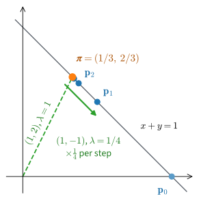
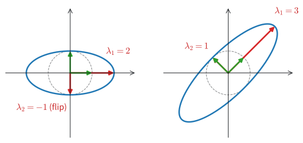
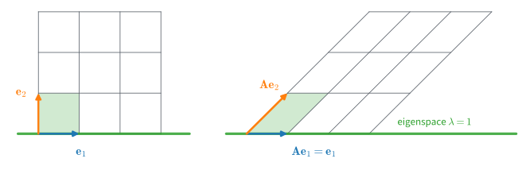
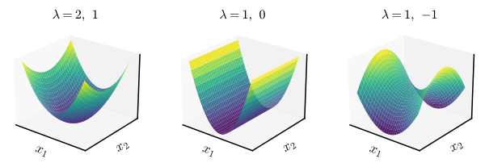

# Eigendecompositions
:label:`sec_mdl-eigendecompositions`

In :numref:`sec_mdl-linear-maps` we asked what a matrix does to space when it
is applied once. Many computations in machine learning, however, apply the same
matrix over and over. A deep linear network with identical layers computes
$\mathbf A^{50}\mathbf x$ after 50 layers, and gradient descent on a quadratic
objective multiplies its error by the same fixed matrix at every step. In each
case we want to know whether the signal grows, dies out, or settles down, and
how quickly that happens. Multiplying out the matrix powers gives us the
numbers, but it does not explain them.

A random walk between two web pages is the smallest version of this question.
Suppose a surfer on page 1 stays on page 1 or clicks to page 2 with
probability $1/2$ each; from page 2 she stays with probability $3/4$ and
returns to page 1 with probability $1/4$. Let $\mathbf p_k$ hold the
probabilities of being on each page after $k$ clicks. Each click multiplies
this vector by a fixed matrix,

$$
\mathbf p_{k+1}=\mathbf P\mathbf p_k,
\qquad
\mathbf P=\begin{pmatrix}1/2&1/4\\1/2&3/4\end{pmatrix},
$$

whose columns record the click probabilities from each page and therefore sum
to one. Starting on page 1 with $\mathbf p_0=(1,0)$, the first few
distributions are $(0.5,0.5)$, $(0.375,0.625)$, $(0.344,0.656)$, and
$(0.336,0.664)$. The changes shrink with every click, as if the walk were
settling onto a fixed distribution. Where is the surfer after 50 clicks, and
how fast does the distribution converge? PageRank asks the very same question
of the entire web.

The key is to rewrite the starting vector in the coordinates of a few special
directions—the eigenvectors—along which the matrix acts simply as
multiplication by a number. In those coordinates, each component evolves on its
own as a scalar power $\lambda^k$.

In :numref:`sec_linear-algebra` we already met eigenvectors as the directions
that a matrix only stretches: the symmetric matrix
$\mathbf S=\left(\begin{smallmatrix}2&1\\1&2\end{smallmatrix}\right)$
stretches $(1,1)$ by 3 and $(1,-1)$ by 1, and for any symmetric matrix we had
$\mathbf A^k\mathbf x=\sum_i c_i\lambda_i^k\mathbf v_i$. Here we drop the
symmetry requirement. We learn how to find the eigenvalues of an arbitrary
square matrix, see when a full set of eigenvectors exists and what replaces it
when one does not, and then prove why symmetry guarantees so much more.

Three results carry the most weight: the eigenvector expansion
:eqref:`eq_mdl-eig-power-expansion` of $\mathbf A^k\mathbf x$, the spectral
theorem, and the quadratic form written as a weighted sum of squares,
:eqref:`eq_mdl-quadform`. A reader in a hurry can jump from
:numref:`subsec_mdl-diagonalization` straight to
:numref:`subsec_mdl-spectral-theorem`. We leave two practical questions to
:numref:`sec_mdl-spectra-in-practice`: how to locate and compute eigenvalues
when a matrix is large, and the situations in which eigenvalues can mislead us.
Throughout this section we compute with NumPy, whose `eig` function returns
complex eigenvalues whenever a real matrix has them.

```{.python .input #eigendecomposition-imports}
#@tab mxnet
import numpy as np
```

```{.python .input #eigendecomposition-imports}
#@tab pytorch
import numpy as np
```

```{.python .input #eigendecomposition-imports}
#@tab tensorflow
import numpy as np
```

```{.python .input #eigendecomposition-imports}
#@tab jax
import numpy as np
```

## Eigenvalues and Diagonalization

### Eigenvectors and Eigenvalues
:label:`subsec_mdl-eigen-definition`

Certain input vectors are only rescaled by $\mathbf P$, as though the matrix
were a single number. Applying $\mathbf P$ to $(1,2)$ gives
$\mathbf P(1,2)=(\tfrac12+\tfrac12,\ \tfrac12+\tfrac32)=(1,2)$, leaving it
completely unchanged, while applying $\mathbf P$ to $(1,-1)$ gives
$(\tfrac12-\tfrac14,\ \tfrac12-\tfrac34)=\tfrac14(1,-1)$. Along the first
direction $\mathbf P$ multiplies by $1$; along the second it multiplies by
$1/4$.

In general, a nonzero vector $\mathbf v$ is called an *eigenvector* of a square
matrix $\mathbf A$, with corresponding *eigenvalue* $\lambda$, if

$$
\mathbf{A}\mathbf{v} = \lambda \mathbf{v}.
$$
:eqlabel:`eq_mdl-eigpair`

In geometric terms, $\mathbf A$ only stretches an eigenvector by the factor
$\lambda$, reversing its direction when $\lambda<0$. For the surfer's matrix
$\mathbf P$, the eigenpairs $(\lambda,\mathbf v)$ are $(1,(1,2))$ and
$(\tfrac14,(1,-1))$. We exclude the zero vector from being an eigenvector
because it trivially satisfies :eqref:`eq_mdl-eigpair` for every $\lambda$.
However, all solutions of $\mathbf A\mathbf v=\lambda\mathbf v$ for a fixed
$\lambda$, together with $\mathbf 0$, form a linear subspace called the
*eigenspace* of $\lambda$.

The eigenvalue $\lambda=0$, on the other hand, is perfectly valid. It means
that $\mathbf A\mathbf v=\mathbf 0$ for some nonzero $\mathbf v$, so a square
matrix is singular if and only if $0$ is one of its eigenvalues. Notice also
that a real matrix need not have any real eigenvectors: a rotation by
$90^\circ$ turns every nonzero direction in the plane. Its eigenvalues turn out
to be complex, a case we take up in :numref:`subsec_mdl-complex-rotation`.

It is tempting to confuse eigenvectors with the axes of the ellipse produced
when an invertible $2\times2$ matrix acts on the unit circle.
:numref:`fig_mdl-la-eig-ellipse` shows why the two concepts are distinct. For
the symmetric matrix $\mathbf S$, the eigenvectors do lie along the ellipse
axes. For the upper-triangular matrix
$\left(\begin{smallmatrix}1&1\\0&2\end{smallmatrix}\right)$, however, they do
not: its eigenvectors are $(1,0)$ with $\lambda=1$ and $(1,1)$ with
$\lambda=2$, whereas the ellipse axes point at $58^\circ$ and $-32^\circ$
(:numref:`sec_mdl-svd-low-rank` shows how to compute them). The ellipse axes
mark the directions of largest and smallest stretch, while the eigenvectors
mark the directions that are not rotated at all. For symmetric matrices these
two sets of directions always coincide, as the spectral theorem of
:numref:`subsec_mdl-spectral-theorem` proves; for general matrices they need
not.


:label:`fig_mdl-la-eig-ellipse`

### The Characteristic Polynomial
:label:`subsec_mdl-finding-eigenvalues`

We spotted the eigenvectors of $\mathbf P$ by inspection, which does not take
us far on larger matrices. To find the eigenvalues of any square matrix
systematically, move $\lambda\mathbf v$ to the left-hand side of
:eqref:`eq_mdl-eigpair` and factor out $\mathbf v$:

$$
(\mathbf{A} - \lambda \mathbf{I})\mathbf{v} = \mathbf 0.
$$
:eqlabel:`eq_mdl-eigvalue_der`

A nonzero solution $\mathbf v$ exists if and only if
$\mathbf A-\lambda\mathbf I$ has a nontrivial null space—that is, if and only
if it is singular, so that $\det(\mathbf A-\lambda\mathbf I)=0$. Expanding
this determinant yields a polynomial of degree $n$ in $\lambda$, called the
*characteristic polynomial* $p(\lambda)=\det(\mathbf A-\lambda\mathbf I)$.
Its roots are precisely the eigenvalues of $\mathbf A$. Once a root $\lambda$
is known, solving the homogeneous linear system :eqref:`eq_mdl-eigvalue_der`
gives its eigenspace.

Let us run this recipe on the surfer's matrix:

$$
\det(\mathbf P-\lambda\mathbf I)
=\Bigl(\tfrac12-\lambda\Bigr)\Bigl(\tfrac34-\lambda\Bigr)-\tfrac14\cdot\tfrac12
=\lambda^2-\tfrac54\lambda+\tfrac14
=(\lambda-1)\Bigl(\lambda-\tfrac14\Bigr).
$$

The roots are $1$ and $1/4$, matching the two scaling factors we noticed
earlier. Because $\mathbf P-\lambda\mathbf I$ is singular at each root, a
single row suffices to find the eigenvector. For $\lambda=1$, the first row of
$\mathbf P-\mathbf I$ gives $-\tfrac12v_1+\tfrac14v_2=0$, so $v_2=2v_1$ and we
may choose $\mathbf v=(1,2)$. For $\lambda=\tfrac14$, the first row of
$\mathbf P-\tfrac14\mathbf I$ gives $\tfrac14v_1+\tfrac14v_2=0$, yielding
$\mathbf v=(1,-1)$. Keep in mind that every eigenvector is determined only up
to a nonzero scalar factor: if $\mathbf v$ is an eigenvector, then so is
$c\mathbf v$ for any $c\neq0$, since both sides of :eqref:`eq_mdl-eigpair`
scale by $c$.

In practice we leave this algebra to a numerical library. NumPy's `eig`
returns the eigenvalues together with a matrix whose columns are the
corresponding eigenvectors; the last line below checks
:eqref:`eq_mdl-eigpair` for all pairs at once.

```{.python .input #eigendecomposition-an-example}
P = np.array([[0.5, 0.25], [0.5, 0.75]])
lam, V = np.linalg.eig(P)
print('eigenvalues:', lam)
print('eigenvectors (columns):\n', V)
print('max |P V - V diag(lam)|:', np.abs(P @ V - V * lam).max())
```

Order, scale, and sign are all at the library's discretion: here `eig` returns
the eigenvalues as $1/4$ and $1$, and the columns are unit-length vectors
parallel to $(1,-1)$ and $(1,2)$.

Numerical libraries do not actually form and solve the characteristic
polynomial. For $n\ge5$ there is no general closed-form formula for polynomial
roots in radicals, and even for moderate $n$ the roots are notoriously
sensitive to tiny rounding errors in the polynomial coefficients. Instead,
`eig` applies a sequence of orthogonal changes of basis that gradually drive
the matrix into triangular form without altering its eigenvalues. A triangular
matrix displays its eigenvalues right on its diagonal: subtracting
$\lambda\mathbf I$ keeps it triangular, and the determinant of a triangular
matrix is simply the product of its diagonal entries
(:numref:`subsec_mdl-determinant-general`). For matrices far too large to
factor at all, power iteration (:numref:`subsec_mdl-power-iteration`) extracts
dominant eigenvalues using only matrix--vector products.

### Diagonalization
:label:`subsec_mdl-diagonalization`

We can now answer our opening question about $\mathbf P^{50}\mathbf p_0$.
Collect the two eigenvectors of $\mathbf P$ as the columns of a matrix
$\mathbf V$, and place their eigenvalues on the diagonal of
$\boldsymbol\Lambda$:

$$
\mathbf V=\begin{pmatrix}1&1\\2&-1\end{pmatrix},
\qquad
\boldsymbol\Lambda=\begin{pmatrix}1&0\\0&1/4\end{pmatrix}.
$$

Written side by side as columns, the two eigenvector equations
$\mathbf P\mathbf v_i=\lambda_i\mathbf v_i$ compactly read
$\mathbf P\mathbf V=\mathbf V\boldsymbol\Lambda$. Because
$\det\mathbf V=-1-2=-3\neq0$, the matrix $\mathbf V$ is invertible, with
$\mathbf V^{-1}=\tfrac13\left(\begin{smallmatrix}1&1\\2&-1\end{smallmatrix}\right)$.
Multiplying on the right by $\mathbf V^{-1}$ yields

$$
\mathbf{P} = \mathbf{V} \boldsymbol{\Lambda} \mathbf{V}^{-1}.
$$
:eqlabel:`eq_mdl-eig_decomp`

Read this factorization from right to left as three steps: change to
eigenvector coordinates ($\mathbf V^{-1}$), scale each coordinate independently
by its eigenvalue ($\boldsymbol\Lambda$), and change back to the original
coordinates ($\mathbf V$). A square matrix $\mathbf A$ that can be written as
$\mathbf A=\mathbf V\boldsymbol\Lambda\mathbf V^{-1}$, with $\mathbf V$
invertible and $\boldsymbol\Lambda$ diagonal, is called *diagonalizable*, and
the factorization itself is its *eigendecomposition*. Such a factorization
exists if and only if $\mathbf A$ has $n$ linearly independent eigenvectors to
fill the columns of $\mathbf V$.

Taking powers of a diagonalizable matrix now becomes effortless. In a product
of $k$ copies of $\mathbf V\boldsymbol\Lambda\mathbf V^{-1}$, every adjacent
pair $\mathbf V^{-1}\mathbf V$ cancels out:

$$
\mathbf{A}^k = \overbrace{(\mathbf{V}\boldsymbol{\Lambda} \mathbf{V}^{-1})\cdots(\mathbf{V}\boldsymbol{\Lambda} \mathbf{V}^{-1})}^{\textrm{$k$ times}} =  \mathbf{V}\overbrace{\boldsymbol{\Lambda}\cdots\boldsymbol{\Lambda}}^{\textrm{$k$ times}}\mathbf{V}^{-1} = \mathbf{V}\boldsymbol{\Lambda}^k \mathbf{V}^{-1}.
$$

Powers of a diagonalizable matrix thus reduce to powers of scalars. Applying
$\mathbf A^k$ to a vector $\mathbf x$, and writing
$\mathbf c=\mathbf V^{-1}\mathbf x$ for the coordinates of $\mathbf x$ in the
eigenbasis (so that $\mathbf x=\sum_i c_i\mathbf v_i$), we obtain

$$
\mathbf A^k\mathbf x=\mathbf V\boldsymbol\Lambda^k\mathbf c
=\sum_{i=1}^n c_i\lambda_i^k\mathbf v_i .
$$
:eqlabel:`eq_mdl-eig-power-expansion`

Each eigen-coordinate evolves independently as the geometric sequence
$c_i\lambda_i^k$. For the surfer starting on page 1,
$\mathbf c=\mathbf V^{-1}\mathbf p_0=\tfrac13(1,2)=(\tfrac13,\tfrac23)$, which
gives the closed-form distribution after any number of clicks $k$:

$$
\mathbf p_k=\mathbf P^k\mathbf p_0
=\frac13\begin{pmatrix}1\\2\end{pmatrix}
+\frac23\Bigl(\frac14\Bigr)^k\begin{pmatrix}1\\-1\end{pmatrix}.
$$
:eqlabel:`eq_mdl-markov-closed-form`

This completely settles the opening question. As $k$ grows, the second term
vanishes and the distribution approaches $\boldsymbol\pi=(1/3,2/3)$: in the
long run, the surfer spends twice as much time on page 2 as on page 1. The
remaining error is $\tfrac23\,4^{-k}$ in each entry and always points along the
eigenvector $(1,-1)$. Every click divides that error by $4$, so after 10 clicks
it has dropped to $6\times10^{-7}$, and after 50 clicks it is below $10^{-30}$.
As a sanity check, setting $k=3$ gives
$(\tfrac13+\tfrac1{96},\ \tfrac23-\tfrac1{96})=(0.34375,0.65625)$, matching
the third iterate we computed at the start.
:numref:`fig_mdl-la-markov-iterates` illustrates the geometry: because the
entries of every $\mathbf p_k$ sum to one, the iterates slide along the line
$x+y=1$ toward the point where the eigenvector of $\lambda=1$ intersects it.


:label:`fig_mdl-la-markov-iterates`

Let us verify that fifty matrix multiplications and the two-term
eigen-expansion produce the same $\mathbf p_{50}$, and check the ratio of
consecutive errors.

```{.python .input #mdl-eigendecomposition-diagonalization}
p0 = np.array([1.0, 0.0])
c = np.linalg.solve(V, p0)              # coordinates of p0 in the eigenbasis
print('P^50 p0             :', np.linalg.matrix_power(P, 50) @ p0)
print('sum c_i lam_i^50 v_i:', V @ (c * lam ** 50))
pi = np.array([1 / 3, 2 / 3])
errs = np.array([np.abs(np.linalg.matrix_power(P, k) @ p0 - pi).max()
                 for k in range(8)])
print('error ratios:', np.round(errs[1:] / errs[:-1], 4))
```

The two computations agree, and every consecutive error ratio is $0.25$. The
eigenvalue $1$ governs the part of $\mathbf p_0$ that survives, while the
eigenvalue $1/4$ governs the part that dies out.

The same recipe applies to other functions of a diagonalizable matrix. When no
eigenvalue is zero, $\mathbf A^{-1}=\mathbf V\boldsymbol\Lambda^{-1}\mathbf V^{-1}$:
simply invert each eigenvalue on the diagonal. Similarly, the matrix
exponential $e^{\mathbf A t}=\mathbf V e^{\boldsymbol\Lambda t}\mathbf V^{-1}$,
which solves the linear differential equation $\dot{\mathbf x}=\mathbf A\mathbf x$,
is built by exponentiating each eigenvalue; :numref:`sec_mdl-odes-solvers`
develops it in detail.

**Similarity.** The eigendecomposition tells us that $\mathbf P$ and
$\boldsymbol\Lambda$ represent the very same linear map written in two
different bases. In general, two matrices related by
$\mathbf A'=\mathbf B\mathbf A\mathbf B^{-1}$ for some invertible
$\mathbf B$ are called *similar*. The next proposition confirms that changing
basis cannot alter a matrix's eigenvalues. It relies on the multiplicativity of
the determinant from :numref:`sec_mdl-linear-maps`,

$$
\det(\mathbf X\mathbf Y)=\det\mathbf X\,\det\mathbf Y,
$$

which in particular gives $\det(\mathbf B^{-1})=1/\det\mathbf B$ from
$\mathbf B\mathbf B^{-1}=\mathbf I$.

**Proposition (similar matrices share the characteristic polynomial).** *For
every square $\mathbf A$ and every invertible $\mathbf B$,*

$$
\det(\mathbf B\mathbf A\mathbf B^{-1}-\lambda\mathbf I)=\det(\mathbf A-\lambda\mathbf I).
$$
:eqlabel:`eq_mdl-similar-charpoly`

**Proof.** Rewrite $\lambda\mathbf I=\mathbf B(\lambda\mathbf I)\mathbf B^{-1}$
and factor out $\mathbf B$ and $\mathbf B^{-1}$:
$\det(\mathbf B\mathbf A\mathbf B^{-1}-\lambda\mathbf I)
=\det\bigl(\mathbf B(\mathbf A-\lambda\mathbf I)\mathbf B^{-1}\bigr)
=\det\mathbf B\,\det(\mathbf A-\lambda\mathbf I)\,\det\mathbf B^{-1}
=\det(\mathbf A-\lambda\mathbf I)$. $\blacksquare$

Similar matrices therefore have the same eigenvalues with the same
multiplicities as roots, and any quantity determined by the characteristic
polynomial is a *similarity invariant*. The two most useful invariants are the
determinant and the trace. For any diagonalizable matrix,

$$
\det(\mathbf{A}) = \det(\mathbf{V}\boldsymbol{\Lambda}\mathbf{V}^{-1})
  = \det(\mathbf{V})\det(\boldsymbol{\Lambda})\det(\mathbf{V}^{-1})
  = \det(\boldsymbol{\Lambda})
  = \lambda_1 \lambda_2 \cdots \lambda_n .
$$
:eqlabel:`eq_mdl-det-eig`

Thus the determinant is the product of the eigenvalues: whatever volume
distortion $\mathbf V$ introduces, $\mathbf V^{-1}$ undoes, leaving only the
axis scaling of $\boldsymbol\Lambda$. For the trace, we use its cyclic property
(:numref:`subsec_mdl-einsum`),

$$
\operatorname{tr}(\mathbf X\mathbf Y)=\operatorname{tr}(\mathbf Y\mathbf X),
$$

which holds for any $\mathbf X$ and $\mathbf Y$ whose products are square.
Setting $\mathbf X=\mathbf V$ and
$\mathbf Y=\boldsymbol\Lambda\mathbf V^{-1}$ gives

$$
\operatorname{tr}(\mathbf{A})
  = \operatorname{tr}(\mathbf{V}\boldsymbol{\Lambda}\mathbf{V}^{-1})
  = \operatorname{tr}(\boldsymbol{\Lambda}\mathbf{V}^{-1}\mathbf{V})
  = \operatorname{tr}(\boldsymbol{\Lambda})
  = \lambda_1+\cdots+\lambda_n .
$$
:eqlabel:`eq_mdl-tr-eig`

Thus the trace is the sum of the eigenvalues. On the surfer's matrix we can
check both identities at a glance:
$\operatorname{tr}\mathbf P=\tfrac12+\tfrac34=\tfrac54=1+\tfrac14$ and
$\det\mathbf P=\tfrac38-\tfrac18=\tfrac14=1\cdot\tfrac14$. For any $2\times2$
matrix, these two numbers fix both eigenvalues directly as the roots of
$\lambda^2-(\operatorname{tr})\lambda+\det$.

In fact, both identities hold for *every* square matrix, diagonalizable or not,
provided we count the eigenvalues over $\mathbb C$ with their multiplicities as
roots. By the *fundamental theorem of algebra* (which we take as given), every
degree-$n$ polynomial factors completely over $\mathbb C$:

$$
\det(\mathbf A-\lambda\mathbf I)=\prod_{i=1}^n(\lambda_i-\lambda).
$$

Setting $\lambda=0$ immediately yields $\det\mathbf A=\prod_i\lambda_i$. For
the trace, compare the coefficients of $\lambda^{n-1}$ on both sides. On the
right-hand side the coefficient is $(-1)^{n-1}\sum_i\lambda_i$. On the
left-hand side, only the product of the diagonal entries of
$\mathbf A-\lambda\mathbf I$ reaches degree $n-1$, giving
$(-1)^{n-1}\sum_i a_{ii}$. Hence $\operatorname{tr}\mathbf A=\sum_i\lambda_i$.
Because any non-real eigenvalues of a real matrix come in complex conjugate
pairs, both the sum and the product remain real.

Finally, the rank of a diagonalizable matrix equals its number of nonzero
eigenvalues, counted with multiplicity: multiplying by the invertible matrices
$\mathbf V$ and $\mathbf V^{-1}$ preserves dimensions, so
$\operatorname{rank}\mathbf A=\operatorname{rank}\boldsymbol\Lambda$.
Exercise :exref:`ex_mdl-eigendecomposition-rank-zero-eigenvalues` examines what
happens when a matrix is not diagonalizable.

### Algebraic and Geometric Multiplicity
:label:`subsec_mdl-multiplicity`

The surfer's matrix had two distinct eigenvalues and yielded two linearly
independent eigenvectors. That was no coincidence: distinct eigenvalues always
produce independent eigenvectors.

**Proposition (distinct eigenvalues give independent eigenvectors).**
*Eigenvectors belonging to distinct eigenvalues are linearly independent. In
particular, any $n\times n$ matrix with $n$ distinct eigenvalues is
diagonalizable.*

**Proof.** Suppose, for the sake of contradiction, that some eigenvectors
$\mathbf{v}_1,\ldots,\mathbf{v}_m$ with distinct eigenvalues
$\lambda_1,\ldots,\lambda_m$ are linearly dependent. Among all nontrivial
dependence relations, choose one with the fewest nonzero coefficients,
$\sum_{i=1}^{m} c_i\mathbf{v}_i = \mathbf 0$, and relabel if needed so that
$c_m\neq0$. Such a relation must have at least two nonzero coefficients, since
$c_m\mathbf{v}_m=\mathbf 0$ alone would force $\mathbf{v}_m=\mathbf 0$. Now
apply $\mathbf{A}$ to the relation and subtract $\lambda_m$ times the original
relation:

$$
\mathbf 0 = \mathbf{A}\!\sum_i c_i\mathbf{v}_i - \lambda_m\!\sum_i c_i\mathbf{v}_i
   = \sum_{i=1}^{m-1} c_i(\lambda_i-\lambda_m)\,\mathbf{v}_i .
$$

The $\mathbf{v}_m$ term drops out, leaving a shorter relation. Yet it is still
nontrivial: any other nonzero coefficient $c_i$ ($i<m$) survives as
$c_i(\lambda_i-\lambda_m)\neq0$ because the eigenvalues are distinct. This
contradicts the minimality of our chosen relation. When $\mathbf A$ has $n$
distinct eigenvalues, its $n$ independent eigenvectors form a basis of
$\mathbb C^n$ (or of $\mathbb R^n$ when all eigenvalues are real), so
$\mathbf{V}$ is invertible. $\blacksquare$

When eigenvalues repeat, we have to keep track of two different counts. The
number of times $\lambda$ appears as a root of the characteristic polynomial is
its *algebraic multiplicity* $a(\lambda)$. The dimension of its eigenspace—the
number of linearly independent eigenvectors it contributes—is its *geometric
multiplicity* $g(\lambda)$.

**Proposition.** *For every eigenvalue $\lambda$ of a square matrix,
$1\le g(\lambda)\le a(\lambda)$.*

**Proof.** Because $\mathbf A-\lambda\mathbf I$ is singular, its null space is
nontrivial, which gives $g\ge1$. For the upper bound, pick a basis
$\mathbf v_1,\ldots,\mathbf v_g$ of the eigenspace, extend it to a basis of
$\mathbb C^n$, and place these basis vectors as the columns of $\mathbf B$.
The first $g$ columns of $\mathbf A\mathbf B$ are simply
$\lambda\mathbf v_1,\ldots,\lambda\mathbf v_g$, so in this new basis the matrix
takes a block upper-triangular form:

$$
\mathbf B^{-1}\mathbf A\mathbf B=\begin{pmatrix}\lambda\mathbf I_g&\mathbf X\\\mathbf 0&\mathbf Y\end{pmatrix}.
$$

By :eqref:`eq_mdl-similar-charpoly`, this matrix has the same characteristic
polynomial $p$ as $\mathbf A$. Let us write the polynomial variable as $t$,
since $\lambda$ now stands for our fixed eigenvalue. Subtracting $t\mathbf I$
preserves the block upper-triangular structure, with diagonal blocks
$(\lambda-t)\mathbf I_g$ and $\mathbf Y-t\mathbf I$. Because the determinant
of a block upper-triangular matrix is the product of the determinants of its
diagonal blocks (:numref:`subsec_mdl-determinant-general`), we get
$p(t)=(\lambda-t)^g\det(\mathbf Y-t\mathbf I)$. Thus $(\lambda-t)^g$ divides
the characteristic polynomial, which means $a\ge g$. $\blacksquare$

An eigenvalue can never supply more independent eigenvectors than its
multiplicity as a root, though it can supply fewer. Now pick a basis for each
eigenspace and pool all the chosen vectors together. They are jointly
independent: if a linear combination of them equals zero, group the terms by
eigenvalue; each group is either zero or an eigenvector, and the proposition on
distinct eigenvalues forces every group to vanish. A matrix therefore possesses
at most $\sum_\lambda g(\lambda)$ linearly independent eigenvectors. Over
$\mathbb C$, the algebraic multiplicities sum to $n$ and $g(\lambda)\le a(\lambda)$
for every $\lambda$, which gives a crisp criterion: *the eigenvectors of
$\mathbf A$ span $\mathbb C^n$ if and only if $g(\lambda)=a(\lambda)$ for every
complex eigenvalue $\lambda$*.

For a real matrix to have a basis of *real* eigenvectors, all of its
eigenvalues must also be real. The $90^\circ$ rotation
$\mathbf R_{90}=\left(\begin{smallmatrix}0&-1\\1&0\end{smallmatrix}\right)$
shows why that extra requirement is essential: its eigenvalues $\pm i$ each
satisfy $g=a=1$, so it has a full complex eigenbasis, yet no real eigenvector
at all.

When eigenvalues repeat, diagonalizability can fail altogether. The simplest
counterexample is the *shear* from :numref:`subsec_mdl-composition`:

$$
\mathbf{T} = \begin{pmatrix}
1 & 1 \\
0 & 1
\end{pmatrix}.
$$
:eqlabel:`eq_mdl-defective-shear`

Its characteristic polynomial is $(1-\lambda)^2$, so $\lambda=1$ has algebraic
multiplicity $2$. Yet $(\mathbf{T}-\mathbf{I})\mathbf{v}=\mathbf 0$ becomes
$\left(\begin{smallmatrix}0&1\\0&0\end{smallmatrix}\right)\mathbf v=\mathbf 0$,
which forces $v_2=0$. The eigenspace is only the line spanned by $(1,0)$, so
the geometric multiplicity is $1$. There is no eigenbasis, and the shear is not
diagonalizable. Any matrix with $g(\lambda)<a(\lambda)$ for some eigenvalue is
called *defective*. :numref:`fig_mdl-la-defective-shear` makes the shortage
visible: the shear slides every horizontal line sideways in proportion to its
height, leaving the horizontal axis as the sole line through the origin that
keeps its direction. (By contrast, a diagonalizable $2\times2$ matrix with a
repeated eigenvalue $\lambda$ would have to be $\lambda\mathbf I$, which
preserves every direction.)


:label:`fig_mdl-la-defective-shear`

Iterating the shear shows how defectiveness changes the behavior of matrix
powers: $\mathbf T^k=\left(\begin{smallmatrix}1&k\\0&1\end{smallmatrix}\right)$,
so $\mathbf T^k\mathbf e_2=(k,1)$ grows without bound even though the only
eigenvalue is $1$. No pure eigen-expansion can produce that linear factor $k$.
The next subsection explains where it comes from.

### The Jordan Normal Form
:label:`subsec_mdl-jordan`

When geometric multiplicity falls short, no eigenbasis exists. What structure
takes its place? For what follows in this book, one consequence matters most: a
defective eigenvalue multiplies $\lambda^k$ by a polynomial in $k$. Over the
complex numbers, every square matrix is similar to a block-diagonal matrix
built from *Jordan blocks*

$$
\mathbf{J}_m(\lambda) =
\begin{pmatrix}
\lambda & 1      &        &        \\
        & \lambda& \ddots &        \\
        &        & \ddots & 1      \\
        &        &        & \lambda
\end{pmatrix},
$$

which are $m\times m$ blocks carrying a single eigenvalue $\lambda$ down the
diagonal and $1$s on the superdiagonal immediately above it. This
factorization is the *Jordan normal form* :cite:`Horn.Johnson.2012`, which we
use without proof. By :eqref:`eq_mdl-similar-charpoly`, it has the same
eigenvalues as the original matrix.

Each Jordan block supplies exactly one eigenvector, namely its first basis
vector. The geometric multiplicity of $\lambda$ is therefore the number of
blocks carrying $\lambda$, while its algebraic multiplicity is the sum of
their sizes. In particular, a matrix is diagonalizable if and only if every
Jordan block has size $1\times1$. The shear $\mathbf T$ of
:eqref:`eq_mdl-defective-shear` is the single block $\mathbf{J}_2(1)$.

Under repeated application, a Jordan block does more than simply scale. Write
$\mathbf{J}_m(\lambda)=\lambda\mathbf{I}+\mathbf{N}$, where $\mathbf{N}$ has
$1$s just above the diagonal and zeros everywhere else. Geometrically,
$\mathbf N$ acts as a shift, sending each basis vector to the previous one, so
$\mathbf N^m=\mathbf 0$ (any matrix with a vanishing power is called
*nilpotent*). Because $\mathbf{I}$ and $\mathbf{N}$ commute, we can expand
powers with the binomial theorem. For $m=2$, every term beyond the first two
contains $\mathbf{N}^2=\mathbf 0$, leaving

$$
\mathbf{J}_2(\lambda)^k = (\lambda\mathbf{I}+\mathbf{N})^k
  = \lambda^k\mathbf{I} + k\lambda^{k-1}\mathbf{N}.
$$

In the long run, the eigenvalue still decides between growth and decay, but it
is now multiplied by a polynomial in $k$ (of degree $m-1$ for an $m\times m$
block). When $|\lambda|=1$, as in the shear, the iterates drift linearly. When
$|\lambda|$ is slightly below $1$, something more surprising happens: the
upper-right entry $k\lambda^{k-1}$ initially grows, peaks near
$k\approx-1/\log|\lambda|$, and only then decays toward zero. For
$\lambda=0.99$ this puts the peak near $k\approx100$, where the entry reaches
$100\cdot0.99^{99}\approx37$. Let us check this prediction numerically.

```{.python .input #mdl-eigendecomposition-jordan-power}
J = np.array([[0.99, 1.], [0., 0.99]])   # the Jordan block J_2(0.99)
for k in [1, 50, 100, 200, 800]:
    Jk = np.linalg.matrix_power(J, k)
    pred = k * 0.99 ** (k - 1)   # predicted corner entry, k * lambda^(k-1)
    print(f'k = {k:3d}   ||J^k|| = {np.linalg.norm(Jk, 2):8.3f}   '
          f'k * 0.99^(k-1) = {pred:8.3f}')
```

Every eigenvalue of $\mathbf{J}$ is $0.99$, yet the norm of its powers climbs
to about $37$ at $k=100$ and is still $27$ at $k=200$ before the exponential
factor $0.99^k$ finally takes over. Eigenvalues alone do not warn us about this
transient growth, a phenomenon we revisit in
:numref:`subsec_mdl-transient-growth`.

Jordan blocks represent one way a real matrix can lack a real eigenbasis: it
simply has too few eigenvectors. The second way is quite different in nature.
A real matrix can lack any real eigenvector in a plane because it *rotates*
that plane.

### Complex Eigenvalues
:label:`subsec_mdl-complex-rotation`

Consider the planar rotation by an angle $\theta$
(:numref:`subsec_mdl-orthogonal-matrices`),

$$
\mathbf{R}_\theta = \begin{pmatrix}\cos\theta & -\sin\theta\\
                            \sin\theta & \phantom{-}\cos\theta\end{pmatrix}.
$$

Whenever $\theta$ is not a multiple of $\pi$, $\mathbf{R}_\theta$ turns every
nonzero real vector, leaving no real eigenvector. Its characteristic polynomial
$\lambda^2-2\cos\theta\,\lambda+1$ has the complex conjugate roots
$\lambda=\cos\theta\pm i\sin\theta=e^{\pm i\theta}$. Here the modulus
$|\lambda|=1$ reflects that $\mathbf{R}_\theta$ preserves lengths, while the
argument $\pm\theta$ records the rotation angle.

Now look at the chapter's running $2\times2$ matrix, which shows no obvious
rotation in its entries:

$$
\mathbf A=\begin{pmatrix}1&2\\-1&3\end{pmatrix},
\qquad \operatorname{tr}\mathbf A=4,\quad \det\mathbf A=5 .
$$

Its characteristic polynomial is $\lambda^2-4\lambda+5$, whose roots are
$\lambda=2\pm i=\sqrt5\,e^{\pm i\theta}$ with
$\theta=\arctan\tfrac12\approx26.6^\circ$. To find an eigenvector for $2+i$,
read off the second row of $\mathbf A-(2+i)\mathbf I$, which gives
$-w_1+(1-i)w_2=0$. Setting $w_2=1$ yields

$$
\mathbf w=\begin{pmatrix}1-i\\1\end{pmatrix}
=\underbrace{\begin{pmatrix}1\\1\end{pmatrix}}_{\mathbf u}
+i\underbrace{\begin{pmatrix}-1\\0\end{pmatrix}}_{\mathbf v}.
$$

Where is the rotation hiding? Take any real matrix $\mathbf{A}$ with a complex
eigenpair $\mathbf{A}\mathbf{w}=\lambda\mathbf{w}$, where $\lambda=a+ib$ and
$b\neq0$, and separate the eigenvector into its real and imaginary parts,
$\mathbf{w}=\mathbf{u}+i\mathbf{v}$. Expanding
$\mathbf{A}(\mathbf{u}+i\mathbf{v})=(a+ib)(\mathbf{u}+i\mathbf{v})$ and
equating real and imaginary parts gives

$$
\mathbf{A}\mathbf{u} = a\mathbf{u} - b\mathbf{v},
\qquad
\mathbf{A}\mathbf{v} = b\mathbf{u} + a\mathbf{v}.
$$

Both images stay inside $\operatorname{span}\{\mathbf{u},\mathbf{v}\}$, so
this subspace is invariant under $\mathbf{A}$. Moreover, it is a genuine
two-dimensional plane. If $\mathbf u$ and $\mathbf v$ were linearly dependent,
their span would be a single line (not zero, because $\mathbf w\neq\mathbf 0$)
mapped into itself, on which $\mathbf A$ would act by multiplying by some real
scalar $\mu$. That would force $\mathbf A\mathbf w=\mu\mathbf w$, making
$\lambda=\mu$ real and contradicting $b\neq0$. Placing $\mathbf{v}$ and
$\mathbf{u}$ as the columns of $\mathbf{B}=[\mathbf{v}\;\;\mathbf{u}]$ turns
the two identities into
$\mathbf{A}\mathbf{B}=\mathbf{B}\left(\begin{smallmatrix}a & -b\\ b & \phantom{-}a\end{smallmatrix}\right)$,
or equivalently,

$$
\mathbf{B}^{-1}\mathbf{A}\mathbf{B}
= \begin{pmatrix} a & -b\\ b & \phantom{-}a \end{pmatrix}
= \underbrace{\sqrt{a^2+b^2}}_{r}\,
  \begin{pmatrix} \cos\theta & -\sin\theta\\ \sin\theta & \phantom{-}\cos\theta \end{pmatrix},
\qquad \theta=\arg(a+ib).
$$
:eqlabel:`eq_mdl-rotation-scaling-block`

In the basis $(\mathbf v,\mathbf u)$ of its invariant plane, $\mathbf{A}$ acts
as a rotation--scaling block $r\mathbf R_\theta$: it scales by the modulus $r$
and rotates by the argument $\theta$. Because the derivation used only
$\mathbf A\mathbf w=\lambda\mathbf w$, this block is independent of how
$\mathbf w$ is scaled or rotated in phase. The connection also works in
reverse: if we identify $(x,y)\in\mathbb{R}^2$ with the complex number
$x+iy$, then the block maps $(x,y)$ to $(ax-by,\,bx+ay)$, which is simply
complex multiplication by $a+ib$.

For our running matrix $\mathbf A$, we have
$\mathbf B=\left(\begin{smallmatrix}-1&1\\0&1\end{smallmatrix}\right)$ and
$\mathbf B^{-1}\mathbf A\mathbf B=\left(\begin{smallmatrix}2&-1\\1&2\end{smallmatrix}\right)$,
which scales by $\sqrt5$ and rotates by $26.6^\circ$. One might expect every
step to lengthen a vector by the factor $\sqrt5\approx2.24$. Let us compute
the block from the eigenvector returned by `eig` and track the actual lengths
of the iterates $\mathbf A^k(1,0)$.

```{.python .input #mdl-eigendecomposition-complex-eigenvalues-are-rotations-1}
A = np.array([[1., 2.], [-1., 3.]])
lam, V = np.linalg.eig(A)
j = np.argmax(lam.imag)                  # the eigenvalue a + ib with b > 0
r, theta = np.abs(lam[j]), np.angle(lam[j])
u, v = V[:, j].real, V[:, j].imag
B = np.column_stack([v, u])              # basis (v, u) of the invariant plane
print(f'lambda = {lam[j]:.4f}   r = {r:.4f}   theta = {theta:.4f}')
print('B^-1 A B =\n', np.round(np.linalg.inv(B) @ A @ B, 4))
xs = [np.array([1., 0.])]
for _ in range(8):
    xs.append(A @ xs[-1])
norms = np.linalg.norm(xs, axis=1)
print('norm ratios:', np.round(norms[1:] / norms[:-1], 2))
x20 = np.linalg.matrix_power(A, 20) @ np.array([1., 0.])
print(f'average rate ||A^20 x||^(1/20) = {np.linalg.norm(x20) ** (1 / 20):.3f}')
```

Regardless of which eigenvector `eig` chooses, the resulting block is
$\left(\begin{smallmatrix}2&-1\\1&2\end{smallmatrix}\right)$. Yet the vector
lengths do *not* grow by a steady factor of $2.24$ at each step. Along the
trajectory $(1,0)\to(1,-1)\to(-1,-4)\to(-9,-11)\to(-31,-24)$, the per-step
norm ratios swing between roughly $1.4$ and $3.5$. The reason is that the
scaling is uniform only in the coordinates $(\mathbf v,\mathbf u)$, which are
not orthonormal. Back in standard coordinates, the iterates spiral outward
along stretched ellipses, completing a full turn roughly every
$2\pi/\theta\approx13.6$ steps. Only the long-run geometric average
$\|\mathbf A^k\mathbf x\|^{1/k}$ settles at $\sqrt5$ (reaching $2.25$ by
$k=20$). The motion is a rigid rotation and uniform scaling in standard
coordinates only when the matrix is *normal*, a property we define in
:numref:`subsec_mdl-normal-matrices`.

Up to a real change of basis, every real square matrix is built from the three
elementary behaviors we have now uncovered, alone or in combination: stretching
along a line, shearing within a Jordan block, and rotating with scaling in a
plane. This decomposition is known as the *real Jordan form*
:cite:`Horn.Johnson.2012`.

## Symmetric Matrices and Quadratic Forms

### The Spectral Theorem
:label:`subsec_mdl-spectral-theorem`

Which matrices guarantee a real, orthonormal eigenbasis? Symmetry eliminates
both obstacles we just encountered: it rules out complex eigenvalues as well as
shortages of eigenvectors. The symmetric matrix $\mathbf S$ from
:numref:`sec_linear-algebra` shows what happens. Its unit eigenvectors
$(1,1)/\sqrt2$ and $(1,-1)/\sqrt2$ are perpendicular, giving

$$
\mathbf S=\begin{pmatrix}2&1\\1&2\end{pmatrix}
=\underbrace{\frac1{\sqrt2}\begin{pmatrix}1&1\\1&-1\end{pmatrix}}_{\mathbf V}
\begin{pmatrix}3&0\\0&1\end{pmatrix}
\underbrace{\frac1{\sqrt2}\begin{pmatrix}1&1\\1&-1\end{pmatrix}}_{\mathbf V^\top}.
$$

Because the eigenvector matrix $\mathbf V$ is orthogonal
($\mathbf V^\top\mathbf V=\mathbf I$), its inverse is simply its transpose. The
spectral theorem guarantees that this holds for *every* real symmetric matrix.
It is the central theorem of this chapter: positive definiteness, the Rayleigh
quotient, and all of :numref:`sec_mdl-svd-low-rank` rest on it.

**Theorem (spectral theorem).** *Every real symmetric matrix $\mathbf{A}$ has
real eigenvalues and an orthonormal basis of real eigenvectors. Equivalently,*

$$
\mathbf{A} = \mathbf{V}\boldsymbol{\Lambda}\mathbf{V}^\top ,
$$
:eqlabel:`eq_mdl-spectral`

*where $\boldsymbol{\Lambda}=\operatorname{diag}(\lambda_1,\ldots,\lambda_n)$
is real and $\mathbf{V}$ is orthogonal.*

We prove this in three steps: first, every eigenvalue is real; second,
eigenvectors for distinct eigenvalues are orthogonal; third, a full orthonormal
eigenbasis always exists. For complex vectors we use the Hermitian inner
product $\langle\mathbf x,\mathbf y\rangle=\mathbf x^*\mathbf y$, where
$\mathbf x^*$ is the conjugate transpose (which reduces to the ordinary dot
product on real vectors). The only external fact we borrow is that the
characteristic polynomial has at least one complex root (the fundamental
theorem of algebra), ensuring that at least one eigenpair exists over
$\mathbb{C}$. Parts (i) and (ii) take only two lines each; the real work is in
part (iii).

**Proof, part (i): the eigenvalues are real.** Suppose
$\mathbf{A}\mathbf{v}=\lambda\mathbf{v}$ with $\mathbf{v}\neq\mathbf 0$,
allowing complex entries for the moment. Because $\mathbf{A}$ is real and
symmetric, $\mathbf A^*=\mathbf A^\top=\mathbf A$, and therefore

$$
\lambda\,\mathbf{v}^*\mathbf{v}
   = \mathbf{v}^*\mathbf{A}\mathbf{v}
   = (\mathbf{A}\mathbf{v})^*\mathbf{v}
   = \bar\lambda\,\mathbf{v}^*\mathbf{v}.
$$

Since $\mathbf{v}^*\mathbf{v}=\|\mathbf v\|^2>0$, we can divide both sides by
it to obtain $\lambda=\bar\lambda$: the eigenvalue must be real. Its
eigenvector can then be chosen real as well, because it solves the real
homogeneous system $(\mathbf A-\lambda\mathbf I)\mathbf v=\mathbf 0$.
$\blacksquare$

**Proof, part (ii): eigenvectors of distinct eigenvalues are orthogonal.** Let
$\mathbf{A}\mathbf{u}=\lambda\mathbf{u}$ and
$\mathbf{A}\mathbf{v}=\mu\mathbf{v}$ with $\lambda\neq\mu$, where both
eigenvalues and both eigenvectors are real by part (i). Using
$\mathbf{A}=\mathbf{A}^\top$ to move $\mathbf{A}$ across the inner product,

$$
\lambda\langle\mathbf{u},\mathbf{v}\rangle
  = \langle\mathbf{A}\mathbf{u},\mathbf{v}\rangle
  = \langle\mathbf{u},\mathbf{A}\mathbf{v}\rangle
  = \mu\langle\mathbf{u},\mathbf{v}\rangle.
$$

Thus $(\lambda-\mu)\langle\mathbf{u},\mathbf{v}\rangle=0$. Because
$\lambda\neq\mu$, we must have $\langle\mathbf{u},\mathbf{v}\rangle=0$.
$\blacksquare$

**Proof, part (iii): an orthonormal eigenbasis.** We argue by induction on $n$;
for $n=1$ the claim is immediate. For $n>1$, part (i) supplies a real
eigenpair $(\lambda_1,\mathbf{v}_1)$ with $\|\mathbf{v}_1\|=1$. Consider the
$(n-1)$-dimensional orthogonal complement $U=\mathbf{v}_1^{\perp}$. Symmetry
ensures that $\mathbf{A}$ maps $U$ back into itself: for any $\mathbf{x}\in U$,

$$
\langle\mathbf{A}\mathbf{x},\mathbf{v}_1\rangle
  = \langle\mathbf{x},\mathbf{A}\mathbf{v}_1\rangle
  = \lambda_1\langle\mathbf{x},\mathbf{v}_1\rangle = 0 .
$$

Choose an orthonormal basis of $U$ and assemble its vectors as the columns of
$\mathbf Q\in\mathbb R^{n\times(n-1)}$. Because every column of
$\mathbf A\mathbf Q$ lies in $U$, we can write
$\mathbf A\mathbf Q=\mathbf Q\mathbf C$ where
$\mathbf C=\mathbf Q^\top\mathbf A\mathbf Q$ represents $\mathbf A$ restricted
to $U$. Notice that $\mathbf C$ is symmetric,
$\mathbf C^\top=\mathbf Q^\top\mathbf A^\top\mathbf Q=\mathbf C$, and has size
$(n-1)\times(n-1)$. By the inductive hypothesis,
$\mathbf C=\mathbf V'\boldsymbol\Lambda'\mathbf V'^\top$ for an orthogonal
matrix $\mathbf V'$. Now look at the columns of $\mathbf Q\mathbf V'$: they
are orthonormal because
$(\mathbf Q\mathbf V')^\top\mathbf Q\mathbf V'=\mathbf V'^\top\mathbf V'=\mathbf I$;
they lie in $U$, so they are orthogonal to $\mathbf v_1$; and they are
eigenvectors of $\mathbf A$, because
$\mathbf A\mathbf Q\mathbf V'=\mathbf Q\mathbf C\mathbf V'=\mathbf Q\mathbf V'\boldsymbol\Lambda'$.
Appending them to $\mathbf v_1$ gives the orthogonal matrix
$\mathbf V=[\mathbf v_1\;\mathbf Q\mathbf V']$ satisfying
$\mathbf A\mathbf V=\mathbf V\boldsymbol\Lambda$. $\blacksquare$

Geometrically, :eqref:`eq_mdl-spectral` breaks any symmetric linear map into
three clean actions. First, $\mathbf V^\top$ aligns the orthonormal
eigenvectors with the coordinate axes—a pure rotation, possibly combined with
a reflection (for $\mathbf S$ above, $\det\mathbf V=-1$). Next,
$\boldsymbol\Lambda$ stretches each coordinate axis by its eigenvalue. Finally,
$\mathbf V$ turns the axes back. This proves what the left panel of
:numref:`fig_mdl-la-eig-ellipse` illustrated for $\mathbf S$, now for every
symmetric matrix.

Every matrix $\mathbf A$, rectangular or square, produces a symmetric matrix
$\mathbf A^\top\mathbf A$. Its quadratic form
$\mathbf x^\top\mathbf A^\top\mathbf A\mathbf x=\|\mathbf A\mathbf x\|^2$ can
never be negative—a property that we name, test, and exploit next.

### Positive Definiteness
:label:`subsec_mdl-psd`

Can the quadratic form $\mathbf{x}^\top\mathbf{A}\mathbf{x}$ ever turn
negative? This single question decides whether a critical point of a loss
surface is a minimum, whether a matrix is a valid covariance, and whether a
least-squares problem has a unique solution. A symmetric matrix $\mathbf{A}$
is *positive semidefinite* (PSD), written $\mathbf{A}\succeq0$, if

$$
\mathbf{x}^\top\mathbf{A}\mathbf{x} \ge 0 \quad\textrm{for all } \mathbf{x},
$$

and *positive definite* (PD), written $\mathbf{A}\succ0$, if the inequality
is strict for every nonzero $\mathbf{x}$. For instance,
$\mathbf x^\top\mathbf S\mathbf x=2x_1^2+2x_1x_2+2x_2^2=x_1^2+x_2^2+(x_1+x_2)^2$
is strictly positive whenever $\mathbf x\neq\mathbf 0$, so $\mathbf S\succ0$,
whereas $\left(\begin{smallmatrix}1&0\\0&-1\end{smallmatrix}\right)$ is
neither PD nor PSD because $\mathbf e_2$ gives $-1$. Completing the square by
hand quickly becomes impractical in higher dimensions, but the eigenvalues
settle the question cleanly for any symmetric matrix.

**Proposition (definiteness from eigenvalues).** *For symmetric $\mathbf{A}$,*

$$
\mathbf{A}\succeq0 \iff \lambda_i\ge0\ \textrm{for all } i,
\qquad
\mathbf{A}\succ0 \iff \lambda_i>0\ \textrm{for all } i .
$$

**Proof.** Apply the spectral theorem to write
$\mathbf{A}=\mathbf{V}\boldsymbol{\Lambda}\mathbf{V}^\top$, and switch to
eigenvector coordinates $\mathbf{y}=\mathbf{V}^\top\mathbf{x}$—an orthogonal
change of basis that preserves lengths. Then

$$
\mathbf{x}^\top\mathbf{A}\mathbf{x}
  = \mathbf{x}^\top\mathbf{V}\boldsymbol{\Lambda}\mathbf{V}^\top\mathbf{x}
  = \mathbf{y}^\top\boldsymbol{\Lambda}\mathbf{y}
  = \sum_{i=1}^{n}\lambda_i\,y_i^2
  = \sum_{i=1}^{n}\lambda_i\,(\mathbf{v}_i^\top\mathbf{x})^2 .
$$
:eqlabel:`eq_mdl-quadform`

In eigenvector coordinates, the quadratic form is simply a weighted sum of
squares whose weights are the eigenvalues. If every $\lambda_i\ge0$, this sum
is clearly non-negative. Conversely, plugging in $\mathbf{x}=\mathbf{v}_j$
gives $\mathbf y=\mathbf e_j$ and
$\mathbf{v}_j^\top\mathbf{A}\mathbf{v}_j=\lambda_j$, forcing $\lambda_j\ge0$.
The positive definite case follows by the same argument with strict
inequalities, since $\mathbf y\neq\mathbf 0$ whenever $\mathbf x\neq\mathbf 0$.
$\blacksquare$

Let us check :eqref:`eq_mdl-quadform` on $\mathbf S$ with $\mathbf x=\mathbf e_1$:
the eigen-coordinates are $\mathbf y=\mathbf V^\top\mathbf e_1=(1/\sqrt2,1/\sqrt2)$,
and the weighted sum gives $3\cdot\tfrac12+1\cdot\tfrac12=2$, matching
$\mathbf e_1^\top\mathbf S\mathbf e_1=s_{11}$. Three consequences account for
most appearances of positive definiteness in deep learning:

* **PD implies invertible.** If $\mathbf{A}\succ0$ and
  $\mathbf{A}\mathbf{x}=\mathbf 0$, then
  $\mathbf{x}^\top\mathbf{A}\mathbf{x}=0$, which forces $\mathbf{x}=\mathbf 0$.
* **Gram and covariance matrices are PSD.** For any matrix $\mathbf{X}$,
  $\mathbf{x}^\top\mathbf{X}^\top\mathbf{X}\mathbf{x}=\|\mathbf{X}\mathbf{x}\|^2\ge0$,
  so $\mathbf X^\top\mathbf X\succeq0$. It is strictly PD if and only if
  $\mathbf{X}$ has full column rank (so that $\mathbf{X}\mathbf{x}=\mathbf 0$
  implies $\mathbf{x}=\mathbf 0$). Because the sample covariance of centered
  data is a Gram matrix divided by the number of samples, it is always PSD.
* **A PD Hessian guarantees a strict local minimum.** Suppose $f$ is twice
  continuously differentiable with $\nabla f(\mathbf x^*)=\mathbf 0$, and its
  Hessian $\nabla^2 f(\mathbf x^*)$ (the symmetric matrix of second partial
  derivatives) is PD. For any small step $\boldsymbol\delta$, the second-order
  Taylor expansion (:numref:`subsec_mdl-second-order-taylor`) reads
  $f(\mathbf x^*+\boldsymbol\delta)=f(\mathbf x^*)+\tfrac12\boldsymbol\delta^\top\nabla^2 f(\mathbf x^*)\boldsymbol\delta+o(\|\boldsymbol\delta\|^2)$.
  By :eqref:`eq_mdl-quadform`, the quadratic term is at least
  $\tfrac12\lambda_{\min}\|\boldsymbol\delta\|^2>0$, so $\mathbf x^*$ is a
  strict local minimum. Note that this condition is sufficient rather than
  necessary: $f(x)=x^4$ has a strict minimum at $0$ even though its second
  derivative there is $0$.

Positive definiteness also admits a fast algorithmic test, the *Cholesky
factorization*: $\mathbf{A}\succ0$ if and only if
$\mathbf{A}=\mathbf{L}\mathbf{L}^\top$ for a lower-triangular matrix
$\mathbf{L}$ with positive diagonal entries. One direction is immediate: such
an $\mathbf{L}$ is invertible, so
$\mathbf{x}^\top\mathbf{A}\mathbf{x}=\|\mathbf{L}^\top\mathbf{x}\|^2>0$ for
every nonzero $\mathbf{x}$. Attempting a Cholesky factorization is the standard
numerical way to test positive definiteness, and it is considerably cheaper
than computing all eigenvalues. As a bonus, the same factor $\mathbf{L}$
transforms independent standard Gaussian samples $\mathbf z$ into samples
$\mathbf L\mathbf z$ with covariance $\mathbf L\mathbf L^\top=\mathbf A$.

Geometrically, the signs of the eigenvalues govern the shape of the surface
$z=\mathbf{x}^\top\mathbf{A}\mathbf{x}$ (:numref:`fig_mdl-la-psd`): a bowl when
all eigenvalues are positive, a trough that is flat along any zero-eigenvalue
direction, and a saddle when signs are mixed.


:label:`fig_mdl-la-psd`

We can see the rank condition for Gram matrices directly in their eigenvalues.
Below we compare a tall matrix $\mathbf{X}$ with independent columns—whose
$\mathbf X^\top\mathbf X$ should be PD—against one whose second column is twice
the first, which should yield a PSD matrix with a zero eigenvalue.

```{.python .input #eigendecomposition-psd-gram}
X_full = np.array([[1., 0.], [1., 1.], [0., 1.], [2., 1.]])  # rank 2
X_dep = np.array([[1., 2.], [1., 2.], [0., 0.], [2., 4.]])   # col 2 = 2*col 1
for X, name in [(X_full, 'full column rank'), (X_dep, 'dependent columns')]:
    eigvals = np.linalg.eigvalsh(X.T @ X).round(4)
    eigvals[np.abs(eigvals) < 1e-9] = 0.0  # clean up tiny round-off / -0.0
    print(f'{name}: eigenvalues of X^T X = {eigvals}')
```

Both eigenvalues are strictly positive in the full-rank case. In the dependent
case, one drops to zero: the quadratic form vanishes along $(2,-1)$, the very
direction that $\mathbf X$ maps to zero.

### The Rayleigh Quotient
:label:`subsec_mdl-rayleigh`

Identity :eqref:`eq_mdl-quadform` does more than test signs: it turns the
largest and smallest eigenvalues into the solutions of optimization problems.
For a symmetric matrix $\mathbf{A}$, define the *Rayleigh quotient*

$$
R(\mathbf{x}) = \frac{\mathbf{x}^\top\mathbf{A}\mathbf{x}}{\mathbf{x}^\top\mathbf{x}},
\qquad \mathbf{x}\neq\mathbf 0 .
$$

This measures the quadratic form per unit squared length, and whenever
$\mathbf{x}$ is an eigenvector, $R(\mathbf{x})$ equals its eigenvalue.
Throughout this subsection we order the eigenvalues by their signed values,
$\lambda_1\ge\cdots\ge\lambda_n$, rather than by magnitude.

**Proposition (Rayleigh).** *For symmetric $\mathbf{A}$ with eigenvalues
$\lambda_1\ge\cdots\ge\lambda_n$,*

$$
\lambda_1 = \max_{\mathbf{x}\neq\mathbf 0} R(\mathbf{x}),
\qquad
\lambda_n = \min_{\mathbf{x}\neq\mathbf 0} R(\mathbf{x}),
$$

*with the maximum and minimum attained at the corresponding eigenvectors.*

**Proof.** Rescaling $\mathbf{x}$ leaves $R(\mathbf{x})$ unchanged, so we may
restrict attention to unit vectors. Setting $\mathbf{y}=\mathbf{V}^\top\mathbf{x}$
preserves the norm ($\|\mathbf y\|=\|\mathbf x\|=1$) and turns
:eqref:`eq_mdl-quadform` into $R(\mathbf x)=\sum_i\lambda_i y_i^2$. This is a
weighted average of the eigenvalues with non-negative weights $y_i^2$ summing
to $1$. Every average lies between its smallest and largest values, so
$\lambda_n\le R(\mathbf x)\le\lambda_1$. Putting all the weight onto a single
coordinate—at $\mathbf x=\mathbf v_1$ or $\mathbf x=\mathbf v_n$—attains the
two bounds. $\blacksquare$

For our running symmetric matrix $\mathbf S$, this tells us that $R(\mathbf x)$
ranges over $[1,3]$, peaking along the eigenvector at $45^\circ$ and reaching
its minimum along the eigenvector at $135^\circ$. Every intermediate direction
blends the eigenvalues $1$ and $3$ in proportion to its squared
eigen-coordinates.

Maximizing over subspaces recovers all intermediate eigenvalues as well: the
*Courant--Fischer theorem* states that
$\lambda_j=\max_{\dim U=j}\ \min_{\mathbf 0\neq\mathbf x\in U}R(\mathbf x)$,
the highest guaranteed Rayleigh quotient across all $j$-dimensional subspaces
$U$ (Exercise :exref:`ex_mdl-eigendecomposition-computed-eigenvalue-accuracy`d
guides you through the proof).

Two applications of the extreme eigenvalues recur throughout this book. First,
for any matrix $\mathbf A$, the largest Rayleigh quotient of
$\mathbf A^\top\mathbf A$ is
$\max_{\mathbf x\neq\mathbf 0}\|\mathbf A\mathbf x\|^2/\|\mathbf x\|^2$, the
square of the largest factor by which $\mathbf A$ can stretch a vector.
Second, consider gradient descent on a convex quadratic
$f(\mathbf x)=\tfrac12\mathbf x^\top\mathbf A\mathbf x$ with
$\mathbf A\succ0$, whose update is
$\mathbf x\leftarrow(\mathbf I-\eta\mathbf A)\mathbf x$. By
:eqref:`eq_mdl-eig-power-expansion`, each eigen-coordinate is multiplied by
$1-\eta\lambda_i$ at every step, so the iteration converges from every starting
point if and only if $|1-\eta\lambda_i|<1$ for all $i$—that is,
$0<\eta<2/\lambda_{\max}$. The largest eigenvalue thus caps the step size (it
is the smoothness constant $L$ of :numref:`sec_mdl-gradient-based-optimization`),
and for step sizes $\eta\le1/\lambda_{\max}$ the smallest eigenvalue dictates
the slowest contraction rate, $1-\eta\lambda_{\min}$. Their ratio
$\lambda_{\max}/\lambda_{\min}$ is the condition number of $\mathbf A$, which
:numref:`subsec_mdl-condition-number` generalizes to arbitrary matrices.

### Sample Covariance and the Marchenko--Pastur Law
:label:`subsec_mdl-sample-covariance-mp`

When we look for structure in high-dimensional data, we inspect the largest
eigenvalues of the sample covariance matrix. To judge which eigenvalues are
genuinely large, however, we first need a baseline: what do the eigenvalues
look like when the data contain no structure at all? Suppose we draw $n$
samples of pure noise in $d$ dimensions, with independent coordinates of mean
$0$ and variance $1$ (so the true covariance is $\mathbf I$), and stack them as
the rows of $\mathbf X\in\mathbb R^{n\times d}$. Do the eigenvalues of the
sample covariance $\mathbf C=\tfrac1n\mathbf X^\top\mathbf X$ cluster near $1$?
For any unit vector $\mathbf w$, the Rayleigh quotient
$\mathbf w^\top\mathbf C\mathbf w$ is the sample variance of the data projected
onto $\mathbf w$. The extreme eigenvalues of $\mathbf C$ are therefore the
sample variances along the most and least variable directions—the very
quantities that principal component analysis interprets as structure
(:numref:`subsec_mdl-pca`).

Surprisingly, they do *not* cluster near $1$. Let $d,n\to\infty$ while holding
the *aspect ratio* $c=d/n\le1$ fixed. Then the histogram of eigenvalues of
$\mathbf C$ converges to a deterministic density supported on the interval

$$
\bigl[(1-\sqrt c)^2,\ (1+\sqrt c)^2\bigr],
$$

known as the *Marchenko--Pastur bulk* :cite:`Marchenko.Pastur.1967`, and
provided the noise has a finite fourth moment, the extreme eigenvalues converge
right to its edges. When $c>1$, the matrix $\mathbf C$ has rank at most $n<d$,
so at least $d-n$ eigenvalues are identically zero in addition to the bulk. Even
with four samples per dimension ($c=1/4$), pure-noise eigenvalues spread all
the way across $[0.25,2.25]$: the sample variance along the loudest random
direction is more than double the true variance, while along the quietest it is
only a quarter. At $n=4000$ and $d=1000$, this asymptotic limit is already
strikingly accurate. Let us test it.

```{.python .input #mdl-eigendecomposition-sample-covariance-and-the-marchenko-pastur-law}
n, d = 4000, 1000                       # aspect ratio c = d / n = 1/4
X = np.random.randn(n, d)               # pure noise: true covariance I
ev = np.linalg.eigvalsh(X.T @ X / n)
c = d / n
print(f'eigenvalues of C: min {ev.min():.3f}, max {ev.max():.3f}')
print(f'Marchenko-Pastur edges: {(1 - c ** 0.5) ** 2:.3f}, '
      f'{(1 + c ** 0.5) ** 2:.3f}')
```

On every run, the smallest and largest eigenvalues land within a few
hundredths of the predicted edges $0.25$ and $2.25$. Any eigenvalue falling
inside this bulk is indistinguishable from pure noise; only an eigenvalue
clearly above the upper edge provides evidence of genuine structure. Exercise
:exref:`ex_mdl-eigendecomposition-spiked-covariance` explores how strong a
signal must be before its eigenvalue escapes the bulk.

Throughout this section we took two things for granted: that we can actually
compute the eigenvalues of a matrix, and that those eigenvalues tell us what
its powers do after a handful of steps just as well as after many. For large
matrices and for matrices far from symmetric, neither assumption is safe.
:numref:`sec_mdl-spectra-in-practice` takes up both.

## Summary

In eigenvector coordinates, a diagonalizable matrix acts as a list of scalars,
$\mathbf A^k\mathbf x=\sum_i c_i\lambda_i^k\mathbf v_i$, explaining repeated
application in Markov chains, deep linear networks, and gradient descent on
quadratics. A full eigenbasis exists over $\mathbb C$ if and only if every
eigenvalue's geometric multiplicity matches its algebraic multiplicity;
otherwise Jordan blocks introduce polynomial factors in $k$ that can cause
transient growth, while complex conjugate pairs correspond to rotation and
scaling in an invariant plane. Real symmetric matrices avoid both pitfalls:
they always have real eigenvalues and an orthonormal eigenbasis. Their
quadratic forms become weighted sums of squares, so eigenvalue signs determine
positive definiteness and the extreme eigenvalues are the extremes of the
Rayleigh quotient. Finally, the eigenvalues of a pure-noise sample covariance
spread across the Marchenko--Pastur interval, meaning that only eigenvalues
above the upper bulk edge signal real structure.

## Exercises

1. **Trace, determinant, and definiteness.** The identities
   :eqref:`eq_mdl-det-eig` and :eqref:`eq_mdl-tr-eig` fix both eigenvalues of
   a $2\times2$ matrix through their sum and product.
    1. Find the eigenvalues of
       $\left(\begin{smallmatrix}4&1\\1&4\end{smallmatrix}\right)$ from its
       trace and determinant alone, without forming the characteristic
       polynomial. Then find its eigenvectors. Do the same for the surfer's
       matrix $\mathbf P$, whose trace is $5/4$ and determinant $1/4$.
    1. Show that a symmetric $2\times2$ matrix is positive definite if and
       only if its trace and its determinant are both positive. Which sign
       conditions on trace and determinant characterize positive
       semidefiniteness?
    1. Each of the matrices
       $\left(\begin{smallmatrix}2&1\\1&2\end{smallmatrix}\right)$,
       $\left(\begin{smallmatrix}1&2\\2&1\end{smallmatrix}\right)$, and
       $\left(\begin{smallmatrix}1&1\\1&1\end{smallmatrix}\right)$ is the
       Hessian of the quadratic $f(\mathbf{x})=\tfrac12\mathbf{x}^\top\mathbf{A}\mathbf{x}$
       at its critical point $\mathbf{0}$. Use (b) to decide for each $f$
       whether the origin is a strict minimum, a minimum that is not strict,
       or a saddle point. For the saddle point, give a direction along which
       $f$ decreases.
    1. Show that the Cholesky factor $\mathbf{L}$ of
       $\left(\begin{smallmatrix}a&b\\b&c\end{smallmatrix}\right)$ has the
       diagonal entries $\sqrt a$ and $\sqrt{(ac-b^2)/a}$. Why do the
       conditions under which a factor with positive diagonal exists coincide
       with the test of (b)?
   :exlabel:`ex_mdl-eigendecomposition-trace-determinant`

1. **Rank and zero eigenvalues.** The section shows that the rank of a
   diagonalizable matrix equals the number of its nonzero eigenvalues,
   counted with multiplicity.
    1. Find the rank and the eigenvalues of
       $\mathbf{N}=\left(\begin{smallmatrix}0&1\\0&0\end{smallmatrix}\right)$.
       Which step of the argument for diagonalizable matrices fails for
       $\mathbf{N}$?
    1. Let $g_0$ be the geometric multiplicity of the eigenvalue $0$ of an
       $n\times n$ matrix $\mathbf{A}$, with $g_0=0$ when $0$ is not an
       eigenvalue. Show that $\operatorname{rank}\mathbf{A}=n-g_0$ for every
       square matrix. Conclude that the rank is at least the number of nonzero
       eigenvalues counted with algebraic multiplicity, with equality if and
       only if the eigenvalue $0$ is not defective.
    1. The *singular values* of a matrix are
       $\sigma_i=\sqrt{\lambda_i(\mathbf{A}^\top\mathbf{A})}$, the square roots
       of the eigenvalues of the PSD matrix $\mathbf A^\top\mathbf A$. Find the
       singular values of $\mathbf{N}$ and of the Jordan block
       $\mathbf{J}_m(0)$ of :numref:`subsec_mdl-jordan`. Compare the number of
       nonzero singular values with the rank and with the number of nonzero
       eigenvalues.
   :exlabel:`ex_mdl-eigendecomposition-rank-zero-eigenvalues`

1. **The centering matrix.** Let $\mathbf{1}\in\mathbb{R}^n$ be the all-ones
   vector and $\mathbf{H}=\mathbf{I}-\tfrac1n\mathbf{1}\mathbf{1}^\top$.
    1. Show that $n\mathbf{I}-\mathbf{1}\mathbf{1}^\top$ is positive
       semidefinite by writing
       $\mathbf{x}^\top(n\mathbf{I}-\mathbf{1}\mathbf{1}^\top)\mathbf{x}$ as a
       sum of squares of the differences $x_i-x_j$. Then find all eigenvalues
       of $n\mathbf{I}-\mathbf{1}\mathbf{1}^\top$ and their eigenvectors.
    1. Show that $\mathbf{H}$ is symmetric with $\mathbf{H}^2=\mathbf{H}$, and
       deduce its eigenvalues and its rank from (a).
    1. Let the rows of $\mathbf{X}\in\mathbb{R}^{n\times d}$ be $n$ samples.
       Subtracting the sample mean from every row gives $\mathbf{H}\mathbf{X}$,
       so that the sample covariance is
       $\mathbf{C}=\tfrac1n\mathbf{X}^\top\mathbf{H}\mathbf{X}$.
       Show that $\mathbf{C}\succeq0$ and
       $\operatorname{rank}\mathbf{C}\le n-1$. How many zero
       eigenvalues does the sample covariance of $512$-dimensional embeddings
       computed from a minibatch of $256$ examples have at least? This is the
       case $c=d/n>1$ of :numref:`subsec_mdl-sample-covariance-mp`. Which
       operations on $\mathbf{C}$ does it rule out?

   *Adapted from Gilbert Strang,
   [MIT 18.065 Problem Sets](https://ocw.mit.edu/courses/18-065-matrix-methods-in-data-analysis-signal-processing-and-machine-learning-spring-2018/cd4c57b7e61b8ca9fdd3511a30aca052_MIT18_065S18PSets.pdf),
   Problems for Lecture 13, Problem 4.*
   :exlabel:`ex_mdl-eigendecomposition-centering-matrix`

1. [code] **Accuracy of computed eigenvalues.** ● The algorithm behind
   `np.linalg.eigvals` is backward stable: it returns the exact eigenvalues of
   a matrix $\mathbf{A}+\mathbf{E}$ with $\|\mathbf{E}\|_2$ of the order of
   $\epsilon_{\textrm{mach}}\|\mathbf{A}\|_2$, where
   $\epsilon_{\textrm{mach}}\approx2.2\times10^{-16}$ in double precision
   :cite:`Golub.Van-Loan.1996`. A small perturbation can move a defective
   eigenvalue by a fractional power of $\varepsilon$.
    1. Let $\mathbf{e}_1,\ldots,\mathbf{e}_m$ be the standard basis vectors.
       Show that $\mathbf{J}_m(\lambda)+\varepsilon\,\mathbf{e}_m\mathbf{e}_1^\top$,
       which places $\varepsilon$ in the lower-left corner of the Jordan
       block, has the eigenvalues $\lambda+\varepsilon^{1/m}\omega$, where
       $\omega$ ranges over the $m$-th roots of unity.
    1. For $m=1,\ldots,4$, form $\mathbf{Q}\mathbf{J}_m(2)\mathbf{Q}^\top$ with
       an orthogonal $\mathbf{Q}$ taken from the QR factorization of a
       Gaussian matrix, and record the median over $20$ draws of
       $\max_i|\hat\lambda_i-2|$ for the computed eigenvalues
       $\hat\lambda_i$. Compare with $\epsilon_{\textrm{mach}}^{1/m}$. Repeat
       with the symmetric matrix $\mathbf{Q}(2\mathbf{I})\mathbf{Q}^\top$.
    1. Let $\mathbf{A}$ and $\mathbf{E}$ be symmetric. Use the Rayleigh
       proposition of :numref:`subsec_mdl-rayleigh` to show that
       $\lambda_{\max}(\mathbf{A}+\mathbf{E})\le\lambda_{\max}(\mathbf{A})+\|\mathbf{E}\|_2$
       and
       $\lambda_{\min}(\mathbf{A}+\mathbf{E})\ge\lambda_{\min}(\mathbf{A})-\|\mathbf{E}\|_2$.
       How does this explain the symmetric result of (b)?
    1. Prove the Courant--Fischer theorem
       $\lambda_j=\max_{\dim U=j}\ \min_{\mathbf 0\neq\mathbf x\in U}R(\mathbf x)$
       for symmetric $\mathbf A$ with $\lambda_1\ge\cdots\ge\lambda_n$. For the
       upper bound, intersect $U$ with
       $\operatorname{span}(\mathbf v_j,\ldots,\mathbf v_n)$, which has
       dimension $n-j+1$, so the intersection is at least a line; for the
       lower bound take $U=\operatorname{span}(\mathbf v_1,\ldots,\mathbf v_j)$.
       Deduce Weyl's inequality
       $|\lambda_j(\mathbf A+\mathbf E)-\lambda_j(\mathbf A)|\le\|\mathbf E\|_2$
       for every $j$, which extends (c) to all eigenvalues.
   :exlabel:`ex_mdl-eigendecomposition-computed-eigenvalue-accuracy`

1. [code] **Spikes above the bulk.** ●
   :numref:`subsec_mdl-sample-covariance-mp` treats the Marchenko--Pastur bulk
   as the range of pure-noise eigenvalues. Suppose that the data contain one
   real direction: the $n$ samples have independent Gaussian coordinates of
   variance $1$, except the first coordinate, whose variance is $1+\beta$. For
   $n\to\infty$ with $c=d/n$ fixed, :citet:`Baik.Silverstein.2006` show that
   the largest eigenvalue of $\mathbf{C}=\tfrac1n\mathbf{X}^\top\mathbf{X}$
   converges to

   $$
   \lambda_{\max}\to\begin{cases}(1+\sqrt c)^2, & \beta\le\sqrt c,\\
   (1+\beta)\left(1+c/\beta\right), & \beta>\sqrt c.\end{cases}
   $$

    1. For $n=2000$ and $d=500$, compute the largest eigenvalue of
       $\mathbf{C}$ for $\beta\in\{0,0.3,0.5,0.7,1,2\}$, averaged over five
       draws, and compare with the prediction.
    1. Fix $d=500$ and $\beta=0.4$. Use the formula to find the sample size
       $n$ above which the largest eigenvalue leaves the bulk. Then increase
       the number of samples through $n\in\{500,1000,2000,4000,8000\}$, and
       compare the largest eigenvalue with the bulk edge, with the prediction,
       and with the largest eigenvalue for $\beta=0$ at the same $n$. Why is
       the separation hard to see at $n=4000$?
    1. A practitioner keeps the principal components whose eigenvalues exceed
       the bulk edge. How large must the variance of a direction be at
       $c=1/4$ for it to be kept? How many samples per dimension are
       needed to detect a direction whose variance exceeds the others by
       $10\%$?
   :exlabel:`ex_mdl-eigendecomposition-spiked-covariance`

:begin_tab:`mxnet`
[Discussions](https://d2l.discourse.group/t/411)
:end_tab:

:begin_tab:`pytorch`
[Discussions](https://d2l.discourse.group/t/1086)
:end_tab:

:begin_tab:`tensorflow`
[Discussions](https://d2l.discourse.group/t/1087)
:end_tab:

:begin_tab:`jax`
[Discussions](https://d2l.discourse.group/t/1087)
:end_tab:

<!-- slides -->

::: {.slide}
::: {.cover}
[Dive into Deep Learning · §33.3]{.kicker}

Eigendecompositions<br>**eigenvectors · diagonalization & matrix powers · defective & complex spectra · spectral theorem · quadratic forms**
:::
:::

::: {.slide title="Repeated Matrix Application: Where Does P⁵⁰ Land?"}
[Motivation]{.kicker}

::: {.cols .vc}
::: {.col}
- **Iterated Linear Maps in ML:** Deep linear networks apply $\mathbf{W}^{50}\mathbf{x}$, gradient descent on a quadratic updates errors by $(\mathbf{I} - \eta\mathbf{H})^k$, and Markov chains iterate transition matrices $\mathbf{p}_{k+1} = \mathbf{P}\mathbf{p}_k$.
- **A Two-Page Random Surfer:** From page 1, click to page 1 or 2 with probability $1/2$ each; from page 2, return to 1 with probability $1/4$ or stay with $3/4$:
  $$\mathbf{P} = \begin{bmatrix}1/2 & 1/4 \\ 1/2 & 3/4\end{bmatrix}$$
- **Rapid Settling:** Starting at $\mathbf{p}_0 = (1, 0)$, iterates move $(0.5, 0.5)$ $\to$ $(0.375, 0.625)$ $\to$ $(0.344, 0.656)$. Eigenvectors explain both the limit and the exact convergence rate.
:::

::: {.col .fig}
{.nostretch width=100%}
:::
:::
:::

::: {.slide title="Eigenvectors: Directions a Matrix Only Stretches"}
[Core Definition]{.kicker}

::: {.cols .vc}
::: {.col}
- **Eigenpair Equation ($\mathbf{v} \neq \mathbf{0}$):** A nonzero vector $\mathbf{v}$ is an *eigenvector* of $\mathbf{A}$ with *eigenvalue* $\lambda$ if $\mathbf{A}$ acts on $\mathbf{v}$ as pure scalar multiplication:
  $$\mathbf{A}\mathbf{v} = \lambda\mathbf{v}$$
- **Surfer Matrix Eigenpairs:** $\mathbf{P}(1, 2) = 1\cdot(1, 2)$ (stationary direction, $\lambda_1 = 1$) and $\mathbf{P}(1, -1) = \tfrac{1}{4}(1, -1)$ (decaying error direction, $\lambda_2 = 1/4$).
- **Unrotated vs. Maximum-Stretch Axes:** Eigenvectors mark directions that are *not rotated*; they align with the ellipse axes of the transformed unit circle for symmetric matrices, but not for general matrices.
:::

::: {.col .fig}
{.nostretch width=100%}
:::
:::
:::

::: {.slide title="Finding Eigenvalues via det(A − λI) = 0"}
[Characteristic Polynomial]{.kicker}

- **Singularity Condition:** Rewriting $\mathbf{A}\mathbf{v} = \lambda\mathbf{v}$ as $(\mathbf{A} - \lambda\mathbf{I})\mathbf{v} = \mathbf{0}$ shows that a nonzero eigenvector $\mathbf{v}$ exists if and only if $\mathbf{A} - \lambda\mathbf{I}$ is singular:
  $$p(\lambda) = \det(\mathbf{A} - \lambda\mathbf{I}) = 0$$
- **Worked $2 \times 2$ Surfer Matrix:** $\det(\mathbf{P} - \lambda\mathbf{I}) = (\tfrac{1}{2}-\lambda)(\tfrac{3}{4}-\lambda) - \tfrac{1}{8} = \lambda^2 - \tfrac{5}{4}\lambda + \tfrac{1}{4} = (\lambda - 1)(\lambda - \tfrac{1}{4})$, giving roots $\lambda_1 = 1$ and $\lambda_2 = 1/4$.
- **Solving for Eigenspaces:** Plugging $\lambda_1 = 1$ into $(\mathbf{P} - \mathbf{I})\mathbf{v} = \mathbf{0}$ gives $-\tfrac{1}{2}v_1 + \tfrac{1}{4}v_2 = 0 \implies \mathbf{v}_1 = (1, 2)$; plugging $\lambda_2 = 1/4$ gives $\tfrac{1}{4}v_1 + \tfrac{1}{4}v_2 = 0 \implies \mathbf{v}_2 = (1, -1)$.

::: {.cols .vc}
::: {.col}
@-eigendecomposition-an-example
:::

::: {.col}
@!eigendecomposition-an-example
:::
:::
:::

::: {.slide title="How Libraries Compute Eigenvalues in Practice"}
[Numerical Eigensolvers]{.kicker}

::: {.cols .vc}
::: {.col}
- **Never Solve $p(\lambda) = 0$ Directly:** For $n \ge 5$, no closed-form radical formula exists, and polynomial roots are catastrophically sensitive to coefficient roundoff.
- **Iterative Orthogonal Similarity (QR / Schur):** Solvers apply $\mathbf{A}_{k+1} = \mathbf{Q}_k^\top\mathbf{A}_k\mathbf{Q}_k$ to drive off-diagonal entries to zero while preserving eigenvalues.
- **Triangular Readout:** Once upper-triangular, $\det(\mathbf{U} - \lambda\mathbf{I}) = \prod_i (u_{ii} - \lambda)$ displays all eigenvalues on the diagonal.
:::

::: {.col .fig .big}
@fig:ch33-la-schur-qr-loop
:::
:::
:::

::: {.slide title="Diagonalization Turns Matrix Powers Into Scalars"}
[Diagonalization]{.kicker}

::: {.cols .vc}
::: {.col}
- **Eigenbasis Factorization ($\mathbf{A} = \mathbf{V}\boldsymbol{\Lambda}\mathbf{V}^{-1}$):** Stacking $n$ independent eigenvectors into $\mathbf{V}$ gives $\mathbf{A}\mathbf{V} = \mathbf{V}\boldsymbol{\Lambda}$.
- **Telescoping Powers:** Interior $\mathbf{V}^{-1}\mathbf{V} = \mathbf{I}$ cancel in $\mathbf{A}^k = \mathbf{V}\boldsymbol{\Lambda}^k\mathbf{V}^{-1}$, so $\mathbf{A}^k\mathbf{x} = \sum_{i=1}^n c_i\lambda_i^k\mathbf{v}_i$ ($\mathbf{c} = \mathbf{V}^{-1}\mathbf{x}$).
- **Surfer Closed Form:** $\mathbf{p}_k = \tfrac{1}{3}(1, 2) + \tfrac{2}{3}(\tfrac{1}{4})^k(1, -1) \to (1/3, 2/3)$ as error divides by $4$ each click.
:::

::: {.col .fig .big}
@fig:ch33-la-diag-powers
:::
:::
:::

::: {.slide title="Verifying the Closed-Form Eigen-Expansion"}
[Diagonalization in Code]{.kicker}

Fifty matrix multiplications $\mathbf{P}^{50}\mathbf{p}_0$ and the scalar power formula $\sum_i c_i \lambda_i^{50}\mathbf{v}_i$ match to machine precision, with consecutive errors dividing by $4$ at every step:

@mdl-eigendecomposition-diagonalization

::: {.d2l-note}
**General Matrix Functions:** The exact same eigenbasis recipe defines matrix inverses $\mathbf{A}^{-1} = \mathbf{V}\boldsymbol{\Lambda}^{-1}\mathbf{V}^{-1}$ (when all $\lambda_i \neq 0$) and matrix exponentials $e^{\mathbf{A}t} = \mathbf{V}e^{\boldsymbol{\Lambda}t}\mathbf{V}^{-1}$ for continuous-time differential equations $\dot{\mathbf{x}} = \mathbf{A}\mathbf{x}$.
:::
:::

::: {.slide title="Similarity Invariants: Trace and Determinant"}
[Similarity & Invariants]{.kicker}

::: {.cols .vc}
::: {.col}
- **Basis Independence:** Similar matrices $\mathbf{A}' = \mathbf{B}\mathbf{A}\mathbf{B}^{-1}$ share the exact same characteristic polynomial $\det(\mathbf{A} - \lambda\mathbf{I}) = \prod_{i=1}^n (\lambda_i - \lambda)$.
- **Trace & Determinant Identities:** $\operatorname{tr}\mathbf{A} = \sum_{i=1}^n \lambda_i$ and $\det\mathbf{A} = \prod_{i=1}^n \lambda_i$ hold for every square matrix.
- **$2 \times 2$ Shortcut:** $p(\lambda) = \lambda^2 - (\operatorname{tr}\mathbf{A})\lambda + \det\mathbf{A} = 0$.
:::

::: {.col .fig .big}
@fig:ch33-la-similarity-invariants
:::
:::
:::

::: {.slide title="Distinct Eigenvalues Guarantee Independence"}
[Multiplicity & Diagonalizability]{.kicker}

::: {.cols .vc}
::: {.col}
- **Distinct Eigenvalues $\implies$ Independent Eigenvectors:** Minimal-dependence proof by applying $\mathbf{A} - \lambda_m\mathbf{I}$ shows $n$ distinct eigenvalues always diagonalize $\mathbf{A}$.
- **Multiplicity Bound ($1 \le g(\lambda) \le a(\lambda)$):** Geometric multiplicity $g(\lambda) = \dim\ker(\mathbf{A} - \lambda\mathbf{I})$ never exceeds root multiplicity $a(\lambda)$.
- **Diagonalizability Criterion:** $\mathbf{A}$ is diagonalizable over $\mathbb{C}$ iff $g(\lambda) = a(\lambda)$ for every eigenvalue $\lambda$.
:::

::: {.col .fig .big}
@fig:ch33-la-multiplicity-gap
:::
:::
:::

::: {.slide title="Defective Matrices: The Shear Lacks an Eigenbasis"}
[When Diagonalization Fails]{.kicker}

::: {.cols .vc}
::: {.col}
- **Repeated Root ($\lambda = 1$ Twice):** For the horizontal shear $\mathbf{T} = \left(\begin{smallmatrix}1&1\\0&1\end{smallmatrix}\right)$, $\det(\mathbf{T} - \lambda\mathbf{I}) = (1 - \lambda)^2 = 0$, so algebraic multiplicity is $a(1) = 2$.
- **Single Eigendirection ($g(1) = 1$):** Solving $(\mathbf{T} - \mathbf{I})\mathbf{v} = \left(\begin{smallmatrix}0&1\\0&0\end{smallmatrix}\right)\mathbf{v} = \mathbf{0}$ forces $v_2 = 0$, leaving only the horizontal axis $\operatorname{span}\{(1, 0)\}$.
- **Linear Drift Under Powers:** Because $g(1) < a(1)$, $\mathbf{T}$ is *defective*; its powers $\mathbf{T}^k = \left(\begin{smallmatrix}1&k\\0&1\end{smallmatrix}\right)$ grow linearly in $k$ even though $\lambda = 1$.
:::

::: {.col .fig}
{.nostretch width=100%}
:::
:::
:::

::: {.slide title="Jordan Blocks Multiply λᵏ by a Polynomial in k"}
[Jordan Normal Form]{.kicker}

::: {.cols .vc}
::: {.col}
- **Jordan Block ($\mathbf{J}_m(\lambda) = \lambda\mathbf{I} + \mathbf{N}$):** Nilpotent shift $\mathbf{N}^m = \mathbf{0}$ gives $\mathbf{J}_2(\lambda)^k = \lambda^k\mathbf{I} + k\lambda^{k-1}\mathbf{N}$.
- **Transient Amplification:** At $\lambda = 0.99$, $k(0.99)^{k-1}$ climbs to $37.0$ at $k = 100$ before decaying.
:::

::: {.col .fig}
@fig:ch33-la-jordan-transient
:::
:::
:::

::: {.slide title="Jordan Blocks Multiply λᵏ by a Polynomial in k (cont.)"}
[Jordan Normal Form]{.kicker}

@mdl-eigendecomposition-jordan-power
:::

::: {.slide title="Complex Eigenvalues Encode Rotation Plus Scaling"}
[Complex Spectra in Real Matrices]{.kicker}

::: {.cols .vc}
::: {.col}
- **Real Invariant Plane:** Splitting $\mathbf{A}(\mathbf{u} + i\mathbf{v}) = (a + ib)(\mathbf{u} + i\mathbf{v})$ into real and imaginary parts gives $\mathbf{B}^{-1}\mathbf{A}\mathbf{B} = r\mathbf{R}_\theta$ in basis $\mathbf{B} = [\mathbf{v}\;\;\mathbf{u}]$.
- **Modulus & Angle:** Scales by $r = \sqrt{a^2 + b^2}$ and rotates by $\theta = \arg(a + ib)$.
- **Running Matrix $\mathbf{A} = \left(\begin{smallmatrix}1&2\\-1&3\end{smallmatrix}\right)$:** $\lambda = 2 \pm i = \sqrt{5}\,e^{\pm i\,26.6^\circ}$.
:::

::: {.col .fig .big}
@fig:ch33-la-complex-rotation-block
:::
:::
:::

::: {.slide title="Elliptical Spirals of the Running Matrix A"}
[Complex Spectra in Code]{.kicker}

Extracting the real and imaginary parts of the complex eigenvector transforms $\mathbf{A}$ into the exact block $\left(\begin{smallmatrix}2&-1\\1&2\end{smallmatrix}\right)$, while standard coordinates show non-uniform per-step norm ratios:

@-mdl-eigendecomposition-complex-eigenvalues-are-rotations-1
:::

::: {.slide title="Elliptical Spirals of the Running Matrix A (cont.)"}
[Complex Spectra in Code]{.kicker}

@!mdl-eigendecomposition-complex-eigenvalues-are-rotations-1

::: {.d2l-note}
**Why Per-Step Ratios Swing Between $1.4$ and $3.5$:** The rotation–scaling is uniform only in the non-orthogonal basis $(\mathbf{v}, \mathbf{u})$; in standard coordinates, iterates spiral along tilted ellipses whose geometric average growth rate settles to $\sqrt{5} \approx 2.236$.
:::
:::

::: {.slide title="Three Elementary Behaviors of Real Square Matrices"}
[Real Jordan Form Synthesis]{.kicker}

::: {.cols .vc}
::: {.col}
- **1. Distinct Real Eigenvalues:** Pure exponential scaling $\lambda_i^k$ along real axes (surfer $\mathbf{P}$, symmetric $\mathbf{S}$).
- **2. Defective Jordan Block:** Polynomial-times-exponential $k\lambda^{k-1}$ drift or transient growth (shear $\mathbf{T}$, $\mathbf{J}_2(0.99)$).
- **3. Complex Conjugate Pair:** Rotation–scaling $r^k\mathbf{R}_{k\theta}$ in an invariant 2D plane (running matrix $\mathbf{A}$).
:::

::: {.col .fig .big}
@fig:ch33-la-real-jordan-cases
:::
:::
:::

::: {.slide title="The Spectral Theorem for Real Symmetric Matrices"}
[Symmetric Matrices]{.kicker}

::: {.cols .vc}
::: {.col}
- **Spectral Theorem ($\mathbf{A} = \mathbf{A}^\top \implies \mathbf{A} = \mathbf{V}\boldsymbol{\Lambda}\mathbf{V}^\top$):** Real eigenvalues $\boldsymbol{\Lambda}$ and orthonormal eigenvectors $\mathbf{V}^\top\mathbf{V} = \mathbf{I}$.
- **Part (i) Real $\lambda$:** $\lambda\|\mathbf{v}\|^2 = \mathbf{v}^*\mathbf{A}\mathbf{v} = \bar{\lambda}\|\mathbf{v}\|^2 \implies \lambda \in \mathbb{R}$.
- **Part (ii) Orthogonal $\mathbf{v}_i$:** $(\lambda - \mu)\mathbf{u}^\top\mathbf{v} = 0 \implies \mathbf{u} \perp \mathbf{v}$ for $\lambda \neq \mu$.
:::

::: {.col .fig .big}
@fig:ch33-la-spectral-theorem-proof
:::
:::
:::

::: {.slide title="Inductive Proof & Geometry of the Spectral Theorem"}
[Symmetric Matrices]{.kicker}

- **Proof Part (iii) — Induction on the Orthogonal Complement:** Given a unit eigenvector $\mathbf{v}_1$ of $\mathbf{A}$, symmetry keeps the $(n-1)$-dimensional subspace $U = \mathbf{v}_1^\perp$ invariant because $\mathbf{x} \perp \mathbf{v}_1 \implies (\mathbf{A}\mathbf{x})^\top\mathbf{v}_1 = \mathbf{x}^\top(\mathbf{A}\mathbf{v}_1) = \lambda_1(\mathbf{x}^\top\mathbf{v}_1) = 0$.
- **Restricting to $U$:** Choosing an orthonormal basis $\mathbf{Q} \in \mathbb{R}^{n \times (n-1)}$ of $U$ produces a smaller $(n-1) \times (n-1)$ symmetric matrix $\mathbf{C} = \mathbf{Q}^\top\mathbf{A}\mathbf{Q}$, whose orthonormal eigenbasis completes $\mathbf{V} = [\mathbf{v}_1\;\;\mathbf{Q}\mathbf{V}']$.
- **Rotate–Scale–Rotate Geometry:** Because $\mathbf{V}^{-1} = \mathbf{V}^\top$, applying a symmetric matrix $\mathbf{A} = \mathbf{V}\boldsymbol{\Lambda}\mathbf{V}^\top$ simply rotates the orthonormal eigen-axes onto the standard axes ($\mathbf{V}^\top$), stretches each axis by $\lambda_i$ ($\boldsymbol{\Lambda}$), and rotates back ($\mathbf{V}$).
- **Worked Symmetric Matrix $\mathbf{S} = \left(\begin{smallmatrix}2&1\\1&2\end{smallmatrix}\right)$:** Unit eigenvectors $(1, 1)/\sqrt{2}$ ($\lambda_1 = 3$) and $(1, -1)/\sqrt{2}$ ($\lambda_2 = 1$) are mutually orthogonal, aligning directly with the semi-axes of the output ellipse.
:::

::: {.slide title="Quadratic Forms and Positive Definiteness"}
[Quadratic Forms]{.kicker}

::: {.cols .vc}
::: {.col}
- **Sum of Squares in Eigen-Coordinates:** Substituting $\mathbf{A} = \mathbf{V}\boldsymbol{\Lambda}\mathbf{V}^\top$ and $\mathbf{y} = \mathbf{V}^\top\mathbf{x}$ decouples any symmetric quadratic form:
  $$\mathbf{x}^\top\mathbf{A}\mathbf{x} = \mathbf{y}^\top\boldsymbol{\Lambda}\mathbf{y} = \sum_{i=1}^n \lambda_i\,y_i^2 = \sum_{i=1}^n \lambda_i (\mathbf{v}_i^\top\mathbf{x})^2$$
- **Definiteness From Eigenvalue Signs:**
  - *Positive definite* ($\mathbf{A} \succ 0$, bowl): $\mathbf{x}^\top\mathbf{A}\mathbf{x} > 0$ for all $\mathbf{x} \neq \mathbf{0} \iff$ all $\lambda_i > 0$.
  - *Positive semidefinite* ($\mathbf{A} \succeq 0$, trough): $\mathbf{x}^\top\mathbf{A}\mathbf{x} \ge 0$ for all $\mathbf{x} \iff$ all $\lambda_i \ge 0$.
  - *Indefinite* (saddle): mixed-sign eigenvalues $\lambda_i$.
:::

::: {.col .fig}
{.nostretch width=100%}
:::
:::
:::

::: {.slide title="Gram Matrices, Hessians, and Cholesky Testing"}
[Positive Definiteness in ML]{.kicker}

- **Where PD and PSD Matrices Arise in Deep Learning:**
  - *Gram & Covariance Matrices:* For any $\mathbf{X}$, $\mathbf{x}^\top(\mathbf{X}^\top\mathbf{X})\mathbf{x} = \|\mathbf{X}\mathbf{x}\|^2 \ge 0$, so $\mathbf{X}^\top\mathbf{X} \succeq 0$, and $\mathbf{X}^\top\mathbf{X} \succ 0 \iff \mathbf{X}$ has full column rank.
  - *Strict Local Minima:* At a critical point $\nabla f(\mathbf{x}^\star) = \mathbf{0}$, a PD Hessian $\nabla^2 f(\mathbf{x}^\star) \succ 0$ bounds the second-order Taylor term below by $\tfrac{1}{2}\lambda_{\min}\|\boldsymbol{\delta}\|^2 > 0$.
  - *Cholesky Factorization ($\mathbf{A} = \mathbf{L}\mathbf{L}^\top$):* Testing whether a lower-triangular Cholesky factor $\mathbf{L}$ with positive diagonal exists is the fastest numerical check for $\mathbf{A} \succ 0$ and generates correlated Gaussians $\mathbf{L}\mathbf{z} \sim \mathcal{N}(\mathbf{0}, \mathbf{A})$.

@eigendecomposition-psd-gram
:::

::: {.slide title="The Rayleigh Quotient Bounds Quadratic Stretch"}
[Variational Characterization]{.kicker}

::: {.cols .vc}
::: {.col}
- **Convex Average of Eigenvalues:** For unit $\mathbf{x}$ ($\mathbf{y} = \mathbf{V}^\top\mathbf{x}$), $R(\mathbf{x}) = \frac{\mathbf{x}^\top\mathbf{A}\mathbf{x}}{\mathbf{x}^\top\mathbf{x}} = \sum_{i=1}^n \lambda_i y_i^2 \in [\lambda_{\min}, \lambda_{\max}]$.
- **Maximum Stretch:** On $\mathbf{A}^\top\mathbf{A}$, $\max_{\|\mathbf{x}\|=1}\|\mathbf{A}\mathbf{x}\|^2 = \lambda_{\max}(\mathbf{A}^\top\mathbf{A}) = \|\mathbf{A}\|_2^2$.
- **Gradient Descent Limit:** On $\tfrac{1}{2}\mathbf{x}^\top\mathbf{A}\mathbf{x}$, $|1 - \eta\lambda_i| < 1$ requires $0 < \eta < 2/\lambda_{\max}$.
:::

::: {.col .fig .big}
@fig:ch33-la-rayleigh-quotient
:::
:::
:::

::: {.slide title="Sample Covariance Noise: Marchenko–Pastur Law"}
[High-Dimensional Statistics]{.kicker}

::: {.cols .vc}
::: {.col}
- **Marchenko–Pastur Bulk:** For $n$ pure-noise samples in $\mathbb{R}^d$ ($c = d/n$), eigenvalues of $\mathbf{C} = \tfrac{1}{n}\mathbf{X}^\top\mathbf{X}$ spread across $[(1 - \sqrt{c})^2, (1 + \sqrt{c})^2]$ ($[0.25, 2.25]$ at $c = 1/4$).
- **Signal Detection:** Only eigenvalues escaping above $(1 + \sqrt{c})^2$ reflect genuine data structure.

@mdl-eigendecomposition-sample-covariance-and-the-marchenko-pastur-law
:::

::: {.col .fig}
@fig:ch33-la-marchenko-pastur
:::
:::
:::

::: {.slide title="Concept Check: Eigenvalues, Powers & Definiteness"}
[Concept Check]{.kicker}

1. **Eigenvalues from Trace & Determinant:** A $2 \times 2$ matrix has $\operatorname{tr}\mathbf{A} = 8$ and $\det\mathbf{A} = 15$. What are its eigenvalues?
2. **Two Ways to Test Positive Definiteness:** Without computing roots of $p(\lambda)$, give two independent proofs that $\mathbf{S} = \left(\begin{smallmatrix}2&1\\1&2\end{smallmatrix}\right)$ is strictly positive definite.
3. **Rank Deficiency when $d > n$:** If you compute a $512 \times 512$ sample covariance matrix $\mathbf{C}$ from a minibatch of $n = 256$ centered embeddings, how many zero eigenvalues must $\mathbf{C}$ have at least?

::: {.d2l-note .fragment .fade-up}
**Answers:**
**1.** Roots of $\lambda^2 - 8\lambda + 15 = (\lambda - 3)(\lambda - 5) = 0$, so $\lambda_1 = 5$ and $\lambda_2 = 3$.
**2.** (i) $\operatorname{tr}\mathbf{S} = 4 > 0$ and $\det\mathbf{S} = 3 > 0$, so both real eigenvalues are positive; (ii) completing the square gives $\mathbf{x}^\top\mathbf{S}\mathbf{x} = x_1^2 + x_2^2 + (x_1 + x_2)^2 > 0$ for all $\mathbf{x} \neq \mathbf{0}$.
**3.** Centering $256$ rows leaves rank at most $n - 1 = 255$, so $\mathbf{C}$ has at least $512 - 255 = 257$ zero eigenvalues and cannot be inverted without regularization.
:::
:::

::: {.slide title="Summary: Eigendecompositions"}
[Key Takeaways]{.kicker}

| Concept | Mathematical Form | Key Property / Deep Learning Role |
| :--- | :--- | :--- |
| **Eigenpair & Polynomial** | $\mathbf{A}\mathbf{v} = \lambda\mathbf{v}$, $\det(\mathbf{A} - \lambda\mathbf{I}) = 0$ | Invariant directions scaled by $\lambda$; $\operatorname{tr}\mathbf{A} = \sum_i \lambda_i$ and $\det\mathbf{A} = \prod_i \lambda_i$ |
| **Diagonalization & Powers** | $\mathbf{A} = \mathbf{V}\boldsymbol{\Lambda}\mathbf{V}^{-1}$, $\mathbf{A}^k\mathbf{x} = \sum_i c_i \lambda_i^k \mathbf{v}_i$ | Exists iff $g(\lambda) = a(\lambda)$ for all $\lambda$; decouples $k$-step dynamics into scalar powers |
| **Defective & Complex Cases** | $\mathbf{J}_2(\lambda)^k = \lambda^k\mathbf{I} + k\lambda^{k-1}\mathbf{N}$, $\lambda = r e^{\pm i\theta}$ | Missing eigenvectors cause $k\lambda^{k-1}$ transient growth; complex pairs rotate and scale a 2D plane |
| **Spectral Theorem** | $\mathbf{A} = \mathbf{A}^\top \implies \mathbf{A} = \mathbf{V}\boldsymbol{\Lambda}\mathbf{V}^\top$ | Every real symmetric matrix has real eigenvalues and an orthonormal eigenbasis ($\mathbf{V}^{-1} = \mathbf{V}^\top$) |
| **Quadratic Form & Rayleigh** | $\mathbf{x}^\top\mathbf{A}\mathbf{x} = \sum_i \lambda_i y_i^2$, $R(\mathbf{x}) \in [\lambda_{\min}, \lambda_{\max}]$ | $\mathbf{A} \succ 0 \iff$ all $\lambda_i > 0$; caps gradient descent step size at $\eta < 2/\lambda_{\max}$ |
| **Marchenko–Pastur Bulk** | $\lambda(\tfrac{1}{n}\mathbf{X}^\top\mathbf{X}) \in [(1-\sqrt{c})^2, (1+\sqrt{c})^2]$ | Pure-noise sample eigenvalues spread with $c = d/n$; only spikes above $(1+\sqrt{c})^2$ are signal |
:::
