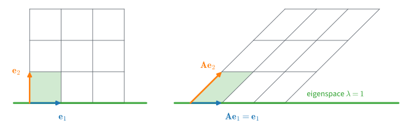

# Eigendecompositions
:label:`sec_mdl-eigendecompositions`

In :numref:`sec_mdl-linear-maps` we asked what a matrix does to space when it
is applied once. Many computations apply the same matrix again and again. A
deep linear network with equal layers computes $\mathbf A^{50}\mathbf x$
after 50 layers, and gradient descent on a quadratic multiplies its error by
one fixed matrix per step. In each case we want to know whether the signal
grows, dies out, or settles, and how quickly. Multiplying out the powers gives
the numbers but does not explain them.

A random walk between two web pages is the smallest instance of the question.
From page 1 a surfer clicks to page 1 or to page 2 with probability $1/2$
each; from page 2 she stays with probability $3/4$ and returns to page 1 with
probability $1/4$. Let $\mathbf p_k$ hold the probabilities of being on each
page after $k$ clicks. One click multiplies it by a fixed matrix,

$$
\mathbf p_{k+1}=\mathbf P\mathbf p_k,
\qquad
\mathbf P=\begin{pmatrix}1/2&1/4\\1/2&3/4\end{pmatrix},
$$

whose columns are the click probabilities from each page, so each column sums
to one. Starting on page 1, $\mathbf p_0=(1,0)$, the distribution reads
$(0.5,0.5)$, $(0.375,0.625)$, $(0.344,0.656)$, $(0.336,0.664)$. The changes
shrink from click to click, as if the walk were settling on a fixed
distribution. Where is the surfer after 50 clicks, and how fast does the
answer settle? PageRank asks the same question of the whole web.

The answer is to write the starting vector in the coordinates of a few
special directions, the eigenvectors, along which the matrix acts as
multiplication by a number. Each coordinate then evolves by its own scalar
power $\lambda^k$.

In :numref:`sec_linear-algebra` we met eigenvectors as the directions that a
matrix only stretches: the symmetric
$\mathbf S=\left(\begin{smallmatrix}2&1\\1&2\end{smallmatrix}\right)$
stretches $(1,1)$ by 3 and $(1,-1)$ by 1, and for a symmetric matrix
$\mathbf A^k\mathbf x=\sum_i c_i\lambda_i^k\mathbf v_i$. This section drops
the symmetry. We find the eigenvalues of any square matrix, see when a full
set of eigenvectors exists and what replaces it when it does not, and then
prove what symmetry guarantees.

Three results matter most: the expansion
:eqref:`eq_mdl-eig-power-expansion` of $\mathbf A^k\mathbf x$ in eigenvectors,
the spectral theorem, and the quadratic form as a weighted sum of squares,
:eqref:`eq_mdl-quadform`. A reader in a hurry can go from
:numref:`subsec_mdl-diagonalization` straight to
:numref:`subsec_mdl-spectral-theorem`. Two things are left to
:numref:`sec_mdl-spectra-in-practice`: how eigenvalues are located and
computed when a matrix is large, and the cases in which they mislead. We
compute with NumPy throughout; its `eig` returns complex eigenvalues when a
real matrix has them.

```{.python .input #eigendecomposition-imports}
#@tab mxnet
import numpy as np
```

```{.python .input #eigendecomposition-imports}
#@tab pytorch
import numpy as np
```

```{.python .input #eigendecomposition-imports}
#@tab tensorflow
import numpy as np
```

```{.python .input #eigendecomposition-imports}
#@tab jax
import numpy as np
```

## Eigenvalues and Diagonalization

### Eigenvectors and Eigenvalues
:label:`subsec_mdl-eigen-definition`

Some inputs are only rescaled by $\mathbf P$, as if it were a number. The
vector $(1,2)$ is mapped to
$\mathbf P(1,2)=(\tfrac12+\tfrac12,\ \tfrac12+\tfrac32)=(1,2)$, and $(1,-1)$
is mapped to $(\tfrac12-\tfrac14,\ \tfrac12-\tfrac34)=\tfrac14(1,-1)$. Along
the first direction $\mathbf P$ multiplies by 1, along the second by $1/4$.

In general, a nonzero vector $\mathbf v$ is an *eigenvector* of a square
matrix $\mathbf A$, with *eigenvalue* $\lambda$, if

$$
\mathbf{A}\mathbf{v} = \lambda \mathbf{v}.
$$
:eqlabel:`eq_mdl-eigpair`

The matrix only stretches an eigenvector by the factor $\lambda$, and reverses
it when $\lambda<0$. For $\mathbf P$, the pairs are $(1,(1,2))$ and
$(\tfrac14,(1,-1))$. The zero vector is excluded as an eigenvector because it
satisfies :eqref:`eq_mdl-eigpair` for every $\lambda$. All solutions of
$\mathbf A\mathbf v=\lambda\mathbf v$ for one $\lambda$, together with
$\mathbf 0$, form a subspace, the *eigenspace* of $\lambda$.

The eigenvalue $\lambda=0$ is allowed. It means
$\mathbf A\mathbf v=\mathbf 0$ for some $\mathbf v\neq\mathbf 0$, so a square
matrix is singular if and only if 0 is one of its eigenvalues. Not every real
matrix has a real eigenvector: a rotation by $90^\circ$ turns every direction.
Its eigenvalues are complex, and we return to them in
:numref:`subsec_mdl-complex-rotation`.

A $2\times2$ invertible matrix maps the unit circle to an ellipse. Are the
axes of that ellipse the eigenvectors? :numref:`fig_mdl-la-eig-ellipse`
compares two matrices. For the symmetric $\mathbf S$ the eigenvectors lie on
the axes. For the upper-triangular
$\left(\begin{smallmatrix}1&1\\0&2\end{smallmatrix}\right)$ they do not: its
eigenvectors are $(1,0)$ with $\lambda=1$ and $(1,1)$ with $\lambda=2$, while
the ellipse axes point at $58^\circ$ and $-32^\circ$
(:numref:`sec_mdl-svd-low-rank` shows how to compute them). The ellipse axes
are the directions of largest and smallest stretch; the eigenvectors are the
directions that are not turned. For symmetric matrices the two coincide, as
the spectral theorem of :numref:`subsec_mdl-spectral-theorem` proves. For
other matrices they need not.


:label:`fig_mdl-la-eig-ellipse`

### The Characteristic Polynomial
:label:`subsec_mdl-finding-eigenvalues`

We found the eigenvectors of $\mathbf P$ by inspection. To find the
eigenvalues of any matrix, move $\lambda\mathbf v$ to the left side of
:eqref:`eq_mdl-eigpair` and factor out the vector:

$$
(\mathbf{A} - \lambda \mathbf{I})\mathbf{v} = \mathbf 0.
$$
:eqlabel:`eq_mdl-eigvalue_der`

A nonzero solution $\mathbf v$ exists if and only if
$\mathbf A-\lambda\mathbf I$ has a nontrivial null space, that is, if and only
if it is singular and $\det(\mathbf A-\lambda\mathbf I)=0$. Expanding the
determinant gives a polynomial of degree $n$ in $\lambda$, the
*characteristic polynomial* $p(\lambda)=\det(\mathbf A-\lambda\mathbf I)$.
Its roots are the eigenvalues. For each root, solving
:eqref:`eq_mdl-eigvalue_der` gives the eigenspace.

For the surfer's matrix,

$$
\det(\mathbf P-\lambda\mathbf I)
=\Bigl(\tfrac12-\lambda\Bigr)\Bigl(\tfrac34-\lambda\Bigr)-\tfrac14\cdot\tfrac12
=\lambda^2-\tfrac54\lambda+\tfrac14
=(\lambda-1)\Bigl(\lambda-\tfrac14\Bigr),
$$

so the eigenvalues are 1 and $1/4$, the two factors we found by inspection.
The eigenvectors follow from one row of each singular system. For $\lambda=1$
the first row of $\mathbf P-\mathbf I$ reads $-\tfrac12v_1+\tfrac14v_2=0$, so
$v_2=2v_1$ and $\mathbf v=(1,2)$. For $\lambda=\tfrac14$ the first row of
$\mathbf P-\tfrac14\mathbf I$ reads $\tfrac14v_1+\tfrac14v_2=0$, so
$\mathbf v=(1,-1)$. Each eigenvector is determined only up to a nonzero
factor: if $\mathbf v$ is an eigenvector, so is $c\mathbf v$ for any
$c\neq0$, since both sides of :eqref:`eq_mdl-eigpair` scale by $c$.

In practice a library does this work. NumPy's `eig` returns the eigenvalues
and, as the columns of a matrix, one eigenvector for each; the last line of
the cell checks :eqref:`eq_mdl-eigpair` for all pairs at once.

```{.python .input #eigendecomposition-an-example}
P = np.array([[0.5, 0.25], [0.5, 0.75]])
lam, V = np.linalg.eig(P)
print('eigenvalues:', lam)
print('eigenvectors (columns):\n', V)
print('max |P V - V diag(lam)|:', np.abs(P @ V - V * lam).max())
```

Order, scale and sign are the library's choice: the eigenvalues come as $1/4$
and 1, and the columns are parallel to $(1,-1)$ and $(1,2)$, scaled to length
one.

Libraries do not solve the characteristic polynomial. For $n\ge5$ there is
no general formula for its roots in radicals, and the roots are highly
sensitive to rounding errors in the coefficients. Instead, `eig` applies a
sequence of orthogonal changes of basis that drives the matrix to triangular
form without changing its eigenvalues. A triangular matrix shows its
eigenvalues on its diagonal: subtracting $\lambda\mathbf I$ leaves it
triangular, and the determinant of a triangular matrix is the product of its
diagonal entries (:numref:`subsec_mdl-determinant-general`). For matrices too large to factor at all, power iteration
(:numref:`subsec_mdl-power-iteration`) needs only matrix--vector products.

### Diagonalization
:label:`subsec_mdl-diagonalization`

We return to the opening question, $\mathbf P^{50}\mathbf p_0$. Collect the two
eigenvectors as the columns of $\mathbf V$ and the eigenvalues on the diagonal
of $\boldsymbol\Lambda$:

$$
\mathbf V=\begin{pmatrix}1&1\\2&-1\end{pmatrix},
\qquad
\boldsymbol\Lambda=\begin{pmatrix}1&0\\0&1/4\end{pmatrix}.
$$

The two eigenvector equations $\mathbf P\mathbf v_i=\lambda_i\mathbf v_i$,
written side by side as columns, read
$\mathbf P\mathbf V=\mathbf V\boldsymbol\Lambda$. Since
$\det\mathbf V=-1-2=-3\neq0$, the matrix $\mathbf V$ is invertible, with
$\mathbf V^{-1}=\tfrac13\left(\begin{smallmatrix}1&1\\2&-1\end{smallmatrix}\right)$,
and multiplying by $\mathbf V^{-1}$ on the right gives

$$
\mathbf{P} = \mathbf{V} \boldsymbol{\Lambda} \mathbf{V}^{-1}.
$$
:eqlabel:`eq_mdl-eig_decomp`

In words: change to eigenvector coordinates ($\mathbf V^{-1}$), scale each
coordinate by its eigenvalue ($\boldsymbol\Lambda$), and change back
($\mathbf V$). A square matrix $\mathbf A$ that can be written as
$\mathbf A=\mathbf V\boldsymbol\Lambda\mathbf V^{-1}$, with an invertible
$\mathbf V$ and a diagonal $\boldsymbol\Lambda$, is called *diagonalizable*;
the factorization is its *eigendecomposition*. It exists if and only if the
matrix has $n$ linearly independent eigenvectors to fill the columns of
$\mathbf V$.

Powers of a diagonalizable matrix reduce to powers of numbers. In a product of
$k$ copies of
$\mathbf V\boldsymbol\Lambda\mathbf V^{-1}$, each inner pair
$\mathbf V^{-1}\mathbf V$ cancels:

$$
\mathbf{A}^k = \overbrace{(\mathbf{V}\boldsymbol{\Lambda} \mathbf{V}^{-1})\cdots(\mathbf{V}\boldsymbol{\Lambda} \mathbf{V}^{-1})}^{\textrm{$k$ times}} =  \mathbf{V}\overbrace{\boldsymbol{\Lambda}\cdots\boldsymbol{\Lambda}}^{\textrm{$k$ times}}\mathbf{V}^{-1} = \mathbf{V}\boldsymbol{\Lambda}^k \mathbf{V}^{-1}.
$$

Applied to a vector $\mathbf x$, with $\mathbf c=\mathbf V^{-1}\mathbf x$
the coordinates of $\mathbf x$ in the eigenbasis, so that
$\mathbf x=\sum_i c_i\mathbf v_i$, this reads

$$
\mathbf A^k\mathbf x=\mathbf V\boldsymbol\Lambda^k\mathbf c
=\sum_{i=1}^n c_i\lambda_i^k\mathbf v_i .
$$
:eqlabel:`eq_mdl-eig-power-expansion`

Each eigen-coordinate evolves on its own, as the scalar sequence
$c_i\lambda_i^k$. For the surfer, $\mathbf c=\mathbf V^{-1}\mathbf p_0
=\tfrac13(1,2)=(\tfrac13,\tfrac23)$, and therefore

$$
\mathbf p_k=\mathbf P^k\mathbf p_0
=\frac13\begin{pmatrix}1\\2\end{pmatrix}
+\frac23\Bigl(\frac14\Bigr)^k\begin{pmatrix}1\\-1\end{pmatrix}.
$$
:eqlabel:`eq_mdl-markov-closed-form`

This answers the opening question. The distribution approaches
$\boldsymbol\pi=(1/3,2/3)$: in the long run the surfer spends twice as much
time on page 2 as on page 1. The error is $\tfrac23\,4^{-k}$ in each entry and
points along the eigenvector $(1,-1)$. Every click divides it by 4, so after
10 clicks it is $6\times10^{-7}$ and after 50 clicks below $10^{-30}$. At
$k=3$ the formula gives
$(\tfrac13+\tfrac1{96},\ \tfrac23-\tfrac1{96})=(0.34375,0.65625)$, the third
iterate of the opening. :numref:`fig_mdl-la-markov-iterates` shows the
geometry: every $\mathbf p_k$ has entries summing to one, so the iterates
slide along the line $x+y=1$ toward the point where the eigenvector of
$\lambda=1$ meets it.


:label:`fig_mdl-la-markov-iterates`

Fifty matrix multiplications and the two eigen-coordinates must give the same
$\mathbf p_{50}$. The cell computes both and prints the ratio of consecutive
errors.

```{.python .input #mdl-eigendecomposition-diagonalization}
p0 = np.array([1.0, 0.0])
c = np.linalg.solve(V, p0)              # coordinates of p0 in the eigenbasis
print('P^50 p0             :', np.linalg.matrix_power(P, 50) @ p0)
print('sum c_i lam_i^50 v_i:', V @ (c * lam ** 50))
pi = np.array([1 / 3, 2 / 3])
errs = np.array([np.abs(np.linalg.matrix_power(P, k) @ p0 - pi).max()
                 for k in range(8)])
print('error ratios:', np.round(errs[1:] / errs[:-1], 4))
```

The two computations agree, and every error ratio is $0.25$. The eigenvalue 1
belongs to the part of $\mathbf p_0$ that survives, the eigenvalue $1/4$ to
the part that dies out.

The same recipe handles other functions of a diagonalizable matrix. If no
eigenvalue is zero, $\mathbf A^{-1}=\mathbf V\boldsymbol\Lambda^{-1}\mathbf V^{-1}$:
invert each eigenvalue. The matrix exponential
$e^{\mathbf A t}=\mathbf V e^{\boldsymbol\Lambda t}\mathbf V^{-1}$, which solves
the differential equation $\dot{\mathbf x}=\mathbf A\mathbf x$, is obtained in
the same way; :numref:`sec_mdl-odes-solvers` develops it.

**Similarity.** The eigendecomposition says that $\mathbf P$ and
$\boldsymbol\Lambda$ are the same map written in two bases. Two matrices
related by $\mathbf A'=\mathbf B\mathbf A\mathbf B^{-1}$ for an invertible
$\mathbf B$ are called *similar*. The next proposition shows that a change of
basis cannot change the eigenvalues. It uses the multiplicativity of the
determinant from :numref:`sec_mdl-linear-maps`,

$$
\det(\mathbf X\mathbf Y)=\det\mathbf X\,\det\mathbf Y,
$$

which also gives $\det(\mathbf B^{-1})=1/\det\mathbf B$ from
$\mathbf B\mathbf B^{-1}=\mathbf I$.

**Proposition (similar matrices share the characteristic polynomial).** *For
every square $\mathbf A$ and every invertible $\mathbf B$,*

$$
\det(\mathbf B\mathbf A\mathbf B^{-1}-\lambda\mathbf I)=\det(\mathbf A-\lambda\mathbf I).
$$
:eqlabel:`eq_mdl-similar-charpoly`

**Proof.** Write $\lambda\mathbf I=\mathbf B(\lambda\mathbf I)\mathbf B^{-1}$
and factor:
$\det(\mathbf B\mathbf A\mathbf B^{-1}-\lambda\mathbf I)
=\det\bigl(\mathbf B(\mathbf A-\lambda\mathbf I)\mathbf B^{-1}\bigr)
=\det\mathbf B\,\det(\mathbf A-\lambda\mathbf I)\,\det\mathbf B^{-1}
=\det(\mathbf A-\lambda\mathbf I)$. $\blacksquare$

Similar matrices therefore have the same eigenvalues with the same
multiplicities as roots, and every quantity computed from the characteristic
polynomial is a *similarity invariant*. The two most useful ones are the
determinant and the trace. For a diagonalizable matrix,

$$
\det(\mathbf{A}) = \det(\mathbf{V}\boldsymbol{\Lambda}\mathbf{V}^{-1})
  = \det(\mathbf{V})\det(\boldsymbol{\Lambda})\det(\mathbf{V}^{-1})
  = \det(\boldsymbol{\Lambda})
  = \lambda_1 \lambda_2 \cdots \lambda_n .
$$
:eqlabel:`eq_mdl-det-eig`

The determinant is the product of the eigenvalues: whatever $\mathbf V$ does
to volumes, $\mathbf V^{-1}$ undoes, so only the scaling by
$\boldsymbol\Lambda$ remains. The trace is cyclic
(:numref:`subsec_mdl-einsum`),

$$
\operatorname{tr}(\mathbf X\mathbf Y)=\operatorname{tr}(\mathbf Y\mathbf X),
$$

for any $\mathbf X$ and $\mathbf Y$ whose products are square. With
$\mathbf X=\mathbf V$ and
$\mathbf Y=\boldsymbol\Lambda\mathbf V^{-1}$,

$$
\operatorname{tr}(\mathbf{A})
  = \operatorname{tr}(\mathbf{V}\boldsymbol{\Lambda}\mathbf{V}^{-1})
  = \operatorname{tr}(\boldsymbol{\Lambda}\mathbf{V}^{-1}\mathbf{V})
  = \operatorname{tr}(\boldsymbol{\Lambda})
  = \lambda_1+\cdots+\lambda_n .
$$
:eqlabel:`eq_mdl-tr-eig`

The trace is the sum of the eigenvalues. On the surfer's matrix both identities
check by eye: $\operatorname{tr}\mathbf P=\tfrac12+\tfrac34=\tfrac54=1+\tfrac14$
and $\det\mathbf P=\tfrac38-\tfrac18=\tfrac14=1\cdot\tfrac14$. For a $2\times2$
matrix the two numbers determine both eigenvalues, as the roots of
$\lambda^2-(\operatorname{tr})\lambda+\det$.

Both identities hold for every square matrix, diagonalizable or not, if the
eigenvalues are counted over $\mathbb C$ with their multiplicity as roots. The
*fundamental theorem of algebra*, which we use without proof, says that a
polynomial of degree $n$ factors completely over $\mathbb C$:

$$
\det(\mathbf A-\lambda\mathbf I)=\prod_{i=1}^n(\lambda_i-\lambda).
$$

Setting $\lambda=0$ gives $\det\mathbf A=\prod_i\lambda_i$. For the trace,
compare the coefficients of $\lambda^{n-1}$. On the right it is
$(-1)^{n-1}\sum_i\lambda_i$. On the left, only the product of the diagonal
entries of $\mathbf A-\lambda\mathbf I$ reaches degree $n-1$, so the
coefficient is $(-1)^{n-1}\sum_i a_{ii}$. Hence
$\operatorname{tr}\mathbf A=\sum_i\lambda_i$. The complex eigenvalues of a
real matrix come in conjugate pairs, so the product and the sum are real.

Finally, the rank of a diagonalizable matrix is the number of its nonzero
eigenvalues, counted with multiplicity: multiplying by the invertible
$\mathbf V$ and $\mathbf V^{-1}$ changes no dimensions, so
$\operatorname{rank}\mathbf A=\operatorname{rank}\boldsymbol\Lambda$.
Exercise :exref:`ex_mdl-eigendecomposition-rank-zero-eigenvalues` treats the
general case.

### Algebraic and Geometric Multiplicity
:label:`subsec_mdl-multiplicity`

The surfer's matrix had two distinct eigenvalues and two independent
eigenvectors. The second fact follows from the first.

**Proposition (distinct eigenvalues give independent eigenvectors).**
*Eigenvectors belonging to distinct eigenvalues are linearly independent. In
particular, an $n\times n$ matrix with $n$ distinct eigenvalues is
diagonalizable.*

**Proof.** Suppose, for contradiction, that some eigenvectors
$\mathbf{v}_1,\ldots,\mathbf{v}_m$ with distinct eigenvalues
$\lambda_1,\ldots,\lambda_m$ are dependent, and take a dependence relation
$\sum_{i=1}^{m} c_i\mathbf{v}_i = \mathbf 0$ with the fewest nonzero
coefficients; relabel so that $c_m\neq0$. Such a relation has at least two
nonzero coefficients, because $c_m\mathbf{v}_m=\mathbf 0$ alone would force
$\mathbf{v}_m=\mathbf 0$. Apply $\mathbf{A}$ to the relation and subtract
$\lambda_m$ times the relation:

$$
\mathbf 0 = \mathbf{A}\!\sum_i c_i\mathbf{v}_i - \lambda_m\!\sum_i c_i\mathbf{v}_i
   = \sum_{i=1}^{m-1} c_i(\lambda_i-\lambda_m)\,\mathbf{v}_i .
$$

The $\mathbf{v}_m$ term cancels, so this relation is shorter. It is still
nontrivial: the second nonzero coefficient $c_i$, $i<m$, survives as
$c_i(\lambda_i-\lambda_m)\neq0$ because the eigenvalues are distinct. This
contradicts minimality. With $n$ distinct eigenvalues we obtain $n$
independent eigenvectors, a basis of $\mathbb C^n$ (of $\mathbb R^n$ when the
eigenvalues are real), so $\mathbf{V}$ is invertible. $\blacksquare$

With repeated eigenvalues there are two counts. The number of times
$\lambda$ appears as a root of the characteristic polynomial is its
*algebraic multiplicity* $a(\lambda)$. The dimension of its eigenspace, the
number of independent eigenvectors it contributes, is its *geometric
multiplicity* $g(\lambda)$.

**Proposition.** *For every eigenvalue $\lambda$ of a square matrix,
$1\le g(\lambda)\le a(\lambda)$.*

**Proof.** Since $\mathbf A-\lambda\mathbf I$ is singular, its null space is
not zero, so $g\ge1$. For the upper bound, take a basis
$\mathbf v_1,\ldots,\mathbf v_g$ of the eigenspace, extend it to a basis of
$\mathbb C^n$, and collect the basis as the columns of $\mathbf B$. The first
$g$ columns of $\mathbf A\mathbf B$ are $\lambda\mathbf v_1,\ldots,\lambda\mathbf v_g$,
so in this basis the matrix is block upper triangular,

$$
\mathbf B^{-1}\mathbf A\mathbf B=\begin{pmatrix}\lambda\mathbf I_g&\mathbf X\\\mathbf 0&\mathbf Y\end{pmatrix}.
$$

By :eqref:`eq_mdl-similar-charpoly` it has the characteristic polynomial $p$
of $\mathbf A$. We write the variable of $p$ as $t$, because $\lambda$ now
denotes the fixed eigenvalue. Subtracting $t\mathbf I$ keeps the matrix block
upper triangular, with the diagonal blocks $(\lambda-t)\mathbf I_g$ and
$\mathbf Y-t\mathbf I$. The determinant of such a matrix is the product of
the determinants of its diagonal blocks
(:numref:`subsec_mdl-determinant-general`), so
$p(t)=(\lambda-t)^g\det(\mathbf Y-t\mathbf I)$. Hence $(\lambda-t)^g$ divides
the characteristic polynomial, and $a\ge g$. $\blacksquare$

An eigenvalue can never have more independent eigenvectors than its count as
a root, but it can have fewer. Now choose a basis of every eigenspace. The
chosen vectors are jointly independent: if a combination of them vanishes,
group it by eigenvalue; each group is zero or an eigenvector, and the
proposition on distinct eigenvalues forces every group to be zero. A matrix
therefore has $\sum_\lambda g(\lambda)$ independent eigenvectors and no more.
Over $\mathbb C$ the algebraic multiplicities add up to $n$, and
$g\le a$, so *the eigenvectors of $\mathbf A$ span $\mathbb C^n$ if and only
if $g(\lambda)=a(\lambda)$ for every complex eigenvalue $\lambda$*.

A real matrix has a basis of real eigenvectors if and only if, in addition,
all of its eigenvalues are real. The rotation by $90^\circ$,
$\mathbf R_{90}=\left(\begin{smallmatrix}0&-1\\1&0\end{smallmatrix}\right)$,
shows that the second condition is needed: its eigenvalues $\pm i$ each have
$g=a=1$, so it has a complex eigenbasis, but no real eigenvector.

When eigenvalues repeat, diagonalizability can fail. The simplest example is
the *shear* of :numref:`subsec_mdl-composition`,

$$
\mathbf{T} = \begin{pmatrix}
1 & 1 \\
0 & 1
\end{pmatrix}.
$$
:eqlabel:`eq_mdl-defective-shear`

Its characteristic polynomial is $(1-\lambda)^2$, so $\lambda=1$ has algebraic
multiplicity 2. But $(\mathbf{T}-\mathbf{I})\mathbf{v}=\mathbf 0$ reads
$\left(\begin{smallmatrix}0&1\\0&0\end{smallmatrix}\right)\mathbf v=\mathbf 0$,
that is, $v_2=0$, so the eigenspace is the line spanned by $(1,0)$. The geometric
multiplicity is 1, there is no eigenbasis, and the shear is not
diagonalizable. A matrix with $g(\lambda)<a(\lambda)$ for some eigenvalue is
called *defective*. :numref:`fig_mdl-la-defective-shear` shows the shortage:
the shear slides every horizontal line sideways by an amount proportional to
its height, and the horizontal axis is the only line through the origin that
keeps its direction. A diagonalizable $2\times2$ matrix with a repeated
eigenvalue $\lambda$ would be $\lambda\mathbf I$ and would keep every
direction.


:label:`fig_mdl-la-defective-shear`

Powers of the shear show what defectiveness does to iteration:
$\mathbf T^k=\left(\begin{smallmatrix}1&k\\0&1\end{smallmatrix}\right)$, so
$\mathbf T^k\mathbf e_2=(k,1)$ grows without bound although the only
eigenvalue is 1. No eigen-expansion can produce the factor $k$; the next
subsection explains where it comes from.

### The Jordan Normal Form
:label:`subsec_mdl-jordan`

When the geometric multiplicity falls short, no eigenbasis exists. What
structure remains? Later text needs one consequence of the answer: a
defective eigenvalue multiplies $\lambda^k$ by a polynomial in $k$. Over the
complex numbers, every square matrix is similar to a block-diagonal matrix
whose diagonal blocks are *Jordan blocks*

$$
\mathbf{J}_m(\lambda) =
\begin{pmatrix}
\lambda & 1      &        &        \\
        & \lambda& \ddots &        \\
        &        & \ddots & 1      \\
        &        &        & \lambda
\end{pmatrix},
$$

$m\times m$ blocks with one eigenvalue $\lambda$ repeated down the diagonal and
1s just above it. This is the *Jordan normal form* :cite:`Horn.Johnson.2012`,
which we use without proof. By :eqref:`eq_mdl-similar-charpoly` it carries the
same eigenvalues as the original matrix.

Each block contributes one eigenvector, its first basis vector. The
geometric multiplicity of $\lambda$ is therefore the number of blocks
carrying $\lambda$, the algebraic multiplicity is their total size, and a
matrix is diagonalizable if and only if every block is $1\times1$. The shear
$\mathbf T$ of :eqref:`eq_mdl-defective-shear` is the single block
$\mathbf{J}_2(1)$.

Under iteration a Jordan block does more than scale. Write
$\mathbf{J}_m(\lambda)=\lambda\mathbf{I}+\mathbf{N}$, where $\mathbf{N}$ has
1s just above the diagonal and zeros elsewhere. $\mathbf N$ is a shift: it
sends each basis vector to the previous one, so $\mathbf N^m=\mathbf 0$ (a
matrix with a vanishing power is called *nilpotent*). Because $\mathbf{I}$ and
$\mathbf{N}$ commute, the binomial theorem applies, and for $m=2$ every term
beyond the first two contains $\mathbf{N}^2=\mathbf 0$:

$$
\mathbf{J}_2(\lambda)^k = (\lambda\mathbf{I}+\mathbf{N})^k
  = \lambda^k\mathbf{I} + k\lambda^{k-1}\mathbf{N}.
$$

The eigenvalue still decides between growth and decay in the long run, but it
is multiplied by a polynomial in $k$ (of degree $m-1$ for a block of size $m$).
With $|\lambda|=1$, as for the shear, the iterates drift linearly. With
$|\lambda|$ slightly below 1, the corner entry $k\lambda^{k-1}$ first grows,
peaks near $k\approx-1/\log|\lambda|$, and only then decays. For $\lambda=0.99$
this puts the peak near $k\approx100$, where the corner entry is
$100\cdot0.99^{99}\approx37$. The cell checks the prediction.

```{.python .input #mdl-eigendecomposition-jordan-power}
J = np.array([[0.99, 1.], [0., 0.99]])   # the Jordan block J_2(0.99)
for k in [1, 50, 100, 200, 800]:
    Jk = np.linalg.matrix_power(J, k)
    pred = k * 0.99 ** (k - 1)   # predicted corner entry, k * lambda^(k-1)
    print(f'k = {k:3d}   ||J^k|| = {np.linalg.norm(Jk, 2):8.3f}   '
          f'k * 0.99^(k-1) = {pred:8.3f}')
```

Every eigenvalue of $\mathbf{J}$ is $0.99$, yet the norm of its powers climbs to
about 37 at $k=100$ and is still 27 at $k=200$ before the factor $0.99^k$
dominates. The eigenvalues alone do not reveal this transient growth, to which
:numref:`subsec_mdl-transient-growth` returns.

Jordan blocks are one way in which a real matrix falls short of a real
eigenbasis: it has too few eigenvectors. The second way is different in kind.
A real matrix can have no real eigenvector at all in some plane, because it
rotates that plane.

### Complex Eigenvalues
:label:`subsec_mdl-complex-rotation`

Consider the planar rotation by an angle $\theta$
(:numref:`subsec_mdl-orthogonal-matrices`),

$$
\mathbf{R}_\theta = \begin{pmatrix}\cos\theta & -\sin\theta\\
                            \sin\theta & \phantom{-}\cos\theta\end{pmatrix}.
$$

If $\theta$ is not a multiple of $\pi$, $\mathbf{R}_\theta$ turns every nonzero
real vector, so it has no real eigenvector. Its characteristic polynomial
$\lambda^2-2\cos\theta\,\lambda+1$ has the complex conjugate roots
$\lambda=\cos\theta\pm i\sin\theta=e^{\pm i\theta}$. The modulus
$|\lambda|=1$ records that $\mathbf{R}_\theta$ preserves lengths, and the
argument $\pm\theta$ records the angle.

The chapter's running $2\times2$ matrix has no visible rotation in its
entries:

$$
\mathbf A=\begin{pmatrix}1&2\\-1&3\end{pmatrix},
\qquad \operatorname{tr}\mathbf A=4,\quad \det\mathbf A=5 .
$$

Its characteristic polynomial is $\lambda^2-4\lambda+5$, with roots
$\lambda=2\pm i=\sqrt5\,e^{\pm i\theta}$ and $\theta=\arctan\tfrac12\approx26.6^\circ$.
The eigenvector for $2+i$ comes from the second row of
$\mathbf A-(2+i)\mathbf I$, which reads $-w_1+(1-i)w_2=0$. With $w_2=1$,

$$
\mathbf w=\begin{pmatrix}1-i\\1\end{pmatrix}
=\underbrace{\begin{pmatrix}1\\1\end{pmatrix}}_{\mathbf u}
+i\underbrace{\begin{pmatrix}-1\\0\end{pmatrix}}_{\mathbf v}.
$$

Where is the rotation hidden? Take any real matrix with an eigenpair
$\mathbf{A}\mathbf{w}=\lambda\mathbf{w}$, $\lambda=a+ib$, $b\neq0$, and split
the eigenvector into real and imaginary parts, $\mathbf{w}=\mathbf{u}+i\mathbf{v}$.
Expanding $\mathbf{A}(\mathbf{u}+i\mathbf{v})=(a+ib)(\mathbf{u}+i\mathbf{v})$
and matching real and imaginary parts gives

$$
\mathbf{A}\mathbf{u} = a\mathbf{u} - b\mathbf{v},
\qquad
\mathbf{A}\mathbf{v} = b\mathbf{u} + a\mathbf{v}.
$$

Both images land back in $\operatorname{span}\{\mathbf{u},\mathbf{v}\}$, so
this span is an invariant subspace. It is a plane. If $\mathbf u$ and
$\mathbf v$ were dependent, their span would be a line (not zero, since
$\mathbf w\neq\mathbf 0$) mapped into itself, on which $\mathbf A$ multiplies by
a real number $\mu$. Then $\mathbf A\mathbf w=\mu\mathbf w$, and $\lambda=\mu$
would be real, contradicting $b\neq0$. Collecting the two identities as
columns with $\mathbf{B}=[\mathbf{v}\;\;\mathbf{u}]$ gives
$\mathbf{A}\mathbf{B}=\mathbf{B}\left(\begin{smallmatrix}a & -b\\ b & \phantom{-}a\end{smallmatrix}\right)$,
that is,

$$
\mathbf{B}^{-1}\mathbf{A}\mathbf{B}
= \begin{pmatrix} a & -b\\ b & \phantom{-}a \end{pmatrix}
= \underbrace{\sqrt{a^2+b^2}}_{r}\,
  \begin{pmatrix} \cos\theta & -\sin\theta\\ \sin\theta & \phantom{-}\cos\theta \end{pmatrix},
\qquad \theta=\arg(a+ib).
$$
:eqlabel:`eq_mdl-rotation-scaling-block`

In the basis $(\mathbf v,\mathbf u)$ of its invariant plane, the matrix is a
rotation--scaling block $r\mathbf R_\theta$: it scales by the modulus and
rotates by the argument. The block does not depend on the scale or phase of
$\mathbf w$, since the derivation used only $\mathbf A\mathbf w=\lambda\mathbf w$.
The correspondence also reads from right to left. Identify
$(x,y)\in\mathbb{R}^2$ with the complex number $x+iy$. The block maps
$(x,y)$ to $(ax-by,\,bx+ay)$, which is multiplication by $a+ib$.

For the running matrix, $\mathbf B=\left(\begin{smallmatrix}-1&1\\0&1\end{smallmatrix}\right)$
and $\mathbf B^{-1}\mathbf A\mathbf B=\left(\begin{smallmatrix}2&-1\\1&2\end{smallmatrix}\right)$:
scale by $\sqrt5$ and rotate by $26.6^\circ$. If that were the whole
description, every step would lengthen a vector by the factor
$\sqrt5\approx2.24$. We compute the block from the eigenvector that `eig`
returns and then follow the lengths of the iterates $\mathbf A^k(1,0)$.

```{.python .input #mdl-eigendecomposition-complex-eigenvalues-are-rotations-1}
A = np.array([[1., 2.], [-1., 3.]])
lam, V = np.linalg.eig(A)
j = np.argmax(lam.imag)                  # the eigenvalue a + ib with b > 0
r, theta = np.abs(lam[j]), np.angle(lam[j])
u, v = V[:, j].real, V[:, j].imag
B = np.column_stack([v, u])              # basis (v, u) of the invariant plane
print(f'lambda = {lam[j]:.4f}   r = {r:.4f}   theta = {theta:.4f}')
print('B^-1 A B =\n', np.round(np.linalg.inv(B) @ A @ B, 4))
xs = [np.array([1., 0.])]
for _ in range(8):
    xs.append(A @ xs[-1])
norms = np.linalg.norm(xs, axis=1)
print('norm ratios:', np.round(norms[1:] / norms[:-1], 2))
x20 = np.linalg.matrix_power(A, 20) @ np.array([1., 0.])
print(f'average rate ||A^20 x||^(1/20) = {np.linalg.norm(x20) ** (1 / 20):.3f}')
```

The block is $\left(\begin{smallmatrix}2&-1\\1&2\end{smallmatrix}\right)$,
whatever eigenvector `eig` returned. The lengths, however, do not grow by
2.24 per step. Along the iterates
$(1,0)\to(1,-1)\to(-1,-4)\to(-9,-11)\to(-31,-24)$ the ratios swing between
about 1.4 and 3.5. The scaling is uniform only in
the coordinates $(\mathbf v,\mathbf u)$, which are not orthonormal. In the
original coordinates the iterates spiral outward along stretched ellipses,
and a full turn takes $2\pi/\theta\approx13.6$ steps. Only the average rate
$\|\mathbf A^k\mathbf x\|^{1/k}$ settles at $\sqrt5$ (it is 2.25 at $k=20$).
The motion is a rigid rotation and scaling only when the matrix is normal, a
property defined in :numref:`subsec_mdl-normal-matrices`.

Every real square matrix is built, up to a real change of basis, from the
three behaviours we have now seen, alone or combined: stretch along a line,
shear within a Jordan block, and rotation with scaling in a plane. This is
the *real Jordan form* :cite:`Horn.Johnson.2012`.

## Symmetric Matrices and Quadratic Forms

### The Spectral Theorem
:label:`subsec_mdl-spectral-theorem`

For which matrices is a real, orthonormal eigenbasis guaranteed? Symmetry
rules out both failures we have met, too few eigenvectors and complex ones.
The symmetric $\mathbf S$ of :numref:`sec_linear-algebra` shows what to
expect. Its unit eigenvectors
$(1,1)/\sqrt2$ and $(1,-1)/\sqrt2$ are perpendicular, and with them

$$
\mathbf S=\begin{pmatrix}2&1\\1&2\end{pmatrix}
=\underbrace{\frac1{\sqrt2}\begin{pmatrix}1&1\\1&-1\end{pmatrix}}_{\mathbf V}
\begin{pmatrix}3&0\\0&1\end{pmatrix}
\underbrace{\frac1{\sqrt2}\begin{pmatrix}1&1\\1&-1\end{pmatrix}}_{\mathbf V^\top}.
$$

The eigenvector matrix is orthogonal, $\mathbf V^\top\mathbf V=\mathbf I$, so
its inverse is its transpose. The spectral theorem states that this holds for
every symmetric matrix. It is the theorem of this chapter: positive
definiteness, the Rayleigh quotient, and all of
:numref:`sec_mdl-svd-low-rank` rest on it.

**Theorem (spectral theorem).** *Every real symmetric matrix $\mathbf{A}$ has
real eigenvalues and an orthonormal basis of real eigenvectors. Equivalently,*

$$
\mathbf{A} = \mathbf{V}\boldsymbol{\Lambda}\mathbf{V}^\top ,
$$
:eqlabel:`eq_mdl-spectral`

*where $\boldsymbol{\Lambda}=\operatorname{diag}(\lambda_1,\ldots,\lambda_n)$
is real and $\mathbf{V}$ is orthogonal.*

We prove three claims in turn: the eigenvalues are real, eigenvectors of
distinct eigenvalues are orthogonal, and an orthonormal eigenbasis exists. For
complex vectors we use the inner product
$\langle\mathbf x,\mathbf y\rangle=\mathbf x^*\mathbf y$, where $\mathbf x^*$
is the conjugate transpose; on real vectors it is the dot product. The only
fact we borrow is that the characteristic polynomial has at least one complex
root (the fundamental theorem of algebra), so at least one eigenpair exists
over $\mathbb{C}$. Parts (i) and (ii) are two-line computations; the work is
in part (iii).

**Proof, part (i): the eigenvalues are real.** Let
$\mathbf{A}\mathbf{v}=\lambda\mathbf{v}$ with $\mathbf{v}\neq\mathbf 0$, allowing
complex entries. Since $\mathbf{A}$ is real and symmetric,
$\mathbf A^*=\mathbf A^\top=\mathbf A$, so

$$
\lambda\,\mathbf{v}^*\mathbf{v}
   = \mathbf{v}^*\mathbf{A}\mathbf{v}
   = (\mathbf{A}\mathbf{v})^*\mathbf{v}
   = \bar\lambda\,\mathbf{v}^*\mathbf{v}.
$$

Because $\mathbf{v}^*\mathbf{v}=\|\mathbf v\|^2>0$, we may divide by it and
obtain $\lambda=\bar\lambda$: the eigenvalue is real. The eigenvector can then
be taken real as well, since it solves the real system
$(\mathbf A-\lambda\mathbf I)\mathbf v=\mathbf 0$. $\blacksquare$

**Proof, part (ii): eigenvectors of distinct eigenvalues are orthogonal.** Let
$\mathbf{A}\mathbf{u}=\lambda\mathbf{u}$ and
$\mathbf{A}\mathbf{v}=\mu\mathbf{v}$ with $\lambda\neq\mu$, both real by (i),
and $\mathbf u$, $\mathbf v$ real. Using $\mathbf{A}=\mathbf{A}^\top$ to move
$\mathbf{A}$ from one side of the inner product to the other,

$$
\lambda\langle\mathbf{u},\mathbf{v}\rangle
  = \langle\mathbf{A}\mathbf{u},\mathbf{v}\rangle
  = \langle\mathbf{u},\mathbf{A}\mathbf{v}\rangle
  = \mu\langle\mathbf{u},\mathbf{v}\rangle,
$$

so $(\lambda-\mu)\langle\mathbf{u},\mathbf{v}\rangle=0$, and since
$\lambda\neq\mu$, $\langle\mathbf{u},\mathbf{v}\rangle=0$. $\blacksquare$

**Proof, part (iii): an orthonormal eigenbasis.** We induct on $n$; for $n=1$
there is nothing to prove. For $n>1$, part (i) gives a real eigenpair
$(\lambda_1,\mathbf{v}_1)$ with $\|\mathbf{v}_1\|=1$. Let
$U=\mathbf{v}_1^{\perp}$ be the orthogonal complement, of dimension $n-1$. The
matrix maps $U$ into itself: for any $\mathbf{x}\in U$,

$$
\langle\mathbf{A}\mathbf{x},\mathbf{v}_1\rangle
  = \langle\mathbf{x},\mathbf{A}\mathbf{v}_1\rangle
  = \lambda_1\langle\mathbf{x},\mathbf{v}_1\rangle = 0 .
$$

Let the columns of $\mathbf Q\in\mathbb R^{n\times(n-1)}$ be an orthonormal
basis of $U$. Since the columns of $\mathbf A\mathbf Q$ lie in $U$, we can write
$\mathbf A\mathbf Q=\mathbf Q\mathbf C$ with
$\mathbf C=\mathbf Q^\top\mathbf A\mathbf Q$, the matrix of $\mathbf A$
restricted to $U$. It is symmetric,
$\mathbf C^\top=\mathbf Q^\top\mathbf A^\top\mathbf Q=\mathbf C$, and of size
$n-1$, so by the inductive hypothesis
$\mathbf C=\mathbf V'\boldsymbol\Lambda'\mathbf V'^\top$ with $\mathbf V'$
orthogonal. The columns of $\mathbf Q\mathbf V'$ are orthonormal, since
$(\mathbf Q\mathbf V')^\top\mathbf Q\mathbf V'=\mathbf V'^\top\mathbf V'=\mathbf I$.
They lie in $U$, hence are orthogonal to $\mathbf v_1$. They are also
eigenvectors, since
$\mathbf A\mathbf Q\mathbf V'=\mathbf Q\mathbf C\mathbf V'=\mathbf Q\mathbf V'\boldsymbol\Lambda'$.
Together with $\mathbf v_1$ they form the orthogonal matrix
$\mathbf V=[\mathbf v_1\;\mathbf Q\mathbf V']$, and
$\mathbf A\mathbf V=\mathbf V\boldsymbol\Lambda$. $\blacksquare$

The factorization :eqref:`eq_mdl-spectral` reads as three steps. First
$\mathbf V^\top$ turns the orthonormal eigenvectors onto the coordinate axes.
This is a rotation, possibly combined with a reflection; for $\mathbf S$
above, $\mathbf V$ has determinant $-1$. Then $\boldsymbol\Lambda$ stretches
each axis by its eigenvalue, and $\mathbf V$ turns the axes back. This is the
left panel of :numref:`fig_mdl-la-eig-ellipse`, now proved for every symmetric
matrix.

Every matrix $\mathbf A$, square or not, yields a symmetric matrix
$\mathbf A^\top\mathbf A$. Its quadratic form
$\mathbf x^\top\mathbf A^\top\mathbf A\mathbf x=\|\mathbf A\mathbf x\|^2$ is
never negative, a property that the next subsection names and tests.

### Positive Definiteness
:label:`subsec_mdl-psd`

Is the quadratic form $\mathbf{x}^\top\mathbf{A}\mathbf{x}$ ever negative?
The question decides whether a critical point of a loss is a minimum, whether
a matrix can be a covariance, and whether a least-squares problem has a
unique solution. A symmetric matrix $\mathbf{A}$ is *positive semidefinite*
(PSD), written $\mathbf{A}\succeq0$, if

$$
\mathbf{x}^\top\mathbf{A}\mathbf{x} \ge 0 \quad\textrm{for all } \mathbf{x},
$$

and *positive definite* (PD), written $\mathbf{A}\succ0$, if the inequality
is strict for every $\mathbf{x}\neq\mathbf 0$. For example,
$\mathbf x^\top\mathbf S\mathbf x=2x_1^2+2x_1x_2+2x_2^2=x_1^2+x_2^2+(x_1+x_2)^2$
is positive unless $\mathbf x=\mathbf 0$, so $\mathbf S\succ0$, while
$\left(\begin{smallmatrix}1&0\\0&-1\end{smallmatrix}\right)$ is neither, since
$\mathbf e_2$ gives $-1$. Completing squares by hand does not scale, but the
eigenvalues decide the question for every symmetric matrix.

**Proposition (definiteness from eigenvalues).** *For symmetric $\mathbf{A}$,*

$$
\mathbf{A}\succeq0 \iff \lambda_i\ge0\ \textrm{for all } i,
\qquad
\mathbf{A}\succ0 \iff \lambda_i>0\ \textrm{for all } i .
$$

**Proof.** Write $\mathbf{A}=\mathbf{V}\boldsymbol{\Lambda}\mathbf{V}^\top$ by
the spectral theorem and change variables to the eigen-coordinates
$\mathbf{y}=\mathbf{V}^\top\mathbf{x}$, a rotation (possibly with a
reflection) that preserves lengths. Then

$$
\mathbf{x}^\top\mathbf{A}\mathbf{x}
  = \mathbf{x}^\top\mathbf{V}\boldsymbol{\Lambda}\mathbf{V}^\top\mathbf{x}
  = \mathbf{y}^\top\boldsymbol{\Lambda}\mathbf{y}
  = \sum_{i=1}^{n}\lambda_i\,y_i^2
  = \sum_{i=1}^{n}\lambda_i\,(\mathbf{v}_i^\top\mathbf{x})^2 .
$$
:eqlabel:`eq_mdl-quadform`

The quadratic form is a weighted sum of squares with the eigenvalues as
weights. If every $\lambda_i\ge0$, the sum is non-negative. Conversely,
$\mathbf{x}=\mathbf{v}_j$ gives $\mathbf y=\mathbf e_j$ and
$\mathbf{v}_j^\top\mathbf{A}\mathbf{v}_j=\lambda_j$, which forces
$\lambda_j\ge0$. The PD statement is the same argument with strict
inequalities, using that $\mathbf y\neq\mathbf 0$ whenever
$\mathbf x\neq\mathbf 0$. $\blacksquare$

For $\mathbf S$ and $\mathbf x=\mathbf e_1$, the eigen-coordinates are
$\mathbf y=\mathbf V^\top\mathbf e_1=(1/\sqrt2,1/\sqrt2)$, and
:eqref:`eq_mdl-quadform` gives $3\cdot\tfrac12+1\cdot\tfrac12=2$, which is
$\mathbf e_1^\top\mathbf S\mathbf e_1=s_{11}$. Three consequences cover most
places where definiteness appears in deep learning.

* **PD implies invertible.** If $\mathbf{A}\succ0$ and
  $\mathbf{A}\mathbf{x}=\mathbf 0$, then
  $\mathbf{x}^\top\mathbf{A}\mathbf{x}=0$, which forces $\mathbf{x}=\mathbf 0$.
* **Gram and covariance matrices are PSD.** For any matrix $\mathbf{X}$,
  $\mathbf{x}^\top\mathbf{X}^\top\mathbf{X}\mathbf{x}=\|\mathbf{X}\mathbf{x}\|^2\ge0$,
  so $\mathbf X^\top\mathbf X\succeq0$, and it is PD if and only if
  $\mathbf{X}$ has full column rank (so that $\mathbf{X}\mathbf{x}=\mathbf 0$
  forces $\mathbf{x}=\mathbf 0$). The sample covariance of centred data is
  such a Gram matrix divided by the number of samples, so it is always PSD.
* **A PD Hessian gives a strict local minimum.** Let $f$ be twice
  continuously differentiable with $\nabla f(\mathbf x^*)=\mathbf 0$, and let
  its Hessian $\nabla^2 f(\mathbf x^*)$, the symmetric matrix of second
  partial derivatives, be PD. For a small displacement $\boldsymbol\delta$,
  the second-order Taylor expansion of
  :numref:`subsec_mdl-second-order-taylor` gives
  $f(\mathbf x^*+\boldsymbol\delta)=f(\mathbf x^*)+\tfrac12\boldsymbol\delta^\top\nabla^2 f(\mathbf x^*)\boldsymbol\delta+o(\|\boldsymbol\delta\|^2)$,
  and by :eqref:`eq_mdl-quadform` the quadratic term is at least
  $\tfrac12\lambda_{\min}\|\boldsymbol\delta\|^2>0$. So $\mathbf x^*$ is a
  strict local minimum. The condition is sufficient, not necessary:
  $f(x)=x^4$ has a strict minimum at 0 with Hessian 0.

Positive definiteness also has an algorithmic certificate, the *Cholesky
factorization*: $\mathbf{A}\succ0$ if and only if
$\mathbf{A}=\mathbf{L}\mathbf{L}^\top$ for a lower-triangular $\mathbf{L}$ with
positive diagonal. One direction is immediate: such an $\mathbf{L}$ is
invertible, so $\mathbf{x}^\top\mathbf{A}\mathbf{x}=\|\mathbf{L}^\top\mathbf{x}\|^2>0$
for $\mathbf{x}\neq\mathbf 0$. Attempting the factorization is the standard
numerical test for definiteness, and it is cheaper than computing the
eigenvalues. The same factor turns independent standard Gaussian samples
$\mathbf z$ into samples $\mathbf L\mathbf z$ with covariance
$\mathbf L\mathbf L^\top=\mathbf A$.

Geometrically, the signs of the eigenvalues set the shape of the surface
$z=\mathbf{x}^\top\mathbf{A}\mathbf{x}$ (:numref:`fig_mdl-la-psd`): a bowl when
all are positive, a trough that is flat along the eigenvector of a zero
eigenvalue, and a saddle for mixed signs.


:label:`fig_mdl-la-psd`

The rank condition for Gram matrices can be read off their eigenvalues. Take
a tall $\mathbf{X}$ with independent columns, whose
$\mathbf X^\top\mathbf X$ should be PD, and one whose second column is twice
the first, for which it should be PSD with a zero eigenvalue.

```{.python .input #eigendecomposition-psd-gram}
X_full = np.array([[1., 0.], [1., 1.], [0., 1.], [2., 1.]])  # rank 2
X_dep = np.array([[1., 2.], [1., 2.], [0., 0.], [2., 4.]])   # col 2 = 2*col 1
for X, name in [(X_full, 'full column rank'), (X_dep, 'dependent columns')]:
    eigvals = np.linalg.eigvalsh(X.T @ X).round(4)
    eigvals[np.abs(eigvals) < 1e-9] = 0.0  # clean up tiny round-off / -0.0
    print(f'{name}: eigenvalues of X^T X = {eigvals}')
```

Both eigenvalues are positive in the first case. In the second, one is
zero: the form vanishes along $(2,-1)$, the direction that $\mathbf X$ maps
to zero.

### The Rayleigh Quotient
:label:`subsec_mdl-rayleigh`

Identity :eqref:`eq_mdl-quadform` does more than test signs: it identifies the
largest and smallest eigenvalues as the solutions of optimization problems.
Define the *Rayleigh quotient* of a symmetric $\mathbf{A}$,

$$
R(\mathbf{x}) = \frac{\mathbf{x}^\top\mathbf{A}\mathbf{x}}{\mathbf{x}^\top\mathbf{x}},
\qquad \mathbf{x}\neq\mathbf 0 .
$$

It is the value of the quadratic form per unit squared length, and on an
eigenvector it equals the eigenvalue. In this subsection the eigenvalues are
ordered by their signed values, $\lambda_1\ge\cdots\ge\lambda_n$, not by
modulus.

**Proposition (Rayleigh).** *For symmetric $\mathbf{A}$ with eigenvalues
$\lambda_1\ge\cdots\ge\lambda_n$,*

$$
\lambda_1 = \max_{\mathbf{x}\neq\mathbf 0} R(\mathbf{x}),
\qquad
\lambda_n = \min_{\mathbf{x}\neq\mathbf 0} R(\mathbf{x}),
$$

*attained at the corresponding eigenvectors.*

**Proof.** Scaling $\mathbf{x}$ leaves $R$ unchanged, so restrict to unit
vectors. With $\mathbf{y}=\mathbf{V}^\top\mathbf{x}$ we have
$\|\mathbf y\|=\|\mathbf x\|=1$ and, by :eqref:`eq_mdl-quadform`,
$R(\mathbf x)=\sum_i\lambda_i y_i^2$: an average of the eigenvalues with
non-negative weights $y_i^2$ that sum to 1. An average lies between the
smallest and the largest value, so $\lambda_n\le R(\mathbf x)\le\lambda_1$,
and the bounds are attained by putting all weight on one coordinate, at
$\mathbf x=\mathbf v_1$ or $\mathbf x=\mathbf v_n$. $\blacksquare$

For $\mathbf S$ this means that $R$ ranges over $[1,3]$, with the maximum at
the eigenvector direction $45^\circ$ and the minimum at $135^\circ$.
Every direction between the two extremes mixes the eigenvalues 1 and 3 in
proportion to its squared eigen-coordinates.

Maximizing over subspaces recovers every eigenvalue in between: the
*Courant--Fischer theorem* states that
$\lambda_j=\max_{\dim U=j}\ \min_{\mathbf 0\neq\mathbf x\in U}R(\mathbf x)$,
the best guaranteed stretch over all $j$-dimensional subspaces $U$
(Exercise :exref:`ex_mdl-eigendecomposition-computed-eigenvalue-accuracy`d
asks for the proof and gives a hint).

Two uses of the extreme case recur in the book. First, for every
matrix $\mathbf A$, the largest Rayleigh quotient of $\mathbf A^\top\mathbf A$
is $\max_{\mathbf x\neq\mathbf 0}\|\mathbf A\mathbf x\|^2/\|\mathbf x\|^2$, the
square of the largest factor by which $\mathbf A$ stretches a vector. Second,
gradient descent on a convex quadratic $f(\mathbf x)=\tfrac12\mathbf x^\top\mathbf A\mathbf x$
with $\mathbf A\succ0$ updates $\mathbf x\leftarrow(\mathbf I-\eta\mathbf A)\mathbf x$.
By :eqref:`eq_mdl-eig-power-expansion` each eigen-coordinate is multiplied by
$1-\eta\lambda_i$ per step, so the iteration converges from every start if and
only if $|1-\eta\lambda_i|<1$ for all $i$, that is, $0<\eta<2/\lambda_{\max}$.
The largest eigenvalue limits the step size (it is the smoothness constant
$L$ of :numref:`sec_mdl-gradient-based-optimization`), and at step sizes
$\eta\le1/\lambda_{\max}$ the smallest sets the slowest rate,
$1-\eta\lambda_{\min}$. Their ratio $\lambda_{\max}/\lambda_{\min}$ is the
condition number of $\mathbf A$, which :numref:`subsec_mdl-condition-number`
defines for every matrix.

### Sample Covariance and the Marchenko--Pastur Law
:label:`subsec_mdl-sample-covariance-mp`

When we look for structure in data, we look at the large eigenvalues of its
sample covariance. To tell which eigenvalues are large, we need to know what
they are when the data have no structure at all. Draw $n$ samples of pure
noise in $d$ dimensions, with independent coordinates of mean 0 and
variance 1, so that the true covariance is $\mathbf I$, and stack them as
the rows of $\mathbf X\in\mathbb R^{n\times d}$.
Do the eigenvalues of the sample covariance
$\mathbf C=\tfrac1n\mathbf X^\top\mathbf X$ sit near 1? For a unit vector
$\mathbf w$, the Rayleigh quotient $\mathbf w^\top\mathbf C\mathbf w$ is the
sample variance of the data along $\mathbf w$. The extreme eigenvalues of
$\mathbf C$ are therefore the sample variances of the most and the least
variable directions, the quantities that principal component analysis reads
as structure (:numref:`subsec_mdl-pca`).

They do not sit near 1. Let $d,n\to\infty$ with the *aspect ratio*
$c=d/n\le1$ fixed. Then the histogram of the eigenvalues of $\mathbf C$
converges to a fixed density supported on the interval

$$
\bigl[(1-\sqrt c)^2,\ (1+\sqrt c)^2\bigr],
$$

the *Marchenko--Pastur bulk* :cite:`Marchenko.Pastur.1967`, and with a
finite fourth moment the extreme eigenvalues converge to its edges. For
$c>1$ the matrix has rank at most $n<d$, so in addition at least $d-n$
eigenvalues are zero. With four samples per dimension,
$c=1/4$, the noise eigenvalues already spread over $[0.25,2.25]$: the sample
variance along the most variable direction is more than twice the true
variance, along the least variable one a quarter of it. At $n=4000$ and
$d=1000$ the limit is already accurate.

```{.python .input #mdl-eigendecomposition-sample-covariance-and-the-marchenko-pastur-law}
n, d = 4000, 1000                       # aspect ratio c = d / n = 1/4
X = np.random.randn(n, d)               # pure noise: true covariance I
ev = np.linalg.eigvalsh(X.T @ X / n)
c = d / n
print(f'eigenvalues of C: min {ev.min():.3f}, max {ev.max():.3f}')
print(f'Marchenko-Pastur edges: {(1 - c ** 0.5) ** 2:.3f}, '
      f'{(1 + c ** 0.5) ** 2:.3f}')
```

On every run the smallest and largest eigenvalues land within a few
hundredths of the predicted edges 0.25 and 2.25. An eigenvalue inside the
bulk is therefore indistinguishable from noise. Only an eigenvalue clearly
above the upper edge indicates a direction of real structure. How strong a
direction must be to show up is the subject of Exercise
:exref:`ex_mdl-eigendecomposition-spiked-covariance`.

Two things were taken for granted throughout this section: that the
eigenvalues of a matrix can be computed, and that they say what its powers do
after a few steps as well as after many. For large matrices, and for matrices
far from symmetric, neither is safe.
:numref:`sec_mdl-spectra-in-practice` takes up both.

## Summary

In eigenvector coordinates a matrix acts as a list of numbers,
$\mathbf A^k\mathbf x=\sum_i c_i\lambda_i^k\mathbf v_i$, which explains
repeated application in a Markov chain, a deep linear network, or gradient
descent on a quadratic. An eigenbasis exists over $\mathbb C$ if and only if
every eigenvalue has as many independent eigenvectors as its multiplicity as
a root; otherwise Jordan blocks add polynomial factors in $k$. Symmetric
matrices always have real eigenvalues and an orthonormal eigenbasis. Their
quadratic forms are weighted sums of squares, so the eigenvalue signs decide
definiteness and the extreme eigenvalues are the extremes of the Rayleigh
quotient. The eigenvalues of a sample covariance of pure noise spread over
the Marchenko--Pastur interval, so only an eigenvalue above its upper edge is
evidence of structure.

## Exercises

1. **Trace, determinant, and definiteness.** The identities
   :eqref:`eq_mdl-det-eig` and :eqref:`eq_mdl-tr-eig` fix both eigenvalues of
   a $2\times2$ matrix through their sum and product.
    1. Find the eigenvalues of
       $\left(\begin{smallmatrix}4&1\\1&4\end{smallmatrix}\right)$ from its
       trace and determinant alone, without forming the characteristic
       polynomial. Then find its eigenvectors. Do the same for the surfer's
       matrix $\mathbf P$, whose trace is $5/4$ and determinant $1/4$.
    1. Show that a symmetric $2\times2$ matrix is positive definite if and
       only if its trace and its determinant are both positive. Which sign
       conditions on trace and determinant characterize positive
       semidefiniteness?
    1. Each of the matrices
       $\left(\begin{smallmatrix}2&1\\1&2\end{smallmatrix}\right)$,
       $\left(\begin{smallmatrix}1&2\\2&1\end{smallmatrix}\right)$, and
       $\left(\begin{smallmatrix}1&1\\1&1\end{smallmatrix}\right)$ is the
       Hessian of the quadratic $f(\mathbf{x})=\tfrac12\mathbf{x}^\top\mathbf{A}\mathbf{x}$
       at its critical point $\mathbf{0}$. Use (b) to decide for each $f$
       whether the origin is a strict minimum, a minimum that is not strict,
       or a saddle point. For the saddle point, give a direction along which
       $f$ decreases.
    1. Show that the Cholesky factor $\mathbf{L}$ of
       $\left(\begin{smallmatrix}a&b\\b&c\end{smallmatrix}\right)$ has the
       diagonal entries $\sqrt a$ and $\sqrt{(ac-b^2)/a}$. Why do the
       conditions under which a factor with positive diagonal exists coincide
       with the test of (b)?
   :exlabel:`ex_mdl-eigendecomposition-trace-determinant`

1. **Rank and zero eigenvalues.** The section shows that the rank of a
   diagonalizable matrix equals the number of its nonzero eigenvalues,
   counted with multiplicity.
    1. Find the rank and the eigenvalues of
       $\mathbf{N}=\left(\begin{smallmatrix}0&1\\0&0\end{smallmatrix}\right)$.
       Which step of the argument for diagonalizable matrices fails for
       $\mathbf{N}$?
    1. Let $g_0$ be the geometric multiplicity of the eigenvalue $0$ of an
       $n\times n$ matrix $\mathbf{A}$, with $g_0=0$ when $0$ is not an
       eigenvalue. Show that $\operatorname{rank}\mathbf{A}=n-g_0$ for every
       square matrix. Conclude that the rank is at least the number of nonzero
       eigenvalues counted with algebraic multiplicity, with equality if and
       only if the eigenvalue $0$ is not defective.
    1. The *singular values* of a matrix are
       $\sigma_i=\sqrt{\lambda_i(\mathbf{A}^\top\mathbf{A})}$, the square roots
       of the eigenvalues of the PSD matrix $\mathbf A^\top\mathbf A$. Find the
       singular values of $\mathbf{N}$ and of the Jordan block
       $\mathbf{J}_m(0)$ of :numref:`subsec_mdl-jordan`. Compare the number of
       nonzero singular values with the rank and with the number of nonzero
       eigenvalues.
   :exlabel:`ex_mdl-eigendecomposition-rank-zero-eigenvalues`

1. **The centering matrix.** Let $\mathbf{1}\in\mathbb{R}^n$ be the all-ones
   vector and $\mathbf{H}=\mathbf{I}-\tfrac1n\mathbf{1}\mathbf{1}^\top$.
    1. Show that $n\mathbf{I}-\mathbf{1}\mathbf{1}^\top$ is positive
       semidefinite by writing
       $\mathbf{x}^\top(n\mathbf{I}-\mathbf{1}\mathbf{1}^\top)\mathbf{x}$ as a
       sum of squares of the differences $x_i-x_j$. Then find all eigenvalues
       of $n\mathbf{I}-\mathbf{1}\mathbf{1}^\top$ and their eigenvectors.
    1. Show that $\mathbf{H}$ is symmetric with $\mathbf{H}^2=\mathbf{H}$, and
       deduce its eigenvalues and its rank from (a).
    1. Let the rows of $\mathbf{X}\in\mathbb{R}^{n\times d}$ be $n$ samples.
       Subtracting the sample mean from every row gives $\mathbf{H}\mathbf{X}$,
       so that the sample covariance is
       $\mathbf{C}=\tfrac1n\mathbf{X}^\top\mathbf{H}\mathbf{X}$.
       Show that $\mathbf{C}\succeq0$ and
       $\operatorname{rank}\mathbf{C}\le n-1$. How many zero
       eigenvalues does the sample covariance of $512$-dimensional embeddings
       computed from a minibatch of $256$ examples have at least? This is the
       case $c=d/n>1$ of :numref:`subsec_mdl-sample-covariance-mp`. Which
       operations on $\mathbf{C}$ does it rule out?

   *Adapted from Gilbert Strang,
   [MIT 18.065 Problem Sets](https://ocw.mit.edu/courses/18-065-matrix-methods-in-data-analysis-signal-processing-and-machine-learning-spring-2018/cd4c57b7e61b8ca9fdd3511a30aca052_MIT18_065S18PSets.pdf),
   Problems for Lecture 13, Problem 4.*
   :exlabel:`ex_mdl-eigendecomposition-centering-matrix`

1. [code] **Accuracy of computed eigenvalues.** ● The algorithm behind
   `np.linalg.eigvals` is backward stable: it returns the exact eigenvalues of
   a matrix $\mathbf{A}+\mathbf{E}$ with $\|\mathbf{E}\|_2$ of the order of
   $\epsilon_{\textrm{mach}}\|\mathbf{A}\|_2$, where
   $\epsilon_{\textrm{mach}}\approx2.2\times10^{-16}$ in double precision
   :cite:`Golub.Van-Loan.1996`. Exercise
   :exref:`ex_mdl-eigendecomposition-defective-limit` shows how strongly such
   a perturbation can move a defective eigenvalue.
    1. Let $\mathbf{e}_1,\ldots,\mathbf{e}_m$ be the standard basis vectors.
       Show that $\mathbf{J}_m(\lambda)+\varepsilon\,\mathbf{e}_m\mathbf{e}_1^\top$,
       which places $\varepsilon$ in the lower-left corner of the Jordan
       block, has the eigenvalues $\lambda+\varepsilon^{1/m}\omega$, where
       $\omega$ ranges over the $m$-th roots of unity.
    1. For $m=1,\ldots,4$, form $\mathbf{Q}\mathbf{J}_m(2)\mathbf{Q}^\top$ with
       an orthogonal $\mathbf{Q}$ taken from the QR factorization of a
       Gaussian matrix, and record the median over $20$ draws of
       $\max_i|\hat\lambda_i-2|$ for the computed eigenvalues
       $\hat\lambda_i$. Compare with $\epsilon_{\textrm{mach}}^{1/m}$. Repeat
       with the symmetric matrix $\mathbf{Q}(2\mathbf{I})\mathbf{Q}^\top$.
    1. Let $\mathbf{A}$ and $\mathbf{E}$ be symmetric. Use the Rayleigh
       proposition of :numref:`subsec_mdl-rayleigh` to show that
       $\lambda_{\max}(\mathbf{A}+\mathbf{E})\le\lambda_{\max}(\mathbf{A})+\|\mathbf{E}\|_2$
       and
       $\lambda_{\min}(\mathbf{A}+\mathbf{E})\ge\lambda_{\min}(\mathbf{A})-\|\mathbf{E}\|_2$.
       How does this explain the symmetric result of (b)?
    1. Prove the Courant--Fischer theorem
       $\lambda_j=\max_{\dim U=j}\ \min_{\mathbf 0\neq\mathbf x\in U}R(\mathbf x)$
       for symmetric $\mathbf A$ with $\lambda_1\ge\cdots\ge\lambda_n$. For the
       upper bound, intersect $U$ with
       $\operatorname{span}(\mathbf v_j,\ldots,\mathbf v_n)$, which has
       dimension $n-j+1$, so the intersection is at least a line; for the
       lower bound take $U=\operatorname{span}(\mathbf v_1,\ldots,\mathbf v_j)$.
       Deduce Weyl's inequality
       $|\lambda_j(\mathbf A+\mathbf E)-\lambda_j(\mathbf A)|\le\|\mathbf E\|_2$
       for every $j$, which extends (c) to all eigenvalues.
   :exlabel:`ex_mdl-eigendecomposition-computed-eigenvalue-accuracy`

1. [code] **Spikes above the bulk.** ●
   :numref:`subsec_mdl-sample-covariance-mp` treats the Marchenko--Pastur bulk
   as the range of pure-noise eigenvalues. Suppose that the data contain one
   real direction: the $n$ samples have independent Gaussian coordinates of
   variance $1$, except the first coordinate, whose variance is $1+\beta$. For
   $n\to\infty$ with $c=d/n$ fixed, :citet:`Baik.Silverstein.2006` show that
   the largest eigenvalue of $\mathbf{C}=\tfrac1n\mathbf{X}^\top\mathbf{X}$
   converges to

   $$
   \lambda_{\max}\to\begin{cases}(1+\sqrt c)^2, & \beta\le\sqrt c,\\
   (1+\beta)\left(1+c/\beta\right), & \beta>\sqrt c.\end{cases}
   $$

    1. For $n=2000$ and $d=500$, compute the largest eigenvalue of
       $\mathbf{C}$ for $\beta\in\{0,0.3,0.5,0.7,1,2\}$, averaged over five
       draws, and compare with the prediction.
    1. Fix $d=500$ and $\beta=0.4$. Use the formula to find the sample size
       $n$ above which the largest eigenvalue leaves the bulk. Then increase
       the number of samples through $n\in\{500,1000,2000,4000,8000\}$, and
       compare the largest eigenvalue with the bulk edge, with the prediction,
       and with the largest eigenvalue for $\beta=0$ at the same $n$. Why is
       the separation hard to see at $n=4000$?
    1. A practitioner keeps the principal components whose eigenvalues exceed
       the bulk edge. How large must the variance of a direction be at
       $c=1/4$ for it to be kept? How many samples per dimension are
       needed to detect a direction whose variance exceeds the others by
       $10\%$?
   :exlabel:`ex_mdl-eigendecomposition-spiked-covariance`

:begin_tab:`mxnet`
[Discussions](https://d2l.discourse.group/t/411)
:end_tab:

:begin_tab:`pytorch`
[Discussions](https://d2l.discourse.group/t/1086)
:end_tab:

:begin_tab:`tensorflow`
[Discussions](https://d2l.discourse.group/t/1087)
:end_tab:

:begin_tab:`jax`
[Discussions](https://d2l.discourse.group/t/1087)
:end_tab:

<!-- slides -->

::: {.slide}
::: {.cover}
[Dive into Deep Learning · §22.2]{.kicker}

Eigendecompositions<br>
**the directions a matrix only stretches · powers · symmetry · quadratic forms**
:::
:::

::: {.slide title="Where Is the Surfer After 50 Clicks?"}
[The problem]{.kicker}

Two web pages. From page 1: stay or move, $1/2$ each. From page 2: stay
$3/4$, back to page 1 $1/4$.

$$\mathbf p_{k+1}=\mathbf P\mathbf p_k,\qquad
\mathbf P=\begin{pmatrix}1/2&1/4\\1/2&3/4\end{pmatrix}$$

$(1,0)\to(0.5,0.5)\to(0.375,0.625)\to(0.344,0.656)\to\ ?$

::: {.d2l-note .warn}
Where does $\mathbf P^{50}\mathbf p_0$ land, and how fast does it settle?
The same question: a 50-layer linear network, gradient descent on a
quadratic, PageRank.
:::
:::

::: {.slide title="By the End of This Deck You Can"}
[Goals]{.kicker}

- compute the eigenvalues and eigenvectors of a $2\times2$ matrix by hand;
- write $\mathbf A^k\mathbf x$ in closed form when an eigenbasis exists;
- decide positive definiteness from eigenvalue signs;
- tell noise eigenvalues from structure in a sample covariance.

**Running example:** the surfer's $\mathbf P$. **Idea:** in eigenvector
coordinates a matrix is a list of numbers.
:::

::: {.slide title="Eigenvalues Turn Repeated Maps into Scalar Powers"}
[Where this fits]{.kicker}

::: {.cols .vc}
::: {.col}
| section | adds |
|---|---|
| Vectors, Angles, and Projections | lengths, angles, projections, hyperplanes |
| Matrices as Linear Maps | columns, rank, inverses, determinants |
| **Eigendecompositions** | **powers of one square map, symmetric matrices** |
| Spectra in Practice | locating and computing eigenvalues, where they mislead |
| Singular Value Decomposition | two bases, best low rank, least squares, $\kappa$ |
:::

::: {.col .narrow}
- **Uses:** determinants, $\det(\mathbf X\mathbf Y)=\det\mathbf X\det\mathbf Y$.
- **Skips:** production eigensolvers.
- Complex numbers only where a real matrix forces them.
:::
:::
:::

::: {.slide title="Eigenvalues Are the Roots of det(A − λI)"}
$\mathbf A\mathbf v=\lambda\mathbf v$ with $\mathbf v\neq\mathbf 0$ needs
$\mathbf A-\lambda\mathbf I$ singular:

$$\det(\mathbf P-\lambda\mathbf I)=\lambda^2-\tfrac54\lambda+\tfrac14
=(\lambda-1)\bigl(\lambda-\tfrac14\bigr).$$

- $\lambda=1$: row 1 gives $-\tfrac12v_1+\tfrac14v_2=0$, so $\mathbf v_1=(1,2)$.
- $\lambda=\tfrac14$: row 1 gives $v_1+v_2=0$, so $\mathbf v_2=(1,-1)$.

::: {.d2l-note .rule}
Eigenvectors are fixed only up to scale; $\lambda=0$ means singular.
:::
:::

::: {.slide title="Eigenvectors Are the Ellipse Axes Only for Symmetric Matrices"}
@fig:mdl-la-eig-ellipse

Left $\left(\begin{smallmatrix}2&1\\1&2\end{smallmatrix}\right)$: eigenvectors
(green) on the axes. Right
$\left(\begin{smallmatrix}1&1\\0&2\end{smallmatrix}\right)$: eigenvectors
$(1,0)$, $(1,1)$; axes (grey) at $58^\circ$ and $-32^\circ$.
:::

::: {.slide title="Diagonalization Turns P^k into Scalar Powers"}
$\mathbf P=\mathbf V\boldsymbol\Lambda\mathbf V^{-1}$ with
$\mathbf V=\left(\begin{smallmatrix}1&1\\2&-1\end{smallmatrix}\right)$,
$\boldsymbol\Lambda=\operatorname{diag}(1,\tfrac14)$; then
$\mathbf A^k\mathbf x=\sum_i c_i\lambda_i^k\mathbf v_i$, $\mathbf c=\mathbf V^{-1}\mathbf x$:

$$\mathbf p_k=\tfrac13\begin{pmatrix}1\\2\end{pmatrix}+\tfrac23\bigl(\tfrac14\bigr)^k\begin{pmatrix}1\\-1\end{pmatrix}$$

@!mdl-eigendecomposition-diagonalization

::: {.d2l-note .rule}
Limit $(1/3,2/3)$; the error shrinks by 4 per click.
:::
:::

::: {.slide title="Check: Eigenvalues from Trace and Determinant"}
[Check]{.kicker}

For a $2\times2$ matrix the eigenvalues are the roots of
$\lambda^2-(\operatorname{tr})\lambda+\det$.

1. $\operatorname{tr}=5/4$, $\det=1/4$: which eigenvalues?
2. $\operatorname{tr}=8$, $\det=15$: which eigenvalues?

::: {.fragment .fade-up}
::: {.d2l-note}
**Answer.** (1) $1$ and $1/4$, the surfer's $\mathbf P$. (2) $3$ and $5$:
their sum is 8, their product 15.
:::
:::
:::

::: {.slide title="A Change of Basis Cannot Change the Eigenvalues"}
For invertible $\mathbf B$:

$$\det(\mathbf B\mathbf A\mathbf B^{-1}-\lambda\mathbf I)
=\det\mathbf B\,\det(\mathbf A-\lambda\mathbf I)\,\det\mathbf B^{-1}
=\det(\mathbf A-\lambda\mathbf I).$$

- So $\det\mathbf A=\prod_i\lambda_i$ and $\operatorname{tr}\mathbf A=\sum_i\lambda_i$.
- On $\mathbf P$: $\det=\tfrac14=1\cdot\tfrac14$, $\operatorname{tr}=\tfrac54=1+\tfrac14$.
- Over $\mathbb C$ with multiplicity, both hold for every square matrix.
:::

::: {.slide title="A Repeated Eigenvalue Can Have Too Few Eigenvectors"}
::: {.cols .vc}
::: {.col}
Shear $\mathbf T=\left(\begin{smallmatrix}1&1\\0&1\end{smallmatrix}\right)$:
$\lambda=1$ is a double root, but only $(1,0)$ keeps its direction.

- algebraic multiplicity 2, geometric 1: *defective*;
- $\mathbf T^k=\left(\begin{smallmatrix}1&k\\0&1\end{smallmatrix}\right)$ grows
  without bound, although the only eigenvalue is 1.
:::

::: {.col .fig .big}

:::
:::

::: {.d2l-note .rule}
Eigenbasis of $\mathbb C^n$ iff $g=a$ for every eigenvalue; a real one needs
real eigenvalues too.
:::
:::

::: {.slide title="A Jordan Block Grows Like kλ^(k−1) Before It Decays"}
$\mathbf J_2(\lambda)=\lambda\mathbf I+\mathbf N$, $\mathbf N^2=\mathbf 0$, so
$\mathbf J_2(\lambda)^k=\lambda^k\mathbf I+k\lambda^{k-1}\mathbf N$.
For $\lambda=0.99$ the peak is near $k\approx-1/\log\lambda\approx100$:

@!mdl-eigendecomposition-jordan-power

::: {.d2l-note .rule}
Every eigenvalue is 0.99, yet the norm reaches 37.
:::
:::

::: {.slide title="A Complex Pair Is a Rotation and Scaling in Some Plane"}
$\mathbf A=\left(\begin{smallmatrix}1&2\\-1&3\end{smallmatrix}\right)$,
$\lambda=2\pm i=\sqrt5\,e^{\pm i\,26.6^\circ}$. Split the eigenvector,
$\mathbf w=\mathbf u+i\mathbf v$, and use the basis $\mathbf B=[\mathbf v\;\mathbf u]$:

@!mdl-eigendecomposition-complex-eigenvalues-are-rotations-1

::: {.d2l-note .rule}
In that basis: scale $\sqrt5$, turn $26.6^\circ$. In the original one the
norm ratio swings between 1.4 and 3.5.
:::
:::

::: {.slide title="Symmetric Matrices Have Real Eigenvalues (I)"}
$\mathbf A=\mathbf A^\top$ real, $\mathbf A\mathbf v=\lambda\mathbf v$, $\mathbf v\in\mathbb C^n$:

$$\lambda\|\mathbf v\|^2=\mathbf v^*\mathbf A\mathbf v=(\mathbf A\mathbf v)^*\mathbf v=\bar\lambda\|\mathbf v\|^2
\ \Rightarrow\ \lambda=\bar\lambda.$$

Distinct eigenvalues give orthogonal eigenvectors:
$\lambda\langle\mathbf u,\mathbf v\rangle=\langle\mathbf A\mathbf u,\mathbf v\rangle=\langle\mathbf u,\mathbf A\mathbf v\rangle=\mu\langle\mathbf u,\mathbf v\rangle$.

::: {.d2l-note}
Instance: $\left(\begin{smallmatrix}2&1\\1&2\end{smallmatrix}\right)$ has $\lambda=3,1$
with eigenvectors $(1,1)\perp(1,-1)$.
:::
:::

::: {.slide title="…and an Orthonormal Eigenbasis (II)"}
Induction: take a unit eigenvector $\mathbf v_1$; $U=\mathbf v_1^\perp$ is
mapped into itself, since
$\langle\mathbf A\mathbf x,\mathbf v_1\rangle=\lambda_1\langle\mathbf x,\mathbf v_1\rangle=0$.

- orthonormal basis $\mathbf Q$ of $U$; $\mathbf Q^\top\mathbf A\mathbf Q$ is symmetric, size $n-1$;
- its eigenvectors, mapped back by $\mathbf Q$, finish the basis.

::: {.d2l-note .rule}
$\mathbf A=\mathbf V\boldsymbol\Lambda\mathbf V^\top$, $\mathbf V^\top\mathbf V=\mathbf I$:
turn onto the axes, scale, turn back.
:::
:::

::: {.slide title="Eigenvalue Signs Decide the Shape of xᵀAx"}
$\mathbf x^\top\mathbf A\mathbf x=\sum_i\lambda_i(\mathbf v_i^\top\mathbf x)^2$, a
weighted sum of squares. For
$\mathbf S=\left(\begin{smallmatrix}2&1\\1&2\end{smallmatrix}\right)$ and $\mathbf e_1$: $2=3\cdot\tfrac12+1\cdot\tfrac12$.

@fig:mdl-la-psd

PD iff all $\lambda_i>0$; PSD iff all $\lambda_i\ge0$.
:::

::: {.slide title="The Rayleigh Quotient Lies Between λmin and λmax"}
$R(\mathbf x)=\mathbf x^\top\mathbf S\mathbf x/\mathbf x^\top\mathbf x$ is an
average of the eigenvalues with weights $y_i^2$, so $1\le R(\mathbf x)\le3$.

::: {.d2l-note .rule}
Extremes 1 and 3 at $135^\circ$ and $45^\circ$. Gradient descent on
$\tfrac12\mathbf x^\top\mathbf A\mathbf x$ needs $\eta<2/\lambda_{\max}$.
:::
:::

::: {.slide title="Pure-Noise Eigenvalues Spread over [0.25, 2.25] When d = n/4"}
$n$ samples of $d$ independent unit-variance coordinates; true covariance
$\mathbf I$, but the eigenvalues of $\mathbf C=\tfrac1n\mathbf X^\top\mathbf X$
spread over $\bigl[(1-\sqrt c)^2,(1+\sqrt c)^2\bigr]$, $c=d/n$
(Marchenko--Pastur):

@!mdl-eigendecomposition-sample-covariance-and-the-marchenko-pastur-law

::: {.d2l-note .rule}
An eigenvalue inside the bulk is noise; only one above the edge is structure.
:::
:::

::: {.slide title="Check: Positive Definite Without Eigenvalues?"}
[Check]{.kicker}

Is $\mathbf S=\left(\begin{smallmatrix}2&1\\1&2\end{smallmatrix}\right)$ positive
definite? Decide without computing eigenvalues, in two different ways.

::: {.fragment .fade-up}
::: {.d2l-note}
**Answer.** Trace $4>0$ and determinant $3>0$, so both eigenvalues are
positive. Or complete the squares:
$\mathbf x^\top\mathbf S\mathbf x=x_1^2+x_2^2+(x_1+x_2)^2>0$ unless
$\mathbf x=\mathbf 0$.
:::
:::
:::

::: {.slide title="Wrap-up"}
- Surfer: $\mathbf p_k\to(1/3,2/3)$, error $\times\tfrac14$ per click.
- Jordan block $\mathbf J_2(0.99)$: norm 37 at $k=100$.
- $\left(\begin{smallmatrix}1&2\\-1&3\end{smallmatrix}\right)$: $\sqrt5$ and $26.6^\circ$ in the right basis.
- Symmetric: $\mathbf V\boldsymbol\Lambda\mathbf V^\top$; signs give definiteness.
- Noise covariance at $d=n/4$: eigenvalues in $[0.25,2.25]$.

**Next:** where the eigenvalues of a large matrix lie, how to compute the
largest one, and what eigenvalues leave unsaid about a finite number of steps.
:::
