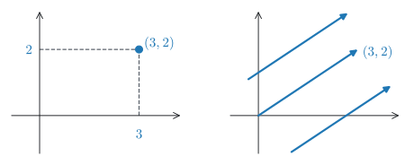
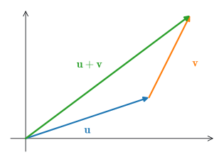
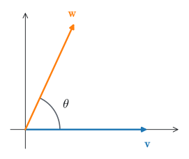
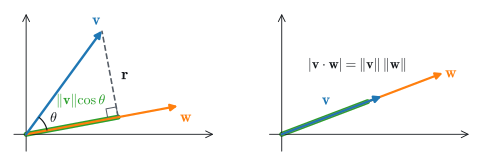
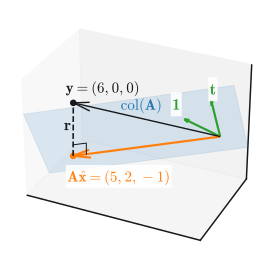
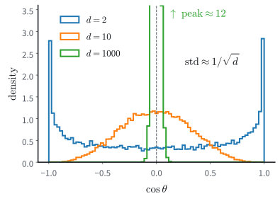
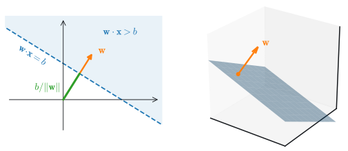

# Vectors, Angles, and Projections
:label:`sec_mdl-geometry-linear-algebraic-ops`

The Basics treated every input as a vector: an image became a list of pixel
values, and a word became an embedding. Models do three geometric things
with these vectors. They compare, as when we ask whether two
embeddings are similar. They fit, as when we look for the combination of
features that comes closest to the targets. And they separate, as when a
classifier decides on which side of a boundary an input falls. In the plane
each of these is a picture of lengths, angles, and shadows. Inputs live in
spaces of hundreds or thousands of dimensions, which nobody can draw. Do the
pictures still mean anything there?

Telling t-shirts from trousers is one instance of the question. Each
$28 \times 28$ Fashion-MNIST image (:numref:`sec_fashion_mnist`) is a list of
$784$ numbers, so it is a point in $\mathbb{R}^{784}$. A simple rule assigns
a new image to the class whose average image it lies closer to. In the plane
"closer" is something we can see; in $\mathbb{R}^{784}$ it is a calculation,
and it takes one dot product per image. On the $2{,}000$ test images of those
two classes the rule is right about $92\%$ of the time. If the pictures we
draw in the plane did not carry over to $784$ dimensions, a rule as simple as
"nearest mean" would have no reason to work.

The dot product carries the geometry of the plane into any dimension.
Lengths are square roots of dot products, the shadow of one vector on another
is a ratio of dot products, and the angle between two vectors is defined from
them. We prove each result once, with a picture drawn in the plane, and check
it on the images.

:numref:`sec_linear-algebra` introduced the dot product
$\mathbf{x}^\top\mathbf{y} = \sum_i x_i y_i$, the length
$\|\mathbf{x}\| = \sqrt{\mathbf{x}^\top\mathbf{x}}$, the planar identity
$\mathbf{x}^\top\mathbf{y} = \|\mathbf{x}\|\|\mathbf{y}\|\cos\theta$, cosine
similarity, and an algebraic proof of the Cauchy–Schwarz inequality. This
section proves Cauchy–Schwarz a second way, from a picture, and goes on to
subspaces, least squares, and hyperplanes. Apart from loading the images,
all the code is plain NumPy, the same in every framework.

```{.python .input #geometry-linear-algebraic-ops-imports}
#@tab mxnet
%matplotlib inline
from d2l import mxnet as d2l
import numpy as np
```

```{.python .input #geometry-linear-algebraic-ops-imports}
#@tab pytorch
%matplotlib inline
from d2l import torch as d2l
import numpy as np
```

```{.python .input #geometry-linear-algebraic-ops-imports}
#@tab tensorflow
%matplotlib inline
from d2l import tensorflow as d2l
import numpy as np
```

```{.python .input #geometry-linear-algebraic-ops-imports}
#@tab jax
%matplotlib inline
from d2l import jax as d2l
import numpy as np
```

## Vectors and Their Geometry

### Points and Directions

A vector admits two geometric readings. Read as a *point*, its components
give a location relative to a fixed reference called the *origin*:
$\mathbf{v} = (3, 2)$ is the point $3$ units to the right of the origin and
$2$ units up. This reading turns a dataset into a cloud of points, and the
task of telling t-shirts from trousers into geometry: find a way to separate
two clouds of points.

Read as a *direction*, the same vector says "take $3$ steps to the right and
$2$ steps up." An arrow with that displacement can start anywhere. All the
parallel arrows in :numref:`fig_mdl-la-vectors` are therefore the same vector. (A
single vector is a column by default, while in a data matrix each example is
a row, as in :numref:`sec_linear-algebra`.)


:label:`fig_mdl-la-vectors`

The direction view makes vector addition visual: follow one arrow, then the
other, tip to tail, as in :numref:`fig_mdl-la-vector-add`.


:label:`fig_mdl-la-vector-add`

Subtraction has a similar reading. From the identity
$\mathbf{u} = \mathbf{v} + (\mathbf{u}-\mathbf{v})$, the vector
$\mathbf{u}-\mathbf{v}$ is the direction that takes us from the point
$\mathbf{v}$ to the point $\mathbf{u}$.

Everything else in this section is built from one operation. The *dot
product* of two vectors $\mathbf{u}, \mathbf{v} \in \mathbb{R}^d$ multiplies
them entry by entry and adds the products:

$$\mathbf{u}^\top\mathbf{v} = \sum_{i=1}^d u_i v_i.$$
:eqlabel:`eq_mdl-dot_def`

It is symmetric, $\mathbf{u}^\top\mathbf{v} = \mathbf{v}^\top\mathbf{u}$, so
we also write it with a dot, $\mathbf{u}\cdot\mathbf{v}$. For
$\mathbf{u} = (1, 3)$ and $\mathbf{v} = (2, 1)$ it is $2 + 3 = 5$, and the
squared length of $\mathbf{u}$ is $\mathbf{u}\cdot\mathbf{u} = 1 + 9 = 10$.

### Projection onto a Line

How much of a vector $\mathbf{v}$ points along another vector $\mathbf{w}$?
Put differently: which multiple $t\mathbf{w}$ comes closest to $\mathbf{v}$?
This is the smallest fitting problem there is. We approximate $\mathbf{v}$ by
one direction and choose the best coefficient.

Take $\mathbf{v} = (1, 3)$ and $\mathbf{w} = (2, 1)$ and try a few values of
$t$. With $t = 1$ the error $\mathbf{v} - t\mathbf{w} = (-1, 2)$ has squared
length $5$; with $t = 0.5$ the error is $(0, 2.5)$, of squared length $6.25$;
with $t = 1.5$ it is $(-2, 1.5)$, again of squared length $6.25$. The best
value appears to be $t = 1$, and the closest point is $(2, 1)$. Its error is
called the *residual*. Here $\mathbf{r} = (-1, 2)$, and its dot product with
$\mathbf{w}$ vanishes: $\mathbf{r}\cdot\mathbf{w} = -2 + 2 = 0$. The shortest
error meets the line at a right angle. The lengths fit together as in a right
triangle: $\|\mathbf{v}\|^2 = 10$, the closest point has squared length $5$, the
residual has squared length $5$, and $10 = 5 + 5$.

The general statement keeps this shape.

**Proposition (orthogonal projection).** *Let $\mathbf{w} \neq \mathbf{0}$.
The multiple of $\mathbf{w}$ closest to $\mathbf{v}$ is*

$$
\operatorname{proj}_{\mathbf{w}}\mathbf{v}
 = \frac{\mathbf{v}\cdot\mathbf{w}}{\mathbf{w}\cdot\mathbf{w}}\,\mathbf{w},
$$
:eqlabel:`eq_mdl-projection`

*and the residual $\mathbf{r} = \mathbf{v} - \operatorname{proj}_{\mathbf{w}}\mathbf{v}$
satisfies $\mathbf{r}\cdot\mathbf{w} = 0$.*

**Proof.** We minimize the squared error as a function of the coefficient
$t$. Expanding the dot product of $\mathbf{v} - t\mathbf{w}$ with itself gives
a quadratic in $t$,

$$
q(t) = \|\mathbf{v} - t\mathbf{w}\|^2
 = \|\mathbf{w}\|^2\, t^2 - 2\,(\mathbf{v}\cdot\mathbf{w})\, t + \|\mathbf{v}\|^2,
$$

whose leading coefficient $\|\mathbf{w}\|^2$ is positive, so it has a single
minimum where $q'(t) = 2\|\mathbf{w}\|^2 t - 2\,\mathbf{v}\cdot\mathbf{w}$
vanishes, at $t^\star = \mathbf{v}\cdot\mathbf{w}/\mathbf{w}\cdot\mathbf{w}$.
This is :eqref:`eq_mdl-projection`. For the residual,
$\mathbf{r}\cdot\mathbf{w} = \mathbf{v}\cdot\mathbf{w} - t^\star\,\mathbf{w}\cdot\mathbf{w} = 0$.
$\blacksquare$

On the example, $q(t) = 5t^2 - 10t + 10$, minimized at $t^\star = 5/5 = 1$
with value $5$, which matches the trial values above. We call
$\operatorname{proj}_{\mathbf{w}}\mathbf{v}$ the *projection*, or
*shadow*, of $\mathbf{v}$ on $\mathbf{w}$. The shadow is the part of
$\mathbf{v}$ along $\mathbf{w}$, and the residual is the part at right angles
to $\mathbf{w}$. The hypothesis $\mathbf{w} \neq \mathbf{0}$
matters: the zero vector has no direction, and the formula would divide by
zero.

The right angle is what makes lengths add. Two vectors $\mathbf{a}$,
$\mathbf{b}$ are **orthogonal** when $\mathbf{a}\cdot\mathbf{b} = 0$. For
orthogonal vectors, expanding the squared length of the sum gives
**Pythagoras' theorem**,

$$
\|\mathbf{a} + \mathbf{b}\|^2
 = \|\mathbf{a}\|^2 + 2\,\mathbf{a}\cdot\mathbf{b} + \|\mathbf{b}\|^2
 = \|\mathbf{a}\|^2 + \|\mathbf{b}\|^2 .
$$
:eqlabel:`eq_mdl-pythagoras`

So orthogonal pieces add in squared length, with no cross term, in every
dimension. Applied to
$\mathbf{v} = \operatorname{proj}_{\mathbf{w}}\mathbf{v} + \mathbf{r}$, it
reads $\|\mathbf{v}\|^2 = \|\operatorname{proj}_{\mathbf{w}}\mathbf{v}\|^2 + \|\mathbf{r}\|^2$,
which is $10 = 5 + 5$ on the example.

The length of the shadow, with a sign that says whether it points along
$\mathbf{w}$ or against it, is the coefficient times $\|\mathbf{w}\|$:

$$
\frac{\mathbf{v}\cdot\mathbf{w}}{\|\mathbf{w}\|}.
$$

On the example it is $5/\sqrt{5} = \sqrt{5}$, the length of $(2, 1)$. This
*signed length* returns at the end of the section as the signed distance of a
point to a hyperplane. :numref:`fig_mdl-la-projection` draws the example.


:label:`fig_mdl-la-projection`

### Cauchy–Schwarz and the Angle

In $784$ dimensions there is no protractor. Can "the angle between two
images" mean anything? And is the shadow of a vector ever longer than the
vector itself? Panel (a) of :numref:`fig_mdl-la-projection` suggests the
answer to the second question: the shadow is a leg of a right triangle whose
hypotenuse is $\mathbf{v}$. Pythagoras turns that picture into a proof valid
in every dimension.

**Proposition (Cauchy–Schwarz).** *For all vectors $\mathbf{v}, \mathbf{w}$,*

$$
|\mathbf{v}\cdot\mathbf{w}| \le \|\mathbf{v}\|\,\|\mathbf{w}\|,
$$
:eqlabel:`eq_mdl-cauchy-schwarz`

*with equality if and only if $\mathbf{v}$ and $\mathbf{w}$ are collinear (one
is a multiple of the other).*

**Proof.** If $\mathbf{w} = \mathbf{0}$, both sides are zero and the vectors
are collinear. Otherwise split $\mathbf{v}$ into its shadow and residual. By
Pythagoras :eqref:`eq_mdl-pythagoras`,

$$
\|\mathbf{v}\|^2
 = \|\operatorname{proj}_{\mathbf{w}}\mathbf{v}\|^2 + \|\mathbf{r}\|^2
 \ge \|\operatorname{proj}_{\mathbf{w}}\mathbf{v}\|^2
 = \frac{(\mathbf{v}\cdot\mathbf{w})^2}{\|\mathbf{w}\|^2}.
$$

Multiplying by $\|\mathbf{w}\|^2$ and taking square roots gives the
inequality. Equality holds exactly when $\mathbf{r} = \mathbf{0}$, that is,
when $\mathbf{v} = t^\star\mathbf{w}$. Conversely, if $\mathbf{v} = t\mathbf{w}$,
then $|\mathbf{v}\cdot\mathbf{w}| = |t|\,\|\mathbf{w}\|^2 = \|\mathbf{v}\|\,\|\mathbf{w}\|$.
$\blacksquare$

The inequality says that the shadow is never longer than the vector, and that
it is as long only when nothing is left over. :numref:`sec_linear-algebra`
proved it algebraically, from $\|\mathbf{u} - \mathbf{v}\|^2 \ge 0$ for unit
vectors. The proof here is panel (a) of the figure, and panel (b) is the
equality case.

We turn to the angle. In the plane, the law of cosines applied to the triangle with
sides $\mathbf{v}$, $\mathbf{w}$, and $\mathbf{v} - \mathbf{w}$ gives
$\mathbf{v}\cdot\mathbf{w} = \|\mathbf{v}\|\|\mathbf{w}\|\cos\theta$, as
:numref:`sec_linear-algebra` showed by expanding
$\|\mathbf{v} - \mathbf{w}\|^2$ in two ways
(:numref:`fig_mdl-la-angle`).


:label:`fig_mdl-la-angle`

In $\mathbb{R}^d$ there is no triangle to measure, so we turn the planar
identity around and use it as a definition. For nonzero
$\mathbf{v}, \mathbf{w} \in \mathbb{R}^d$, the *angle* between them is

$$\theta = \arccos\left(\frac{\mathbf{v}\cdot\mathbf{w}}{\|\mathbf{v}\|\|\mathbf{w}\|}\right) \in [0, \pi].$$
:eqlabel:`eq_mdl-angle_formula`

The $\arccos$ accepts only arguments in $[-1, 1]$, and Cauchy–Schwarz states
that the ratio lies there. So the definition is
legitimate in every dimension, and the planar identity now holds everywhere,
as a consequence of the definition:

$$
\mathbf{v}\cdot\mathbf{w} = \|\mathbf{v}\|\|\mathbf{w}\|\cos\theta.
$$
:eqlabel:`eq_mdl-dot_geom`

The dot product is thus the product of the two lengths, multiplied by the
cosine of the angle between the directions. The equality cases of Cauchy–Schwarz are
$\theta = 0$ (same direction) and $\theta = \pi$ (opposite directions).

An objection: is this defined angle the one we would measure? Two vectors
always lie in a plane (a line, if they are collinear), and inside that plane
school geometry applies. The projection gives coordinates for that plane. Put
$\mathbf{q}_1 = \mathbf{w}/\|\mathbf{w}\|$ and, when $\mathbf{r} \neq \mathbf{0}$,
$\mathbf{q}_2 = \mathbf{r}/\|\mathbf{r}\|$. These two vectors have unit
length and are orthogonal, so dot products of their combinations are computed
as in the plane. In these coordinates $\mathbf{w} = (\|\mathbf{w}\|, 0)$ and
$\mathbf{v} = (\mathbf{v}\cdot\mathbf{w}/\|\mathbf{w}\|,\ \|\mathbf{r}\|)$.
The angle a protractor would measure between these two planar arrows has
cosine $(\mathbf{v}\cdot\mathbf{w}/\|\mathbf{w}\|)/\|\mathbf{v}\|$, which is
the defined value. So the definition agrees with ordinary geometry in the
plane spanned by the two vectors. On the example,
$\cos\theta = 5/(\sqrt{10}\sqrt{5}) = 1/\sqrt{2}$ and $\theta = 45^\circ$.

For nonzero vectors, orthogonality means $\theta = \pi/2$. The definition by
the dot product also covers the zero vector, which is orthogonal to every
vector, although no angle is defined for it. We use this definition
throughout the chapter.

Does the formula return $\pi/4$ on the worked pair, and what does it give on
a pair in $\mathbb{R}^3$ that we have not drawn?

```{.python .input #geometry-linear-algebraic-ops-dot-products-and-angles}
def angle(v, w):
    cos = v @ w / (np.linalg.norm(v) * np.linalg.norm(w))
    return np.arccos(np.clip(cos, -1, 1))  # roundoff can push |cos| past 1

angle(np.array([1., 3]), np.array([2., 1])), angle(np.array([0., 1, 2]),
                                                   np.array([2., 3, 4]))
```

The first value is $0.785 = \pi/4$, the $45^\circ$ of the picture. The second
pair is at $0.419$ radians, about $24^\circ$: the two vectors point roughly the
same way. The clip in `angle` is necessary. In exact arithmetic Cauchy–Schwarz keeps
the ratio in $[-1, 1]$, but in floating point it can overshoot by one unit in
the last place. For $\mathbf{v} = (10^8 + 1, 3, 7)$ and $3\mathbf{v}$ the
computed ratio is $1 + 2.2\times 10^{-16}$, and `arccos` without the clip
returns `nan`.

Cauchy–Schwarz also bounds the length of a sum by the sum of the lengths.

**Corollary (triangle inequality).** *For all $\mathbf{v}, \mathbf{w}$,*
$\|\mathbf{v} + \mathbf{w}\| \le \|\mathbf{v}\| + \|\mathbf{w}\|$.

**Proof.** Expand the square and apply :eqref:`eq_mdl-cauchy-schwarz` to the
cross term:

$$
\|\mathbf{v} + \mathbf{w}\|^2
 = \|\mathbf{v}\|^2 + 2\,\mathbf{v}\cdot\mathbf{w} + \|\mathbf{w}\|^2
 \le \|\mathbf{v}\|^2 + 2\,\|\mathbf{v}\|\|\mathbf{w}\| + \|\mathbf{w}\|^2
 = \bigl(\|\mathbf{v}\| + \|\mathbf{w}\|\bigr)^2.
$$

Taking square roots gives the claim. $\blacksquare$

## Subspaces and Least Squares

### Span, Bases, and Subspaces

Suppose we measure a quantity three times, at times $t = 0, 1, 2$, and want
the straight line $C + Dt$ that fits the measurements best. Collect the
measurements in $\mathbf{y} \in \mathbb{R}^3$, the times in
$\mathbf{t} = (0, 1, 2)$, and let $\mathbf{1} = (1, 1, 1)$. The line's values
at the three times form the vector $C\mathbf{1} + D\mathbf{t}$, so choosing
the line means choosing the point of the form $C\mathbf{1} + D\mathbf{t}$
that is closest to $\mathbf{y}$. As $C$ and $D$ vary, these candidates fill a
plane through the origin in $\mathbb{R}^3$. Projection onto a line handled one
direction; we now need words for planes and their higher-dimensional
relatives.

A weighted sum $a_1\mathbf{v}_1 + \cdots + a_k\mathbf{v}_k$ is a *linear
combination* of $\mathbf{v}_1, \ldots, \mathbf{v}_k$. The set of all of them
is their **span**,

$$
\operatorname{span}(\mathbf{v}_1, \ldots, \mathbf{v}_k)
 = \bigl\{ a_1\mathbf{v}_1 + \cdots + a_k\mathbf{v}_k
   : a_1, \ldots, a_k \in \mathbb{R} \bigr\}.
$$

The span is everything reachable by scaling and adding the given vectors.
In $\mathbb{R}^2$ (:numref:`fig_mdl-la-span`), the span of one nonzero vector
is the line through the origin in its direction. The span of two vectors not
on a common line through the origin is the whole plane. The candidates
of the line fit are $\operatorname{span}(\mathbf{1}, \mathbf{t})$.


:label:`fig_mdl-la-span`

A span is closed under addition and scaling: adding two linear combinations
or scaling one gives another linear combination. Any nonempty set of vectors
with these two closure properties is called a **subspace**. Every subspace
contains $\mathbf{0}$ (scale any element by zero), so a line that misses the
origin is not a subspace. The subspaces of $\mathbb{R}^2$ are the origin
alone, the lines through the origin, and $\mathbb{R}^2$ itself; in
$\mathbb{R}^3$ the planes through the origin join the list.

A spanning list can be redundant. If one vector already lies in the span of
the others, deleting it shrinks the list without shrinking the span. A list
is **linearly independent** when this cannot happen, that is, when the only
linear combination $a_1\mathbf{v}_1 + \cdots + a_k\mathbf{v}_k$ equal to
$\mathbf{0}$ is the trivial one with every $a_i = 0$. The vectors $\mathbf{1}$
and $\mathbf{t}$ are independent: $a_1\mathbf{1} + a_2\mathbf{t} = (a_1,\,
a_1 + a_2,\, a_1 + 2a_2)$ vanishes only if $a_1 = a_2 = 0$.

A **basis** of a subspace is a linearly independent list that spans it. The
vectors $\mathbf{e}_1 = (1, 0)$ and $\mathbf{e}_2 = (0, 1)$ form the
*standard basis* of $\mathbb{R}^2$, but the slanted pair in
:numref:`fig_mdl-la-span` is an equally valid basis.

Every basis of a given
subspace has the same number of elements (a theorem we use without proof),
and that number is the subspace's **dimension**. This gives a precise meaning
to the $d$ in "$d$-dimensional space": $\mathbb{R}^d$ has dimension $d$
because $\mathbf{e}_1, \ldots, \mathbf{e}_d$ is a basis. The candidates of
the line fit form a two-dimensional subspace of $\mathbb{R}^3$.

Independence is what makes coordinates well defined.

**Proposition (coordinates are unique).** *Let $\mathbf{v}_1, \ldots,
\mathbf{v}_k$ be a basis of a subspace $S$. Then every $\mathbf{x} \in S$ can
be written as $\mathbf{x} = a_1\mathbf{v}_1 + \cdots + a_k\mathbf{v}_k$ for
exactly one choice of coefficients $a_1, \ldots, a_k$.*

**Proof.** At least one representation exists because the basis spans $S$. If
there were two, $\mathbf{x} = \sum_i a_i \mathbf{v}_i = \sum_i b_i \mathbf{v}_i$,
subtracting would give $\sum_i (a_i - b_i)\,\mathbf{v}_i = \mathbf{0}$, and
independence forces $a_i = b_i$ for every $i$. $\blacksquare$

A basis therefore identifies a $k$-dimensional subspace with $\mathbb{R}^k$:
once the basis is fixed, the coefficient list $(a_1, \ldots, a_k)$ names the
point. For the line fit, the coefficients of a candidate are the intercept
$C$ and the slope $D$.

### Projection onto a Subspace

We can now finish the line fit, for measurements $\mathbf{y} = (6, 0, 0)$.
The best line corresponds to the point $C\mathbf{1} + D\mathbf{t}$ of the
plane $\operatorname{span}(\mathbf{1}, \mathbf{t})$ closest to $\mathbf{y}$.
For a line, the closest point left a residual orthogonal to the line. For a
plane we expect the residual to be orthogonal to the whole plane, hence to
both $\mathbf{1}$ and $\mathbf{t}$ (the proposition below proves this). That
gives two equations for the two unknowns:

$$
\begin{aligned}
\mathbf{1}\cdot(\mathbf{y} - C\mathbf{1} - D\mathbf{t}) &= 6 - 3C - 3D = 0,\\
\mathbf{t}\cdot(\mathbf{y} - C\mathbf{1} - D\mathbf{t}) &= 0 - 3C - 5D = 0.
\end{aligned}
$$

Subtracting the first equation from the second gives $2D = -6$, so $D = -3$
and $C = 5$. The best line is $5 - 3t$. Its values at the three times are
$(5, 2, -1)$, and the errors are $\mathbf{r} = \mathbf{y} - (5, 2, -1) = (1, -2, 1)$.
Both checks pass, $\mathbf{r}\cdot\mathbf{1} = 1 - 2 + 1 = 0$ and
$\mathbf{r}\cdot\mathbf{t} = 0 - 2 + 2 = 0$, and Pythagoras splits the
squared length of the measurements: $36 = 30 + 6$. For contrast, projecting
$\mathbf{y}$ onto $\mathbf{1}$ alone gives the coefficient
$\mathbf{y}\cdot\mathbf{1}/\mathbf{1}\cdot\mathbf{1} = 2$, the mean of the
measurements, with residual $(4, -2, -2)$ of squared length $24$. Adding the
direction $\mathbf{t}$ cuts the squared error from $24$ to $6$.
:numref:`fig_mdl-la-least-squares` shows the fit in $\mathbb{R}^3$.


:label:`fig_mdl-la-least-squares`

For the general statement it helps to have a basis whose vectors are
orthogonal to each other. A basis $\mathbf{q}_1, \ldots, \mathbf{q}_k$ of a
subspace $S \subseteq \mathbb{R}^n$ is **orthonormal** when each vector has
unit length and distinct vectors are orthogonal. Stacking the vectors as the
columns of an $n \times k$ matrix $\mathbf{Q}$ writes this compactly as
$\mathbf{Q}^\top\mathbf{Q} = \mathbf{I}_k$, because entry $(i, j)$ of
$\mathbf{Q}^\top\mathbf{Q}$ is $\mathbf{q}_i\cdot\mathbf{q}_j$. In this chapter
the letter $\mathbf{Q}$ always denotes a matrix with orthonormal columns.

**Proposition (projection onto a subspace).** *Let $\mathbf{Q}$ have
orthonormal columns spanning $S$, and set $\mathbf{P} =
\mathbf{Q}\mathbf{Q}^\top$. Then for every $\mathbf{x} \in \mathbb{R}^n$:*
(i) *$\mathbf{P}\mathbf{x} \in S$, and the residual $\mathbf{x} -
\mathbf{P}\mathbf{x}$ is orthogonal to every vector of $S$;*
(ii) *$\mathbf{P}\mathbf{x}$ is the unique closest point of $S$ to
$\mathbf{x}$;*
(iii) *$\mathbf{P}^2 = \mathbf{P}$ and $\mathbf{P}^\top = \mathbf{P}$.*

**Proof.** For (i), $\mathbf{P}\mathbf{x} = \mathbf{Q}(\mathbf{Q}^\top\mathbf{x})$
is a linear combination of the columns of $\mathbf{Q}$, hence lies in $S$.
Multiplying the residual by $\mathbf{Q}^\top$ gives

$$
\mathbf{Q}^\top(\mathbf{x} - \mathbf{P}\mathbf{x})
 = \mathbf{Q}^\top\mathbf{x} - (\mathbf{Q}^\top\mathbf{Q})\,\mathbf{Q}^\top\mathbf{x}
 = \mathbf{0},
$$

so the residual is orthogonal to each $\mathbf{q}_i$, and therefore to every
combination of them. For (ii), take any $\mathbf{s} \in S$ and split
$\mathbf{x} - \mathbf{s} = (\mathbf{x} - \mathbf{P}\mathbf{x}) + (\mathbf{P}\mathbf{x} - \mathbf{s})$.
The second piece lies in $S$ and the first is orthogonal to it, so Pythagoras
:eqref:`eq_mdl-pythagoras` gives

$$
\|\mathbf{x} - \mathbf{s}\|^2
 = \|\mathbf{x} - \mathbf{P}\mathbf{x}\|^2 + \|\mathbf{P}\mathbf{x} - \mathbf{s}\|^2
 \ge \|\mathbf{x} - \mathbf{P}\mathbf{x}\|^2,
$$

with equality only when $\mathbf{s} = \mathbf{P}\mathbf{x}$. For (iii),
$\mathbf{P}^2 = \mathbf{Q}(\mathbf{Q}^\top\mathbf{Q})\mathbf{Q}^\top =
\mathbf{Q}\mathbf{Q}^\top = \mathbf{P}$, and
$\mathbf{P}^\top = (\mathbf{Q}^\top)^\top\mathbf{Q}^\top = \mathbf{P}$.
$\blacksquare$

The orthogonality in (i) also characterizes the closest point. If
$\mathbf{s} \in S$ and $\mathbf{x} - \mathbf{s}$ is orthogonal to $S$, then
$\mathbf{P}\mathbf{x} - \mathbf{s} = (\mathbf{x} - \mathbf{s}) - (\mathbf{x} - \mathbf{P}\mathbf{x})$
lies in $S$ and is orthogonal to $S$, hence to itself, so it is zero. This is
why the two equations of the line fit found the closest point.

Property (iii) says two things. $\mathbf{P}^2 = \mathbf{P}$ means projecting
twice changes nothing, because the first projection already lies in $S$.
$\mathbf{P}^\top = \mathbf{P}$ is what makes the projection *orthogonal*. A
matrix with $\mathbf{P}^2 = \mathbf{P}$ but $\mathbf{P}^\top \neq \mathbf{P}$
also maps every vector into its column space and leaves that space fixed.
Such an *oblique* projector moves vectors along a slanted direction, and in
general it does not return the closest point (:exref:`ex_mdl-geometry-linear-algebraic-ops-projectors`). For
$k = 1$, with the single unit column $\mathbf{q} = \mathbf{w}/\|\mathbf{w}\|$,
the matrix $\mathbf{P} = \mathbf{q}\mathbf{q}^\top$ reproduces
:eqref:`eq_mdl-projection`.

The line fit is one instance of **least squares**, the fitting problem behind
linear regression. Let $\mathbf{A}$ be a data matrix whose columns are
features and whose rows are examples, and let $\mathbf{y}$ hold the targets.
Least squares asks for the coefficient vector $\mathbf{x}$ that minimizes the
squared error,

$$
\min_{\mathbf{x}} \|\mathbf{A}\mathbf{x} - \mathbf{y}\|^2 .
$$
:eqlabel:`eq_mdl-least-squares`

As $\mathbf{x}$ ranges over all coefficient vectors, $\mathbf{A}\mathbf{x}$
ranges over the span of the columns of $\mathbf{A}$, its *column space*
$\operatorname{col}(\mathbf{A})$. So least squares asks for the point of
$\operatorname{col}(\mathbf{A})$ closest to $\mathbf{y}$, and by the
proposition this is the point whose residual is orthogonal to every column.
Writing "orthogonal to every column" as $\mathbf{A}^\top(\mathbf{y} -
\mathbf{A}\hat{\mathbf{x}}) = \mathbf{0}$ gives the *normal equations*

$$
\mathbf{A}^\top\mathbf{A}\,\hat{\mathbf{x}} = \mathbf{A}^\top\mathbf{y}.
$$
:eqlabel:`eq_mdl-normal-equations`

They are the general form of the $2 \times 2$ system we solved by hand: for
the line fit, $\mathbf{A} = [\mathbf{1}\ \mathbf{t}]$ has
$\mathbf{A}^\top\mathbf{A} = \left(\begin{smallmatrix}3&3\\3&5\end{smallmatrix}\right)$
and $\mathbf{A}^\top\mathbf{y} = (6, 0)$. When the columns of $\mathbf{A}$
are linearly independent, $\mathbf{A}^\top\mathbf{A}$ is invertible
(:exref:`ex_mdl-geometry-linear-algebraic-ops-least-squares-line`) and the
coefficients are unique. When they are dependent, the fitted point
$\mathbf{A}\hat{\mathbf{x}}$ is still unique, being the closest point of the
column space, but several coefficient vectors produce it.

Least squares leaves the target unchanged. It finds the point of the column
space nearest to the target, and the error it leaves is orthogonal to every
feature column.

Do the normal equations and an orthonormal basis give the same fit $5 - 3t$,
and does $\mathbf{P} = \mathbf{Q}\mathbf{Q}^\top$ behave as the proposition
says? The library routine `np.linalg.qr` returns an orthonormal basis of the
column space of a matrix whose columns are independent (we build one by hand
below).

```{.python .input #mdl-geometry-linear-algebraic-ops-projection-onto-a-subspace}
A = np.array([[1., 0], [1, 1], [1, 2]])     # columns 1 and t
y = np.array([6., 0, 0])
x_hat = np.linalg.solve(A.T @ A, A.T @ y)   # normal equations
Q, R = np.linalg.qr(A)                      # orthonormal basis of col(A)
P = Q @ Q.T
r = y - P @ y
print(x_hat.round(6), (P @ y).round(6), r.round(6))
print(np.linalg.norm(P @ P - P), np.linalg.norm(Q.T @ r))
```

The coefficients are $C = 5$ and $D = -3$, the projection $\mathbf{P}\mathbf{y}$
is the vector of fitted values $(5, 2, -1)$, and the residual is
$(1, -2, 1)$. The last two numbers are zero up to roundoff: $\mathbf{P}$ is
idempotent, and the residual is orthogonal to both columns.

The two routes differ in accuracy. Forming $\mathbf{A}^\top\mathbf{A}$ squares
the sensitivity of the problem to rounding errors when the columns are nearly
dependent, which is why library least-squares solvers work with an
orthonormal basis of the column space instead.

### Gram–Schmidt and QR
:label:`subsec_mdl-gram-schmidt`

An orthonormal basis can be built by repeated projection. Take two
independent vectors, keep the direction of the first, and remove from the
second its shadow on the first. What remains is orthogonal to the first
vector, by the projection proposition.

Start with $\mathbf{a}_1 = (3, 4)$ and $\mathbf{a}_2 = (1, 0)$. Normalizing
the first gives $\mathbf{q}_1 = \mathbf{a}_1/5 = (0.6, 0.8)$. The shadow of
$\mathbf{a}_2$ on $\mathbf{q}_1$ is $(\mathbf{q}_1\cdot\mathbf{a}_2)\,\mathbf{q}_1 =
0.6\,(0.6, 0.8)$, and subtracting it leaves
$(1, 0) - (0.36, 0.48) = (0.64, -0.48)$, a vector of length $0.8$ that is
orthogonal to $\mathbf{q}_1$ ($0.384 - 0.384 = 0$). Normalizing it gives
$\mathbf{q}_2 = (0.8, -0.6)$. Reading the construction backward expresses each
original vector in the new basis:

$$
\mathbf{a}_1 = 5\,\mathbf{q}_1,
\qquad
\mathbf{a}_2 = 0.6\,\mathbf{q}_1 + 0.8\,\mathbf{q}_2 .
$$

In matrix form this is $\mathbf{A} = \mathbf{Q}\mathbf{R}$ with
$\mathbf{A} = [\mathbf{a}_1\ \mathbf{a}_2]$, $\mathbf{Q} = [\mathbf{q}_1\ \mathbf{q}_2]$,
and $\mathbf{R} = \left(\begin{smallmatrix}5&0.6\\0&0.8\end{smallmatrix}\right)$,
whose entries are the dot products $\mathbf{q}_i\cdot\mathbf{a}_j$. The matrix
$\mathbf{R}$ is upper triangular because $\mathbf{a}_j$ involves only
$\mathbf{q}_1, \ldots, \mathbf{q}_j$.

The general procedure is the **Gram–Schmidt process**. Process linearly
independent vectors $\mathbf{a}_1, \ldots, \mathbf{a}_k$ in order. For each
$\mathbf{a}_j$, subtract its projections :eqref:`eq_mdl-projection` onto the
directions $\mathbf{q}_1, \ldots, \mathbf{q}_{j-1}$ already produced, and
normalize what remains. The output is an orthonormal basis of
$\operatorname{span}(\mathbf{a}_1, \ldots, \mathbf{a}_k)$ and the
*QR factorization* $\mathbf{A} = \mathbf{Q}\mathbf{R}$, with $\mathbf{Q}$ having
orthonormal columns and $\mathbf{R}$ upper triangular with positive diagonal.
Independence is needed: a vector in the span of its predecessors leaves a zero
remainder, which cannot be normalized.

Library routines compute the same factorization by a different algorithm,
based on reflections, which is more accurate in floating point. Their answer
agrees with Gram–Schmidt up to signs: flipping the sign of a column of
$\mathbf{Q}$ together with the corresponding row of $\mathbf{R}$ leaves the
product unchanged. When $\mathbf{A}$ has independent columns, these sign
flips are the only freedom. Does the two-step process give $(0.6, 0.8)$ and
$(0.8, -0.6)$, and what does `np.linalg.qr` return?

```{.python .input #mdl-geometry-linear-algebraic-ops-gram-schmidt-and-qr}
a1, a2 = np.array([3., 4]), np.array([1., 0])
q1 = a1 / np.linalg.norm(a1)
v = a2 - (q1 @ a2) * q1                     # remove the shadow on q1
q2 = v / np.linalg.norm(v)
Q_qr, R_qr = np.linalg.qr(np.stack([a1, a2], axis=1))
print(np.stack([q1, q2], axis=1).round(6))
print(Q_qr.round(6))
print(R_qr.round(6))
```

Gram–Schmidt gives the columns $(0.6, 0.8)$ and $(0.8, -0.6)$. The library
returns the negatives of both, with $\mathbf{R}$'s diagonal $-5$ and $-0.8$:
the same basis and, up to sign, the same dot products $5$, $0.6$, $0.8$
that we computed by hand. In floating point the order of the subtractions
matters. On nearly dependent columns, the version above, called *classical*
Gram–Schmidt, loses orthogonality
(:exref:`ex_mdl-geometry-linear-algebraic-ops-gram-schmidt`).

## Similarity in High Dimensions

So far every result came with a picture in the plane. We now ask what the
results say where no picture is possible: how similar two images are, and
what similarity to expect between vectors that are unrelated. The rest of the
section works with the images from the opening. We load them through
`d2l.FashionMNIST` (:numref:`sec_fashion_mnist`) as NumPy arrays, one
flattened image of $784$ pixels per row, with pixel values in $[0, 1]$.

```{.python .input #geometry-linear-algebraic-ops-hyperplanes-1}
#@tab mxnet
data = d2l.FashionMNIST()
X_train, y_train = (a.asnumpy() for a in data.read(train=True))
X_test, y_test = (a.asnumpy() for a in data.read(train=False))
X_train = X_train.reshape(-1, 784) / 255
X_test = X_test.reshape(-1, 784) / 255
X_train.shape, X_test.shape
```

```{.python .input #geometry-linear-algebraic-ops-hyperplanes-1}
#@tab pytorch
data = d2l.FashionMNIST()
X_train = data.train.data.numpy().reshape(-1, 784) / 255
y_train = data.train.targets.numpy()
X_test = data.val.data.numpy().reshape(-1, 784) / 255
y_test = data.val.targets.numpy()
X_train.shape, X_test.shape
```

```{.python .input #geometry-linear-algebraic-ops-hyperplanes-1}
#@tab tensorflow, jax
data = d2l.FashionMNIST()
(X_train, y_train), (X_test, y_test) = data.train, data.val
X_train = X_train.reshape(-1, 784) / 255
X_test = X_test.reshape(-1, 784) / 255
X_train.shape, X_test.shape
```

There are $60{,}000$ training and $10{,}000$ test images, each a point in
$\mathbb{R}^{784}$.

### Cosine Similarity

:numref:`sec_linear-algebra` called the ratio in
:eqref:`eq_mdl-angle_formula` the *cosine similarity* of two vectors,

$$
\cos\theta = \frac{\mathbf{v}\cdot\mathbf{w}}{\|\mathbf{v}\|\,\|\mathbf{w}\|}
 \;\in\; [-1, 1],
$$
:eqlabel:`eq_mdl-cosine-sim`

equal to $+1$ when the vectors point the same way, $-1$ when they point in
opposite directions, and $0$ when they are orthogonal. It compares directions
and ignores lengths. An image and a copy of it dimmed to $10\%$ brightness are
far apart pixel by pixel, yet their cosine similarity is $1$, because scaling
a vector changes its length but not its direction.

This invariance makes cosine similarity the standard score for
nearest-neighbor retrieval over embeddings, and for contrastive objectives
such as SimCLR :cite:`Chen.Kornblith.Norouzi.ea.2020`, which pull the
embeddings of two views of the same image together in direction. Attention
uses a different score: the *unnormalized* dot product, scaled by $1/\sqrt{d}$
as explained below, so the lengths of queries and keys matter there.

### Near-Orthogonality of Random Directions

Two unrelated images, or two unrelated embeddings: what cosine should we
expect between them by chance? Without an answer, no observed cosine can be
called large. The cleanest reference is a direction chosen uniformly at
random, with no preference for any part of the space.

**Proposition (near-orthogonality).** *Fix a unit vector $\mathbf{u} \in
\mathbb{R}^d$ and let $\mathbf{v}$ be drawn uniformly from the unit sphere in
$\mathbb{R}^d$. Then $\cos\theta = \mathbf{u}\cdot\mathbf{v}$ satisfies*

$$
\mathbb{E}[\cos\theta] = 0,
\qquad
\textrm{Var}(\cos\theta) = \frac{1}{d},
\qquad
\Pr\bigl(|\cos\theta| \ge \varepsilon\bigr) \le \frac{1}{d\,\varepsilon^2}
\quad \textrm{for every } \varepsilon > 0.
$$

**Proof.** The uniform distribution on the sphere does not change under
rotations, so we may rotate coordinates until $\mathbf{u} = \mathbf{e}_1$;
then $\cos\theta = v_1$. The distribution is also unchanged by
$\mathbf{v} \mapsto -\mathbf{v}$, so $\mathbb{E}[v_1] = 0$. For the variance,
every coordinate plays the same role, so $\mathbb{E}[v_i^2]$ is the same for
all $i$. Since $\sum_i v_i^2 = \|\mathbf{v}\|^2 = 1$, we get
$d\,\mathbb{E}[v_1^2] = \mathbb{E}\bigl[\sum_i v_i^2\bigr] = 1$, hence
$\textrm{Var}(\cos\theta) = \mathbb{E}[v_1^2] = 1/d$. The tail bound is
Chebyshev's inequality $\Pr(|X - \mathbb{E}[X]| \ge \varepsilon) \le
\textrm{Var}(X)/\varepsilon^2$ of :numref:`sec_prob`.
$\blacksquare$

The typical cosine between random directions is of size $1/\sqrt{d}$. For
$d = 784$ the standard deviation is $1/28 \approx 0.036$, so two random
directions in the space of images are within a few degrees of orthogonal.
Chebyshev bounds the chance of a cosine above $0.1$ in absolute value by
$1/(784 \cdot 0.01) \approx 0.13$; the true probability is below $0.01$. The
bound is loose because it uses only the variance; exponential bounds of the
same kind appear in :numref:`sec_mdl-concentration-generalization`.

Low dimensions behave differently (:numref:`fig_mdl-la-cosine-highd`). In the plane ($d = 2$) the angle between
a fixed and a random direction is uniform on $[0, \pi]$, so "within $0.1$
radians of orthogonal" and "within $0.1$ radians of collinear" are equally
likely, about $6\%$ each. The *cosine*, however, piles up at $\pm 1$, because
$\cos\theta$ changes slowly near $\theta = 0$ and $\theta = \pi$: a wide range
of angles maps to cosines near $\pm 1$. The probability of $|\cos\theta| > 0.9$
is about $0.29$, against about $0.06$ for $|\cos\theta| < 0.1$. In $d = 3$ the
cosine is uniform on $[-1, 1]$, a fact known to Archimedes. From
$d = 4$ on, the density has its peak at $0$; by $d = 10$ it is a bell of width
$1/\sqrt{10} \approx 0.32$, and by $d = 1000$ a spike of width about $0.03$
(:exref:`ex_mdl-geometry-linear-algebraic-ops-low-dim-cosine` derives the
densities).


:label:`fig_mdl-la-cosine-highd`

Is the standard deviation of the cosine really $1/\sqrt{784}$? We draw
random unit vectors by normalizing Gaussian vectors, whose distribution does
not change under rotations. The same cell checks a fact we need for
attention below: for vectors $\mathbf{q}, \mathbf{k}$ with independent
standard normal entries, the variance of $\mathbf{q}\cdot\mathbf{k}$ is $d$.

```{.python .input #mdl-geometry-linear-algebraic-ops-near-orthogonality-of-random-directions-1}
rng = np.random.default_rng()
d = 784
U = rng.standard_normal((10000, d))
U /= np.linalg.norm(U, axis=1, keepdims=True)
V = rng.standard_normal((10000, d))
V /= np.linalg.norm(V, axis=1, keepdims=True)
q, k = rng.standard_normal((10000, 64)), rng.standard_normal((10000, 64))
np.std((U * V).sum(axis=1)), 1 / np.sqrt(d), np.var((q * k).sum(axis=1))
```

The empirical standard deviation is about $0.036$, as predicted, and the
variance of the raw dot product in $64$ dimensions is about $64$.

Real data need not follow the isotropic reference. Do two unrelated
Fashion-MNIST images look orthogonal? We compare $5{,}000$ random pairs of test
images, first as they are and then after subtracting the mean training image.

```{.python .input #mdl-geometry-linear-algebraic-ops-near-orthogonality-of-random-directions-2}
def cosines(A, B):
    """Cosine similarity between corresponding rows of A and B."""
    return (A * B).sum(axis=1) / (np.linalg.norm(A, axis=1)
                                  * np.linalg.norm(B, axis=1))

i, j = rng.integers(0, len(X_test), (2, 5000))
mean_image = X_train.mean(axis=0)
raw = cosines(X_test[i], X_test[j])
centered = cosines(X_test[i] - mean_image, X_test[j] - mean_image)
raw.mean(), raw.std(), centered.mean(), centered.std()
```

They do not. Raw images have cosines around $0.6$ with a standard deviation
of about $0.18$, nowhere near $0 \pm 0.036$. Pixels are non-negative, so every
image lies in the same orthant of $\mathbb{R}^{784}$ and every pair has a
positive dot product. Subtracting the mean image centers the cosines at $0$,
but their standard deviation, about $0.34$, is nearly ten times the isotropic value:
the images vary along far fewer effective directions than $784$. A cosine
therefore counts as large only when it exceeds the spread of unrelated pairs
from the same data. Retrieval over embeddings relies on training to push
related pairs above that spread.

### The Scale of Attention Scores

Dot-product attention (:numref:`sec_attention-scoring-functions`) compares a
query $\mathbf{q} \in \mathbb{R}^d$ with keys $\mathbf{k}_1, \mathbf{k}_2,
\ldots$ and turns the scores $\mathbf{q}\cdot\mathbf{k}_j/\sqrt{d}$ into
weights with a softmax :cite:`Vaswani.Shazeer.Parmar.ea.2017`. A short
variance computation explains the $\sqrt{d}$. Suppose all $2d$ entries of
$\mathbf{q}$ and $\mathbf{k}$ are mutually independent, with mean zero and
variance one. Each summand $q_i k_i$ of $\mathbf{q}\cdot\mathbf{k}$ then has
mean zero and variance $\mathbb{E}[q_i^2]\,\mathbb{E}[k_i^2] = 1$, and
distinct summands are uncorrelated, since
$\mathbb{E}[(q_i k_i)(q_j k_j)] = \mathbb{E}[q_i]\,\mathbb{E}[k_i]\,\mathbb{E}[q_j]\,\mathbb{E}[k_j] = 0$
for $i \neq j$. The variances of the $d$ summands therefore add:

$$
\textrm{Var}(\mathbf{q}\cdot\mathbf{k})
 = \sum_{i=1}^d \textrm{Var}(q_i k_i) = d.
$$

The raw scores have standard deviation $\sqrt{d}$, which grows with the width
of the head, and dividing by $\sqrt{d}$ standardizes them. Without the
division the softmax saturates. With $d = 64$ the raw scores have standard
deviation $8$, and two scores $8$ apart get softmax weights $0.9997$ and
$0.0003$; divided by $8$, they get $0.73$ and $0.27$. The geometric reading
agrees with the computation: each vector has length about $\sqrt{d}$, and the
cosine between unrelated directions has size about $1/\sqrt{d}$, so their dot
product has size about $\sqrt{d}\cdot\sqrt{d}\cdot 1/\sqrt{d} = \sqrt{d}$.

Near-orthogonality does not make unrelated keys harmless. Each unrelated
cosine is of order $1/\sqrt{d}$ and centered at $0$, but the largest of $n$
of them grows, to leading order, like $\sqrt{2\ln n / d}$: about $0.3$ for
$n = 10^5$ keys in $d = 256$ dimensions. A related key must beat that
level, which is what training arranges
(:exref:`ex_mdl-geometry-linear-algebraic-ops-random-cosines`).

## Hyperplanes and Decision Boundaries

A linear classifier answers two questions about an input: on which side of a
boundary does it lie, and how far from the boundary is it? Throughout, we
write the boundary as $\mathbf{w}\cdot\mathbf{x} + b = 0$, the form used by
the layers of :numref:`sec_softmax`.

### Hyperplanes and Signed Distance

Both questions have answers we can draw when the boundary is a line in the
plane, and the drawing shows how $\mathbf{w}$ and $b$ place the line. Take
$\mathbf{w} = (2, 1)$ and $b = -1$. The points with $2x + y - 1 = 0$ form
the line $y = 1 - 2x$. By :eqref:`eq_mdl-dot_geom`, every point
$\mathbf{x}$ on it has the same signed shadow on $\mathbf{w}$,

$$
\frac{\mathbf{w}\cdot\mathbf{x}}{\|\mathbf{w}\|} = \frac{-b}{\|\mathbf{w}\|} = \frac{1}{\sqrt{5}}.
$$

So the line is perpendicular to $\mathbf{w}$ and crosses it at signed
position $-b/\|\mathbf{w}\|$ along $\mathbf{w}$, at distance
$|b|/\|\mathbf{w}\| = 1/\sqrt{5} \approx 0.45$ from the origin. The foot of
the perpendicular from the origin is $(1/\sqrt{5})\,\mathbf{w}/\|\mathbf{w}\| = (0.4, 0.2)$.

The same description works in any dimension. A **hyperplane** in
$\mathbb{R}^d$ is a set $\{\mathbf{x} : \mathbf{w}\cdot\mathbf{x} + b = 0\}$
with $\mathbf{w} \neq \mathbf{0}$; the vector $\mathbf{w}$ is its *normal* and
$b$ its *offset*. It has dimension $d - 1$: a line in the plane, a plane in
$\mathbb{R}^3$, and a $783$-dimensional flat in the space of images. It
divides the space into two *half-spaces*, $\mathbf{w}\cdot\mathbf{x} + b > 0$
and $\mathbf{w}\cdot\mathbf{x} + b < 0$, whose points have signed shadows on
$\mathbf{w}$ greater or smaller than that of the hyperplane. Changing $b$
slides the hyperplane along $\mathbf{w}$ without rotating it, and $b = 0$
gives a hyperplane through the origin, which is a subspace.

How far is an arbitrary point $\mathbf{x}$ from the hyperplane? Pick any point
$\mathbf{x}_0$ on it, so that $\mathbf{w}\cdot\mathbf{x}_0 = -b$. The distance
is the signed length of the shadow of the displacement
$\mathbf{x} - \mathbf{x}_0$ on the normal, so the **signed distance** is

$$
\frac{\mathbf{w}\cdot(\mathbf{x} - \mathbf{x}_0)}{\|\mathbf{w}\|}
 = \frac{\mathbf{w}\cdot\mathbf{x} + b}{\|\mathbf{w}\|}.
$$
:eqlabel:`eq_mdl-signed-distance`

It does not depend on which $\mathbf{x}_0$ we picked. It is positive on the
side that $\mathbf{w}$ points to, negative on the other, and zero on the
hyperplane. In the example, the origin is at signed distance
$-1/\sqrt{5} \approx -0.45$. The point $(1, 1)$ has score
$\mathbf{w}\cdot\mathbf{x} + b = 2$, so it lies at $+2/\sqrt{5} \approx 0.89$
on the side $\mathbf{w}$ points to; its closest point on the line is
$(1, 1) - (2/5)(2, 1) = (0.2, 0.6)$. The point $(0, 1)$ scores $0$ and lies on
the line (:numref:`fig_mdl-la-hyperplane`).


:label:`fig_mdl-la-hyperplane`

A classifier also needs to know whether a point lies on the correct side. For
a labeled point with $y \in \{-1, +1\}$, the **margin** is
$y\,(\mathbf{w}\cdot\mathbf{x} + b)/\|\mathbf{w}\|$, the signed distance
multiplied by the label: positive when the point is on its own side, and
larger the farther it is from the boundary. Scaling
$(\mathbf{w}, b) \to (c\mathbf{w}, cb)$ with $c > 0$ leaves the hyperplane and
the margin unchanged but multiplies the score by $c$. A classifier that
maximizes the score must therefore fix the scale of $\mathbf{w}$
(:exref:`ex_mdl-geometry-linear-algebraic-ops-signed-distance`).

### The Nearest-Mean Classifier
:label:`subsec_mdl-nearest-mean`

A linear classifier computes $\mathbf{w}\cdot\mathbf{x} + b$, as the
layer in :numref:`sec_softmax` does, and predicts by the sign. Its weight
vector is the normal of the boundary and its bias is the offset. With $q$
classes and one weight vector per class, classes $i$ and $j$ are separated by
the hyperplane $(\mathbf{w}_i - \mathbf{w}_j)\cdot\mathbf{x} + (b_i - b_j) = 0$,
where their scores tie. A deep classifier ends with such a layer, applied to
a representation that the earlier layers learn.

Which hyperplane should we choose? The simplest classifier we can think of
needs no training: assign $\mathbf{x}$ to the class whose mean is nearer. Let
$\bar{\mathbf{x}}_0$ and $\bar{\mathbf{x}}_1$ be the means of the two classes.
Expanding both squared distances, the term $\|\mathbf{x}\|^2$ cancels:

$$
\begin{aligned}
\|\mathbf{x} - \bar{\mathbf{x}}_1\|^2 < \|\mathbf{x} - \bar{\mathbf{x}}_0\|^2
&\iff -2\,\mathbf{x}\cdot\bar{\mathbf{x}}_1 + \|\bar{\mathbf{x}}_1\|^2
      < -2\,\mathbf{x}\cdot\bar{\mathbf{x}}_0 + \|\bar{\mathbf{x}}_0\|^2 \\
&\iff (\bar{\mathbf{x}}_1 - \bar{\mathbf{x}}_0)\cdot\mathbf{x}
      - \tfrac12\bigl(\|\bar{\mathbf{x}}_1\|^2 - \|\bar{\mathbf{x}}_0\|^2\bigr) > 0.
\end{aligned}
$$

With $\|\mathbf{a}\|^2 - \|\mathbf{c}\|^2 = (\mathbf{a} - \mathbf{c})\cdot(\mathbf{a} + \mathbf{c})$,
the last line is $\mathbf{w}\cdot\mathbf{x} + b > 0$ for

$$
\mathbf{w} = \bar{\mathbf{x}}_1 - \bar{\mathbf{x}}_0,
\qquad
b = -\mathbf{w}\cdot\tfrac12\left(\bar{\mathbf{x}}_0 + \bar{\mathbf{x}}_1\right).
$$

So "nearest mean" is one hyperplane: its normal points from one mean to the
other, and it passes through their midpoint. Nothing about the threshold is
chosen by hand. The rule also does not depend on the units of the pixels.
Rescaling every pixel by $c > 0$ multiplies the means by $c$, so
$\mathbf{w} \to c\mathbf{w}$ and $b \to c^2 b$; the score of a rescaled
image becomes $c^2$ times the old score, and no prediction changes.
(:exref:`ex_mdl-geometry-linear-algebraic-ops-nearest-centroid` extends this
to rotations and shifts, and finds a per-pixel rescaling that does change
predictions.)

What do the average t-shirt and the average pair of trousers look like, and
how far apart are their directions?

```{.python .input #geometry-linear-algebraic-ops-hyperplanes-2}
X0, X1 = X_train[y_train == 0], X_train[y_train == 1]    # t-shirts, trousers
mean_0, mean_1 = X0.mean(axis=0), X1.mean(axis=0)
d2l.show_images([mean_0.reshape(28, 28), mean_1.reshape(28, 28)], 1, 2,
                titles=['mean t-shirt', 'mean trousers'], cmap='Greys')
np.degrees(angle(mean_0, mean_1))
```

The means are blurry but recognizable. Their angle is about $33^\circ$
(cosine $0.84$), far from orthogonal: both are bright in the middle of the
frame. The classifier does not need the means to be orthogonal. It uses only
their difference.

How often is the nearest-mean hyperplane right on the $2{,}000$ test images of
the two classes?

```{.python .input #geometry-linear-algebraic-ops-hyperplanes-4}
w = mean_1 - mean_0
b = -w @ (mean_0 + mean_1) / 2
mask = (y_test == 0) | (y_test == 1)
X2, y2 = X_test[mask], y_test[mask]
predictions = X2 @ w + b > 0                              # True: trousers
np.mean(predictions == (y2 == 1))
```

The rule is right on about $92\%$ of the test images: $169$ of the $2{,}000$
lie on the wrong side. We computed two means and asked of each image only
which side of one hyperplane in $\mathbb{R}^{784}$ it lies on.

Where do the two classes sit along $\mathbf{w}$? We reduce every test image
to one number, its signed distance :eqref:`eq_mdl-signed-distance` to the
boundary, and plot the two histograms.

```{.python .input #geometry-linear-algebraic-ops-projection-histogram}
dist = (X2 @ w + b) / np.linalg.norm(w)         # signed distance to boundary
bins = np.linspace(dist.min(), dist.max(), 51)
counts = [np.histogram(dist[y2 == c], bins)[0] for c in (0, 1)]
top = max(counts[0].max(), counts[1].max())
d2l.plot([bins[:-1]] * 2 + [[0, 0]], counts + [[0, top]], 'signed distance',
         'number of images', fmts=('-', 'm--', 'k:'),
         legend=['t-shirts', 'trousers', 'boundary'], figsize=(5, 3))
```

The two classes form two modes whose tails overlap at the boundary. The
t-shirts make a broad hump around $-4$; the trousers make a sharp peak near
$+4$ with a long tail toward the boundary. On average each class sits near
the signed distance of its training mean, $\mp\|\mathbf{w}\|/2 \approx \mp 3.2$.
How wide is each class along $\mathbf{w}$, and on which side do the errors
fall?

```{.python .input #mdl-geometry-linear-algebraic-ops-the-nearest-mean-classifier-1}
(dist[y2 == 0].std(), dist[y2 == 1].std(),
 int((dist[y2 == 0] > 0).sum()), int((dist[y2 == 1] < 0).sum()))
```

The t-shirts spread with a standard deviation of about $2.4$ along
$\mathbf{w}$, the trousers with about $1.7$; $101$ t-shirts and $68$ trousers
are on the wrong side. The midpoint rule uses only the two means. It has no
way of representing the size or the shape of a class. Does it survive on
pairs of classes whose means are close?

```{.python .input #mdl-geometry-linear-algebraic-ops-the-nearest-mean-classifier-2}
# t-shirt/trouser, t-shirt/shirt, pullover/coat
for a, c in [(0, 1), (0, 6), (2, 4)]:
    m_a = X_train[y_train == a].mean(axis=0)
    m_c = X_train[y_train == c].mean(axis=0)
    w_ac, b_ac = m_c - m_a, -(m_c - m_a) @ (m_a + m_c) / 2
    pair = (y_test == a) | (y_test == c)
    acc = np.mean((X_test[pair] @ w_ac + b_ac > 0) == (y_test[pair] == c))
    names = data.text_labels([a, c])
    print(f'{names[0]:>8} vs {names[1]:<9}accuracy {acc:.3f}')
```

It does not. T-shirts against shirts drop to about $79\%$, and pullovers
against coats to about $72\%$. The means of these pairs are close, while the
images of each class spread widely along $\mathbf{w}$, so the two
distributions overlap. The remedy is to tilt $\mathbf{w}$ away from directions
in which the classes spread, which is Fisher's discriminant
(:exref:`ex_mdl-geometry-linear-algebraic-ops-fisher-direction`). A learned
linear classifier, such as softmax regression, moves and tilts the same kind
of boundary to reduce the overlap. A deep network goes further and learns a
representation in which the classes are nearly separable by one hyperplane.

### Layers as Stacked Hyperplanes

A linear layer computes many such tests at once. Entry $i$ of the product
$\mathbf{A}\mathbf{x}$ is the dot product of row $i$ of $\mathbf{A}$ with
$\mathbf{x}$. Each output is thus a score $\mathbf{a}_i\cdot\mathbf{x}$
against the normal $\mathbf{a}_i$, and adding a bias makes it the score of a
hyperplane. A softmax layer for the ten Fashion-MNIST classes holds ten
normals $\mathbf{w}_1, \ldots, \mathbf{w}_{10}$ and ten offsets.

Take the chapter's running matrix
$\mathbf{A} = \left(\begin{smallmatrix}1&2\\-1&3\end{smallmatrix}\right)$ and
$\mathbf{x} = (2, -1)$. Row one gives $1\cdot 2 + 2\cdot(-1) = 0$, so
$\mathbf{x}$ lies on the hyperplane through the origin with normal $(1, 2)$.
Row two gives $-2 - 3 = -5$, so $\mathbf{x}$ lies on the negative side of the
hyperplane with normal $(-1, 3)$, at signed distance $-5/\sqrt{10} \approx -1.58$.
Together, $\mathbf{A}\mathbf{x} = (0, -5)$.

We can now measure an angle in any dimension, drop a vector onto a line or a
subspace, fit a line by projection, and classify a $784$-dimensional image by
the side of one hyperplane. We cannot yet describe what a matrix does to
all vectors at once. The row view shows a layer as a stack of hyperplane
tests, but it does not tell us which inputs the map destroys, or whether its
action can be undone. Reading the same product by columns answers
these questions in :numref:`sec_mdl-linear-maps`.

## Summary

Dot products give lengths, angles, and projections, and the formulas are the
same in every dimension. Comparing (cosine similarity), fitting (least
squares), and classifying (hyperplanes) are built from these three
operations. The projection onto a line or a subspace is the closest point,
and its residual is orthogonal to it. Pythagoras then splits the squared
length, which proves Cauchy–Schwarz and makes the angle well defined, and
Gram–Schmidt builds orthonormal bases by repeated projection. Random directions in high dimension are nearly
orthogonal, with cosines of size $1/\sqrt{d}$, but real images are not, so a
cosine is large only relative to the right reference. The nearest-mean rule
is one hyperplane through the midpoint of the class means. It reaches about
$92\%$ on t-shirts against trousers but only about $79\%$ and $72\%$ on harder
pairs, because it ignores the spread of the classes.

## Exercises

1. **Fitting a line by projection.** Four measurements
   $\mathbf{y} = (0, 8, 8, 20)$ are taken at the times
   $\mathbf{t} = (0, 1, 3, 4)$. Let $\mathbf{1} = (1, 1, 1, 1)$. This is the
   four-point version of the fit in the text.
    1. Project $\mathbf{y}$ onto the line through $\mathbf{1}$
       with :eqref:`eq_mdl-projection`. Check that the residual is orthogonal
       to $\mathbf{1}$, confirm :eqref:`eq_mdl-pythagoras`, and find the
       distance from $\mathbf{y}$ to the line. Which statistic of the
       measurements is the coefficient of the projection?
    1. Fit the line $C + Dt$ by least squares :eqref:`eq_mdl-least-squares`,
       where $\mathbf{A}$ has the columns $\mathbf{1}$ and $\mathbf{t}$. Write
       down the normal equations :eqref:`eq_mdl-normal-equations`, solve them,
       and compute the four errors and the sum of their squares. Why does $C$
       differ from the coefficient of the first part?
    1. Suppose the columns of $\mathbf{A}$ are linearly independent, so that
       the Gram–Schmidt process gives $\mathbf{A} = \mathbf{Q}\mathbf{R}$ with
       $\mathbf{Q}^\top\mathbf{Q} = \mathbf{I}$ and an invertible upper
       triangular $\mathbf{R}$. Show that $\mathbf{A}^\top\mathbf{A}$ is
       invertible and that
       $\mathbf{A}(\mathbf{A}^\top\mathbf{A})^{-1}\mathbf{A}^\top =
       \mathbf{Q}\mathbf{Q}^\top$. The normal equations therefore yield the
       projection $\mathbf{P}$ without an orthonormal basis.

   *Adapted from Gilbert Strang,
   [MIT 18.065 Matrix Methods in Data Analysis, Signal Processing, and Machine Learning, Problem Sets](https://www.ocw.mit.edu/courses/18-065-matrix-methods-in-data-analysis-signal-processing-and-machine-learning-spring-2018/cd4c57b7e61b8ca9fdd3511a30aca052_MIT18_065S18PSets.pdf),
   Problems for Lecture 10, Problems 12 and 17.*
   :exlabel:`ex_mdl-geometry-linear-algebraic-ops-least-squares-line`

1. [code] **Cosines between random vectors.**
    1. Sample $1{,}000$ pairs of independent random unit vectors in
       $d = 10{,}000$ dimensions by drawing Gaussian vectors and normalizing
       them, and compute the cosine of each pair. Compare the empirical
       standard deviation with the prediction $1/\sqrt{d} = 0.01$ of the
       near-orthogonality proposition, and find the largest $|\cos\theta|$
       among the pairs.
    1. A retrieval system compares one query with $n$ keys and returns the
       key of largest cosine. Let the query and the keys be independent
       random unit vectors in $d = 256$ dimensions. Compute the largest of
       the $n$ cosines for $n = 10$, $10^3$, and $10^5$, and compare it with
       $\sqrt{2\ln n / d}$, the leading-order estimate of the maximum of $n$
       independent Gaussian draws with variance $1/d$. Which cosine does an
       unrelated key reach as the top match among $10^5$ keys? How should a
       threshold for declaring two embeddings related depend on $n$ and $d$?
   :exlabel:`ex_mdl-geometry-linear-algebraic-ops-random-cosines`

1. **Closest point and margin.**
    1. Show that the point of the hyperplane $\mathbf{w}\cdot\mathbf{x} + b = 0$
       closest to $\mathbf{x}$ is
       $\mathbf{x} - \frac{\mathbf{w}\cdot\mathbf{x} + b}{\|\mathbf{w}\|^2}\,\mathbf{w}$,
       and that its distance from $\mathbf{x}$ is the absolute value of the
       signed distance :eqref:`eq_mdl-signed-distance`. (Hint: subtract from
       $\mathbf{x} - \mathbf{x}_0$ its shadow on $\mathbf{w}$, for a point
       $\mathbf{x}_0$ of the hyperplane.)
    1. For $\mathbf{w} = (3, 4)$ and $b = -10$, compute the signed distance
       of $\mathbf{x} = (1, 1)$, the side of the hyperplane on which
       $\mathbf{x}$ lies, and the closest point of the hyperplane.
    1. Replace $(\mathbf{w}, b)$ by $(c\mathbf{w}, cb)$ with $c > 0$. Which
       of the hyperplane, the score $\mathbf{w}\cdot\mathbf{x} + b$, and the
       signed distance change? Let training points $\mathbf{x}_i$ with labels
       $y_i \in \{-1, +1\}$ be separable: some $(\mathbf{w}, b)$ gives
       $y_i(\mathbf{w}\cdot\mathbf{x}_i + b) > 0$ for every $i$. A classifier
       chooses $(\mathbf{w}, b)$ to maximize the smallest score
       $\min_i y_i(\mathbf{w}\cdot\mathbf{x}_i + b)$. Why does this
       maximization have no solution unless the scale of $\mathbf{w}$ is
       fixed? Which scale-invariant quantity can be maximized instead?
   :exlabel:`ex_mdl-geometry-linear-algebraic-ops-signed-distance`

1. **Nearest means and invariance.** The nearest-mean rule assigns
   $\mathbf{x}$ to class $1$ when $\mathbf{w}\cdot\mathbf{x} + b > 0$, with
   $\mathbf{w} = \bar{\mathbf{x}}_1 - \bar{\mathbf{x}}_0$ and
   $b = -\mathbf{w}\cdot\tfrac12(\bar{\mathbf{x}}_0 + \bar{\mathbf{x}}_1)$.
    1. Every training and test image is transformed by the same map
       $\mathbf{x} \mapsto c\mathbf{Q}\mathbf{x} + \mathbf{z}$ with $c > 0$,
       a square $\mathbf{Q}$ with $\mathbf{Q}^\top\mathbf{Q} = \mathbf{I}$, and
       a fixed vector $\mathbf{z}$, and the class means and $b$ are
       recomputed. Show that no prediction changes, and relate the result to
       the rescaling $\mathbf{w} \to c\mathbf{w}$, $b \to c^2 b$ of the text.
    1. Standardizing every pixel to unit variance replaces $\mathbf{x}$ by
       $\mathbf{D}\mathbf{x}$ for a diagonal $\mathbf{D}$ with positive
       entries. Construct two class means and a point in $\mathbb{R}^2$
       whose prediction changes under such a $\mathbf{D}$.
    1. With $q$ classes and the rule "nearest mean", show that the region
       assigned to class $i$ is the intersection of the $q - 1$ half-spaces
       $(\bar{\mathbf{x}}_i - \bar{\mathbf{x}}_j)\cdot\mathbf{x} + b_{ij} > 0$,
       $j \neq i$, and find $b_{ij}$. Compare with the pairwise boundaries
       $(\mathbf{w}_i - \mathbf{w}_j)\cdot\mathbf{x} + (b_i - b_j) = 0$ of a
       softmax layer: which weights and biases make the layer predict the
       nearest mean?
   :exlabel:`ex_mdl-geometry-linear-algebraic-ops-nearest-centroid`

1. **Orthogonal and oblique projectors.**
    1. Let $\mathbf{P}$ satisfy $\mathbf{P}^2 = \mathbf{P}$ and
       $\mathbf{P}^\top = \mathbf{P}$. Show that for every $\mathbf{x}$,
       $\mathbf{P}\mathbf{x}$ lies in the column space of $\mathbf{P}$ and
       $\mathbf{x} - \mathbf{P}\mathbf{x}$ is orthogonal to it. Conclude
       with Pythagoras that $\mathbf{P}\mathbf{x}$ is the closest point of the
       column space, without using an orthonormal basis.
    1. The matrix $\mathbf{P}_{\mathrm{o}} = \left(\begin{smallmatrix}1&1\\0&0\end{smallmatrix}\right)$
       satisfies $\mathbf{P}_{\mathrm{o}}^2 = \mathbf{P}_{\mathrm{o}}$ but is
       not symmetric. For $\mathbf{x} = (1, 1)$, compute
       $\mathbf{P}_{\mathrm{o}}\mathbf{x}$ and the orthogonal projection of
       $\mathbf{x}$ onto the same column space (the first coordinate axis),
       and the distance of each from $\mathbf{x}$. Along which direction does
       $\mathbf{P}_{\mathrm{o}}$ move points?
    1. Show that any $\mathbf{P}$ with $\mathbf{P}^2 = \mathbf{P}$ splits
       every $\mathbf{x}$ as $\mathbf{P}\mathbf{x} + (\mathbf{x} - \mathbf{P}\mathbf{x})$,
       with the first piece in the column space of $\mathbf{P}$ and the
       second in its null space $\{\mathbf{z} : \mathbf{P}\mathbf{z} = \mathbf{0}\}$.
       Show that these two subspaces are orthogonal exactly when
       $\mathbf{P}^\top = \mathbf{P}$.
   :exlabel:`ex_mdl-geometry-linear-algebraic-ops-projectors`

1. **The cosine in two and three dimensions.**
    1. In $d = 2$ the angle $\theta$ between a fixed direction and a uniformly
       random direction is uniform on $[0, \pi]$. Derive the density of
       $\cos\theta$, $f(c) = 1/(\pi\sqrt{1 - c^2})$ on $(-1, 1)$, and compute
       $\Pr(|\cos\theta| < 0.1)$ and $\Pr(|\cos\theta| > 0.9)$. Why does the
       cosine pile up at $\pm 1$ although the angle does not?
    1. In $d = 3$ show that $\cos\theta$ is uniform on $[-1, 1]$. (Hint: by a
       theorem of Archimedes, the area of the part of a sphere between two
       parallel planes that cut it depends only on the distance between the
       planes.)
    1. For general $d \ge 2$ the density of $\cos\theta$ is proportional to
       $(1 - c^2)^{(d-3)/2}$ on $(-1, 1)$. Check, numerically or with a Beta
       integral, that its variance is $1/d$ for $d = 4$ and $d = 10$, and find
       the smallest $d$ for which the density has a strict maximum at $0$.
   :exlabel:`ex_mdl-geometry-linear-algebraic-ops-low-dim-cosine`

1. [code] **Tilting the boundary.** ● The mean-difference normal
   $\boldsymbol{\Delta} = \bar{\mathbf{x}}_1 - \bar{\mathbf{x}}_0$
   ignores how the images of each class spread around their mean. Let
   $\mathbf{C}$ be the average of the two within-class covariance matrices
   of the training images. Fisher's linear discriminant
   :cite:`Fisher.1936` chooses the normal $\mathbf{w}$ that maximizes
   $$J(\mathbf{w}) = \frac{(\mathbf{w}\cdot\boldsymbol{\Delta})^2}{\mathbf{w}^\top\mathbf{C}\mathbf{w}},$$
   the squared distance between the projected class means relative to the
   variance of the projections within a class. For a positive definite
   $\mathbf{C}$ its maximizer is $\mathbf{w} \propto \mathbf{C}^{-1}\boldsymbol{\Delta}$.
    1. Show that $J(c\mathbf{w}) = J(\mathbf{w})$ for every $c \neq 0$. For
       $\mathbf{C} = s^2\mathbf{I}$, use Cauchy–Schwarz to show that
       $\boldsymbol{\Delta}$ maximizes $J$.
    1. Use the arrays `X0` and `X1` of t-shirts and trousers from the text,
       compute $\mathbf{C}$, and let
       $\bar s^2 = \operatorname{tr}(\mathbf{C})/784$ be the average pixel variance.
       For these images $\mathbf{C}$ has a condition number of about $10^9$:
       some pixels are almost constant. For
       $\gamma \in \{10^{-4}, 10^{-2}, 1, 10^{2}, 10^{4}\}$, take the normal
       $\mathbf{w}_\gamma = (\mathbf{C} + \gamma\bar s^2\mathbf{I})^{-1}\boldsymbol{\Delta}$,
       put the boundary through the midpoint of the two means, and compute
       the training and test accuracy. Then hold out $1{,}000$ images of each
       class from the training images, recompute $\mathbf{C}$ and the class
       means from the rest, and choose $\gamma$ by the accuracy on the
       held-out images. Redraw the histogram of signed distances with
       $\mathbf{w}_\gamma$ for that $\gamma$.
    1. Why does $\mathbf{w}_\gamma$ approach the direction of
       $\boldsymbol{\Delta}$ as $\gamma \to \infty$? Why does the
       regularizer scale with $\bar s^2$ rather than use a fixed multiple of
       $\mathbf{I}$?
   :exlabel:`ex_mdl-geometry-linear-algebraic-ops-fisher-direction`

1. [code] **Gram–Schmidt in floating point.** ● The Gram–Schmidt process
   admits two orderings of the same subtractions. Classical Gram–Schmidt
   (CGS) forms $\mathbf{q}_j$ by normalizing
   $\mathbf{a}_j - \sum_{i<j}(\mathbf{q}_i\cdot\mathbf{a}_j)\,\mathbf{q}_i$,
   as in the two-vector example of the text. Modified Gram–Schmidt (MGS)
   starts from $\mathbf{v} = \mathbf{a}_j$, replaces $\mathbf{v}$ by
   $\mathbf{v} - (\mathbf{q}_i\cdot\mathbf{v})\,\mathbf{q}_i$ for
   $i = 1, \ldots, j-1$ in turn, and normalizes the result.
    1. Show that CGS and MGS produce the same vectors in exact arithmetic.
    1. Implement both and apply them to the Hilbert matrices $\mathbf{H}_n$
       with entries $1/(i + j - 1)$ for $n = 4, 6, 8, 10, 12$, whose columns
       are close to linearly dependent. Plot the Frobenius norm
       $\|\mathbf{Q}^\top\mathbf{Q} - \mathbf{I}\|_F$ against $n$ for CGS,
       MGS, and `np.linalg.qr`. For each method, from which $n$ on is
       $\mathbf{P} = \mathbf{Q}\mathbf{Q}^\top$ no longer a projection, as
       measured by $\|\mathbf{P}^2 - \mathbf{P}\|_F$?
    1. Run the CGS subtraction twice for every column, the second time on
       the vector that the first pass left. How close to orthonormal are the
       resulting columns, compared with one pass of CGS and with MGS? Explain
       the difference by comparing the size of the components along
       $\mathbf{q}_1, \ldots, \mathbf{q}_{j-1}$ in the vector that enters the
       first pass and in the vector that enters the second.
   :exlabel:`ex_mdl-geometry-linear-algebraic-ops-gram-schmidt`

1. [extended] **Packing nearly orthogonal directions.** ●● $\mathbb{R}^d$
   holds at most $d$ mutually orthogonal directions but many more whose
   pairwise cosines are small. :citet:`Elhage.Hume.Olsson.ea.2022` use this
   fact to explain how a layer of width $d$ can represent more than $d$
   features in *superposition*, as nearly orthogonal directions. Their
   features are *sparse*: each one is active on a small fraction of the
   inputs, so few features have to be read out at the same time. Let
   $\mathbf{u}_1, \ldots, \mathbf{u}_n$ be unit vectors in $\mathbb{R}^d$,
   stacked as the rows of $\mathbf{U} \in \mathbb{R}^{n \times d}$, and let
   $\mu = \max_{i \neq j}|\mathbf{u}_i\cdot\mathbf{u}_j|$ be their largest
   interference.
    1. Expand $\sum_{i,j}(\mathbf{u}_i\cdot\mathbf{u}_j)^2$ in coordinates
       and show that it equals $\sum_{k,l}\bigl(\sum_i u_{ik}u_{il}\bigr)^2$,
       the sum of the squared entries of the $d \times d$ matrix
       $\mathbf{U}^\top\mathbf{U}$. Bound this sum from below by its $d$
       diagonal terms and Cauchy–Schwarz in the form
       $\sum_{k=1}^d a_k^2 \ge \bigl(\sum_k a_k\bigr)^2/d$, using
       $\sum_k (\mathbf{U}^\top\mathbf{U})_{kk} = n$. Bound the original sum
       from above by $n + n(n-1)\mu^2$, and derive the *Welch bound*
       :cite:`Welch.1974`
       $$\mu^2 \ge \frac{n - d}{d\,(n - 1)}.$$
       Evaluate it for $d = 32$ with $n = 64$ and $n = 512$.
    1. A union bound over the pairs shows that independent random directions
       keep $\mu \le \varepsilon$ for $n$ of order
       $e^{d\varepsilon^2/4}$ (:numref:`sec_mdl-concentration-generalization`).
       For $d = 32$ and $n \in \{64, 128, 256, 512\}$, compute $\mu$ for
       random unit vectors and compare it with the Welch bound.
    1. Reduce $\mu$ by optimization: minimize
       $\sum_{i \neq j}(\mathbf{u}_i\cdot\mathbf{u}_j)^{p}$ for an even power
       such as $p = 10$ by gradient steps on $\mathbf{U}$, and renormalize
       every row after each step. For $d \in \{16, 32, 48, 64\}$ and
       $n \in \{d, 2d, 4d, 8d, 16d\}$, plot $\mu$ against $n$ for random
       vectors, for optimized vectors, and for the Welch bound.
    1. Use the curves to estimate, for each $d$, the largest $n$ whose
       optimized directions keep $\mu \le 0.2$. How does this number grow
       with $d$, compared with the rate $e^{d\varepsilon^2/4}$ of random
       directions? Which of your conclusions would change if some features
       mattered more than others, or if many features were active at once?
   :exlabel:`ex_mdl-geometry-linear-algebraic-ops-packing-directions`

:begin_tab:`mxnet`
[Discussions](https://d2l.discourse.group/t/410)
:end_tab:

:begin_tab:`pytorch`
[Discussions](https://d2l.discourse.group/t/1084)
:end_tab:

:begin_tab:`tensorflow`
[Discussions](https://d2l.discourse.group/t/1085)
:end_tab:

:begin_tab:`jax`
[Discussions](https://d2l.discourse.group/t/1085)
:end_tab:

<!-- slides -->

::: {.slide}
::: {.cover}
[Dive into Deep Learning · §24.1]{.kicker}

Vectors, Angles, and Projections<br>
**lengths, shadows, and hyperplanes in 784 dimensions**
:::
:::

::: {.slide title="One Dot Product per Image Is Right 92% of the Time"}
[The problem]{.kicker}

::: {.cols .vc}
::: {.col .narrow}
- A $28\times 28$ image is a point in $\mathbb{R}^{784}$: no picture.
- Is it nearer the mean t-shirt or the mean trousers?
- That is one dot product and one threshold per image.
- It is right on about **92%** of $2{,}000$ test images.
:::

::: {.col .fig}
@!geometry-linear-algebraic-ops-hyperplanes-2
:::
:::

::: {.d2l-note .warn}
Why do pictures from the plane still hold in 784 dimensions?
:::
:::

::: {.slide title="By the End of This Deck You Can"}
[Goals]{.kicker}

- compute a projection and an angle by hand, in any dimension;
- prove Cauchy–Schwarz from a right triangle;
- fit a line by projecting onto a plane, and build $\mathbf{Q}$ by Gram–Schmidt;
- say what cosine to expect between unrelated vectors;
- read a hyperplane's normal and offset, and compute a signed distance;
- classify by nearest mean, and say when it fails.

**Running example:** t-shirts against trousers; the vectors $(1, 3)$ and $(2, 1)$.
:::

::: {.slide title="Everything Here Uses Only Dot Products"}
[Where this fits]{.kicker}

| section | adds |
|---|---|
| **Vectors, Angles, and Projections** | **lengths, angles, projections, hyperplanes** |
| Matrices as Linear Maps | columns, rank, inverses, determinants |
| Eigendecompositions | powers of one square map, symmetric matrices |
| Singular Value Decomposition | two bases, best low rank, least squares, $\kappa$ |

- **Uses:** the dot product $\mathbf{u}\cdot\mathbf{v} = \sum_i u_i v_i$, length $\|\mathbf{u}\| = \sqrt{\mathbf{u}\cdot\mathbf{u}}$.
- **Skips:** what matrices do as maps (next deck).
:::

::: {.slide title="The Shadow of v on w Is the Closest Multiple of w"}
::: {.cols .vc}
::: {.col .narrow}
$\mathbf{v} = (1, 3)$, $\mathbf{w} = (2, 1)$: minimize $\|\mathbf{v} - t\mathbf{w}\|^2 = 5t^2 - 10t + 10$.

- $t^\star = \mathbf{v}\cdot\mathbf{w}/\mathbf{w}\cdot\mathbf{w} = 5/5 = 1$;
- shadow $(2, 1)$, residual $\mathbf{r} = (-1, 2)$;
- $\mathbf{r}\cdot\mathbf{w} = -2 + 2 = 0$: a right angle.
:::

::: {.col .fig}

:::
:::
:::

::: {.slide title="Orthogonal Pieces Add in Squared Length"}
::: {.d2l-note .rule}
$$\operatorname{proj}_{\mathbf{w}}\mathbf{v} = \frac{\mathbf{v}\cdot\mathbf{w}}{\mathbf{w}\cdot\mathbf{w}}\,\mathbf{w},
\qquad \mathbf{r} = \mathbf{v} - \operatorname{proj}_{\mathbf{w}}\mathbf{v} \perp \mathbf{w}.$$
:::

- Pythagoras: $\mathbf{a}\cdot\mathbf{b} = 0 \Rightarrow \|\mathbf{a} + \mathbf{b}\|^2 = \|\mathbf{a}\|^2 + \|\mathbf{b}\|^2$ (the cross term $2\,\mathbf{a}\cdot\mathbf{b}$ vanishes).
- Example: $\|\mathbf{v}\|^2 = 10 = 5 + 5$.
- Signed length of the shadow: $\mathbf{v}\cdot\mathbf{w}/\|\mathbf{w}\| = \sqrt{5}$.
- Needs $\mathbf{w} \neq \mathbf{0}$: the zero vector has no direction.
:::

::: {.slide title="The Shadow Is Never Longer Than the Vector"}
I. Pythagoras on $\mathbf{v} = \operatorname{proj}_{\mathbf{w}}\mathbf{v} + \mathbf{r}$:

$$\|\mathbf{v}\|^2 = \|\operatorname{proj}_{\mathbf{w}}\mathbf{v}\|^2 + \|\mathbf{r}\|^2 \ge \frac{(\mathbf{v}\cdot\mathbf{w})^2}{\|\mathbf{w}\|^2}$$

II. Multiply by $\|\mathbf{w}\|^2$, take square roots.

::: {.d2l-note .rule}
**Cauchy–Schwarz.** $|\mathbf{v}\cdot\mathbf{w}| \le \|\mathbf{v}\|\,\|\mathbf{w}\|$, with equality iff $\mathbf{r} = \mathbf{0}$, i.e. $\mathbf{v}$ and $\mathbf{w}$ collinear.
:::
:::

::: {.slide title="In 784 Dimensions the Angle Is a Definition"}
- Plane: the law of cosines gives $\mathbf{v}\cdot\mathbf{w} = \|\mathbf{v}\|\|\mathbf{w}\|\cos\theta$.
- $\mathbb{R}^d$: define $\theta = \arccos\big(\mathbf{v}\cdot\mathbf{w}/(\|\mathbf{v}\|\|\mathbf{w}\|)\big)$; Cauchy–Schwarz keeps the argument in $[-1, 1]$.
- It matches a protractor in the plane of $\mathbf{w}/\|\mathbf{w}\|$ and $\mathbf{r}/\|\mathbf{r}\|$.

@geometry-linear-algebraic-ops-dot-products-and-angles

$\pi/4 = 45^\circ$ for the example, about $24^\circ$ for the second pair. Orthogonal: $\mathbf{v}\cdot\mathbf{w} = 0$.
:::

::: {.slide title="Check: Project (3, 2) onto (2, 1)"}
[Check]{.kicker}

Compute the shadow of $\mathbf{v} = (3, 2)$ on $\mathbf{w} = (2, 1)$ and its residual, and check the right angle.

::: {.fragment .fade-up}
::: {.d2l-note}
**Answer.** $\mathbf{v}\cdot\mathbf{w} = 8$, $\mathbf{w}\cdot\mathbf{w} = 5$, so the shadow is $1.6\,(2, 1) = (3.2, 1.6)$. The residual is $(-0.2, 0.4)$, and $(-0.2)(2) + (0.4)(1) = 0$. Check: $13 = 12.8 + 0.2$.
:::
:::
:::

::: {.slide title="Fitting a Line Is Projecting onto a Plane"}
::: {.cols .vc}
::: {.col .narrow}
$\mathbf{y} = (6, 0, 0)$ at $t = 0, 1, 2$; candidates $C\mathbf{1} + D\mathbf{t}$.

- residual $\perp \mathbf{1}$: $3C + 3D = 6$;
- residual $\perp \mathbf{t}$: $3C + 5D = 0$;
- line $5 - 3t$, fit $(5, 2, -1)$, errors $(1, -2, 1)$;
- $36 = 30 + 6$; the mean alone leaves $24$.
:::

::: {.col .fig}

:::
:::
:::

::: {.slide title="P = QQᵀ Is the Closest-Point Map"}
$\mathbf{Q}$: orthonormal columns spanning $S$, so $\mathbf{Q}^\top\mathbf{Q} = \mathbf{I}$.

- (i) $\mathbf{x} - \mathbf{P}\mathbf{x} \perp S$; (ii) $\mathbf{P}\mathbf{x}$ is the unique closest point;
- (iii) $\mathbf{P}^2 = \mathbf{P}$ (twice changes nothing), $\mathbf{P}^\top = \mathbf{P}$ (orthogonal, not oblique).

::: {.d2l-note .rule}
Least squares $\min_{\mathbf{x}}\|\mathbf{A}\mathbf{x} - \mathbf{y}\|^2$: residual $\perp$ every column gives $\mathbf{A}^\top\mathbf{A}\hat{\mathbf{x}} = \mathbf{A}^\top\mathbf{y}$.
:::

@!mdl-geometry-linear-algebraic-ops-projection-onto-a-subspace
:::

::: {.slide title="Gram–Schmidt Builds Q by Repeated Projection"}
$\mathbf{a}_1 = (3, 4)$, $\mathbf{a}_2 = (1, 0)$:

- $\mathbf{q}_1 = \mathbf{a}_1/5 = (0.6, 0.8)$;
- $\mathbf{a}_2 - 0.6\,\mathbf{q}_1 = (0.64, -0.48)$, length $0.8$, so $\mathbf{q}_2 = (0.8, -0.6)$;
- $\mathbf{A} = \mathbf{Q}\mathbf{R}$ with $\mathbf{R} = \left(\begin{smallmatrix}5&0.6\\0&0.8\end{smallmatrix}\right)$, entries $\mathbf{q}_i\cdot\mathbf{a}_j$;
- $\mathbf{R}$ is upper triangular: $\mathbf{a}_j$ uses only $\mathbf{q}_1, \ldots, \mathbf{q}_j$.

::: {.d2l-note}
`np.linalg.qr` returns the same basis up to signs: columns $-\mathbf{q}_1$, $-\mathbf{q}_2$.
:::
:::

::: {.slide title="Random Directions in High Dimension Are Nearly Orthogonal"}
::: {.cols .vc}
::: {.col .narrow}
$\mathbf{u}$ fixed, $\mathbf{v}$ uniform on the unit sphere of $\mathbb{R}^d$:

- $\mathbb{E}[\cos\theta] = 0$, $\textrm{Var}(\cos\theta) = 1/d$;
- Chebyshev: $\Pr(|\cos\theta| \ge \varepsilon) \le 1/(d\varepsilon^2)$;
- $d = 784$: $\cos\theta \approx 0 \pm 0.036$.
:::

::: {.col .fig}

:::
:::

In $d = 2$ the angle is uniform; only the cosine piles up at $\pm 1$.
:::

::: {.slide title="Check: What Cosine Do Two Random Images Have?"}
[Check]{.kicker}

Pick two Fashion-MNIST test images at random. Is their cosine near $0 \pm 0.036$?

::: {.fragment .fade-up}
::: {.d2l-note}
**Answer.** No: about $0.6 \pm 0.18$. Pixels are non-negative, so all images share one orthant. After subtracting the mean image: $0 \pm 0.34$, nearly ten times the isotropic width. A cosine is large only relative to the right reference.
:::
:::
:::

::: {.slide title="Attention Divides by √d Because Raw Scores Have Variance d"}
Entries of $\mathbf{q}, \mathbf{k} \in \mathbb{R}^d$ independent, mean $0$, variance $1$:

$$\textrm{Var}(\mathbf{q}\cdot\mathbf{k}) = \sum_{i=1}^d \textrm{Var}(q_i k_i) = d$$

- $d = 64$: raw scores $8$ apart give softmax weights $0.9997$ and $0.0003$;
- divided by $\sqrt{d} = 8$: $0.73$ and $0.27$.
- The largest of $n$ unrelated cosines grows like $\sqrt{2\ln n/d}$: about $0.3$ for $n = 10^5$, $d = 256$.
:::

::: {.slide title="A Hyperplane Is a Normal and an Offset"}
::: {.cols .vc}
::: {.col .narrow}
$\{\mathbf{x} : \mathbf{w}\cdot\mathbf{x} + b = 0\}$; signed distance $(\mathbf{w}\cdot\mathbf{x} + b)/\|\mathbf{w}\|$.

- $\mathbf{w} = (2, 1)$, $b = -1$: the line $2x + y = 1$;
- origin at $-1/\sqrt{5}$; $(1, 1)$ at $+2/\sqrt{5}$;
- margin of a labeled point, $y \in \{\pm 1\}$: $y\,(\mathbf{w}\cdot\mathbf{x} + b)/\|\mathbf{w}\|$.
:::

::: {.col .fig}

:::
:::
:::

::: {.slide title="Nearest Mean Is One Hyperplane Through the Midpoint"}
Expand both squared distances; $\|\mathbf{x}\|^2$ cancels:

$$\|\mathbf{x} - \bar{\mathbf{x}}_1\|^2 < \|\mathbf{x} - \bar{\mathbf{x}}_0\|^2 \iff \mathbf{w}\cdot\mathbf{x} + b > 0$$

- $\mathbf{w} = \bar{\mathbf{x}}_1 - \bar{\mathbf{x}}_0$: from one mean to the other;
- $b = -\mathbf{w}\cdot\tfrac12(\bar{\mathbf{x}}_0 + \bar{\mathbf{x}}_1)$: through the midpoint;
- a softmax layer computes the same $\mathbf{w}\cdot\mathbf{x} + b$, with learned weights.
:::

::: {.slide title="One Hyperplane Separates T-Shirts from Trousers 92% of the Time"}
::: {.cols .vc}
::: {.col .narrow}
~~~python
w = mean_1 - mean_0
b = -w @ (mean_0 + mean_1) / 2
pred = X2 @ w + b > 0   # trousers
np.mean(pred == (y2 == 1))  # 0.92
~~~

Two modes, a broad t-shirt hump and a sharp trouser peak; their tails overlap at the boundary: $169$ of $2{,}000$ errors.
:::

::: {.col .fig}
@!geometry-linear-algebraic-ops-projection-histogram
:::
:::
:::

::: {.slide title="The Midpoint Rule Has No Notion of Spread"}
- Along $\mathbf{w}$: t-shirts spread $\pm 2.4$, trousers $\pm 1.7$.
- Wrong side: $101$ t-shirts, $68$ trousers (a long trouser tail).
- Close means, wide classes: t-shirt/shirt about $79\%$, pullover/coat about $72\%$.

::: {.d2l-note}
Remedies: tilt $\mathbf{w}$ by the within-class spread (Fisher), learn the
boundary (softmax regression), or learn a representation (a deep network).
:::
:::

::: {.slide title="Check: How Many Hyperplane Tests Is a Softmax Layer?"}
[Check]{.kicker}

A 10-class layer on Fashion-MNIST: how many hyperplane tests? And for
$\mathbf{A} = \left(\begin{smallmatrix}1&2\\-1&3\end{smallmatrix}\right)$,
$\mathbf{x} = (2, -1)$, on which hyperplane does $\mathbf{x}$ lie?

::: {.fragment .fade-up}
::: {.d2l-note}
**Answer.** Ten rows, ten normals $\mathbf{w}_k$ (plus ten biases). Row one: $2 - 2 = 0$, so $\mathbf{x}$ lies on the hyperplane with normal $(1, 2)$. Row two: $-2 - 3 = -5$. So $\mathbf{A}\mathbf{x} = (0, -5)$.
:::
:::
:::

::: {.slide title="Dot Products Give Lengths, Angles, and Shadows in Any Dimension"}
[Wrap-up]{.kicker}

- Shadow of $(1, 3)$ on $(2, 1)$: $(2, 1)$; residual $\perp$; $10 = 5 + 5$.
- Cauchy–Schwarz from Pythagoras; the angle in $\mathbb{R}^d$ is a definition.
- Line fit $5 - 3t$; normal equations $\mathbf{A}^\top\mathbf{A}\hat{\mathbf{x}} = \mathbf{A}^\top\mathbf{y}$; Gram–Schmidt gives $\mathbf{Q}$.
- Random cosines $0 \pm 0.036$ in $\mathbb{R}^{784}$; real images about $0.6$.
- Nearest mean: $92\%$, then $79\%$ and $72\%$ on harder pairs.

**Next:** a matrix moves every vector at once. Which inputs does it destroy, and when can it be undone?
:::
