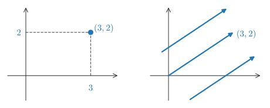
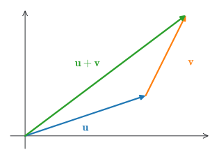
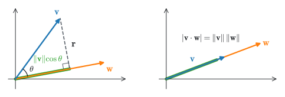
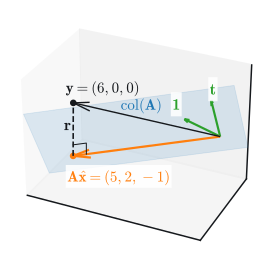
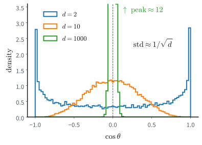
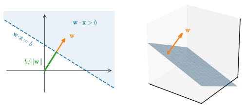

# Vectors, Angles, and Projections
:label:`sec_mdl-geometry-linear-algebraic-ops`

Throughout the Basics chapters, we represented every input as a vector: an
image became a list of pixel values, and a word became an embedding. At heart,
machine learning models perform three geometric operations on these vectors.
They *compare* them, as when we measure whether two embeddings are similar;
they *fit* them, as when we seek the combination of features that best matches
a set of targets; and they *separate* them, as when a classifier decides which
side of a boundary an input falls on. In the two-dimensional plane, each of
these operations is a familiar picture of lengths, angles, and shadows. Real
inputs, however, live in spaces of hundreds or thousands of dimensions that
nobody can draw. Do those geometric pictures still mean anything there?

Telling t-shirts from trousers offers a concrete test. Each $28 \times 28$
Fashion-MNIST image (:numref:`sec_fashion_mnist`) is a list of $784$ pixel
intensities, so it is a point in $\mathbb{R}^{784}$. Consider the simplest rule
imaginable: compute the average t-shirt and the average pair of trousers, and
assign each new image to whichever average lies closer. In the plane, "closer"
is something we can check by eye; in $\mathbb{R}^{784}$, it becomes a
calculation requiring a single dot product per image. On the $2{,}000$ test
images from these two classes, this rule is right about $92\%$ of the time. The
fact that such a simple rule works so well tells us that the two clouds of
points sit well apart, and that geometric notions like distance remain
meaningful even where we cannot see them.

What carries the geometry of the plane into arbitrary dimensions is the dot
product. Lengths are square roots of dot products, the shadow of one vector
onto another is a ratio of dot products, and the angle between two vectors is
defined directly from them. We develop this geometry in three stages. First, we
study a pair of vectors: projection onto a line, the angle between them, and
the Cauchy–Schwarz inequality, which :numref:`sec_linear-algebra` proved
algebraically and which we prove again here from a right triangle. Second, we
introduce the language of subspaces (span, independence, basis, and dimension)
that the rest of the chapter relies on, and we solve least squares as a
projection, with the QR factorization as our computational tool. Third, we take
these ideas to high-dimensional images, asking how similar unrelated vectors
are in $\mathbb{R}^d$ and reading a linear classifier as a hyperplane.

Three results stand out above the rest: the residual of a projection is
orthogonal to the line or subspace we project onto, which is what makes the
projection the closest point; Cauchy–Schwarz, which ensures that angles remain
well defined in any dimension; and the typical scale $1/\sqrt{d}$ of the cosine
between random directions in $\mathbb{R}^d$. Aside from loading the dataset,
all code in this section is plain NumPy and runs identically across frameworks.

```{.python .input #geometry-linear-algebraic-ops-imports}
#@tab mxnet
import math
import numpy as np
from mxnet import autograd, gluon, init, np as mnp, npx
from mxnet.gluon import nn
from d2l import mxnet as d2l
npx.set_np()
```

```{.python .input #geometry-linear-algebraic-ops-imports}
#@tab pytorch
import math
import numpy as np
import torch
from torch import nn
from torch.nn import functional as F
from d2l import torch as d2l
```

```{.python .input #geometry-linear-algebraic-ops-imports}
#@tab tensorflow
import math
import numpy as np
import tensorflow as tf
from d2l import tensorflow as d2l
```

```{.python .input #geometry-linear-algebraic-ops-imports}
#@tab jax
import math
import numpy as np
import jax
from jax import numpy as jnp
from flax import nnx
import optax
from d2l import jax as d2l
```

## Vectors and Their Geometry

### Points and Directions

We can picture a vector in two complementary ways. Viewed as a *point*,
$\mathbf{v} = (3, 2)$ marks the location $3$ units to the right of the *origin*
and $2$ units up. This viewpoint turns an entire dataset into a cloud of
points, turning a classification task such as separating t-shirts from trousers
into a geometric problem of separating two clouds. Viewed as a *direction* (or
displacement), the same vector instructs us to move $3$ steps right and $2$
steps up. Because a displacement can start anywhere, all of the parallel arrows
in :numref:`fig_mdl-la-vectors` represent the same vector.


:label:`fig_mdl-la-vectors`

The direction viewpoint makes vector addition immediate: follow the first
arrow, then follow the second from its tip, as shown in
:numref:`fig_mdl-la-vector-add`.


:label:`fig_mdl-la-vector-add`

Subtraction works the same way. Because
$\mathbf{u} = \mathbf{v} + (\mathbf{u}-\mathbf{v})$, the difference
$\mathbf{u}-\mathbf{v}$ is simply the displacement arrow that carries us from
the point $\mathbf{v}$ to the point $\mathbf{u}$.

Everything else in this section grows out of a single operation, the *dot
product* introduced in :numref:`sec_linear-algebra`. Given two vectors
$\mathbf{u}, \mathbf{v} \in \mathbb{R}^d$, it multiplies their corresponding
entries and sums the results:

$$\mathbf{u}^\top\mathbf{v} = \sum_{i=1}^d u_i v_i.$$
:eqlabel:`eq_mdl-dot_def`

Since the dot product is symmetric,
$\mathbf{u}^\top\mathbf{v} = \mathbf{v}^\top\mathbf{u}$, we often write it as
$\mathbf{u}\cdot\mathbf{v}$: using the dot when we picture two arrows and the
transpose when the product sits inside a matrix expression. For
$\mathbf{u} = (1, 3)$ and $\mathbf{v} = (2, 1)$, we have
$\mathbf{u}\cdot\mathbf{v} = 2 + 3 = 5$, and the squared length of
$\mathbf{u}$ is $\mathbf{u}\cdot\mathbf{u} = 1 + 9 = 10$.

### Projection onto a Line

How much of a vector $\mathbf{v}$ points along another vector $\mathbf{w}$?
Equivalently, which scalar multiple $t\mathbf{w}$ comes closest to
$\mathbf{v}$? This is the simplest fitting problem in linear algebra: we
approximate $\mathbf{v}$ using a single direction and seek the best
coefficient $t$.

Let us test this on our pair $\mathbf{v} = (1, 3)$ and $\mathbf{w} = (2, 1)$ by
trying a few values of $t$. At $t = 1$, the error
$\mathbf{v} - t\mathbf{w} = (-1, 2)$ has squared length $5$. At $t = 0.5$, the
error is $(0, 2.5)$ with squared length $6.25$; at $t = 1.5$, it is
$(-2, 1.5)$, again with squared length $6.25$. The minimum occurs at $t = 1$,
giving the closest point $(2, 1)$. We call the remaining error the *residual*.
Here the residual is $\mathbf{r} = (-1, 2)$, and notice its dot product with
$\mathbf{w}$: $\mathbf{r}\cdot\mathbf{w} = -2 + 2 = 0$. The shortest error
meets the line at a right angle. Even better, the squared lengths satisfy a
right-triangle relation: $\|\mathbf{v}\|^2 = 10$, the closest point has squared
length $5$, the residual has squared length $5$, and $10 = 5 + 5$.

This pattern holds in every dimension.

**Proposition (orthogonal projection).** *Let $\mathbf{w} \neq \mathbf{0}$.
The multiple of $\mathbf{w}$ closest to $\mathbf{v}$ is*

$$
\operatorname{proj}_{\mathbf{w}}\mathbf{v}
 = \frac{\mathbf{v}\cdot\mathbf{w}}{\mathbf{w}\cdot\mathbf{w}}\,\mathbf{w},
$$
:eqlabel:`eq_mdl-projection`

*and the residual $\mathbf{r} = \mathbf{v} - \operatorname{proj}_{\mathbf{w}}\mathbf{v}$
satisfies $\mathbf{r}\cdot\mathbf{w} = 0$.*

**Proof.** We minimize the squared error as a function of $t$. Expanding the
dot product of $\mathbf{v} - t\mathbf{w}$ with itself yields a quadratic in
$t$,

$$
q(t) = \|\mathbf{v} - t\mathbf{w}\|^2
 = \|\mathbf{w}\|^2\, t^2 - 2\,(\mathbf{v}\cdot\mathbf{w})\, t + \|\mathbf{v}\|^2.
$$

Because its leading coefficient $\|\mathbf{w}\|^2$ is positive, $q(t)$ has a
unique minimum where its derivative
$q'(t) = 2\|\mathbf{w}\|^2 t - 2\,\mathbf{v}\cdot\mathbf{w}$ vanishes, namely
at $t^\star = (\mathbf{v}\cdot\mathbf{w}) / (\mathbf{w}\cdot\mathbf{w})$.
Substituting $t^\star$ gives :eqref:`eq_mdl-projection`. Checking the residual,
we find
$\mathbf{r}\cdot\mathbf{w} = \mathbf{v}\cdot\mathbf{w} - t^\star\,\mathbf{w}\cdot\mathbf{w} = 0$.
$\blacksquare$

For our example, $q(t) = 5t^2 - 10t + 10$, which reaches its minimum value of
$5$ at $t^\star = 5/5 = 1$, confirming our trial values. We call
$\operatorname{proj}_{\mathbf{w}}\mathbf{v}$ the *projection*, or *shadow*, of
$\mathbf{v}$ onto $\mathbf{w}$. The projection captures the part of
$\mathbf{v}$ aligned with $\mathbf{w}$, while the residual captures the part at
right angles to it. Notice why we required $\mathbf{w} \neq \mathbf{0}$: the
zero vector defines no direction, and setting $\mathbf{w} = \mathbf{0}$ would
divide by zero.

That right angle is the reason squared lengths add cleanly. Two vectors
$\mathbf{a}$ and $\mathbf{b}$ are *orthogonal* whenever
$\mathbf{a}\cdot\mathbf{b} = 0$. Expanding the squared length of their sum
then gives *Pythagoras' theorem*,

$$
\|\mathbf{a} + \mathbf{b}\|^2
 = \|\mathbf{a}\|^2 + 2\,\mathbf{a}\cdot\mathbf{b} + \|\mathbf{b}\|^2
 = \|\mathbf{a}\|^2 + \|\mathbf{b}\|^2 .
$$
:eqlabel:`eq_mdl-pythagoras`

In any dimension, orthogonal components add in squared length with no cross
term. Applying this to the decomposition
$\mathbf{v} = \operatorname{proj}_{\mathbf{w}}\mathbf{v} + \mathbf{r}$ gives
$\|\mathbf{v}\|^2 = \|\operatorname{proj}_{\mathbf{w}}\mathbf{v}\|^2 + \|\mathbf{r}\|^2$,
which is $10 = 5 + 5$ in our example.

We will also need the length of the shadow together with a sign indicating
whether it points in the same direction as $\mathbf{w}$ or opposite to it.
Multiplying the coefficient $t^\star$ by $\|\mathbf{w}\|$ gives this *signed
length*:

$$
\frac{\mathbf{v}\cdot\mathbf{w}}{\|\mathbf{w}\|}.
$$
:eqlabel:`eq_mdl-signed-length`

In our example it equals $5/\sqrt{5} = \sqrt{5}$, the length of $(2, 1)$. This
signed length will reappear at the end of the section as the signed distance
from a point to a hyperplane. :numref:`fig_mdl-la-projection` illustrates the
entire geometry.


:label:`fig_mdl-la-projection`

### Cauchy–Schwarz and the Angle

In $784$ dimensions there is no protractor. Can "the angle between two images"
still mean anything? Surprisingly, the answer comes from a much simpler
question: can the shadow of a vector ever be longer than the vector itself?
Panel (a) of :numref:`fig_mdl-la-projection` says no, because the shadow is a
leg of a right triangle whose hypotenuse is $\mathbf{v}$. Pythagoras' theorem
turns that picture into a proof that works in every dimension.

**Proposition (Cauchy–Schwarz).** *For all vectors $\mathbf{v}, \mathbf{w}$,*

$$
|\mathbf{v}\cdot\mathbf{w}| \le \|\mathbf{v}\|\,\|\mathbf{w}\|,
$$
:eqlabel:`eq_mdl-cauchy-schwarz`

*with equality if and only if $\mathbf{v}$ and $\mathbf{w}$ are collinear (one
is a scalar multiple of the other).*

**Proof.** If $\mathbf{w} = \mathbf{0}$, both sides vanish and the vectors are
collinear. Otherwise, split $\mathbf{v}$ into its projection onto $\mathbf{w}$
and its orthogonal residual $\mathbf{r}$. By Pythagoras' theorem
:eqref:`eq_mdl-pythagoras`,

$$
\|\mathbf{v}\|^2
 = \|\operatorname{proj}_{\mathbf{w}}\mathbf{v}\|^2 + \|\mathbf{r}\|^2
 \ge \|\operatorname{proj}_{\mathbf{w}}\mathbf{v}\|^2
 = \frac{(\mathbf{v}\cdot\mathbf{w})^2}{\|\mathbf{w}\|^2}.
$$

Multiplying both sides by $\|\mathbf{w}\|^2$ and taking square roots yields the
inequality. Equality holds precisely when $\mathbf{r} = \mathbf{0}$, meaning
$\mathbf{v} = t^\star\mathbf{w}$. Conversely, if $\mathbf{v} = t\mathbf{w}$,
then
$|\mathbf{v}\cdot\mathbf{w}| = |t|\,\|\mathbf{w}\|^2 = \|\mathbf{v}\|\,\|\mathbf{w}\|$.
$\blacksquare$

In plain terms, a vector's shadow is never longer than the vector itself, and
matches its length only when nothing is left over in the residual. Where
:numref:`sec_linear-algebra` proved Cauchy–Schwarz algebraically, here it falls
straight out of panel (a) of :numref:`fig_mdl-la-projection`, with panel (b)
showing the equality case.

Now we can define angles in any dimension. In the plane, the law of cosines
gives $\mathbf{v}\cdot\mathbf{w} = \|\mathbf{v}\|\|\mathbf{w}\|\cos\theta$
(:numref:`sec_linear-algebra`). In $\mathbb{R}^d$ we have no physical triangle
to measure, so we turn this identity into a definition. For nonzero vectors
$\mathbf{v}, \mathbf{w} \in \mathbb{R}^d$, the *angle* between them is

$$\theta = \arccos\left(\frac{\mathbf{v}\cdot\mathbf{w}}{\|\mathbf{v}\|\|\mathbf{w}\|}\right) \in [0, \pi].$$
:eqlabel:`eq_mdl-angle_formula`

Because $\arccos$ is defined only on $[-1, 1]$, this formula makes sense only
if the ratio lies inside that interval, and Cauchy–Schwarz guarantees that it
always does. Thus the angle is well defined in every dimension, and the planar
dot-product formula now holds everywhere as an immediate consequence:

$$
\mathbf{v}\cdot\mathbf{w} = \|\mathbf{v}\|\|\mathbf{w}\|\cos\theta.
$$
:eqlabel:`eq_mdl-dot_geom`

The two equality cases of Cauchy–Schwarz correspond to $\theta = 0$ (vectors
pointing in the same direction) and $\theta = \pi$ (vectors pointing in
opposite directions).

A natural objection arises: does this algebraic definition agree with the angle
a protractor would actually measure? It does. Any two vectors lie inside a
single plane (or a line, if they are collinear), and inside that plane ordinary
geometry applies. Projection gives us rectangular coordinates for that plane:
set $\mathbf{q}_1 = \mathbf{w}/\|\mathbf{w}\|$ and, provided
$\mathbf{r} \neq \mathbf{0}$, set $\mathbf{q}_2 = \mathbf{r}/\|\mathbf{r}\|$.
These two vectors have unit length and are orthogonal, so dot products of their
combinations behave just like dot products in $\mathbb{R}^2$. In this
coordinate system, $\mathbf{w} = (\|\mathbf{w}\|, 0)$ and
$\mathbf{v} = (\mathbf{v}\cdot\mathbf{w}/\|\mathbf{w}\|,\ \|\mathbf{r}\|)$.
The angle a protractor measures between these two planar arrows has cosine
$(\mathbf{v}\cdot\mathbf{w}/\|\mathbf{w}\|)/\|\mathbf{v}\|$, matching
:eqref:`eq_mdl-angle_formula`. For our worked pair $\mathbf{v} = (1, 3)$ and
$\mathbf{w} = (2, 1)$, we get
$\cos\theta = 5/(\sqrt{10}\sqrt{5}) = 1/\sqrt{2}$, so $\theta = 45^\circ$.

For nonzero vectors, orthogonality means $\theta = \pi/2$. Defining
orthogonality via $\mathbf{v}\cdot\mathbf{w} = 0$ has the minor convenience of
including the zero vector as well: it is orthogonal to every vector, even
though no angle is defined for it.

Turning :eqref:`eq_mdl-angle_formula` into code takes only two lines, with one
practical safeguard worth noticing. Let us test it on our worked pair and on a
deliberately tricky collinear pair, $\mathbf{v} = (10^8 + 1, 3, 7)$ and
$3\mathbf{v}$, whose true cosine is $1$ and whose true angle is $0$. For the
collinear pair, we also print the raw cosine minus $1$ and the unclipped
`arccos`.

```{.python .input #geometry-linear-algebraic-ops-dot-products-and-angles}
def angle(v, w):
    cos = v @ w / (np.linalg.norm(v) * np.linalg.norm(w))
    return np.arccos(np.clip(cos, -1, 1))  # roundoff can push |cos| past 1

v = np.array([1e8 + 1, 3, 7])
cos = v @ (3 * v) / (np.linalg.norm(v) * np.linalg.norm(3 * v))
with np.errstate(invalid='ignore'):        # silence the warning for nan
    print(angle(np.array([1., 3]), np.array([2., 1])), cos - 1,
          np.arccos(cos), angle(v, 3 * v))
```

The first number is $0.785 = \pi/4$, matching the $45^\circ$ angle of our
worked pair. The remaining three values show why `np.clip` is essential. In
exact arithmetic, Cauchy–Schwarz keeps the ratio inside $[-1, 1]$. In
floating-point arithmetic, rounding can nudge it past the boundary by one unit
in the last place: here the collinear pair yields $1 + 2.2 \times 10^{-16}$,
causing `np.arccos` to return `nan`. Clipping to $[-1, 1]$ restores the right
answer, $0$.

Cauchy–Schwarz also shows that the length of a sum never exceeds the sum of
the lengths. Expanding $\|\mathbf{v} + \mathbf{w}\|^2$ and bounding the cross
term $2\,\mathbf{v}\cdot\mathbf{w}$ by $2\,\|\mathbf{v}\|\|\mathbf{w}\|$ via
:eqref:`eq_mdl-cauchy-schwarz` yields the *triangle inequality*,
$\|\mathbf{v} + \mathbf{w}\| \le \|\mathbf{v}\| + \|\mathbf{w}\|$, just as in
:numref:`sec_linear-algebra`.

## Subspaces and Least Squares

### Span, Bases, and Subspaces

Suppose we measure a quantity three times, at $t = 0, 1, 2$, and want to fit
the best straight line $C + Dt$ to our data. Stack the measurements into a
vector $\mathbf{y} \in \mathbb{R}^3$, collect the times in
$\mathbf{t} = (0, 1, 2)$, and let $\mathbf{1} = (1, 1, 1)$. Evaluating the line
at the three times produces the vector $C\mathbf{1} + D\mathbf{t}$. Finding the
best line therefore means finding the vector of the form
$C\mathbf{1} + D\mathbf{t}$ that lies closest to $\mathbf{y}$. As $C$ and $D$
vary over all real numbers, these candidate vectors sweep out a plane through
the origin in $\mathbb{R}^3$. Projection onto a line handled a single
direction; to handle planes and their higher-dimensional counterparts, we need
a small set of standard terms. Readers already comfortable with span, bases,
and subspaces can skip straight to the next subsection, where we finish the
line fit.

A weighted sum $a_1\mathbf{v}_1 + \cdots + a_k\mathbf{v}_k$ is called a *linear
combination* of $\mathbf{v}_1, \ldots, \mathbf{v}_k$. The collection of all
such combinations is their *span*,

$$
\operatorname{span}(\mathbf{v}_1, \ldots, \mathbf{v}_k)
 = \bigl\{ a_1\mathbf{v}_1 + \cdots + a_k\mathbf{v}_k
   : a_1, \ldots, a_k \in \mathbb{R} \bigr\}.
$$

In $\mathbb{R}^2$ (:numref:`fig_mdl-la-span`), the span of a single nonzero
vector is the line through the origin along its direction, while the span of
two vectors not lying on a common line through the origin is the entire plane.
In our line-fitting problem, the set of all candidate fits is
$\operatorname{span}(\mathbf{1}, \mathbf{t})$.


:label:`fig_mdl-la-span`

Notice that a span is always closed under addition and scalar multiplication:
adding two linear combinations, or scaling one by a real number, produces
another linear combination. Any nonempty set of vectors with these two closure
properties is called a *subspace*. Every subspace must contain the zero vector
$\mathbf{0}$ (just multiply any element by $0$), which means a line or plane
that misses the origin is not a subspace. In $\mathbb{R}^2$, the only subspaces
are the origin alone, the lines through the origin, and $\mathbb{R}^2$ itself;
in $\mathbb{R}^3$, planes through the origin join the list.

A list of vectors that spans a subspace can contain redundancies. Whenever one
vector already lies in the span of the others, we can drop it without shrinking
the span. A list of vectors is *linearly independent* when no such redundancy
exists, meaning that the only linear combination
$a_1\mathbf{v}_1 + \cdots + a_k\mathbf{v}_k$ equal to $\mathbf{0}$ is the
trivial one with every $a_i = 0$. Our vectors $\mathbf{1}$ and $\mathbf{t}$ are
linearly independent:
$a_1\mathbf{1} + a_2\mathbf{t} = (a_1,\, a_1 + a_2,\, a_1 + 2a_2)$ vanishes
only when $a_1 = a_2 = 0$.

A *basis* of a subspace is a linearly independent list of vectors that spans
it. The familiar vectors $\mathbf{e}_1 = (1, 0)$ and $\mathbf{e}_2 = (0, 1)$
form the *standard basis* of $\mathbb{R}^2$, though the slanted pair in
:numref:`fig_mdl-la-span` is an equally good basis. A fundamental theorem of
linear algebra (which we use without proof) states that every basis of a given
subspace has the same number of vectors; that shared count is the subspace's
*dimension*. This gives a crisp meaning to the $d$ in "$d$-dimensional space":
$\mathbb{R}^d$ has dimension $d$ because $\mathbf{e}_1, \ldots, \mathbf{e}_d$
is a basis. Likewise, our candidate line fits form a two-dimensional subspace
of $\mathbb{R}^3$.

Linear independence is what gives every point in a subspace unique coordinates.
If $\mathbf{v}_1, \ldots, \mathbf{v}_k$ is a basis of a subspace $S$, then
every $\mathbf{x} \in S$ can be written as
$\mathbf{x} = a_1\mathbf{v}_1 + \cdots + a_k\mathbf{v}_k$ in only one way. At
least one representation exists because the basis spans $S$. If two
representations existed with coefficients $a_i$ and $b_i$, subtracting them
would give $\sum_i (a_i - b_i)\,\mathbf{v}_i = \mathbf{0}$, and independence
forces $a_i = b_i$ for every $i$.

Once we fix a basis, a $k$-dimensional subspace behaves just like
$\mathbb{R}^k$: each point is uniquely named by its coefficient tuple
$(a_1, \ldots, a_k)$. For our line fit, those coordinates are simply the
intercept $C$ and the slope $D$.

### Projection onto a Subspace

Let us return to the line fit with concrete measurements
$\mathbf{y} = (6, 0, 0)$. We want the point $C\mathbf{1} + D\mathbf{t}$ in the
plane $\operatorname{span}(\mathbf{1}, \mathbf{t})$ closest to $\mathbf{y}$.
When we projected onto a single line, the closest point left a residual
orthogonal to that line. Projecting onto a plane should leave a residual
orthogonal to the entire plane, and therefore orthogonal to both $\mathbf{1}$
and $\mathbf{t}$ (a fact we prove in a moment). Setting both dot products to
zero gives two linear equations in two unknowns:

$$
\begin{aligned}
\mathbf{1}\cdot(\mathbf{y} - C\mathbf{1} - D\mathbf{t}) &= 6 - 3C - 3D = 0,\\
\mathbf{t}\cdot(\mathbf{y} - C\mathbf{1} - D\mathbf{t}) &= 0 - 3C - 5D = 0.
\end{aligned}
$$

Subtracting the first equation from the second yields $2D = -6$, so $D = -3$
and $C = 5$. The best-fitting line is $5 - 3t$. Its predicted values at
$t = 0, 1, 2$ are $(5, 2, -1)$, leaving the residual
$\mathbf{r} = \mathbf{y} - (5, 2, -1) = (1, -2, 1)$. Both orthogonality checks
hold: $\mathbf{r}\cdot\mathbf{1} = 1 - 2 + 1 = 0$ and
$\mathbf{r}\cdot\mathbf{t} = 0 - 2 + 2 = 0$. Pythagoras' theorem again splits
the squared length of $\mathbf{y}$ cleanly: $36 = 30 + 6$. By comparison,
projecting $\mathbf{y}$ onto $\mathbf{1}$ alone yields the constant fit
$\mathbf{y}\cdot\mathbf{1}/\mathbf{1}\cdot\mathbf{1} = 2$ (the sample mean),
whose residual $(4, -2, -2)$ has squared length $24$. Allowing a slope along
$\mathbf{t}$ reduces the squared error from $24$ down to $6$.
:numref:`fig_mdl-la-least-squares` shows this projection in $\mathbb{R}^3$.


:label:`fig_mdl-la-least-squares`

To state and prove the general result cleanly, it helps to choose a basis whose
vectors are mutually orthogonal and have unit length. A basis
$\mathbf{q}_1, \ldots, \mathbf{q}_k$ of a subspace $S \subseteq \mathbb{R}^n$
is *orthonormal* when every vector satisfies $\|\mathbf{q}_i\| = 1$ and
distinct vectors satisfy $\mathbf{q}_i\cdot\mathbf{q}_j = 0$. Every finite
spanning list admits such a basis: :numref:`subsec_mdl-gram-schmidt` constructs
one using nothing more than projection onto a line. If we place these basis
vectors as the columns of an $n \times k$ matrix $\mathbf{Q}$, orthonormality
takes the compact form $\mathbf{Q}^\top\mathbf{Q} = \mathbf{I}_k$, because
entry $(i, j)$ of $\mathbf{Q}^\top\mathbf{Q}$ is
$\mathbf{q}_i\cdot\mathbf{q}_j$. Throughout this chapter, we reserve the letter
$\mathbf{Q}$ for a matrix with orthonormal columns. The following proposition
is the workhorse result that the rest of the chapter draws on most.

**Proposition (projection onto a subspace).** *Let $\mathbf{Q}$ have
orthonormal columns spanning $S$, and set $\mathbf{P} =
\mathbf{Q}\mathbf{Q}^\top$. Then for every $\mathbf{x} \in \mathbb{R}^n$:*
(i) *$\mathbf{P}\mathbf{x} \in S$, and the residual $\mathbf{x} -
\mathbf{P}\mathbf{x}$ is orthogonal to every vector of $S$;*
(ii) *$\mathbf{P}\mathbf{x}$ is the unique closest point of $S$ to
$\mathbf{x}$;*
(iii) *$\mathbf{P}^2 = \mathbf{P}$ and $\mathbf{P}^\top = \mathbf{P}$.*

**Proof.** For (i), $\mathbf{P}\mathbf{x} = \mathbf{Q}(\mathbf{Q}^\top\mathbf{x})$
is a linear combination of the columns of $\mathbf{Q}$, so it lies in $S$.
Multiplying the residual on the left by $\mathbf{Q}^\top$ gives

$$
\mathbf{Q}^\top(\mathbf{x} - \mathbf{P}\mathbf{x})
 = \mathbf{Q}^\top\mathbf{x} - (\mathbf{Q}^\top\mathbf{Q})\,\mathbf{Q}^\top\mathbf{x}
 = \mathbf{0},
$$

so the residual is orthogonal to every column $\mathbf{q}_i$, and therefore to
every linear combination of them. For (ii), take any $\mathbf{s} \in S$ and
write
$\mathbf{x} - \mathbf{s} = (\mathbf{x} - \mathbf{P}\mathbf{x}) + (\mathbf{P}\mathbf{x} - \mathbf{s})$.
Since $\mathbf{P}\mathbf{x} - \mathbf{s}$ lies in $S$ while
$\mathbf{x} - \mathbf{P}\mathbf{x}$ is orthogonal to $S$, Pythagoras' theorem
:eqref:`eq_mdl-pythagoras` gives

$$
\|\mathbf{x} - \mathbf{s}\|^2
 = \|\mathbf{x} - \mathbf{P}\mathbf{x}\|^2 + \|\mathbf{P}\mathbf{x} - \mathbf{s}\|^2
 \ge \|\mathbf{x} - \mathbf{P}\mathbf{x}\|^2,
$$

with equality only when $\mathbf{s} = \mathbf{P}\mathbf{x}$. For (iii),
$\mathbf{P}^2 = \mathbf{Q}(\mathbf{Q}^\top\mathbf{Q})\mathbf{Q}^\top =
\mathbf{Q}\mathbf{Q}^\top = \mathbf{P}$, and
$\mathbf{P}^\top = (\mathbf{Q}^\top)^\top\mathbf{Q}^\top = \mathbf{P}$.
$\blacksquare$

Conversely, the orthogonality condition in (i) uniquely identifies the closest
point. If some $\mathbf{s} \in S$ leaves a residual $\mathbf{x} - \mathbf{s}$
orthogonal to $S$, then the difference
$\mathbf{P}\mathbf{x} - \mathbf{s} = (\mathbf{x} - \mathbf{s}) - (\mathbf{x} - \mathbf{P}\mathbf{x})$
both lies in $S$ and is orthogonal to $S$, hence orthogonal to itself, which
forces $\mathbf{s} = \mathbf{P}\mathbf{x}$. That is why solving the two
orthogonality equations in our line fit was guaranteed to produce the closest
point.

Each half of property (iii) has a clear geometric meaning. The identity
$\mathbf{P}^2 = \mathbf{P}$ says that projecting a second time changes nothing,
since the first projection already landed in $S$. Symmetry,
$\mathbf{P}^\top = \mathbf{P}$, is what makes the projection *orthogonal*. A
matrix satisfying $\mathbf{P}^2 = \mathbf{P}$ without symmetry is an *oblique*
projector: it maps vectors into its column space along a slanted direction and
generally misses the closest point
(:exref:`ex_mdl-geometry-linear-algebraic-ops-projectors`). In the
one-dimensional case $k = 1$, taking the single unit column
$\mathbf{q} = \mathbf{w}/\|\mathbf{w}\|$ reduces
$\mathbf{P} = \mathbf{q}\mathbf{q}^\top$ directly to our earlier line
projection :eqref:`eq_mdl-projection`.

Our line fit is one example of *least squares*, the optimization problem at the
heart of linear regression. Let $\mathbf{A}$ be a data matrix whose rows are
examples and whose columns are features, and let $\mathbf{y}$ be the vector of
targets. Least squares seeks the coefficient vector $\mathbf{x}$ that minimizes
the squared error:

$$
\min_{\mathbf{x}} \|\mathbf{A}\mathbf{x} - \mathbf{y}\|^2 .
$$
:eqlabel:`eq_mdl-least-squares`

As $\mathbf{x}$ varies over all coefficient vectors, $\mathbf{A}\mathbf{x}$
traces out the span of the columns of $\mathbf{A}$, known as its *column space*
$\operatorname{col}(\mathbf{A})$. Least squares therefore asks for the point in
$\operatorname{col}(\mathbf{A})$ closest to $\mathbf{y}$. By our projection
proposition, that point is the one whose residual $\mathbf{y} - \mathbf{A}\hat{\mathbf{x}}$
is orthogonal to every column of $\mathbf{A}$. Writing this orthogonality
condition as $\mathbf{A}^\top(\mathbf{y} - \mathbf{A}\hat{\mathbf{x}}) = \mathbf{0}$
produces the *normal equations*,

$$
\mathbf{A}^\top\mathbf{A}\,\hat{\mathbf{x}} = \mathbf{A}^\top\mathbf{y}.
$$
:eqlabel:`eq_mdl-normal-equations`

These are simply the matrix form of the $2 \times 2$ system we solved by hand:
for the line fit, $\mathbf{A} = [\mathbf{1}\ \mathbf{t}]$ gives
$\mathbf{A}^\top\mathbf{A} = \left(\begin{smallmatrix}3&3\\3&5\end{smallmatrix}\right)$
and $\mathbf{A}^\top\mathbf{y} = (6, 0)$. Whenever the columns of $\mathbf{A}$
are linearly independent, $\mathbf{A}^\top\mathbf{A}$ is invertible
(:exref:`ex_mdl-geometry-linear-algebraic-ops-least-squares-line`) and the
optimal coefficients $\hat{\mathbf{x}}$ are unique. Even when the columns are
dependent, the fitted vector $\mathbf{A}\hat{\mathbf{x}}$ remains unique
because it is still the closest point in $\operatorname{col}(\mathbf{A})$,
though more than one coefficient vector $\hat{\mathbf{x}}$ can produce it.

In code, we therefore have two ways to compute the fit $5 - 3t$: solve the
normal equations directly, or project using $\mathbf{P} = \mathbf{Q}\mathbf{Q}^\top$.
To obtain $\mathbf{Q}$, we call `np.linalg.qr`, which builds an orthonormal
basis for the column space of a matrix with independent columns (we will
construct one by hand in the next subsection).

```{.python .input #mdl-geometry-linear-algebraic-ops-projection-onto-a-subspace}
A = np.array([[1., 0], [1, 1], [1, 2]])     # columns 1 and t
y = np.array([6., 0, 0])
x_hat = np.linalg.solve(A.T @ A, A.T @ y)   # normal equations
Q, R = np.linalg.qr(A)                      # orthonormal basis of col(A)
P = Q @ Q.T
r = y - P @ y
print(x_hat.round(6), (P @ y).round(6), r.round(6))
print(np.linalg.norm(P @ P - P), np.linalg.norm(Q.T @ r))
```

Both routes recover our hand calculation: the coefficients $C = 5$ and
$D = -3$, the projected values $(5, 2, -1)$, and the residual $(1, -2, 1)$. The
two check norms on the second line vanish up to floating-point roundoff,
confirming $\mathbf{P}^2 = \mathbf{P}$ and $\mathbf{Q}^\top\mathbf{r} = \mathbf{0}$.

On a tiny, well-behaved problem like this, the two methods agree completely.
When the columns of $\mathbf{A}$ are nearly dependent, however, forming
$\mathbf{A}^\top\mathbf{A}$ squares the problem's condition number, its
sensitivity to rounding errors (:numref:`subsec_mdl-condition-number`). For
that reason, production least-squares solvers avoid the normal equations and
work with an orthonormal basis of the column space instead.

### Gram–Schmidt and QR
:label:`subsec_mdl-gram-schmidt`

How do we actually build an orthonormal basis? By repeated projection. Given
two linearly independent vectors, keep the direction of the first and subtract
from the second its shadow along the first. By our projection proposition,
whatever remains is orthogonal to the first vector.

Let us carry this out on $\mathbf{a}_1 = (3, 4)$ and $\mathbf{a}_2 = (1, 0)$.
Normalizing $\mathbf{a}_1$ gives $\mathbf{q}_1 = \mathbf{a}_1/5 = (0.6, 0.8)$.
The shadow of $\mathbf{a}_2$ onto $\mathbf{q}_1$ is
$(\mathbf{q}_1\cdot\mathbf{a}_2)\,\mathbf{q}_1 = 0.6\,(0.6, 0.8) = (0.36, 0.48)$.
Subtracting it leaves $(1, 0) - (0.36, 0.48) = (0.64, -0.48)$, a vector of
length $0.8$ that is indeed orthogonal to $\mathbf{q}_1$
($0.384 - 0.384 = 0$). Normalizing this remainder gives
$\mathbf{q}_2 = (0.8, -0.6)$. Reading the steps in reverse writes each original
vector in terms of the new orthonormal basis:

$$
\mathbf{a}_1 = 5\,\mathbf{q}_1,
\qquad
\mathbf{a}_2 = 0.6\,\mathbf{q}_1 + 0.8\,\mathbf{q}_2 .
$$

In matrix notation, this is $\mathbf{A} = \mathbf{Q}\mathbf{R}$, where
$\mathbf{A} = [\mathbf{a}_1\ \mathbf{a}_2]$,
$\mathbf{Q} = [\mathbf{q}_1\ \mathbf{q}_2]$, and
$\mathbf{R} = \left(\begin{smallmatrix}5&0.6\\0&0.8\end{smallmatrix}\right)$
collects the dot products $\mathbf{q}_i\cdot\mathbf{a}_j$. Notice why
$\mathbf{R}$ is upper triangular: by construction, each $\mathbf{a}_j$ depends
only on $\mathbf{q}_1, \ldots, \mathbf{q}_j$.

Extending this idea to any linearly independent list
$\mathbf{a}_1, \ldots, \mathbf{a}_k$ gives the *Gram–Schmidt process*. We
process the vectors in order: for each $\mathbf{a}_j$, subtract its projections
:eqref:`eq_mdl-projection` onto the unit vectors $\mathbf{q}_1, \ldots, \mathbf{q}_{j-1}$
already constructed, and normalize the remainder to obtain $\mathbf{q}_j$. The
result is both an orthonormal basis for
$\operatorname{span}(\mathbf{a}_1, \ldots, \mathbf{a}_k)$ and the *QR
factorization* $\mathbf{A} = \mathbf{Q}\mathbf{R}$, where $\mathbf{Q}$ has
orthonormal columns and $\mathbf{R}$ is upper triangular with positive diagonal
entries. Linear independence is essential for the factorization, because a
vector that already lies in the span of its predecessors leaves a zero
remainder that cannot be normalized. If we only want an orthonormal basis for
the span, we can simply skip any vector with a zero remainder and continue.
Every finite spanning list therefore yields an orthonormal basis, justifying
the existence claim we relied on earlier.

Numerical libraries compute the QR factorization using a different algorithm
based on reflections, which behaves much better in floating-point arithmetic.
Its output matches Gram–Schmidt only up to signs: negating a column of
$\mathbf{Q}$ together with the corresponding row of $\mathbf{R}$ leaves the
product $\mathbf{Q}\mathbf{R}$ untouched. When $\mathbf{A}$ has independent
columns, those sign flips are the only ambiguity. Let us compare our two-step
Gram–Schmidt calculation against `np.linalg.qr` and verify that they produce
the same columns up to sign.

```{.python .input #mdl-geometry-linear-algebraic-ops-gram-schmidt-and-qr}
a1, a2 = np.array([3., 4]), np.array([1., 0])
q1 = a1 / np.linalg.norm(a1)
v = a2 - (q1 @ a2) * q1                     # remove the shadow on q1
q2 = v / np.linalg.norm(v)
Q_qr, R_qr = np.linalg.qr(np.stack([a1, a2], axis=1))
print(np.stack([q1, q2], axis=1).round(6))
print(Q_qr.round(6))
print(R_qr.round(6))
```

Gram–Schmidt produces $(0.6, 0.8)$ and $(0.8, -0.6)$, while `np.linalg.qr`
returns the negatives of both columns along with diagonal entries $-5$ and
$-0.8$ in $\mathbf{R}$: the same basis and, up to sign, the same dot products
$5$, $0.6$, and $0.8$ we found by hand. In floating point, the order in which
we perform the subtractions also matters. On nearly dependent columns, the
formulation above, known as *classical* Gram–Schmidt, gradually loses
orthogonality (:exref:`ex_mdl-geometry-linear-algebraic-ops-gram-schmidt`).

## Similarity in High Dimensions

Up to this point, every result came with a picture in $\mathbb{R}^2$ or
$\mathbb{R}^3$. Now we move to spaces where no picture is possible, asking how
similar two real images are and what similarity we should expect between
unrelated vectors by pure chance. We load the Fashion-MNIST dataset
(:numref:`sec_fashion_mnist`) through `d2l.FashionMNIST` as NumPy arrays,
flattening each image into a $784$-pixel row scaled to $[0, 1]$.

```{.python .input #geometry-linear-algebraic-ops-hyperplanes-1}
#@tab mxnet
data = d2l.FashionMNIST()
X_train, y_train = (a.asnumpy() for a in data.read(train=True))
X_test, y_test = (a.asnumpy() for a in data.read(train=False))
X_train = X_train.reshape(-1, 784) / 255
X_test = X_test.reshape(-1, 784) / 255
X_train.shape, X_test.shape
```

```{.python .input #geometry-linear-algebraic-ops-hyperplanes-1}
#@tab pytorch
data = d2l.FashionMNIST()
X_train = data.train.data.numpy().reshape(-1, 784) / 255
y_train = data.train.targets.numpy()
X_test = data.val.data.numpy().reshape(-1, 784) / 255
y_test = data.val.targets.numpy()
X_train.shape, X_test.shape
```

```{.python .input #geometry-linear-algebraic-ops-hyperplanes-1}
#@tab tensorflow, jax
data = d2l.FashionMNIST()
(X_train, y_train), (X_test, y_test) = data.train, data.val
X_train = X_train.reshape(-1, 784) / 255
X_test = X_test.reshape(-1, 784) / 255
X_train.shape, X_test.shape
```

Each of these $70{,}000$ images is now a point in $\mathbb{R}^{784}$.

### Cosine Similarity

The ratio inside :eqref:`eq_mdl-angle_formula` is the *cosine similarity*
(:numref:`sec_linear-algebra`),

$$
\cos\theta = \frac{\mathbf{v}\cdot\mathbf{w}}{\|\mathbf{v}\|\,\|\mathbf{w}\|}
 \;\in\; [-1, 1].
$$
:eqlabel:`eq_mdl-cosine-sim`

Cosine similarity compares directions while ignoring lengths: an image and a
copy of it dimmed to $10\%$ brightness sit far apart in Euclidean distance, yet
their cosine similarity is still $1$.

That scale invariance makes cosine similarity the standard metric for
nearest-neighbor retrieval over embeddings and for contrastive learning
objectives such as SimCLR :cite:`Chen.Kornblith.Norouzi.ea.2020`, which align
the directions of embeddings produced from two views of the same image.
Attention layers make a different choice: they use the *unnormalized* dot
product scaled by $1/\sqrt{d}$ (for reasons we derive shortly), so vector
lengths remain informative there.

### Near-Orthogonality of Random Directions

Suppose we pick two unrelated images or two unrelated embeddings. What cosine
similarity should we expect between them purely by chance? Without a baseline,
we cannot judge whether an observed cosine is meaningfully large. The cleanest
baseline is a direction chosen uniformly at random on the unit sphere, with no
preference for any region of space.

**Proposition (near-orthogonality).** *Fix a unit vector $\mathbf{u} \in
\mathbb{R}^d$ and let $\mathbf{v}$ be drawn uniformly from the unit sphere in
$\mathbb{R}^d$. Then $\cos\theta = \mathbf{u}\cdot\mathbf{v}$ satisfies*

$$
\mathbb{E}[\cos\theta] = 0,
\qquad
\textrm{Var}(\cos\theta) = \frac{1}{d},
\qquad
\Pr\bigl(|\cos\theta| \ge \varepsilon\bigr) \le \frac{1}{d\,\varepsilon^2}
\quad \textrm{for every } \varepsilon > 0.
$$

**Proof.** Because the uniform distribution on the sphere is invariant under
rotations, we may rotate coordinates so that $\mathbf{u} = \mathbf{e}_1$; then
$\cos\theta = v_1$. The distribution is also unchanged by sign reversal
$\mathbf{v} \mapsto -\mathbf{v}$, so $\mathbb{E}[v_1] = 0$. By symmetry, every
coordinate has the same second moment $\mathbb{E}[v_i^2]$. Since
$\sum_{i=1}^d v_i^2 = \|\mathbf{v}\|^2 = 1$, taking expectations yields
$d\,\mathbb{E}[v_1^2] = \mathbb{E}\bigl[\sum_{i=1}^d v_i^2\bigr] = 1$, and
therefore $\textrm{Var}(\cos\theta) = \mathbb{E}[v_1^2] = 1/d$. The tail bound
follows immediately from Chebyshev's inequality,
$\Pr(|X - \mathbb{E}[X]| \ge \varepsilon) \le \textrm{Var}(X)/\varepsilon^2$
(:numref:`sec_prob`).
$\blacksquare$

The typical cosine between two random directions is therefore of order
$1/\sqrt{d}$. In $d = 784$, the standard deviation is $1/28 \approx 0.036$,
meaning two random directions in image space are almost always within a few
degrees of orthogonal. Chebyshev's inequality bounds the probability of seeing
$|\cos\theta| \ge 0.1$ by $1/(784 \cdot 0.01) \approx 0.13$, whereas the true
probability is under $0.01$. Chebyshev is loose because it uses only the
variance; sharper exponential bounds appear in
:numref:`sec_mdl-concentration-generalization`.

Low dimensions look completely different (:numref:`fig_mdl-la-cosine-highd`).
In the plane ($d = 2$), the angle between a fixed direction and a random one is
uniform on $[0, \pi]$, so landing within $0.1$ radians of orthogonal is just as
likely as landing within $0.1$ radians of collinear (about $6\%$ each). Yet the
*cosine* piles up near $\pm 1$, because $\cos\theta$ flattens out near
$\theta = 0$ and $\theta = \pi$: the probability that $|\cos\theta| > 0.9$ is
about $0.29$, compared with only $0.06$ for $|\cos\theta| < 0.1$. In $d = 3$,
the cosine is uniform on $[-1, 1]$, a classical result known to
Archimedes. Starting at $d = 4$, the density peaks at $0$; by $d = 10$ it forms
a bell of width $1/\sqrt{10} \approx 0.32$, and by $d = 1000$ it has narrowed
into a sharp spike of width roughly $0.03$
(:exref:`ex_mdl-geometry-linear-algebraic-ops-low-dim-cosine` works out the
exact densities).


:label:`fig_mdl-la-cosine-highd`

Let us check this isotropic baseline in $d = 784$ by simulation. Because a
standard Gaussian vector's distribution is rotationally invariant, normalizing
it produces a uniformly random unit vector. In the same cell, we also estimate
a variance we will need for attention in a moment: the variance of
$\mathbf{q}\cdot\mathbf{k}$ for independent standard normal vectors in $64$
dimensions.

```{.python .input #mdl-geometry-linear-algebraic-ops-near-orthogonality-of-random-directions-1}
rng = np.random.default_rng()
d = 784
U = rng.standard_normal((10000, d))
U /= np.linalg.norm(U, axis=1, keepdims=True)
V = rng.standard_normal((10000, d))
V /= np.linalg.norm(V, axis=1, keepdims=True)
q, k = rng.standard_normal((10000, 64)), rng.standard_normal((10000, 64))
np.std((U * V).sum(axis=1)), 1 / np.sqrt(d), np.var((q * k).sum(axis=1))
```

The empirical standard deviation matches $1/\sqrt{784} \approx 0.036$, and the
variance of the unnormalized dot product is close to $64$, the dimension.

Real data, however, rarely look isotropic. Do two unrelated Fashion-MNIST
images behave like nearly orthogonal vectors? Let us sample $5{,}000$ random
pairs of test images and measure their cosines, first on the raw pixels and
then after subtracting the mean training image.

```{.python .input #mdl-geometry-linear-algebraic-ops-near-orthogonality-of-random-directions-2}
def cosines(A, B):
    """Cosine similarity between corresponding rows of A and B."""
    return (A * B).sum(axis=1) / (np.linalg.norm(A, axis=1)
                                  * np.linalg.norm(B, axis=1))

i, j = rng.integers(0, len(X_test), (2, 5000))
mean_image = X_train.mean(axis=0)
raw = cosines(X_test[i], X_test[j])
centered = cosines(X_test[i] - mean_image, X_test[j] - mean_image)
raw.mean(), raw.std(), centered.mean(), centered.std()
```

Not even close. Raw images have an average cosine around $0.6$ with a standard
deviation of roughly $0.18$, nowhere near $0 \pm 0.036$. The reason is simple:
pixel intensities are non-negative, so every image lives in the same positive
orthant of $\mathbb{R}^{784}$, making negative dot products impossible.
Subtracting the mean image centers the cosines at $0$, yet their standard
deviation, about $0.34$, is still nearly ten times the isotropic value. By our
proposition, a spread of $0.34$ corresponds to random directions in only eight
or nine dimensions ($1/0.34^2$ lies between $8$ and $9$). Judged by their
cosines, the centered images behave like a cloud living in fewer than ten
dimensions rather than $784$, an early glimpse of the low-rank structure we
will study in :numref:`sec_mdl-svd-low-rank`. Practically, this means a cosine
counts as large only when it stands out above the spread of unrelated pairs
from the *same* dataset; training an embedding model is what pushes related
pairs above that background.

### The Scale of Attention Scores

Dot-product attention (:numref:`sec_attention-scoring-functions`) scores a
query $\mathbf{q} \in \mathbb{R}^d$ against keys
$\mathbf{k}_1, \mathbf{k}_2, \ldots$ using
$\mathbf{q}\cdot\mathbf{k}_j/\sqrt{d}$ and passes those scores through a
softmax :cite:`Vaswani.Shazeer.Parmar.ea.2017`. A brief variance calculation
explains where the $\sqrt{d}$ comes from. Suppose all $2d$ entries of
$\mathbf{q}$ and $\mathbf{k}$ are mutually independent with mean $0$ and
variance $1$. Each product $q_i k_i$ then has mean $0$ and variance
$\mathbb{E}[q_i^2]\,\mathbb{E}[k_i^2] = 1$, and distinct terms are uncorrelated
because
$\mathbb{E}[(q_i k_i)(q_j k_j)] = \mathbb{E}[q_i]\,\mathbb{E}[k_i]\,\mathbb{E}[q_j]\,\mathbb{E}[k_j] = 0$
for $i \neq j$. The variances of the $d$ terms therefore add:

$$
\textrm{Var}(\mathbf{q}\cdot\mathbf{k})
 = \sum_{i=1}^d \textrm{Var}(q_i k_i) = d.
$$

Thus the raw dot products have standard deviation $\sqrt{d}$, which grows with
the head dimension; dividing by $\sqrt{d}$ restores unit variance. Without that
scaling, the softmax saturates into near-one-hot weights. For $d = 64$, raw
scores have standard deviation $8$, and two scores separated by $8$ receive
softmax weights $0.9997$ and $0.0003$; dividing by $\sqrt{d} = 8$ brings the
weights back to a healthy $0.73$ and $0.27$. Geometry gives the exact same
scaling: each vector has length roughly $\sqrt{d}$, while the cosine between
unrelated directions is roughly $1/\sqrt{d}$, so their dot product has typical
magnitude $\sqrt{d}\cdot\sqrt{d}\cdot (1/\sqrt{d}) = \sqrt{d}$.

Near-orthogonality does not, however, make unrelated keys harmless when there
are many of them. Although any single unrelated cosine has scale $1/\sqrt{d}$,
the *largest* cosine among $n$ independent keys grows, to leading order, like
$\sqrt{2\ln n / d}$. In a large retrieval index, that worst-case background
match is several times larger than $1/\sqrt{d}$, so a relevant key
must clear a much higher bar, which is what training arranges
(:exref:`ex_mdl-geometry-linear-algebraic-ops-random-cosines` puts concrete
numbers on this effect).

## Hyperplanes and Decision Boundaries

A linear classifier asks two geometric questions about an input $\mathbf{x}$:
which side of a decision boundary does it fall on, and how far is it from that
boundary? Throughout this section, we write the boundary as
$\mathbf{w}\cdot\mathbf{x} + b = 0$.

### Hyperplanes and Signed Distance

In the plane, this equation defines a straight line, and a quick example shows
the roles of $\mathbf{w}$ and $b$. Take $\mathbf{w} = (2, 1)$ and $b = -1$. The
points satisfying $2x + y - 1 = 0$ form the line $y = 1 - 2x$. Every point
$\mathbf{x}$ on this line satisfies $\mathbf{w}\cdot\mathbf{x} = -b$, so its
shadow onto $\mathbf{w}$ has the same signed length
:eqref:`eq_mdl-signed-length`:

$$
\frac{\mathbf{w}\cdot\mathbf{x}}{\|\mathbf{w}\|} = \frac{-b}{\|\mathbf{w}\|} = \frac{1}{\sqrt{5}}.
$$

Geometrically, the line runs perpendicular to $\mathbf{w}$ and crosses it at
signed position $-b/\|\mathbf{w}\|$, at distance
$|b|/\|\mathbf{w}\| = 1/\sqrt{5} \approx 0.45$ from the origin.

Nothing changes in higher dimensions. A *hyperplane* in $\mathbb{R}^d$ is a set
$\{\mathbf{x} : \mathbf{w}\cdot\mathbf{x} + b = 0\}$ with
$\mathbf{w} \neq \mathbf{0}$; we call $\mathbf{w}$ its *normal* vector and $b$
its *offset*. It is simply a shifted copy of the subspace
$\mathbf{w}\cdot\mathbf{x} = 0$, which has dimension $d - 1$
(:numref:`subsec_mdl-rank`): a line in $\mathbb{R}^2$, a plane in
$\mathbb{R}^3$, and a $783$-dimensional flat sheet inside image space. The
hyperplane partitions $\mathbb{R}^d$ into two *half-spaces*,
$\mathbf{w}\cdot\mathbf{x} + b > 0$ and $\mathbf{w}\cdot\mathbf{x} + b < 0$.
Adjusting $b$ translates the hyperplane parallel to itself along $\mathbf{w}$
without tilting it.

How far is an arbitrary point $\mathbf{x}$ from the hyperplane? Pick any point
$\mathbf{x}_0$ lying on the hyperplane, so $\mathbf{w}\cdot\mathbf{x}_0 = -b$.
The distance from $\mathbf{x}$ to the hyperplane is the signed length of the
shadow of the displacement $\mathbf{x} - \mathbf{x}_0$ onto the normal
$\mathbf{w}$, giving the *signed distance*

$$
\frac{\mathbf{w}\cdot(\mathbf{x} - \mathbf{x}_0)}{\|\mathbf{w}\|}
 = \frac{\mathbf{w}\cdot\mathbf{x} + b}{\|\mathbf{w}\|}.
$$
:eqlabel:`eq_mdl-signed-distance`

Notice that $\mathbf{x}_0$ drops out completely: the signed distance depends
only on $\mathbf{x}$, $\mathbf{w}$, and $b$. It is positive on the side
$\mathbf{w}$ points toward, negative on the opposite side, and zero on the
hyperplane itself. In our planar example, the origin sits at signed distance
$-1/\sqrt{5}$, while the point $(1, 1)$ has score
$\mathbf{w}\cdot\mathbf{x} + b = 2$, placing it at signed distance
$+2/\sqrt{5} \approx 0.89$ on the positive side; its closest point on the line
is $(1, 1) - (2/5)(2, 1) = (0.2, 0.6)$. The point $(0, 1)$ scores $0$ and lies
directly on the line (:numref:`fig_mdl-la-hyperplane`).


:label:`fig_mdl-la-hyperplane`

For a labeled example $(\mathbf{x}, y)$ with $y \in \{-1, +1\}$, we also want
to know whether it falls on the *correct* side. Multiplying the signed distance
by the label defines the *margin*,
$y\,(\mathbf{w}\cdot\mathbf{x} + b)/\|\mathbf{w}\|$, which is positive when the
classification is right and grows larger the deeper the point sits inside its
own half-space. Rescaling $(\mathbf{w}, b) \to (c\mathbf{w}, cb)$ for any
$c > 0$ leaves both the hyperplane and the margin unchanged, while multiplying
the raw score $\mathbf{w}\cdot\mathbf{x} + b$ by $c$. Any learning objective
that maximizes the raw score must therefore constrain the scale of $\mathbf{w}$
(:exref:`ex_mdl-geometry-linear-algebraic-ops-signed-distance`).

### The Nearest-Mean Classifier
:label:`subsec_mdl-nearest-mean`

Which hyperplane should we pick to separate two classes? The simplest rule
requires no iterative training at all: assign $\mathbf{x}$ to the class whose
mean lies closer. Remarkably, this rule is itself a single hyperplane. Let
$\bar{\mathbf{x}}_0$ and $\bar{\mathbf{x}}_1$ denote the two class means.
Expanding both squared distances, the quadratic term $\|\mathbf{x}\|^2$ cancels
on both sides:

$$
\begin{aligned}
\|\mathbf{x} - \bar{\mathbf{x}}_1\|^2 < \|\mathbf{x} - \bar{\mathbf{x}}_0\|^2
&\iff -2\,\mathbf{x}\cdot\bar{\mathbf{x}}_1 + \|\bar{\mathbf{x}}_1\|^2
      < -2\,\mathbf{x}\cdot\bar{\mathbf{x}}_0 + \|\bar{\mathbf{x}}_0\|^2 \\
&\iff (\bar{\mathbf{x}}_1 - \bar{\mathbf{x}}_0)\cdot\mathbf{x}
      - \tfrac12\bigl(\|\bar{\mathbf{x}}_1\|^2 - \|\bar{\mathbf{x}}_0\|^2\bigr) > 0.
\end{aligned}
$$

Using the identity
$\|\mathbf{a}\|^2 - \|\mathbf{c}\|^2 = (\mathbf{a} - \mathbf{c})\cdot(\mathbf{a} + \mathbf{c})$,
the final inequality becomes $\mathbf{w}\cdot\mathbf{x} + b > 0$ with

$$
\mathbf{w} = \bar{\mathbf{x}}_1 - \bar{\mathbf{x}}_0,
\qquad
b = -\mathbf{w}\cdot\tfrac12\left(\bar{\mathbf{x}}_0 + \bar{\mathbf{x}}_1\right).
$$

So "nearest mean" is just the perpendicular bisector hyperplane: its normal
points from one mean to the other, and it cuts directly through their midpoint.
There is no threshold to tune by hand, and the rule is invariant to uniform
pixel rescaling: multiplying every pixel by $c > 0$ sends
$\mathbf{w} \to c\mathbf{w}$ and $b \to c^2 b$, scaling every score by $c^2$
without changing a single prediction
(:exref:`ex_mdl-geometry-linear-algebraic-ops-nearest-centroid` extends this
invariance to rotations and translations, and constructs a per-pixel rescaling
that *does* change predictions).

Before testing this classifier on t-shirts and trousers, let us inspect the two
class means and compute the angle between them.

```{.python .input #geometry-linear-algebraic-ops-hyperplanes-2}
X0, X1 = X_train[y_train == 0], X_train[y_train == 1]    # t-shirts, trousers
mean_0, mean_1 = X0.mean(axis=0), X1.mean(axis=0)
d2l.show_images([mean_0.reshape(28, 28), mean_1.reshape(28, 28)], 1, 2,
                titles=['mean t-shirt', 'mean trousers'], cmap='Greys')
np.degrees(angle(mean_0, mean_1))
```

Both mean images are blurry yet immediately recognizable. They sit only about
$33^\circ$ apart (a cosine of $0.84$), far from orthogonal, because both
garments occupy the bright center of the frame. Seeing the two means so close
in angle might make us pessimistic, but the nearest-mean classifier does not
require orthogonal means; it relies only on their *difference*. Let us evaluate
it on all $2{,}000$ test images of t-shirts and trousers.

```{.python .input #geometry-linear-algebraic-ops-hyperplanes-4}
w = mean_1 - mean_0
b = -w @ (mean_0 + mean_1) / 2
mask = (y_test == 0) | (y_test == 1)
X2, y2 = X_test[mask], y_test[mask]
predictions = X2 @ w + b > 0                              # True: trousers
np.mean(predictions == (y2 == 1))
```

The rule classifies about $92\%$ of the test images correctly, putting only
$169$ of the $2{,}000$ on the wrong side. All we did was average each class and
check which side of one hyperplane each test image falls on.

To understand where the remaining errors come from, we compress every test
image to a single number, its signed distance :eqref:`eq_mdl-signed-distance`
to the boundary, and plot the histogram for each class.

```{.python .input #geometry-linear-algebraic-ops-projection-histogram}
dist = (X2 @ w + b) / np.linalg.norm(w)         # signed distance to boundary
bins = np.linspace(dist.min(), dist.max(), 51)
counts = [np.histogram(dist[y2 == c], bins)[0] for c in (0, 1)]
top = max(counts[0].max(), counts[1].max())
d2l.plot([bins[:-1]] * 2 + [[0, 0]], counts + [[0, top]], 'signed distance',
         'number of images', fmts=('-', 'm--', 'k:'),
         legend=['t-shirts', 'trousers', 'boundary'], figsize=(5, 3))
```

The two classes form distinct modes whose tails cross the boundary. T-shirts
form a broad hump centered around $-4$, while trousers form a sharper peak near
$+4$ with a long tail stretching toward zero. On average, each class sits near
the signed distance of its training mean, $\mp\|\mathbf{w}\|/2 \approx \mp 3.2$.
Let us quantify this picture by computing each class's standard deviation along
$\mathbf{w}$ and counting how many examples land on the wrong side.

```{.python .input #mdl-geometry-linear-algebraic-ops-the-nearest-mean-classifier-1}
(dist[y2 == 0].std(), dist[y2 == 1].std(),
 int((dist[y2 == 0] > 0).sum()), int((dist[y2 == 1] < 0).sum()))
```

Along $\mathbf{w}$, t-shirts have a standard deviation of about $2.4$ and
trousers about $1.7$, with $101$ t-shirts and $68$ trousers misclassified.
Because each class center lies less than two standard deviations from the
boundary, an error rate of several percent is entirely expected. Notice the
built-in limitation of the midpoint rule: it looks only at the two class means
and has no way to account for the size or shape of either cloud. What happens
when we apply it to harder pairs that look much more alike, such as t-shirts
versus shirts or pullovers versus coats?

```{.python .input #mdl-geometry-linear-algebraic-ops-the-nearest-mean-classifier-2}
# t-shirt/trouser, t-shirt/shirt, pullover/coat
for a, c in [(0, 1), (0, 6), (2, 4)]:
    m_a = X_train[y_train == a].mean(axis=0)
    m_c = X_train[y_train == c].mean(axis=0)
    w_ac, b_ac = m_c - m_a, -(m_c - m_a) @ (m_a + m_c) / 2
    pair = (y_test == a) | (y_test == c)
    acc = np.mean((X_test[pair] @ w_ac + b_ac > 0) == (y_test[pair] == c))
    dist_ac = (X_test[pair] @ w_ac + b_ac) / np.linalg.norm(w_ac)
    sd_a, sd_c = (dist_ac[y_test[pair] == k].std() for k in (a, c))
    names = data.text_labels([a, c])
    print(f'{names[0]:>8} vs {names[1]:<9}accuracy {acc:.3f}   '
          f'||w||/2 {np.linalg.norm(w_ac) / 2:.2f}   '
          f'std along w {sd_a:.2f}, {sd_c:.2f}')
```

Accuracy drops sharply: t-shirts versus shirts falls to about $79\%$, and
pullovers versus coats falls to about $72\%$. The remaining columns explain
why. Each training mean sits at distance $\|\mathbf{w}\|/2$ from the boundary,
and what governs overlap is that distance measured in units of each class's
standard deviation along $\mathbf{w}$. For t-shirts and trousers, the gap is
$1.4$ to $1.9$ standard deviations. For the two harder pairs, it shrinks to
just $0.6$ to $1.0$ standard deviations, so a boundary placed at the midpoint
slices straight through the bulk of both classes. The cure is to tilt
$\mathbf{w}$ away from directions along which the classes vary widely, which is
the idea behind Fisher's linear discriminant
(:exref:`ex_mdl-geometry-linear-algebraic-ops-fisher-direction`). Softmax
regression goes a step further by learning both the tilt and the offset
directly from data, while a deep network transforms the inputs themselves into
a representation where the classes become nearly separable by a single
hyperplane.

### Layers as Stacked Hyperplanes

A linear neural network layer runs many hyperplane tests in parallel. Entry $i$
of the matrix-vector product $\mathbf{A}\mathbf{x}$ is the dot product of row
$i$ of $\mathbf{A}$ with $\mathbf{x}$, a score $\mathbf{a}_i\cdot\mathbf{x}$
against the normal $\mathbf{a}_i$, and adding a bias vector turns each entry
into a hyperplane score. For instance, the ten-class softmax layer of
:numref:`sec_softmax` on Fashion-MNIST stores ten normals
$\mathbf{w}_1, \ldots, \mathbf{w}_{10}$ and ten offsets. Because it predicts
the class with the highest score, the decision boundary separating classes $i$
and $j$ is the hyperplane
$(\mathbf{w}_i - \mathbf{w}_j)\cdot\mathbf{x} + (b_i - b_j) = 0$ where their
two scores tie.

To see this concretely, take our chapter's running matrix
$\mathbf{A} = \left(\begin{smallmatrix}1&2\\-1&3\end{smallmatrix}\right)$ and
the input $\mathbf{x} = (2, -1)$. Row one yields $1\cdot 2 + 2\cdot(-1) = 0$,
meaning $\mathbf{x}$ lies directly on the hyperplane through the origin with
normal $(1, 2)$. Row two yields $-2 - 3 = -5$, placing $\mathbf{x}$ on the
negative side of the hyperplane with normal $(-1, 3)$ at signed distance
$-5/\sqrt{10} \approx -1.58$. Stacking both results gives
$\mathbf{A}\mathbf{x} = (0, -5)$.

Viewing $\mathbf{A}\mathbf{x}$ row by row reveals a linear layer as a stack of
hyperplane tests, yet it leaves two essential questions unanswered: which
inputs does the transformation collapse to zero, and when can its action be
inverted? Reading the very same product column by column answers both questions
in :numref:`sec_mdl-linear-maps`.

## Summary

The dot product extends lengths, angles, and projections from the plane to any
dimension using the exact same formulas. Projecting onto a line or subspace
produces the unique closest point, characterized by a residual orthogonal to
the target space; from this single geometric fact follow the Cauchy–Schwarz
inequality (which makes high-dimensional angles well defined) and the normal
equations of least squares. The Gram–Schmidt process converts any spanning list
into an orthonormal basis, yielding the $\mathbf{Q}$ factor of the QR
factorization. While random directions in $\mathbb{R}^d$ are nearly orthogonal
with typical cosines of order $1/\sqrt{d}$, real image datasets are far from
isotropic, so an observed cosine is meaningful only relative to unrelated pairs
from the same distribution. Finally, the nearest-mean classifier defines a
single hyperplane bisecting the two class means: it reaches about $92\%$
accuracy on t-shirts versus trousers, but drops to $72\%$–$79\%$ on visually
similar pairs where class spread along the boundary normal matters.

## Exercises

1. **Fitting a line by projection.** Four measurements
   $\mathbf{y} = (0, 8, 8, 20)$ are taken at times
   $\mathbf{t} = (0, 1, 3, 4)$. Let $\mathbf{1} = (1, 1, 1, 1)$. This is the
   four-point counterpart of the line fit in the text.
    1. Project $\mathbf{y}$ onto the line through $\mathbf{1}$
       using :eqref:`eq_mdl-projection`. Verify that the residual is orthogonal to
       $\mathbf{1}$, check :eqref:`eq_mdl-pythagoras`, and compute the distance
       from $\mathbf{y}$ to the line. Which familiar statistic of the
       measurements is the projection coefficient?
    1. Fit the line $C + Dt$ by least squares :eqref:`eq_mdl-least-squares`,
       where $\mathbf{A}$ has columns $\mathbf{1}$ and $\mathbf{t}$. Write out
       the normal equations :eqref:`eq_mdl-normal-equations`, solve them, and
       compute the four errors along with the sum of their squares. Why does
       $C$ differ from the coefficient found in part 1?
    1. Suppose the columns of $\mathbf{A}$ are linearly independent, so that
       Gram–Schmidt gives $\mathbf{A} = \mathbf{Q}\mathbf{R}$ with
       $\mathbf{Q}^\top\mathbf{Q} = \mathbf{I}$ and an invertible upper
       triangular $\mathbf{R}$. Show that $\mathbf{A}^\top\mathbf{A}$ is
       invertible and that
       $\mathbf{A}(\mathbf{A}^\top\mathbf{A})^{-1}\mathbf{A}^\top =
       \mathbf{Q}\mathbf{Q}^\top$. The normal equations therefore recover the
       projection matrix $\mathbf{P}$ without forming an orthonormal basis.

   *Adapted from Gilbert Strang,
   [MIT 18.065 Matrix Methods in Data Analysis, Signal Processing, and Machine Learning, Problem Sets](https://www.ocw.mit.edu/courses/18-065-matrix-methods-in-data-analysis-signal-processing-and-machine-learning-spring-2018/cd4c57b7e61b8ca9fdd3511a30aca052_MIT18_065S18PSets.pdf),
   Problems for Lecture 10, Problems 12 and 17.*
   :exlabel:`ex_mdl-geometry-linear-algebraic-ops-least-squares-line`

1. [code] **Cosines between random vectors.**
    1. Sample $1{,}000$ pairs of independent random unit vectors in
       $d = 10{,}000$ dimensions by normalizing standard Gaussian vectors, and
       compute the cosine of each pair. Compare the empirical standard
       deviation with the prediction $1/\sqrt{d} = 0.01$ from the
       near-orthogonality proposition, and report the largest $|\cos\theta|$
       observed.
    1. A retrieval system compares one query against $n$ keys and returns the
       key with the largest cosine. Model the query and keys as independent
       random unit vectors in $d = 256$ dimensions. Compute the maximum of the
       $n$ cosines for $n = 10$, $10^3$, and $10^5$, and compare it with
       $\sqrt{2\ln n / d}$, the leading-order estimate for the maximum of $n$
       independent Gaussian draws of variance $1/d$. How large a cosine does an
       unrelated key achieve as the top match among $10^5$ keys? How should a
       threshold for declaring two embeddings related scale with $n$ and $d$?
   :exlabel:`ex_mdl-geometry-linear-algebraic-ops-random-cosines`

1. **Closest point and margin.**
    1. Show that the point on the hyperplane $\mathbf{w}\cdot\mathbf{x} + b = 0$
       closest to $\mathbf{x}$ is
       $\mathbf{x} - \frac{\mathbf{w}\cdot\mathbf{x} + b}{\|\mathbf{w}\|^2}\,\mathbf{w}$,
       and that its distance from $\mathbf{x}$ equals the absolute value of the
       signed distance :eqref:`eq_mdl-signed-distance`. (Hint: pick any point
       $\mathbf{x}_0$ on the hyperplane and subtract from
       $\mathbf{x} - \mathbf{x}_0$ its shadow onto $\mathbf{w}$.)
    1. For $\mathbf{w} = (3, 4)$ and $b = -10$, find the signed distance of
       $\mathbf{x} = (1, 1)$, determine which side of the hyperplane it lies
       on, and compute its closest point on the hyperplane.
    1. Replace $(\mathbf{w}, b)$ by $(c\mathbf{w}, cb)$ with $c > 0$. Which of
       the hyperplane, the raw score $\mathbf{w}\cdot\mathbf{x} + b$, and the
       signed distance change? Now suppose training points $\mathbf{x}_i$ with
       labels $y_i \in \{-1, +1\}$ are linearly separable, so some
       $(\mathbf{w}, b)$ achieves $y_i(\mathbf{w}\cdot\mathbf{x}_i + b) > 0$
       for every $i$. If a classifier tries to maximize the smallest score
       $\min_i y_i(\mathbf{w}\cdot\mathbf{x}_i + b)$, why does the problem have
       no finite maximum unless the scale of $\mathbf{w}$ is fixed? What
       scale-invariant quantity should be maximized instead?
   :exlabel:`ex_mdl-geometry-linear-algebraic-ops-signed-distance`

1. **Nearest means and invariance.** The nearest-mean rule assigns
   $\mathbf{x}$ to class $1$ when $\mathbf{w}\cdot\mathbf{x} + b > 0$, where
   $\mathbf{w} = \bar{\mathbf{x}}_1 - \bar{\mathbf{x}}_0$ and
   $b = -\mathbf{w}\cdot\tfrac12(\bar{\mathbf{x}}_0 + \bar{\mathbf{x}}_1)$.
    1. Suppose every training and test image undergoes the same transformation
       $\mathbf{x} \mapsto c\mathbf{Q}\mathbf{x} + \mathbf{z}$, where $c > 0$,
       $\mathbf{Q}$ is square with $\mathbf{Q}^\top\mathbf{Q} = \mathbf{I}$,
       and $\mathbf{z}$ is a fixed vector, and we recompute the class means and
       $b$. Show that no prediction changes, and connect this to the rescaling
       $\mathbf{w} \to c\mathbf{w}$, $b \to c^2 b$ discussed in the text.
    1. Standardizing each pixel to unit variance replaces $\mathbf{x}$ by
       $\mathbf{D}\mathbf{x}$ for a positive diagonal matrix $\mathbf{D}$.
       Construct two class means and a test point in $\mathbb{R}^2$ whose
       predicted class flips under such a $\mathbf{D}$.
    1. With $q$ classes under the nearest-mean rule, show that the region
       assigned to class $i$ is the intersection of the $q - 1$ half-spaces
       $(\bar{\mathbf{x}}_i - \bar{\mathbf{x}}_j)\cdot\mathbf{x} + b_{ij} > 0$
       for $j \neq i$, and find $b_{ij}$. Compare this with the pairwise
       boundaries
       $(\mathbf{w}_i - \mathbf{w}_j)\cdot\mathbf{x} + (b_i - b_j) = 0$ of a
       softmax layer: which choice of weights and biases makes a softmax layer
       reproduce the nearest-mean classifier?
   :exlabel:`ex_mdl-geometry-linear-algebraic-ops-nearest-centroid`

1. **Orthogonal and oblique projectors.**
    1. Let $\mathbf{P}$ satisfy $\mathbf{P}^2 = \mathbf{P}$ and
       $\mathbf{P}^\top = \mathbf{P}$. Show that for every $\mathbf{x}$,
       $\mathbf{P}\mathbf{x}$ lies in the column space of $\mathbf{P}$ and
       $\mathbf{x} - \mathbf{P}\mathbf{x}$ is orthogonal to it. Deduce via
       Pythagoras' theorem that $\mathbf{P}\mathbf{x}$ is the closest point in
       the column space, without invoking an orthonormal basis.
    1. The matrix $\mathbf{P}_{\mathrm{o}} = \left(\begin{smallmatrix}1&1\\0&0\end{smallmatrix}\right)$
       satisfies $\mathbf{P}_{\mathrm{o}}^2 = \mathbf{P}_{\mathrm{o}}$ but is
       not symmetric. For $\mathbf{x} = (1, 1)$, compute
       $\mathbf{P}_{\mathrm{o}}\mathbf{x}$ and the orthogonal projection of
       $\mathbf{x}$ onto the same column space (the first coordinate axis),
       along with the distance of each from $\mathbf{x}$. Along what direction
       does $\mathbf{P}_{\mathrm{o}}$ project points?
    1. Show that any matrix $\mathbf{P}$ with $\mathbf{P}^2 = \mathbf{P}$
       decomposes every $\mathbf{x}$ as
       $\mathbf{P}\mathbf{x} + (\mathbf{x} - \mathbf{P}\mathbf{x})$, with the
       first term in the column space of $\mathbf{P}$ and the second in its
       null space $\{\mathbf{z} : \mathbf{P}\mathbf{z} = \mathbf{0}\}$. Show
       that these two subspaces are orthogonal if and only if
       $\mathbf{P}^\top = \mathbf{P}$.
   :exlabel:`ex_mdl-geometry-linear-algebraic-ops-projectors`

1. **The cosine in two and three dimensions.**
    1. In $d = 2$, the angle $\theta$ between a fixed direction and a uniformly
       random direction is uniform on $[0, \pi]$. Derive the probability
       density of $\cos\theta$, $f(c) = 1/(\pi\sqrt{1 - c^2})$ on $(-1, 1)$,
       and use it to verify the probabilities quoted in the text for
       $|\cos\theta| < 0.1$ and $|\cos\theta| > 0.9$.
    1. In $d = 3$, show that $\cos\theta$ is uniform on $[-1, 1]$. (Hint: by a
       theorem of Archimedes, the surface area of the band on a sphere between
       two parallel cutting planes depends only on the distance between the
       planes.)
    1. In general dimension $d \ge 2$, the density of $\cos\theta$ is
       proportional to $(1 - c^2)^{(d-3)/2}$ on $(-1, 1)$. Check, either
       numerically or using a Beta integral, that its variance equals $1/d$ for
       $d = 4$ and $d = 10$. Starting from which dimension $d$ does
       $|\cos\theta| < 0.1$ become more likely than $|\cos\theta| > 0.9$?
   :exlabel:`ex_mdl-geometry-linear-algebraic-ops-low-dim-cosine`

1. [code] **Tilting the boundary.** ● The mean-difference normal
   $\boldsymbol{\Delta} = \bar{\mathbf{x}}_1 - \bar{\mathbf{x}}_0$ ignores how
   the images in each class spread around their mean. Let $\mathbf{C}$ be the
   average of the two within-class covariance matrices on the training set.
   Fisher's linear discriminant :cite:`Fisher.1936` selects the normal
   $\mathbf{w}$ maximizing

   $$
   J(\mathbf{w}) = \frac{(\mathbf{w}\cdot\boldsymbol{\Delta})^2}{\mathbf{w}^\top\mathbf{C}\mathbf{w}},
   $$

   the squared separation between the projected class means divided by the
   within-class variance of the projections. When $\mathbf{C}$ is positive
   definite, the maximizer is $\mathbf{w} \propto \mathbf{C}^{-1}\boldsymbol{\Delta}$.
   (This problem uses the matrix inverse from :numref:`subsec_mdl-inverses`,
   positive definiteness from :numref:`subsec_mdl-psd`, and the condition
   number from :numref:`subsec_mdl-condition-number`.)
    1. Show that $J(c\mathbf{w}) = J(\mathbf{w})$ for every $c \neq 0$. When
       $\mathbf{C} = s^2\mathbf{I}$, apply Cauchy–Schwarz to show that
       $\boldsymbol{\Delta}$ maximizes $J$.
    1. Using the arrays `X0` and `X1` of t-shirts and trousers from the text,
       compute $\mathbf{C}$ and let
       $\bar s^2 = \operatorname{tr}(\mathbf{C})/784$ be the average pixel
       variance. For these images, $\mathbf{C}$ has a condition number of about
       $10^9$ because some border pixels are nearly constant. For
       $\gamma \in \{10^{-4}, 10^{-2}, 1, 10^{2}, 10^{4}\}$, form the
       regularized normal
       $\mathbf{w}_\gamma = (\mathbf{C} + \gamma\bar s^2\mathbf{I})^{-1}\boldsymbol{\Delta}$,
       place the boundary at the midpoint of the two means, and evaluate both
       training and test accuracy. Next, hold out $1{,}000$ training images per
       class, recompute $\mathbf{C}$ and the class means on the remaining
       images, select $\gamma$ by validation accuracy on the held-out set, and
       replot the signed-distance histogram using that $\mathbf{w}_\gamma$.
    1. Why does $\mathbf{w}_\gamma$ align with $\boldsymbol{\Delta}$ as
       $\gamma \to \infty$? Why scale the regularizer by $\bar s^2$ instead of
       adding a fixed multiple of $\mathbf{I}$?
   :exlabel:`ex_mdl-geometry-linear-algebraic-ops-fisher-direction`

1. [code] **Gram–Schmidt in floating point.** ● The Gram–Schmidt process can be
   executed in two algebraically equivalent orders. Classical Gram–Schmidt
   (CGS) computes $\mathbf{q}_j$ by normalizing
   $\mathbf{a}_j - \sum_{i<j}(\mathbf{q}_i\cdot\mathbf{a}_j)\,\mathbf{q}_i$, as
   in our two-vector example. Modified Gram–Schmidt (MGS) initializes
   $\mathbf{v} = \mathbf{a}_j$, updates
   $\mathbf{v} \leftarrow \mathbf{v} - (\mathbf{q}_i\cdot\mathbf{v})\,\mathbf{q}_i$
   sequentially for $i = 1, \ldots, j-1$, and then normalizes $\mathbf{v}$.
    1. Show that CGS and MGS produce identical vectors in exact arithmetic.
    1. Implement both algorithms and run them on the Hilbert matrices
       $\mathbf{H}_n$ with entries $1/(i + j - 1)$ for $n = 4, 6, 8, 10, 12$,
       whose columns are nearly linearly dependent. Plot the Frobenius norm
       $\|\mathbf{Q}^\top\mathbf{Q} - \mathbf{I}\|_F$ against $n$ for CGS, MGS,
       and `np.linalg.qr`. For each method, at what $n$ does
       $\mathbf{P} = \mathbf{Q}\mathbf{Q}^\top$ fail to act as a projector, as
       measured by $\|\mathbf{P}^2 - \mathbf{P}\|_F$?
    1. Apply the CGS subtraction step twice to each column, running the second
       pass on the vector left by the first. How close to orthonormal are the
       resulting columns compared with a single pass of CGS and with MGS?
       Explain the improvement by comparing the size of the components along
       $\mathbf{q}_1, \ldots, \mathbf{q}_{j-1}$ entering the first pass versus
       those entering the second.
   :exlabel:`ex_mdl-geometry-linear-algebraic-ops-gram-schmidt`

1. [extended] **Packing nearly orthogonal directions.** ●● Although
   $\mathbb{R}^d$ accommodates at most $d$ mutually orthogonal directions, it
   can pack vastly more directions whose pairwise cosines stay small.
   :citet:`Elhage.Hume.Olsson.ea.2022` use this geometry to explain how a layer
   of width $d$ can represent more than $d$ features in *superposition* as
   nearly orthogonal directions. Their features are *sparse*: each activates on
   only a small fraction of inputs, so only a few need to be read out at once.
   Let $\mathbf{u}_1, \ldots, \mathbf{u}_n$ be unit vectors in $\mathbb{R}^d$,
   stacked as the rows of $\mathbf{U} \in \mathbb{R}^{n \times d}$, and let
   $\mu = \max_{i \neq j}|\mathbf{u}_i\cdot\mathbf{u}_j|$ denote their worst
   pairwise interference.
    1. Expand $\sum_{i,j}(\mathbf{u}_i\cdot\mathbf{u}_j)^2$ in coordinates and
       show that it equals $\sum_{k,l}\bigl(\sum_i u_{ik}u_{il}\bigr)^2$, the
       sum of squared entries of the $d \times d$ matrix
       $\mathbf{U}^\top\mathbf{U}$. Bound this sum below using its $d$ diagonal
       terms together with Cauchy–Schwarz in the form
       $\sum_{k=1}^d a_k^2 \ge \bigl(\sum_k a_k\bigr)^2/d$, noting that
       $\sum_k (\mathbf{U}^\top\mathbf{U})_{kk} = n$. Bound the original sum
       above by $n + n(n-1)\mu^2$ to derive the *Welch bound*
       :cite:`Welch.1974`:

       $$
       \mu^2 \ge \frac{n - d}{d\,(n - 1)}.
       $$

       Evaluate this bound for $d = 32$ with $n = 64$ and $n = 512$.
    1. A union bound over all pairs shows that independent random directions
       keep $\mu \le \varepsilon$ for $n$ on the order of
       $e^{d\varepsilon^2/4}$ (:numref:`sec_mdl-concentration-generalization`).
       For $d = 32$ and $n \in \{64, 128, 256, 512\}$, compute $\mu$ for random
       unit vectors and compare it against the Welch bound.
    1. Reduce $\mu$ directly by optimization: minimize
       $\sum_{i \neq j}(\mathbf{u}_i\cdot\mathbf{u}_j)^{p}$ for an even power
       such as $p = 10$ via gradient steps on $\mathbf{U}$, renormalizing every
       row after each step. For $d \in \{16, 32, 48, 64\}$ and
       $n \in \{d, 2d, 4d, 8d, 16d\}$, plot $\mu$ against $n$ for random
       vectors, optimized vectors, and the Welch bound.
    1. Use these curves to estimate, for each $d$, the largest $n$ for which
       optimized directions keep $\mu \le 0.2$. How does this capacity grow
       with $d$ compared with the random-direction rate
       $e^{d\varepsilon^2/4}$? How would your conclusions change if some
       features were more important than others, or if many features activated
       simultaneously?
   :exlabel:`ex_mdl-geometry-linear-algebraic-ops-packing-directions`

:begin_tab:`mxnet`
[Discussions](https://d2l.discourse.group/t/410)
:end_tab:

:begin_tab:`pytorch`
[Discussions](https://d2l.discourse.group/t/1084)
:end_tab:

:begin_tab:`tensorflow`
[Discussions](https://d2l.discourse.group/t/1085)
:end_tab:

:begin_tab:`jax`
[Discussions](https://d2l.discourse.group/t/1085)
:end_tab:

<!-- slides -->

::: {.slide}
::: {.cover}
[Dive into Deep Learning · §24.1]{.kicker}

Vectors, Angles, and Projections<br>
**lengths, shadows, and hyperplanes in 784 dimensions**
:::
:::

::: {.slide title="One Dot Product per Image Is Right 92% of the Time"}
[The problem]{.kicker}

::: {.cols .vc}
::: {.col .narrow}
- A $28\times 28$ image is a point in $\mathbb{R}^{784}$: no picture.
- Is it nearer the mean t-shirt or the mean trousers?
- That is one dot product and one threshold per image.
- It is right on about **92%** of $2{,}000$ test images.
:::

::: {.col .fig}
@!geometry-linear-algebraic-ops-hyperplanes-2
:::
:::

::: {.d2l-note .warn}
Why do pictures from the plane still hold in 784 dimensions?
:::
:::

::: {.slide title="By the End of This Deck You Can"}
[Goals]{.kicker}

- compute a projection and an angle by hand, in any dimension;
- prove Cauchy–Schwarz from a right triangle;
- fit a line by projecting onto a plane, and build $\mathbf{Q}$ by Gram–Schmidt;
- say what cosine to expect between unrelated vectors;
- read a hyperplane's normal and offset, and compute a signed distance;
- classify by nearest mean, and say when it fails.

**Running example:** t-shirts against trousers; the vectors $(1, 3)$ and $(2, 1)$.
:::

::: {.slide title="Everything Here Uses Only Dot Products"}
[Where this fits]{.kicker}

| section | adds |
|---|---|
| **Vectors, Angles, and Projections** | **lengths, angles, projections, hyperplanes** |
| Matrices as Linear Maps | columns, rank, inverses, determinants |
| Eigendecompositions | powers of one square map, symmetric matrices |
| Spectra in Practice | locating and computing eigenvalues, where they mislead |
| Singular Value Decomposition | two bases, best low rank, least squares, $\kappa$ |

- **Uses:** the dot product $\mathbf{u}\cdot\mathbf{v} = \sum_i u_i v_i$, length $\|\mathbf{u}\| = \sqrt{\mathbf{u}\cdot\mathbf{u}}$.
- **Skips:** what matrices do as maps (next deck).
:::

::: {.slide title="The Shadow of v on w Is the Closest Multiple of w"}
::: {.cols .vc}
::: {.col .narrow}
$\mathbf{v} = (1, 3)$, $\mathbf{w} = (2, 1)$: minimize $\|\mathbf{v} - t\mathbf{w}\|^2 = 5t^2 - 10t + 10$.

- $t^\star = \mathbf{v}\cdot\mathbf{w}/\mathbf{w}\cdot\mathbf{w} = 5/5 = 1$;
- shadow $(2, 1)$, residual $\mathbf{r} = (-1, 2)$;
- $\mathbf{r}\cdot\mathbf{w} = -2 + 2 = 0$: a right angle.
:::

::: {.col .fig}

:::
:::
:::

::: {.slide title="Orthogonal Pieces Add in Squared Length"}
::: {.d2l-note .rule}
$$\operatorname{proj}_{\mathbf{w}}\mathbf{v} = \frac{\mathbf{v}\cdot\mathbf{w}}{\mathbf{w}\cdot\mathbf{w}}\,\mathbf{w},
\qquad \mathbf{r} = \mathbf{v} - \operatorname{proj}_{\mathbf{w}}\mathbf{v} \perp \mathbf{w}.$$
:::

- Pythagoras: $\mathbf{a}\cdot\mathbf{b} = 0 \Rightarrow \|\mathbf{a} + \mathbf{b}\|^2 = \|\mathbf{a}\|^2 + \|\mathbf{b}\|^2$ (the cross term $2\,\mathbf{a}\cdot\mathbf{b}$ vanishes).
- Example: $\|\mathbf{v}\|^2 = 10 = 5 + 5$.
- Signed length of the shadow: $\mathbf{v}\cdot\mathbf{w}/\|\mathbf{w}\| = \sqrt{5}$.
- Needs $\mathbf{w} \neq \mathbf{0}$: the zero vector has no direction.
:::

::: {.slide title="The Shadow Is Never Longer Than the Vector"}
I. Pythagoras on $\mathbf{v} = \operatorname{proj}_{\mathbf{w}}\mathbf{v} + \mathbf{r}$:

$$\|\mathbf{v}\|^2 = \|\operatorname{proj}_{\mathbf{w}}\mathbf{v}\|^2 + \|\mathbf{r}\|^2 \ge \frac{(\mathbf{v}\cdot\mathbf{w})^2}{\|\mathbf{w}\|^2}$$

II. Multiply by $\|\mathbf{w}\|^2$, take square roots.

::: {.d2l-note .rule}
**Cauchy–Schwarz.** $|\mathbf{v}\cdot\mathbf{w}| \le \|\mathbf{v}\|\,\|\mathbf{w}\|$, with equality iff $\mathbf{r} = \mathbf{0}$, i.e. $\mathbf{v}$ and $\mathbf{w}$ collinear.
:::
:::

::: {.slide title="In 784 Dimensions the Angle Is a Definition"}
- Plane: the law of cosines gives $\mathbf{v}\cdot\mathbf{w} = \|\mathbf{v}\|\|\mathbf{w}\|\cos\theta$.
- $\mathbb{R}^d$: define $\theta = \arccos\big(\mathbf{v}\cdot\mathbf{w}/(\|\mathbf{v}\|\|\mathbf{w}\|)\big)$; Cauchy–Schwarz keeps the argument in $[-1, 1]$.
- It matches a protractor in the plane of $\mathbf{w}/\|\mathbf{w}\|$ and $\mathbf{r}/\|\mathbf{r}\|$.

@geometry-linear-algebraic-ops-dot-products-and-angles

$\pi/4 = 45^\circ$ for the example. For a collinear pair rounding pushes the ratio to $1 + 2.2\times10^{-16}$, and only the clip avoids `nan`. Orthogonal: $\mathbf{v}\cdot\mathbf{w} = 0$.
:::

::: {.slide title="Check: Project (3, 2) onto (2, 1)"}
[Check]{.kicker}

Compute the shadow of $\mathbf{v} = (3, 2)$ on $\mathbf{w} = (2, 1)$ and its residual, and check the right angle.

::: {.fragment .fade-up}
::: {.d2l-note}
**Answer.** $\mathbf{v}\cdot\mathbf{w} = 8$, $\mathbf{w}\cdot\mathbf{w} = 5$, so the shadow is $1.6\,(2, 1) = (3.2, 1.6)$. The residual is $(-0.2, 0.4)$, and $(-0.2)(2) + (0.4)(1) = 0$. Check: $13 = 12.8 + 0.2$.
:::
:::
:::

::: {.slide title="Fitting a Line Is Projecting onto a Plane"}
::: {.cols .vc}
::: {.col .narrow}
$\mathbf{y} = (6, 0, 0)$ at $t = 0, 1, 2$; candidates $C\mathbf{1} + D\mathbf{t}$.

- residual $\perp \mathbf{1}$: $3C + 3D = 6$;
- residual $\perp \mathbf{t}$: $3C + 5D = 0$;
- line $5 - 3t$, fit $(5, 2, -1)$, errors $(1, -2, 1)$;
- $36 = 30 + 6$; the mean alone leaves $24$.
:::

::: {.col .fig}

:::
:::
:::

::: {.slide title="P = QQᵀ Is the Closest-Point Map"}
$\mathbf{Q}$: orthonormal columns spanning $S$, so $\mathbf{Q}^\top\mathbf{Q} = \mathbf{I}$.

- (i) $\mathbf{x} - \mathbf{P}\mathbf{x} \perp S$; (ii) $\mathbf{P}\mathbf{x}$ is the unique closest point;
- (iii) $\mathbf{P}^2 = \mathbf{P}$ (twice changes nothing), $\mathbf{P}^\top = \mathbf{P}$ (orthogonal, not oblique).

::: {.d2l-note .rule}
Least squares $\min_{\mathbf{x}}\|\mathbf{A}\mathbf{x} - \mathbf{y}\|^2$: residual $\perp$ every column gives $\mathbf{A}^\top\mathbf{A}\hat{\mathbf{x}} = \mathbf{A}^\top\mathbf{y}$.
:::

@!mdl-geometry-linear-algebraic-ops-projection-onto-a-subspace
:::

::: {.slide title="Gram–Schmidt Builds Q by Repeated Projection"}
$\mathbf{a}_1 = (3, 4)$, $\mathbf{a}_2 = (1, 0)$:

- $\mathbf{q}_1 = \mathbf{a}_1/5 = (0.6, 0.8)$;
- $\mathbf{a}_2 - 0.6\,\mathbf{q}_1 = (0.64, -0.48)$, length $0.8$, so $\mathbf{q}_2 = (0.8, -0.6)$;
- $\mathbf{A} = \mathbf{Q}\mathbf{R}$ with $\mathbf{R} = \left(\begin{smallmatrix}5&0.6\\0&0.8\end{smallmatrix}\right)$, entries $\mathbf{q}_i\cdot\mathbf{a}_j$;
- $\mathbf{R}$ is upper triangular: $\mathbf{a}_j$ uses only $\mathbf{q}_1, \ldots, \mathbf{q}_j$.

::: {.d2l-note}
`np.linalg.qr` returns the same basis up to signs: columns $-\mathbf{q}_1$, $-\mathbf{q}_2$.
:::
:::

::: {.slide title="Random Directions in High Dimension Are Nearly Orthogonal"}
::: {.cols .vc}
::: {.col .narrow}
$\mathbf{u}$ fixed, $\mathbf{v}$ uniform on the unit sphere of $\mathbb{R}^d$:

- $\mathbb{E}[\cos\theta] = 0$, $\textrm{Var}(\cos\theta) = 1/d$;
- Chebyshev: $\Pr(|\cos\theta| \ge \varepsilon) \le 1/(d\varepsilon^2)$;
- $d = 784$: $\cos\theta \approx 0 \pm 0.036$.
:::

::: {.col .fig}

:::
:::

In $d = 2$ the angle is uniform; only the cosine piles up at $\pm 1$.
:::

::: {.slide title="Check: What Cosine Do Two Random Images Have?"}
[Check]{.kicker}

Pick two Fashion-MNIST test images at random. Is their cosine near $0 \pm 0.036$?

::: {.fragment .fade-up}
::: {.d2l-note}
**Answer.** No: about $0.6 \pm 0.18$. Pixels are non-negative, so all images share one orthant. After subtracting the mean image: $0 \pm 0.34$, nearly ten times the isotropic width. A cosine is large only relative to the right reference.
:::
:::
:::

::: {.slide title="Attention Divides by √d Because Raw Scores Have Variance d"}
Entries of $\mathbf{q}, \mathbf{k} \in \mathbb{R}^d$ independent, mean $0$, variance $1$:

$$\textrm{Var}(\mathbf{q}\cdot\mathbf{k}) = \sum_{i=1}^d \textrm{Var}(q_i k_i) = d$$

- $d = 64$: raw scores $8$ apart give softmax weights $0.9997$ and $0.0003$;
- divided by $\sqrt{d} = 8$: $0.73$ and $0.27$.
- The largest of $n$ unrelated cosines grows like $\sqrt{2\ln n/d}$: about $0.3$ for $n = 10^5$, $d = 256$.
:::

::: {.slide title="A Hyperplane Is a Normal and an Offset"}
::: {.cols .vc}
::: {.col .narrow}
$\{\mathbf{x} : \mathbf{w}\cdot\mathbf{x} + b = 0\}$; signed distance $(\mathbf{w}\cdot\mathbf{x} + b)/\|\mathbf{w}\|$.

- $\mathbf{w} = (2, 1)$, $b = -1$: the line $2x + y = 1$;
- origin at $-1/\sqrt{5}$; $(1, 1)$ at $+2/\sqrt{5}$;
- margin of a labeled point, $y \in \{\pm 1\}$: $y\,(\mathbf{w}\cdot\mathbf{x} + b)/\|\mathbf{w}\|$.
:::

::: {.col .fig}

:::
:::
:::

::: {.slide title="Nearest Mean Is One Hyperplane Through the Midpoint"}
Expand both squared distances; $\|\mathbf{x}\|^2$ cancels:

$$\|\mathbf{x} - \bar{\mathbf{x}}_1\|^2 < \|\mathbf{x} - \bar{\mathbf{x}}_0\|^2 \iff \mathbf{w}\cdot\mathbf{x} + b > 0$$

- $\mathbf{w} = \bar{\mathbf{x}}_1 - \bar{\mathbf{x}}_0$: from one mean to the other;
- $b = -\mathbf{w}\cdot\tfrac12(\bar{\mathbf{x}}_0 + \bar{\mathbf{x}}_1)$: through the midpoint;
- a softmax layer computes the same $\mathbf{w}\cdot\mathbf{x} + b$, with learned weights.
:::

::: {.slide title="One Hyperplane Separates T-Shirts from Trousers 92% of the Time"}
::: {.cols .vc}
::: {.col .narrow}
~~~python
w = mean_1 - mean_0
b = -w @ (mean_0 + mean_1) / 2
pred = X2 @ w + b > 0   # trousers
np.mean(pred == (y2 == 1))  # 0.92
~~~

Two modes, a broad t-shirt hump and a sharp trouser peak; their tails overlap at the boundary: $169$ of $2{,}000$ errors.
:::

::: {.col .fig}
@!geometry-linear-algebraic-ops-projection-histogram
:::
:::
:::

::: {.slide title="The Midpoint Rule Has No Notion of Spread"}
- Along $\mathbf{w}$: t-shirts spread $\pm 2.4$, trousers $\pm 1.7$.
- Wrong side: $101$ t-shirts, $68$ trousers (a long trouser tail).
- Mean to boundary, in standard deviations of the class: $1.4$ to $1.9$ here.
- T-shirt/shirt and pullover/coat: only $0.6$ to $1.0$, and accuracy drops to about $79\%$ and $72\%$.

::: {.d2l-note}
Remedies: tilt $\mathbf{w}$ by the within-class spread (Fisher), learn the
boundary (softmax regression), or learn a representation (a deep network).
:::
:::

::: {.slide title="Check: How Many Hyperplane Tests Is a Softmax Layer?"}
[Check]{.kicker}

A 10-class layer on Fashion-MNIST: how many hyperplane tests? And for
$\mathbf{A} = \left(\begin{smallmatrix}1&2\\-1&3\end{smallmatrix}\right)$,
$\mathbf{x} = (2, -1)$, on which hyperplane does $\mathbf{x}$ lie?

::: {.fragment .fade-up}
::: {.d2l-note}
**Answer.** Ten rows, ten normals $\mathbf{w}_k$ (plus ten biases). Row one: $2 - 2 = 0$, so $\mathbf{x}$ lies on the hyperplane with normal $(1, 2)$. Row two: $-2 - 3 = -5$. So $\mathbf{A}\mathbf{x} = (0, -5)$.
:::
:::
:::

::: {.slide title="Dot Products Give Lengths, Angles, and Shadows in Any Dimension"}
[Wrap-up]{.kicker}

- Shadow of $(1, 3)$ on $(2, 1)$: $(2, 1)$; residual $\perp$; $10 = 5 + 5$.
- Cauchy–Schwarz from Pythagoras; the angle in $\mathbb{R}^d$ is a definition.
- Line fit $5 - 3t$; normal equations $\mathbf{A}^\top\mathbf{A}\hat{\mathbf{x}} = \mathbf{A}^\top\mathbf{y}$; Gram–Schmidt gives $\mathbf{Q}$.
- Random cosines $0 \pm 0.036$ in $\mathbb{R}^{784}$; real images about $0.6$.
- Nearest mean: $92\%$, then $79\%$ and $72\%$ on harder pairs.

**Next:** a matrix moves every vector at once. Which inputs does it destroy, and when can it be undone?
:::
